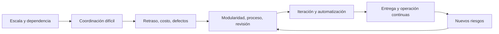
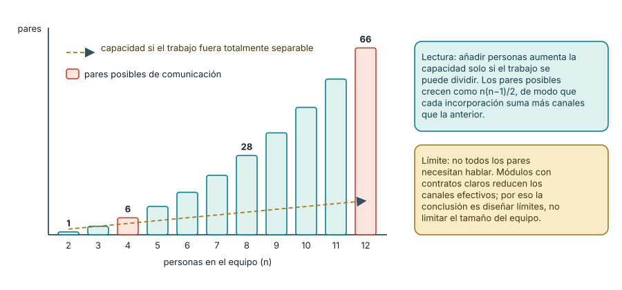
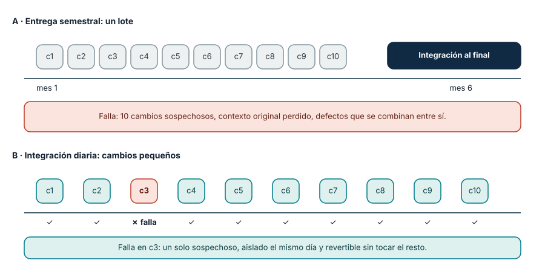
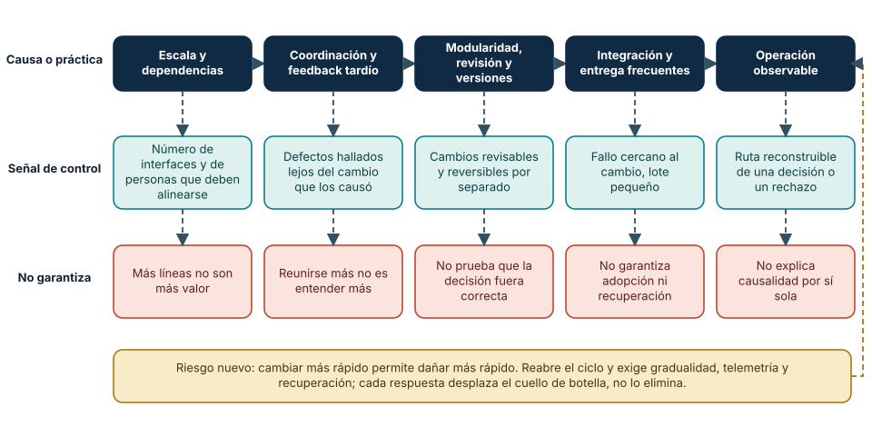

# SE-002 — Historia de la crisis del software a la ingeniería continua

[← SE-001](https://github.com/vladimiracunadev-create/modern-software-engineering-program/blob/main/classes/part-00-ingenieria-de-software-como-profesion/se-001-software-sistemas-y-productos-fronteras-de-la-disciplina/README.md) · [↑ Parte 00](https://github.com/vladimiracunadev-create/modern-software-engineering-program/blob/main/classes/part-00-ingenieria-de-software-como-profesion/README.md) · [📚 Índice completo](https://github.com/vladimiracunadev-create/modern-software-engineering-program/blob/main/classes/README.md) · [SE-003 →](https://github.com/vladimiracunadev-create/modern-software-engineering-program/blob/main/classes/part-00-ingenieria-de-software-como-profesion/se-003-ciclo-de-vida-completo-y-responsabilidades-profesionales/README.md)

## Antes de empezar

En `SE-001` delimitaste Campus Abierto como sistema sociotécnico. Ahora conserva ese
mapa e imagina que pasa de una facultad a veinte, integra nuevos proveedores y cambia
reglas cada semestre. La dificultad no crece solo porque haya más código: aumentan
dependencias, estados posibles, coordinación y costo de corregir tarde.

Esta clase explica **por qué aparecieron las prácticas de ingeniería**. No estudiarás
una cronología para memorizar fechas; construirás una cadena causal que conecte un
problema de escala con una práctica, su señal de control y aquello que no garantiza.
Esa cadena prepara `SE-003`, donde distribuiremos responsabilidad durante el ciclo de
vida completo.

## Prerrequisitos

Comprender componente, sistema y producto (`SE-001`).

## Problema auténtico

Un equipo adopta microservicios, CI o IA porque son modernos. Sin conocer el problema histórico que intentan resolver, conserva las causas originales y añade complejidad. La historia debe explicar mecanismos, no celebrar una cronología.

## Objetivos observables

Explicarás la llamada crisis del software, relacionarás escala con coordinación y defectos, distinguirás una práctica de una garantía y construirás una cadena causal hasta la ingeniería continua.

## Temas y por qué importan

| Tema | Pregunta de control |
| --- | --- |
| Crisis | ¿qué dejó de escalar? |
| Ingeniería | ¿qué hace observables decisiones y calidad? |
| Iteración | ¿cómo reduce el costo de aprender? |
| Continuidad | ¿cómo se controla el cambio frecuente? |

## Mapa conceptual

Cada respuesta desplaza el cuello de botella. Automatizar compilación no aclara requisitos; desplegar rápido no garantiza recuperación.

## Conceptos y decisiones

### 1. La “crisis” nombra causas persistentes, no una anécdota cerrada

Las conferencias de la OTAN de 1968 y 1969 reunieron problemas ya visibles en
proyectos grandes: resultados tardíos, estimaciones frágiles, interfaces mal
entendidas, dificultad para verificar y costos de mantenimiento. El valor histórico no
está en atribuir a una reunión el nacimiento exacto de la ingeniería de software, sino
en reconocer un cambio de escala. Técnicas que funcionaban para programas pequeños y
equipos próximos dejaban de ofrecer control cuando crecían tamaño, impacto y número de
personas involucradas.

“Crisis del software” tampoco significa que todo proyecto fracasaba ni que el problema
quedó resuelto. Cada generación amplía lo que puede construir y crea nuevas
dependencias. Hoy automatizamos compilación y despliegue, pero operamos cadenas de
suministro, servicios de terceros y sistemas que cambian mientras están en uso. La
pregunta profesional sigue siendo la misma: ¿cómo convertir trabajo invisible e
incierto en decisiones observables y corregibles?

### 2. Por qué la complejidad crece más rápido que el número de líneas

Añadir una función no suma solo su código. Introduce estados, interacciones y
excepciones. Si Campus Abierto integra veinte facultades, cada una puede aportar
calendarios, reglas y autoridades diferentes. Las combinaciones posibles aumentan y el
conocimiento se reparte entre personas. Un cambio local puede contradecir una regla
remota aunque ambas piezas funcionen por separado.

Hay al menos cuatro mecanismos distintos:

- **complejidad del dominio:** las reglas reales contienen excepciones y cambian;
- **complejidad técnica:** componentes y estados interactúan de formas no evidentes;
- **complejidad de coordinación:** personas necesitan alinear vocabulario, decisiones
  y tiempos;
- **demora de retroalimentación:** un error descubierto meses después exige reconstruir
  contexto y deshacer decisiones dependientes.

Contratar más personas puede aumentar capacidad cuando el trabajo es separable. En una
tarea muy acoplada también añade canales de coordinación y no recupera de inmediato el
conocimiento faltante. La conclusión no es “equipos pequeños siempre”, sino diseñar
límites, contratos y feedback acordes al acoplamiento real.

**Cómo leer la figura.** Las barras cuentan los pares de personas que *podrían* necesitar
alinearse: con dos personas hay uno, con cuatro seis y con doce sesenta y seis. La línea
discontinua representa lo que se ganaría si cada persona aportara capacidad independiente
de las demás. La distancia entre ambas es el costo potencial de coordinación; es una cota
superior, la formulación matemática detrás de la llamada ley de Brooks (ver la fuente de
Brooks al final). **Dónde deja de valer:** asume que todos los pares podrían interactuar. En un
sistema modular con contratos estables, la mayoría de esos pares nunca necesita hablar, y
por eso el diseño de límites cambia la curva real. Tampoco mide el costo de *no* coordinar:
interfaces incompatibles descubiertas tarde.

### 3. Una práctica de ingeniería actúa sobre un mecanismo concreto

El control de versiones conserva una secuencia de cambios y permite comparar o
recuperar estados; no explica por qué una decisión era correcta. La modularidad reduce
lo que debe comprenderse simultáneamente si sus límites corresponden a responsabilidades
cohesivas; aplicada arbitrariamente, multiplica interfaces. La revisión aporta otra
perspectiva y transmite conocimiento; no reemplaza pruebas ni elimina sesgos compartidos.

La integración continua reduce el tiempo durante el cual cambios compatibles por
separado pueden divergir. Requiere integrar realmente con frecuencia y ejecutar
verificaciones útiles: un servidor llamado “CI” que corre una prueba irrelevante una
vez por semana no produce el mecanismo. La entrega continua mantiene el producto en
estado desplegable; el despliegue continuo además publica cambios que superan el flujo.
Ninguno garantiza adopción, valor o recuperación.

La observabilidad convierte estados internos en señales que ayudan a formular
explicaciones durante operación. Logs sin contexto, métricas sin relación con una
decisión o trazas que exponen datos sensibles pueden aumentar costo sin reducir
incertidumbre. La práctica vale por la pregunta que permite responder a tiempo.

### 4. Iterar cambia el costo del aprendizaje, no la obligación de pensar

Un plan predictivo busca reducir incertidumbre antes de comprometer recursos; resulta
razonable cuando el cambio físico o regulatorio es costoso y existe conocimiento
suficiente. Un enfoque iterativo construye incrementos para obtener feedback cuando el
problema o la solución aún son inciertos. Ambos son estrategias de riesgo, no bandos
morales.

Iterar mal significa fraccionar la construcción sin validar supuestos: doce sprints
pueden producir el mismo gran lote de aprendizaje al final. Predecir mal significa
convertir el plan en promesa y ocultar información nueva para aparentar cumplimiento.
La pregunta útil es qué incertidumbre se resolverá, con qué incremento, ante quién y
qué decisión cambiará como resultado.

### 5. De entregar una versión a sostener un flujo de cambio

La ingeniería continua acorta los bucles entre especificar, construir, verificar,
liberar, observar y aprender. No elimina controles; procura que actúen mientras todavía
es barato corregir. Cambios pequeños facilitan aislar causas y revertir, siempre que
datos, contratos y operación sean también compatibles con la reversión.

Al reducir el tamaño de lote aparece un riesgo nuevo: hacer daño más rápido. Por eso
frecuencia necesita pruebas relevantes, revisión proporcional, despliegue gradual,
telemetría, límites y recuperación. “Más despliegues” es una medida de actividad. La
capacidad profesional es cambiar con una exposición controlada y aprender del resultado.

**Cómo leer la figura.** El carril A acumula diez cambios durante meses y los integra juntos;
cuando algo falla, hay diez sospechosos y varios pueden interactuar entre sí. El carril B
integra cada cambio el mismo día; el fallo aparece junto a c3 y se aísla o revierte sin tocar
los demás. La diferencia no es la velocidad de escritura sino la *distancia entre causa y
descubrimiento*. **Dónde deja de valer:** el carril B supone que cada cambio es reversible
de forma independiente. Una migración de datos o un cambio de contrato público no lo es, y
ahí el tamaño pequeño del cambio no sustituye al ensayo, al respaldo ni a la coordinación.

## Caso conductor: de una facultad a veinte

Campus Abierto comenzó con una regla de elegibilidad, una base de datos y dos personas
que hablaban a diario. Al crecer, cada facultad añade reglas y calendarios; identidad y
pagos cambian por separado; una entrega semestral reúne cientos de cambios. El fallo no
es simplemente “mucho código”: las incompatibilidades se descubren cuando el contexto
original ya se perdió.

La respuesta se diseña por cadena causal:

| Causa observable | Práctica candidata | Señal temprana | Lo que no garantiza |
| --- | --- | --- | --- |
| reglas contradictorias entre facultades | vocabulario y contratos versionados | prueba de ejemplo incompatible | que la regla sea justa o útil |
| cambios divergen durante meses | integración frecuente | fallo cercano al cambio | que producción sea recuperable |
| gran lote hace difícil aislar causa | cambios pequeños y trazables | regresión asociada a un cambio | ausencia de efectos combinados |
| operación no puede explicar un rechazo | eventos con contexto y privacidad | ruta reconstruible de la decisión | causalidad automática |

**Cómo leer la figura.** Cada columna une una causa o práctica con dos preguntas: qué señal
observable permite saber si está funcionando y qué cosa concreta *no* garantiza. La fila
inferior importa tanto como la superior: una práctica sin límite declarado se vuelve
dogma. La flecha punteada del extremo derecho recuerda que la entrega frecuente crea su
propio riesgo (dañar más rápido), de modo que la cadena es un ciclo y no una escalera hacia
un estado final. **Dónde deja de valer:** las cinco etapas están ordenadas por claridad, no
por una cronología rígida; muchas organizaciones adoptaron la integración frecuente antes que
la modularidad, y otras operan con observabilidad pero sin revisión estructurada.

El estudiante elige una cadena, identifica el supuesto que la sostiene y define un
caso que obligaría a abandonarla. La historia se convierte así en instrumento de
diseño, no en una lista de fechas.

## Definiciones de trabajo

- **crisis del software:** dificultad persistente para entregar y evolucionar software confiable bajo restricciones;
- **retroalimentación:** información que llega a tiempo para modificar una decisión;
- **integración continua:** integrar y verificar cambios con frecuencia;
- **ingeniería continua:** especificar, construir, observar y corregir de forma sostenida.

## Glosario

**Lote** es un grupo grande de cambios validado tarde. **Lead time** mide desde petición hasta disponibilidad. **Deuda** es costo futuro creado por una decisión, no sinónimo de código viejo.

## Ejemplo mínimo

Dos personas editan copias durante un mes. Cada copia funciona; al unirlas, discrepan interfaces. Probar al final detecta el defecto, pero no reduce el mes de divergencia. Integrar diariamente con prueba de contrato cambia el momento del aprendizaje.

## Ejemplo profesional

Una institución pasa de dos entregas anuales a despliegues semanales. Una migración irreversible sigue exigiendo ensayo, respaldo y coordinación. Frecuencia no elimina diferencias de riesgo.

## Práctica guiada

Crea `timeline.md` con cinco hitos: problema, respuesta, evidencia, límite y riesgo nuevo. Analiza una práctica actual en `causal-chain.md`: señal que recibe, demora que reduce y garantía que no ofrece.

## Ejercicios

1. Explica por qué añadir personas puede retrasar trabajo acoplado.
2. Da un caso donde desplegar menos sea responsable.
3. Distingue qué resuelven Git, CI y feature flags.

## Reto verificable

Defiende una práctica sin usar «moderna» ni «mejor práctica»: conecta causa, mecanismo, señal y límite. Otra persona debe poder refutarla cambiando una condición.

## Preguntas frecuentes

### ¿La crisis terminó?
No. Mejoraron capacidades y crecieron escala e impacto. Debe indicarse qué riesgo está controlado.

### ¿DevOps es el final?
No. Reduce separación entre construcción y operación, pero puede acelerar daño sin controles.

### ¿La ley de Brooks dice que añadir personas siempre retrasa un proyecto?

No. Brooks formuló la observación para proyectos *ya retrasados* con trabajo muy acoplado,
donde incorporar personas exige formarlas y añade canales de coordinación. En trabajo
separable, más personas sí aumentan capacidad. La lección es examinar el acoplamiento
antes de decidir, no memorizar una regla.

### ¿Los costos de corregir un defecto crecen siempre de forma exponencial con el tiempo?

Es una afirmación muy repetida y discutida: los datos históricos son heterogéneos y dependen
del tipo de defecto y del contexto. Aquí solo se sostiene lo que la clase puede mostrar: un
defecto hallado lejos de su causa exige reconstruir contexto y deshacer decisiones
dependientes. Usa mediciones propias de tu entorno antes de citar un multiplicador.

### ¿Esto significa que conviene siempre integrar y desplegar más a menudo?

No. Significa que debes conocer el costo de cada incertidumbre y elegir el ritmo que permite
aprender sin exponer a un daño irreversible. Una migración regulada puede ser un caso donde
menos cambios, mejor ensayados, sean la decisión profesional.

## Fallo controlado y diagnóstico

En un repositorio de práctica crea una función pequeña con una prueba. Introduce diez
modificaciones triviales (renombrar una variable, ajustar un mensaje, cambiar un límite) y
oculta entre ellas una que rompa la prueba. **Rama A:** entrega las diez en un solo commit y
pide a otra persona que encuentre la causa leyendo el diff; cronometra. **Rama B:** crea diez
commits pequeños en secuencia y localiza el defecto con `git bisect`, que realiza búsqueda
binaria sobre el historial (documentada en el manual de Git). Registra tiempo, número de
hipótesis descartadas y si la persona necesitó reconstruir contexto.

El síntoma esperado es que la rama B localice la causa en un número logarítmico de pasos
(unos cuatro para diez commits) y que la rama A obligue a leer todo. Si no ocurre, el
diagnóstico cambia: quizá los commits de B no eran independientes (un cambio dependía de
otro) o la prueba no cubre el comportamiento roto. Ambas conclusiones son resultados válidos
y enseñan más que la confirmación de la hipótesis. Solo usa un repositorio desechable.

## Errores comunes y cómo corregirlos

| Síntoma | Causa | Corrección |
| --- | --- | --- |
| “antes se usaba cascada; ahora Agile” | relato binario sin mecanismo ni contexto | compara incertidumbre, costo de cambio y feedback de cada estrategia |
| una herramienta aparece como solución | se confundió instalación con práctica | declara conducta, frecuencia, señal y decisión que habilita |
| CI “garantiza calidad” | se atribuyó a la práctica más de lo que observa | enumera verificaciones reales y aquello que queda fuera |
| velocidad es el único resultado | se midió actividad en vez de riesgo o valor | incorpora estabilidad, recuperación, adopción e impacto |
| la cronología termina en DevOps | se presentó una moda como destino final | documenta nuevos riesgos y el siguiente cuello de botella |

## Entorno y archivos clave

Markdown e historial Git local: `timeline.md`, `causal-chain.md`, `comparison.md`.

## Seguridad, ética y accesibilidad

No uses commits por persona como productividad: incentiva volumen y daña colaboración. La velocidad no justifica omitir revisión de impactos.

## Puente hacia el trabajo con agentes

La IA generativa reproduce el problema histórico a una escala nueva: puede producir en
minutos un cambio de cientos de líneas. Si ese cambio llega como un único lote, el cuello de
botella deja de ser escribir y pasa a ser revisar, probar y comprender, es decir, el carril A
de la figura 3. Las prácticas de esta clase se vuelven restricciones para trabajar con
agentes: cambios pequeños con un objetivo verificable, ejecución automática de pruebas
tras cada paso y reversión sencilla. La señal que decide si un cambio de un agente se acepta
sigue siendo la misma que para un humano: verificación cercana al cambio, no la confianza en
quien lo escribió. Las partes dedicadas a harness y agentic engineering desarrollan este
punto.

## Transferencia

Aplica la cadena a datos o firmware e identifica feedback automatizable y feedback físico o humano.

## Evaluación y evidencia

Se evalúan causalidad, un contraejemplo y límites. Una cronología sin mecanismos no aprueba.

## Fuentes

- [NATO Software Engineering, 1968](https://homepages.cs.ncl.ac.uk/brian.randell/NATO/nato1968.PDF), informe primario.
- [Fifty Years of Software Engineering](https://eprints.ncl.ac.uk/247869), retrospectiva de Brian Randell.
- [SWEBOK v4.0a](https://www.computer.org/education/bodies-of-knowledge/software-engineering/v4), mapa contemporáneo.
- [ISO/IEC/IEEE 12207:2026](https://www.iso.org/standard/90219.html), procesos sin imponer metodología.
- Frederick P. Brooks Jr., *The Mythical Man-Month*, edición aniversario (Addison-Wesley, ISBN 978-0-201-83595-3): origen de la observación sobre coordinación y plazos; respalda la figura 1.
- [Documentación de `git bisect`](https://git-scm.com/docs/git-bisect): describe la búsqueda binaria sobre el historial usada en el fallo controlado.
- Nicole Forsgren, Jez Humble y Gene Kim, *Accelerate* (IT Revolution, ISBN 978-1-942788-33-1): evidencia sobre cambios pequeños y frecuentes en relación con estabilidad; debe leerse con su metodología de encuestas.

## Límites y siguiente paso

No se demuestra que una práctica funcione en todo contexto. `SE-003` convierte la historia en responsabilidades de ciclo de vida.

---

[← SE-001](https://github.com/vladimiracunadev-create/modern-software-engineering-program/blob/main/classes/part-00-ingenieria-de-software-como-profesion/se-001-software-sistemas-y-productos-fronteras-de-la-disciplina/README.md) · [↑ Parte 00](https://github.com/vladimiracunadev-create/modern-software-engineering-program/blob/main/classes/part-00-ingenieria-de-software-como-profesion/README.md) · [SE-003 →](https://github.com/vladimiracunadev-create/modern-software-engineering-program/blob/main/classes/part-00-ingenieria-de-software-como-profesion/se-003-ciclo-de-vida-completo-y-responsabilidades-profesionales/README.md)
