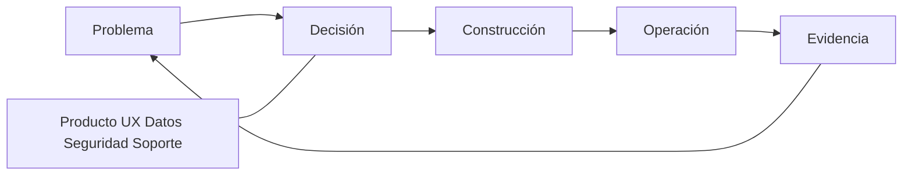
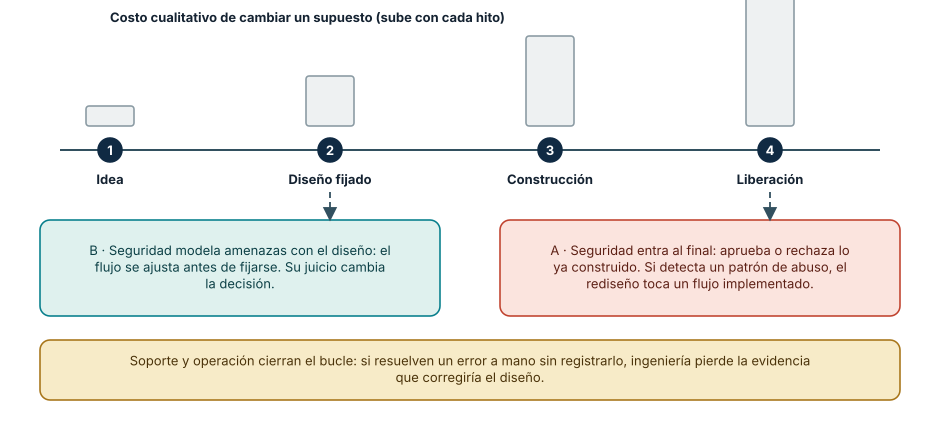
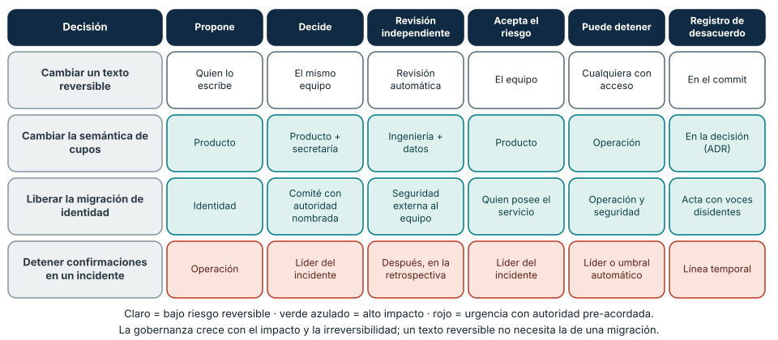
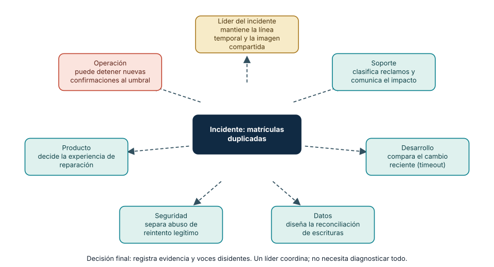

# SE-005 — Roles, especialidades y colaboración interdisciplinaria

[← SE-004](https://github.com/vladimiracunadev-create/modern-software-engineering-program/blob/main/classes/part-00-ingenieria-de-software-como-profesion/se-004-etica-interes-publico-y-consecuencias-de-las-decisiones-tecnicas/README.md) · [↑ Parte 00](https://github.com/vladimiracunadev-create/modern-software-engineering-program/blob/main/classes/part-00-ingenieria-de-software-como-profesion/README.md) · [📚 Índice completo](https://github.com/vladimiracunadev-create/modern-software-engineering-program/blob/main/classes/README.md) · [SE-006 →](https://github.com/vladimiracunadev-create/modern-software-engineering-program/blob/main/classes/part-00-ingenieria-de-software-como-profesion/se-006-evidencia-incertidumbre-y-pensamiento-critico-en-ingenieria/README.md)

## Antes de empezar

El análisis ético de `SE-004` identificó voces que una decisión técnica no puede
ignorar. Ahora debes incorporarlas al trabajo sin convertir cada decisión en una
reunión masiva. Campus Abierto sufre un incidente: soporte ve síntomas, datos detecta
un patrón, seguridad limita accesos y desarrollo conoce el cambio reciente, pero la
información no cruza las fronteras organizativas.

Diseñarás una red de autoridad, consulta, evidencia y escalamiento. El producto de la
clase no será un organigrama, sino interfaces de colaboración que puedan funcionar
bajo presión. `SE-006` preguntará cómo esas personas distinguen convicción de evidencia
cuando deben escoger una explicación.

## Prerrequisitos

Responsabilidad y juicio profesional de `SE-003`–`SE-004`.

## Problema auténtico

Un incidente pasa entre desarrollo, datos, seguridad y soporte. Todos participaron, nadie tenía la imagen completa y cada equipo optimizó su métrica. Nombrar más roles no repara interfaces de colaboración.

## Objetivos observables

Relacionarás roles con decisiones, diseñarás transferencias y revisiones, distinguirás especialización de silo y crearás una matriz de autoridad.

## Temas y por qué importan

| Área | Pregunta |
| --- | --- |
| Producto | ¿qué resultado y para quién? |
| Diseño/UX | ¿qué tarea y contexto? |
| Ingeniería | ¿qué comportamiento y cambio? |
| Calidad/seguridad | ¿qué riesgo y evidencia? |
| Operación/soporte | ¿qué ocurre realmente? |

## Mapa conceptual

Los roles aportan perspectivas al mismo bucle; no son etapas que lanzan trabajo sobre una pared.

## Conceptos y decisiones

### 1. Rol, especialidad, responsabilidad y cargo no son equivalentes

Un **rol** agrupa responsabilidades necesarias en un contexto: quien facilita una
retrospectiva o responde por un servicio puede cambiar sin que cambie su cargo. Una
**especialidad** expresa profundidad de conocimiento y juicio. La **responsabilidad**
se refiere a un resultado; la **autoridad**, a la capacidad legítima de decidir. Un
cargo organizativo puede combinar varios roles o no describirlos con precisión.

Separar estos conceptos evita diseñar el trabajo alrededor de títulos. Campus Abierto
necesita que alguien decida semántica de cupos, que una persona competente revise
privacidad y que operación pueda detener una liberación. No necesita necesariamente
tres departamentos con esos nombres. En un equipo pequeño una persona puede usar
varios “sombreros”, pero los conflictos y las competencias siguen existiendo y deben
declararse.

### 2. Especialización aporta profundidad; el silo interrumpe el aprendizaje

Un especialista puede reconocer modos de fallo invisibles para un generalista. El
problema aparece cuando su conocimiento entra tarde como aprobación o cuando una señal
no puede cruzar el límite del equipo. Si seguridad conoce un patrón de abuso, pero solo
revisa al final, el diseño ya puede depender de supuestos costosos de cambiar. Si
soporte resuelve manualmente el mismo error sin registrarlo, ingeniería pierde evidencia
del comportamiento real.

La alternativa no es que todas las personas hagan todo. Se diseñan momentos y
artefactos donde la especialidad cambia la decisión: modelado de amenazas antes de
fijar el flujo, revisión de accesibilidad con prototipo, criterios operativos antes de
desplegar y feedback de soporte después. La colaboración efectiva conserva profundidad
y hace permeable el conocimiento relevante.

**Cómo leer la figura.** Las barras grises sugieren, de forma cualitativa, que cambiar un
supuesto cuesta más a medida que el diseño se fija y se construye. En el carril B, seguridad
modela amenazas cuando el flujo todavía es maleable y su conocimiento *cambia la decisión*.
En el carril A, la misma persona, con el mismo conocimiento, solo puede aprobar o rechazar lo
construido: la especialidad existe, pero entró cuando ya no podía influir sin rehacer. La
franja inferior recuerda el otro extremo del silo: la señal que nunca llega a ingeniería.
**Dónde deja de valer:** la altura de las barras no es una medición; es una intuición ordenada que
cada equipo debe calibrar con su propio historial de retrabajo. Además, adelantar una
especialidad no la sustituye: una revisión final sigue siendo necesaria para lo que cambió
durante la construcción.

### 3. Las interfaces de colaboración también se diseñan

Una reunión no garantiza colaboración. Puede reunir perspectivas sin producir una
decisión, ocultar desacuerdo o excluir a quien no comparte horario o idioma. Una
interfaz de trabajo saludable declara:

- qué información o artefacto recibe;
- qué pregunta debe responder y con qué competencia;
- qué salida y criterio de aceptación produce;
- en qué plazo y por qué canal;
- qué ocurre si falta evidencia o existe desacuerdo;
- quién posee la decisión final y quién puede escalar.

El contrato no busca burocracia, sino reducir espera y reproceso. Puede ser una tabla
breve en una decisión, una prueba de contrato, un runbook o una revisión asincrónica.
Debe ajustarse al riesgo: cambiar un texto reversible no requiere la gobernanza de una
migración de identidad.

### 4. Derechos de decisión y revisión independiente

RACI ayuda a visualizar quién responde, ejecuta, consulta y recibe información, pero
no resuelve por sí solo cómo se decide. Una matriz puede contener una “A” sin tiempo,
competencia o acceso a evidencia. Conviene añadir quién propone, quién acepta el riesgo,
quién puede detener y cómo se conserva el desacuerdo.

La revisión independiente aporta una perspectiva menos comprometida con la autoría.
No significa desconocimiento ni neutralidad absoluta. La persona revisora necesita
contexto y autoridad para cuestionar. En equipos pequeños, si la misma persona propone
y revisa, se limita el alcance, se buscan criterios automatizados o revisión externa y
se registra la limitación. A mayor impacto e irreversibilidad, más importante es separar
incentivos.

**Cómo leer la figura.** Las filas van de menor a mayor impacto y urgencia. Cambiar un texto
reversible lo decide el propio equipo con una revisión automática; liberar una migración de
identidad separa quien propone, quien decide, quien revisa de forma independiente y quien
acepta el riesgo, y registra el desacuerdo. La última fila muestra una excepción
legítima: en un incidente la autoridad de parada está pre-acordada para actuar rápido, y la
revisión ocurre después. **Dónde deja de valer:** los nombres de rol son ilustrativos. Lo que
debe sobrevivir al traslado a otra organización es el principio: la gobernanza es
proporcional al riesgo, y cada dimensión tiene un propietario que existe antes del conflicto.

### 5. Colaborar bajo presión requiere protocolos previos

Durante un incidente no hay tiempo para descubrir quién posee una dependencia o qué
canal es confiable. El protocolo define liderazgo operativo, registro temporal,
comunicación, especialistas convocables y autoridad para mitigar. La persona que
coordina no necesita diagnosticar todo; mantiene una imagen compartida y evita cambios
contradictorios.

Una retrospectiva posterior analiza condiciones, no culpabilidad individual. Pregunta
qué información faltó, qué interfaz retrasó y qué protección habría reducido el daño.
Si solo concluye “comunicar mejor”, no ha diseñado ninguna mejora verificable.

## Caso conductor: incidente de matrículas duplicadas

Soporte recibe reclamos; datos detecta escrituras repetidas; seguridad observa
reintentos desde sesiones legítimas; desarrollo recuerda un cambio de timeout. Cada
equipo posee una parte y puede equivocarse si actúa aislado. Bloquear cuentas reduce
duplicados, pero daña a personas; revertir código puede no revertir escrituras.

La red de colaboración asigna: soporte clasifica y comunica impacto; una persona lidera
el incidente y conserva la línea temporal; desarrollo compara el cambio; datos diseña
reconciliación; seguridad diferencia abuso de reintento; producto decide la experiencia
de reparación. Operación puede detener nuevas confirmaciones si cruza el umbral
acordado. La decisión final registra evidencia y voces disidentes.

El flujo no termina al restaurar el servicio. Las personas afectadas reciben estado y
corrección; el contrato de idempotencia cambia; la señal de duplicado entra al tablero;
y el mapa de decisiones se actualiza. Así la colaboración produce aprendizaje y no
solo coordinación momentánea.

**Cómo leer la figura.** No hay jerarquía: el nodo central es el incidente y cada rol aporta
una pieza que los demás no ven. El líder conserva la línea temporal y la imagen compartida
(no diagnostica todo); soporte, desarrollo, datos y seguridad contribuyen evidencia distinta;
producto decide la experiencia de reparación; operación puede detener nuevas confirmaciones
al cruzarse un umbral acordado *antes* del incidente. **Dónde deja de valer:** la figura
omite el tiempo. En un incidente real las aportaciones llegan en desorden, hay información
contradictoria y personas que cambian de turno; por eso el protocolo previo y el registro
temporal importan más que el diagrama.

## Definiciones de trabajo

- **rol:** conjunto contextual de responsabilidades;
- **especialidad:** profundidad para emitir juicio en un dominio;
- **handoff:** transferencia de trabajo y contexto con aceptación;
- **revisión independiente:** evaluación sin autoría directa ni incentivo dominante;
- **escalamiento:** traslado explícito a autoridad capaz de decidir.

## Glosario

**Bus factor** mide concentración de conocimiento. **Team topology** describe límites e interacción de equipos. **Facilitación** estructura participación sin apropiarse de la decisión.

## Ejemplo mínimo

«Backend entrega endpoint» es insuficiente. Un contrato útil incluye semántica, errores, privacidad, ejemplos, compatibilidad y persona que acepta.

## Ejemplo profesional

En recuperación de cuenta, producto define resultado, UX diseña prueba comprensible, seguridad modela abuso, soporte aporta casos y plataforma implementa identidad. La decisión sobre fricción pertenece al conjunto porque reduce fraude y puede excluir usuarios.

## Práctica guiada

Crea `decision-map.md` con diez decisiones y roles que proponen, deciden, revisan y operan. Modela un handoff y realiza una revisión con una perspectiva ausente.

## Ejercicios

1. Convierte un organigrama en mapa de decisiones.
2. Detecta un rol con responsabilidad sin autoridad.
3. Diseña colaboración asincrónica para dos zonas horarias.

## Reto verificable

Simula un incidente: otra persona debe encontrar dueño, experto, autoridad de parada y canal de comunicación en menos de tres minutos.

## Preguntas frecuentes

### ¿Quién tiene la última palabra?
Depende de la decisión. Debe declararse antes del conflicto y respetar obligaciones profesionales.

### ¿Un generalista reemplaza especialistas?
No en riesgos que requieren competencia profunda; sí puede mejorar interfaces y visión sistémica.

### ¿La ley de Conway implica que debo reorganizar el equipo para cambiar la arquitectura?

Conway observó que las organizaciones tienden a producir diseños que copian su estructura de
comunicación. Es una tendencia, no un mandato. Sirve para detectar que una frontera técnica
difícil de mantener quizá refleja una frontera de equipo, y que cambiar una exige considerar
la otra. No obliga a reorganizar por reflejo.

### ¿Cuántas personas debe tener una decisión de alto riesgo?

Las necesarias para cubrir competencia, autoridad y revisión independiente, no un número
fijo. Más personas sin interfaz clara añaden espera. Es preferible pocas personas con papeles
explícitos que un comité donde nadie acepta el riesgo.

### ¿Cómo colaboro con alguien en otra zona horaria sin reuniones constantes?

Con artefactos asincrónicos completos: una decisión escrita con contexto, opciones, plazo
y criterio de aceptación; un canal acordado y una ventana de solapamiento reservada para
desacuerdos que el texto no resuelve. La excepción son los incidentes, donde se pre-acuerda
quién actúa cuando alguien duerme.

## Fallo controlado y diagnóstico

Entre dos personas (o dos roles que interpretas en momentos distintos) elige un artefacto
pequeño, por ejemplo la especificación de un endpoint de consulta de cupos. **Ronda 1:** la
persona emisora entrega el artefacto con la frase «ya está» y sin criterio de aceptación;
la receptora lo implementa. Registra espera, preguntas de aclaración, reproceso y diferencias
entre lo que ambas creían acordado. **Ronda 2:** repite con una interfaz explícita (entrada,
pregunta que debe responder, salida, criterio de aceptación, plazo, canal y qué hacer si falta
evidencia). **Síntoma esperado:** la ronda 1 produce reproceso y malentendidos de
semántica, errores y privacidad. **Causa:** la interfaz de colaboración estaba implícita.
**Corrección:** mejorar la interfaz, no culpar a quien recibió. Compara tiempos y errores en
ambas rondas y registra qué parte de la mejora podría deberse al aprendizaje de la segunda
ronda y no al contrato: es una amenaza a tu conclusión, no un detalle.

## Errores comunes y cómo corregirlos

| Síntoma | Causa | Corrección |
| --- | --- | --- |
| el mapa replica cargos | se modeló estructura, no decisiones | parte de decisiones y asigna competencia, autoridad y operación |
| todos son “responsables” | se evitó declarar autoridad | nombra quién acepta, detiene y escala cada decisión |
| más reuniones ante cada fallo | falta una interfaz de información | define entrada, salida, aceptación, plazo y canal asincrónico |
| seguridad o accesibilidad revisan al final | se usan especialidades como gate tardío | incorpora su evidencia antes de fijar decisiones costosas |
| la retrospectiva culpa a quien actuó | se ignoran condiciones del sistema | reconstruye señales, incentivos, límites y protecciones faltantes |

## Entorno y archivos clave

`decision-map.md`, `handoff.md`, `review-log.md`, con nombres de roles ficticios.

## Seguridad, ética y accesibilidad

Evita exponer a personas en retrospectivas; analiza condiciones. Incluye representación de usuarios y canales accesibles.

## Puente hacia el trabajo con agentes

Un agente de IA es un participante nuevo en la red de colaboración, y casi siempre sin rol
declarado. Si no se define su interfaz, ocurre lo mismo que en la figura 1: entra al final como
«quien genera» sin acceso al contexto que cambiaría su salida. Diseñarlo implica las mismas
preguntas que para una persona: qué información recibe, qué pregunta responde, qué salida y
criterio de aceptación produce, cuánto tiempo tiene, qué hace ante falta de evidencia y
quién posee la decisión. La autoridad nunca se delega por defecto: proponer cambios es
distinto de aceptarlos, y detener una acción en curso debe ser posible para una persona
nombrada. Además, un agente no sustituye especialistas con competencia verificable; puede
preparar material para su revisión. Las partes sobre agentes y harness desarrollan estos
contratos con herramientas concretas.

## Transferencia

Adapta el mapa a open source y a una organización regulada; compara autoridad formal e influencia.

## Evaluación y evidencia

Se exige autoridad explícita, interfaces, revisión, manejo de desacuerdo y reducción del bus factor.

## Fuentes

- [SWEBOK v4.0a](https://www.computer.org/education/bodies-of-knowledge/software-engineering/v4), práctica profesional y trabajo en equipo.
- [ACM Code of Ethics](https://www.acm.org/code-of-ethics), competencia, revisión y liderazgo responsable.
- [NASA Software Activities Review](https://swehb.nasa.gov/spaces/7150/pages/16449741/SWE-018+-+Software+Activities+Review), participación de stakeholders y cierre de asuntos.
- Melvin E. Conway, [How Do Committees Invent?](https://www.melconway.com/Home/Committees_Paper.html) (1968): origen de la observación sobre estructura de comunicación y diseño; respalda la pregunta sobre equipos y arquitectura.
- [Google SRE Book: Managing Incidents](https://sre.google/sre-book/managing-incidents/): papeles, comunicación y control durante un incidente; contrasta con la red de la figura 2.
- Matthew Skelton y Manuel Pais, *Team Topologies* (IT Revolution, ISBN 978-1-942788-81-2): interacción entre equipos y carga cognitiva; se estudia con más detalle en la parte de liderazgo.

## Límites y siguiente paso

La matriz no garantiza buenas decisiones. `SE-006` evalúa la calidad de la evidencia con que se decide.

---

[← SE-004](https://github.com/vladimiracunadev-create/modern-software-engineering-program/blob/main/classes/part-00-ingenieria-de-software-como-profesion/se-004-etica-interes-publico-y-consecuencias-de-las-decisiones-tecnicas/README.md) · [↑ Parte 00](https://github.com/vladimiracunadev-create/modern-software-engineering-program/blob/main/classes/part-00-ingenieria-de-software-como-profesion/README.md) · [SE-006 →](https://github.com/vladimiracunadev-create/modern-software-engineering-program/blob/main/classes/part-00-ingenieria-de-software-como-profesion/se-006-evidencia-incertidumbre-y-pensamiento-critico-en-ingenieria/README.md)
