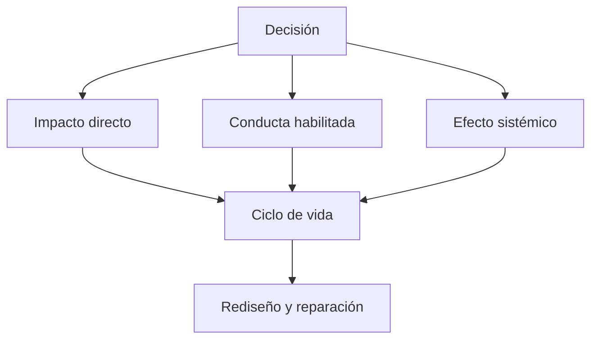
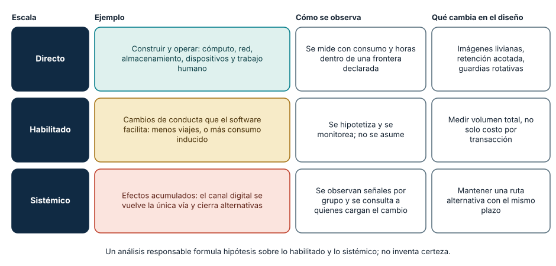
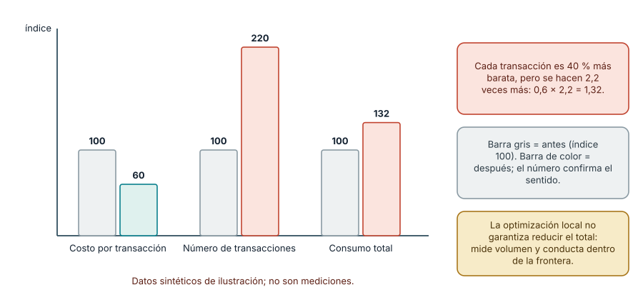
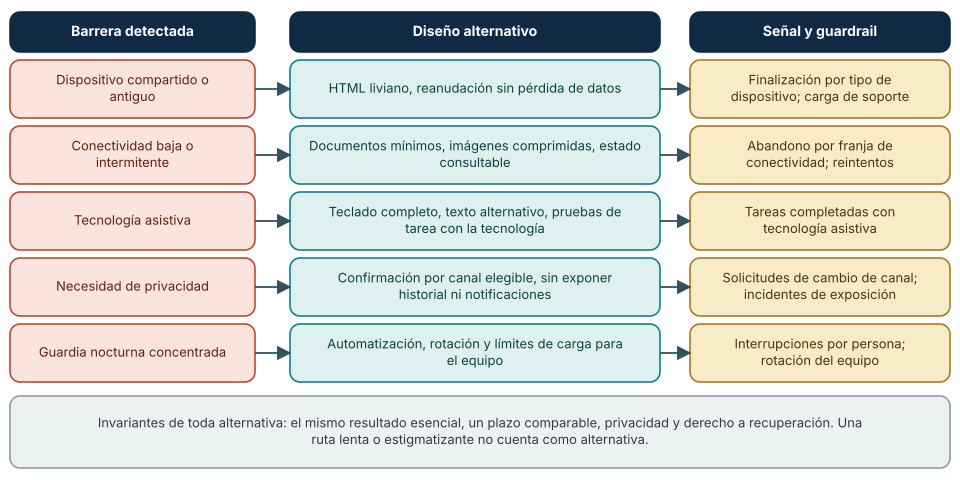

# SE-009 — Sostenibilidad, inclusión y responsabilidad social

[← SE-008](https://github.com/vladimiracunadev-create/modern-software-engineering-program/blob/main/classes/part-00-ingenieria-de-software-como-profesion/se-008-restricciones-riesgos-y-compromisos-entre-atributos/README.md) · [↑ Parte 00](https://github.com/vladimiracunadev-create/modern-software-engineering-program/blob/main/classes/part-00-ingenieria-de-software-como-profesion/README.md) · [📚 Índice completo](https://github.com/vladimiracunadev-create/modern-software-engineering-program/blob/main/classes/README.md) · [SE-010 →](https://github.com/vladimiracunadev-create/modern-software-engineering-program/blob/main/classes/part-00-ingenieria-de-software-como-profesion/se-010-como-leer-estandares-documentacion-y-literatura-tecnica/README.md)

## Antes de empezar

En `SE-008` hiciste visibles ganadores, pérdidas y riesgos de una decisión. Falta mirar
efectos que suelen quedar fuera del sprint. Campus Abierto reduce trámites presenciales,
pero exige dispositivos recientes, transfiere datos innecesarios y concentra guardias
en pocas personas. La mejora local puede crear deuda humana, social o ambiental.

Analizarás impactos directos, habilitados y sistémicos a lo largo del ciclo de vida.
No buscarás una etiqueta de “software verde”, sino alternativas y señales que cambien
el diseño. `SE-010` te dará el método para respaldar estas afirmaciones sin usar una
bibliografía como decoración.

## Prerrequisitos
Stakeholders, ética y trade-offs (`SE-004`, `SE-008`).

## Problema auténtico
Un servicio reduce papel pero obliga a renovar dispositivos, excluye conexiones lentas y conserva datos indefinidamente. «Digital» no equivale a sostenible ni inclusivo.

## Objetivos observables
Analizarás impactos directos, habilitados y sistémicos; diseñarás alternativas inclusivas; conectarás sostenibilidad técnica, humana y ambiental con decisiones de ciclo de vida.

## Temas y por qué importan
| Dimensión | Ejemplos |
| --- | --- |
| Ambiental | energía, hardware, transferencia, residuos |
| Social | acceso, poder, trabajo, comunidades |
| Técnica | mantenibilidad, dependencia, obsolescencia |
| Humana | carga cognitiva, guardias, salud laboral |

## Mapa conceptual

Optimizar consumo por transacción puede aumentar consumo total si el servicio induce más uso: efecto rebote.

## Conceptos y decisiones

### 1. Sostenibilidad pregunta qué capacidad dejamos disponible mañana

Sostener un sistema implica satisfacer una necesidad actual sin degradar de manera
irresponsable la capacidad futura de personas, organizaciones y ambiente. En software
esto incluye energía e infraestructura, pero también mantenibilidad, dependencia,
conocimiento, condiciones laborales, acceso y posibilidad de retirar datos y hardware.
Una solución eficiente durante una demostración puede ser insostenible si requiere
guardias permanentes o un proveedor imposible de sustituir.

Las dimensiones se relacionan. Reducir capacidad del servidor puede bajar consumo y
costo, pero trasladar cómputo y transferencia a dispositivos de personas con menos
recursos. Conservar compatibilidad prolonga vida de hardware y aumenta superficie de
pruebas. La decisión no busca una etiqueta “verde”; declara frontera, período,
beneficiados, cargas y evidencia.

### 2. Impactos directos, habilitados y sistémicos

El impacto **directo** procede de construir y operar: cómputo, red, almacenamiento,
dispositivos y trabajo. El impacto **habilitado** aparece cuando el software cambia una
conducta, como sustituir viajes o inducir más consumo. El impacto **sistémico** surge de
adopción acumulada, incentivos o cambios institucionales, por ejemplo convertir el
canal digital en única vía y cerrar alternativas presenciales.

Optimizar una transacción no garantiza reducir el total. Si hacerla más barata aumenta
mucho la demanda, ocurre un efecto rebote. Tampoco todo efecto de segundo orden puede
predecirse: se formulan hipótesis, se monitorean señales y se conserva capacidad de
corregir. El análisis responsable no inventa certeza sobre sistemas sociales.

**Cómo leer la figura.** Cada fila amplía la frontera: lo directo se mide dentro de lo que
construyes y operas; lo habilitado exige hipótesis sobre cómo cambia la conducta de las
personas; lo sistémico solo se ve con señales acumuladas y con la voz de quienes cargan el
cambio. La última columna evita que el análisis termine en una lista de preocupaciones: cada
escala debe cambiar una decisión de diseño concreta. **Dónde deja de valer:** las tres
escalas no son compartimentos. Un efecto sistémico (cerrar la atención presencial) puede
nacer de una decisión directa (optimizar costos de soporte), y los límites entre ellas
dependen de la frontera de análisis que se haya declarado.

**Cómo leer la figura.** Cada transacción es un 40 % más barata (índice 60), pero el servicio
se vuelve tan conveniente que se realizan 2,2 veces más (índice 220). El producto de ambos,
0,6 × 2,2 = 1,32, indica que el consumo total *sube*. Es el efecto rebote: una eficiencia
local que no basta para reducir el total. **Dónde deja de valer:** los números son sintéticos
y ejemplifican el mecanismo; no afirman que toda optimización genere rebote. Que ocurra o no
depende de la elasticidad de la demanda, algo que debe observarse en el contexto concreto
y no suponerse en ninguna dirección.

### 3. Accesibilidad, inclusión y equidad no son intercambiables

La accesibilidad elimina barreras para personas con discapacidades y contextos
diversos; WCAG aporta criterios verificables para contenido web, pero su cumplimiento
no demuestra que el servicio completo sea inclusivo. La inclusión pregunta quién puede
participar con dignidad y alcanzar el resultado. La equidad observa si reglas y apoyos
consideran desigualdades relevantes en vez de ofrecer formalmente lo mismo.

Una interfaz compatible con teclado puede seguir excluyendo si el trámite exige video
en vivo, conectividad estable, lenguaje experto o respuesta en horario laboral. Diseñar
una alternativa no significa crear una ruta lenta y estigmatizante. Debe conservar el
resultado esencial, plazo comparable, privacidad y derecho a recuperación.

Las dimensiones también interactúan con seguridad. Una persona en contexto de
violencia puede necesitar ocultar historial o notificaciones. Un canal “conveniente”
puede exponerla. Por eso contexto de uso incluye entorno social, no solo navegador y
resolución.

### 4. Ciclo de vida ambiental y técnico

La huella no se limita al servidor durante ejecución. Incluye fabricación y renovación
de dispositivos, transferencia, almacenamiento, copias, entrenamiento o inferencia si
aplica, y retiro. Sin datos comparables no se atribuyen cifras: se identifica qué medir,
con qué frontera y qué decisión cambiaría.

La sostenibilidad técnica considera que el software pueda entenderse, adaptarse y
retirarse. Dependencias sin mantenimiento, formatos cerrados y conocimiento concentrado
crean obsolescencia. Mantener todo indefinidamente tampoco es sostenible: aumenta
costo, exposición y carga cognitiva. Políticas de versión, migración y retiro equilibran
continuidad con reducción de legado.

### 5. Trabajo y organización forman parte del sistema

Una automatización puede reducir tarea repetitiva y simultáneamente trasladar
excepciones difíciles a personas con menos tiempo y apoyo. Las guardias concentradas,
interrupciones continuas y metas incompatibles degradan la capacidad futura del equipo.
La calidad de vida laboral no es un beneficio accesorio: afecta errores, rotación y
conocimiento operacional.

Responsabilidad social pregunta quién obtiene valor, quién absorbe costo y quién puede
participar en decidir. Escenarios creados por el equipo son un inicio, no representación
auténtica de comunidades. Cuando una decisión afecta materialmente a un grupo, se
necesitan investigación, consentimiento y canales de participación apropiados.

## Caso conductor: una matrícula “solo digital”

Campus Abierto propone eliminar atención presencial porque la tasa global de uso web es
alta. El análisis descubre hogares con dispositivo compartido, zonas de baja
conectividad, personas que usan tecnología asistiva y estudiantes que necesitan
privacidad. Además, el nuevo flujo carga imágenes pesadas, conserva documentos sin
plazo y exige guardia nocturna durante cada período.

La alternativa combina HTML liviano, reanudación sin pérdida, documentos mínimos,
confirmación por canal elegible y atención asistida con el mismo plazo. Se prueba el
resultado completo, no solo la conformidad de la interfaz. Datos temporales tienen
retención declarada; métricas segmentadas observan finalización y carga sin crear
vigilancia excesiva; las guardias se rediseñan con automatización y rotación.

El equipo no afirma que la alternativa representa todas las necesidades. Registra
grupos aún no consultados, impacto que no puede cuantificar y señal que exigiría nueva
participación. La sostenibilidad se convierte en gobierno continuo, no en un sello.

**Cómo leer la figura.** Cada fila va de una barrera *observada* (no imaginada) a un diseño
que la atiende y a una señal que permite saber si funcionó, con un guardrail contra el daño
que la propia medición podría crear. La última fila recuerda que el análisis incluye al
equipo: la guardia nocturna concentrada es una barrera humana. Los invariantes de abajo
definen qué cuenta como alternativa: una ruta lenta o estigmatizante no lo es. **Dónde deja de
valer:** las barreras provienen de un análisis del equipo; no representan a comunidades
reales hasta que haya investigación y participación con consentimiento. La tabla es un plan
de consulta, no una conclusión final.

## Definiciones de trabajo
- **impacto directo:** recursos consumidos por construir y operar;
- **impacto habilitado:** cambio de conducta que el software facilita;
- **efecto sistémico:** consecuencia acumulada o de segundo orden;
- **inclusión:** participación con dignidad y resultado equivalente;
- **obsolescencia:** pérdida de utilidad por cambios técnicos u organizativos.

## Glosario
**Efecto rebote** contrarresta eficiencia mediante más consumo. **Degradación progresiva** conserva función esencial bajo menos capacidades. **Just transition** considera a quienes cargan el cambio.

## Ejemplo mínimo
Una imagen comprimida reduce transferencia sin cambiar tarea; bloquear navegadores antiguos reduce soporte pero excluye dispositivos. La decisión necesita datos de uso y alternativa.

## Ejemplo profesional
Un trámite exige video en vivo. Se diseña ruta asincrónica con documentos mínimos, atención accesible y plazo equivalente. Se mide éxito por finalización y carga, no por adopción del canal nuevo.

## Práctica guiada
Crea `impact-map.md` para una función. Incluye ciclo de vida, grupos excluidos, alternativa de baja conectividad y una métrica con guardrail. Entrevistas reales requieren consentimiento; puedes trabajar con escenarios.

## Ejercicios
1. Encuentra un efecto rebote en una optimización.
2. Diseña alternativa sin smartphone.
3. Analiza impacto laboral de automatizar una revisión.

## Reto verificable
Un revisor elige un grupo o etapa omitida. Debes mostrar decisión, evidencia, alternativa y métrica; una lista de buenas intenciones no pasa.

## Preguntas frecuentes
### ¿Sostenibilidad es solo energía?
No; incluye continuidad técnica, personas e impactos sociales.
### ¿Diseñar para extremos encarece todo?
Puede cambiar prioridades, pero también revela fallos que afectan a muchos.

### ¿Cómo estimo la huella de carbono de mi software?

Con una frontera declarada y datos comparables: energía medida o estimada del cómputo,
transferencia, almacenamiento y la parte atribuible del hardware. Existen metodologías, como
la especificación Software Carbon Intensity de la Green Software Foundation, que expresan la
huella por unidad funcional. Sin datos, no inventes cifras: declara qué medirías y qué
decisión cambiaría con el resultado.

### ¿Accesibilidad e inclusión son lo mismo?

No. La accesibilidad elimina barreras técnicas (teclado, lectores de pantalla, contraste); la
inclusión pregunta quién puede participar con dignidad y alcanzar el resultado. Un servicio
puede cumplir criterios WCAG y seguir excluyendo si exige video en vivo, conectividad estable
o un horario laboral.

### ¿Sostenibilidad frena la innovación?

Puede acotar opciones, igual que cualquier restricción, pero también descubre fallos
temprano: un flujo que funciona con poca conectividad suele funcionar mejor para todos. La
clave es tratarla como criterio de diseño con evidencia y señales, no como un sello o un trámite
al final del proyecto.

## Fallo controlado y diagnóstico

Toma una función de práctica (por ejemplo, subir documentos de matrícula) y estima su impacto
en dos pasadas con datos sintéticos. **Pasada 1:** frontera estrecha, solo servidor
(cómputo y almacenamiento). Concluye si la función es «ligera». **Pasada 2:** amplía a
cliente, red, hardware del dispositivo y conducta habilitada (por ejemplo, más personas que
suben archivos pesados por falta de una alternativa). **Síntoma esperado:** la conclusión
cambia: lo que parecía eficiente traslada costo al cliente y a la red. **Causa:** la frontera
excluyó a quienes absorben la carga. **Corrección:** declara la frontera, añade una
alternativa (compresión, reanudación, canal asistido) y registra qué dato faltaría para
estimar la huella sin inventar cifras. Documenta el cambio de conclusión y la incertidumbre que
queda, no solo el resultado final.

## Errores comunes y cómo corregirlos

| Síntoma | Causa | Corrección |
| --- | --- | --- |
| “digital elimina papel, por tanto es sostenible” | frontera demasiado estrecha | compara ciclo de vida, conducta habilitada y alternativas |
| promedio de adopción justifica canal único | quienes no acceden quedaron fuera de la muestra | segmenta, investiga abandono y conserva resultado alternativo |
| accesibilidad se reduce a auditor automático | criterio técnico confundido con uso | prueba tareas y recuperación con contextos representativos |
| comunidad hipotética presentada como validada | se sustituyó participación por imaginación | declara escenario y plan de consulta, no una conclusión final |
| eficiencia por transacción es la única métrica | se omitieron volumen y rebote | mide consumo total y cambio de conducta dentro de la frontera |

## Entorno y archivos clave
`impact-map.md`, `inclusion-scenarios.md`, `alternatives.md`, `measures.md`.

## Seguridad, ética y accesibilidad
No representes comunidades sin participación como verdad final. Protege datos y ofrece formatos alternativos.

## Puente hacia el trabajo con agentes

La IA generativa añade una dimensión explícita a esta clase: cada consulta a un modelo consume
cómputo y energía, y el uso se multiplica cuando generar es barato (otro caso de rebote). Un
flujo con agentes que reintenta, explora alternativas y vuelve a leer todo el repositorio
puede consumir mucho más de lo que su valor justifica. Tratar el costo, la latencia y la
energía como señales con presupuesto, igual que en la figura 2, es parte del diseño del
harness. Además, un agente optimiza para la persona que le habla y casi nunca ve a las que
quedan fuera: ampliar la frontera de análisis (quién carga el costo, quién queda excluido,
qué datos se retienen) es una responsabilidad humana que debe formularse como requisito de
la tarea. Las partes sobre IA y agentes retoman los costos y límites con medición.

## Transferencia
Compara nube, aplicación móvil y dispositivo embebido.

## Evaluación y evidencia
Se exigen múltiples escalas, alternativa inclusiva, trade-off y límite de evidencia.

## Fuentes
- [ACM Code of Ethics](https://www.acm.org/code-of-ethics), bienestar, justicia, privacidad y calidad de vida laboral.
- [WCAG 2.2](https://www.w3.org/TR/WCAG22/), criterios de accesibilidad web.
- [ISO/IEC 25019:2023](https://www.iso.org/standard/78177.html), consecuencias en contexto de uso.
- [Software Carbon Intensity (Green Software Foundation)](https://sci.greensoftware.foundation/): especificación para expresar la intensidad de carbono del software por unidad funcional; respalda la necesidad de una frontera declarada y de datos comparables.

## Límites y siguiente paso
Un análisis hipotético no sustituye participación. `SE-010` enseña a leer fuentes normativas sin exagerar su alcance.

---
[← SE-008](https://github.com/vladimiracunadev-create/modern-software-engineering-program/blob/main/classes/part-00-ingenieria-de-software-como-profesion/se-008-restricciones-riesgos-y-compromisos-entre-atributos/README.md) · [↑ Parte 00](https://github.com/vladimiracunadev-create/modern-software-engineering-program/blob/main/classes/part-00-ingenieria-de-software-como-profesion/README.md) · [SE-010 →](https://github.com/vladimiracunadev-create/modern-software-engineering-program/blob/main/classes/part-00-ingenieria-de-software-como-profesion/se-010-como-leer-estandares-documentacion-y-literatura-tecnica/README.md)
