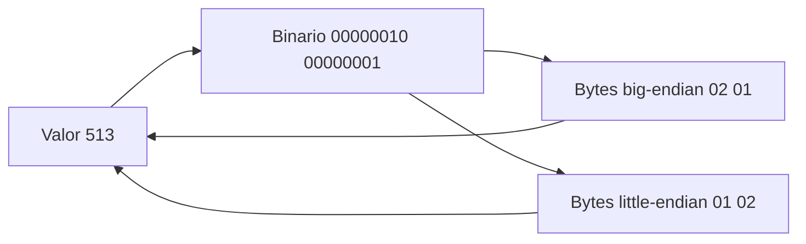
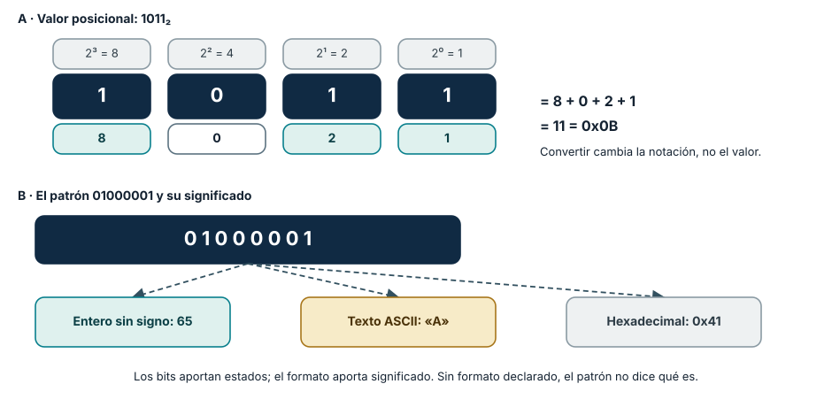
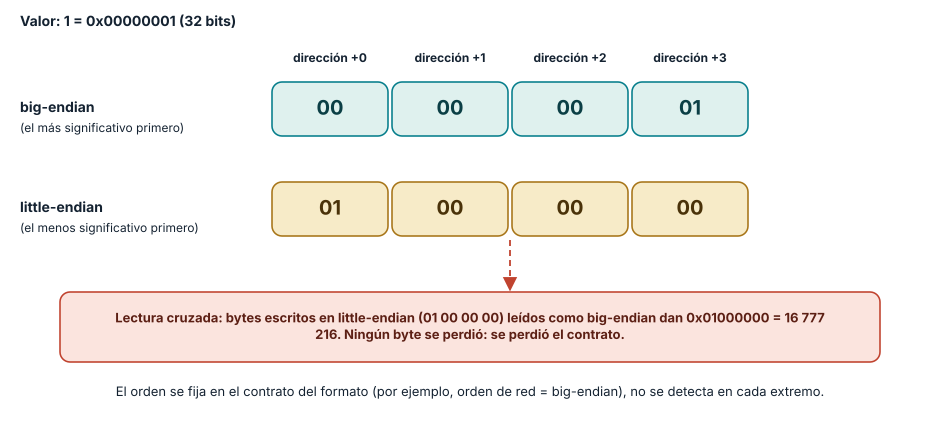
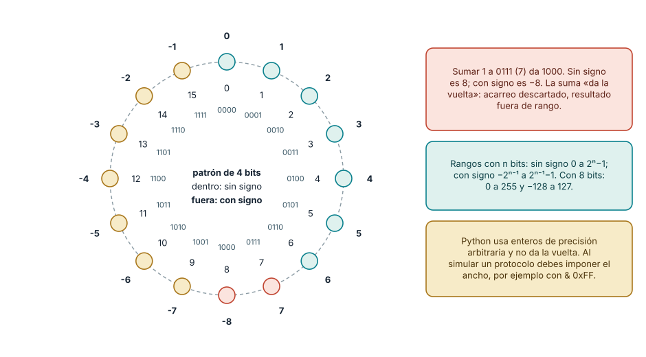

# SE-014 — Bits, bytes, bases numéricas y representación

[← SE-013](https://github.com/vladimiracunadev-create/modern-software-engineering-program/blob/main/classes/part-01-computadores-y-representacion-de-informacion/se-013-arquitectura-basica-de-un-computador-moderno/README.md) · [↑ Parte 01](https://github.com/vladimiracunadev-create/modern-software-engineering-program/blob/main/classes/part-01-computadores-y-representacion-de-informacion/README.md) · [📚 Índice completo](https://github.com/vladimiracunadev-create/modern-software-engineering-program/blob/main/classes/README.md) · [SE-015 →](https://github.com/vladimiracunadev-create/modern-software-engineering-program/blob/main/classes/part-01-computadores-y-representacion-de-informacion/se-015-texto-unicode-codificaciones-y-mojibake/README.md)

## Punto profesional y fundamento pedagógico

**Punto profesional.** La clase existe para interpretar un valor binario solo cuando se declaran base, ancho, signo y orden de bytes.

**Por qué aparece aquí.** Se sitúa después de **Arquitectura básica de un computador moderno** y antes de **Texto, Unicode, codificaciones y mojibake**: convierte el conocimiento anterior en una decisión observable que la clase siguiente podrá reutilizar. La continuidad se comprueba en el artefacto, no por compartir vocabulario.

**Error conceptual que debe corregir.** Creer que una secuencia de bytes posee signo y orden por sí misma.

**Secuencia de aprendizaje.** Antes de ejecutar código, escribe los dos bytes que esperas para `513` en big-endian y little-endian. Verifica ambos round trips, provoca un overflow de ancho fijo y explica por qué el error pertenece al contrato de representación. Cierra transfiriendo el procedimiento a un valor con signo.

**Evidencia de aprendizaje.** Representations.md con valor↔bits↔bytes, round trips y un desbordamiento explicado. Debe contener predicción previa, observación, explicación causal, contraejemplo, criterio de aceptación y una nota de qué dato haría cambiar la conclusión.

**Límite de la conclusión.** Los enteros de Python no reproducen un registro de ancho fijo sin imponerlo.

### Trazabilidad fuente → afirmación

| Fuente primaria u oficial | Afirmación que respalda | Lo que no prueba |
|---|---|---|
| [RISC-V ISA Introduction](https://docs.riscv.org/reference/isa/unpriv/intro.html) |  declara el byte de ocho bits y variantes de ancho | No demuestra por sí sola que el artefacto del estudiante sea correcto. |
| [Python integer methods](https://docs.python.org/3/library/stdtypes.html#int.to_bytes) |  define serialización, orden y signo | No demuestra por sí sola que el artefacto del estudiante sea correcto. |
| [Python `struct`](https://docs.python.org/3/library/struct.html) |  documenta formatos binarios y byte order | No demuestra por sí sola que el artefacto del estudiante sea correcto. |

## Antes de empezar

`SE-013` localizó capas y contratos. Ahora abrimos el dato que las atraviesa. El byte
`01000001` puede significar 65, `A`, una máscara o parte de una instrucción: los bits
aportan estados; el formato aporta significado. Prepararás la serialización numérica de
el analizador local de eventos para que `SE-015` pueda explicar texto sin confundirlo con bytes.

## Prerrequisitos

Mapa de capas de `SE-013`, suma y potencias enteras básicas, Python 3.11+.

## Problema auténtico

Dos servicios intercambian cuatro bytes. Uno lee `1`; el otro, `16777216`. Ambos
conservan los mismos bits, pero asumieron distinto orden. Sin contrato de representación,
“los datos llegaron intactos” no significa que conservaron significado.

## Objetivos observables

Convertirás entre bases usando valor posicional; explicarás rango y signo; serializarás
enteros con orden explícito; y diagnosticarás overflow o endianess sin probar valores al
azar.

## Temas y por qué importan

| Tema | Mecanismo | Por qué importa |
| --- | --- | --- |
| Bit y byte | agrupan estados discretos | son unidad de contratos binarios |
| Base posicional | pesos por potencia | permite leer y verificar representaciones |
| Signo y rango | reserva patrones para valores | explica overflow e interoperabilidad |
| Endianess | ordena bytes de valores multibyte | evita decodificaciones incompatibles |
## Mapa conceptual

El valor es el mismo solo cuando el lector conoce ancho, signo y orden. El mapa no
aplica a texto hasta que `SE-015` defina una codificación.

## Conceptos y decisiones

### 1. Un bit distingue estados; el contexto les da significado

Un bit modela dos estados, usualmente escritos 0 y 1. Ocho bits forman un byte en las
plataformas estudiadas. Con `n` bits existen `2**n` patrones. Eso no decide qué
representan: el mismo patrón puede interpretarse como entero, flags o fragmento de un
formato.

### 2. La notación posicional conserva valor entre bases

En base `b`, cada dígito pesa una potencia de `b`. `1011₂` vale
`1×2³ + 0×2² + 1×2¹ + 1×2⁰ = 11`. Hexadecimal agrupa cuatro bits por dígito y facilita
inspección: `0x0B` expresa el mismo valor. Convertir no cambia el valor; cambia la
notación. Verifica reconstruyendo la suma, no mediante memoria visual.

**Cómo leer la figura.** En la parte A, cada bit multiplica el peso de su posición y la suma
reconstruye el valor; el hexadecimal agrupa de cuatro en cuatro bits, de modo que `0000 1011`
es `0x0B`. En la parte B, el *mismo* patrón se lee de tres maneras según el formato que se
declare. La conversión entre bases es mecánica; lo que no es mecánico es saber qué formato
aplica. **Dónde deja de valer:** el valor posicional describe enteros no negativos. Los
negativos, las fracciones y el texto necesitan reglas adicionales (secciones siguientes y
`SE-015`, `SE-016`), y el patrón de la parte B es ASCII solo si el contrato dice que es texto.

### 3. Ancho y signo determinan el rango

Un entero sin signo de `n` bits cubre `0` a `2**n - 1`. Complemento a dos usa el bit
más significativo como parte de una representación cuyo rango es `-2**(n-1)` a
`2**(n-1)-1`. La suma modular descarta acarreo fuera del ancho. Python usa enteros de
precisión arbitraria, por lo que debes imponer el ancho cuando simulas un protocolo.

### 4. Endianess ordena bytes, no bits dentro de una explicación informal

Un valor multibyte puede serializarse con el byte más significativo primero
(`big-endian`) o al final (`little-endian`). El contrato debe fijarlo. Cambiar el orden
de visualización de bits dentro de cada byte introduce otra cuestión y no debe mezclarse.
`int.to_bytes` y `int.from_bytes` exigen declarar orden y signo.

**Cómo leer la figura.** Las dos filas guardan *el mismo valor* en las mismas cuatro direcciones;
solo cambia cuál byte va primero. La flecha roja muestra el error del problema auténtico:
bytes escritos en un orden y leídos en el contrario no se corrompen, pero significan otra cosa.
`struct.pack('<I', 1)` produce `01000000` y `struct.pack('>I', 1)` produce `00000001`.
**Dónde deja de valer:** el diagrama trata los bytes como indivisibles. Dentro de un byte el
orden de los bits es otra cuestión que casi nunca importa en software, pero sí en ciertos
buses y protocolos serie; no mezcles ambas preguntas.

### 5. Tamaño, unidad y prefijo también son contratos

Un byte no es un carácter. `KB` y `KiB` pueden representar bases distintas según el
estándar y producto. Un identificador de 32 bits no tiene el mismo rango que una
cantidad de 32 bytes. Escribe unidad, ancho y representación cerca del dato.

### 6. Complemento a dos: por qué existe y cómo se calcula

Representar números negativos con bits exige una regla. La más usada es el *complemento a dos*,
porque permite que la misma circuitería sume y reste números con y sin signo. Para negar un
valor se invierten todos sus bits y se suma uno. En ocho bits, 5 es `00000101`; invertido es
`11111010`; sumando uno resulta `11111011`, que es `0xFB`, y `(-5).to_bytes(1, 'big', signed=True)`
devuelve exactamente `fb`. Otra forma de leerlo: el bit más significativo pesa `-2ⁿ⁻¹` en lugar
de `+2ⁿ⁻¹`, de modo que `11111011` vale `-128 + 64 + 32 + 16 + 8 + 2 + 1 = -5`.

Esta regla hace que sumar *da la vuelta*. En ocho bits, `127 + 1` produce `10000000`, que con
signo es `-128`: el acarreo que sale del byte se descarta y el resultado cae fuera del rango. La
Figura 3 lo muestra con cuatro bits, donde la vuelta es visible en un círculo. Python no
muestra este comportamiento porque sus enteros no tienen ancho; para simularlo se impone
una máscara. La expresión `((n & 0xFF) ^ 0x80) - 0x80` interpreta los ocho bajos de `n` como un
byte con signo: aplicada a 128 da `-128`, y a 255 da `-1`, tal como `int.from_bytes(b'\xff', 'big',
signed=True)`. El mismo `0xff` vale 255 sin signo y -1 con signo; el patrón no decide.

**Cómo leer la figura.** Cada punto es un patrón de cuatro bits. El número interior es su lectura
sin signo y el exterior, con signo. Avanzar una posición suma uno; al pasar de `0111` a `1000` el
valor con signo salta de 7 a -8. Los puntos rojos marcan esa frontera. **Dónde deja de valer:**
el anillo explica la aritmética modular de un ancho fijo. Los lenguajes difieren en qué hacen
ante el desbordamiento con signo (envolver, saturar, lanzar un error o declararlo comportamiento
indefinido), de modo que el hecho de que el hardware dé la vuelta no autoriza a depender de ello
en el código.

### 7. Máscaras y desplazamientos: banderas sin ambigüedad

Muchos formatos empaquetan varias decisiones en un campo: permisos, estados, opciones. Las
operaciones bit a bit permiten leerlas y modificarlas sin tocar el resto. `&` conserva los bits
presentes en ambos operandos (útil para *probar* o *borrar* con una máscara), `|` combina
(*activar*), `^` invierte los bits indicados, `~` invierte todos y `<<`, `>>` desplazan. Con
`0b1010` y `0b0110`: `&` da `0b0010` (2), `|` da `0b1110` (14), `^` da `0b1100` (12), `~0b1010 & 0xF` da
`0b0101` (5), `1 << 3` da 8 y `0b1000 >> 2` da 2.

Los permisos de archivos Unix usan esta idea: lectura, escritura y ejecución valen 4, 2 y 1, y
`r|w` es 6 mientras `r|w|x` es 7. El modo `0o755` combina tres grupos (propietario, grupo, otros) y la
máscara `umask` de `0o022` indica qué bits *quitar*: `0o777 & ~0o022` es `0o755`. Para evitar
errores, define las máscaras como constantes con nombre, prueba un bit con `valor & MASCARA`, y no
mezcles banderas con valores numéricos: un campo de banderas no admite orden ni suma.

### 8. Contadores que dan la vuelta: comparar números de secuencia

Un campo de dos bytes, como el `sequence=513` del caso conductor, llega a 65 535 y vuelve a 0.
Comparar con `<` falla en la vuelta: si el último número recibido fue 65 535 y llega 1, el número 1
es *posterior* (dos pasos después) pero `1 < 65535` es verdadero. La aritmética de números de
secuencia, descrita en el RFC 1982 y usada por TCP y DNS, compara por *distancia circular*: el
número `b` es posterior a `a` si `(b - a) & 0xFFFF` es positivo y menor que `0x8000`. Con `a = 65535`
y `b = 1`, `(b - a) & 0xFFFF` es 2, de modo que `b` es posterior; la comparación ingenua daba lo
contrario. La regla tiene un límite: solo es válida si dos números comparables nunca están más
lejos que la mitad del rango, algo que el diseño del protocolo debe garantizar (por ejemplo,
con ventanas de tamaño acotado).

## Caso conductor: longitud binaria del analizador local de eventos

El analizador local de eventos agrega un campo `sequence=513`. Se decide serializarlo en dos bytes sin signo y
big-endian: `02 01`. El lector valida exactamente dos bytes. Si el dominio puede superar
65535, el contrato debe ampliar ancho o rechazar; truncar silenciosamente cambia la
identidad.

## Definiciones de trabajo

- **bit:** unidad con dos estados distinguibles;
- **byte:** grupo de ocho bits en este programa;
- **base:** cantidad de dígitos y pesos de una notación posicional;
- **overflow:** resultado fuera del rango representable;
- **endianess:** orden de bytes en un valor multibyte.

## Glosario

**MSB/LSB** señalan bit o byte más/menos significativo según contexto. **Nibble** son
cuatro bits. **Máscara** selecciona posiciones mediante operaciones bit a bit.

## Ejemplo mínimo

`255` cabe en un byte sin signo (`ff`) y no en un byte con signo. `(-1).to_bytes(1,
'big', signed=True)` produce `ff`; leerlo como no firmado devuelve 255.

## Ejemplo profesional

Un encabezado de red fija ancho y orden. El productor que usa orden nativo puede pasar
pruebas locales y fallar al interoperar. La solución es contrato explícito y vectores
de prueba compartidos, no detectar plataforma en cada extremo.

## Práctica guiada

Usa como base el [laboratorio ejecutable de la Parte 01](https://github.com/vladimiracunadev-create/modern-software-engineering-program/tree/main/labs/part-01-machine-observer); trabaja sobre una copia o conserva tus salidas en el directorio `work/SE-014/`.

1. Crea `representations.py` con funciones que muestren decimal, binario y hexadecimal.
2. Convierte manualmente 13, 255 y 513 y verifica con `format`.
3. Serializa 513 en dos bytes, ambos órdenes, y registra `hex()`.
4. Lee cada secuencia con el orden contrario y explica el valor resultante.
5. Prueba fronteras 0, 65535, -1 y 65536 con signo declarado.
6. Entrega `conversion-table.md`, `representations.py` y `observations.md`.

## Ejercicios

1. Demuestra por qué `0xff` no determina por sí solo -1 o 255.
2. Diseña un campo de flags y dos máscaras.
3. Propón una migración de 16 a 32 bits compatible con lectores antiguos.

## Reto verificable

Otra persona recibe cinco secuencias y tu contrato. Debe recuperar valores y rechazar
las inválidas sin preguntarte ancho, signo u orden.

## Preguntas frecuentes

### ¿Hexadecimal ocupa menos memoria?
No necesariamente; es una notación textual compacta para humanos.

### ¿El orden nativo es más rápido?
Puede evitar conversiones locales, pero la interoperabilidad requiere un contrato estable.

### ¿Por qué los protocolos de red usan big-endian?

Por convención histórica: el «orden de red» es big-endian, y las funciones como `htons` y `htonl`
existen para convertir desde el orden local. Hoy muchos formatos modernos usan little-endian
porque los procesadores más comunes lo usan de forma nativa. Lo importante no es cuál es mejor
sino que el formato lo declare y lo pruebe con vectores.

### ¿El complemento a dos es la única forma de representar negativos?

No. Existieron otras, como el complemento a uno y signo-magnitud, que complican la aritmética
(dos ceros, por ejemplo). Casi todos los procesadores actuales usan complemento a dos para enteros;
los formatos de coma flotante usan signo-magnitud con un bit de signo independiente, tema de `SE-016`.

### ¿Cuántos bits necesito para un identificador?

Los que cubran el máximo de valores distintos que existirán durante la vida del sistema, con
margen. Con `n` bits hay `2ⁿ` valores: 16 bits cubren 65 536 y 32 bits cubren unos 4 300
millones. Un contador de eventos por segundo puede agotar 32 bits en años; calcúlalo con la tasa
esperada en vez de elegir el ancho por costumbre.

## Fallo controlado y diagnóstico

Codifica 513 como big-endian y léelo como little-endian. Conserva bytes, valor erróneo,
hipótesis y corrección. No “arregles” invirtiendo hasta que funcione: fija el contrato.

Un segundo fallo controlado explora el desbordamiento. Serializa en dos bytes sin signo el valor
65 535 y luego 65 536: `int.to_bytes` lanza `OverflowError: int too big to convert`, lo que
convierte el error en visible. Ahora repite con la máscara `& 0xFFFF`: el valor 65 536 se
transforma en 0 sin avisar. **Síntoma:** un identificador se repite tras 65 536 eventos y dos
registros distintos colisionan. **Causa:** se eligió truncar en silencio en lugar de rechazar o
ampliar el ancho. **Corrección:** el contrato define qué hacer fuera de rango (rechazar, ampliar a
cuatro bytes con una versión de formato o usar aritmética de secuencia) y los vectores de prueba
incluyen 0, 65 535, 65 536 y -1.

## Errores comunes y cómo corregirlos

| Síntoma | Causa | Corrección |
| --- | --- | --- |
| conversión aprendida de memoria | falta modelo posicional | reconstruye pesos y suma |
| overflow no aparece en Python | entero arbitrario oculta ancho | valida rango o usa serialización fija |
| “un byte es un carácter” | capas mezcladas | define codificación en SE-015 |
| bytes invertidos entre sistemas | endianess implícito | fija orden y vector de prueba |

## Entorno y archivos clave

Python 3.11+, sin dependencias: `representations.py`, `conversion-table.md`, `observations.md`. Limpieza: elimina el directorio de práctica.

## Seguridad, ética y accesibilidad

Usa valores sintéticos. Presenta binario agrupado y con equivalente decimal para
lectores con distintas necesidades. No confíes en overflow para validación de seguridad.

## Puente hacia el trabajo con agentes

Un asistente de IA genera funciones de serialización con fluidez, y los errores que introduce
son los de esta clase: orden de bytes implícito, ancho no declarado, `& 0xFF` que trunca en
silencio. Convierte cada sección en un criterio de aceptación de la tarea: el contrato fija
ancho, signo y orden; los vectores de prueba incluyen fronteras (0, máximo, máximo + 1, -1); y
una revisión humana comprueba que el código *rechaza* lo inválido en lugar de truncarlo. También
conviene pedirle al agente que genere los vectores desde la especificación y no desde su propia
implementación, porque una prueba derivada del código reproduce sus errores. Las partes sobre
especificación y evaluación del trabajo agentic desarrollan ese criterio.

## Transferencia

Inspecciona un color RGB o un encabezado documentado y separa patrón, formato y significado.

## Evaluación y evidencia

Se evalúan conversiones justificadas, contrato completo, fronteras y diagnóstico reproducible.

## Fuentes

- [RISC-V ISA Introduction](https://docs.riscv.org/reference/isa/unpriv/intro.html) declara el byte de ocho bits y variantes de ancho.
- [Python integer methods](https://docs.python.org/3/library/stdtypes.html#int.to_bytes) define serialización, orden y signo.
- [Python `struct`](https://docs.python.org/3/library/struct.html) documenta formatos binarios y byte order.
- [RFC 1982, Serial Number Arithmetic](https://www.rfc-editor.org/rfc/rfc1982): define la comparación circular de números de secuencia usada en la sección 8.
- Randal E. Bryant y David R. O'Hallaron, *Computer Systems: A Programmer's Perspective*, 3.ª edición (Pearson, ISBN 978-0-13-409266-9), capítulo 2: representación de enteros, complemento a dos y desbordamiento.

## Límites y siguiente paso

No cubre álgebra booleana ni formatos de archivo completos. `SE-015` asigna texto a secuencias de bytes.

---
[← SE-013](https://github.com/vladimiracunadev-create/modern-software-engineering-program/blob/main/classes/part-01-computadores-y-representacion-de-informacion/se-013-arquitectura-basica-de-un-computador-moderno/README.md) · [↑ Parte 01](https://github.com/vladimiracunadev-create/modern-software-engineering-program/blob/main/classes/part-01-computadores-y-representacion-de-informacion/README.md) · [SE-015 →](https://github.com/vladimiracunadev-create/modern-software-engineering-program/blob/main/classes/part-01-computadores-y-representacion-de-informacion/se-015-texto-unicode-codificaciones-y-mojibake/README.md)
