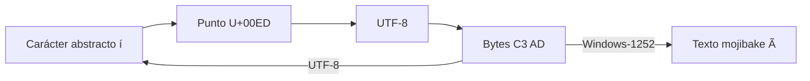
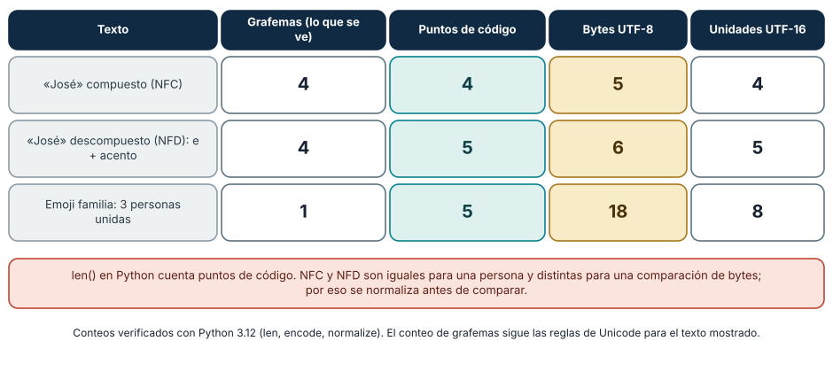
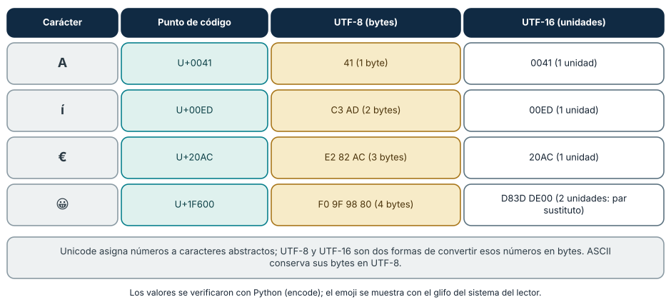
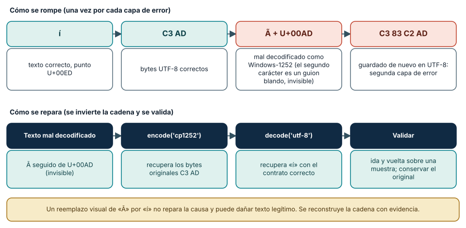

# SE-015 — Texto, Unicode, codificaciones y mojibake

[← SE-014](https://github.com/vladimiracunadev-create/modern-software-engineering-program/blob/main/classes/part-01-computadores-y-representacion-de-informacion/se-014-bits-bytes-bases-numericas-y-representacion/README.md) · [↑ Parte 01](https://github.com/vladimiracunadev-create/modern-software-engineering-program/blob/main/classes/part-01-computadores-y-representacion-de-informacion/README.md) · [📚 Índice completo](https://github.com/vladimiracunadev-create/modern-software-engineering-program/blob/main/classes/README.md) · [SE-016 →](https://github.com/vladimiracunadev-create/modern-software-engineering-program/blob/main/classes/part-01-computadores-y-representacion-de-informacion/se-016-enteros-coma-flotante-precision-y-errores-numericos/README.md)

## Punto profesional y fundamento pedagógico

**Punto profesional.** La clase existe para distinguir carácter, punto de código, unidades de código, bytes y glifo al diagnosticar texto.

**Por qué aparece aquí.** Se sitúa después de **Bits, bytes, bases numéricas y representación** y antes de **Enteros, coma flotante, precisión y errores numéricos**: convierte el conocimiento anterior en una decisión observable que la clase siguiente podrá reutilizar. La continuidad se comprueba en el artefacto, no por compartir vocabulario.

**Error conceptual que debe corregir.** Tratar Unicode como una codificación única o suponer que toda corrupción es reversible.

**Secuencia de aprendizaje.** Conserva primero los bytes originales; luego predice puntos de código, UTF-8 y longitudes NFC/NFD de la entrada. Reproduce un mojibake en una copia, reconstruye la transformación y pide a otra persona que determine qué casos son reversibles. La recuperación se evalúa por la cadena causal, no porque el texto vuelva a verse bien.

**Evidencia de aprendizaje.** Text-lab.md con code points, hex, normalización y un fallo de decodificación reproducible. Debe contener predicción previa, observación, explicación causal, contraejemplo, criterio de aceptación y una nota de qué dato haría cambiar la conclusión.

**Límite de la conclusión.** Unicode no determina por sí solo tipografía, shaping ni bidi.

### Trazabilidad fuente → afirmación

| Fuente primaria u oficial | Afirmación que respalda | Lo que no prueba |
|---|---|---|
| [The Unicode Standard 18.0](https://www.unicode.org/versions/Unicode18.0.0/) | define el modelo y las propiedades Unicode vigentes | No demuestra por sí sola que el artefacto del estudiante sea correcto. |
| [Unicode UTF FAQ](https://www.unicode.org/faq/utf_bom.html) |  explica UTF-8, UTF-16 y BOM | No demuestra por sí sola que el artefacto del estudiante sea correcto. |
| [Unicode Normalization Annex #15](https://www.unicode.org/reports/tr15/) |  define las formas de normalización | No demuestra por sí sola que el artefacto del estudiante sea correcto. |

## Antes de empezar

`SE-014` mostró que los bits necesitan un contrato. Ahora el analizador local de eventos debe conservar
`Matrícula José ✓`. La pantalla parece mostrar “caracteres”, pero el sistema intercambia
bytes. Construirás la cadena carácter → punto de código → codificación → bytes y la
usarás para provocar y reparar mojibake de forma explicada.

## Prerrequisitos

Bits, bytes y hexadecimal de `SE-014`; Python 3.11+; archivos desechables.

## Problema auténtico

Un CSV correcto llega como `Matrícula`. Reemplazar visualmente `í` por `í` puede
corromper otros datos porque el síntoma procede de decodificar UTF-8 como otra
codificación y volver a serializar. Se necesita reconstruir la transformación.

## Objetivos observables

Distinguirás carácter, grafema, punto y unidad de código; explicarás UTF-8; demostrarás
ida y vuelta; compararás normalizaciones; y diagnosticarás mojibake conservando bytes.

## Temas y por qué importan

| Tema | Mecanismo | Por qué importa |
| --- | --- | --- |
| Modelo Unicode | asigna puntos de código a caracteres abstractos | permite intercambio entre escrituras |
| UTF-8 | transforma puntos en bytes únicos | sostiene archivos y protocolos modernos |
| Normalización | compara secuencias equivalentes según forma | evita claves visualmente iguales pero distintas |
| Mojibake | bytes se decodifican con contrato incorrecto | permite reparar causa, no apariencia |
## Mapa conceptual

La última flecha muestra el mecanismo del síntoma. El dibujo simplifica grafemas: lo
visible puede contener varios puntos de código.

## Conceptos y decisiones

### 1. Texto visible no equivale a una unidad técnica

Un carácter abstracto pertenece al repertorio Unicode. Un **punto de código** es su
número. Una **unidad de código** es una unidad de una forma como UTF-16. Un **grafema**
es una unidad que una persona percibe como carácter y puede reunir varios puntos. Por
eso `len()` depende del modelo del lenguaje y no siempre cuenta símbolos percibidos.

**Cómo leer la figura.** La palabra «José» escrita con la «é» compuesta (NFC) tiene cuatro puntos
de código y cinco bytes en UTF-8; escrita con una «e» seguida de un acento combinante (NFD)
tiene cinco puntos y seis bytes, aunque una persona ve las mismas cuatro letras. El emoji de
familia muestra el caso extremo: un grafema, cinco puntos de código unidos por un carácter de
unión de ancho cero (U+200D), dieciocho bytes en UTF-8 y ocho unidades en UTF-16. Las cuatro
columnas miden cosas distintas y ninguna es «el número de caracteres». **Dónde deja de valer:**
los conteos de grafemas siguen las reglas de segmentación de Unicode (Anexo 29), que varían
con la versión del estándar y con el soporte de fuentes y sistemas; un mismo emoji compuesto
puede mostrarse como uno o como varios símbolos según el entorno.

### 2. Unicode es repertorio; UTF-8 es una forma de codificación

Unicode asigna puntos de código. UTF-8 los transforma en secuencias de uno a cuatro
bytes y conserva ASCII como bytes iguales. Es reversible para secuencias válidas. El
orden de bytes del procesador no altera UTF-8 porque se interpreta byte a byte. Un BOM
en UTF-8 puede actuar como firma, no como indicador de endianess.

**Cómo leer la figura.** Cada fila lleva un carácter desde su número Unicode hasta los bytes de
dos codificaciones. `A` ocupa un byte en UTF-8, idéntico a ASCII; `í` ocupa dos; `€`, tres; y el emoji,
cuatro. En UTF-16 los tres primeros caben en una unidad de 16 bits, pero el emoji, que supera
U+FFFF, necesita un *par sustituto* de dos unidades (`D83D DE00`). Por eso «Unicode de 16 bits» es
una frase incorrecta: Unicode no tiene ancho; las codificaciones sí. **Dónde deja de valer:** los
valores corresponden a las formas de codificación UTF-8 y UTF-16 big-endian; UTF-16 little-endian
invierte los bytes de cada unidad, y UTF-32 usa siempre cuatro bytes por punto.

### 3. Codificar y decodificar son operaciones inversas bajo el mismo contrato

`text.encode('utf-8')` produce bytes; `data.decode('utf-8')` produce texto. Sin una
codificación declarada, los bytes no contienen una etiqueta universal. Las políticas
`strict`, `replace` o `ignore` cambian si el error se detiene, se hace visible o se
pierde. Ignorar puede ser aceptable en visualización no crítica, pero es peligroso para
identidades o registros auditables.

### 4. Normalización trata equivalencias, no apariencia universal

`é` puede ser U+00E9 o `e` más un acento combinante. NFC y NFD transforman entre formas
canónicas; NFKC/NFKD aplican compatibilidad y pueden cambiar distinciones significativas.
Normalizar ayuda a comparar, pero no reemplaza reglas de dominio ni resuelve caracteres
visualmente similares de escrituras diferentes.

### 5. Mojibake conserva un rastro causal

Si bytes UTF-8 `C3 AD` se decodifican como Windows-1252 aparecen `í`. Si ese texto se
guarda en UTF-8, nace una segunda capa. Reparar exige conocer o inferir con evidencia la
cadena; aplicar sustituciones globales puede dañar texto legítimo. Se conserva copia,
se prueba en muestra y se valida round-trip.

**Cómo leer la figura.** La fila superior reconstruye *cómo se rompe*: los bytes UTF-8 `C3 AD` se
decodifican con Windows-1252, que los lee como dos caracteres (`Ã` y un guion blando U+00AD que
no se ve); si ese texto se guarda otra vez en UTF-8 aparecen bytes nuevos (`C3 83 C2 AD`) y el error
queda grabado en una segunda capa. La fila inferior invierte exactamente la cadena. En
Python, `"Matr\u00c3\u00adcula".encode("cp1252").decode("utf-8")` devuelve `Matrícula`. **Dónde deja de
valer:** la reparación solo es posible si la transformación original es reversible. Si algún
byte fue sustituido por `?` o por U+FFFD al guardarlo, la información se perdió y ninguna
codificación la recupera: por eso se conserva siempre el original y se prueba sobre una muestra.

### 6. UTF-8 por dentro: cómo se reconoce cada byte

UTF-8 reparte el número de un punto de código en uno a cuatro bytes con un esquema que permite
reconocer, mirando solo los primeros bits, qué papel cumple cada byte: `0xxxxxxx` es un carácter
ASCII de un byte; `110xxxxx` abre una secuencia de dos bytes; `1110xxxx`, una de tres; `11110xxx`, una de
cuatro; y `10xxxxxx` es siempre un byte de continuación. Para la `í`, el punto U+00ED vale `1110 1101`
en ocho bits o `000 1110 1101` en once; esos once bits se reparten como `110 00011` y `10 101101`, es
decir, `C3 AD`. Para el euro, U+20AC se reparte en tres bytes y produce `E2 82 AC`.

Este diseño tiene consecuencias prácticas. Es *autosincronizante*: si pierdes un byte puedes
volver a alinearte buscando el siguiente byte que no empiece por `10`. Es compatible con ASCII, de
modo que un texto ASCII es UTF-8 válido sin cambios. Y permite detectar errores: un byte `0x80`
aislado o un `0xC0` inicial no es válido, y `bytes.decode("utf-8")` lanza `UnicodeDecodeError` con la
posición del problema. Las secuencias «demasiado largas» (por ejemplo, codificar un carácter ASCII
con dos bytes) están prohibidas porque eran una vía de ataque para eludir filtros; un decodificador
estricto las rechaza.

### 7. Comparar y buscar texto: normalización, mayúsculas y caracteres parecidos

Comparar texto exige decidir qué se considera «igual». La normalización resuelve una parte:
`"José"` compuesto y `"Jose\u0301"` descompuesto son canónicamente equivalentes y, tras NFC, comparan
iguales. Pero otras diferencias no desaparecen: `ß` en mayúsculas es `SS`, de modo que `len` cambia, y
para comparar sin distinguir mayúsculas conviene `casefold()` en lugar de `lower()`. Algunos pliegues
dependen del idioma (la «i» turca), y ninguna función universal los resuelve sin conocer el
contexto.

Hay también una dimensión de seguridad. La letra cirílica `а` (U+0430) y la latina `a` (U+0061) se ven
igual y son distintas; un nombre de usuario o un dominio puede suplantar a otro sin que una persona lo note, y la
normalización no los unifica. El Informe Técnico 39 de Unicode (*Security Mechanisms*) describe
listas de caracteres confundibles y estrategias de detección. La regla para identificadores es
restringir el repertorio permitido y normalizar *antes* de comparar y de almacenar; para datos
libres, conservar el original y comparar con una forma derivada.

### 8. Texto en los bordes del sistema: archivos, protocolos y bases de datos

Los errores de codificación nacen donde el texto cruza una frontera. Un archivo no lleva
etiqueta de codificación; por eso `open(ruta, encoding="utf-8")` debe declararla siempre en lugar
de heredarla de la configuración regional, que puede variar entre equipos (la PEP 686 propone que
UTF-8 sea el valor por defecto en versiones futuras de Python, por lo que conviene verificar cuál
aplica a la versión que uses). En HTTP, la cabecera `Content-Type` puede declarar `charset`; el JSON
intercambiado entre sistemas debe codificarse en UTF-8 según el RFC 8259. En las bases de datos, el
conjunto de caracteres de la conexión, de la tabla y de la columna deben coincidir. Una regla
fiable es decodificar al entrar, trabajar con texto Unicode en el interior y codificar al salir, con
la política de errores `strict` y una ruta de cuarentena para las filas inválidas.

## Caso conductor: confirmar una matrícula sin perder el nombre

El analizador local de eventos serializa JSON con UTF-8 y declara el encoding al abrir archivos. Guarda texto
normalizado solo si el dominio lo exige y conserva el original cuando la forma importa.
El laboratorio compara `José`, `Jose\u0301` y `✓`; registra puntos, nombres Unicode,
bytes y longitud en cada nivel.

## Definiciones de trabajo

- **punto de código:** valor del espacio Unicode;
- **codificación:** transformación entre texto modelado y unidades binarias;
- **grafema:** unidad aproximada percibida por una persona;
- **normalización:** conversión a una forma Unicode definida;
- **mojibake:** texto ilegible por interpretación incompatible de bytes.

## Glosario

**Code unit** es unidad de una forma de codificación. **BOM** es U+FEFF al inicio bajo
ciertos protocolos. **Replacement character** U+FFFD hace visible una decodificación no
recuperada.

## Ejemplo mínimo

`'í'.encode('utf-8').hex()` devuelve `c3ad`. Decodificar esos bytes como latin-1 crea
dos puntos de código; volver a codificar no recupera significado sin conocer el error.

## Ejemplo profesional

Una importación recibe CSV sin charset. En vez de probar hasta “verse bien”, se obtiene
metadato del productor, se conserva original, se valida muestra multilingüe y se
rechazan secuencias inválidas con informe de fila.

## Práctica guiada

Usa como base el [laboratorio ejecutable de la Parte 01](https://github.com/vladimiracunadev-create/modern-software-engineering-program/tree/main/labs/part-01-machine-observer); trabaja sobre una copia o conserva tus salidas en el directorio `work/SE-015/`.

1. Crea `unicode_probe.py` con `unicodedata.name`, `normalize`, `encode` y `decode`.
2. Inspecciona `Matrícula José ✓` y la forma descompuesta de `é`.
3. Demuestra UTF-8 → latin-1/Windows-1252 → mojibake sin sobrescribir el original.
4. Compara NFC, NFD y longitudes; explica qué cambia y qué no.
5. Prueba `strict` y `replace` con bytes inválidos.
6. Entrega `text-cases.json`, `observations.md` y procedimiento de recuperación.

## Ejercicios

1. Explica por qué “Unicode de 16 bits” es incorrecto.
2. Diseña un contrato para CSV con encoding y política de error.
3. Analiza cuándo NFKC dañaría una identidad o código.

## Reto verificable

Otra persona debe reconstruir bytes originales de dos casos y decir cuál no puede
repararse sin información adicional. No aprueba una tabla de reemplazos visuales.

## Preguntas frecuentes

### ¿UTF-8 representa todos los caracteres Unicode?
Sí, salvo puntos sustitutos que no son valores escalares codificables.

### ¿Normalizar arregla mojibake?
No. Opera sobre texto ya decodificado; el error de encoding requiere reconstruir bytes.

### ¿Debo escribir un BOM al inicio de mis archivos UTF-8?

Normalmente no. El BOM en UTF-8 es la secuencia `EF BB BF` y solo sirve como firma, ya que UTF-8 no
tiene orden de bytes. Algunos programas lo exigen para reconocer la codificación y otros lo
muestran como un carácter extraño al inicio del archivo. Decide según el consumidor y declara la
decisión; Python lo maneja con la codificación `utf-8-sig`.

### ¿Por qué `len("😀")` da 1 en Python y 2 en JavaScript?

Porque cuentan unidades distintas. Python cuenta puntos de código y el emoji es uno; las cadenas de
JavaScript se indexan por unidades UTF-16, y el emoji ocupa dos. Cuando una frontera entre sistemas
usa índices o longitudes, hay que fijar qué se cuenta (puntos, unidades o bytes) o los cortes caerán
en mitad de un carácter.

### ¿Qué hago con bytes inválidos en un archivo que no puedo rechazar?

Decide la política según el riesgo: `replace` los hace visibles con U+FFFD, `ignore` los pierde en silencio,
`surrogateescape` los preserva para reescribirlos sin pérdida, y `strict` detiene el proceso. Para
datos auditables conviene `strict` con cuarentena y un informe de filas. Nunca descartes datos
inválidos sin dejar rastro.

## Fallo controlado y diagnóstico

Decodifica bytes UTF-8 con una codificación incompatible. Captura bytes antes y después,
explica cada transformación y recupera solo desde una copia verificable.

Un segundo fallo controlado ataca la comparación. Crea dos cadenas que una persona ve idénticas,
`"José"` y `"Jose\u0301"`, y úsalas como claves de un diccionario. **Síntoma:** el diccionario las trata
como claves distintas y una búsqueda falla. **Causa:** puntos de código diferentes con la misma
apariencia. **Corrección:** normaliza con NFC al entrar y compara con la misma forma; documenta qué
campos se normalizan. Añade luego un par con la letra latina `a` y la cirílica `а` y comprueba que
NFC no las unifica: ese segundo caso exige una política de repertorio permitido, no de
normalización. Registra en `observations.md` qué problema resolvió cada técnica.

## Errores comunes y cómo corregirlos

| Síntoma | Causa | Corrección |
| --- | --- | --- |
| `len()` se interpreta como caracteres visibles | puntos y grafemas confundidos | declara la unidad que cuentas |
| texto “arreglado” con reemplazos | se atacó apariencia | reconstruye codificación y conserva original |
| `errors='ignore'` en datos críticos | pérdida silenciosa | usa `strict` y ruta de cuarentena |
| normalización universal | dominio no considerado | elige forma y campos con criterio explícito |

## Entorno y archivos clave

Python 3.11+, `unicodedata`, `pathlib`; `unicode_probe.py`, `text-cases.json`, `observations.md`. Limpieza local por directorio.

## Seguridad, ética y accesibilidad

No uses nombres reales. Conservar correctamente una escritura es una cuestión de
identidad e inclusión. No uses transliteración como sustituto automático del original.

## Puente hacia el trabajo con agentes

Los modelos de lenguaje operan sobre *tokens*, no sobre caracteres ni bytes, de modo que la
relación entre texto visible y unidad de procesamiento es otra capa más, con consecuencias
parecidas: contar caracteres, truncar a un número de tokens o buscar un fragmento por posición puede
caer en mitad de un grafema. Cuando un agente edita archivos, hereda los mismos riesgos de esta
clase: puede reescribir un archivo con otra codificación, normalizar sin avisar, o «arreglar» mojibake con
reemplazos visuales. Exige que cualquier cambio sobre texto conserve la codificación y los finales
de línea del original, que el diff muestre los bytes cuando algo no ASCII cambia, y que existan pruebas con
nombres con acentos, escrituras no latinas y emoji compuestos. La instrucción «no cambies nada fuera
de lo pedido» es verificable con un diff a nivel de bytes.

## Transferencia

Repite con emoji compuesto y una escritura no latina; identifica puntos, grafema y bytes.

## Evaluación y evidencia

Se exige cadena reversible, normalización explicada, error controlado y política de entrada.

## Fuentes

- [The Unicode Standard 18.0](https://www.unicode.org/versions/Unicode18.0.0/) define el modelo y las propiedades Unicode vigentes.
- [Unicode UTF FAQ](https://www.unicode.org/faq/utf_bom.html) explica UTF-8, UTF-16 y BOM.
- [Unicode Normalization Annex #15](https://www.unicode.org/reports/tr15/) define las formas de normalización.
- [Python Unicode HOWTO](https://docs.python.org/3/howto/unicode.html) respalda el laboratorio.
- [Unicode Standard Annex #29, Text Segmentation](https://www.unicode.org/reports/tr29/): define cómo se segmentan los grafemas; respalda la distinción entre grafema, punto y byte.
- [Unicode Technical Standard #39, Security Mechanisms](https://www.unicode.org/reports/tr39/): caracteres confundibles y detección de suplantación; respalda la sección 7.
- [RFC 8259, The JSON Data Interchange Format](https://www.rfc-editor.org/rfc/rfc8259): exige UTF-8 para JSON intercambiado entre sistemas.
- [PEP 686, UTF-8 mode as default](https://peps.python.org/pep-0686/): propuesta sobre la codificación predeterminada de Python; verifica su estado en la versión que uses.

## Límites y siguiente paso

No cubre segmentación completa ni seguridad de identificadores. `SE-016` estudia números y precisión.

---
[← SE-014](https://github.com/vladimiracunadev-create/modern-software-engineering-program/blob/main/classes/part-01-computadores-y-representacion-de-informacion/se-014-bits-bytes-bases-numericas-y-representacion/README.md) · [↑ Parte 01](https://github.com/vladimiracunadev-create/modern-software-engineering-program/blob/main/classes/part-01-computadores-y-representacion-de-informacion/README.md) · [SE-016 →](https://github.com/vladimiracunadev-create/modern-software-engineering-program/blob/main/classes/part-01-computadores-y-representacion-de-informacion/se-016-enteros-coma-flotante-precision-y-errores-numericos/README.md)
