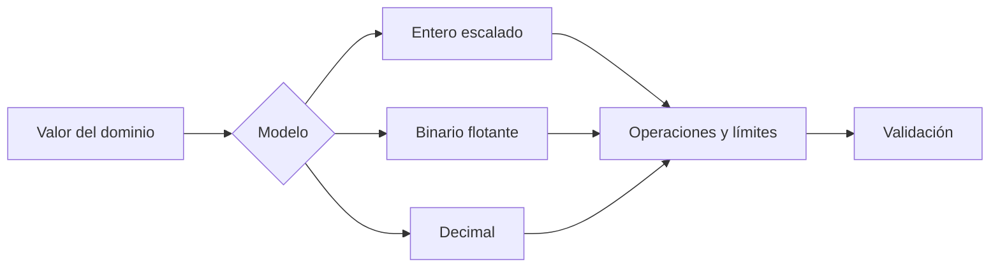
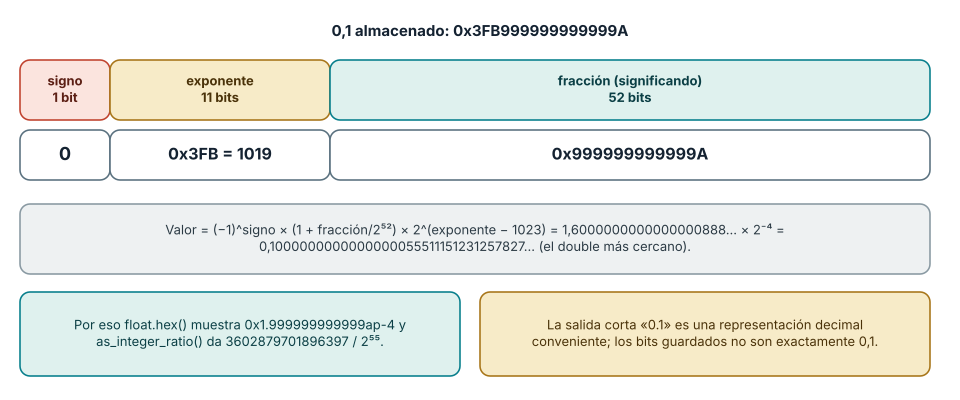
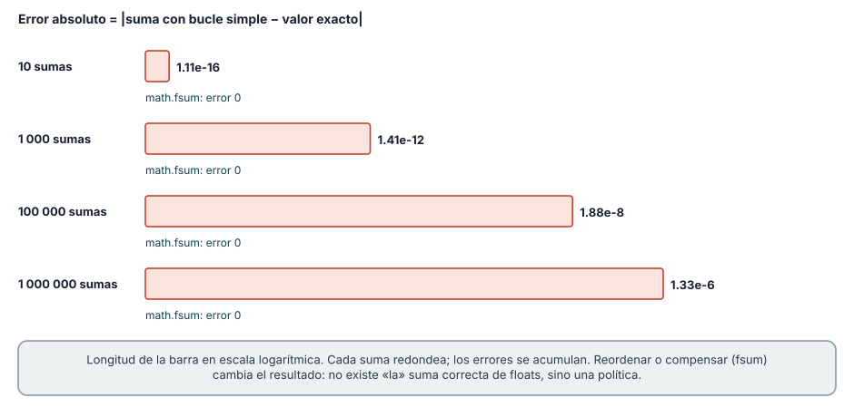
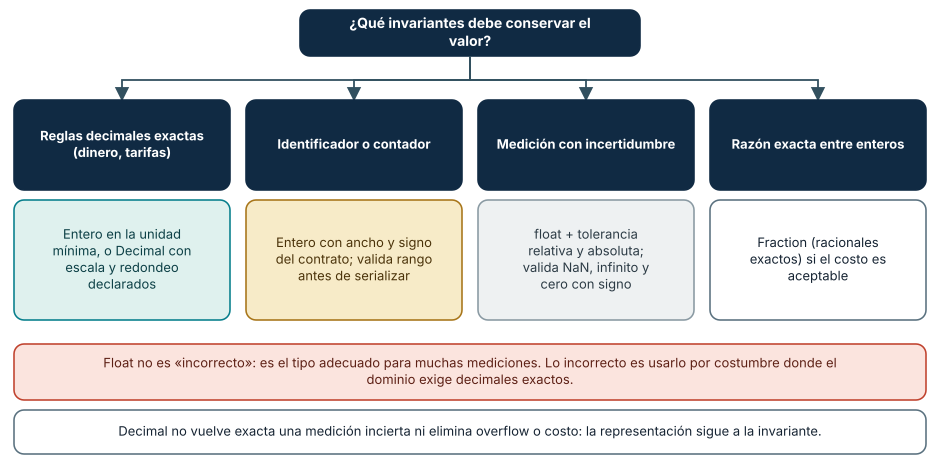

# SE-016 — Enteros, coma flotante, precisión y errores numéricos

[← SE-015](https://github.com/vladimiracunadev-create/modern-software-engineering-program/blob/main/classes/part-01-computadores-y-representacion-de-informacion/se-015-texto-unicode-codificaciones-y-mojibake/README.md) · [↑ Parte 01](https://github.com/vladimiracunadev-create/modern-software-engineering-program/blob/main/classes/part-01-computadores-y-representacion-de-informacion/README.md) · [📚 Índice completo](https://github.com/vladimiracunadev-create/modern-software-engineering-program/blob/main/classes/README.md) · [SE-017 →](https://github.com/vladimiracunadev-create/modern-software-engineering-program/blob/main/classes/part-01-computadores-y-representacion-de-informacion/se-017-cpu-instrucciones-registros-y-ciclos-de-ejecucion/README.md)

## Punto profesional y fundamento pedagógico

**Punto profesional.** La clase existe para evaluar precisión según representación, propagación del error y tolerancia ligada a la escala.

**Por qué aparece aquí.** Se sitúa después de **Texto, Unicode, codificaciones y mojibake** y antes de **CPU, instrucciones, registros y ciclos de ejecución**: convierte el conocimiento anterior en una decisión observable que la clase siguiente podrá reutilizar. La continuidad se comprueba en el artefacto, no por compartir vocabulario.

**Error conceptual que debe corregir.** Esperar aritmética decimal exacta de coma flotante o elegir epsilon por costumbre.

**Secuencia de aprendizaje.** Predice qué operaciones serán exactas y cuáles aproximadas antes de inspeccionar ratios o formatos. Compara float, decimal e entero escalado bajo invariantes de dominio, provoca una comparación defectuosa y diseña una prueba que la detecte. Después cambia la escala del problema y revisa si la representación elegida sigue siendo válida.

**Evidencia de aprendizaje.** Numeric-errors.md con predicción, error absoluto/relativo y contraejemplo inestable. Debe contener predicción previa, observación, explicación causal, contraejemplo, criterio de aceptación y una nota de qué dato haría cambiar la conclusión.

**Límite de la conclusión.** El ejercicio no certifica estabilidad de algoritmos científicos completos.

### Trazabilidad fuente → afirmación

| Fuente primaria u oficial | Afirmación que respalda | Lo que no prueba |
|---|---|---|
| [Python Floating-Point Tutorial](https://docs.python.org/3/tutorial/floatingpoint.html) |  explica representación y aproximación | No demuestra por sí sola que el artefacto del estudiante sea correcto. |
| [Python `decimal`](https://docs.python.org/3/library/decimal.html) |  documenta aritmética decimal y contextos | No demuestra por sí sola que el artefacto del estudiante sea correcto. |
| [Java Virtual Machine Specification SE 27 §2.8](https://docs.oracle.com/javase/specs/jvms/se27/html/jvms-2.html#jvms-2.8) | ofrece otro contrato IEEE 754 especificado | No demuestra por sí sola que el artefacto del estudiante sea correcto. |

## Antes de empezar

Ya sabes que los bits necesitan interpretación. El analizador local de eventos calcula el promedio de tiempos y
un importe ficticio. Si usa el mismo tipo para ambos, puede mostrar `0.30000000000000004`
o acumular una cantidad incorrecta. Esta clase conecta representación con decisión de
dominio antes de seguir las operaciones hasta la CPU en `SE-017`.

## Prerrequisitos

Representación binaria de `SE-014`, Python 3.11+, fracciones y exponentes básicos.

## Problema auténtico

Un sistema compara `0.1 + 0.2 == 0.3` y rechaza una conciliación. Redondear la pantalla
oculta el síntoma, pero no define cómo calcular, comparar ni acumular.

## Objetivos observables

Explicarás rango de enteros fijos, representación binaria aproximada, redondeo, NaN e
infinito; elegirás entre entero escalado, decimal y float; y diseñarás pruebas de frontera.

## Temas y por qué importan

| Tema | Mecanismo | Por qué importa |
| --- | --- | --- |
| Enteros | rango depende de ancho y signo | controla IDs, contadores y overflow |
| Coma flotante | significando y exponente aproximan reales | permite gran rango con precisión finita |
| Redondeo | asigna resultados no representables | acumula error y afecta comparaciones |
| Modelo de dominio | elige representación por invariantes | evita usar float por costumbre |
## Mapa conceptual

No existe un tipo mejor en absoluto. La decisión depende de rango, exactitud, operaciones, interoperabilidad y costo.

## Conceptos y decisiones

### 1. Los enteros de máquina tienen ancho; Python abstrae ese límite

En formatos fijos, rango y overflow siguen las reglas de `SE-014`. Python expande sus
enteros mientras haya memoria, pero al serializar, llamar código nativo o usar una base
de datos reaparece el ancho. Probar solo en Python puede ocultar incompatibilidad con un
campo de 32 bits.

### 2. Coma flotante distribuye precisión sobre un rango amplio

IEEE 754 representa valores mediante signo, exponente y significando. Entre valores
representables hay huecos que crecen con la magnitud. `0.1` no tiene expansión binaria
finita, por lo que se guarda el valor representable más cercano bajo una regla de
redondeo. La salida corta de Python es una representación decimal conveniente, no los
bits exactos.

**Cómo leer la figura.** Un `double` reparte sus 64 bits en un bit de signo, once de exponente y
cincuenta y dos de fracción. El número 0,1 se guarda como `0x3FB999999999999A`: el exponente
almacenado es 1019, que tras restar el sesgo 1023 vale -4, y la fracción `999999999999A` es el
patrón repetido de la expansión binaria de 0,1 redondeado al último bit. Calculado, el
valor guardado es 0,1000000000000000055511151231257827…, el `double` más cercano a 0,1. Puedes
verlo con `(0.1).hex()`, que devuelve `0x1.999999999999ap-4`, y con `(0.1).as_integer_ratio()`, que
devuelve 3602879701896397 sobre 36028797018963968 (2⁵⁵). **Dónde deja de valer:** la figura es
para el formato de doble precisión. La precisión simple (32 bits, `float32`) tiene 8 bits de
exponente y 23 de fracción, y guarda 0,1 como 0,10000000149011612; y los números *subnormales*, cercanos a
cero, usan un exponente reservado y pierden precisión de forma gradual.

### 3. Error de representación no significa implementación defectuosa

La operación puede ser correctamente redondeada y diferir del número real ideal. Sumar
muchos términos, restar magnitudes cercanas o mezclar escalas cambia el error. Reordenar
operaciones puede cambiar el resultado. Para comparar floats se usa una tolerancia
justificada por escala y dominio; una constante universal crea falsos positivos.

**Cómo leer la figura.** Cada barra es el error absoluto de acumular 0,1 con un bucle de `+=` y su
longitud está en escala logarítmica. Con diez sumas el resultado es 0,9999999999999999 (un error
de 1,1 × 10⁻¹⁶); con un millón es 100000,00000133288 (un error de 1,3 × 10⁻⁶). Cada suma redondea y
los redondeos se acumulan. `math.fsum`, que lleva sumas parciales exactas, devuelve 100000,0.
**Dónde deja de valer:** el resultado depende del orden de las operaciones y de la versión del
intérprete. Desde Python 3.12, la función integrada `sum` aplica una suma compensada con números
flotantes, de modo que `sum([0.1] * 1_000_000)` devuelve 100000.0 y *oculta* el error del bucle; en
versiones anteriores producía el resultado acumulado. Una prueba que pasa o falla según la versión
de Python señala que el código depende de un detalle de implementación y no de un contrato.

### 4. NaN, infinito y cero con signo requieren política

IEEE 754 incluye infinitos, NaN y ceros con signo. NaN no es igual a sí mismo y puede
propagarse; usarlo como dato faltante sin política mezcla ausencia con resultado
indefinido. Validar entrada y salida evita que un valor especial atraviese decisiones
que esperaban números finitos.

### 5. Dinero, mediciones y probabilidades piden modelos distintos

Para dinero, entero en unidad mínima o decimal puede conservar reglas legales; aun así
se debe fijar redondeo y escala. Float es adecuado para muchas mediciones científicas si
se modela incertidumbre. Decimal no vuelve exacta una medición incierta ni elimina
overflow o costo. La representación se elige por invariantes, no por apariencia.

**Cómo leer la figura.** El punto de partida es la pregunta sobre qué debe conservar el valor, no
el tipo. El dinero exige reglas decimales exactas y se modela con enteros en la unidad mínima o
con `Decimal`; los identificadores y contadores exigen ancho y signo declarados; las mediciones
admiten `float` si se define una tolerancia y se validan los valores especiales; una razón
exacta entre enteros puede usar `Fraction`. **Dónde deja de valer:** el árbol no resuelve
requisitos de interoperabilidad. Si un sistema externo fija un formato (por ejemplo, un
campo de 32 bits o un decimal con dos posiciones), ese contrato manda aunque tu dominio sugiera
otra representación.

### 6. Cómo se pierde información: absorción, cancelación y orden de las operaciones

Entre dos `double` consecutivos hay un hueco que crece con la magnitud, medido en ULP (*unit in the
last place*). Cerca de 1 el hueco es de unos 2,2 × 10⁻¹⁶ (el épsilon de máquina); cerca de 10¹⁶ es 2. La
primera consecuencia es la *absorción*: `1e16 + 1` es igual a `1e16`, porque 1 es menor que la mitad
del hueco; un acumulador grande ignora sumandos pequeños. Con enteros pasa algo parecido en el
límite 2⁵³: `float(2**53) + 1 == float(2**53)` es verdadero, y por encima de 2⁵³ un `float` ya no
representa todos los enteros.

La segunda es la *cancelación*: restar valores casi iguales borra los dígitos en común y deja el
error de redondeo como resultado dominante. `(1 + 1e-16) - 1` es `0.0` en lugar de `1e-16`, y
`0.1 + 0.2 - 0.3` es `5.551115123125783e-17` en lugar de cero. La tercera es que la suma de floats
no es asociativa: `(a + b) + c` puede diferir de `a + (b + c)`. Un acumulador que suma `1e16` y luego diez
veces `1.0` con un bucle simple vuelve a `1e16`; `math.fsum` devuelve `1.000000000000001e+16`, el valor
correcto. Por eso los resultados de una reducción en paralelo pueden diferir según el número de
hilos, y por eso las pruebas numéricas comparan con tolerancia y no con igualdad exacta.

### 7. Redondeo: modos, empates y el caso de 2,675

Redondear exige elegir un *modo*. Python usa por defecto «redondeo al par más cercano» (a veces
llamado bancario): `round(0.5)` es 0, `round(1.5)` es 2 y `round(2.5)` es 2, porque los empates van
al entero par. Esto evita sesgo acumulado, pero choca con las reglas legales que exigen «medio hacia arriba».
Un caso aparente de error es `round(2.675, 2)`, que devuelve `2.67` y no `2.68`: el `float`
2,675 en realidad vale 2,67499999999999982236…, de modo que *no hay empate* y el redondeo es correcto.
`Decimal("2.675").quantize(Decimal("0.01"))` devuelve `2.68`, porque en `Decimal` el valor sí es
exactamente 2,675 y el empate se resuelve al par (8 es par).

La moraleja es declarar el modo de redondeo en el contrato y probarlo con casos de empate. En
`decimal`, el contexto define precisión y modo (`ROUND_HALF_EVEN`, `ROUND_HALF_UP`, etc.), y puede
establecerse por operación. Una política habitual para facturas es redondear solo en el punto
definido por la ley (por línea o por total) y calcular todo lo demás sin redondear.

### 8. Enteros escalados: dinero en la unidad mínima y los límites que reaparecen

Modelar un importe como un entero en centavos evita el error de representación, pero traslada las
decisiones a otros puntos. La división ya no es exacta: `divmod(100, 3)` es `(33, 1)`, y repartir
100 centavos entre tres personas obliga a decidir quién recibe el centavo restante (una política
común asigna el resto a las primeras personas, de modo que se paga `34, 33, 33` y la suma se
conserva). Un impuesto del 19 % sobre 1 999 centavos produce `379,81` centavos: debe definirse a
qué entero se redondea y en qué momento. Lo que nunca debe ocurrir es que la suma de las partes
difiera del total sin explicación.

El otro límite reaparece al cruzar fronteras: Python no desborda, pero una base de datos o un
protocolo con un campo de 32 bits sí. `struct.unpack('>i', (2**31).to_bytes(4, 'big'))[0]` da `-2147483648`:
el mismo patrón que Python considera 2 147 483 648 se interpreta como negativo en el campo con
signo. La validación de rango antes de serializar, con pruebas en el máximo, el máximo más uno y los
valores negativos, es la defensa.

## Caso conductor: promedio y tarifa del analizador local de eventos

El analizador local de eventos calcula latencia media con float y conserva muestras originales; no usa igualdad
exacta. Una tarifa ficticia se representa en centavos enteros. El informe declara rango,
unidad y política de redondeo. Cambiar a Decimal se evalúa por contrato externo, no para
“arreglar todos los decimales”.

## Definiciones de trabajo

- **precisión:** cantidad de información significativa representada;
- **rango:** intervalo de magnitudes disponibles;
- **redondeo:** selección de un valor representable;
- **ULP:** distancia local entre valores flotantes consecutivos;
- **NaN:** valor especial para resultados no numéricos.

## Glosario

**Significando** contiene dígitos significativos. **Overflow/underflow** exceden rango
alto o pequeño. **Cancelación** pierde información al restar valores cercanos.

## Ejemplo mínimo

`0.1 + 0.2` produce un float cercano a 0.3. `math.isclose` puede comparar mediciones con
tolerancia; para tres pagos de 10 centavos se prefieren `10 + 10 + 10` centavos.

## Ejemplo profesional

Un contador Java de 32 bits se exporta desde Python. Aunque Python no desborde, el
contrato sí. Se valida rango antes de serializar y se prueba máximo, máximo+1 y valores negativos.

## Práctica guiada

Usa como base el [laboratorio ejecutable de la Parte 01](https://github.com/vladimiracunadev-create/modern-software-engineering-program/tree/main/labs/part-01-machine-observer); trabaja sobre una copia o conserva tus salidas en el directorio `work/SE-016/`.

1. Usa `float.hex()` y `as_integer_ratio()` para inspeccionar 0.1.
2. Compara suma repetida, `math.fsum` y Decimal bajo el mismo conjunto.
3. Modela importe como centavos y tiempo como float con unidad.
4. Prueba infinito, NaN, -0.0 y límites de serialización de 32 bits.
5. Registra criterio de comparación y contraejemplo en `numeric-decision.md`.
6. Entrega `numbers.py`, resultados y limpieza local.

## Ejercicios

1. Explica por qué imprimir 0.1 no muestra necesariamente todos sus bits.
2. Diseña tolerancia para una medición y justifica escala.
3. Compara entero escalado y Decimal al cambiar número de decimales.

## Reto verificable

Una revisión recibe cinco operaciones y debe predecir cuáles son exactas, aproximadas o
inválidas bajo tu contrato. Aprueba si las pruebas cubren fronteras y valores especiales.

## Preguntas frecuentes

### ¿Nunca debo usar float para dinero?
La regla depende del contrato, pero binario flotante rara vez conserva exactamente fracciones decimales legales.

### ¿Redondear al final elimina el error?
No; define presentación, pero operaciones previas pueden haber acumulado o amplificado error.

### ¿Qué significa `math.isclose` y cómo elijo sus tolerancias?

Compara con una tolerancia relativa (`rel_tol`, por defecto 1e-09) y una absoluta (`abs_tol`, por defecto 0). La
tolerancia relativa escala con la magnitud y no sirve cerca de cero, donde hace falta una absoluta.
Elígelas desde el dominio: la incertidumbre de la medición, el error aceptable para la decisión
que se tomará con el resultado, no desde un valor «que haga pasar la prueba».

### ¿`Decimal` es siempre más lento y peor que `float`?

Es más lento y consume más memoria, pero en Python 3 la implementación es en C y suele bastar para
volúmenes moderados. Lo decisivo no es el costo sino la invariante: `Decimal` representa
exactamente los decimales que se le dan, con una precisión configurable, y no cambia que una
medición física sea incierta. Mide antes de descartarlo y evita mezclar `float` y `Decimal` en la misma
operación.

### ¿Cómo comparo valores que pueden ser NaN?

`NaN` no es igual a sí mismo: `float('nan') == float('nan')` es falso. Para detectarlo usa
`math.isnan`. Decide una política: rechazar la entrada, propagarlo y marcar el resultado como
inválido, o sustituir un valor documentado. No uses `NaN` como valor faltante sin que el contrato
lo diga, porque se mezclará con resultados indefinidos.

## Fallo controlado y diagnóstico

Usa igualdad exacta para `0.1 + 0.2`. Inspecciona ratios, identifica representación y
reemplaza la comparación o el modelo según el dominio, no solo el literal.

Un segundo fallo controlado es la acumulación. Escribe un bucle que sume 0,1 un millón de veces y
compara el resultado con `math.fsum`, con `sum` y con `Decimal`, registrando la versión de Python. **Síntoma:**
el bucle da `100000.00000133288` mientras `sum` y `fsum` dan `100000.0`. **Causa:** errores de redondeo
acumulados que `sum` compensa desde Python 3.12. **Corrección:** decide si el cálculo requiere
exactitud (entero escalado o `Decimal`) o tolerancia (compara con `math.isclose` y una tolerancia
relativa y absoluta justificadas), y escribe una prueba que *no* dependa de la versión del
intérprete. Documenta qué dato mostraría que tu tolerancia es demasiado laxa o demasiado estricta.

## Errores comunes y cómo corregirlos

| Síntoma | Causa | Corrección |
| --- | --- | --- |
| centavos faltantes | float usado sin política decimal | usa entero escalado o Decimal con redondeo |
| prueba pasa en Python y falla al integrar | ancho externo omitido | valida rango del contrato |
| tolerancia fija para toda magnitud | escala ignorada | combina tolerancia relativa y absoluta justificadas |
| NaN atraviesa el cálculo | valores especiales no validados | define entrada, propagación y rechazo |

## Entorno y archivos clave

Python 3.11+, `math`, `decimal`, `struct`; `numbers.py`, `numeric-decision.md`, `results.json`.

## Seguridad, ética y accesibilidad

Un error numérico puede distribuir dinero, riesgo o acceso de forma desigual. Muestra
unidad y redondeo en lenguaje comprensible; no uses precisión visual para aparentar certeza.

## Puente hacia el trabajo con agentes

Un asistente de IA escribe `float` para dinero con la misma naturalidad con que escribe cualquier
otro tipo, y su código pasa pruebas con valores «bonitos». Traduce esta clase en un requisito de la
tarea: el contrato nombra el tipo y el redondeo, las pruebas incluyen empates (0,5; 1,5; 2,5),
acumulaciones largas y valores especiales, y la revisión comprueba que la implementación no
sustituya `Decimal` o enteros escalados por un `float` «para simplificar». Además, los modelos de
lenguaje pueden *calcular* con errores aritméticos; los resultados numéricos que un agente afirma
deben provenir de una ejecución verificable, no de su texto. La evaluación de ese flujo
(partes de IA asistida y evals) usa estas mismas fronteras.

## Transferencia

Compara el mismo cálculo en una hoja o segundo lenguaje y atribuye diferencias a representación y reglas.

## Evaluación y evidencia

Se exigen bits o ratios observados, decisión por dominio, pruebas límite y explicación de error.

## Fuentes

- [Python Floating-Point Tutorial](https://docs.python.org/3/tutorial/floatingpoint.html) explica representación y aproximación.
- [Python `decimal`](https://docs.python.org/3/library/decimal.html) documenta aritmética decimal y contextos.
- [Java Virtual Machine Specification SE 27 §2.8](https://docs.oracle.com/javase/specs/jvms/se27/html/jvms-2.html#jvms-2.8) ofrece otro contrato IEEE 754 especificado.
- David Goldberg, «What every computer scientist should know about floating-point arithmetic», *ACM Computing Surveys* 23(1), 1991, DOI [10.1145/103162.103163](https://doi.org/10.1145/103162.103163): referencia clásica sobre redondeo, cancelación y errores; respalda las secciones 6 y 7.
- [Python `math`](https://docs.python.org/3/library/math.html): `fsum`, `isclose`, `ulp` y `isnan`, usadas en la clase y en las figuras.

## Límites y siguiente paso

No es análisis numérico completo. `SE-017` sigue las operaciones desde instrucciones y registros.

---
[← SE-015](https://github.com/vladimiracunadev-create/modern-software-engineering-program/blob/main/classes/part-01-computadores-y-representacion-de-informacion/se-015-texto-unicode-codificaciones-y-mojibake/README.md) · [↑ Parte 01](https://github.com/vladimiracunadev-create/modern-software-engineering-program/blob/main/classes/part-01-computadores-y-representacion-de-informacion/README.md) · [SE-017 →](https://github.com/vladimiracunadev-create/modern-software-engineering-program/blob/main/classes/part-01-computadores-y-representacion-de-informacion/se-017-cpu-instrucciones-registros-y-ciclos-de-ejecucion/README.md)
