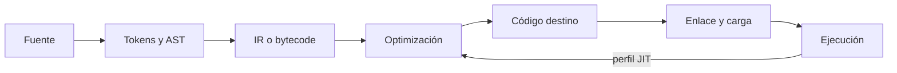
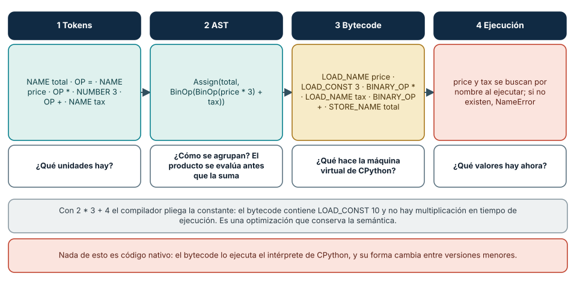
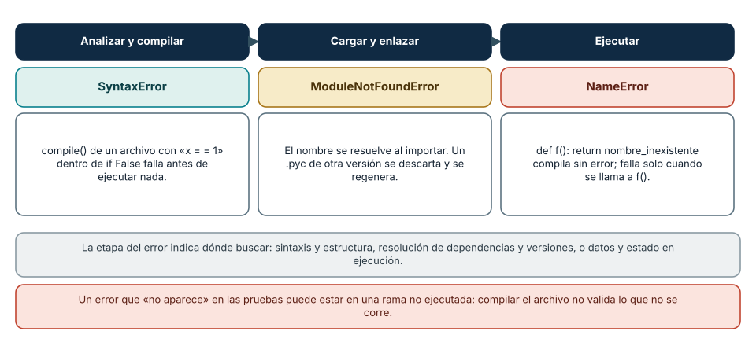
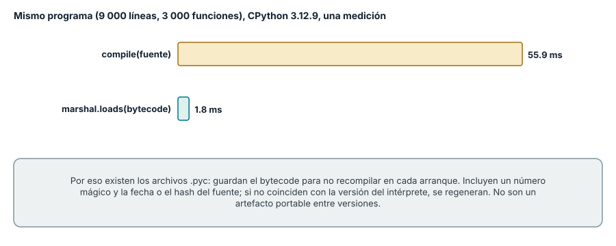
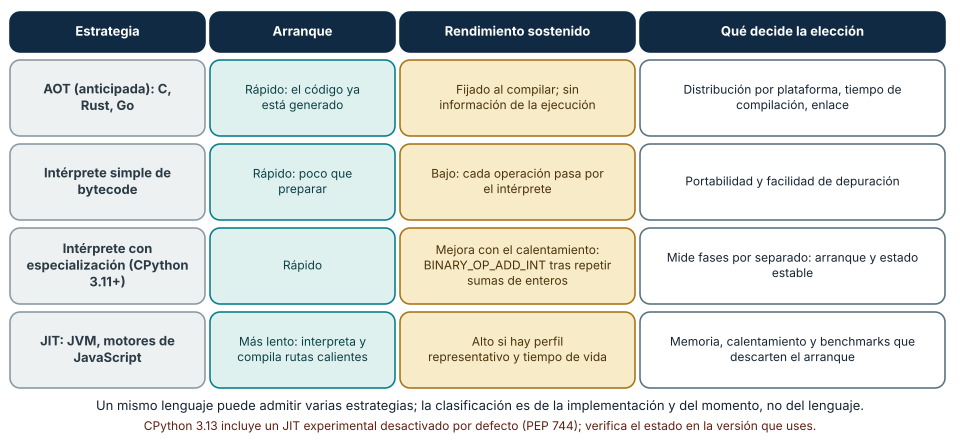

# SE-020 — Compilación, interpretación, bytecode y JIT

[← SE-019](https://github.com/vladimiracunadev-create/modern-software-engineering-program/blob/main/classes/part-01-computadores-y-representacion-de-informacion/se-019-procesos-hilos-interrupciones-y-entrada-salida/README.md) · [↑ Parte 01](https://github.com/vladimiracunadev-create/modern-software-engineering-program/blob/main/classes/part-01-computadores-y-representacion-de-informacion/README.md) · [📚 Índice completo](https://github.com/vladimiracunadev-create/modern-software-engineering-program/blob/main/classes/README.md) · [SE-021 →](https://github.com/vladimiracunadev-create/modern-software-engineering-program/blob/main/classes/part-01-computadores-y-representacion-de-informacion/se-021-runtimes-maquinas-virtuales-y-recoleccion-de-basura/README.md)

## Punto profesional y fundamento pedagógico

**Punto profesional.** La clase existe para seguir fuente, AST, bytecode, IR y ejecución para localizar la etapa que introduce un fallo.

**Por qué aparece aquí.** Se sitúa después de **Procesos, hilos, interrupciones y entrada/salida** y antes de **Runtimes, máquinas virtuales y recolección de basura**: convierte el conocimiento anterior en una decisión observable que la clase siguiente podrá reutilizar. La continuidad se comprueba en el artefacto, no por compartir vocabulario.

**Error conceptual que debe corregir.** Creer que interpretar excluye compilar o que JIT compila todo antes de iniciar.

**Secuencia de aprendizaje.** Predice qué partes del artefacto cambiarán al modificar una constante y una condición. Inspecciona AST y bytecode con la versión registrada, clasifica errores por etapa y trata el bytecode como detalle de CPython. Después contrasta el mapa con otra VM sin afirmar equivalencia entre sus representaciones.

**Evidencia de aprendizaje.** Pipeline.md con representaciones, tres etapas de fallo y contraste con otra VM. Debe contener predicción previa, observación, explicación causal, contraejemplo, criterio de aceptación y una nota de qué dato haría cambiar la conclusión.

**Límite de la conclusión.** Inspeccionar IR no prueba optimizaciones ni código nativo final.

### Trazabilidad fuente → afirmación

| Fuente primaria u oficial | Afirmación que respalda | Lo que no prueba |
|---|---|---|
| [Python `ast`](https://docs.python.org/3/library/ast.html) | , [`dis`](https://docs.python.org/3/library/dis.html) y [`py_compile`](https://docs.python.org/3/library/py_compile.html) definen las vistas usadas | No demuestra por sí sola que el artefacto del estudiante sea correcto. |
| [LLVM documentation](https://llvm.org/docs/) |  describe IR, generación y JIT | No demuestra por sí sola que el artefacto del estudiante sea correcto. |
| [JVM Specification](https://docs.oracle.com/javase/specs/) |  ofrece un formato de clase y VM especificados | No demuestra por sí sola que el artefacto del estudiante sea correcto. |

## Antes de empezar

Hasta ahora trataste el analizador local de eventos como fuente que “se ejecuta”. `SE-017` advirtió que una línea
no es una instrucción. Esta clase abre las traducciones entre texto, estructura,
representaciones intermedias y máquina. `SE-021` estudiará los servicios que permanecen activos durante esa ejecución.

## Prerrequisitos

ISA y bytecode distinguidos en `SE-017`, procesos de `SE-019`, Python 3.11+.

## Problema auténtico

“Python es interpretado y C compilado” se usa para explicar rendimiento. La frase
oculta que ambos atraviesan etapas, que CPython compila bytecode y que un runtime puede
compilar en ejecución. La decisión técnica nace de una dicotomía falsa.

## Objetivos observables

Seguirás análisis léxico/sintáctico, AST, IR, generación, enlace y carga; distinguirás
estrategia de traducción y momento; inspeccionarás AST/bytecode; explicarás límites de JIT.

## Temas y por qué importan

| Tema | Mecanismo | Por qué importa |
| --- | --- | --- |
| Frontend | valida sintaxis y produce estructura | separa lenguaje de máquina destino |
| IR/bytecode | conserva operaciones en formato intermedio | habilita portabilidad y optimización |
| AOT/JIT | elige cuándo generar código | intercambia arranque, adaptación y costo |
| Enlace/carga | resuelve dependencias y prepara proceso | explica fallos posteriores a compilar |
## Mapa conceptual

No todos los sistemas usan todas las cajas ni en ese orden. El bucle muestra que un JIT
puede usar evidencia de ejecución; no garantiza mejor rendimiento.

## Conceptos y decisiones

### 1. El frontend transforma texto en estructura con significado

Lexer y parser reconocen unidades y gramática; el AST descarta detalles de superficie y
conserva estructura. Análisis semántico resuelve nombres, tipos o reglas según lenguaje.
Un error de sintaxis ocurre antes de ejecutar la rama, aunque algunos entornos difieran en cuándo procesan el archivo.

**Cómo leer la figura.** La misma línea de código atraviesa cuatro representaciones, y cada una
permite una pregunta que la anterior no responde. Los *tokens* separan unidades; el *árbol sintáctico*
(AST) muestra cómo se agrupan, de modo que `price * 3` se evalúa antes de sumar `tax`; el *bytecode*
es lo que ejecuta la máquina virtual; y solo en la *ejecución* se buscan `price` y `tax` por su nombre
y se descubre si existen. En CPython 3.12 puedes ver cada etapa con `tokenize`, `ast.dump`, `dis` y `exec`.
**Dónde deja de valer:** otras implementaciones siguen etapas distintas o las fusionan, y el bytecode
cambia entre versiones menores (el listado de la figura corresponde a 3.12). El esquema es un modelo
para razonar, no una descripción del interior de todos los compiladores.

### 2. Una representación intermedia crea una nueva interfaz

IR y bytecode permiten analizar y transformar sin atarse inmediatamente a una ISA.
Pueden ser portables o específicos de versión. El bytecode de CPython está dirigido a
su máquina virtual y no es contrato estable para persistencia o interoperabilidad.

### 3. Optimizar preserva semántica dentro de supuestos

Eliminar trabajo, plegar constantes o reasignar registros cambia implementación sin
cambiar comportamiento permitido. Lenguajes con efectos, reflexión o excepciones
limitan transformaciones. “Optimizado” no significa menor latencia en toda carga; puede
aumentar tamaño o tiempo de compilación.

### 4. Compilar e interpretar describen mecanismos combinables

Un intérprete ejecuta una representación mediante otro programa. AOT genera artefactos
antes de ejecutar. Un JIT compila durante ejecución, usando información observada. Una
VM puede interpretar al inicio y compilar rutas calientes después. La elección considera
arranque, pico, portabilidad, memoria, depuración y distribución.

### 5. Enlace y carga completan el camino

Compilar una unidad no resuelve todas las dependencias. Enlace combina símbolos y
artefactos; carga mapea código y datos, resuelve bibliotecas y prepara estado. Versiones,
ABI y rutas pueden fallar aunque el fuente sea correcto. Empaquetado es parte del contrato.

### 6. Mirar cada etapa en CPython: `tokenize`, `ast`, `compile` y `dis`

Cada etapa tiene una herramienta estándar. `tokenize.generate_tokens` produce los tokens (`NAME total`,
`OP =`, `NAME price`, `OP *`, `NUMBER 3`…); `ast.parse` y `ast.dump(..., indent=1)` muestran el árbol, con
`Assign`, `BinOp`, `Name` y `Constant`; `compile(fuente, nombre, "exec")` produce un objeto de código cuyas
tablas `co_names` (`('price', 'tax', 'total')`) y `co_consts` (`(3, None)`) son parte del resultado; y
`dis.dis` lista las operaciones de bytecode. Con `compile("x = 2*3 + 4\n", "<s>", "exec")`, el desensamblado
muestra un solo `LOAD_CONST 10`: el compilador *plegó* la constante antes de ejecutar nada. Es una
optimización que conserva la semántica (el resultado siempre es 10) y que no cambia lo que el programa puede
observar.

Las etapas también determinan *cuándo* aparecen los errores. `compile("if False:\n    x = = 1\n", "f.py", "exec")`
lanza `SyntaxError` aunque la rama nunca pueda ejecutarse: el archivo entero se analiza antes de ejecutar una línea.
En cambio, `def f(): return nombre_inexistente` compila sin error, y el `NameError` aparece solo al llamar a `f()`.
Un `import` de un módulo inexistente falla al *cargarlo* con `ModuleNotFoundError`. Saber en qué etapa
ocurre un error indica dónde buscar su causa.

**Cómo leer la figura.** Cada columna es una etapa con un error que solo puede ocurrir en ella. La
sintaxis se valida para todo el archivo antes de ejecutar; los módulos se resuelven al importar; los
nombres de variables y atributos, al ejecutar la línea que los usa. **Dónde deja de valer:** en Python
muchos errores de nombre y tipo solo existen en tiempo de ejecución, mientras que lenguajes con análisis
estático más fuerte detectan parte de ellos al compilar. Y una rama no ejecutada puede contener un error que
ninguna prueba ve: compilar no es verificar el comportamiento.

### 7. Los archivos `.pyc`: qué contienen, por qué existen y por qué no son portables

Compilar cuesta. En una medición con 8 999 líneas de código (3 000 funciones), `compile` tardó 55,9 ms, mientras
que cargar el bytecode ya compilado con `marshal.loads` tardó 1,8 ms: unas 31 veces menos. Por eso CPython guarda
el bytecode de los módulos importados en archivos `.pyc` dentro de `__pycache__`. El archivo empieza con un
encabezado de 16 bytes: un *número mágico* que identifica la versión del bytecode (en 3.12, `cb0d0d0a`), un
campo de banderas, la fecha de modificación del fuente y su tamaño (o un hash). Si el número mágico no coincide con el
del intérprete, o el fuente cambió, el `.pyc` se descarta y se regenera.

**Cómo leer la figura.** Dos formas de obtener el mismo código ejecutable: traducirlo desde el fuente o cargar una
traducción previa. **Dónde deja de valer:** es una sola medición sobre un archivo sintético. En programas reales
la proporción depende del tamaño, y el costo de compilar se paga una vez por módulo y versión. La consecuencia
operativa es que un `.pyc` es un *artefacto de caché*, no un formato de distribución: no es portable entre versiones, y
nunca debe cargarse (ni deserializarse con `marshal`) si proviene de una fuente no confiable, porque la documentación
de `marshal` advierte que no está pensado para datos hostiles.

### 8. Intérpretes que se adaptan y compiladores en ejecución

La dicotomía «compilado o interpretado» se rompe en cuanto miras las implementaciones. Desde Python 3.11, el
intérprete *especializa* instrucciones según los tipos que observa (PEP 659). Tras repetir una suma de enteros
unas miles de veces, `dis.dis(add, adaptive=True)` muestra `BINARY_OP_ADD_INT` en lugar de la operación genérica, y
`LOAD_FAST__LOAD_FAST` fusiona dos cargas: el intérprete se reescribió a sí mismo usando evidencia de la ejecución. Un *JIT*
va más allá: traduce a código nativo las rutas calientes durante la ejecución. CPython 3.13 incluye un JIT experimental
(PEP 744) desactivado por defecto; la JVM y los motores de JavaScript lo usan de manera central.

**Cómo leer la figura.** Cada fila es una estrategia y cada columna una consecuencia observable. Lo que
distingue a un JIT no es ser «más rápido», sino pagar un costo de arranque y de memoria para obtener un rendimiento
sostenido mayor *si* el programa vive lo suficiente y su perfil es representativo. Un benchmark que mide una sola llamada
favorece a la compilación anticipada; uno que descarta el calentamiento favorece al JIT; ambos dicen la verdad sobre su
alcance. **Dónde deja de valer:** las celdas son tendencias, no medidas. Una implementación concreta puede combinar
varias estrategias, y la versión del intérprete cambia los resultados; por eso se reportan arranque y estado estable
por separado, con versión declarada.

## Caso conductor: tres representaciones del analizador local de eventos

Se elige una función `summarize(values)`. `ast.dump` muestra la estructura;
`dis.dis` muestra bytecode del intérprete actual; la ejecución produce resultados. La
clase no afirma qué código nativo termina ejecutando CPython. Cada artefacto responde una pregunta diferente.

## Definiciones de trabajo

- **AST:** árbol de estructura sintáctica relevante;
- **IR:** representación diseñada para análisis o traducción;
- **bytecode:** instrucciones de una máquina virtual;
- **AOT:** traducción antes de ejecutar;
- **JIT:** traducción durante ejecución.

## Glosario

**Frontend/backend** separan lenguaje fuente y destino. **Linker** resuelve artefactos.
**Loader** prepara ejecución. **Hot path** es ruta observada con alta actividad.

## Ejemplo mínimo

`python -m ast` y `python -m dis` ofrecen vistas diferentes del mismo fuente. Cambiar
versión puede cambiar bytecode sin cambiar el resultado del lenguaje.

## Ejemplo profesional

Una función JIT tarda al inicio y mejora después de calentamiento. Un benchmark que
mide una sola llamada favorece AOT; otro que descarta arranque favorece estado estable. Se reportan ambos según uso.

## Práctica guiada

Usa como base el [laboratorio ejecutable de la Parte 01](https://github.com/vladimiracunadev-create/modern-software-engineering-program/tree/main/labs/part-01-machine-observer); trabaja sobre una copia o conserva tus salidas en el directorio `work/SE-020/`.

1. Crea `translation_probe.py` con una función pura del analizador local de eventos.
2. Guarda AST con `ast.dump(..., indent=2)` y bytecode con `dis`.
3. Modifica una constante y un `if`; compara qué representación cambia.
4. Genera `.pyc` con `py_compile` en el directorio de práctica.
5. Registra versión y advierte que `.pyc` no es artefacto portable universal.
6. Elimina `__pycache__` y documenta limpieza.

## Ejercicios

1. Ubica tres errores en etapa de sintaxis, enlace/carga y ejecución.
2. Compara AOT y JIT para CLI breve y servidor duradero.
3. Explica por qué menos bytecode no garantiza menos instrucciones físicas.

## Reto verificable

Otra persona reconstruye cuatro etapas con tus artefactos y clasifica cada afirmación
por representación. Debe detectar una conclusión que el bytecode no permite.

## Preguntas frecuentes

### ¿Un lenguaje es compilado o interpretado?
La especificación y sus implementaciones pueden admitir múltiples estrategias.

### ¿El JIT siempre optimiza?
No; paga compilación y necesita perfiles representativos, memoria y tiempo de vida suficiente.

### ¿Python es interpretado o compilado?

Las dos cosas, en etapas distintas: CPython compila el fuente a bytecode y luego lo interpreta con una máquina
virtual. «Interpretado» describe una *estrategia de ejecución* de una implementación, no una propiedad del
lenguaje; existen implementaciones de Python con otras estrategias, incluyendo compilación anticipada y JIT.

### ¿Por qué mis pruebas no ven un error de sintaxis en un archivo que no importo?

Porque la sintaxis solo se analiza para los archivos que se compilan. Un módulo que ningún proceso importa
nunca se compila, y su error queda latente hasta que alguien lo cargue. Una forma barata de cubrirlo es ejecutar
`python -m compileall` sobre todo el código fuente en el flujo de verificación.

### ¿El bytecode de Python es estable entre versiones?

No. Cambia entre versiones menores sin aviso de compatibilidad, y la documentación de `dis` lo declara un
detalle de implementación. No guardes ni distribuyas bytecode como formato; distribuye fuente o paquetes y deja que
cada intérprete genere el suyo.

## Fallo controlado y diagnóstico

Conserva un `.pyc`, cambia versión de intérprete solo si ya está instalada y prueba
cargarlo. No fuerces compatibilidad: regenera desde fuente y documenta procedencia.

Un segundo fallo controlado ataca la idea de que «las pruebas que pasan validan todo el archivo». Escribe un
módulo con una función correcta y otra, nunca llamada por las pruebas, que contenga un nombre inexistente en una rama.
**Síntoma:** las pruebas pasan, `import` funciona y el módulo parece correcto. **Traza:** `python -m compileall` y
`python -W error -c "import modulo"` aceptan el archivo (el nombre no se resuelve al compilar); un analizador estático o una
prueba que ejecute esa rama revelan el `NameError`. **Corrección:** añade la prueba que recorre esa rama, y un paso de
análisis estático al flujo de verificación. Anota qué etapa detecta qué: la compilación detecta sintaxis; la ejecución,
nombres y valores.

## Errores comunes y cómo corregirlos

| Síntoma | Causa | Corrección |
| --- | --- | --- |
| lenguaje clasificado por una palabra | etapas combinadas ocultas | dibuja traducción real de implementación |
| bytecode = máquina | niveles confundidos | nombra VM y versión |
| benchmark ignora calentamiento | JIT/arranque omitido | mide fases por separado |
| compilar = desplegar | enlace, carga y dependencias omitidos | inventaría artefactos y runtime |

## Entorno y archivos clave

Python 3.11+, `ast`, `dis`, `py_compile`; `translation_probe.py`, `ast.txt`, `bytecode.txt`, `map.md`.

## Seguridad, ética y accesibilidad

Inspecciona solo fuente propio; no cargues bytecode recibido. Publica representaciones textuales y versiones.

## Puente hacia el trabajo con agentes

El código que un asistente genera puede *compilar* sin ser correcto, y la etapa donde aparece cada error
decide qué comprobación lo detecta. Una estrategia barata de verificación por capas es: compilar todo
(`compileall`), ejecutar un analizador estático o verificador de tipos, y ejecutar pruebas que recorran
las ramas modificadas; cada capa atrapa una clase de error distinta, y ninguna sustituye a las demás. Un
agente que «arregla» un error de ejecución puede crear otro en una rama que nadie ejecuta. Además, el bytecode y
los archivos serializados (`.pyc`, `marshal`, `pickle`) no son revisables por una persona: no aceptes artefactos
binarios generados o descargados por un agente, y ejecuta lo que genere en un entorno aislado. Las partes de
calidad, cadena de suministro y seguridad agentic profundizan en estos controles.

## Transferencia

Compara el mapa con JVM o LLVM usando su especificación, sin asumir equivalencia uno a uno.

## Evaluación y evidencia

Se exige mapa por etapas, artefactos versionados, comparación y límite sobre código nativo.

## Fuentes

- [Python `ast`](https://docs.python.org/3/library/ast.html), [`dis`](https://docs.python.org/3/library/dis.html) y [`py_compile`](https://docs.python.org/3/library/py_compile.html) definen las vistas usadas.
- [LLVM documentation](https://llvm.org/docs/) describe IR, generación y JIT.
- [PEP 659, Specializing Adaptive Interpreter](https://peps.python.org/pep-0659/) y [PEP 744, JIT Compilation](https://peps.python.org/pep-0744/): describen la especialización de CPython 3.11 y el JIT experimental; respalda la sección 8 (verifica el estado en la versión que uses).
- [Python `marshal`](https://docs.python.org/3/library/marshal.html) y [`tokenize`](https://docs.python.org/3/library/tokenize.html): formato interno de código compilado (con su advertencia de seguridad) y análisis léxico usados en la clase.
- Alfred Aho, Monica Lam, Ravi Sethi y Jeffrey Ullman, *Compilers: Principles, Techniques, and Tools*, 2.ª edición (Pearson, ISBN 978-0-321-48681-3): referencia clásica sobre las etapas de un compilador.
- [JVM Specification](https://docs.oracle.com/javase/specs/) ofrece un formato de clase y VM especificados.

## Límites y siguiente paso

No implementa compilador ni inspecciona código nativo. `SE-021` estudia runtime y memoria automática.

---
[← SE-019](https://github.com/vladimiracunadev-create/modern-software-engineering-program/blob/main/classes/part-01-computadores-y-representacion-de-informacion/se-019-procesos-hilos-interrupciones-y-entrada-salida/README.md) · [↑ Parte 01](https://github.com/vladimiracunadev-create/modern-software-engineering-program/blob/main/classes/part-01-computadores-y-representacion-de-informacion/README.md) · [SE-021 →](https://github.com/vladimiracunadev-create/modern-software-engineering-program/blob/main/classes/part-01-computadores-y-representacion-de-informacion/se-021-runtimes-maquinas-virtuales-y-recoleccion-de-basura/README.md)
