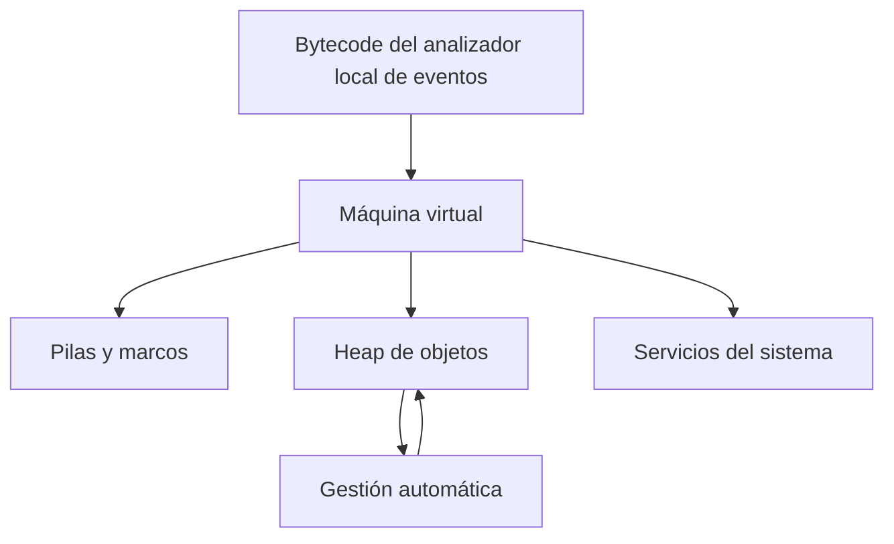
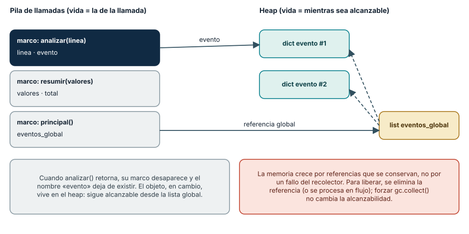
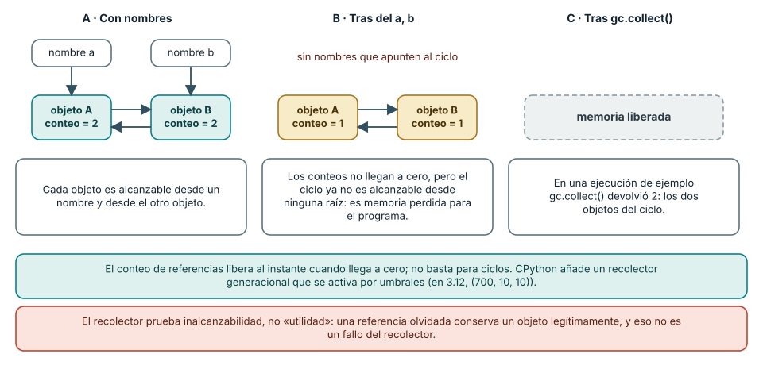
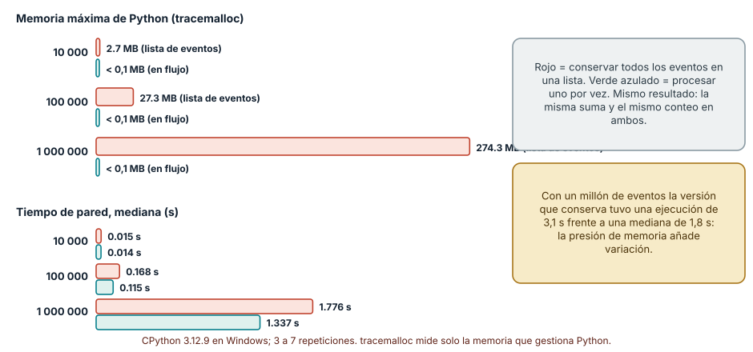

# SE-021 — Runtimes, máquinas virtuales y recolección de basura

[← SE-020](https://github.com/vladimiracunadev-create/modern-software-engineering-program/blob/main/classes/part-01-computadores-y-representacion-de-informacion/se-020-compilacion-interpretacion-bytecode-y-jit/README.md) · [↑ Parte 01](https://github.com/vladimiracunadev-create/modern-software-engineering-program/blob/main/classes/part-01-computadores-y-representacion-de-informacion/README.md) · [📚 Índice completo](https://github.com/vladimiracunadev-create/modern-software-engineering-program/blob/main/classes/README.md) · [SE-022 →](https://github.com/vladimiracunadev-create/modern-software-engineering-program/blob/main/classes/part-01-computadores-y-representacion-de-informacion/se-022-rendimiento-consumo-energetico-y-limites-fisicos/README.md)


## Punto profesional y fundamento pedagógico

**Punto profesional.** La clase existe para razonar sobre carga, memoria y recolección separando especificación de estrategia del runtime.

**Por qué aparece aquí.** Se sitúa después de **Compilación, interpretación, bytecode y JIT** y antes de **Rendimiento, consumo energético y límites físicos**: convierte el conocimiento anterior en una decisión observable que la clase siguiente podrá reutilizar. La continuidad se comprueba en el artefacto, no por compartir vocabulario.

**Error conceptual que debe corregir.** Suponer que gc.collect devuelve memoria al sistema o que toda VM recolecta igual.

**Secuencia de aprendizaje.** Dibuja raíces y referencias antes de observar memoria. Compara una versión que retiene objetos con otra que los procesa y descarta, fuerza una colección sin esperar que libere objetos alcanzables y localiza el borde que conserva la retención. Cierra separando vida del objeto de cierre oportuno del recurso externo.

**Evidencia de aprendizaje.** Runtime-memory.md con grafo de referencias, snapshots y recolección. Debe contener predicción previa, observación, explicación causal, contraejemplo, criterio de aceptación y una nota de qué dato haría cambiar la conclusión.

**Límite de la conclusión.** Los resultados de CPython no generalizan a otros runtimes y RSS no equivale a memoria rastreada.

### Trazabilidad fuente → afirmación

| Fuente primaria u oficial | Afirmación que respalda | Lo que no prueba |
|---|---|---|
| [Python `gc`](https://docs.python.org/3/library/gc.html) |  y [`tracemalloc`](https://docs.python.org/3/library/tracemalloc.html) definen observaciones usadas | No demuestra por sí sola que el artefacto del estudiante sea correcto. |
| [JVM Specification SE 27, Run-Time Data Areas](https://docs.oracle.com/javase/specs/jvms/se27/html/jvms-2.html#jvms-2.5) | distingue contrato y algoritmo no prescrito | No demuestra por sí sola que el artefacto del estudiante sea correcto. |

## Antes de empezar

`SE-020` dejó el analizador local de eventos convertido a AST y bytecode. Esas representaciones necesitan un
entorno que cargue módulos, cree objetos, maneje llamadas y errores y administre memoria.
Hoy estudiarás ese runtime. `SE-022` medirá sus costos sin confundirlos con el algoritmo.

## Prerrequisitos

Proceso, pila conceptual, bytecode e incertidumbre de medición (`SE-019`–`SE-020`).

## Problema auténtico

La memoria de un servicio crece y el equipo concluye “el garbage collector tiene una
fuga”. Puede existir retención alcanzable, caché intencional, fragmentación o memoria
nativa. Forzar colecciones reduce momentáneamente una señal sin explicar la causa.

## Objetivos observables

Explicarás servicios de runtime, pila y heap; distinguirás especificación de VM e
implementación; compararás conteo de referencias y trazado; observarás asignación y
alcanzabilidad; separarás memoria de recursos externos.

## Temas y por qué importan

| Tema | Mecanismo | Por qué importa |
| --- | --- | --- |
| Runtime | implementa servicios no escritos en cada programa | sostiene tipos, errores y carga |
| VM | define una máquina abstracta | desacopla lenguaje y hardware |
| Pila/heap | separan llamadas y objetos de vida variable | orientan diagnóstico de memoria |
| Recolección | recupera objetos inalcanzables | intercambia pausas, throughput y memoria |
## Mapa conceptual



El mapa separa áreas lógicas. Una especificación puede no imponer su ubicación física ni algoritmo de GC.

## Conceptos y decisiones

### 1. El runtime hace visible una semántica

Un runtime implementa representación de valores, llamadas, excepciones, carga,
resolución de nombres, asignación y otras convenciones. Puede incluir intérprete, JIT,
bibliotecas y enlaces nativos. Su trabajo explica por qué dos implementaciones del mismo
lenguaje pueden tener perfiles distintos sin violar la semántica.

### 2. Una máquina virtual es un contrato abstracto

La JVM especifica tipos, class files, instrucciones y áreas de ejecución, pero deja a la
implementación políticas como el algoritmo de recolección. CPython tiene una máquina de
bytecode propia con detalles distintos. “Corre en una VM” no informa automáticamente
aislamiento de seguridad, portabilidad total ni costo.

### 3. Marcos y heap expresan vidas diferentes

Cada llamada crea estado lógico: parámetros, locales, retorno y operandos. Objetos cuya
vida no coincide con una llamada se asignan en un heap administrado. Optimización puede
evitar o mover asignaciones, por lo que este modelo orienta razonamiento pero no prueba
ubicación física de cada valor.



**Cómo leer la figura.** A la izquierda están los marcos de las llamadas activas; a la derecha, los objetos que viven en
el heap. Una flecha es una referencia. Cuando `analizar()` retorna, su marco desaparece y su variable `evento` deja de existir,
pero el diccionario que creó permanece porque una lista global lo referencia. **Dónde deja de valer:** es un modelo lógico. En
CPython los marcos y las pilas se implementan con estructuras propias, y los objetos pequeños pueden reutilizarse o
almacenarse de forma especial; en otras máquinas virtuales el compilador puede incluso evitar asignar un objeto que no escapa de la función.

### 4. Recolectar significa demostrar inalcanzabilidad según un modelo

Conteo de referencias recupera cuando el conteo llega a cero, pero ciclos requieren
otro mecanismo. Un recolector por trazado parte de raíces y marca alcanzables; los demás
pueden recuperarse. Hipótesis generacionales usan el patrón de que muchos objetos mueren
jóvenes. Cada estrategia intercambia pausas, memoria, CPU y complejidad.



**Cómo leer la figura.** En A, cada objeto recibe una referencia de un nombre y otra del otro objeto, así que su conteo es 2. Al borrar
los nombres (B), cada conteo baja solo a 1: el ciclo se mantiene a sí mismo, aunque ningún nombre del programa pueda alcanzarlo.
El recolector de ciclos (C) parte de las raíces, no encuentra esos objetos y los libera. **Dónde deja de valer:** en
CPython el recolector de ciclos se dispara por umbrales de asignaciones (por defecto `(700, 10, 10)` en 3.12), no al instante,
de modo que la liberación de un ciclo es *impredecible* en el tiempo. Otras implementaciones (la JVM, PyPy) usan recolectores por
trazado sin conteo de referencias, con otro comportamiento de pausas.

### 6. CPython por dentro: conteo de referencias y recolector de ciclos

Cada objeto de CPython lleva un contador de referencias. `sys.getrefcount(x)` lo informa, sumando uno por el argumento
temporal de la llamada: una lista recién creada muestra 2, tras `y = x` muestra 3 y tras `del y` vuelve a 2. Cuando el contador llega
a cero el objeto se libera de inmediato, lo que hace que la limpieza sea *determinista* para la mayoría de los objetos. El punto débil
son los ciclos, que el recolector generacional resuelve de forma periódica. El siguiente experimento lo demuestra:

```python
import gc, weakref

class Nodo: pass
a, b = Nodo(), Nodo()
a.otro, b.otro = b, a          # ciclo
ref = weakref.ref(a)           # referencia débil: no cuenta ni mantiene vivo
del a, b
print(ref() is not None)       # True: el ciclo sigue vivo
gc.disable()
print(gc.collect())            # 2: dos objetos recuperados
print(ref() is not None)       # False
gc.enable()
```

La referencia débil permite *observar* la vida de un objeto sin prolongarla. En una ejecución de ejemplo (CPython 3.12.9), el
objeto seguía vivo tras `del` y desapareció solo tras `gc.collect()`, que devolvió 2. Observa también lo que no se afirma: el ejemplo no
dice cuándo el recolector habría actuado por sí solo ni cuánta memoria física devolvió al sistema, pues el asignador de Python puede
conservar la memoria liberada para reutilizarla.

### 7. Diagnosticar el crecimiento de memoria sin culpar al recolector

Una memoria creciente tiene causas distintas que se confunden con «una fuga». Las más frecuentes son: *retención alcanzable* (una
lista, un diccionario o un cierre que conserva referencias), *cachés sin límite*, *ciclos con finalizadores* en versiones antiguas,
*memoria nativa* (extensiones en C, búferes) que `tracemalloc` no ve, y *fragmentación* o reserva del asignador. Para separarlas se
compara instantáneas y se pregunta quién referencia el objeto.

El experimento del caso conductor ilustra el primer caso. Con cien mil eventos (diccionarios de tres campos), conservarlos todos en
una lista alcanzó un máximo de **27,3 MB** de memoria de Python según `tracemalloc`, mientras que procesarlos uno por uno (con un generador)
no llegó a 0,1 MB; con un millón de eventos fueron **274,3 MB** frente a una cantidad despreciable. Ambas versiones calculan lo mismo (la misma suma y el mismo
conteo). Llamar a `gc.collect()` no cambia la versión que retiene, porque los objetos *son* alcanzables: el recolector no ve un defecto.



**Cómo leer la figura.** El panel superior mide el pico de memoria de Python; el inferior, el tiempo mediano. La versión que conserva crece de
forma lineal con la entrada (2,7, 27,3 y 274,3 MB) y la de flujo se mantiene plana. También fue más lenta con un millón de eventos
(1,78 s frente a 1,34 s de mediana), y su peor ejecución llegó a 3,1 s: presión de memoria y trabajo del recolector añaden variación. **Dónde deja de valer:**
`tracemalloc` mide solo lo que gestiona Python y añade su propio costo; el consumo total del proceso, que ve el sistema operativo, incluye el intérprete
y la memoria nativa. Es una medición en un equipo y con datos sintéticos; sirve para fijar el método.

### 8. Recursos externos, finalizadores y propiedad

La memoria automática gestiona *objetos*, no *recursos*: un archivo, un socket o una transacción de base de datos viven fuera del
heap. Que el objeto Python que los representa quede inalcanzable no garantiza que el recurso se cierre en el momento oportuno. Los *finalizadores* (`__del__`)
se ejecutan cuando el objeto se libera, algo que en CPython suele ser inmediato para objetos sin ciclos pero que no está garantizado por el
lenguaje, y que no ocurre de forma determinista en otras implementaciones. La JVM lo reconoció: la finalización está *deprecada para su eliminación*
desde JDK 18 (JEP 421) por su imprevisibilidad.

La solución es *propiedad explícita*: abrir y cerrar con un administrador de contexto. Tras `with open(ruta) as fh:` el archivo está cerrado al salir
del bloque (`fh.closed` es `True`), con independencia de cuándo se libere el objeto. El mismo patrón se aplica a conexiones, bloqueos y
transacciones, y se compone con `contextlib` y con `ExitStack` cuando hay varios recursos. Una regla práctica para revisar código es preguntar, de cada
recurso, *quién lo cierra y en qué circunstancia*; si la respuesta es «el recolector», el diseño es frágil. Una limitación inversa existe para las cachés: un
`weakref.WeakValueDictionary` permite que el recolector descarte valores que nadie más usa, pero cambia la semántica (el valor puede desaparecer) y debe
usarse a propósito.


### 5. Memoria automática no administra todos los recursos

Un archivo, socket o transacción tiene vida externa. Que un objeto quede inalcanzable no
garantiza cierre oportuno. Se usan context managers y cierre explícito. Finalizadores
pueden ejecutarse tarde o bajo restricciones y no sustituyen propiedad clara.

## Caso conductor: objetos temporales del analizador local de eventos

El analizador local de eventos crea miles de diccionarios temporales al parsear eventos. `tracemalloc` compara
dos versiones: conservar todos en una lista y procesar en streaming. La primera mantiene
referencias alcanzables; llamar `gc.collect()` no debe liberarlas. El rediseño reduce
retención y conserva el resultado.

## Definiciones de trabajo

- **runtime:** servicios que implementan ejecución de un lenguaje;
- **máquina virtual:** arquitectura abstracta ejecutada por software o hardware;
- **raíz:** referencia inicial para un trazado de alcanzabilidad;
- **objeto alcanzable:** objeto conectado desde raíces según referencias;
- **finalización:** acción asociada al fin de vida, no garantía de liberación inmediata.

## Glosario

**Heap** almacena objetos de vida dinámica. **Frame** representa una llamada. **Pause**
es intervalo de trabajo del recolector que puede afectar la aplicación.

## Ejemplo mínimo

Dos objetos se referencian mutuamente. Quitar nombres externos deja un ciclo: conteo de
referencias solo no llega a cero; un recolector de ciclos puede detectarlo.

## Ejemplo profesional

Un servicio guarda respuestas en una caché sin límite. Los objetos son alcanzables; no
es fallo del GC. Se define tamaño, expiración, métrica y comportamiento al saturarse.

## Práctica guiada

Usa como base el [laboratorio ejecutable de la Parte 01](https://github.com/vladimiracunadev-create/modern-software-engineering-program/tree/main/labs/part-01-machine-observer); trabaja sobre una copia o conserva tus salidas en el directorio `work/SE-021/`.

1. Crea `runtime_probe.py` con objetos temporales y una versión que los retiene.
2. Mide instantáneas con `tracemalloc`; registra versión y tamaño de entrada.
3. Usa `gc.get_count()` y `gc.collect()` solo como observación documentada.
4. Explica por qué la lista retenida impide liberar.
5. Abre un archivo con `with` y contrasta vida del recurso con la del objeto.
6. Entrega `object-lifecycle.md`, `snapshots.txt`, `runtime_probe.py`.

## Ejercicios

1. Dibuja raíces y objetos de un ciclo.
2. Compara una pausa corta frecuente con otra larga infrecuente según carga.
3. Explica por qué una VM no es necesariamente un sandbox.

## Reto verificable

Otra persona identifica qué objetos permanecen alcanzables y reproduce la diferencia de
pico. Debe proponer dos explicaciones alternativas antes de culpar al GC.

## Preguntas frecuentes

### ¿`del` libera memoria inmediatamente?
Elimina una referencia; el efecto depende de referencias restantes, runtime y asignador.

### ¿GC elimina fugas?
Recupera objetos inalcanzables; una referencia olvidada conserva el objeto legítimamente.

### ¿Qué es una fuga de memoria si el recolector libera lo inalcanzable?

En lenguajes con recolección, una «fuga» suele ser *retención no intencional*: objetos todavía alcanzables que el programa ya no
necesita (una caché sin límite, un registro de oyentes que nunca se da de baja, una lista global). El recolector no puede saber que no los necesitas.
Una fuga de memoria *nativa* es distinta: ocurre en código de extensión que reserva y no libera, y es invisible para el recolector.

### ¿Debo llamar a `gc.collect()` en mi aplicación?

Casi nunca. Forzar colecciones cambia el momento de las pausas y rara vez resuelve la causa de un crecimiento. Es útil como
herramienta de diagnóstico (comprobar si un objeto se libera) y en situaciones específicas como justo antes de medir. En producción, ajustar
umbrales o rediseñar la retención suele ser más eficaz.

### ¿Una máquina virtual es un sandbox?

No. Una máquina virtual de lenguaje ejecuta bytecode con una semántica definida, pero el aislamiento de seguridad exige un mecanismo
añadido (permisos, un gestor de seguridad, procesos separados, contenedores). Ejecutar código no confiable en la misma máquina virtual que tus
datos no aísla nada por sí mismo.

## Fallo controlado y diagnóstico

Retén objetos en una lista global y fuerza GC. Registra que siguen alcanzables, elimina
la causa y vuelve a medir. No uses entradas capaces de agotar memoria.

Un segundo fallo controlado ataca la hipótesis «es una fuga del recolector». Escribe una función que agregue 100 000
diccionarios a una lista global y mide el pico con `tracemalloc`; luego llama a `gc.collect()` y mide de nuevo.
**Síntoma:** la memoria no baja. **Hipótesis A:** el recolector falló. **Hipótesis B:** los objetos son alcanzables por la lista global.
**Prueba que podría refutar B:** crear una `weakref` a uno de los diccionarios y comprobar que sigue vivo tras `gc.collect()`; si el objeto se
liberara, B sería falsa. **Corrección:** eliminar la referencia (vaciar la lista) y repetir: el pico y las referencias débiles cambian. Registra las
dos hipótesis, la prueba y el resultado. Mantén el tamaño de entrada acotado (cien mil basta) para no presionar el equipo.

## Errores comunes y cómo corregirlos

| Síntoma | Causa | Corrección |
| --- | --- | --- |
| toda memoria creciente = fuga GC | causas no separadas | inspecciona alcanzabilidad, caché y memoria nativa |
| `del` = liberación física | niveles confundidos | habla de referencias y política del runtime |
| finalizador para cerrar recursos | oportunidad no garantizada | usa propiedad y context manager |
| VM = seguridad | abstracción confundida con aislamiento | evalúa permisos y sandbox real |

## Entorno y archivos clave

Python 3.11+, `gc`, `tracemalloc`; entradas acotadas. Limpieza: cerrar recursos y eliminar `work/SE-021/`.

## Seguridad, ética y accesibilidad

No fuerces agotamiento ni inspecciones datos sensibles en snapshots. Publica tablas textuales y unidades.

## Puente hacia el trabajo con agentes

Un agente que se ejecuta durante horas es un proceso de larga vida y acumula estado: historial de conversación, resultados de herramientas,
archivos leídos. Es exactamente la retención de la figura 3: si cada paso conserva todo lo anterior, el contexto crece sin límite, igual que la
lista de eventos. La alternativa es la de *flujo*: procesar un elemento por vez, resumir o descartar lo que ya no hace falta y conservar solo el
estado necesario. Además, un agente que abre archivos, procesos o conexiones debe cerrarlos con propiedad explícita; un proceso lanzado y olvidado es
el equivalente de un archivo sin cerrar. Para el código que el agente escribe, exige que las pruebas incluyan casos de volumen (miles de elementos) y un
límite de memoria, porque una solución correcta con diez elementos puede agotar el equipo con diez millones. Las partes de contexto y harness retoman
estas políticas de retención y limpieza.

## Transferencia

Lee la JVM Specification y separa lo prescrito de la política de un recolector concreto.

## Evaluación y evidencia

Se exigen grafo de alcanzabilidad, medición acotada, manejo de recurso y límites.

## Fuentes


- [Python `gc`](https://docs.python.org/3/library/gc.html) y [`tracemalloc`](https://docs.python.org/3/library/tracemalloc.html) definen observaciones usadas.
- [JVM Specification SE 27, Run-Time Data Areas](https://docs.oracle.com/javase/specs/jvms/se27/html/jvms-2.html#jvms-2.5) distingue contrato y algoritmo no prescrito.
- [Python `weakref`](https://docs.python.org/3/library/weakref.html) y [`contextlib`](https://docs.python.org/3/library/contextlib.html): referencias débiles y administradores de contexto usados en las secciones 6 y 8.
- [JEP 421, Deprecate Finalization for Removal](https://openjdk.org/jeps/421): razones por las que la plataforma Java deja la finalización; respalda la advertencia sobre `__del__`.
- Richard Jones, Antony Hosking y Eliot Moss, *The Garbage Collection Handbook*, 2.ª edición (CRC Press, ISBN 978-1-4200-8279-1): referencia sobre conteo de referencias, trazado y recolectores generacionales.

## Límites y siguiente paso

No perfila memoria nativa ni compara recolectores productivos. `SE-022` diseña mediciones de rendimiento y energía.

---
[← SE-020](https://github.com/vladimiracunadev-create/modern-software-engineering-program/blob/main/classes/part-01-computadores-y-representacion-de-informacion/se-020-compilacion-interpretacion-bytecode-y-jit/README.md) · [↑ Parte 01](https://github.com/vladimiracunadev-create/modern-software-engineering-program/blob/main/classes/part-01-computadores-y-representacion-de-informacion/README.md) · [SE-022 →](https://github.com/vladimiracunadev-create/modern-software-engineering-program/blob/main/classes/part-01-computadores-y-representacion-de-informacion/se-022-rendimiento-consumo-energetico-y-limites-fisicos/README.md)
