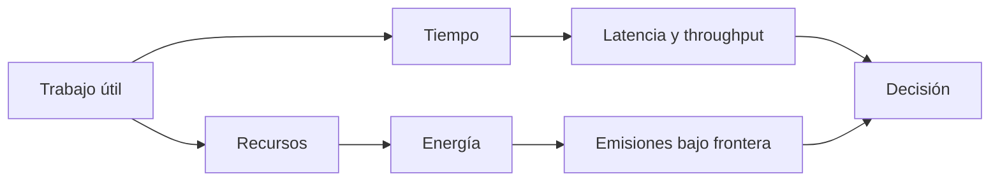
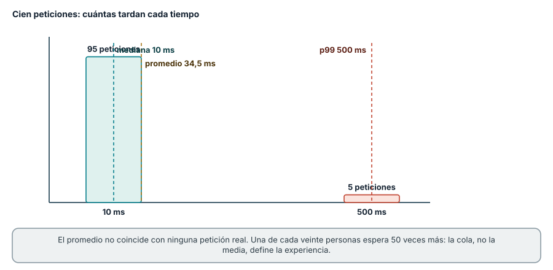
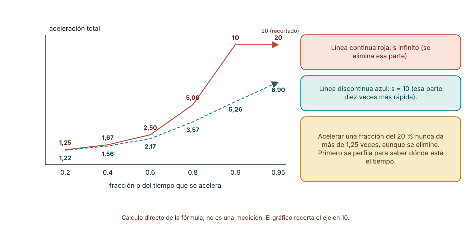
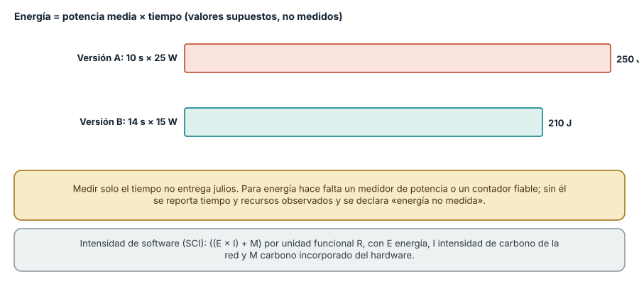
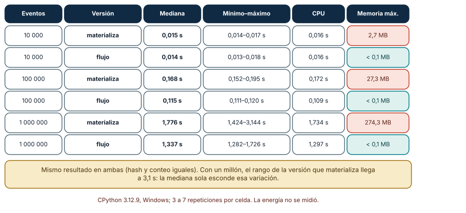

# SE-022 — Rendimiento, consumo energético y límites físicos

[← SE-021](https://github.com/vladimiracunadev-create/modern-software-engineering-program/blob/main/classes/part-01-computadores-y-representacion-de-informacion/se-021-runtimes-maquinas-virtuales-y-recoleccion-de-basura/README.md) · [↑ Parte 01](https://github.com/vladimiracunadev-create/modern-software-engineering-program/blob/main/classes/part-01-computadores-y-representacion-de-informacion/README.md) · [📚 Índice completo](https://github.com/vladimiracunadev-create/modern-software-engineering-program/blob/main/classes/README.md) · [SE-023 →](https://github.com/vladimiracunadev-create/modern-software-engineering-program/blob/main/classes/part-01-computadores-y-representacion-de-informacion/se-023-taller-observar-un-programa-desde-el-codigo-hasta-la-maquina/README.md)

## Punto profesional y fundamento pedagógico

**Punto profesional.** La clase existe para formular afirmaciones de rendimiento y energía con unidad funcional, protocolo, variación y frontera.

**Por qué aparece aquí.** Se sitúa después de **Runtimes, máquinas virtuales y recolección de basura** y antes de **Taller: observar un programa desde el código hasta la máquina**: convierte el conocimiento anterior en una decisión observable que la clase siguiente podrá reutilizar. La continuidad se comprueba en el artefacto, no por compartir vocabulario.

**Error conceptual que debe corregir.** Concluir que más rápido significa menor energía o comparar sin calentamiento.

**Secuencia de aprendizaje.** Define primero unidad funcional, oráculo de corrección, orden de ejecución y número de muestras. Alterna variantes, conserva datos crudos y decide de antemano cómo resumir variación. Luego intenta —y rechaza— inferir energía desde duración, indicando qué sensor, modelo y frontera serían necesarios.

**Evidencia de aprendizaje.** Performance-report.md con datos crudos, dispersión, unidad funcional y afirmaciones permitidas. Debe contener predicción previa, observación, explicación causal, contraejemplo, criterio de aceptación y una nota de qué dato haría cambiar la conclusión.

**Límite de la conclusión.** Sin sensor o modelo validado no se infiere consumo energético.

### Trazabilidad fuente → afirmación

| Fuente primaria u oficial | Afirmación que respalda | Lo que no prueba |
|---|---|---|
| [Python `time`](https://docs.python.org/3/library/time.html) |  y [`timeit`](https://docs.python.org/3/library/timeit.html) definen los relojes | No demuestra por sí sola que el artefacto del estudiante sea correcto. |
| [Software Carbon Intensity](https://greensoftware.foundation/standards/sci/) |  define frontera, energía, hardware y unidad funcional | No demuestra por sí sola que el artefacto del estudiante sea correcto. |

## Antes de empezar

El analizador local de eventos ya tiene representación, ejecución y runtime. Ahora responderás “¿es más
eficiente?” sin reducir la pregunta a un cronómetro. Definirás trabajo útil, carga,
latencia, throughput, recursos y frontera energética. `SE-023` aplicará el protocolo a
todo el recorrido.

## Prerrequisitos

Evidencia de `SE-006`, jerarquía de `SE-018`, runtime de `SE-021`, Python 3.11+.

## Problema auténtico

Una versión tarda 20 % menos en una corrida. Cambió el orden, la caché estaba caliente y
procesó menos datos válidos. La cifra mezcla rendimiento, corrección y ruido.

## Objetivos observables

Definirás carga y métrica; separarás latencia, throughput y utilización; diseñarás
benchmark repetible; aplicarás razonamiento de cuello de botella; delimitarás energía y emisiones.

## Temas y por qué importan

| Tema | Mecanismo | Por qué importa |
| --- | --- | --- |
| Métrica y carga | fijan qué trabajo se compara | evita optimizaciones irrelevantes |
| Variación | entorno y calentamiento alteran muestras | obliga a distribuciones y control |
| Cuello de botella | limita mejora del sistema completo | orienta esfuerzo donde cambia resultado |
| Energía y carbono | amplían frontera a electricidad y hardware | evita equiparar rapidez con sostenibilidad |
## Mapa conceptual

Tiempo, energía y emisiones se relacionan pero no son intercambiables. La intensidad de
la red y el hardware incorporado requieren datos adicionales.

## Conceptos y decisiones

### 1. Rendimiento empieza por trabajo útil y condiciones

Latencia mide cuánto tarda una unidad; throughput, cuántas se completan por tiempo;
utilización, cuánto ocupa un recurso. Mejorar una puede empeorar otra. La carga incluye
tamaño, distribución, concurrencia, estado y criterio de corrección. Comparar versiones
que producen resultados distintos no es benchmark.

### 2. Los relojes observan fronteras distintas

`perf_counter` mide tiempo transcurrido adecuado para duraciones; `process_time` mide
CPU del proceso. Ninguno explica por sí solo causa. Se registran versión, hardware
expuesto, carga, procesos relevantes y política de energía cuando esté disponible sin modificarla.

### 3. Calentamiento, ruido y distribución cambian la conclusión

Carga de módulos, cachés, JIT o frecuencia dinámica alteran primeras rondas. Se decide
si arranque forma parte del uso; no siempre debe descartarse. Múltiples muestras, orden
alternado, mediana y colas muestran variación. Eliminar outliers requiere regla previa y causa.

**Cómo leer la figura.** Hay dos grupos: 95 peticiones rápidas y 5 muy lentas. La mediana (10 ms) describe al grupo grande; el promedio (34,5 ms) no
coincide con ninguna petición real; el percentil 99 (500 ms) describe la cola. Una persona de cada veinte espera cincuenta veces más que las demás. **Dónde
deja de valer:** los datos son sintéticos y la distribución es la más sencilla posible. Las latencias reales tienen colas más suaves y dependen de la
carga, pero el mensaje se mantiene: un único resumen no describe una distribución, y el que se elija debe corresponder a la pregunta (¿cuánto tarda
un caso típico?, ¿qué espera la peor experiencia razonable?).

### 4. Acelerar una fracción tiene un límite sistémico

Si una parte representa una fracción pequeña, incluso eliminarla no acelera todo en la
misma proporción. Este razonamiento, relacionado con la ley de Amdahl, evita optimizar
lo visible y pequeño. Primero se perfila; luego se cambia una variable; finalmente se
verifica que no aumentó memoria, error o costo operativo.

**Cómo leer la figura.** El eje horizontal es la fracción del tiempo total que ocupa la parte optimizada; el vertical, cuánto se acelera el programa
completo. Aun eliminando por completo (s infinito) una parte que ocupa el 20 % del tiempo, el máximo es 1,25 veces; para ganar diez veces, la parte optimizada debe ocupar
el 90 % del tiempo *y* desaparecer. Con una mejora de diez veces en la parte (línea discontinua), una fracción del 90 % da solo 5,26. La fórmula es
*aceleración = 1 / ((1 − p) + p / s)*. **Dónde deja de valer:** supone que la fracción es fija y que el resto no cambia. En sistemas paralelos y de varios
componentes el reparto del tiempo se modifica al optimizar (otra parte pasa a ser el cuello), y existen formulaciones complementarias, como la de Gustafson,
que consideran que la carga crece con los recursos.

### 5. Energía no se deriva automáticamente del tiempo

Energía depende de potencia a lo largo del tiempo, hardware y actividad. Un programa
más rápido puede usar más potencia y aun consumir menos o más energía. Emisiones añaden
intensidad de carbono y hardware incorporado. SCI exige una frontera y unidad funcional.
Sin medidor fiable, se reporta tiempo/recursos observados y se declara energía no medida.

**Cómo leer la figura.** La energía es potencia multiplicada por tiempo: la versión A termina antes, pero con más potencia consume 250 J; B tarda más y con menos
potencia consume 210 J. **Dónde deja de valer:** los valores son *supuestos* para ilustrar la relación, no mediciones de ninguna máquina. En la práctica
la potencia varía durante la ejecución, el sistema consume energía en reposo, y los procesadores modernos ajustan su frecuencia; por eso el tiempo no es un
sustituto de la energía y esta debe medirse con un instrumento propio o declararse como no medida.

### 7. Un protocolo de benchmark paso a paso

Un benchmark responde una pregunta comparativa bajo condiciones controladas. El protocolo mínimo tiene siete pasos. (1) *Definir el trabajo útil y la
equivalencia*: ambas versiones deben producir el mismo resultado, verificado con un hash y un conteo *antes* de medir. (2) *Fijar la carga*: tamaños, semilla
y datos sintéticos. (3) *Registrar el entorno*: versión de Python, sistema, hardware visible y procesos activos. (4) *Calentar* y decidir si el arranque
forma parte del uso. (5) *Repetir* varias veces, alternando el orden de las versiones. (6) *Conservar todas las muestras* y reportar mediana y rango. (7) *Declarar lo que no se midió* (energía,
red, producción).

En el caso conductor, una versión materializa todos los eventos en una lista de diccionarios y otra los procesa en flujo. Ambas producen el mismo resultado
(por ejemplo, `(479604, 10000)` con diez mil eventos). Medido en CPython 3.12.9, con tres a siete repeticiones: con **10 000** eventos las medianas son prácticamente iguales (0,015 s y 0,014 s);
con **100 000**, 0,168 s frente a 0,115 s; con **1 000 000**, 1,776 s frente a 1,337 s, con un rango de la versión que materializa de 1,42 a 3,14 s. La memoria máxima fue de 2,7, 27,3 y 274,3 MB
para la que materializa y despreciable para la de flujo. La conclusión defendible es estrecha: *en este equipo y con esta carga, la versión de flujo usa mucha menos memoria y, a partir
de cien mil eventos, es más rápida*. No prueba que lo sea con otro formato de datos, otro intérprete ni en producción.

**Cómo leer la figura.** Cada fila es una combinación de tamaño y versión; la última columna destaca la memoria. Fíjate en la columna del rango: con un millón de eventos
la versión que materializa varía de 1,4 a 3,1 s entre ejecuciones, de modo que reportar solo la mediana o solo el mejor caso oculta información. **Dónde deja de valer:** son pocas
repeticiones sobre una carga sintética y un solo equipo. Para decisiones reales conviene más repeticiones, la distribución completa y la carga de producción.

### 8. Percentiles y colas: por qué el promedio engaña

El promedio resume una distribución en un número que puede no corresponder a ningún caso. Los *percentiles* indican el valor bajo el cual cae cierta fracción de las
observaciones: la mediana es el percentil 50, y el 95 o el 99 describen la cola. Con 100 observaciones ordenadas, el método del rango más próximo toma la observación número
`ceil(p/100 × n)`: el percentil 95 es la 95.ª y el 99, la 99.ª. En la distribución sintética de la Figura 1 el percentil 95 es todavía 10 ms, y el 99 salta a 500 ms:
un percentil alto solo ve la cola si hay suficientes observaciones y la cola es suficientemente pesada.

La cola importa más en sistemas compuestos. Si una petición llama a varios servicios y espera a todos, la probabilidad de que *alguna* llamada sea lenta crece con
el número de llamadas: con 100 llamadas independientes, cada una con un 1 % de probabilidad de ser lenta, la probabilidad de que al menos una lo sea es de aproximadamente el 63 %
(1 − 0,99¹⁰⁰). Este efecto, descrito por Dean y Barroso en *The Tail at Scale*, explica por qué los sistemas distribuidos se diseñan alrededor de percentiles y
de técnicas para tolerar la lentitud ocasional, no solo de promedios.

### 9. De tiempo a energía: qué se puede y qué no se puede afirmar

La energía se obtiene integrando la potencia en el tiempo: con potencia media constante, *E = P × t*. Un programa más rápido no consume necesariamente menos
(Figura 3), y un procesador que termina antes puede entrar en un estado de bajo consumo, lo que cambia la cuenta. Medir energía exige un instrumento: un medidor de
potencia externo, o contadores internos como los de energía que algunos procesadores exponen a través de herramientas del sistema. Python no los expone en su biblioteca estándar.

El estándar de *Software Carbon Intensity* (SCI) de la Green Software Foundation formaliza la contabilidad: *SCI = ((E × I) + M) por unidad funcional R*, donde *E* es la energía consumida,
*I* la intensidad de carbono de la electricidad usada, *M* el carbono incorporado del hardware atribuible y *R* la unidad funcional (por ejemplo, «una solicitud»). Exige declarar la
frontera. Cuando no hay medidor, la práctica honesta es reportar lo que sí se observó (tiempo, memoria, transferencia de datos) y escribir «energía no medida» en lugar de inferirla. Los límites físicos
(disipación de calor, costo de mover datos) explican por qué el siguiente hardware no resolverá por sí solo un diseño que trabaja de más.

### 6. Los límites físicos orientan, no excusan

Movimiento de datos, disipación y paralelismo tienen costos. Frecuencia no crece sin
límites térmicos y energéticos. La respuesta de software incluye reducir trabajo,
reutilizar, elegir representación y evitar transferencias; no asumir que el siguiente hardware resolverá todo.

## Caso conductor: comparar dos parsers del analizador local de eventos

Una versión materializa todos los eventos; otra procesa en streaming. Se verifica mismo
hash y conteo, luego se miden tiempo, CPU y pico Python para tres tamaños. Se declara que
energía no fue medida. La decisión considera memoria y latencia de arranque, no solo la mediana.

## Definiciones de trabajo

- **latencia:** tiempo para una unidad de trabajo;
- **throughput:** unidades completadas por tiempo;
- **benchmark:** experimento comparativo bajo protocolo;
- **cuello de botella:** restricción dominante del resultado;
- **unidad funcional:** resultado respecto del cual se normaliza impacto.

## Glosario

**Warm-up** es transición inicial. **Baseline** es referencia. **Tail latency** describe
colas de distribución. **Potencia** es tasa; **energía**, acumulación en tiempo.

## Ejemplo mínimo

Dormir 100 ms eleva pared, no CPU. Un bucle eleva ambas. Ninguna observación entrega julios.

## Ejemplo profesional

Comprimir reduce red y aumenta CPU. En red lenta puede mejorar latencia y energía total;
en dispositivo limitado puede empeorar. Se mide el sistema bajo su unidad funcional.

## Práctica guiada

Usa como base el [laboratorio ejecutable de la Parte 01](https://github.com/vladimiracunadev-create/modern-software-engineering-program/tree/main/labs/part-01-machine-observer); trabaja sobre una copia o conserva tus salidas en el directorio `work/SE-022/`.

1. Define “procesar N eventos válidos y obtener hash H”.
2. Implementa materialización y streaming con mismo resultado.
3. Usa `timeit` o bucle controlado, alterna orden y conserva muestras.
4. Mide CPU y pico con instrumentos ya usados, uno por vez si interfieren.
5. Reporta mediana, rango y límites; no inventes energía.
6. Entrega `benchmark.py`, `protocol.md`, `samples.csv`, `decision.md`.

## Ejercicios

1. Da un caso donde baja latencia y baja throughput.
2. Calcula el límite de acelerar una fracción de 20 %.
3. Define frontera energética y unidad funcional para una carga por lotes.

## Reto verificable

Otra persona reproduce la comparación y verifica equivalencia funcional. Aprueba si
puede identificar carga, relojes, calentamiento, variación y conclusión no permitida.

## Preguntas frecuentes

### ¿La mediana basta?
No siempre; las colas pueden dominar experiencia o capacidad.

### ¿Menos CPU significa menos carbono?
No necesariamente; faltan tiempo, otros recursos, intensidad y hardware.

### ¿Cuántas repeticiones necesito para un benchmark?

Las suficientes para que la mediana y el rango sean estables ante una repetición del experimento. Para operaciones de microsegundos hacen falta
miles (por eso existe `timeit`); para tareas de segundos, entre cinco y treinta suele bastar. Si el rango entre ejecuciones es del mismo orden que la diferencia entre las versiones, no hay
evidencia de que una sea mejor.

### ¿Puedo usar el mejor tiempo (el mínimo) en lugar de la mediana?

El mínimo estima el costo cuando menos interfiere el entorno y es útil para microbenchmarks deterministas. Pero no representa lo que experimentará una persona usuaria,
que sufre el ruido, y oculta la cola. Reporta el mínimo y la mediana *con el rango*, y declara cuál responde a tu pregunta.

### ¿Un microbenchmark sirve para decidir sobre producción?

Para descartar una idea, sí; para adoptarla, no por sí solo. Un microbenchmark aísla un fragmento con datos y cachés distintos a los reales. Valídalo con una carga representativa
y mide el efecto sobre la métrica de producción antes de generalizar.

## Fallo controlado y diagnóstico

Compara una corrida fría de A con una caliente de B. Luego alterna y repite. Conserva
ambos resultados para mostrar cómo el método cambió la conclusión.

Un segundo fallo controlado ataca el promedio. Genera cien latencias sintéticas con noventa y cinco valores de 10 ms y cinco de 500 ms, y calcula
promedio, mediana, percentil 95 y percentil 99 con el método del rango más próximo. **Síntoma:** el promedio (34,5 ms) parece «aceptable» y esconde que el 5 % espera 500 ms.
**Causa:** un resumen único de una distribución con cola. **Corrección:** reporta mediana y percentiles junto con el número de observaciones, y fija un objetivo sobre un percentil (por ejemplo,
«el 99 % de las peticiones por debajo de 200 ms»). Repite con 1 000 observaciones y comprueba cómo cambia la estabilidad del percentil 99: con pocas observaciones, un percentil alto es una
estimación débil. Registra qué decisión habría tomado el equipo con cada resumen.

## Errores comunes y cómo corregirlos

| Síntoma | Causa | Corrección |
| --- | --- | --- |
| una corrida decide | variación ignorada | repite, alterna y reporta distribución |
| versión rápida procesa menos | trabajo útil no verificado | compara salida/invariantes antes del tiempo |
| tiempo = energía | frontera incompleta | mide energía o declara no medida |
| microbenchmark = producción | carga no representativa | limita conclusión y valida con contexto |

## Entorno y archivos clave

Python 3.11+, `time`, `timeit`, `tracemalloc`; entrada sintética y límites de tamaño. Limpieza de resultados temporales.

## Seguridad, ética y accesibilidad

No desactives controles térmicos ni satures equipos compartidos. Publica datos tabulares y no conviertas hardware costoso en prerrequisito educativo.

## Puente hacia el trabajo con agentes

Pedir a un asistente que «optimice» es pedir una mejora sin definir la métrica, y la respuesta suele ser un microbenchmark con una sola ejecución. El protocolo de esta clase es
el contrato que debe cumplir cualquier propuesta de rendimiento de un agente: equivalencia verificada, carga declarada, repeticiones, distribución y alcance de la conclusión. Hay un
riesgo específico: un agente optimiza la métrica que se le da y puede mejorar el promedio degradando la cola, o reducir el tiempo recortando trabajo (la «versión rápida que procesa menos»).
Del mismo modo, medir un flujo asistido por modelos requiere las mismas ideas: las respuestas varían entre ejecuciones, de modo que se repite, se reportan percentiles de latencia (incluido
el tiempo hasta el primer token), se normaliza el costo por una unidad funcional (por ejemplo, «por tarea resuelta correctamente») y se declara lo que no se midió, como la energía de la
inferencia. Las partes de evals y de costos de la IA asistida desarrollan estas métricas.

## Transferencia

Diseña el mismo protocolo para una función de red sin ejecutarla contra servicios externos.

## Evaluación y evidencia

Se exige equivalencia, protocolo, muestras, análisis de cuello y frontera energética honesta.

## Fuentes

- [Python `time`](https://docs.python.org/3/library/time.html) y [`timeit`](https://docs.python.org/3/library/timeit.html) definen los relojes.
- [Software Carbon Intensity](https://greensoftware.foundation/standards/sci/) define frontera, energía, hardware y unidad funcional.
- Jeffrey Dean y Luiz André Barroso, «The Tail at Scale», *Communications of the ACM* 56(2), 2013, DOI [10.1145/2408776.2408794](https://doi.org/10.1145/2408776.2408794): origen del análisis de latencias de cola en sistemas compuestos; respalda la sección 8.
- Gene Amdahl, «Validity of the single processor approach to achieving large scale computing capabilities», AFIPS 1967, DOI [10.1145/1465482.1465560](https://doi.org/10.1145/1465482.1465560): origen de la ley citada en la figura 2.
- Raj Jain, *The Art of Computer Systems Performance Analysis* (Wiley, ISBN 978-0-471-50336-1): diseño de experimentos y análisis de mediciones de rendimiento.
- [Python `statistics`](https://docs.python.org/3/library/statistics.html): mediana y cuantiles usados en el protocolo.

## Límites y siguiente paso

No mide energía física ni simula producción. `SE-023` integra todas las observaciones en un taller vertical.

---
[← SE-021](https://github.com/vladimiracunadev-create/modern-software-engineering-program/blob/main/classes/part-01-computadores-y-representacion-de-informacion/se-021-runtimes-maquinas-virtuales-y-recoleccion-de-basura/README.md) · [↑ Parte 01](https://github.com/vladimiracunadev-create/modern-software-engineering-program/blob/main/classes/part-01-computadores-y-representacion-de-informacion/README.md) · [SE-023 →](https://github.com/vladimiracunadev-create/modern-software-engineering-program/blob/main/classes/part-01-computadores-y-representacion-de-informacion/se-023-taller-observar-un-programa-desde-el-codigo-hasta-la-maquina/README.md)
