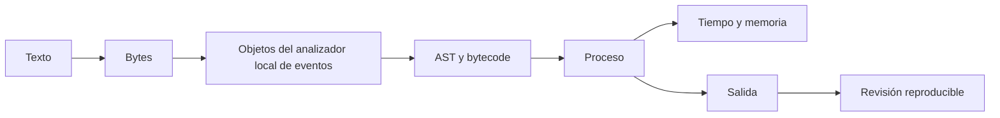
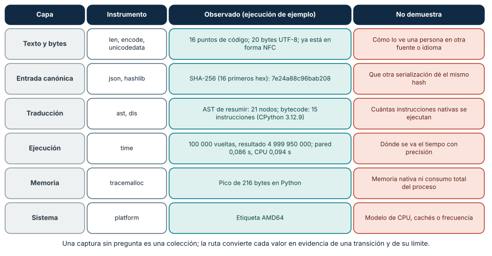
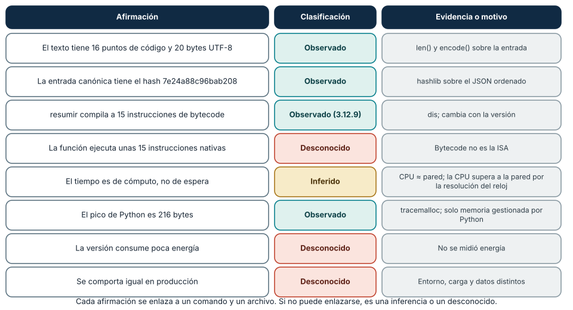
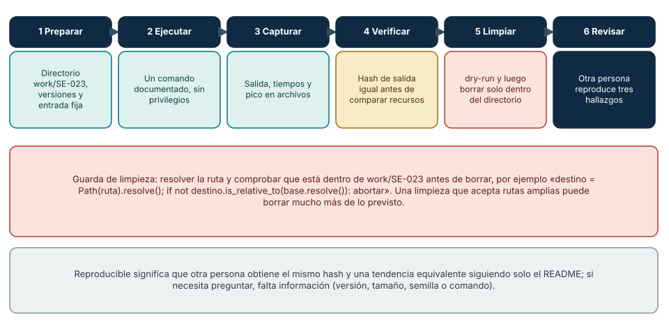

# SE-023 — Taller: observar un programa desde el código hasta la máquina

[← SE-022](https://github.com/vladimiracunadev-create/modern-software-engineering-program/blob/main/classes/part-01-computadores-y-representacion-de-informacion/se-022-rendimiento-consumo-energetico-y-limites-fisicos/README.md) · [↑ Parte 01](https://github.com/vladimiracunadev-create/modern-software-engineering-program/blob/main/classes/part-01-computadores-y-representacion-de-informacion/README.md) · [📚 Índice completo](https://github.com/vladimiracunadev-create/modern-software-engineering-program/blob/main/classes/README.md) · [SE-024 →](https://github.com/vladimiracunadev-create/modern-software-engineering-program/blob/main/classes/part-01-computadores-y-representacion-de-informacion/se-024-proyecto-informe-reproducible-de-comportamiento-y-recursos/README.md)


## Punto profesional y fundamento pedagógico

**Punto profesional.** La clase existe para integrar las capas del computador en una explicación causal que separe observación, inferencia e hipótesis.

**Por qué aparece aquí.** Se sitúa después de **Rendimiento, consumo energético y límites físicos** y antes de **Proyecto: informe reproducible de comportamiento y recursos**: convierte el conocimiento anterior en una decisión observable que la clase siguiente podrá reutilizar. La continuidad se comprueba en el artefacto, no por compartir vocabulario.

**Error conceptual que debe corregir.** Elegir una causa a partir de una sola métrica o presentar una captura como explicación.

**Secuencia de aprendizaje.** Antes de integrar, selecciona tres afirmaciones y predice qué instrumento podría sostenerlas. Ejecuta el laboratorio común, enlaza cada salida con una capa y separa en columnas lo observado, lo inferido y lo no medido. Una revisión cruzada debe detectar al menos una generalización que el dossier no autoriza.

**Evidencia de aprendizaje.** End-to-end-trace.md con mapa fuente→runtime→SO→máquina y vacíos explícitos. Debe contener predicción previa, observación, explicación causal, contraejemplo, criterio de aceptación y una nota de qué dato haría cambiar la conclusión.

**Límite de la conclusión.** La traza explica solo el caso y el entorno instrumentados.

### Trazabilidad fuente → afirmación

| Fuente primaria u oficial | Afirmación que respalda | Lo que no prueba |
|---|---|---|
| [Python 3 documentation](https://docs.python.org/3/) |  sustenta todas las interfaces del taller | No demuestra por sí sola que el artefacto del estudiante sea correcto. |
| [Unicode Standard 18.0](https://www.unicode.org/versions/Unicode18.0.0/) | sustenta la entrada textual | No demuestra por sí sola que el artefacto del estudiante sea correcto. |
| [RISC-V specifications](https://docs.riscv.org/reference/isa/) |  delimitan lo que una ISA sí describe | No demuestra por sí sola que el artefacto del estudiante sea correcto. |

## Antes de empezar

Las clases anteriores abrieron una capa por vez. El taller vuelve a cerrar el sistema:
seguirás una ejecución del analizador local de eventos desde caracteres y bytes hasta AST, bytecode, proceso,
tiempo y memoria. La disciplina central es separar evidencia directa de interpretación.
El dossier será la entrada de `SE-024`.

## Prerrequisitos

Artefactos de `SE-013`–`SE-022`, Python 3.11+, terminal y editor.

## Problema auténtico

Un informe reúne capturas de `dis`, tiempos y memoria, pero no conecta una pregunta con
ellas. Más herramientas no producen explicación: hace falta una ruta vertical,
controles y límites.

## Objetivos observables

Seguirás una unidad de información por seis capas; reproducirás una ejecución; enlazarás
cada afirmación a evidencia; formularás hipótesis rivales; y entregarás limpieza y revisión.

## Temas y por qué importan

| Etapa | Evidencia | Por qué importa |
| --- | --- | --- |
| Entrada | texto, puntos y bytes | fija significado inicial |
| Traducción | fuente, AST y bytecode | muestra transformaciones del runtime |
| Ejecución | proceso, CPU/pared y salida | conecta trabajo con entorno |
| Recursos | asignación y archivos | descubre costos y persistencia |
## Mapa conceptual



Las flechas representan relaciones verificadas en el taller. No implican correspondencia uno a uno con instrucciones físicas.

## Conceptos y decisiones

### 1. La unidad de seguimiento debe permanecer identificable

Se elige un evento sintético con `sequence`, texto y valor. Un hash permite comprobar
que las variantes procesan el mismo contenido. Sin identidad e invariantes, no es
posible saber si una “optimización” observó el mismo trabajo.

### 2. Cada instrumento tiene un alcance

`unicodedata` observa propiedades; `ast`, estructura; `dis`, bytecode; `platform`,
etiquetas; `time`, relojes; `tracemalloc`, asignación rastreada por Python. El dossier
incluye una columna “no demuestra” para evitar que la herramienta se convierta en autoridad universal.

### 3. Una ruta vertical conecta causa y consecuencia

La entrada codificada produce bytes; el parser crea objetos; la función se traduce; el
proceso ejecuta y solicita I/O; el resultado conserva invariantes. Se identifican saltos
que no pueden observarse, como instrucciones nativas exactas o energía.



**Cómo leer la figura.** Cada fila sigue el mismo evento sintético por una capa: la columna central contiene un valor *realmente observado*
en una ejecución de ejemplo, y la última dice qué no puede concluirse de ese valor. Por ejemplo, el hash de la entrada canónica demuestra que dos
corridas procesan el mismo contenido serializado, no que otra serialización produzca el mismo valor. **Dónde deja de valer:** son los valores de un equipo y una versión
(CPython 3.12.9, AMD64); otra versión cambiará el número de instrucciones de bytecode y otro equipo, los tiempos. Lo que se conserva en cualquier entorno es la
*estructura*: capa, instrumento, valor y límite.

### 6. El dossier de referencia: un programa mínimo que sigue la ruta

Un programa pequeño basta para reunir las seis capas. El siguiente `event_analyzer.py` toma un evento sintético, lo serializa de forma canónica, inspecciona
la traducción de una función, ejecuta un cálculo y captura tiempos y memoria. Es una versión mínima y autocontenida del tipo de artefacto que produce el laboratorio de la Parte 01.

```python
import ast, dis, hashlib, json, platform, sys, time, tracemalloc, unicodedata

EVENTO = {"sequence": 513, "texto": "Matrícula José ✓", "valor": 0.1}

def resumir(valores):
    total = 0
    for v in valores:
        total += v
    return total

def main():
    texto = EVENTO["texto"]
    canon = json.dumps(EVENTO, ensure_ascii=False, sort_keys=True).encode("utf-8")
    instrucciones = sum(1 for _ in dis.get_instructions(resumir.__code__))
    arbol = ast.parse(open(__file__, encoding="utf-8").read())
    funcion = next(n for n in arbol.body if isinstance(n, ast.FunctionDef) and n.name == "resumir")
    t0, c0 = time.perf_counter(), time.process_time()
    tracemalloc.start()
    resultado = resumir(range(100_000))
    _, pico = tracemalloc.get_traced_memory()
    tracemalloc.stop()
    print(json.dumps({
        "python": sys.version.split()[0], "maquina": platform.machine(),
        "puntos_de_codigo": len(texto), "bytes_utf8": len(texto.encode("utf-8")),
        "nfc_igual": unicodedata.normalize("NFC", texto) == texto,
        "sha256_entrada": hashlib.sha256(canon).hexdigest()[:16],
        "instrucciones_bytecode": instrucciones, "nodos_ast_funcion": sum(1 for _ in ast.walk(funcion)),
        "resultado": resultado, "pared_s": round(time.perf_counter() - t0, 4),
        "cpu_s": round(time.process_time() - c0, 4), "pico_bytes": pico}, ensure_ascii=False, indent=1))

if __name__ == "__main__":
    main()
```

En una ejecución de ejemplo (CPython 3.12.9, AMD64) la salida fue: 16 puntos de código y 20 bytes UTF-8 (la `í` y el `✓` ocupan más de un byte), el texto ya estaba en forma NFC, el
SHA-256 de la entrada canónica empezó por `7e24a88c96bab208`, la función tenía **15 instrucciones de bytecode** y **21 nodos** en su árbol, el cálculo dio
`4999950000`, la pared fue de 0,086 s y la CPU de 0,094 s, y el pico de memoria de Python fue de 216 bytes. Dos decisiones del diseño merecen atención. La serialización
*canónica* (claves ordenadas, `ensure_ascii=False`, UTF-8) es lo que hace que el hash sea reproducible: sin ordenar las claves, el mismo contenido podría producir
bytes distintos. Y se mide *después* de preparar todo, con el reloj de pared y el de CPU juntos, para poder clasificar el tiempo como espera o cálculo.

### 7. Clasificar la evidencia: observado, inferido y desconocido

Con la salida en la mano, el trabajo es escribir qué *sostiene* cada valor. La Figura 2 clasifica ocho afirmaciones. Lo **observado** es lo que un instrumento
declaró directamente (el hash, el recuento de bytecode, el pico de Python). Lo **inferido** es una explicación razonada sobre observaciones: que el tiempo es de cómputo se
infiere de CPU ≈ pared, y la CPU (0,094 s) superó a la pared (0,086 s) por la resolución de los relojes, algo que debe declararse en lugar de ocultarse. Lo **desconocido** es lo que
ninguna herramienta usada puede responder: cuántas instrucciones nativas ejecutó la función, cuánta energía consumió, cómo se comporta en producción.



**Cómo leer la figura.** La columna central usa etiquetas (no solo color) para que la clasificación sea legible sin distinguir colores. Cada fila enlaza una afirmación con
la herramienta y el límite que la sostienen. Obsérvese la fila del bytecode: es *observado* solo para esa versión del intérprete, y la fila siguiente impide convertir
«15 instrucciones de bytecode» en «15 instrucciones físicas». **Dónde deja de valer:** la frontera entre observado e inferido es borrosa porque todo instrumento incorpora
supuestos (por ejemplo, qué cuenta como instrucción). La disciplina útil es declarar el supuesto, no pretender una observación pura.

### 8. Reproducción y limpieza seguras

El criterio de reproducibilidad es práctico: otra persona, con solo el README, obtiene el mismo hash y una tendencia equivalente. Eso exige preparación (directorio, versiones,
entrada fija), un comando documentado, capturas en archivos, una verificación de invariantes *antes* de comparar recursos y una limpieza acotada. La limpieza merece cuidado
porque es la única operación destructiva del taller: un `cleanup.py` que recibe una ruta y borra sin comprobarla puede eliminar mucho más de lo previsto. La defensa es resolver la ruta
y comprobar que está dentro del directorio de trabajo, y ofrecer siempre una vista previa:

```python
from pathlib import Path
import shutil, sys

BASE = Path("work/SE-023").resolve()

def limpiar(ruta, ejecutar=False):
    destino = Path(ruta).resolve()
    if not destino.is_relative_to(BASE) or destino == BASE.parent:
        sys.exit(f"Ruta fuera de {BASE}: {destino}")
    print(("Borrando " if ejecutar else "[dry-run] borraría ") + str(destino))
    if ejecutar and destino.exists():
        shutil.rmtree(destino)
```



**Cómo leer la figura.** Los seis pasos son una cadena: cada uno produce lo que el siguiente consume. El cuarto (verificar el hash) es una *compuerta*: si el invariante no se cumple,
no se comparan recursos. El quinto indica el control de seguridad: vista previa y comprobación de ruta. **Dónde deja de valer:** el protocolo supone un directorio de trabajo propio y
datos ficticios; en un equipo compartido o con datos reales hacen falta controles adicionales (permisos, copias, aprobación). Las rutas de Windows y de sistemas POSIX difieren en detalles (mayúsculas, enlaces simbólicos): prueba
el script de limpieza con directorios desechables antes de confiarle algo.


### 4. Comparar exige cambiar una variable relevante

El taller compara materializar y streaming bajo la misma entrada. Cambiar código,
tamaño y orden a la vez elimina atribución. Se fija semilla, se alterna orden y se
conservan muestras. Una diferencia pequeña frente a variación se reporta como inconclusa.

### 5. Reproducibilidad incluye recuperación

El README declara preparación, comando, salidas, limpieza y versiones. Un script solo
es reproducible si sus efectos son conocidos y acotados. La revisión cruzada ejecuta en
un segundo entorno o, si no puede, inspecciona pasos y explica el límite.

## Caso conductor: protocolo integrado del analizador local de eventos

La entrada canónica es JSON UTF-8 con texto multilingüe y valores límite. El analizador local de eventos valida,
normaliza según contrato, calcula un resumen y escribe salida temporal. Se captura
representación, AST/bytecode de la función, identificador del proceso, tiempos y pico
Python. El dossier enlaza cada observación a archivo y comando.

## Definiciones de trabajo

- **ruta vertical:** seguimiento de una capacidad a través de capas;
- **invariante:** propiedad que debe conservarse entre variantes;
- **instrumento:** mecanismo que produce una observación con alcance;
- **procedencia:** origen, versión y transformación de evidencia;
- **reproducción:** repetición documentada del método.

## Glosario

**Probe** es observación acotada. **Fixture** es entrada estable. **Cold/warm** distingue
estados inicial y estabilizado según protocolo.

## Ejemplo mínimo

El hash de salida coincide y el pico baja. Esto respalda equivalencia del contenido y
diferencia en memoria Python; no demuestra menor energía ni igual comportamiento en producción.

## Ejemplo profesional

Un reporte de regresión incluye commit, runtime, carga, muestras y perfil. El equipo
puede repetir y decidir; una captura de “antes/después” no ofrece ese contrato.

## Práctica guiada

Usa como base el [laboratorio ejecutable de la Parte 01](https://github.com/vladimiracunadev-create/modern-software-engineering-program/tree/main/labs/part-01-machine-observer); trabaja sobre una copia o conserva tus salidas en el directorio `work/SE-023/`.

1. Crea `work/SE-023/` con `input.json`, `event_analyzer.py` y `README.md`.
2. Valida puntos de código, bytes y hash esperado.
3. Guarda AST y bytecode de la función principal.
4. Ejecuta variantes materializada y streaming con protocolo de `SE-022`.
5. Captura pared, CPU y pico Python; no mezcles instrumentos si alteran la medida.
6. Completa `evidence-map.md` con observado/inferido/desconocido.
7. Pide reproducción de tres hallazgos y corrige.
8. Ejecuta `cleanup.py --dry-run` y después elimina solo el directorio temporal creado.

## Ejercicios

1. Añade una entrada Unicode normalizada de dos formas y preserva semántica.
2. Localiza una afirmación que `dis` no puede sostener.
3. Cambia sistema operativo o versión y explica diferencias sin llamarlas fallo.

## Reto verificable

Una segunda persona reproduce entrada, hash y tendencia de memoria o entrega una
explicación basada en entorno. Debe clasificar diez afirmaciones sin contexto oral.

## Preguntas frecuentes

### ¿Necesito desensamblador nativo?
No. El alcance llega a bytecode y señales del proceso; cualquier herramienta adicional es opcional y documentada.

### ¿Si la tendencia cambia, fallé?
No. Una diferencia explicada puede revelar una variable o límite del método.

### ¿Qué hago si mi hash no coincide con el de otra persona?

No concluyas que alguien se equivocó. Compara la entrada byte a byte: finales de línea (CRLF o LF), codificación, orden de claves, espacios y versión de la biblioteca. Un hash es sensible a un solo byte, por
lo que una diferencia casi siempre señala una variación de formato. La corrección es hacer más estricta la serialización canónica y documentarla.

### ¿Puedo usar Docker o un entorno virtual para reproducir?

Sí, siempre que se declaren y no sustituyan la comprensión. Un entorno virtual o un contenedor fijan versiones de bibliotecas, pero la medición sigue dependiendo del hardware y del
núcleo, de modo que los tiempos no son comparables entre máquinas aunque el entorno de software sea idéntico. Documenta ambos niveles.

### ¿Cuánta evidencia necesito para cada afirmación?

La que permita a otra persona comprobarla sin preguntar: comando, archivo de salida, versión y, si es una inferencia, el supuesto. No hace falta más evidencia si la afirmación es estrecha; hace
falta mucha más si es amplia. Por eso es mejor escribir afirmaciones pequeñas y verificables.

## Fallo controlado y diagnóstico

Elimina versión o tamaño de entrada del primer reporte. Pide reproducir, registra la
ambigüedad y corrige el contrato sin ocultar el intento fallido.

Un segundo fallo controlado ataca la limpieza. Crea un directorio de práctica con tres archivos y ejecuta `cleanup.py` en modo de vista previa con una ruta *fuera* del directorio de trabajo
(por ejemplo, su carpeta superior). **Síntoma esperado:** un script sin guardas listaría o borraría lo que no debe; el script con guarda aborta con un mensaje. **Causa:** la ruta no se
resolvió ni se comparó con la base. **Corrección:** `Path.resolve()` y `is_relative_to`; añade además una prueba con una ruta que contiene `..` y otra que es un enlace simbólico (si tu sistema lo permite sin privilegios). Registra qué casos
atrapa la guarda y cuáles no: ninguna comprobación de rutas sustituye a trabajar solo en directorios propios.

## Errores comunes y cómo corregirlos

| Síntoma | Causa | Corrección |
| --- | --- | --- |
| colección de capturas | falta pregunta y ruta | enlaza evidencia a transición |
| variante produce otro resultado | invariante no comprobado | verifica hash antes de comparar recursos |
| bytecode prueba CPU | frontera instrumental ignorada | declara VM y capa física desconocida |
| limpieza borra rutas amplias | alcance no validado | usa directorio explícito y dry-run |

## Entorno y archivos clave

Python 3.11+, biblioteca estándar. `event_analyzer.py`, `input.json`, `evidence-map.md`, `samples.csv`, `review.md`, `cleanup.py`.

## Seguridad, ética y accesibilidad

Solo datos ficticios; tamaño acotado; ninguna elevación. Salidas en texto y tablas. Revisa que la limpieza permanezca dentro de `work/SE-023/`.

## Puente hacia el trabajo con agentes

El dossier es también el formato adecuado para trabajar con asistentes. Cuando un agente informa de que «ejecutó las pruebas y todo está en orden», eso es una afirmación con la fuerza de un
mensaje, no de una observación. Exige el mismo contrato que a una persona: comando, salida capturada, versión, hash de la entrada y un mapa que clasifique lo observado, lo inferido y lo desconocido. Una
revisión adversarial útil consiste en pedir al agente que reproduzca tres de sus propios hallazgos desde cero en un directorio limpio y que explique cualquier diferencia. Además, las operaciones destructivas
(limpieza, borrados, sobrescrituras) deben tener vista previa y comprobación de alcance antes de ejecutarse, y las
aprobaciones humanas deben apuntar a rutas concretas, no a permisos amplios. Las partes de harness y de seguridad agentic desarrollan cómo se imponen esas guardas con herramientas.

## Transferencia

Aplica el protocolo a una CLI propia de otro lenguaje y sustituye instrumentos manteniendo preguntas.

## Evaluación y evidencia

Se exigen ruta completa, invariantes, evidencia trazable, revisión cruzada y recuperación segura.

## Fuentes


- [Python 3 documentation](https://docs.python.org/3/) sustenta todas las interfaces del taller.
- [Unicode Standard 18.0](https://www.unicode.org/versions/Unicode18.0.0/) sustenta la entrada textual.
- [RISC-V specifications](https://docs.riscv.org/reference/isa/) delimitan lo que una ISA sí describe.
- [Python `hashlib`](https://docs.python.org/3/library/hashlib.html), [`json`](https://docs.python.org/3/library/json.html) y [`pathlib`](https://docs.python.org/3/library/pathlib.html): hash, serialización canónica y resolución de rutas usadas en el dossier y la limpieza segura.
- Roger D. Peng, «Reproducible Research in Computational Science», *Science* 334(6060), 2011, DOI [10.1126/science.1213847](https://doi.org/10.1126/science.1213847), y [The Turing Way, Reproducible Research](https://book.the-turing-way.org/reproducible-research/reproducible-research.html): criterios y prácticas de reproducibilidad; respaldan la sección 8.

## Límites y siguiente paso

No observa energía, contadores físicos ni producción. `SE-024` exige diseñar una investigación propia.

---
[← SE-022](https://github.com/vladimiracunadev-create/modern-software-engineering-program/blob/main/classes/part-01-computadores-y-representacion-de-informacion/se-022-rendimiento-consumo-energetico-y-limites-fisicos/README.md) · [↑ Parte 01](https://github.com/vladimiracunadev-create/modern-software-engineering-program/blob/main/classes/part-01-computadores-y-representacion-de-informacion/README.md) · [SE-024 →](https://github.com/vladimiracunadev-create/modern-software-engineering-program/blob/main/classes/part-01-computadores-y-representacion-de-informacion/se-024-proyecto-informe-reproducible-de-comportamiento-y-recursos/README.md)
