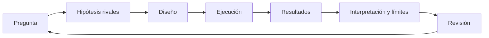
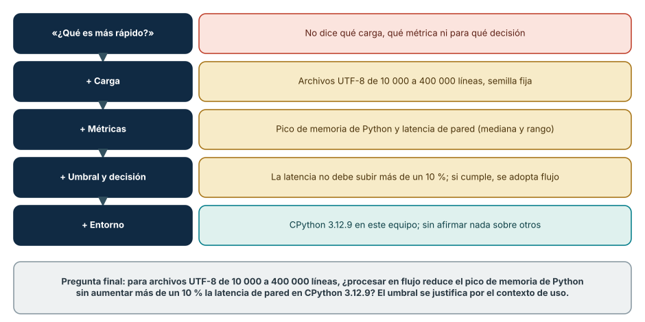
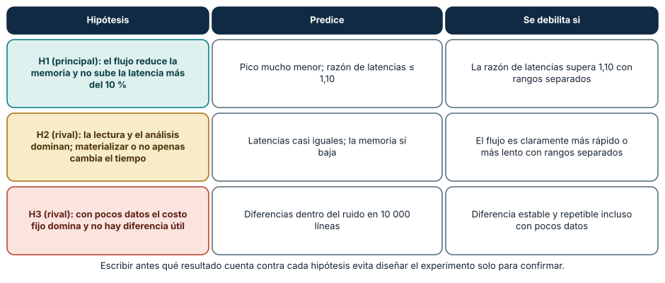
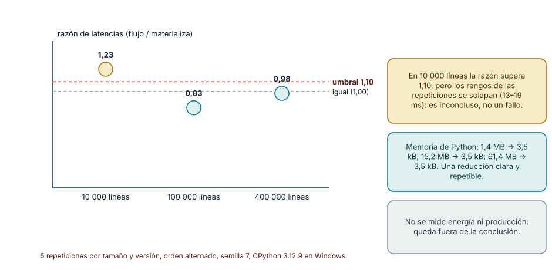
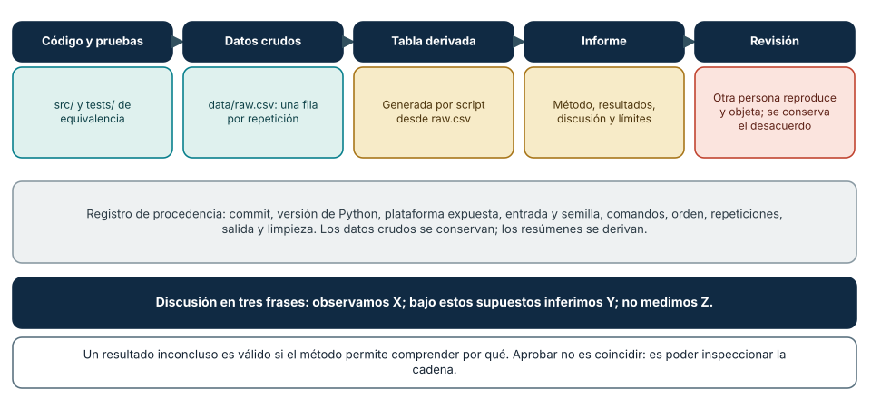

# SE-024 — Proyecto: informe reproducible de comportamiento y recursos

[← SE-023](https://github.com/vladimiracunadev-create/modern-software-engineering-program/blob/main/classes/part-01-computadores-y-representacion-de-informacion/se-023-taller-observar-un-programa-desde-el-codigo-hasta-la-maquina/README.md) · [↑ Parte 01](https://github.com/vladimiracunadev-create/modern-software-engineering-program/blob/main/classes/part-01-computadores-y-representacion-de-informacion/README.md) · [📚 Índice completo](https://github.com/vladimiracunadev-create/modern-software-engineering-program/blob/main/classes/README.md) · [SE-025 →](https://github.com/vladimiracunadev-create/modern-software-engineering-program/blob/main/classes/part-02-sistemas-operativos-terminal-y-automatizacion-base/se-025-windows-linux-macos-y-sus-modelos-operativos/README.md)


## Punto profesional y fundamento pedagógico

**Punto profesional.** La clase existe para convertir observaciones en un informe reproducible que otra persona pueda repetir y disputar.

**Por qué aparece aquí.** Se sitúa después de **Taller: observar un programa desde el código hasta la máquina** y antes de **Windows, Linux, macOS y sus modelos operativos**: convierte el conocimiento anterior en una decisión observable que la clase siguiente podrá reutilizar. La continuidad se comprueba en el artefacto, no por compartir vocabulario.

**Error conceptual que debe corregir.** Confundir reproducibilidad con capturas o correlación con causalidad.

**Secuencia de aprendizaje.** Formula una pregunta refutable y preregistra carga, variables, oráculo y umbral antes de medir. Otra persona debe ejecutar el protocolo desde el fixture versionado, recalcular la tabla y disputar la conclusión. Conserva los intentos fallidos y termina con la condición concreta que obligaría a cambiar la decisión.

**Evidencia de aprendizaje.** Protocolo, datos crudos, script, checksum, informe y resultados no validados. Debe contener predicción previa, observación, explicación causal, contraejemplo, criterio de aceptación y una nota de qué dato haría cambiar la conclusión.

**Límite de la conclusión.** Un procedimiento reproducible no garantiza representatividad ni exactitud física.

### Trazabilidad fuente → afirmación

| Fuente primaria u oficial | Afirmación que respalda | Lo que no prueba |
|---|---|---|
| [Python documentation](https://docs.python.org/3/) | las APIs del proyecto | No demuestra por sí sola que el artefacto del estudiante sea correcto. |
| [Unicode Standard](https://www.unicode.org/versions/latest/) |  y [RISC-V specifications](https://docs.riscv.org/reference/isa/) respaldan los contratos elegidos | No demuestra por sí sola que el artefacto del estudiante sea correcto. |
| [Software Carbon Intensity](https://greensoftware.foundation/standards/sci/) |  delimita afirmaciones energéticas si el proyecto las considera | No demuestra por sí sola que el artefacto del estudiante sea correcto. |

## Antes de empezar

`SE-023` te dio un protocolo integrado. Ahora elegirás una pregunta acotada y defenderás
un informe que una persona pueda reproducir, cuestionar y extender. El resultado cierra
la Parte 01 y se convertirá en insumo de la Parte 02, donde aprenderás a preparar y
diagnosticar el entorno que hizo posibles las observaciones.

## Prerrequisitos

Dossier de `SE-023`, artefactos `SE-013`–`SE-022`, Git y Python 3.11+.

## Problema auténtico

Un informe afirma “la opción B usa menos recursos” sin definir carga, equivalencia,
entorno ni variación. Nadie puede repetirlo y el resultado se usa para decidir hardware.

## Objetivos observables

Formularás una pregunta contrastable; diseñarás dos hipótesis; construirás un caso
mínimo; conservarás datos y procedencia; interpretarás incertidumbre; y responderás una revisión adversarial.

## Temas y por qué importan

| Elemento | Función | Por qué importa |
| --- | --- | --- |
| Pregunta | delimita variable y decisión | evita medir sin propósito |
| Diseño | controla carga e invariantes | permite atribución prudente |
| Evidencia | conserva datos y entorno | hace posible reproducción |
| Discusión | separa resultado, inferencia y límite | impide generalización indebida |
## Mapa conceptual



La revisión vuelve a la pregunta porque puede descubrir que el experimento no la respondía.

## Conceptos y decisiones

### 1. Una buena pregunta conecta mecanismo y decisión

“¿Qué es más rápido?” es insuficiente. “Para archivos UTF-8 de 1–20 MB, ¿procesar en
streaming reduce pico de memoria Python sin aumentar más de 10 % la latencia bajo este
runtime?” fija carga, métricas y decisión. El umbral debe justificarse por contexto.



**Cómo leer la figura.** Cada peldaño añade una restricción que hace la pregunta *falsable*. Sin carga no se sabe qué datos usar; sin métrica no se sabe qué observar; sin umbral
y decisión no se sabe qué resultado cambia la acción; sin entorno el resultado se generaliza sin permiso. La pregunta final es larga a propósito. **Dónde deja de valer:** un umbral
del 10 % es una elección que depende del contexto (un servicio interactivo y un trabajo por lotes toleran cosas distintas) y debe justificarse con una necesidad, no copiarse. Una pregunta
tan específica responde poco, y eso es una virtud: se amplía después, con un nuevo estudio.

### 2. Hipótesis rivales evitan diseñar solo para confirmar

La hipótesis principal predice resultado y mecanismo; una rival ofrece explicación
alternativa, por ejemplo overhead de lectura frente a materialización. Se escribe qué
observación debilita cada una antes de ejecutar.



**Cómo leer la figura.** La hipótesis principal (H1) predice menor memoria sin un aumento de latencia superior al 10 %. Las rivales ofrecen *otras explicaciones* de los mismos datos: que el costo
de generar y analizar las líneas domine el tiempo (H2) o que con pocos datos solo se mida ruido (H3). La tercera columna se escribe *antes* de ejecutar, de modo que el resultado no pueda reinterpretarse a posteriori.
**Dónde deja de valer:** tres hipótesis no agotan las explicaciones posibles. La lista de rivales debe ampliarse cuando la revisión descubra una explicación que nadie consideró.

### 3. Reproducibilidad requiere procedencia completa

Se registran commit, versión, plataforma expuesta, entrada, semilla, comandos, orden,
repeticiones, salida y limpieza. Los datos crudos se conservan; el resumen se deriva.
La ausencia de hardware idéntico no invalida reproducción: obliga a comparar patrones y explicar diferencias.

### 4. Un resultado local no es una ley

El informe distingue: observamos X; bajo supuestos inferimos Y; no medimos Z. Se discuten
amenazas como calentamiento, instrumento, representatividad y cambios de runtime. Un
resultado inconcluso es válido si el método permite comprender por qué.

### 5. La revisión forma parte del producto

La persona revisora intenta ejecutar, cuestiona unidades e identifica afirmaciones que
exceden evidencia. El autor responde cambiando texto, diseño o conclusión y conserva el
desacuerdo. Aprobar no significa coincidir, sino que la cadena pueda inspeccionarse.

### 6. Un estudio de ejemplo completo, de la pregunta a la decisión

Para fijar el método, este es un estudio de ejemplo completo. *Pregunta:* para archivos de 10 000 a 400 000 líneas, ¿procesar en flujo reduce el pico de memoria de Python sin aumentar más de un 10 % la latencia
de pared en CPython 3.12.9? *Diseño:* dos implementaciones (una conserva los eventos en una lista; otra los procesa uno a uno) que *deben* devolver el mismo resultado; la prueba de equivalencia (`assert materializa(n) == flujo(n)`) se ejecuta antes de medir. Tres tamaños, cinco repeticiones por
versión, orden alternado entre repeticiones, semilla 7, y una medición separada de la memoria máxima con `tracemalloc` (para que no altere los tiempos). Los datos crudos van a un CSV con una fila por repetición, y la tabla se calcula desde él.

```python
for n in (10_000, 100_000, 400_000):
    assert materializa(n) == flujo(n), "no equivalentes"
    for r in range(5):
        orden = [materializa, flujo] if r % 2 == 0 else [flujo, materializa]
        for f in orden:
            t = time.perf_counter(); f(n)
            filas.append((n, f.__name__, r, time.perf_counter() - t))
```

*Resultados de una ejecución:* la memoria de Python bajó de 1,4 MB a 3,5 kB con 10 000 líneas, de 15,2 MB a 3,5 kB con 100 000 y de 61,4 MB a 3,5 kB con 400 000. La razón de latencias (mediana del flujo sobre mediana de
materializar) fue **1,23** con 10 000 líneas, **0,83** con 100 000 y **0,98** con 400 000. En los tres tamaños los rangos de las repeticiones se solapan.



**Cómo leer la figura.** Cada punto es la razón de medianas para un tamaño; la línea roja discontinua es el umbral de 1,10 y la gris la igualdad. Con 10 000 líneas el punto supera el umbral, pero la diferencia absoluta
son unos milisegundos dentro de un rango de 13 a 19 ms; los dos tamaños mayores quedan por debajo. **Dónde deja de valer:** son cinco repeticiones por celda en un equipo; con otra máquina, otros datos o más repeticiones la razón
cambiará. El resultado no justifica extrapolar a archivos mayores, otro intérprete ni otro formato.

### 7. Decidir con rangos solapados: una regla escrita antes

Las medianas por sí solas no bastan para decidir si hay diferencia. Una regla útil, fijada *antes de medir*, tiene tres salidas. **Cumple:** la razón de medianas está bajo el umbral. **No cumple:** supera el
umbral *y* los rangos de las repeticiones no se solapan (la diferencia es mayor que la variación). **Inconcluso:** supera el umbral, pero los rangos se solapan; entonces no puede afirmarse una diferencia y se decide qué hacer (más repeticiones, más tamaño, una mejor
medición). En el ejemplo, la memoria es una reducción clara y repetible (órdenes de magnitud, sin solapamiento posible). La latencia *cumple* con 100 000 y 400 000 líneas y es *inconclusa* con 10 000, de modo que la decisión
responsable es adoptar el flujo para tamaños grandes y declarar que, con tamaños pequeños, el estudio no distingue diferencia.

Esta regla es deliberadamente conservadora y simple; existen métodos estadísticos más finos (intervalos de confianza por remuestreo, pruebas no paramétricas) que se tratan en cursos de estadística y en la parte de calidad. Lo
importante en esta etapa es el principio: *la regla de decisión se escribe antes de ver los datos*, y un resultado inconcluso es una conclusión válida si el método permite entender por qué lo es.

### 8. Escribir el informe: afirmaciones, amenazas y procedencia

El informe tiene cuatro partes que separan lo que se hizo de lo que se concluye: *método* (pregunta, hipótesis, diseño, entorno), *resultados* (la tabla derivada de los datos crudos, sin interpretación), *discusión*
(«observamos X; bajo estos supuestos inferimos Y; no medimos Z») y *límites* (amenazas a la validez y próximas pruebas). Las amenazas se organizan en cuatro tipos: *de constructo* (¿la métrica mide lo que dices?, por ejemplo, el pico de
`tracemalloc` no es el consumo total del proceso), *internas* (calentamiento, orden de ejecución, procesos de fondo, frecuencia dinámica), *externas* (otro hardware, otros datos, otro intérprete) y *estadísticas* (pocas repeticiones, rangos solapados).



**Cómo leer la figura.** Cada eslabón consume lo que produce el anterior y es auditable: los datos crudos se conservan, la tabla se *genera* por un script (no se escribe a mano, para que no pueda divergir) y la revisión
entra al final como parte del producto. **Dónde deja de valer:** una cadena completa no hace correcta la conclusión; asegura que otras personas puedan *comprobarla*. El valor de la revisión es descubrir amenazas que el autor no ve, y por eso el
desacuerdo debe conservarse, no borrarse.

## Caso conductor: opciones de proyecto sobre el analizador local de eventos

Puedes investigar representación Unicode y tamaño, enteros/float y error, orden de
acceso y tiempo, materialización/streaming, o arranque/estado estable. Solo eliges una
pregunta. El resto sirve como control o límite, no como excusa para un informe enciclopédico.

## Definiciones de trabajo

- **variable independiente:** factor que se cambia deliberadamente;
- **variable respuesta:** observación comparada;
- **control:** condición mantenida o referencia;
- **amenaza a validez:** mecanismo que ofrece otra explicación;
- **procedencia:** cadena que permite rastrear evidencia.

## Glosario

**Raw data** son observaciones sin resumen. **Replication** repite método; **reproduction**
puede recalcular desde artefactos según convención declarada. Aquí se exige repetir el procedimiento documentado.

## Ejemplo mínimo

Pregunta, dos scripts equivalentes, diez muestras por tamaño y un límite explícito
constituyen mejor informe que cien métricas sin decisión.

## Ejemplo profesional

Un benchmark de librerías publica código, dataset permitido, versiones y resultados.
Evita nombres promocionales y permite que mantenedores expliquen diferencias.

## Práctica guiada

Usa como base el [laboratorio ejecutable de la Parte 01](https://github.com/vladimiracunadev-create/modern-software-engineering-program/tree/main/labs/part-01-machine-observer); trabaja sobre una copia o conserva tus salidas en el directorio `work/SE-024/`.

1. Escribe `proposal.md` con pregunta, decisión, hipótesis y riesgos.
2. Obtén revisión antes de ejecutar.
3. Construye el caso mínimo y pruebas de equivalencia.
4. Ejecuta con protocolo y guarda datos crudos en CSV/JSON.
5. Genera tabla resumen desde esos datos, no a mano.
6. Redacta método, resultados, discusión y límites.
7. Pide reproducción y registra cambios en `review.md`.
8. Verifica limpieza y entrega commit identificable.

## Ejercicios

1. Refuta una generalización de tu propio resultado.
2. Cambia una condición y predice antes de medir.
3. Escribe una decisión responsable si el resultado es inconcluso.

## Reto verificable

Un revisor clona o copia el directorio, ejecuta el comando documentado, obtiene salida
válida y puede recalcular la tabla. Debe señalar qué afirmación no puede extenderse a producción.

## Preguntas frecuentes

### ¿Debo obtener una mejora?
No. Se evalúa método, explicación y honestidad, no una dirección deseada.

### ¿Puedo instalar herramientas?
No son necesarias. Una herramienta opcional requiere versión, licencia, autorización y alternativa.

### ¿Qué hago si mi resultado contradice lo que esperaba o lo que dice un libro?

Lo publicas con tu método: un resultado inesperado es información. Revisa primero las amenazas obvias (equivalencia, calentamiento, orden, instrumento) y reproduce. Si persiste, compara
con la literatura declarando las diferencias de condiciones: una afirmación general de un libro rara vez cubre tu carga, tu intérprete ni tu versión. Contradecir una regla general en un contexto concreto es legítimo si el estudio es transparente.

### ¿Cuántas repeticiones y tamaños necesito?

Los que permitan responder la pregunta y estimar la variación: normalmente entre cinco y treinta repeticiones y entre tres y cinco tamaños que cubran el rango de interés. Si los rangos de las
versiones se solapan, aumenta las repeticiones antes de aumentar los tamaños; si el efecto aparece solo en un extremo, añade tamaños en esa zona.

### ¿Puedo reutilizar el estudio de ejemplo como mi proyecto?

No como entrega: el proyecto exige tu propia pregunta, hipótesis, diseño y revisión. Puedes reutilizar su *estructura* (prueba de equivalencia, orden alternado, datos crudos, tabla derivada, regla de decisión
previa), pero la pregunta, el código y las conclusiones deben ser tuyos. Si reutilizas un fragmento, cítalo y declara qué cambiaste.

## Fallo controlado y diagnóstico

Omite deliberadamente la semilla o versión en un primer intento. Registra el fracaso de
reproducción y corrige el contrato; no borres la evidencia del aprendizaje.

Un segundo fallo controlado ataca la regla de decisión. Ejecuta el estudio de ejemplo con *dos* repeticiones por tamaño y de nuevo con *diez*. **Síntoma esperado:** con pocas repeticiones la razón de medianas
oscila de una ejecución a otra (puede pasar de 0,8 a 1,2) y el resultado cambia de «cumple» a «no cumple». **Causa:** la mediana de pocas observaciones es inestable y un rango amplio se solapa con todo. **Corrección:**
aumenta las repeticiones hasta que la razón sea estable ante una repetición del experimento, y declara «inconcluso» cuando no lo sea. Registra cuántas repeticiones hicieron falta y qué te habría llevado a una decisión equivocada con solo dos.

## Errores comunes y cómo corregirlos

| Síntoma | Causa | Corrección |
| --- | --- | --- |
| pregunta amplia | decisión no delimitada | fija carga, variable, métrica y umbral |
| solo hay resumen | datos crudos ausentes | conserva y deriva automáticamente |
| variantes no equivalentes | resultado no verificado | prueba invariantes antes de medir |
| conclusión universal | contexto borrado | añade amenazas, límites y próxima prueba |

## Entorno y archivos clave

`proposal.md`, `src/`, `tests/`, `data/raw.csv`, `report.md`, `review.md`, `cleanup.md`; Python 3.11+ y biblioteca estándar.

## Seguridad, ética y accesibilidad

Datos sintéticos, carga acotada, sin identificadores de dispositivo innecesarios. El
reporte ofrece tablas y descripciones; respeta licencias y no desacredita proyectos por una prueba local.

## Puente hacia el trabajo con agentes

Un informe reproducible es también el contrato para trabajar con agentes en tareas de investigación o de ingeniería. El patrón *humano especifica, la herramienta propone, otra herramienta verifica, un humano revisa* se aplica aquí
tal cual: la persona fija la pregunta, las hipótesis rivales y la regla de decisión *antes* de que un asistente escriba el código de medición; el asistente puede proponer el diseño y generar los scripts; las pruebas de equivalencia y la
derivación automática de la tabla verifican que no se alteraron los datos; y una persona revisa las amenazas y la conclusión. Un riesgo conocido es que un agente «ajuste» el experimento (descartar valores, cambiar el umbral, escoger el mejor
tamaño) hasta confirmar la hipótesis; la defensa es que la regla de decisión y las hipótesis estén escritas y versionadas antes de ejecutar, y que los datos crudos se conserven. Las partes de evals y de SPEC desarrollan este flujo con ejemplos operables.

## Transferencia

Reformula la pregunta para otro lenguaje o equipo y distingue qué parte del método permanece.

## Gate de salida de la Parte 01

La parte se considera completada cuando el informe cumple estos criterios, que remiten a las clases anteriores:

1. la pregunta es contrastable y fija carga, métrica, umbral, decisión y entorno (`SE-022`);
2. las variantes tienen un invariante comprobado antes de medir (`SE-023`);
3. la representación de datos y texto usada está declarada: ancho, orden, codificación y normalización (`SE-014`–`SE-016`);
4. las capas observadas y sus límites están separados, sin atribuir instrucciones nativas desde bytecode (`SE-013`, `SE-017`, `SE-020`);
5. los tiempos distinguen pared y CPU, y la memoria declara qué instrumento la midió (`SE-013`, `SE-018`, `SE-021`);
6. los datos crudos se conservan y la tabla se deriva automáticamente (`SE-022`);
7. el resultado se declara como cumplido, no cumplido o inconcluso según una regla escrita antes de medir;
8. otra persona reproduce el procedimiento y el informe responde a su revisión, con el desacuerdo conservado.

## Evaluación y evidencia

Aprueba con pregunta contrastable, equivalencia, datos crudos, reproducción, revisión y límites. No puntúa cantidad de gráficos.

## Fuentes


- [Python documentation](https://docs.python.org/3/) respalda las APIs del proyecto.
- [Unicode Standard](https://www.unicode.org/versions/latest/) y [RISC-V specifications](https://docs.riscv.org/reference/isa/) respaldan los contratos elegidos.
- [Software Carbon Intensity](https://greensoftware.foundation/standards/sci/) delimita afirmaciones energéticas si el proyecto las considera.
- Raj Jain, *The Art of Computer Systems Performance Analysis* (Wiley, ISBN 978-0-471-50336-1), y [Python `statistics`](https://docs.python.org/3/library/statistics.html): diseño de mediciones y medidas de resumen usadas en el estudio de ejemplo.
- Roger D. Peng, «Reproducible Research in Computational Science», *Science* 334(6060), 2011, DOI [10.1126/science.1213847](https://doi.org/10.1126/science.1213847): criterios de reproducibilidad que respaldan la cadena de procedencia.

## Límites y siguiente paso

El proyecto no certifica hardware ni producción. `SE-025` empieza a estudiar cómo el sistema operativo ofrece y gobierna el entorno observado.

---
[← SE-023](https://github.com/vladimiracunadev-create/modern-software-engineering-program/blob/main/classes/part-01-computadores-y-representacion-de-informacion/se-023-taller-observar-un-programa-desde-el-codigo-hasta-la-maquina/README.md) · [↑ Parte 01](https://github.com/vladimiracunadev-create/modern-software-engineering-program/blob/main/classes/part-01-computadores-y-representacion-de-informacion/README.md) · [📚 Índice completo](https://github.com/vladimiracunadev-create/modern-software-engineering-program/blob/main/classes/README.md) · [SE-025 →](https://github.com/vladimiracunadev-create/modern-software-engineering-program/blob/main/classes/part-02-sistemas-operativos-terminal-y-automatizacion-base/se-025-windows-linux-macos-y-sus-modelos-operativos/README.md)
