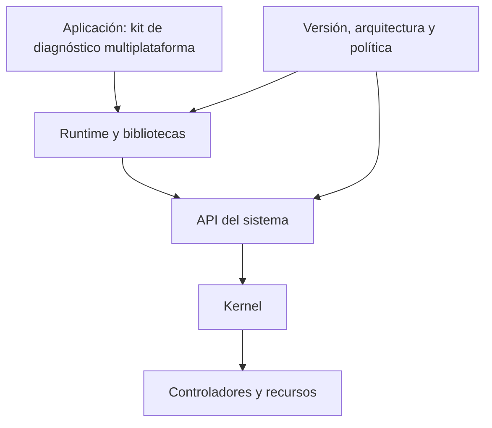
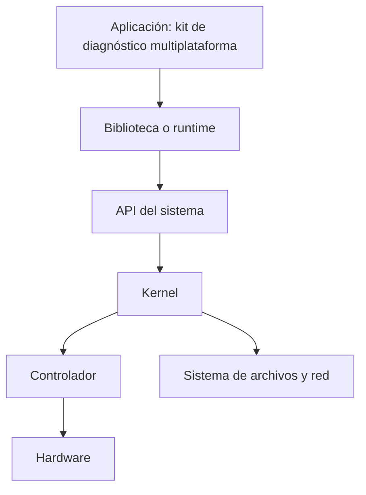
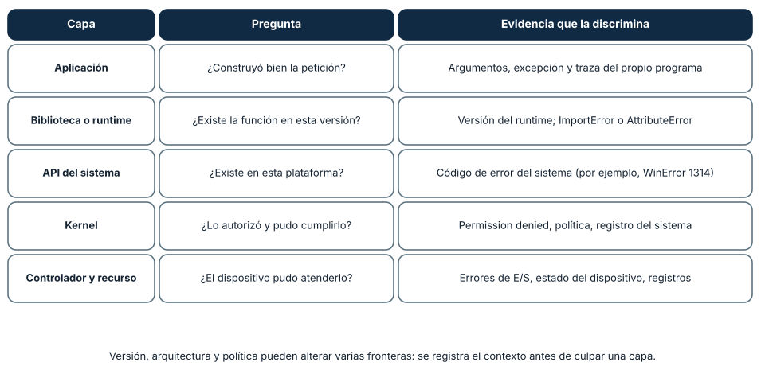
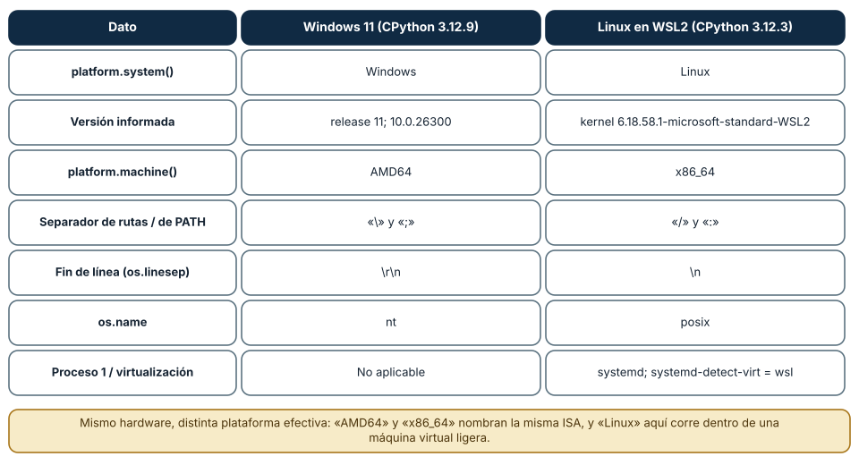
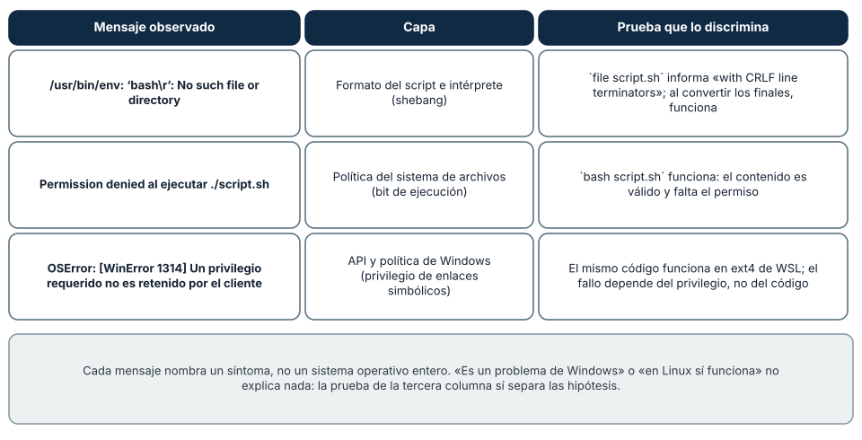

# SE-025 — Windows, Linux, macOS y sus modelos operativos

[← SE-024](https://github.com/vladimiracunadev-create/modern-software-engineering-program/blob/main/classes/part-01-computadores-y-representacion-de-informacion/se-024-proyecto-informe-reproducible-de-comportamiento-y-recursos/README.md) · [↑ Parte 02](https://github.com/vladimiracunadev-create/modern-software-engineering-program/blob/main/classes/part-02-sistemas-operativos-terminal-y-automatizacion-base/README.md) · [📚 Índice completo](https://github.com/vladimiracunadev-create/modern-software-engineering-program/blob/main/classes/README.md) · [SE-026 →](https://github.com/vladimiracunadev-create/modern-software-engineering-program/blob/main/classes/part-02-sistemas-operativos-terminal-y-automatizacion-base/se-026-sistemas-de-archivos-rutas-enlaces-y-metadatos/README.md)


## Punto profesional y fundamento pedagógico

**Punto profesional.** La clase existe para comparar Windows, Linux y macOS por contratos observables y no por estereotipos.

**Por qué aparece aquí.** Se sitúa después de **Proyecto: informe reproducible de comportamiento y recursos** y antes de **Sistemas de archivos, rutas, enlaces y metadatos**: convierte el conocimiento anterior en una decisión observable que la clase siguiente podrá reutilizar. La continuidad se comprueba en el artefacto, no por compartir vocabulario.

**Error conceptual que debe corregir.** Suponer que una orden o ruta portable conserva idéntica semántica.

**Secuencia de aprendizaje.** Antes de leer la solución, el estudiante predice el resultado del caso normal y del error conceptual anterior. Luego explica un caso resuelto paso a paso, construye un contraejemplo que cambie la decisión y, sin consultar el texto, reconstruye el mecanismo y lo aplica a una entrada nueva. La secuencia usa predicción, explicación propia, contraste y recuperación. [ICAP](https://icap.education.asu.edu/research) distingue participación de construcción de conocimiento; [How People Learn II](https://nap.nationalacademies.org/catalog/24783/how-people-learn-ii-learners-contexts-and-cultures) exige conectar conocimiento previo, contexto y transferencia; la [práctica de recuperación](https://pubmed.ncbi.nlm.nih.gov/16507066/) respalda producir de nuevo la explicación tras una demora; y [Education for Life and Work](https://nap.nationalacademies.org/resource/13398/dbasse_084153.pdf) exige devolución que explique la causa del error.

**Evidencia de aprendizaje.** Os-contracts.md con la misma operación, resultado, diferencia y decisión por plataforma. Debe contener predicción previa, observación, explicación causal, contraejemplo, criterio de aceptación y una nota de qué dato haría cambiar la conclusión.

**Límite de la conclusión.** Una muestra de versiones no representa todas las ediciones ni configuraciones.

### Trazabilidad fuente → afirmación

| Fuente primaria u oficial | Afirmación que respalda | Lo que no prueba |
|---|---|---|
| [Microsoft Learn — Windows documentation](https://learn.microsoft.com/windows/) | documenta el comportamiento de Windows o PowerShell que se compara con el contrato POSIX | No demuestra por sí sola que el artefacto del estudiante sea correcto. |
| [Linux man-pages project](https://man7.org/linux/man-pages/) | delimita el contrato técnico que debe cumplirse al comparar Windows, Linux y macOS por contratos observables y no por estereotipos | No demuestra por sí sola que el artefacto del estudiante sea correcto. |
| [Apple Developer Documentation](https://developer.apple.com/documentation/) | delimita el contrato técnico que debe cumplirse al comparar Windows, Linux y macOS por contratos observables y no por estereotipos | No demuestra por sí sola que el artefacto del estudiante sea correcto. |
| [The Open Group Base Specifications, Issue 8](https://pubs.opengroup.org/onlinepubs/9799919799/) | define el contrato portable de procesos, rutas, entorno o shell que se contrasta entre sistemas | No demuestra por sí sola que el artefacto del estudiante sea correcto. |

## Antes de empezar

El analizador local de eventos ya demostró que un programa atraviesa procesador, memoria y dispositivos. Ahora aparece una dificultad profesional: el mismo código no encuentra la configuración en otro equipo. Decir “es un problema de Windows” o “en Linux sí funciona” no explica nada. Necesitamos identificar qué capa tomó la decisión y qué contrato cambió.

En esta clase comienza **kit de diagnóstico multiplataforma**, el kit de diagnóstico que acompañará toda la parte. Su primera versión solo observa: plataforma, arquitectura, versión del sistema, identidad de la sesión y directorios relevantes. No intenta uniformar sistemas distintos; produce una descripción comparable.

### Resultado de aprendizaje

Al terminar podrás ubicar un fallo en una capa —aplicación, biblioteca, espacio de usuario, llamada al sistema, kernel o controlador— y justificar qué evidencia permite distinguirla.

## Prerrequisitos

`SE-024`, capacidad para separar observación e inferencia, y acceso no privilegiado a una terminal. Recupera el mapa de arquitectura del analizador local de eventos: lenguaje, runtime, sistema operativo, ISA y hardware.

## Problema auténtico

El analizador local de eventos funciona en el equipo de desarrollo y falla al entregarse. El equipo atribuye el fallo al nombre del sistema operativo, pero todavía no sabe si cambió una API, la arquitectura del binario, una política o una herramienta disponible. La etiqueta de plataforma está ocultando la frontera causal.

## Objetivos observables

Podrás distinguir kernel y espacio de usuario; comparar Windows, Linux y macOS sin falsas equivalencias; separar API, ABI e ISA; producir una ficha de capacidades; y formular una prueba que discrimine fallos en dos capas distintas.

## Temas y por qué importan

| Tema | Mecanismo | Decisión habilitada |
| --- | --- | --- |
| Abstracción del sistema | convierte recursos físicos en procesos, archivos y sockets | ubicar la operación que realmente falló |
| Protección | separa kernel y procesos de usuario | evitar elevar sin necesidad |
| API, ABI e ISA | definen contratos en capas distintas | elegir artefacto y diagnóstico correctos |
| Capacidad observable | comprueba una función disponible | degradar explícitamente sin adivinar por versión |
## Mapa conceptual



Las flechas no representan propiedad, sino solicitudes y restricciones. Versión, arquitectura y política pueden alterar más de una frontera; por eso el kit de diagnóstico multiplataforma registra contexto antes de culpar una capa.

## Conceptos y decisiones

### El sistema operativo administra recursos y ofrece abstracciones

El hardware expone procesadores, memoria y dispositivos con detalles muy específicos. El sistema operativo arbitra su uso y ofrece abstracciones estables: procesos en vez de secuencias crudas de instrucciones; archivos en vez de bloques físicos; sockets en vez de manipular directamente una interfaz de red.

La abstracción no elimina el hardware. Lo representa con un contrato. Cuando una aplicación abre un archivo, una biblioteca prepara la operación, una llamada al sistema cruza la frontera de protección y el kernel consulta permisos y delega en el sistema de archivos o el controlador correspondiente.



Leer el diagrama de arriba hacia abajo permite formular una pregunta diagnóstica por frontera: ¿la aplicación construyó bien la petición?, ¿la API existe en esta plataforma?, ¿el kernel la autorizó?, ¿el controlador pudo atenderla?

### Kernel y espacio de usuario son dominios de confianza distintos

El kernel ejecuta con privilegios para administrar memoria, planificación, interrupciones y dispositivos. Las aplicaciones normales viven en espacio de usuario con autoridad limitada. El cruce se realiza mediante interfaces controladas; no es una llamada de función ordinaria aunque una biblioteca la haga parecer así.

Esta separación contiene fallos: un proceso no debería escribir memoria de otro libremente. También explica por qué algunas operaciones fallan con acceso denegado y por qué elevar privilegios cambia el riesgo. Un kernel modular, híbrido o monolítico distribuye componentes de manera diferente, pero ninguna etiqueta reemplaza el análisis de la operación concreta.

### Windows, Linux y macOS comparten categorías, no implementaciones

Los tres administran procesos, memoria virtual, archivos, usuarios y dispositivos. Sin embargo, exponen familias de API, convenciones de rutas, modelos de servicio y herramientas diferentes.

- Windows se organiza alrededor del kernel NT y subsistemas de usuario; Win32 y PowerShell son interfaces frecuentes, no “el kernel”.
- Linux es un kernel usado con distintas distribuciones, bibliotecas, gestores y sistemas de inicio. “Linux” no identifica por sí solo una experiencia de usuario completa.
- macOS combina el kernel XNU con marcos y servicios de Apple; su base Unix no vuelve idénticas sus políticas, rutas o herramientas a las de una distribución Linux.

La portabilidad se construye definiendo una intención común y adaptadores por plataforma. Copiar el mismo comando en tres entornos solo desplaza el fallo.

### API, ABI e ISA responden preguntas distintas

Una API define cómo el código fuente solicita una capacidad. Una ABI fija detalles binarios —convención de llamadas, disposición de datos, formato de ejecutable— necesarios para que componentes compilados cooperen. La ISA es el contrato de instrucciones con el procesador.

Un script puede usar una API portable y aun depender de una herramienta ausente. Un binario puede apuntar al sistema correcto pero a otra arquitectura. El kit de diagnóstico multiplataforma registra sistema operativo y arquitectura porque “Windows 11” no informa si un artefacto es x86-64 o Arm64.

### Versión, edición y política también forman parte de la plataforma

Dos equipos con el mismo nombre de sistema pueden diferir en versión, parches, edición, shell disponible, políticas corporativas y capacidades habilitadas. El diagnóstico debe capturar solo los datos necesarios y evitar identificadores personales innecesarios.

La documentación de [Windows](https://learn.microsoft.com/windows/), las páginas de manual de [Linux](https://man7.org/linux/man-pages/) y la documentación de [Apple Developer](https://developer.apple.com/documentation/) permiten verificar interfaces concretas. Una etiqueta genérica nunca sustituye la fuente de la versión realmente observada.

### Detectar capacidades es más robusto que adivinar por nombres

Comprobar “¿existe esta orden?” o “¿esta API está disponible?” suele ser más fiable que una lista de versiones. La detección de capacidades reduce ramas frágiles y permite mensajes accionables. Aun así, una capacidad presente puede estar bloqueada por permisos o políticas; detectar no equivale a autorizar.

### Preguntar por frontera: un mapa de síntomas

El mapa de capas se vuelve útil cuando cada frontera tiene una pregunta y una evidencia asociada. La Figura 1 las reúne: la
aplicación puede haber construido mal la petición (se comprueba con los argumentos y la traza del propio programa), la biblioteca
puede no ofrecer la función en esa versión, la API del sistema puede no existir en la plataforma, el kernel puede haber denegado la
operación y el recurso puede no haber podido atenderla. Elegir la pregunta *antes* de cambiar algo evita la intervención al azar,
que es la forma más cara de diagnosticar.



**Cómo leer la figura.** Cada fila es una frontera. La columna central es una pregunta con respuesta sí o no; la derecha, el
dato concreto que la responde. Por ejemplo, un `WinError 1314` en una llamada de la API de Windows apunta a una capa distinta de un
`AttributeError` de la biblioteca. **Dónde deja de valer:** las capas reales se solapan: una política corporativa (capa de
configuración) puede bloquear una llamada que el kernel permitiría, y una biblioteca puede traducir un error del sistema en uno propio. El mapa
ordena las hipótesis; no sustituye la evidencia de cada caso.

### Mismo programa, dos sistemas: una ficha observada

Para comparar sin caricaturizar, la clase usa *un mismo script* de Python que imprime lo que cada plataforma informa. Ejecutado en
Windows 11 (CPython 3.12.9) y en Ubuntu 24.04 bajo WSL2 (CPython 3.12.3), sobre el mismo equipo, devolvió lo que muestra la Figura 2. Algunas
diferencias son esperables (el separador de rutas es `\` y `;` en Windows, `/` y `:` en Linux; `os.linesep` es `\r\n` o `\n`), pero otras
enseñan más: `platform.machine()` devuelve `AMD64` en uno y `x86_64` en otro, aunque nombran la *misma* arquitectura de 64 bits; y el
«Linux» de este equipo no corre directamente sobre el hardware, sino dentro de una máquina virtual ligera, lo que revelan la cadena del
kernel (`microsoft-standard-WSL2`) y `systemd-detect-virt`, que informa `wsl`.



**Cómo leer la figura.** Cada fila es un dato que un programa podría usar para decidir. Las dos columnas son *el mismo equipo físico*: lo que cambia es la
plataforma efectiva que el programa ve. **Dónde deja de valer:** es una comparación entre Windows y *una* distribución de Linux virtualizada; no
describe macOS (no se ejecutó aquí) ni otras distribuciones, y la información de versión depende de cada configuración. La ficha
omite deliberadamente el nombre del equipo y del usuario, que `platform.uname()` sí devuelve: un diagnóstico minimiza los
identificadores que recoge.

### Tres mensajes reales y la capa que señalan

Los errores son la evidencia más barata, si se leen como síntomas de una capa y no como veredictos sobre un sistema operativo. Tres casos
reproducidos en este equipo: (1) un script con finales de línea de Windows (`\r\n`) ejecutado en Linux produce
`/usr/bin/env: ‘bash\r’: No such file or directory`, porque el *shebang* pide el programa `bash\r`; el comando `file` informa «with CRLF line terminators» y, al
convertir los finales, el script funciona. (2) Un script correcto, pero sin el bit de ejecución, responde `Permission denied` al
invocarlo directamente y funciona con `bash script.sh`, lo que prueba que el contenido es válido y falta el permiso. (3) Crear un
enlace simbólico en NTFS sin el privilegio correspondiente falla con `WinError 1314`, mientras el mismo código funciona en ext4: es
una política de Windows (que se puede levantar activando el modo de desarrollador o con un privilegio explícito), no un defecto del código.



**Cómo leer la figura.** La tercera columna es lo importante: una prueba barata que separa las hipótesis. Si el script funciona con `bash script.sh`, el
problema no es el contenido sino el permiso. **Dónde deja de valer:** los mensajes cambian con el idioma, la versión y el
shell, y un mismo síntoma puede tener varias causas. Se registra el comando exacto, la versión y el mensaje completo, y no solo la
interpretación.

## Definiciones de trabajo

- **sistema operativo:** software que administra recursos y ofrece abstracciones protegidas a programas;
- **plataforma efectiva:** combinación de sistema, versión, arquitectura, políticas y capacidades observadas;
- **API:** interfaz de programación visible en fuente o runtime;
- **ABI:** contrato binario entre ejecutable, bibliotecas y plataforma;
- **capacidad:** operación cuya disponibilidad puede comprobarse sin asumirla por nombre.

## Caso conductor: el kit de diagnóstico multiplataforma identifica dónde está

La primera ficha del kit de diagnóstico multiplataforma contiene:

```text
plataforma: windows | linux | macos | desconocida
version: valor informado por el sistema
arquitectura_proceso: x86_64 | arm64 | otra
arquitectura_sistema: valor si está disponible
shell: nombre y versión
directorio_trabajo: ruta resuelta
observaciones: capacidades ausentes o acceso limitado
```

La distinción entre arquitectura del proceso y del sistema importa: una capa de compatibilidad puede ejecutar un proceso x86-64 sobre hardware Arm. El kit de diagnóstico multiplataforma no infiere una desde la otra. Si un dato no puede obtenerse sin elevar permisos, registra `no disponible` y explica la razón.

Un ejemplo causal: el kit de diagnóstico multiplataforma encuentra el archivo del analizador local de eventos en macOS, pero el ejecutable descargado no inicia. La clasificación correcta todavía no es “macOS bloquea el programa”. Primero se separan hipótesis: arquitectura incompatible, bit de ejecución ausente, política de procedencia o dependencia dinámica faltante. Cada una requiere evidencia distinta.

## Práctica guiada

1. Obtén plataforma, versión, arquitectura y shell mediante herramientas documentadas de tu sistema.
2. Registra cada comando, su código de salida y qué afirmación sustenta.
3. Dibuja el recorrido de una operación de lectura desde el kit de diagnóstico multiplataforma hasta el dispositivo.
4. Formula tres fallos posibles en fronteras distintas y una observación que los discrimine.
5. Repite la ficha en otro sistema o contrástala con la de un compañero; evita convertir diferencias en errores.

La entrega es una tabla `dato → fuente → interpretación → límite`. Una captura de pantalla sin interpretación no basta.

## Ejemplo mínimo

Dos equipos informan “Windows”, pero uno ejecuta un proceso Arm64 y otro x86-64. El nombre del producto coincide; el contrato binario no. La observación mínima útil combina plataforma, arquitectura del proceso y formato del artefacto.

## Ejemplo profesional

Un instalador falla solo en equipos corporativos. La misma versión funciona en un equipo personal. El kit de diagnóstico multiplataforma detecta que la API existe y el binario coincide, pero la ejecución está bloqueada por una política. La corrección se dirige al canal autorizado de distribución; recompilar al azar no aborda el mecanismo.

## Ejercicios

1. Clasifica cinco afirmaciones como API, ABI, ISA, política o implementación.
2. Diseña una detección de capacidad para una herramienta opcional sin basarte únicamente en la versión del SO.
3. Explica qué cambia y qué permanece cuando un proceso x86-64 corre mediante compatibilidad sobre Arm64.

## Reto verificable

Entrega dos fichas de plataforma y una hipótesis que solo una de ellas permite descartar. Otra persona debe poder reconstruir la capa y fuente de cada dato sin acceder a tu equipo.

## Preguntas frecuentes

### ¿Linux es un sistema operativo completo?

Linux nombra el kernel; una instalación utilizable combina distribución, bibliotecas, herramientas y políticas.

### ¿Detectar macOS, Windows o Linux garantiza portabilidad?

No. Solo abre una rama de contexto; aún deben comprobarse arquitectura, API, permisos y dependencias.

### ¿WSL2 es «Linux de verdad»?

Ejecuta un kernel de Linux real dentro de una máquina virtual ligera gestionada por Windows, y por eso se comporta como una instalación de Linux
(`uname`, `systemd`, `ext4`). Pero comparte el equipo, y el acceso a los archivos de Windows (`/mnt/c`) cruza otra frontera con
semánticas y costos distintos (tema de `SE-026` y `SE-034`). Declara siempre en qué capa mediste.

### ¿Por qué `platform.machine()` da `AMD64` en Windows y `x86_64` en Linux?

Cada plataforma usa su propia etiqueta histórica para la misma familia de procesadores de 64 bits. Un programa que compara cadenas debe normalizar ambas,
o mejor, decidir por capacidades (qué binario existe y qué formato tiene) y no por el nombre.

### ¿Detectar el sistema con `platform.system()` es una mala práctica?

No, si sirve para *elegir un adaptador* y se prueba cada rama. Es una mala práctica cuando se usa como sustituto de comprobar la capacidad concreta
(por ejemplo, «si es Linux, existe `systemctl`»), porque los contenedores, WSL y las distribuciones mínimas rompen esa suposición.
## Fallo controlado y diagnóstico

Configura una comprobación para buscar deliberadamente una orden inexistente. El kit de diagnóstico multiplataforma debe clasificar “capacidad ausente”, continuar si es opcional y salir con precondición incumplida si es esencial. Corrige cualquier excepción cruda que no distinga ambos casos.


Una segunda práctica reproduce el primer mensaje real. Crea un script mínimo con finales de línea de Windows (`#!/usr/bin/env bash` y `echo hola`, ambos terminados en
`\r\n`), dale permiso de ejecución y ejecútalo en un Linux de práctica. **Síntoma:** `'bash\r': No such file or directory`.
**Hipótesis:** el intérprete no existe, el shebang está mal o el archivo tiene finales de línea ajenos. **Prueba:** `file script.sh` y `cat -A script.sh` muestran
`^M` al final de cada línea. **Corrección mínima:** convertir los finales (`sed -i 's/\r$//' script.sh`) o configurar el editor y `.gitattributes` para usar `\n`. Después
quita el bit de ejecución y comprueba el segundo mensaje (`Permission denied`) para distinguir contenido y permiso. Anota qué evidencia descartó cada hipótesis.
## Errores comunes y cómo corregirlos

| Síntoma | Causa conceptual | Corrección |
|---|---|---|
| “Linux” aparece como una sola plataforma uniforme | Se confundió kernel con distribución y espacio de usuario | Registrar kernel, distribución, versión y herramientas relevantes por separado |
| Se usa “64 bits” como diagnóstico completo | Se mezclaron ISA, arquitectura del proceso y formato del artefacto | Identificar cada contrato y verificar el binario real |
| El primer intento exige administrador | Se trató el privilegio como comodidad | Observar primero sin elevación y justificar cada capacidad adicional |
| Un comando ausente se interpreta como SO incompatible | Se confundió herramienta con capacidad | Detectar alternativas documentadas y declarar el adaptador |
| Se copian datos del equipo entero | No se minimizó evidencia | Recoger solo lo necesario y redactar identificadores sensibles |

## Entorno y archivos clave

Usa `prepare` e `inspect` del [laboratorio compartido](https://github.com/vladimiracunadev-create/modern-software-engineering-program/tree/main/labs/part-02-cross-platform-diagnostic-kit) para obtener la matriz mínima sin hostname ni usuario; contrasta lo observado con una incógnita que el reporte no pueda resolver.

Python 3.11+, PowerShell o Bash; `platform-report.json`, `layer-map.md` y `observations.md`. Todo se ejecuta sin elevación y en una carpeta de laboratorio.

## Seguridad, ética y accesibilidad

No publiques nombre de host, cuenta, número de serie ni rutas personales. Acompaña el diagrama con explicación textual y no uses una arquitectura como sustituto de medir requisitos de accesibilidad o desempeño.

## Puente hacia el trabajo con agentes

Un asistente que propone comandos presupone un sistema operativo y un shell que casi nunca declara: una instrucción como `rm -rf build/ && ls -la` es válida en Bash y
no existe en PowerShell. Cuando un agente ejecuta comandos, su *harness* debe declarar la plataforma efectiva (sistema, arquitectura, shell y capa de
virtualización) igual que lo hace la ficha de esta clase, y cada comando propuesto debe ser coherente con ella. Los errores de las figuras 1 a 3
reaparecen con agentes: archivos generados con finales de línea inadecuados, scripts sin bit de ejecución o rutas con el separador equivocado. Una instrucción
de repositorio que fije codificación, finales de línea y shell, y una verificación que ejecute el script en la plataforma declarada, convierten esos errores en
fallos visibles antes de la entrega. Las partes sobre harness y especificación desarrollan esos archivos de instrucciones.

## Transferencia

Aplica el mapa a un teléfono o a una función serverless. Indica qué capa controla el proveedor y qué observaciones siguen disponibles para el equipo.

## Evaluación y evidencia

Se exige mapa causal, ficha minimizada, cinco afirmaciones trazables, una hipótesis descartada y límites. Nombrar tres sistemas sin explicar contratos no demuestra el resultado.

## Criterio de cierre

Puedes explicar la ruta de una solicitud desde aplicación a hardware, distinguir API/ABI/ISA, comparar los tres sistemas sin caricaturizarlos y producir una ficha cuya evidencia permita a otra persona verificar tus conclusiones.

## Límites y siguiente paso

Esta clase no enseña administración profunda de kernels ni promete que una API conserve idéntica conducta entre versiones. Tampoco demuestra compatibilidad por detectar el nombre del sistema. La siguiente clase baja a una abstracción concreta —el sistema de archivos— donde pequeñas diferencias de rutas, enlaces y metadatos producen fallos muy visibles.

## Fuentes


- [Microsoft Learn — Windows documentation](https://learn.microsoft.com/windows/) — documenta el comportamiento de Windows o PowerShell que se compara con el contrato POSIX.
- [Linux man-pages project](https://man7.org/linux/man-pages/) — delimita el contrato técnico que debe cumplirse al comparar Windows, Linux y macOS por contratos observables y no por estereotipos.
- [Apple Developer Documentation](https://developer.apple.com/documentation/) — delimita el contrato técnico que debe cumplirse al comparar Windows, Linux y macOS por contratos observables y no por estereotipos.
- [The Open Group Base Specifications, Issue 8](https://pubs.opengroup.org/onlinepubs/9799919799/) — define el contrato portable de procesos, rutas, entorno o shell que se contrasta entre sistemas.

- [WSL: ¿Qué es el Subsistema de Windows para Linux?](https://learn.microsoft.com/windows/wsl/about) y [systemd-detect-virt](https://www.freedesktop.org/software/systemd/man/latest/systemd-detect-virt.html): describen WSL2 y la detección de virtualización usada en la ficha de la figura 2.
- [Habilitar el dispositivo para desarrollo (modo de desarrollador)](https://learn.microsoft.com/windows/apps/get-started/enable-your-device-for-development): documentación de Microsoft sobre el modo de desarrollador y los enlaces simbólicos sin elevación.
- [Python `platform`](https://docs.python.org/3/library/platform.html): campos que devuelve cada plataforma; `uname()` incluye datos de identificación que la ficha omite.
## Glosario

- **ABI:** contrato binario que permite cooperar a ejecutables, bibliotecas y sistema.
- **Espacio de usuario:** dominio de ejecución restringido donde viven aplicaciones y servicios no privilegiados.
- **Kernel:** componente privilegiado que arbitra recursos y expone operaciones controladas.
- **Llamada al sistema:** transición controlada mediante la que un proceso solicita una operación al kernel.
- **Plataforma:** combinación relevante de hardware, sistema, versión, políticas y capacidades; no solo un nombre comercial.

---
[← SE-024](https://github.com/vladimiracunadev-create/modern-software-engineering-program/blob/main/classes/part-01-computadores-y-representacion-de-informacion/se-024-proyecto-informe-reproducible-de-comportamiento-y-recursos/README.md) · [↑ Parte 02](https://github.com/vladimiracunadev-create/modern-software-engineering-program/blob/main/classes/part-02-sistemas-operativos-terminal-y-automatizacion-base/README.md) · [📚 Índice completo](https://github.com/vladimiracunadev-create/modern-software-engineering-program/blob/main/classes/README.md) · [SE-026 →](https://github.com/vladimiracunadev-create/modern-software-engineering-program/blob/main/classes/part-02-sistemas-operativos-terminal-y-automatizacion-base/se-026-sistemas-de-archivos-rutas-enlaces-y-metadatos/README.md)
