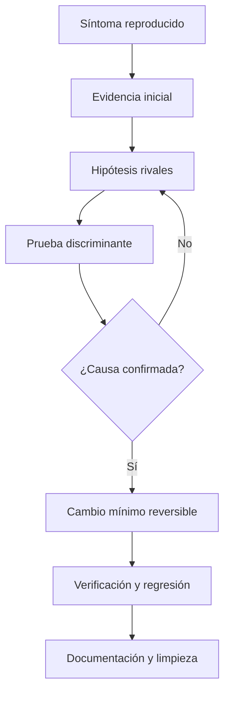
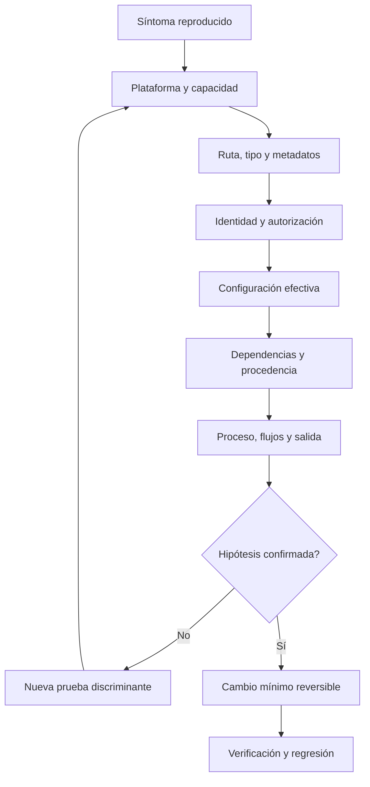
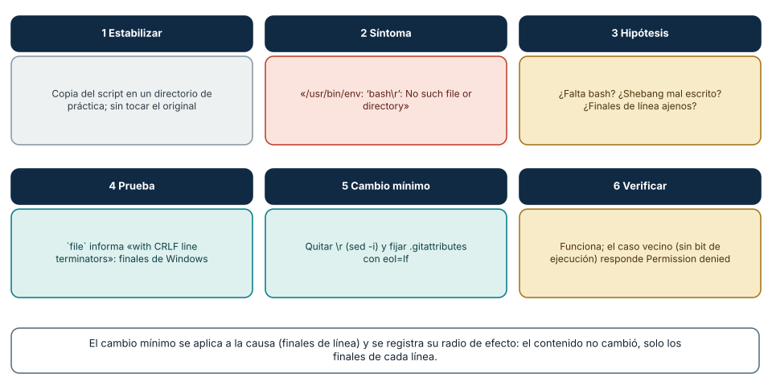
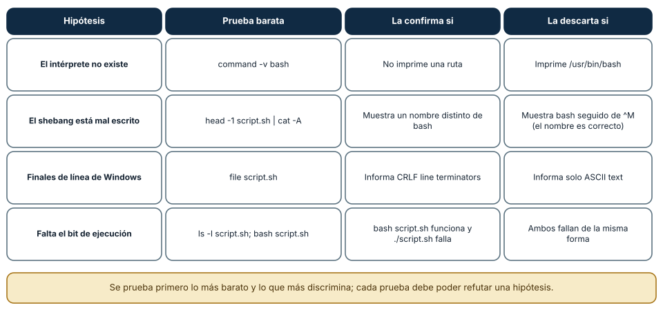
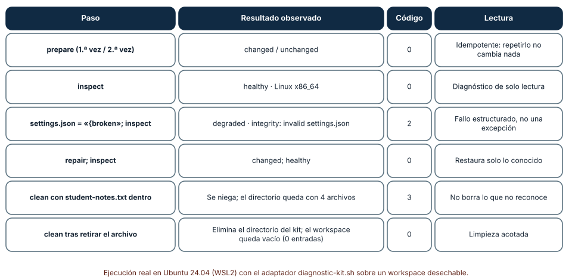

# SE-035 — Taller: preparar y reparar un entorno reproducible

[← SE-034](https://github.com/vladimiracunadev-create/modern-software-engineering-program/blob/main/classes/part-02-sistemas-operativos-terminal-y-automatizacion-base/se-034-virtualizacion-wsl-y-aislamiento-local/README.md) · [↑ Parte 02](https://github.com/vladimiracunadev-create/modern-software-engineering-program/blob/main/classes/part-02-sistemas-operativos-terminal-y-automatizacion-base/README.md) · [📚 Índice completo](https://github.com/vladimiracunadev-create/modern-software-engineering-program/blob/main/classes/README.md) · [SE-036 →](https://github.com/vladimiracunadev-create/modern-software-engineering-program/blob/main/classes/part-02-sistemas-operativos-terminal-y-automatizacion-base/se-036-proyecto-kit-de-diagnostico-multiplataforma/README.md)

## Punto profesional y fundamento pedagógico

**Punto profesional.** La clase existe para preparar, romper, diagnosticar y restaurar un entorno desde un runbook verificable.

**Por qué aparece aquí.** Se sitúa después de **Virtualización, WSL y aislamiento local** y antes de **Proyecto: kit de diagnóstico multiplataforma**: convierte el conocimiento anterior en una decisión observable que la clase siguiente podrá reutilizar. La continuidad se comprueba en el artefacto, no por compartir vocabulario.

**Error conceptual que debe corregir.** Resolver el síntoma cambiando varias variables sin conservar una reproducción.

**Secuencia de aprendizaje.** Antes de leer la solución, el estudiante predice el resultado del caso normal y del error conceptual anterior. Luego explica un caso resuelto paso a paso, construye un contraejemplo que cambie la decisión y, sin consultar el texto, reconstruye el mecanismo y lo aplica a una entrada nueva. La secuencia usa predicción, explicación propia, contraste y recuperación. [ICAP](https://icap.education.asu.edu/research) distingue participación de construcción de conocimiento; [How People Learn II](https://nap.nationalacademies.org/catalog/24783/how-people-learn-ii-learners-contexts-and-cultures) exige conectar conocimiento previo, contexto y transferencia; la [práctica de recuperación](https://pubmed.ncbi.nlm.nih.gov/16507066/) respalda producir de nuevo la explicación tras una demora; y [Education for Life and Work](https://nap.nationalacademies.org/resource/13398/dbasse_084153.pdf) exige devolución que explique la causa del error.

**Evidencia de aprendizaje.** Runbook.md con estado inicial, fallo, hipótesis, reparación, rollback y repetición limpia. Debe contener predicción previa, observación, explicación causal, contraejemplo, criterio de aceptación y una nota de qué dato haría cambiar la conclusión.

**Límite de la conclusión.** La reparación demostrada cubre solo las versiones declaradas.

### Trazabilidad fuente → afirmación

| Fuente primaria u oficial | Afirmación que respalda | Lo que no prueba |
|---|---|---|
| [Microsoft Learn — Sysinternals documentation](https://learn.microsoft.com/sysinternals/) | documenta el comportamiento de Windows o PowerShell que se compara con el contrato POSIX | No demuestra por sí sola que el artefacto del estudiante sea correcto. |
| [The Open Group Base Specifications, Issue 8](https://pubs.opengroup.org/onlinepubs/9799919799/) | define el contrato portable de procesos, rutas, entorno o shell que se contrasta entre sistemas | No demuestra por sí sola que el artefacto del estudiante sea correcto. |
| [systemd manual pages](https://www.freedesktop.org/software/systemd/man/latest/) | define ciclo de vida, supervisión o consulta de eventos en systemd | No demuestra por sí sola que el artefacto del estudiante sea correcto. |
| [Python documentation — subprocess](https://docs.python.org/3/library/subprocess.html) | define la semántica y los límites de la API de Python utilizada en el experimento | No demuestra por sí sola que el artefacto del estudiante sea correcto. |

## Antes de empezar

Este taller integra las clases 25 a 34. Recibirás una copia deliberadamente defectuosa del entorno del analizador local de eventos: ruta dependiente del directorio actual, configuración dominada por una variable obsoleta, dependencia incompatible y permisos excesivos aplicados como “solución”. El objetivo no es hacerlo funcionar lo antes posible. Es explicar cada fallo, intervenir con el menor cambio y dejar un procedimiento reproducible.

### Resultado de aprendizaje

Al terminar podrás conducir un diagnóstico completo desde síntoma hasta verificación y reversión, conservando evidencia y evitando reparaciones destructivas.

## Prerrequisitos

Clases `SE-025`–`SE-034`, carpeta desechable y bitácora. Debes poder ejecutar el kit de diagnóstico multiplataforma en solo lectura y explicar sus códigos, configuración y adaptadores.

## Problema auténtico

El entorno del analizador local de eventos acumula cuatro intentos de reparación: ruta absoluta personal, permisos amplios, dependencia global y variable obsoleta. Ahora funciona solo en una sesión y nadie puede atribuir qué cambio produjo qué resultado.

## Objetivos observables

Podrás estabilizar un escenario; convertir síntomas en afirmaciones; formular hipótesis rivales; aplicar un cambio mínimo; verificar regresión; y entregar reversión con riesgo residual explícito.

## Temas y por qué importan

| Tema | Mecanismo | Decisión habilitada |
| --- | --- | --- |
| Captura inicial | conserva estado antes de intervenir | reproducir y comparar |
| Hipótesis rival | exige pruebas con resultados distintos | evitar la primera explicación cómoda |
| Cambio mínimo | limita variables y radio de efecto | atribuir resultado y revertir |
| Regresión | repite contratos vecinos | comprobar que reparar no rompió otra cosa |
## Mapa conceptual

El ciclo puede repetirse varias veces. Cada iteración cambia una sola variable relevante y conserva el resultado negativo como evidencia.

## Conceptos y decisiones

### Estabilizar el escenario antes de intervenir

Se registra plataforma, versión, arquitectura, shell, hora de inicio y síntoma exacto. Luego se copia el laboratorio o se usa un entorno desechable. No se actualiza, reinstala o elimina nada antes de capturar el estado que permite reproducir.

Estabilizar no significa congelar un sistema productivo sin autorización. En este taller los datos son ficticios y el entorno está acotado.

### Convertir el síntoma en una afirmación comprobable

“No funciona” se transforma en: comando ejecutado, entrada, resultado esperado, resultado observado, código de salida y alcance. Se separa el primer fallo observable de mensajes secundarios.

Una buena hipótesis relaciona mecanismo y evidencia: “la variable `EVENT_ANALYZER_CONFIG` tiene mayor precedencia y dirige a una ruta inexistente”. La prueba mínima ejecuta con entorno saneado; reinstalar no discrimina esta causa.

### Probar primero lo barato: las hipótesis del incidente

El orden se ajusta a la evidencia, pero impide saltar a una única explicación favorita.

### Aplicar un cambio mínimo y registrar su radio de efecto

Cada intervención declara archivos, usuarios y procesos afectados; autoridad requerida; reversión; y señal de éxito. Se prefiere corregir configuración del proyecto antes que una variable global, o restaurar permiso mínimo antes que abrir acceso general.

Si un cambio no explica el resultado, se revierte antes de probar otro. Acumular intentos impide atribuir causalidad.

### Verificar incluye el caso original y casos vecinos

Que el analizador local de eventos inicie una vez no prueba reparación. Se repite el escenario original desde otro directorio, con configuración ausente y con ruta con espacios. Se comprueba código de salida, stdout/stderr, ausencia del secreto centinela y estado final de permisos.

La regresión busca que la corrección no haya roto otro contrato. El kit de diagnóstico multiplataforma conserva versiones y matriz de plataforma para que otra persona pueda repetir.

### Documentar decisión y riesgo residual

El informe final contiene hechos, causa, corrección, evidencia posterior y límites. Si solo se mitigó el síntoma, se dice. Si no se reprodujo en macOS, no se marca esa plataforma como validada.

### Un incidente reproducido de principio a fin

El taller se entiende mejor con un incidente real y pequeño. Un script de Bash creado en Windows se copia a Linux y falla con `/usr/bin/env: ‘bash\r’: No such file or directory`. El método de la clase se aplica así (Figura 1): (1) *estabilizar* el escenario trabajando sobre una copia, sin modificar el original; (2) convertir el síntoma en una
afirmación comprobable (el mensaje nombra `bash\r`, no `bash`); (3) formular hipótesis por capa (falta el intérprete, el shebang está mal escrito, hay finales de línea ajenos); (4) probar la más barata: `file` informa «with CRLF line terminators»; (5) aplicar el cambio *mínimo* (quitar los `\r` con `sed -i 's/\r$//'` y fijar `eol=lf` en `.gitattributes`
para que no se repita); y (6) verificar, no solo el caso original (ahora funciona), sino un caso *vecino*: el mismo script sin el bit de ejecución responde `Permission denied`, y `bash script.sh` funciona, lo que confirma que ese es otro problema y que la corrección no lo enmascaró.

**Cómo leer la figura.** Las seis cajas siguen el orden del método; las de colores cálidos marcan síntoma e hipótesis, y las de tonos verdes, lo comprobado. **Dónde deja de valer:** el incidente tiene una causa única y una prueba trivial. En uno real hay varias causas concurrentes y
las pruebas son costosas o arriesgadas; el orden se conserva (de lo barato y reversible a lo caro) y la verificación debe incluir siempre un caso vecino y el efecto del cambio sobre otros componentes.

### Reducir incertidumbre por capas

Cada hipótesis debe poder *refutarse* con una prueba barata. En el incidente: `command -v bash` descarta la ausencia del intérprete; `head -1 script.sh | cat -A` muestra si el shebang termina en `^M`; `file script.sh` informa los finales de línea; y `ls -l` junto con `bash script.sh` separa contenido y permiso. La Figura 2 las ordena con qué resultado
confirma o descarta cada una. La regla es probar primero lo más *barato* y lo que más *discrimina*, y no cambiar nada hasta tener una hipótesis que la prueba haya sostenido: un cambio al azar (reinstalar, reiniciar, copiar de nuevo) puede «arreglar» el síntoma sin enseñar la causa, y a veces borra la evidencia.

**Cómo leer la figura.** Las dos últimas columnas hacen explícito qué observación refuta la hipótesis, que es lo que la vuelve una hipótesis. **Dónde deja de valer:** las pruebas del ejemplo son de Linux y usan herramientas habituales (`file`, `cat -A`); en otros sistemas se usan equivalentes (por ejemplo, un editor hexadecimal o un visor de finales de línea), y los resultados dependen de que el archivo no se haya modificado al copiarlo.

### Reparar con límites: la secuencia real del laboratorio

El laboratorio de la Parte 02 convierte el taller en una secuencia reproducible. Ejecutada con el adaptador de Bash en Ubuntu 24.04 (WSL2) sobre un workspace desechable: `prepare` informó `changed` y, repetido, `unchanged` (idempotente); `inspect` informó `healthy` sobre `Linux x86_64`; al sustituir `settings.json` por `{broken`, `inspect` informó `degraded` con la categoría `integrity` y
el mensaje `invalid settings.json`, con código de salida 2; `repair` restauró la configuración y `inspect` volvió a `healthy`; `clean` con un archivo ajeno (`student-notes.txt`) dentro se negó con código 3 y dejó el directorio con cuatro archivos; y tras retirar ese archivo, `clean` terminó con 0 dejando el workspace vacío. Lo notable es lo que *no* hace: `repair` solo repone dos archivos conocidos y no toca el marker de propiedad, y `clean`
se niega a borrar lo que no reconoce.

**Cómo leer la figura.** Cada fila es un paso con su resultado y su código; la columna final explica qué propiedad del diseño demuestra. **Dónde deja de valer:** es una ejecución en Linux con el adaptador de Bash; los adaptadores y sistemas distintos se prueban por separado (la clase siguiente reúne las diez pruebas en Windows y en Linux). Un resultado correcto sobre un workspace desechable no demuestra seguridad sobre un entorno real con datos de producción.

## Definiciones de trabajo

- **estado inicial:** conjunto mínimo de condiciones antes de intervenir;
- **hipótesis rival:** explicación alternativa compatible con el síntoma;
- **prueba discriminante:** observación cuyo resultado separa hipótesis;
- **cambio mínimo:** intervención acotada que permite atribuir efecto;
- **regresión:** pérdida de una propiedad previamente satisfecha.

## Caso conductor: incidente-de-diagnóstico-01

Secuencia esperada del taller:

1. El analizador local de eventos termina con código de precondición ausente.
2. El kit de diagnóstico multiplataforma revela que `EVENT_ANALYZER_CONFIG` proviene del entorno y apunta a una ruta relativa.
3. La ruta cambia con el directorio de trabajo.
4. Un intento previo otorgó escritura amplia al directorio.
5. Al corregir la fuente de configuración aparece una dependencia fuera del rango soportado.
6. Se crea un entorno de proyecto con versión fijada, se restaura mínimo privilegio y se ejecutan pruebas.

Hay más de un fallo para evitar que la primera corrección se confunda con cierre completo.

## Práctica guiada

Prepara una carpeta de laboratorio, nunca una instalación real del sistema. Conserva una bitácora con esta estructura:

| Paso | Hipótesis | Evidencia buscada | Acción | Resultado | Decisión |
|---|---|---|---|---|---|
| 1 | La ruta viene del entorno | Configuración efectiva | `diagnostic-kit inspect` | Variable presente | Probar entorno mínimo |

Luego:

1. reproduce sin modificar;
2. captura ficha de plataforma;
3. traza ruta y permisos;
4. explica precedencia;
5. verifica dependencia y procedencia;
6. aplica cambios de uno en uno;
7. ejecuta matriz de regresión;
8. revierte el laboratorio y demuestra limpieza.

## Ejemplo mínimo

El analizador local de eventos busca una ruta relativa equivocada. Ejecutarlo desde otra carpeta reproduce el fallo; pasar una ruta absoluta de laboratorio lo evita. La prueba apunta al contexto de resolución, no a permisos ni dependencia.

## Ejemplo profesional

Una dependencia incompatible aparece después de corregir configuración. El equipo no deshace la primera conclusión: registra dos causas encadenadas, aísla la versión por proyecto y prueba ambos escenarios por separado.

## Ejercicios

1. Reescribe “no funciona” como resultado esperado/observado y alcance.
2. Propón dos hipótesis para acceso denegado y una prueba que las separe.
3. Diseña una matriz de regresión para ruta, configuración y dependencia.

## Reto verificable

Entrega el laboratorio defectuoso y tu bitácora a otra persona. Debe reproducir, reparar con tus decisiones y volver al estado limpio sin instrucciones orales.

## Preguntas frecuentes

### ¿Reinstalar puede ser una prueba válida?

Solo si discrimina una hipótesis y conserva evidencia; normalmente cambia demasiadas variables para ser el primer paso.

### ¿Una mitigación equivale a corregir la causa?

No. Puede reducir impacto mientras la causa permanece; el informe debe distinguirlas.

### ¿Reinstalar o reiniciar puede ser una prueba válida?

Puede serlo si se plantea como un *experimento* con hipótesis y resultado esperado («si el problema es un estado corrupto local, una instalación limpia lo elimina»). Pero como remedio al azar destruye evidencia: después de reinstalar, ya no puedes saber qué falló. Se captura primero el estado (versión, configuración, registros) y se decide con ese criterio.

### ¿Cuánto debe durar un diagnóstico antes de escalar?

Se acuerda de antemano un plazo proporcional al impacto, y se escala cuando se agotan las hipótesis baratas o el plazo, con el registro de lo probado. Un buen escalamiento entrega síntomas, hipótesis descartadas y evidencia, no solo «no funciona».
## Fallo controlado y diagnóstico

Aplica deliberadamente dos cambios a la vez y observa que no puedes atribuir el éxito. Revierte ambos, repite uno por uno y corrige la bitácora con esa limitación.

Una segunda práctica extiende el incidente con un cambio de radio mayor. Ejecuta el recorrido del laboratorio en un workspace desechable: `prepare`, `inspect`, corrompe `settings.json`, `inspect`, `repair`, `inspect`. **Síntoma esperado:** `degraded` con código 2 y luego `healthy`. Añade ahora un archivo ajeno dentro de `.diagnostic-kit` y ejecuta `clean`: debe
negarse con código 3. **Causa del rechazo:** el kit solo borra lo que reconoce. **Registro:** anota en `decision.md` qué hipótesis descartó cada paso, qué cambió (solo dos archivos conocidos) y el riesgo residual (qué no cubre: otros archivos del workspace, otras plataformas). Evita cualquier prueba en un directorio que no hayas creado.
## Errores comunes y cómo corregirlos

| Síntoma | Causa conceptual | Corrección |
|---|---|---|
| Se borra y reinstala al comienzo | Se destruyó evidencia antes de formular hipótesis | Capturar y reproducir primero |
| Varias cosas cambian a la vez | No puede atribuirse el resultado | Un cambio mínimo, medir y revertir si no explica |
| Se repara solo el caso feliz | No se verificaron contratos vecinos | Ejecutar una matriz de regresión adversa |
| El informe enumera comandos sin razonamiento | Falta relación causal | Registrar hipótesis, evidencia y decisión por paso |
| Se declara soporte en tres sistemas | Solo se probó uno | Separar diseño esperado de evidencia ejecutada |

## Entorno y archivos clave

Usa la secuencia `prepare → inspect → corromper settings → inspect → repair → inspect → clean` del [laboratorio compartido](https://github.com/vladimiracunadev-create/modern-software-engineering-program/tree/main/labs/part-02-cross-platform-diagnostic-kit) y conserva cada código antes de redactar la causa.

`work/SE-035/broken-environment/`, `baseline.json`, `diagnostic-log.md`, `regression.md` y `cleanup.md`. Todo debe poder borrarse sin afectar configuración global.

## Seguridad, ética y accesibilidad

No uses un equipo productivo ni datos reales. Declara toda acción que modifica estado, proporciona alternativa manual legible y evita que la guía dependa solo de capturas.

## Puente hacia el trabajo con agentes

Un agente depurando es un candidato natural al *cambio al azar*: prueba una modificación, ejecuta, y si el síntoma desaparece da el trabajo por terminado. El método de esta clase es la corrección: cada acción nace de una hipótesis con una prueba que podría refutarla; los cambios son mínimos y reversibles; y la verificación incluye el caso vecino. Un harness puede imponerlo exigiendo que el agente
registre, antes de tocar nada, el síntoma, las hipótesis y la prueba elegida, y después el cambio y su verificación. Además, las operaciones de reparación del agente deben tener los mismos límites que `repair` y `clean` del laboratorio: alcance acotado, solo sobre lo que reconoce, negativa explícita ante lo ajeno y un código de salida que lo diga. Las partes de harness y de evaluación de agentes
desarrollan esos contratos.

## Transferencia

Aplica el ciclo a un fallo de CI: conserva ejecución, formula hipótesis de entorno/código, cambia una variable y distingue mitigación de corrección.

## Evaluación y evidencia

Se exige reproducción, hipótesis rivales, pruebas discriminantes, cambios unitarios, regresión, reversión y revisión independiente. Velocidad sin trazabilidad no mejora la calificación.

## Criterio de cierre

El taller se aprueba cuando otra persona puede reproducir el fallo, seguir la evidencia, comprender la causa, aplicar la corrección mínima, ejecutar regresión y revertir el laboratorio usando tu documentación.

## Límites y siguiente paso

El escenario es local, deliberadamente controlado y no autoriza intervenir equipos de terceros. La clase final convierte el procedimiento en un producto pequeño: el kit de diagnóstico multiplataforma, con contrato, adaptadores, pruebas y entrega profesional.

## Fuentes

- [Microsoft Learn — Sysinternals documentation](https://learn.microsoft.com/sysinternals/) — documenta el comportamiento de Windows o PowerShell que se compara con el contrato POSIX.
- [The Open Group Base Specifications, Issue 8](https://pubs.opengroup.org/onlinepubs/9799919799/) — define el contrato portable de procesos, rutas, entorno o shell que se contrasta entre sistemas.
- [systemd manual pages](https://www.freedesktop.org/software/systemd/man/latest/) — define ciclo de vida, supervisión o consulta de eventos en systemd.
- [Python documentation — subprocess](https://docs.python.org/3/library/subprocess.html) — define la semántica y los límites de la API de Python utilizada en el experimento.

- [file(1)](https://man7.org/linux/man-pages/man1/file.1.html) y [gitattributes: eol](https://git-scm.com/docs/gitattributes): detección de tipos de archivo y normalización de finales de línea, usadas en el incidente reproducido.
- [Laboratorio de la Parte 02](https://github.com/vladimiracunadev-create/modern-software-engineering-program/tree/main/labs/part-02-cross-platform-diagnostic-kit): secuencia `prepare`, `inspect`, `repair` y `clean` con códigos de salida 0, 2 y 3.
## Glosario

- **Hipótesis discriminante:** explicación cuya prueba produce resultados diferentes frente a alternativas.
- **Radio de efecto:** recursos, personas o procesos que un cambio puede afectar.
- **Regresión:** fallo introducido en una capacidad previamente válida.
- **Reproducción:** procedimiento capaz de volver a mostrar el comportamiento bajo condiciones declaradas.
- **Reversión:** retorno verificable al estado anterior o a uno seguro definido.

---
[← SE-034](https://github.com/vladimiracunadev-create/modern-software-engineering-program/blob/main/classes/part-02-sistemas-operativos-terminal-y-automatizacion-base/se-034-virtualizacion-wsl-y-aislamiento-local/README.md) · [↑ Parte 02](https://github.com/vladimiracunadev-create/modern-software-engineering-program/blob/main/classes/part-02-sistemas-operativos-terminal-y-automatizacion-base/README.md) · [📚 Índice completo](https://github.com/vladimiracunadev-create/modern-software-engineering-program/blob/main/classes/README.md) · [SE-036 →](https://github.com/vladimiracunadev-create/modern-software-engineering-program/blob/main/classes/part-02-sistemas-operativos-terminal-y-automatizacion-base/se-036-proyecto-kit-de-diagnostico-multiplataforma/README.md)
