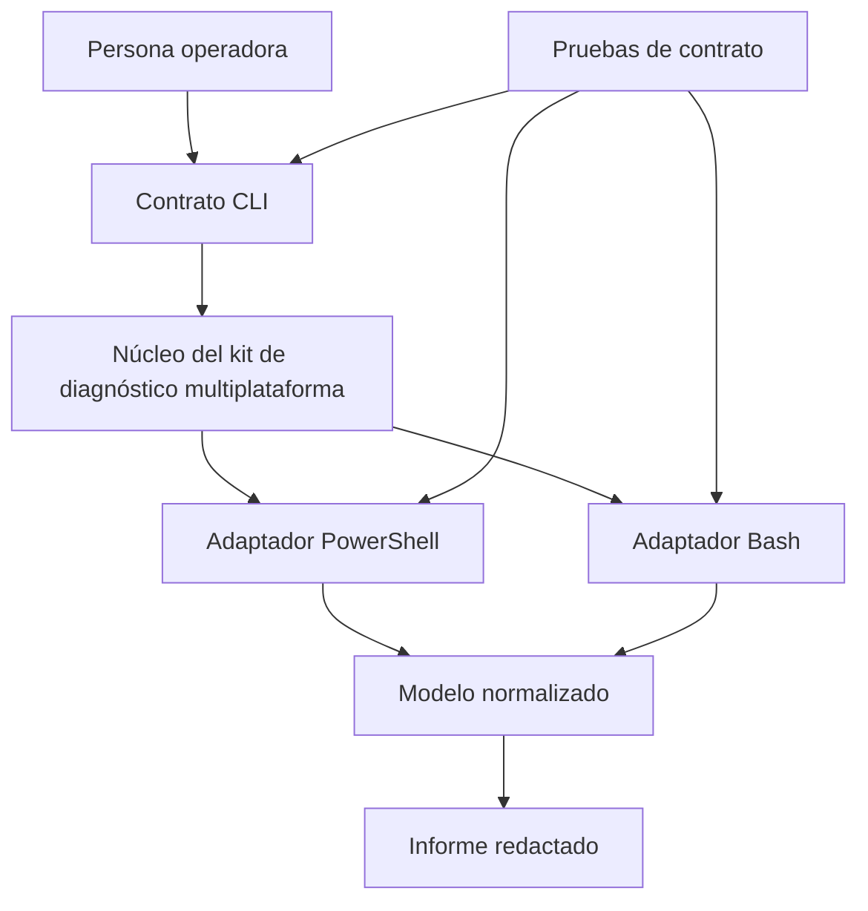
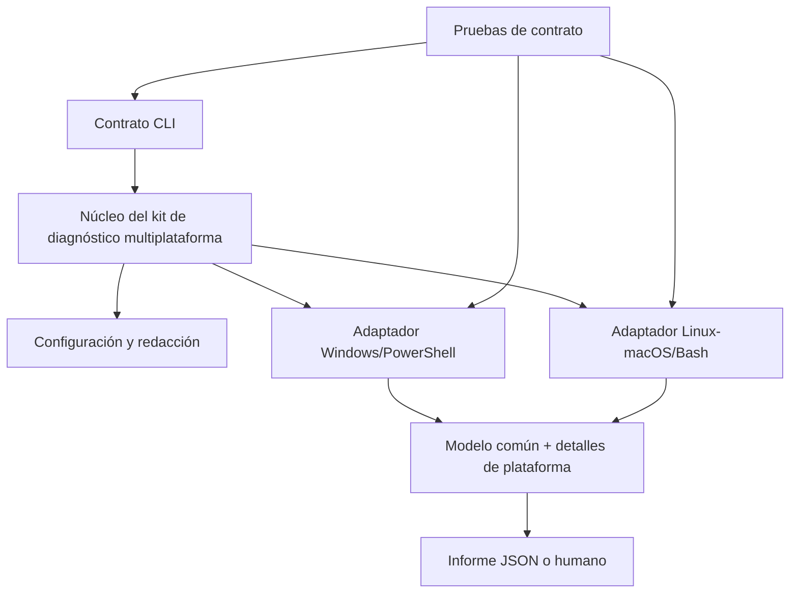
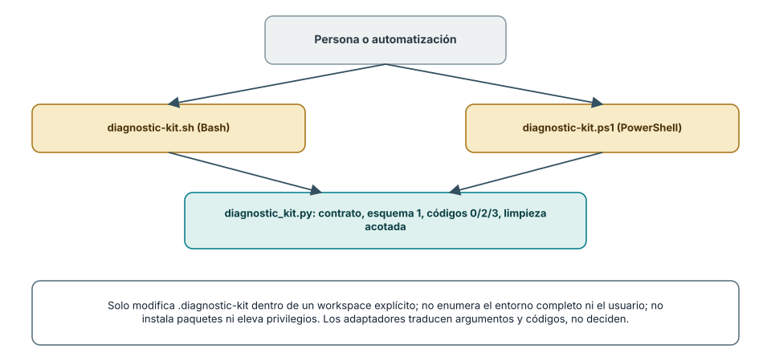
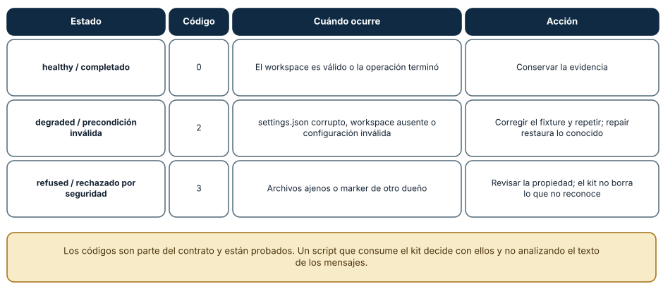
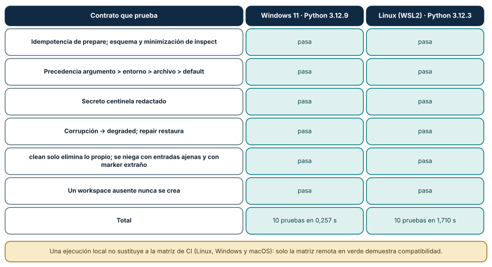

# SE-036 — Proyecto: kit de diagnóstico multiplataforma

[← SE-035](https://github.com/vladimiracunadev-create/modern-software-engineering-program/blob/main/classes/part-02-sistemas-operativos-terminal-y-automatizacion-base/se-035-taller-preparar-y-reparar-un-entorno-reproducible/README.md) · [↑ Parte 02](https://github.com/vladimiracunadev-create/modern-software-engineering-program/blob/main/classes/part-02-sistemas-operativos-terminal-y-automatizacion-base/README.md) · [📚 Índice completo](https://github.com/vladimiracunadev-create/modern-software-engineering-program/blob/main/classes/README.md) · [SE-037 →](https://github.com/vladimiracunadev-create/modern-software-engineering-program/blob/main/classes/part-03-redes-internet-y-protocolos/se-037-modelos-osi-y-tcp-ip-como-herramientas-de-diagnostico/README.md)


## Punto profesional y fundamento pedagógico

**Punto profesional.** La clase existe para entregar un kit de diagnóstico multiplataforma que observe sin alterar innecesariamente.

**Por qué aparece aquí.** Se sitúa después de **Taller: preparar y reparar un entorno reproducible** y antes de **Modelos OSI y TCP/IP como herramientas de diagnóstico**: convierte el conocimiento anterior en una decisión observable que la clase siguiente podrá reutilizar. La continuidad se comprueba en el artefacto, no por compartir vocabulario.

**Error conceptual que debe corregir.** Coleccionar datos sin pregunta diagnóstica o exponer secretos en el reporte.

**Secuencia de aprendizaje.** Antes de leer la solución, el estudiante predice el resultado del caso normal y del error conceptual anterior. Luego explica un caso resuelto paso a paso, construye un contraejemplo que cambie la decisión y, sin consultar el texto, reconstruye el mecanismo y lo aplica a una entrada nueva. La secuencia usa predicción, explicación propia, contraste y recuperación. [ICAP](https://icap.education.asu.edu/research) distingue participación de construcción de conocimiento; [How People Learn II](https://nap.nationalacademies.org/catalog/24783/how-people-learn-ii-learners-contexts-and-cultures) exige conectar conocimiento previo, contexto y transferencia; la [práctica de recuperación](https://pubmed.ncbi.nlm.nih.gov/16507066/) respalda producir de nuevo la explicación tras una demora; y [Education for Life and Work](https://nap.nationalacademies.org/resource/13398/dbasse_084153.pdf) exige devolución que explique la causa del error.

**Evidencia de aprendizaje.** Kit ejecutable, fixtures, salidas redactadas y comparación en dos plataformas. Debe contener predicción previa, observación, explicación causal, contraejemplo, criterio de aceptación y una nota de qué dato haría cambiar la conclusión.

**Límite de la conclusión.** La ausencia de hallazgo no demuestra salud del sistema.

### Trazabilidad fuente → afirmación

| Fuente primaria u oficial | Afirmación que respalda | Lo que no prueba |
|---|---|---|
| [The Open Group Base Specifications, Issue 8](https://pubs.opengroup.org/onlinepubs/9799919799/) | define el contrato portable de procesos, rutas, entorno o shell que se contrasta entre sistemas | No demuestra por sí sola que el artefacto del estudiante sea correcto. |
| [Microsoft Learn — PowerShell documentation](https://learn.microsoft.com/powershell/) | documenta el comportamiento de Windows o PowerShell que se compara con el contrato POSIX | No demuestra por sí sola que el artefacto del estudiante sea correcto. |
| [GNU Bash Reference Manual 5.3](https://www.gnu.org/software/bash/manual/) | documenta parsing, expansión, quoting, pipelines y estado de salida en Bash | No demuestra por sí sola que el artefacto del estudiante sea correcto. |
| [Microsoft Learn — WSL documentation](https://learn.microsoft.com/windows/wsl/) | documenta el comportamiento de Windows o PowerShell que se compara con el contrato POSIX | No demuestra por sí sola que el artefacto del estudiante sea correcto. |
| [OWASP — Logging Cheat Sheet](https://cheatsheetseries.owasp.org/cheatsheets/Logging_Cheat_Sheet.html) | delimita el contrato técnico que debe cumplirse al entregar un kit de diagnóstico multiplataforma que observe sin alterar innecesariamente | No demuestra por sí sola que el artefacto del estudiante sea correcto. |

## Antes de empezar

La Parte 2 concluye con una entrega, no con un cuestionario. Construirás un **kit de diagnóstico multiplataforma**, una herramienta local que describe el entorno del analizador local de eventos, valida precondiciones, explica hallazgos y exporta evidencia segura. El valor no reside en acumular comandos: reside en convertir los mecanismos estudiados en un sistema pequeño que otra persona pueda operar y auditar.

### Resultado de aprendizaje

Al terminar podrás entregar una herramienta multiplataforma con contrato explícito, adaptadores probados, diagnóstico causal, documentación operativa y límites honestos.

## Prerrequisitos

Parte 2 completa y evidencias de `SE-035`. Debes contar con una plataforma ejecutable; las demás pueden permanecer diseñadas si no existe acceso, siempre que la matriz lo diga.

## Problema auténtico

Los diagnósticos anteriores viven en comandos y notas personales. Otra persona no sabe qué ejecutar, qué datos comparte, cómo interpretar un código ni si la herramienta modifica el equipo. El conocimiento existe, pero aún no es un producto operable.

## Objetivos observables

Podrás definir un contrato versionado; separar núcleo y adaptadores; construir modo de solo lectura; probar degradación y redacción; publicar matriz real; y conducir una demostración reproducible por terceros.

## Temas y por qué importan

| Tema | Mecanismo | Decisión habilitada |
| --- | --- | --- |
| Contrato versionado | estabiliza entradas, salidas y estados | permitir consumidores y evolución |
| Núcleo/adaptador | aísla intención de detalles locales | portar sin copiar errores |
| Solo lectura | limita efectos predeterminados | ejecutar diagnóstico con menor riesgo |
| Matriz y evidencia | separa diseño de ejecución | declarar soporte honesto |
## Mapa conceptual



La persona interactúa con un contrato estable. Los adaptadores observan plataformas, el núcleo interpreta y el informe separa evidencia, inferencia y recomendación.

## Conceptos y decisiones

### Un núcleo común expresa intención

El núcleo define operaciones independientes de shell: describir plataforma, resolver una ruta, validar configuración, comprobar una dependencia, observar un proceso propio y construir informe. También define esquema de salida, códigos y política de redacción.

No contiene comandos concatenados ni rutas globales. Recibe resultados de adaptadores y decide qué significan bajo el contrato.

### Los adaptadores contienen diferencias de plataforma

PowerShell y Bash implementan capacidades con herramientas documentadas. Cada adaptador informa `supported`, `unavailable` o `failed`, junto con evidencia segura. Una capacidad ausente no se convierte en dato inventado.



El diagrama obliga a distinguir modelo común y detalle específico. Es aceptable que una plataforma aporte menos datos; no lo es ocultarlo.

### El modo predeterminado es de solo lectura

El kit de diagnóstico multiplataforma observa y propone. Cualquier reparación opcional exige una orden separada, vista previa, confirmación apropiada y reversión documentada. Para este proyecto basta con generar un plan; no se requiere modificar permisos, instalar paquetes ni terminar procesos.

Esto reduce riesgo y vuelve las pruebas repetibles.

### El informe separa evidencia, inferencia y recomendación

Cada hallazgo contiene:

```json
{
  "code": "config.path.missing",
  "severity": "error",
  "evidence": {"source": "environment", "exists": false},
  "interpretation": "La ruta efectiva no existe",
  "next_test": "Ejecutar con un entorno mínimo",
  "remediation": "Corregir la fuente de configuración en su ámbito"
}
```

Los campos sensibles se omiten o redactan antes de serializar. El informe incluye versión del esquema y del kit de diagnóstico multiplataforma para interpretación futura.

### Las pruebas demuestran contratos y degradación

El conjunto mínimo cubre:

- ruta existente, ausente, con espacios y tipo incorrecto;
- precedencia de configuración y valores inválidos;
- dependencia compatible, incompatible y opcional ausente;
- códigos de salida y separación stdout/stderr;
- secreto centinela ausente de todas las salidas;
- capacidad no disponible reportada como diagnóstico parcial;
- ejecución desde un directorio distinto al proyecto.

Las pruebas específicas de plataforma se etiquetan. Un workflow que no ejecuta macOS no prueba macOS; el README muestra matriz real.

### La entrega incluye operación y mantenimiento

El repositorio del proyecto contiene inicio rápido, requisitos, arquitectura, esquema, códigos de salida, matriz, amenazas básicas, procedimiento de diagnóstico y limpieza. Las dependencias están fijadas dentro de límites razonados y su actualización tiene un procedimiento.

Un ejemplo reproducible usa datos ficticios y genera un informe esperado. La documentación enlaza a fuentes oficiales cerca de las decisiones sensibles.

### La arquitectura del kit, leída desde sus archivos

El kit es pequeño a propósito, y su arquitectura se puede leer de sus archivos (Figura 1). Un *núcleo* en Python, `diagnostic_kit.py`, define el contrato: cuatro comandos (`prepare`, `inspect`, `repair`, `clean`), un esquema de reporte versionado (`schema_version = 1`), una resolución de configuración
determinista, una lista de variables visibles y una redacción de lo sensible, y una limpieza acotada. Dos *adaptadores* finos, `diagnostic-kit.sh` y `diagnostic-kit.ps1`, solo traducen argumentos y códigos de salida a cada shell. Las decisiones importantes no están en los adaptadores: el
núcleo solo modifica un directorio `.diagnostic-kit` dentro de un workspace explícito, nunca enumera el entorno completo ni el usuario, y no instala paquetes ni eleva privilegios. El contrato incluye un *marker de propiedad* (`owner.json`): `repair` y `clean` se niegan a actuar si el marker pertenece a otro.



**Cómo leer la figura.** Las flechas muestran quién llama a quién: una persona o automatización invoca un adaptador y este delega en el núcleo. La caja inferior resume los límites de seguridad que el núcleo impone sin importar el adaptador. **Dónde deja de valer:** un adaptador mal escrito puede violar el contrato (por ejemplo, pasando
mal un argumento); por eso las pruebas ejercitan el núcleo y los adaptadores se verifican por separado en su plataforma. Y «solo lectura por defecto» no es riesgo cero: la propia lectura de un directorio puede exponer información, y el kit lo limita al workspace.

### Estados, códigos y lo que significa cada uno

El contrato de salida tiene tres estados con sus códigos: `healthy` o completado (código 0), `degraded` por una precondición o integridad inválida (código 2) y `refused` por seguridad (código 3). Son *parte de la interfaz*: un script que consume el kit decide con ellos, no analizando el texto del mensaje. La Figura 2 resume cuándo ocurre cada uno y la acción que corresponde. Este diseño aplica
la clase `SE-029`: el código de salida es una interfaz pequeña pero crítica, y se documenta, se prueba y se mantiene estable.



**Cómo leer la figura.** Cada fila es un estado: la tercera columna dice cuándo ocurre y la cuarta qué hacer. La diferencia entre 2 y 3 es importante: el primero se corrige arreglando el fixture; el segundo exige revisar la *propiedad*, porque el kit se negó a actuar por seguridad. **Dónde deja de valer:** tres códigos cubren este alcance; un sistema mayor
necesitará más categorías, y debe versionarlas para no romper a sus consumidores.

### Verificar el contrato en dos plataformas

Las diez pruebas del laboratorio ejercitan el contrato: idempotencia de `prepare`; esquema y minimización de `inspect`; precedencia de configuración; redacción del secreto centinela; degradación estructurada ante corrupción; restauración con `repair`; limpieza que solo elimina lo propio; negativa ante entradas ajenas; un workspace ausente que nunca se crea; y un marker extraño que
bloquea la reparación y la limpieza. En la validación de esta parte las diez pasaron en Windows 11 con Python 3.12.9 (0,257 s) y en Ubuntu 24.04 bajo WSL2 con Python 3.12.3 (1,710 s). Eso es evidencia de que el *mismo contrato* se cumple en dos plataformas reales, pero no de todas: la matriz de integración continua ejecuta además macOS y otras versiones de
Python, y solo esa matriz en verde sustenta una afirmación de compatibilidad.



**Cómo leer la figura.** Cada fila es un contrato y cada columna una plataforma; todas pasan. La fila final registra el tiempo. **Dónde deja de valer:** una prueba que pasa demuestra que el contrato se cumple *para esa entrada*, no para todas; faltan pruebas con rutas largas, nombres Unicode complejos, enlaces simbólicos y permisos
restringidos. Esas ausencias se declaran como límites y se convierten en las próximas pruebas.

### Entregar y mantener

La entrega incluye operación y mantenimiento: un README con requisitos y compatibilidad, un recorrido seguro paso a paso, códigos de salida documentados, una política de versiones del esquema y un procedimiento para reportar y reproducir un fallo. Un kit de diagnóstico que nadie puede ejecutar, interpretar o actualizar no es una herramienta sino un riesgo. Por eso el proyecto exige
que una persona ajena ejecute el recorrido desde cero y obtenga el mismo resultado.

## Definiciones de trabajo

- **contrato versionado:** interfaz observable cuya evolución se declara;
- **núcleo:** reglas de interpretación independientes de comandos locales;
- **adaptador:** implementación de capacidades para una plataforma;
- **hallazgo:** relación estructurada entre evidencia, interpretación y siguiente prueba;
- **matriz real:** registro que diferencia diseñado, ejecutado, aprobado y no soportado.

## Caso conductor: demostración final del kit de diagnóstico multiplataforma

La demostración parte de un entorno con dos defectos: variable obsoleta y dependencia incompatible. La persona evaluadora ejecuta el kit de diagnóstico multiplataforma sin conocerlos. El kit:

1. identifica plataforma y capacidades;
2. muestra configuración efectiva con secreto redactado;
3. resuelve la ruta y explica que no existe;
4. comprueba la versión de dependencia;
5. emite dos hallazgos independientes;
6. propone pruebas, no cambios automáticos;
7. sale con estado de precondición fallida;
8. tras corregir cada causa, genera un informe limpio.

La demostración se repite desde otro directorio para probar que las rutas no dependen de la sesión accidental.

## Ejemplo mínimo

`diagnostic_kit inspect --path laboratorio` produce JSON válido en stdout, progreso en stderr y código cero. Con ruta ausente produce un hallazgo estructurado y código de precondición, sin traza interna ni modificación.

## Ejemplo profesional

Un equipo de soporte recibe un paquete diagnóstico de otra plataforma. La versión del esquema, procedencia de campos y límites le permiten revisar sin pedir el entorno completo. La matriz indica que macOS fue diseñado pero no ejecutado, evitando una promesa falsa.

## Práctica guiada

1. Revisa el contrato antes de implementar y congela fixtures.
2. Completa una ruta vertical en la plataforma disponible.
3. Añade el segundo adaptador o un doble claramente marcado.
4. Ejecuta fallos de ruta, configuración, dependencia y capacidad ausente.
5. Busca el secreto centinela en todos los artefactos.
6. Entrega a otra persona y corrige fricciones observadas.

## Ejercicios

1. Diseña una migración de esquema compatible o una ruptura explícita.
2. Explica qué queda en el núcleo y qué pertenece a `platform_details`.
3. Define cuándo un diagnóstico parcial debe terminar con código distinto de cero.

## Reto verificable

Una persona sin contexto debe ejecutar la demo, identificar dos fallos, aplicar correcciones manuales y generar un informe limpio usando solo el README. Registra tiempo, dudas y cambios de documentación.

## Preguntas frecuentes

### ¿Dos scripts separados ya son un diseño multiplataforma?

No. Necesitan contrato común, pruebas comparables y diferencias declaradas.

### ¿Solo lectura significa riesgo cero?

No. Observar puede revelar información o consumir recursos; minimización y autorización siguen siendo necesarias.

### ¿Cuándo debo ampliar el contrato en lugar de añadir un adaptador?

Cuando la necesidad cambia *qué* hace el sistema (un comando nuevo, un campo nuevo en el reporte), se amplía el contrato y se versiona. Un adaptador nuevo solo es adecuado cuando cambia *cómo* se invoca el mismo contrato (otro shell, otro entorno).
## Fallo controlado y diagnóstico

Retira una capacidad opcional del fixture. El kit de diagnóstico multiplataforma debe emitir diagnóstico parcial, mantener esquema válido y explicar degradación. Corrige cualquier éxito silencioso o excepción no estructurada.

## Plan de trabajo y entregables

### Hito 1 — Contrato antes del código

Entrega esquema de entrada/salida, códigos, matriz objetivo y modelo de amenazas básico. Revisión: otra persona puede anticipar qué hará el kit de diagnóstico multiplataforma y qué nunca hará.

### Hito 2 — Núcleo y un adaptador

Implementa la ruta vertical completa en una plataforma: invocación, observación, normalización, hallazgo e informe. Revisión: casos felices y adversos automatizados.

### Hito 3 — Segundo adaptador

Implementa el otro shell conservando semántica. Revisión: mismas pruebas de contrato, más divergencias documentadas. Si no hay acceso a otra plataforma, la entrega se marca “diseñada, no ejecutada” y se aporta un plan verificable.

### Hito 4 — Seguridad y recuperación

Prueba redacción, límites de tamaño, temporales, interrupción y limpieza. Revisión: ninguna prueba deja estado global y el secreto centinela no aparece.

### Hito 5 — Entrega reproducible

Una segunda persona sigue el README desde cero, ejecuta la demostración y registra fricciones. Se corrige la documentación y se publica la evidencia final.

## Rúbrica de evaluación

| Dimensión | Insuficiente | Competente | Profesional |
|---|---|---|---|
| Modelo causal | Lista comandos | Relaciona hallazgos con mecanismos | Distingue alternativas y límites |
| Portabilidad | Afirma compatibilidad | Define adaptadores y matriz | Aporta pruebas cruzadas y degradación explícita |
| Seguridad | Imprime entorno/datos | Redacta campos conocidos | Minimiza desde el diseño y prueba filtraciones |
| Operación | Solo caso feliz | Códigos y errores útiles | Recuperación, limpieza y evidencia reproducible |
| Documentación | Pasos sin contexto | Contrato y requisitos claros | Una tercera persona reproduce y audita |

No se compensa una filtración de secreto o una modificación no declarada con más funcionalidades.


Una segunda práctica verifica la portabilidad real de la entrega. Ejecuta las diez pruebas del laboratorio con `python -m unittest discover -s labs/part-02-cross-platform-diagnostic-kit/tests` en cada plataforma a la que tengas acceso y registra versión de Python, sistema y duración. **Síntoma
posible:** una prueba que depende de una ruta o de un comportamiento del sistema de archivos falla en una plataforma y pasa en otra. **Causa:** una suposición no declarada (por ejemplo, distinción de mayúsculas o permisos). **Corrección:** hacer la suposición explícita en el contrato o degradar con un mensaje estructurado, y añadir una prueba que la cubra. Anota qué plataformas *no* ejecutaste y no las incluyas en tu
afirmación de compatibilidad.
## Errores comunes y cómo corregirlos

| Síntoma | Causa conceptual | Corrección |
|---|---|---|
| El kit de diagnóstico multiplataforma se convierte en un script de cien comandos | No existe modelo ni contrato | Separar capacidades, adaptadores y decisiones |
| El JSON cambia entre plataformas sin versión | Se mezcló detalle con esquema común | Versionar esquema y aislar `platform_details` |
| La demo necesita editar el código | Configuración y entrega no están resueltas | Definir interfaz, ejemplos y precedencia |
| La matriz marca sistemas no ejecutados | Se confundió intención con evidencia | Publicar estado diseñado/probado por celda |
| La herramienta “repara” por defecto | Se amplió el riesgo sin necesidad | Mantener solo lectura y plan explícito |

## Entorno y archivos clave

La implementación de referencia es el [laboratorio compartido](https://github.com/vladimiracunadev-create/modern-software-engineering-program/tree/main/labs/part-02-cross-platform-diagnostic-kit), con núcleo Python, adaptadores PowerShell/Bash, diez pruebas y [evidencia de validación](https://github.com/vladimiracunadev-create/modern-software-engineering-program/blob/main/labs/part-02-cross-platform-diagnostic-kit/evidence/VALIDATION.md). Extiéndela solo si conservas sus negativas de seguridad.

Repositorio del proyecto con `src/`, `adapters/`, `tests/`, `fixtures/`, `schema/`, `README.md`, `SECURITY.md` y `support-matrix.md`. Los artefactos se generan bajo `work/SE-036/`.

## Seguridad, ética y accesibilidad

Solo datos ficticios en ejemplos, redacción previa a salida, límites de tamaño y ningún cambio privilegiado. La CLI y documentación deben ser navegables, legibles y no depender de color.

## Puente hacia el trabajo con agentes

El kit es un modelo en miniatura de lo que necesita una herramienta confiable para un agente: un contrato versionado, entradas acotadas, salidas estructuradas con códigos que distingan «sano», «degradado» y «rechazado», operaciones destructivas con negativas explícitas, y pruebas que se ejecutan en cada plataforma declarada. Un agente puede usar el kit (como herramienta de solo lectura) para obtener la ficha de su entorno antes de actuar, y un
harness puede exigir que cualquier herramienta que el agente use cumpla estas propiedades. Además, el kit demuestra una regla de integración: las herramientas del agente deben negarse a actuar fuera de su alcance y *decirlo* de forma que una máquina lo entienda. Las partes de herramientas, MCP y seguridad agentic retoman este diseño con contratos de herramientas y pruebas de regresión.

## Transferencia

Extiende el contrato para diagnosticar una llamada de red en la Parte 3. Identifica qué nuevos datos requieren consentimiento y qué adaptadores deben cambiar.

## Evaluación y evidencia

Se evalúan contrato, modelo causal, portabilidad demostrada, seguridad, recuperación y documentación. Una funcionalidad sin prueba o un soporte no ejecutado se registra como deuda, no como completado.

## Criterio de cierre

La Parte 2 queda completada cuando el kit de diagnóstico multiplataforma puede ser ejecutado por otra persona, explica al menos dos fallos independientes, conserva contratos en PowerShell y Bash, no expone el secreto centinela, deja el entorno limpio y publica exactamente qué plataformas y escenarios fueron probados.

## Límites y siguiente paso

El kit de diagnóstico multiplataforma es un kit educativo local, no un agente de soporte remoto, herramienta forense ni producto de seguridad certificado. No ejecuta reparaciones privilegiadas. La siguiente parte del programa utilizará este entorno reproducible para estudiar redes: nombres, direcciones, transporte y fallos entre procesos que ya no comparten una sola máquina.

## Fuentes


- [The Open Group Base Specifications, Issue 8](https://pubs.opengroup.org/onlinepubs/9799919799/) — define el contrato portable de procesos, rutas, entorno o shell que se contrasta entre sistemas.
- [Microsoft Learn — PowerShell documentation](https://learn.microsoft.com/powershell/) — documenta el comportamiento de Windows o PowerShell que se compara con el contrato POSIX.
- [GNU Bash Reference Manual 5.3](https://www.gnu.org/software/bash/manual/) — documenta parsing, expansión, quoting, pipelines y estado de salida en Bash.
- [Microsoft Learn — WSL documentation](https://learn.microsoft.com/windows/wsl/) — documenta el comportamiento de Windows o PowerShell que se compara con el contrato POSIX.
- [OWASP — Logging Cheat Sheet](https://cheatsheetseries.owasp.org/cheatsheets/Logging_Cheat_Sheet.html) — delimita el contrato técnico que debe cumplirse al entregar un kit de diagnóstico multiplataforma que observe sin alterar innecesariamente.

- [Laboratorio de la Parte 02: README y validación](https://github.com/vladimiracunadev-create/modern-software-engineering-program/tree/main/labs/part-02-cross-platform-diagnostic-kit): contrato, códigos de salida y pruebas ejecutadas en esta parte.
- [Python `unittest`](https://docs.python.org/3/library/unittest.html) y [`argparse`](https://docs.python.org/3/library/argparse.html): marco de pruebas y análisis de argumentos usados por el núcleo y sus pruebas.
## Glosario

- **Capacidad:** operación comprobable que una plataforma ofrece al adaptador.
- **Degradación explícita:** reducción funcional informada en datos, mensajes y estado.
- **Matriz de soporte:** tabla que separa plataformas objetivo de escenarios efectivamente probados.
- **Solo lectura:** modo que observa sin cambiar deliberadamente el estado inspeccionado.
- **Versión de esquema:** identificador que permite interpretar la estructura de un informe.

---
[← SE-035](https://github.com/vladimiracunadev-create/modern-software-engineering-program/blob/main/classes/part-02-sistemas-operativos-terminal-y-automatizacion-base/se-035-taller-preparar-y-reparar-un-entorno-reproducible/README.md) · [↑ Parte 02](https://github.com/vladimiracunadev-create/modern-software-engineering-program/blob/main/classes/part-02-sistemas-operativos-terminal-y-automatizacion-base/README.md) · [📚 Índice completo](https://github.com/vladimiracunadev-create/modern-software-engineering-program/blob/main/classes/README.md) · [SE-037 →](https://github.com/vladimiracunadev-create/modern-software-engineering-program/blob/main/classes/part-03-redes-internet-y-protocolos/se-037-modelos-osi-y-tcp-ip-como-herramientas-de-diagnostico/README.md)
