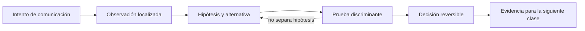
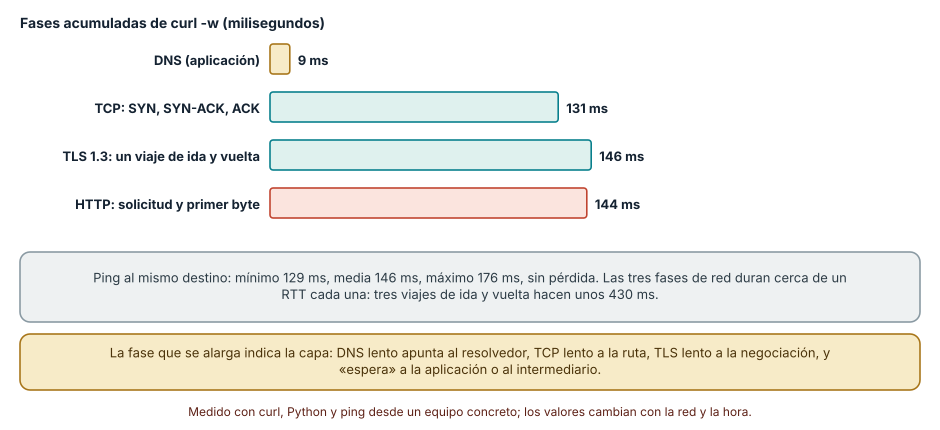
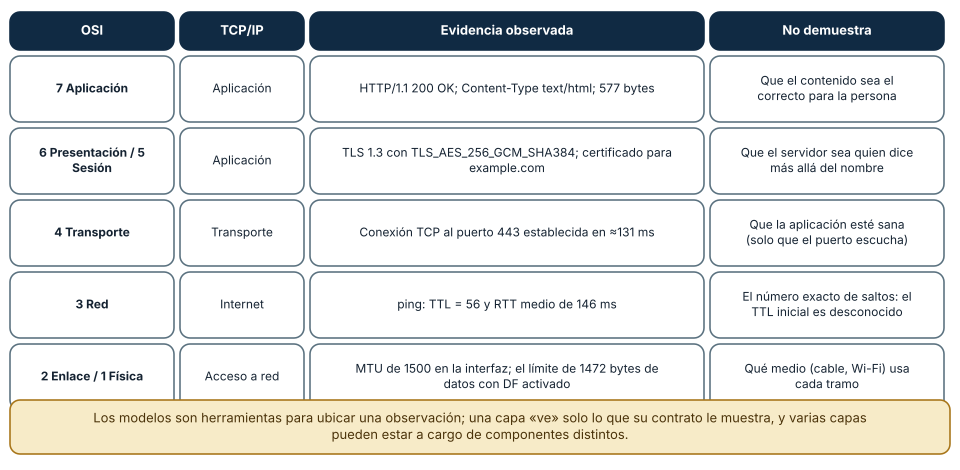
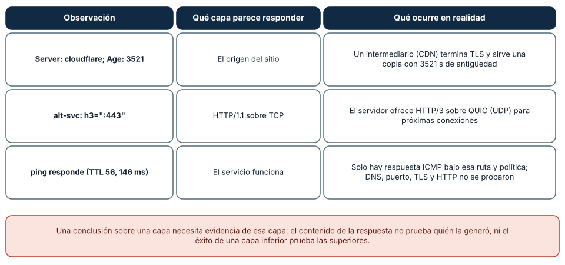

# SE-037 — Modelos OSI y TCP/IP como herramientas de diagnóstico

[← SE-036 — Proyecto: kit de diagnóstico multiplataforma](https://github.com/vladimiracunadev-create/modern-software-engineering-program/blob/main/classes/part-02-sistemas-operativos-terminal-y-automatizacion-base/se-036-proyecto-kit-de-diagnostico-multiplataforma/README.md) · [↑ Parte 03](https://github.com/vladimiracunadev-create/modern-software-engineering-program/blob/main/classes/part-03-redes-internet-y-protocolos/README.md) · [📚 Índice completo](https://github.com/vladimiracunadev-create/modern-software-engineering-program/blob/main/classes/README.md) · [🌐 Portal](https://vladimiracunadev-create.github.io/modern-software-engineering-program/classes/SE-037.html) · [SE-038 — Ethernet, Wi-Fi, direccionamiento y redes locales →](https://github.com/vladimiracunadev-create/modern-software-engineering-program/blob/main/classes/part-03-redes-internet-y-protocolos/se-038-ethernet-wi-fi-direccionamiento-y-redes-locales/README.md)


## Punto profesional y fundamento pedagógico

**Punto profesional.** La clase existe para usar OSI y TCP/IP como modelos de localización de fallos, no como descripción literal del recorrido.

**Por qué aparece aquí.** Se sitúa después de **Proyecto: kit de diagnóstico multiplataforma** y antes de **Ethernet, Wi-Fi, direccionamiento y redes locales**: convierte el conocimiento anterior en una decisión observable que la clase siguiente podrá reutilizar. La continuidad se comprueba en el artefacto, no por compartir vocabulario.

**Error conceptual que debe corregir.** Asignar cada herramienta a una capa rígida o creer que una capa descarta las demás.

**Secuencia de aprendizaje.** Antes de leer la solución, el estudiante predice el resultado del caso normal y del error conceptual anterior. Luego explica un caso resuelto paso a paso, construye un contraejemplo que cambie la decisión y, sin consultar el texto, reconstruye el mecanismo y lo aplica a una entrada nueva. La secuencia usa predicción, explicación propia, contraste y recuperación. [ICAP](https://icap.education.asu.edu/research) distingue participación de construcción de conocimiento; [How People Learn II](https://nap.nationalacademies.org/catalog/24783/how-people-learn-ii-learners-contexts-and-cultures) exige conectar conocimiento previo, contexto y transferencia; la [práctica de recuperación](https://pubmed.ncbi.nlm.nih.gov/16507066/) respalda producir de nuevo la explicación tras una demora; y [Education for Life and Work](https://nap.nationalacademies.org/resource/13398/dbasse_084153.pdf) exige devolución que explique la causa del error.

**Evidencia de aprendizaje.** Layer-hypotheses.md con síntoma, capas candidatas y observación discriminante. Debe contener predicción previa, observación, explicación causal, contraejemplo, criterio de aceptación y una nota de qué dato haría cambiar la conclusión.

**Límite de la conclusión.** Los modelos simplifican implementaciones que atraviesan capas.

### Trazabilidad fuente → afirmación

| Fuente primaria u oficial | Afirmación que respalda | Lo que no prueba |
|---|---|---|
| [RFC 1122 — Requirements for Internet Hosts: Communication Layers](https://www.rfc-editor.org/rfc/rfc1122) | define la semántica normativa del protocolo nombrado en el título y sus límites interoperables | No demuestra por sí sola que el artefacto del estudiante sea correcto. |
| [RFC 9110 — HTTP Semantics](https://www.rfc-editor.org/rfc/rfc9110) | define la semántica normativa del protocolo nombrado en el título y sus límites interoperables | No demuestra por sí sola que el artefacto del estudiante sea correcto. |
| [RFC 8200 — Internet Protocol, Version 6](https://www.rfc-editor.org/rfc/rfc8200) | define la semántica normativa del protocolo nombrado en el título y sus límites interoperables | No demuestra por sí sola que el artefacto del estudiante sea correcto. |

## Antes de empezar

Esta clase continúa la **petición observable de extremo a extremo de la Parte 3**. No estudia redes como una lista de siglas: añade una decisión concreta al mismo recorrido y obliga a explicar dónde nace cada señal. Conserva una bitácora con cuatro columnas —hecho, interpretación, hipótesis rival y próxima prueba—; si una conclusión no apunta a evidencia, todavía no es diagnóstico.

## Prerrequisitos

- Haber completado `SE-036` o poder explicar su evidencia principal.
- Trabajar solo contra `localhost`, una red propia o un destino con autorización expresa.
- Disponer de navegador, `curl` y herramientas equivalentes del sistema; registra versiones y plataforma.

## Problema auténtico

Una persona informa que la petición observable de extremo a extremo «no abre». El navegador muestra un error, pero ese síntoma puede proceder del enlace local, la configuración IP, la resolución de nombres, el transporte, TLS o HTTP. Reiniciar el servidor sin distinguir esas fronteras mezcla causas incompatibles y borra evidencia.

## Objetivos observables

Al terminar podrás:

1. usar OSI y la suite TCP/IP como mapas de preguntas, no como una secuencia física literal;
2. asociar cada unidad observable —trama, paquete, segmento o mensaje— con su alcance;
3. separar encapsulación lógica de la implementación real del sistema operativo;
4. construir una matriz síntoma–capa–prueba que descarte hipótesis;
5. comunicar límites y una siguiente prueba sin presentar inferencias como hechos.

## Mapa conceptual



El ciclo evita el diagnóstico por intuición. La observación se ubica antes de interpretarse; la prueba debe producir resultados diferentes bajo hipótesis rivales; la decisión conserva una salida de recuperación. En esta clase la pregunta rectora es: **¿Cómo localizar la frontera responsable sin convertir las capas en una explicación ficticia?**

## Temas y por qué importan

| Núcleo | Pregunta de trabajo | Evidencia esperada |
|---|---|---|
| alcance | ¿dónde es válido este identificador o estado? | mapa de fronteras |
| mecanismo | ¿qué entrada produce qué transición? | secuencia comentada |
| garantía | ¿qué promete el protocolo y qué no? | ejemplo y contraejemplo |
| diagnóstico | ¿qué prueba separa causas plausibles? | comparación reproducible |
| operación | ¿cómo falla, se limita y se recupera? | caso sano, degradado y restaurado |
## Conceptos y decisiones

### 1. Dos modelos, dos propósitos

OSI ofrece vocabulario fino para razonar sobre funciones; TCP/IP describe mejor la familia desplegada en Internet. No existe una correspondencia uno a uno: sesión y presentación suelen vivir dentro de protocolos o bibliotecas de aplicación. El modelo sirve si reduce el espacio de búsqueda; falla si se usa para afirmar que el software atraviesa siete cajas independientes.

### 2. Encapsulación y alcance

Una aplicación entrega bytes a transporte; transporte añade su información de control; IP permite avanzar entre redes; el enlace mueve la unidad sobre un tramo concreto. Cada salto puede reemplazar la cabecera de enlace mientras el datagrama mantiene su propósito extremo a extremo. Nombrar la unidad evita pedir una dirección MAC a un servidor remoto como si fuera global.

### 3. Plano de datos y plano de control

Los paquetes de una petición pertenecen al plano de datos. DNS, descubrimiento de vecinos, tablas de ruta y negociación producen o consultan estado de control. Que el plano de control funcione una vez no demuestra que el flujo posterior esté permitido ni que la ruta de retorno sea simétrica.

### 4. Síntoma, observación e inferencia

«Timeout» es una observación temporal; «el servidor está caído» es una inferencia. La prueba siguiente debe poder refutarla: resolver el nombre, abrir el puerto, completar TLS o recibir un estado HTTP. Una herramienta que salta capas puede confirmar disponibilidad global, pero no identifica por sí sola dónde apareció el retraso.

### 5. Las capas tienen fugas

MTU, proxies, NAT, aceleración de hardware y QUIC muestran que las fronteras interactúan. RFC 1122 advierte que la estratificación estricta es un modelo imperfecto. El diagnóstico profesional conserva el mapa, pero acepta evidencia cruzada y documenta en qué host y momento se observó.

### Descomponer una petición real en fases

Un modelo de capas se vuelve útil cuando se aplica a una petición concreta. Con `curl` se puede obtener el tiempo *acumulado* hasta cada hito:
`curl -sS -o /dev/null -w "%{time_namelookup} %{time_connect} %{time_appconnect} %{time_starttransfer} %{time_total}\n" https://example.com`. Los valores son
acumulados desde el inicio, de modo que cada fase es la *diferencia* entre dos hitos. En cinco ejecuciones consecutivas desde un equipo con salida a Internet, el nombre se resolvió en 8 a 10 ms (el sistema ya lo tenía en caché),
el handshake TCP tomó entre 131 y 159 ms, la negociación TLS 1.3 entre 142 y 149 ms, y la espera del primer byte entre 137 y 169 ms, para un total de 426 a 480 ms. Un `ping` al mismo destino
dio un RTT mínimo de 129 ms, medio de 146 ms y máximo de 176 ms, sin pérdida. Cada fase de red dura *aproximadamente un viaje de ida y vuelta*: SYN y SYN-ACK en TCP, un viaje para la negociación TLS 1.3, y otro
para la solicitud y la respuesta.



**Cómo leer la figura.** Cada barra es una fase obtenida por diferencia de tiempos acumulados. La lectura diagnóstica es comparativa: si el RTT es 146 ms y el handshake TCP dura 131 ms, la fase está en orden;
si durara 900 ms habría pérdida o un camino anómalo. **Dónde deja de valer:** la medición es de un equipo y una ruta, con DNS ya en caché. Un primer acceso añadiría la resolución real (decenas de milisegundos), y con una
conexión reutilizada (SE-045) TCP y TLS desaparecen de la petición. El mismo método se aplica a cualquier destino: se mide con *tu* red.

### Los modelos como mapa de evidencias

OSI (siete capas) y TCP/IP (cuatro) no son descripciones literales de una implementación: son vocabularios para *ubicar una observación*. La Figura 2 asigna a cada capa un dato real de esa misma petición: el estado
`HTTP/1.1 200 OK` y los 577 bytes pertenecen a la aplicación; la negociación TLS 1.3 con `TLS_AES_256_GCM_SHA384` ocupa lo que OSI llama presentación y sesión; la conexión al puerto 443 es transporte; el `TTL = 56` de la
respuesta de ping es evidencia de red; y el MTU de 1500 bytes es del enlace. La columna final recuerda lo que cada observación *no* demuestra: el TTL no da el número de saltos porque se desconoce el valor inicial (los sistemas usan
típicamente 64, 128 o 255); un puerto abierto no prueba que la aplicación esté sana.



**Cómo leer la figura.** Cada fila liga una capa con un dato y con su límite. **Dónde deja de valer:** TLS no encaja limpiamente en ninguna capa (OSI lo reparte entre presentación y sesión, y TCP/IP lo deja en
la aplicación), y protocolos como QUIC combinan transporte, cifrado y flujos. Los modelos se usan para *ordenar preguntas*, no para decidir a qué capa «pertenece» un protocolo.

### Cuando las capas filtran

La abstracción por capas tiene fugas, y las observaciones reales lo muestran. La respuesta de `example.com` incluyó `Server: cloudflare` y `Age: 3521`: no respondió el origen del sitio sino un intermediario (una CDN) que termina TLS y sirve una copia
con 3521 segundos de antigüedad. La cabecera `alt-svc: h3=":443"` ofrece HTTP/3 sobre QUIC (UDP): la siguiente conexión puede ni siquiera usar TCP. Y un `ping` que responde solo demuestra una respuesta ICMP bajo esa ruta y política: no valida DNS,
puerto, TLS ni HTTP.



**Cómo leer la figura.** La segunda columna es lo que parece responder y la tercera, lo que ocurre. **Dónde deja de valer:** son tres ejemplos de un sitio; otros no usan intermediarios y otros usan varios. El hábito que se conserva es
preguntar «¿quién respondió realmente?» antes de atribuir un comportamiento a una capa o a un componente.

## Definiciones de trabajo

- **capa:** agrupación conceptual de responsabilidades y servicios.
- **encapsulación:** adición de información de control alrededor de datos de una capa superior.
- **PDU:** unidad de datos nombrada según el protocolo observado.
- **extremo:** participante que origina o consume la comunicación.
- **intermediario:** componente que reenvía, transforma o almacena tráfico entre extremos.

Estas definiciones son operativas: precisan el uso dentro de la petición observable de extremo a extremo y deben leerse junto a las fuentes. No convierten un término histórico o dependiente de implementación en una garantía universal.

## Ejemplo mínimo

Clasifica estas observaciones: `DNS_PROBE_FINISHED_NXDOMAIN`, `Connection refused`, certificado no válido y `HTTP 503`. Para cada una escribe la frontera más cercana, una prueba que la antecede y otra que la sigue. No afirmes causa todavía.

El ejemplo se acepta cuando incluye predicción previa, salida relevante y explicación de qué hipótesis descarta. Copiar una salida sin interpretación no demuestra comprensión.

## Ejemplo profesional

La petición observable de extremo a extremo registra cuatro tiempos: resolución, conexión, negociación segura y primer byte. Si la resolución tarda 900 ms y las demás fases 20 ms, el equipo investiga el resolver antes de escalar al servicio. Si `curl --resolve` funciona, no «demuestra que Internet funciona»: aísla DNS conservando destino, TLS y HTTP.

La diferencia profesional es la trazabilidad: la decisión conecta requisito, mecanismo, señal, riesgo y recuperación. El equipo puede cambiar de herramienta sin perder el razonamiento.

## Práctica guiada

1. dibuja host cliente, red local, router, intermediario y origen.
2. anota en cada frontera la unidad y el identificador observable.
3. ejecuta una petición autorizada con `curl -v` y conserva solo cabeceras no sensibles.
4. construye una tabla con observación, capa probable, hipótesis rival y prueba discriminante.
5. explica qué parte del modelo no puede observarse con esa única herramienta.
6. entrega `trace.md` con comandos redactados, marcas de tiempo y condiciones de repetición.

## Ejercicios

1. **Cálculo:** con los tiempos acumulados 0,009 / 0,141 / 0,286 / 0,430 / 0,430 s, calcula la duración de DNS, TCP, TLS y espera, y di cuál se acerca a un RTT.
2. **Clasificación:** asigna a una capa cada observación: «RST recibido», «certificado caducado», «TTL 56», «estado 503» y «MTU 1500», y declara qué no demuestra.
3. **Prueba que separa:** diseña una medición que distinga resolvedor lento de ruta lenta sin cambiar de red.
4. **Fuga de capa:** explica qué cambia en el mapa cuando el servidor anuncia `alt-svc: h3` y el cliente lo usa.

## Reto verificable

Entrega una traza comentada que permita a otra persona responder: qué se intentó, qué frontera se observó, qué garantía aplicaba, qué falló, qué alternativa fue descartada y cómo se restauró el estado. La persona revisora debe poder repetir al menos una prueba sin instrucciones orales.

## Demostración guiada

1. Predice el primer evento observable y el resultado sano.
2. Ejecuta una sola petición de la petición observable de extremo a extremo y asigna cada marca a una frontera.
3. Introduce el fallo controlado descrito abajo.
4. Compara por **primera divergencia**, no por cantidad de errores posteriores.
5. Restaura, repite y conserva evidencia de recuperación.

Una demostración que no incluye restauración solo prueba cómo romper el laboratorio.

## Preguntas frecuentes

### ¿Es OSI o TCP/IP el modelo «correcto»?

Ninguno describe una implementación real con exactitud. TCP/IP refleja mejor los protocolos de Internet y OSI ofrece un vocabulario más fino (presentación, sesión) que sigue siendo útil. Se usa el que permita formular la pregunta diagnóstica, y se declara cuál.

### ¿Por qué los tiempos de `curl -w` son acumulados?

Porque cada variable mide desde el inicio de la operación hasta ese hito: `time_connect` incluye la resolución de DNS, y `time_appconnect` incluye la conexión TCP. La duración de una fase se obtiene restando el hito anterior; leerlos como duraciones separadas produce
conclusiones erróneas.

### ¿El TTL me dice cuántos saltos hay hasta el destino?

No directamente. El TTL que recibes es el inicial del emisor menos los saltos recorridos, y el inicial es desconocido (a menudo 64, 128 o 255). Un TTL de 56 sugiere unos 8 saltos si el inicial era 64, pero es una inferencia; para ver la ruta se usa `traceroute` o `tracert`, con sus propios límites.

### ¿Un `ping` que responde demuestra que el servicio funciona?

No. Solo demuestra que hay una respuesta ICMP bajo esa ruta y política. No valida DNS, el puerto, TLS, HTTP ni la operación de negocio, y muchos sistemas bloquean o priorizan ICMP de forma distinta al tráfico de aplicación.
## Fallo controlado y diagnóstico

Cambia temporalmente el nombre de destino por uno reservado e inexistente. Registra que no hubo conexión TCP ni petición HTTP; luego restaura el nombre y demuestra la transición. El aprendizaje es causal: una falla temprana impide observar capas posteriores.

Registra estado previo, acción, síntoma, primera divergencia, causa, corrección y estado posterior. Si la acción afecta red compartida, requiere privilegios amplios o no tiene rollback probado, reemplázala por una simulación local.


Una práctica reproduce la atribución por fase. Levanta un servidor HTTP local que espere 1 s antes de responder (por ejemplo, con `python -m http.server` modificado para dormir) y mide `curl -w` contra
`http://127.0.0.1:PUERTO/`. **Síntoma:** el total supera 1 s. **Hipótesis:** DNS lento, ruta lenta o servidor lento. **Prueba:** descompón por diferencias: DNS y conexión quedan en milisegundos y la espera hasta el primer byte aporta el segundo completo.
**Conclusión:** la lentitud está en la aplicación, no en la red. Repite contra un destino remoto y compara qué fase domina. Registra el comando, los valores acumulados y las diferencias en `trace.md`, y no concluyas desde una sola medición.

## Errores comunes y cómo corregirlos

| Síntoma | Causa | Corrección |
|---|---|---|
| «La red es lenta» sin medir | Se atribuye el total a una capa sin descomponerlo | Obtener tiempos por fase y comparar con el RTT |
| Leer `time_connect` como la duración del handshake | Los tiempos de `curl -w` son acumulados | Restar el hito anterior para obtener cada fase |
| Concluir saltos desde el TTL | Se desconoce el TTL inicial | Declarar la inferencia o usar `traceroute` con sus límites |
| «El puerto 443 abre, entonces el servicio funciona» | Se confunde transporte con aplicación | Comprobar TLS y una petición HTTP real, no solo la conexión |
| Atribuir una respuesta al origen | Un intermediario puede responder | Leer `Server`, `Via`, `Age` y comprobar quién respondió |

## Entorno y archivos clave

```text
work/SE-037/
├── README.md          # alcance, autorización y reproducción
├── request.txt        # petición sin credenciales
├── trace.md           # línea temporal y evidencias
├── failure-report.md  # hipótesis, prueba y recuperación
└── diagram.mmd        # mapa accesible acompañado de texto
```

Los archivos son contenedores, no evidencia automática. `README.md` declara sistema operativo, versiones, red utilizada y limpieza. Nunca confirmes cambios de red destructivos sin una ruta de recuperación.

### Laboratorio integrado de la Parte 03

Ejecuta la suite de la [petición observable](https://github.com/vladimiracunadev-create/modern-software-engineering-program/tree/main/labs/part-03-observable-request) y construye `layer-hypotheses.md`. Para cada evento indica modelo, frontera, evidencia disponible y una explicación rival. La rúbrica rechaza tanto asignar una herramienta a una capa rígida como afirmar que el modelo representa literalmente la implementación.

## Seguridad, ética y accesibilidad

- captura únicamente tráfico propio o autorizado y durante la ventana mínima;
- redacta cookies, tokens, query strings, IP privadas y nombres de personas;
- no desactives TLS, firewall o aislamiento como solución permanente;
- acompaña color y diagramas con orden, etiquetas y una explicación textual;
- ofrece comandos equivalentes o resultados esperados para quien no pueda modificar una red;
- considera que telemetría e IP pueden identificar o perfilar personas.

## Puente hacia el trabajo con agentes

Un agente que ejecuta `curl` o llamadas a servicios recibe errores como «timeout» o «connection failed» y tiende a reintentar o a concluir que «el servicio está caído». El método de esta clase exige otra cosa: que el harness entregue al agente los tiempos *por fase* y el código de error del sistema, y que
el agente formule una hipótesis por fase antes de actuar. Una consulta a un servicio externo desde un agente es una petición con todas las fases de la figura 1, y cada fase debe tener su propio límite de tiempo. Además, lo que el agente lee de la red es un dato no confiable: una respuesta que contiene instrucciones no es una orden. Las partes de herramientas, observabilidad y seguridad agentic desarrollan
estos controles.

## Transferencia

Traslada el mecanismo a una segunda red o protocolo sin repetir comandos mecánicamente. Conserva la pregunta y el criterio de evidencia; cambia los supuestos de dirección, intermediación y política. Escribe qué observación seguiría siendo válida y cuál depende de la topología original.

## Evaluación y evidencia

| Criterio | Evidencia mínima | Señal de dominio |
|---|---|---|
| modelo causal | mapa con fronteras y unidades correctas | explica interacción y fugas del modelo |
| protocolo | garantía y límite apoyados en fuente | distingue semántica de implementación |
| diagnóstico | hipótesis rival y prueba discriminante | encuentra primera divergencia |
| reproducibilidad | contexto, comandos y salida redactada | otra persona repite el resultado |
| responsabilidad | autorización, minimización y rollback | reduce riesgo sin borrar evidencia |

La clase no se aprueba por ejecutar comandos. Se aprueba cuando la evidencia sostiene las conclusiones y declara lo que todavía no puede saberse.

## Fuentes


- [RFC 1122 — Requirements for Internet Hosts: Communication Layers](https://www.rfc-editor.org/rfc/rfc1122) — define la semántica normativa del protocolo nombrado en el título y sus límites interoperables.
- [RFC 9110 — HTTP Semantics](https://www.rfc-editor.org/rfc/rfc9110) — define la semántica normativa del protocolo nombrado en el título y sus límites interoperables.
- [RFC 8200 — Internet Protocol, Version 6](https://www.rfc-editor.org/rfc/rfc8200) — define la semántica normativa del protocolo nombrado en el título y sus límites interoperables.

Las RFC describen contratos de protocolo, no certifican una red, proveedor o herramienta. Cada afirmación de comportamiento local debe contrastarse con evidencia de ese entorno.

- [curl: variables de `--write-out`](https://curl.se/docs/manpage.html): definición de los tiempos acumulados (`time_namelookup`, `time_connect`, `time_appconnect`, `time_starttransfer`) usados en las figuras 1 y 2.
- [RFC 1122, Requirements for Internet Hosts](https://www.rfc-editor.org/rfc/rfc1122) y [RFC 5737, direcciones de documentación](https://www.rfc-editor.org/rfc/rfc5737): modelo de capas de Internet y rangos reservados para ejemplos.
- James Kurose y Keith Ross, *Computer Networking: A Top-Down Approach*, 7.ª edición (Pearson, ISBN 978-0-13-359414-0): modelos de capas, retardos y sus componentes.

## Límites y siguiente paso

Los modelos no sustituyen la especificación de cada protocolo ni describen toda optimización del kernel o del hardware. La clase siguiente baja al primer alcance concreto: la red local.

## Glosario

- **capa:** agrupación conceptual de responsabilidades y servicios.
- **encapsulación:** adición de información de control alrededor de datos de una capa superior.
- **PDU:** unidad de datos nombrada según el protocolo observado.
- **extremo:** participante que origina o consume la comunicación.
- **intermediario:** componente que reenvía, transforma o almacena tráfico entre extremos.

---

[← SE-036 — Proyecto: kit de diagnóstico multiplataforma](https://github.com/vladimiracunadev-create/modern-software-engineering-program/blob/main/classes/part-02-sistemas-operativos-terminal-y-automatizacion-base/se-036-proyecto-kit-de-diagnostico-multiplataforma/README.md) · [↑ Parte 03](https://github.com/vladimiracunadev-create/modern-software-engineering-program/blob/main/classes/part-03-redes-internet-y-protocolos/README.md) · [📚 Índice completo](https://github.com/vladimiracunadev-create/modern-software-engineering-program/blob/main/classes/README.md) · [🌐 Portal](https://vladimiracunadev-create.github.io/modern-software-engineering-program/classes/SE-037.html) · [SE-038 — Ethernet, Wi-Fi, direccionamiento y redes locales →](https://github.com/vladimiracunadev-create/modern-software-engineering-program/blob/main/classes/part-03-redes-internet-y-protocolos/se-038-ethernet-wi-fi-direccionamiento-y-redes-locales/README.md)
