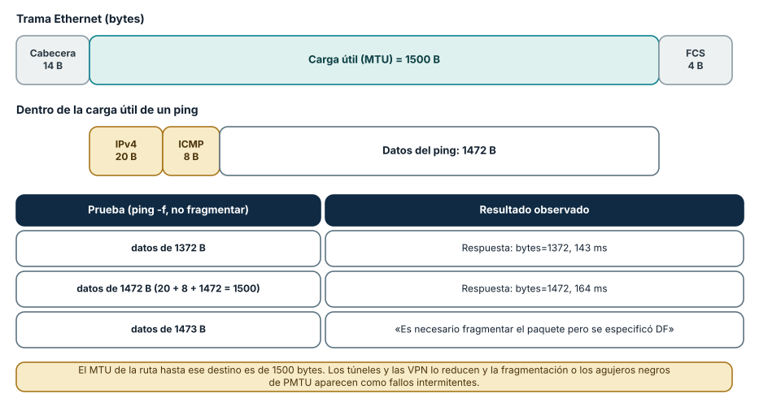
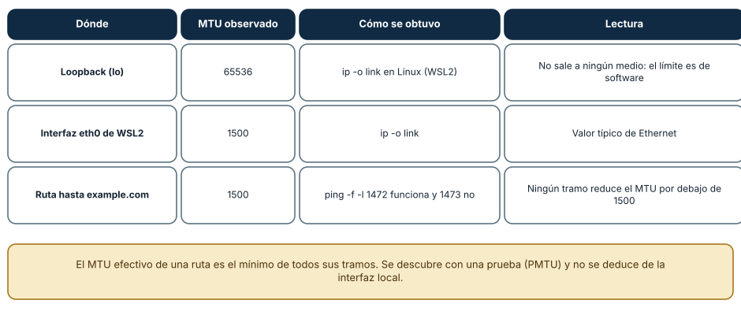
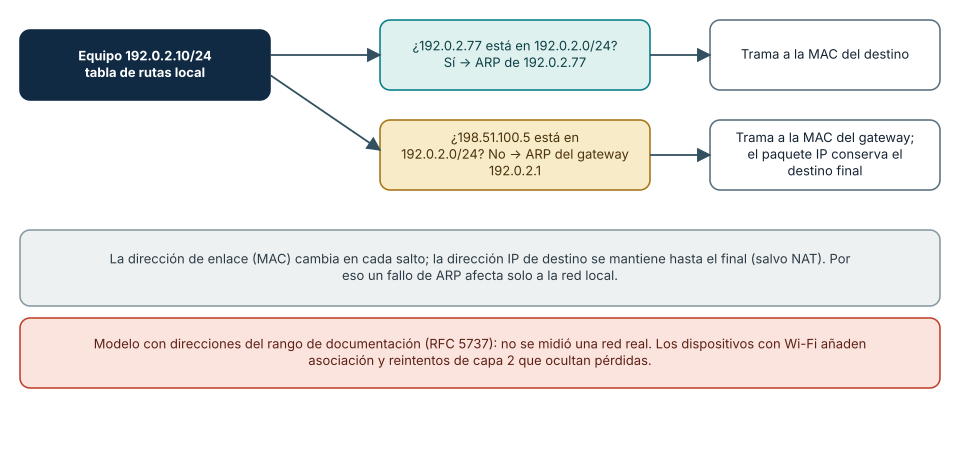

# SE-038 — Ethernet, Wi-Fi, direccionamiento y redes locales

[← SE-037 — Modelos OSI y TCP/IP como herramientas de diagnóstico](https://github.com/vladimiracunadev-create/modern-software-engineering-program/blob/main/classes/part-03-redes-internet-y-protocolos/se-037-modelos-osi-y-tcp-ip-como-herramientas-de-diagnostico/README.md) · [↑ Parte 03](https://github.com/vladimiracunadev-create/modern-software-engineering-program/blob/main/classes/part-03-redes-internet-y-protocolos/README.md) · [📚 Índice completo](https://github.com/vladimiracunadev-create/modern-software-engineering-program/blob/main/classes/README.md) · [🌐 Portal](https://vladimiracunadev-create.github.io/modern-software-engineering-program/classes/SE-038.html) · [SE-039 — IPv4, IPv6, subredes, rutas y NAT →](https://github.com/vladimiracunadev-create/modern-software-engineering-program/blob/main/classes/part-03-redes-internet-y-protocolos/se-039-ipv4-ipv6-subredes-rutas-y-nat/README.md)


## Punto profesional y fundamento pedagógico

**Punto profesional.** La clase existe para explicar entrega local mediante tramas, direcciones de enlace y resolución de vecinos.

**Por qué aparece aquí.** Se sitúa después de **Modelos OSI y TCP/IP como herramientas de diagnóstico** y antes de **IPv4, IPv6, subredes, rutas y NAT**: convierte el conocimiento anterior en una decisión observable que la clase siguiente podrá reutilizar. La continuidad se comprueba en el artefacto, no por compartir vocabulario.

**Error conceptual que debe corregir.** Confundir dirección MAC con identidad global o ARP con enrutamiento.

**Secuencia de aprendizaje.** Antes de leer la solución, el estudiante predice el resultado del caso normal y del error conceptual anterior. Luego explica un caso resuelto paso a paso, construye un contraejemplo que cambie la decisión y, sin consultar el texto, reconstruye el mecanismo y lo aplica a una entrada nueva. La secuencia usa predicción, explicación propia, contraste y recuperación. [ICAP](https://icap.education.asu.edu/research) distingue participación de construcción de conocimiento; [How People Learn II](https://nap.nationalacademies.org/catalog/24783/how-people-learn-ii-learners-contexts-and-cultures) exige conectar conocimiento previo, contexto y transferencia; la [práctica de recuperación](https://pubmed.ncbi.nlm.nih.gov/16507066/) respalda producir de nuevo la explicación tras una demora; y [Education for Life and Work](https://nap.nationalacademies.org/resource/13398/dbasse_084153.pdf) exige devolución que explique la causa del error.

**Evidencia de aprendizaje.** Lan-trace.md con trama, caché de vecino, broadcast y fallo de resolución. Debe contener predicción previa, observación, explicación causal, contraejemplo, criterio de aceptación y una nota de qué dato haría cambiar la conclusión.

**Límite de la conclusión.** Wi‑Fi y Ethernet comparten objetivos pero no todos los mecanismos físicos.

### Trazabilidad fuente → afirmación

| Fuente primaria u oficial | Afirmación que respalda | Lo que no prueba |
|---|---|---|
| [RFC 826 — An Ethernet Address Resolution Protocol](https://www.rfc-editor.org/rfc/rfc826) | define la semántica normativa del protocolo nombrado en el título y sus límites interoperables | No demuestra por sí sola que el artefacto del estudiante sea correcto. |
| [RFC 894 — IP Datagrams over Ethernet Networks](https://www.rfc-editor.org/rfc/rfc894) | define la semántica normativa del protocolo nombrado en el título y sus límites interoperables | No demuestra por sí sola que el artefacto del estudiante sea correcto. |
| [RFC 1122 — Requirements for Internet Hosts: Communication Layers](https://www.rfc-editor.org/rfc/rfc1122) | define la semántica normativa del protocolo nombrado en el título y sus límites interoperables | No demuestra por sí sola que el artefacto del estudiante sea correcto. |

## Antes de empezar

Esta clase continúa la **petición observable de extremo a extremo de la Parte 3**. No estudia redes como una lista de siglas: añade una decisión concreta al mismo recorrido y obliga a explicar dónde nace cada señal. Conserva una bitácora con cuatro columnas —hecho, interpretación, hipótesis rival y próxima prueba—; si una conclusión no apunta a evidencia, todavía no es diagnóstico.

## Prerrequisitos

- Haber completado `SE-037` o poder explicar su evidencia principal.
- Trabajar solo contra `localhost`, una red propia o un destino con autorización expresa.
- Disponer de navegador, `curl` y herramientas equivalentes del sistema; registra versiones y plataforma.

## Problema auténtico

La petición observable de extremo a extremo funciona por cable, pero pierde peticiones por Wi‑Fi. El equipo culpa a Internet aunque el fallo aparece antes del router. Debe distinguir asociación inalámbrica, acceso al medio, dirección de enlace, descubrimiento del vecino y puerta de enlace.

## Objetivos observables

Al terminar podrás:

1. distinguir alcance de una MAC y de una dirección IP;
2. explicar cómo un host descubre al siguiente salto en IPv4;
3. comparar Ethernet y Wi‑Fi sin reducirlos a cable versus radio;
4. diagnosticar congestión, señal y conflicto sin capturar tráfico ajeno;
5. comunicar límites y una siguiente prueba sin presentar inferencias como hechos.

## Mapa conceptual


El ciclo evita el diagnóstico por intuición. La observación se ubica antes de interpretarse; la prueba debe producir resultados diferentes bajo hipótesis rivales; la decisión conserva una salida de recuperación. En esta clase la pregunta rectora es: **¿Qué debe ocurrir antes de que un paquete pueda abandonar la red local?**

## Temas y por qué importan

| Núcleo | Pregunta de trabajo | Evidencia esperada |
|---|---|---|
| alcance | ¿dónde es válido este identificador o estado? | mapa de fronteras |
| mecanismo | ¿qué entrada produce qué transición? | secuencia comentada |
| garantía | ¿qué promete el protocolo y qué no? | ejemplo y contraejemplo |
| diagnóstico | ¿qué prueba separa causas plausibles? | comparación reproducible |
| operación | ¿cómo falla, se limita y se recupera? | caso sano, degradado y restaurado |
## Conceptos y decisiones

### 1. Enlace y dominio local

Una interfaz transmite tramas dentro de un enlace. La dirección MAC identifica una interfaz en ese alcance, no una identidad global de la persona ni una ruta por Internet. Switches aprenden asociaciones entre direcciones y puertos; ese aprendizaje expira y puede cambiar al mover un equipo.

### 2. Ethernet y acceso compartido

Ethernet moderno suele operar con enlaces conmutados full‑duplex: cada puerto es un dominio de colisión separado. Broadcast y multicast aún consumen alcance local. Velocidad negociada, errores, dúplex y saturación del uplink son señales distintas; una interfaz a 1 Gb/s no garantiza ese caudal extremo a extremo.

### 3. Wi‑Fi, asociación y medio

Wi‑Fi comparte espectro y coordina acceso por contención. Intensidad de señal no equivale a calidad: interferencia, canal, retransmisiones, distancia y capacidad del punto de acceso alteran latencia y pérdida. Asociarse al SSID solo prueba acceso al enlace, no dirección válida, ruta ni DNS.

### 4. ARP y siguiente salto

En IPv4, ARP resuelve una dirección de protocolo a una dirección de enlace en el dominio local. Para un destino remoto, el host resuelve la MAC de la puerta de enlace, no la del servidor. Una entrada vecina incompleta orienta el diagnóstico hacia enlace, VLAN o puerta de enlace.

### 5. Segmentación y fronteras

VLAN, redes invitadas y aislamiento de clientes crean dominios lógicos sobre infraestructura física. Dos dispositivos conectados al mismo punto de acceso pueden no comunicarse. La decisión de segmentar reduce movimiento lateral, pero exige documentar servicios permitidos y rutas de administración.

### La trama Ethernet y el origen del límite de 1472 bytes

Una trama Ethernet II tiene una cabecera de 14 bytes (direcciones de destino y origen y el tipo), una carga útil de hasta 1500 bytes —el *MTU* habitual— y 4 bytes de verificación (FCS), de modo que la trama completa mide hasta 1518 bytes. Dentro de la carga viaja un paquete IP:
20 bytes de cabecera IPv4, 8 de la cabecera ICMP y el resto son datos. Con un ping, 20 + 8 + 1472 suman 1500: ese es el mayor tamaño de datos que cabe sin fragmentar. Se puede *comprobarlo*: `ping -f -l 1472 example.com` en Windows (la bandera `-f` activa el bit *No fragmentar*, DF) respondió
con `bytes=1472` en 164 ms, y `ping -f -l 1473` devolvió «Es necesario fragmentar el paquete pero se especificó DF». En Linux la forma equivalente es `ping -M do -s 1472 host`.



**Cómo leer la figura.** La fila superior es la trama; la central, el contenido de la carga para un ping, y la tabla, los tres tamaños probados. Que 1472 funcione y 1473 no confirma que el MTU de *toda la ruta* es de 1500 bytes. **Dónde deja de valer:** esto vale para IPv4 con cabecera de 20 bytes (sin opciones); en IPv6 la cabecera es de 40 bytes y el límite de datos
cambia; los túneles y las VPN añaden cabeceras y reducen el MTU efectivo, y Wi-Fi puede segmentar en otro nivel.

### MTU medidos: del enlace a la ruta

El MTU tiene tres significados que conviene no confundir. El de una *interfaz* (lo informa `ip -o link`): en el Linux de WSL2 fue de 65 536 para la interfaz de loopback (`lo`, que nunca toca un medio) y de 1500 para `eth0`. El de la *ruta* es el mínimo de todos los tramos y no se deduce de la interfaz local: se descubre con una prueba (*Path MTU Discovery*) que envía paquetes con DF y observa
los avisos ICMP de fragmentación necesaria; en la ruta probada fue de 1500. Y el *MSS* de TCP es el MTU menos las cabeceras de IP y TCP (normalmente 1460 en IPv4) y lo negocian los extremos en el handshake. Cuando un tramo descarta los avisos ICMP, los paquetes grandes desaparecen sin explicación (un «agujero negro de PMTU»): conectar funciona,
pero las transferencias se cuelgan.



**Cómo leer la figura.** Cada fila combina un lugar, un valor y el método. **Dónde deja de valer:** el MTU de la ruta puede cambiar si cambia el camino (un balanceo, una VPN activada) y es específico de cada dirección: la ruta de ida y de vuelta pueden diferir.

### Siguiente salto, ARP y la red local

Un equipo decide cada entrega con su tabla de rutas. Si el destino está en el mismo prefijo, resuelve con ARP la dirección de enlace (MAC) *del destino*; si está en otro, resuelve la del *gateway* y le entrega la trama con el paquete IP intacto. Por eso la dirección MAC cambia en cada salto y la IP de destino no
(salvo NAT). La Figura 3 lo muestra con direcciones del rango de documentación. En una red Wi-Fi la historia es parecida, con una diferencia importante: el medio es compartido y half-duplex, de modo que el acceso se arbitra (CSMA/CA), y la capa de enlace *retransmite* tramas perdidas; esas retransmisiones esconden la pérdida de las capas superiores pero aparecen
como variación de latencia (jitter).



**Cómo leer la figura.** El equipo compara el destino con su prefijo y elige a quién preguntar por la dirección de enlace. **Dónde deja de valer:** es un modelo con direcciones de documentación (RFC 5737), no una captura de una red real, y no considera VLAN, puentes ni redes en malla. Los dispositivos de capa 2 pueden segmentar el dominio de difusión, pero ARP sigue siendo la pregunta que viaja en difusión.

## Definiciones de trabajo

- **trama:** unidad transmitida por un protocolo de enlace.
- **MAC:** dirección utilizada en un dominio de enlace.
- **ARP:** protocolo IPv4 de resolución entre dirección IP y dirección de enlace.
- **gateway:** siguiente salto usado para alcanzar otras redes.
- **VLAN:** segmentación lógica de dominios de enlace sobre infraestructura compartida.

Estas definiciones son operativas: precisan el uso dentro de la petición observable de extremo a extremo y deben leerse junto a las fuentes. No convierten un término histórico o dependiente de implementación en una garantía universal.

## Ejemplo mínimo

Con una dirección local, máscara y destino remoto, determina cuál IP se consulta en la tabla de vecinos. Comprueba con `arp -a`, `ip neigh` o equivalente. Explica por qué no aparece la MAC del destino remoto.

El ejemplo se acepta cuando incluye predicción previa, salida relevante y explicación de qué hipótesis descarta. Copiar una salida sin interpretación no demuestra comprensión.

## Ejemplo profesional

La petición observable de extremo a extremo compara cable y Wi‑Fi con la misma petición, tamaño y ventana temporal. Registra RSSI si está disponible, pérdida al gateway, latencia al origen y retransmisiones observables. Solo atribuye el problema al Wi‑Fi si el deterioro ya existe hacia el gateway y desaparece bajo una condición controlada.

La diferencia profesional es la trazabilidad: la decisión conecta requisito, mecanismo, señal, riesgo y recuperación. El equipo puede cambiar de herramienta sin perder el razonamiento.

## Práctica guiada

1. identifica interfaz activa, dirección, prefijo y puerta de enlace sin publicar datos completos.
2. representa el dominio broadcast y los límites de VLAN.
3. vacía solo una entrada vecina de laboratorio o espera su expiración.
4. observa la consulta y respuesta ARP con tráfico propio.
5. compara dos ubicaciones Wi‑Fi conservando destino y carga.
6. entrega `trace.md` con comandos redactados, marcas de tiempo y condiciones de repetición.

## Ejercicios

1. **Cálculo:** con un túnel que añade 50 bytes de cabeceras, calcula el MTU efectivo y el mayor tamaño de datos de un ping.
2. **Predicción:** predice el resultado de `ping -f -l 1473` hacia un destino con MTU de ruta de 1400 y justifícalo.
3. **Entrega:** para el equipo 192.0.2.10/24 con gateway 192.0.2.1, dibuja a quién se envía la trama hacia 192.0.2.77 y hacia 198.51.100.5.
4. **Medio compartido:** explica por qué Wi-Fi puede mostrar jitter sin pérdida a nivel de IP y qué medición lo distingue.

## Reto verificable

Entrega una traza comentada que permita a otra persona responder: qué se intentó, qué frontera se observó, qué garantía aplicaba, qué falló, qué alternativa fue descartada y cómo se restauró el estado. La persona revisora debe poder repetir al menos una prueba sin instrucciones orales.

## Demostración guiada

1. Predice el primer evento observable y el resultado sano.
2. Ejecuta una sola petición de la petición observable de extremo a extremo y asigna cada marca a una frontera.
3. Introduce el fallo controlado descrito abajo.
4. Compara por **primera divergencia**, no por cantidad de errores posteriores.
5. Restaura, repite y conserva evidencia de recuperación.

Una demostración que no incluye restauración solo prueba cómo romper el laboratorio.

## Preguntas frecuentes

### ¿Por qué 1472 y no 1500?

Porque el MTU cuenta el paquete IP completo: 1500 = 20 (IPv4) + 8 (ICMP) + 1472 de datos. El límite aplica al paquete, no solo a los datos de la aplicación.

### ¿Por qué el loopback tiene MTU 65 536?

Porque no viaja por ningún medio físico: es una interfaz de software que entrega paquetes dentro del mismo equipo, y su límite lo fija la implementación. Medir latencia o rendimiento en loopback no dice nada del enlace real.

### ¿Wi-Fi y Ethernet usan el mismo MTU?

En la capa de IP suelen exponer 1500, pero Wi-Fi agrega capas propias de acceso al medio, retransmisión y agregación de tramas que Ethernet cableado no tiene. El MTU igual no implica comportamiento igual: la variación de latencia y la pérdida visible difieren.

### ¿Qué es un dominio de difusión?

El conjunto de interfaces que reciben una trama enviada a la dirección de difusión (por ejemplo, una consulta ARP). Un enrutador separa dominios; un conmutador no, salvo que use VLAN. Acotarlos limita el ruido y el alcance de ciertos ataques.
## Fallo controlado y diagnóstico

Configura en una red de laboratorio una puerta de enlace inexistente o desconecta el punto de acceso. Diferencia `sin asociación`, `sin dirección`, `vecino no resuelto` y `gateway sin respuesta`; restaura automáticamente la configuración original.

Registra estado previo, acción, síntoma, primera divergencia, causa, corrección y estado posterior. Si la acción afecta red compartida, requiere privilegios amplios o no tiene rollback probado, reemplázala por una simulación local.


Una práctica comprueba el descubrimiento del MTU de ruta. Con `ping` y DF, busca el mayor tamaño de datos que pasa hacia un destino propio o autorizado y compara con 1500 − 28. **Síntoma esperado:** 1472 pasa y 1473 no. Si el límite es menor (por ejemplo, 1372), hay un tramo con MTU reducido
(túnel, VPN, PPPoE). **Hipótesis:** reducción por encapsulación. **Prueba:** repite desde otra red o sin la VPN. **Consecuencia de diseño:** el servicio debe tolerar la fragmentación o ajustar el MSS. Registra el comando, la plataforma y los dos tamaños frontera; no lo ejecutes contra destinos sin autorización.

## Errores comunes y cómo corregirlos

| Síntoma | Causa | Corrección |
|---|---|---|
| «Las transferencias grandes se cuelgan pero conectar funciona» | Un tramo con MTU menor descarta paquetes con DF y los avisos ICMP se filtran | Probar PMTU, permitir ICMP «fragmentación necesaria» y ajustar el MSS |
| Medir el rendimiento en loopback y extrapolarlo | El loopback no usa ningún medio | Medir sobre la interfaz y la ruta reales |
| Usar 1500 como límite de datos de una prueba | El MTU incluye las cabeceras | Restar las cabeceras (28 para ping IPv4) |
| Atribuir la latencia variable de Wi-Fi al servidor | La capa de enlace retransmite y arbitra el medio | Medir también desde un equipo cableado o declarar el medio |
| Suponer que ARP funciona entre subredes | ARP solo opera dentro del dominio de difusión | Revisar el gateway y la tabla de rutas |

## Entorno y archivos clave

```text
work/SE-038/
├── README.md          # alcance, autorización y reproducción
├── request.txt        # petición sin credenciales
├── trace.md           # línea temporal y evidencias
├── failure-report.md  # hipótesis, prueba y recuperación
└── diagram.mmd        # mapa accesible acompañado de texto
```

Los archivos son contenedores, no evidencia automática. `README.md` declara sistema operativo, versiones, red utilizada y limpieza. Nunca confirmes cambios de red destructivos sin una ruta de recuperación.

### Laboratorio integrado de la Parte 03

Usa la [petición observable](https://github.com/vladimiracunadev-create/modern-software-engineering-program/tree/main/labs/part-03-observable-request) para delimitar loopback frente a una LAN real. Entrega `lan-trace.md` con lo que el experimento sí observa y con ARP, Wi-Fi, trama, broadcast y VLAN marcados como mecanismos que requieren una práctica autorizada adicional. No conviertas la ausencia de una trama capturada en prueba de que la capa de enlace no existe.

## Seguridad, ética y accesibilidad

- captura únicamente tráfico propio o autorizado y durante la ventana mínima;
- redacta cookies, tokens, query strings, IP privadas y nombres de personas;
- no desactives TLS, firewall o aislamiento como solución permanente;
- acompaña color y diagramas con orden, etiquetas y una explicación textual;
- ofrece comandos equivalentes o resultados esperados para quien no pueda modificar una red;
- considera que telemetría e IP pueden identificar o perfilar personas.

## Puente hacia el trabajo con agentes

Un agente con acceso a la red hereda las mismas fronteras: sus llamadas atraviesan el enlace, el MTU y el gateway del equipo en que se ejecuta, y fallan de las mismas formas. Dos controles se derivan de esta clase. Primero, el harness debe registrar *dónde* se ejecuta el agente (equipo, red, VPN activa), porque un fallo que aparece solo en una red suele ser una cuestión de MTU, de filtrado o de ruta,
y el agente no puede deducirlo del mensaje. Segundo, las comprobaciones de red del agente (un ping, un traceroute, un escáner) son *acciones* con efecto sobre redes que no son suyas: deben ejecutarse solo contra destinos autorizados, con límites de tasa y de alcance. Las partes de herramientas y de seguridad agentic retoman estos límites.

## Transferencia

Traslada el mecanismo a una segunda red o protocolo sin repetir comandos mecánicamente. Conserva la pregunta y el criterio de evidencia; cambia los supuestos de dirección, intermediación y política. Escribe qué observación seguiría siendo válida y cuál depende de la topología original.

## Evaluación y evidencia

| Criterio | Evidencia mínima | Señal de dominio |
|---|---|---|
| modelo causal | mapa con fronteras y unidades correctas | explica interacción y fugas del modelo |
| protocolo | garantía y límite apoyados en fuente | distingue semántica de implementación |
| diagnóstico | hipótesis rival y prueba discriminante | encuentra primera divergencia |
| reproducibilidad | contexto, comandos y salida redactada | otra persona repite el resultado |
| responsabilidad | autorización, minimización y rollback | reduce riesgo sin borrar evidencia |

La clase no se aprueba por ejecutar comandos. Se aprueba cuando la evidencia sostiene las conclusiones y declara lo que todavía no puede saberse.

## Fuentes


- [RFC 826 — An Ethernet Address Resolution Protocol](https://www.rfc-editor.org/rfc/rfc826) — define la semántica normativa del protocolo nombrado en el título y sus límites interoperables.
- [RFC 894 — IP Datagrams over Ethernet Networks](https://www.rfc-editor.org/rfc/rfc894) — define la semántica normativa del protocolo nombrado en el título y sus límites interoperables.
- [RFC 1122 — Requirements for Internet Hosts: Communication Layers](https://www.rfc-editor.org/rfc/rfc1122) — define la semántica normativa del protocolo nombrado en el título y sus límites interoperables.

Las RFC describen contratos de protocolo, no certifican una red, proveedor o herramienta. Cada afirmación de comportamiento local debe contrastarse con evidencia de ese entorno.

- [RFC 1191, Path MTU Discovery](https://www.rfc-editor.org/rfc/rfc1191) y [RFC 826, Address Resolution Protocol](https://www.rfc-editor.org/rfc/rfc826): descubrimiento del MTU de ruta y resolución de direcciones de enlace; respaldan las figuras 2 y 3.
- [Grupo de trabajo IEEE 802.3 (Ethernet)](https://www.ieee802.org/3/) y [IEEE 802.11 (Wi-Fi)](https://www.ieee802.org/11/): estándares de las capas de enlace citadas; el texto de los estándares es de pago y aquí solo se cita su existencia y alcance.
- [ip-link(8)](https://man7.org/linux/man-pages/man8/ip-link.8.html): interfaces, MTU y estado en Linux.

## Límites y siguiente paso

La captura local no ve decisiones internas del switch ni demuestra ausencia de interferencia. No se enseña a evadir segmentación. La clase siguiente explica cómo IP selecciona redes y próximos saltos.

## Glosario

- **trama:** unidad transmitida por un protocolo de enlace.
- **MAC:** dirección utilizada en un dominio de enlace.
- **ARP:** protocolo IPv4 de resolución entre dirección IP y dirección de enlace.
- **gateway:** siguiente salto usado para alcanzar otras redes.
- **VLAN:** segmentación lógica de dominios de enlace sobre infraestructura compartida.

---

[← SE-037 — Modelos OSI y TCP/IP como herramientas de diagnóstico](https://github.com/vladimiracunadev-create/modern-software-engineering-program/blob/main/classes/part-03-redes-internet-y-protocolos/se-037-modelos-osi-y-tcp-ip-como-herramientas-de-diagnostico/README.md) · [↑ Parte 03](https://github.com/vladimiracunadev-create/modern-software-engineering-program/blob/main/classes/part-03-redes-internet-y-protocolos/README.md) · [📚 Índice completo](https://github.com/vladimiracunadev-create/modern-software-engineering-program/blob/main/classes/README.md) · [🌐 Portal](https://vladimiracunadev-create.github.io/modern-software-engineering-program/classes/SE-038.html) · [SE-039 — IPv4, IPv6, subredes, rutas y NAT →](https://github.com/vladimiracunadev-create/modern-software-engineering-program/blob/main/classes/part-03-redes-internet-y-protocolos/se-039-ipv4-ipv6-subredes-rutas-y-nat/README.md)
