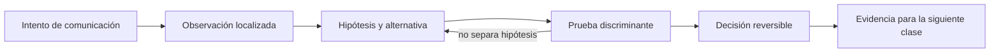
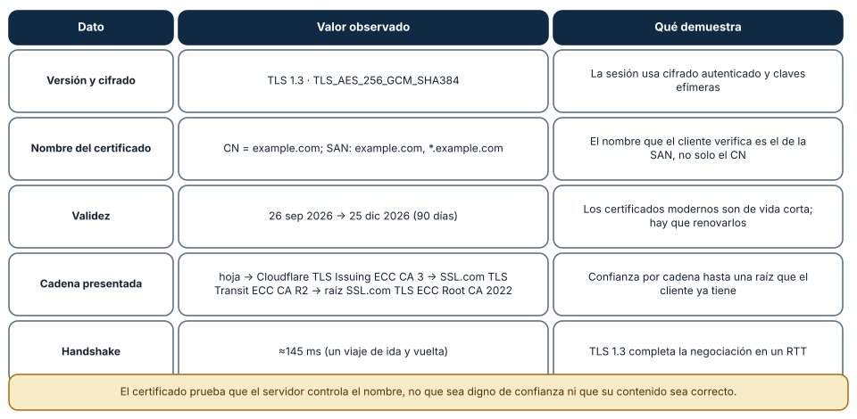
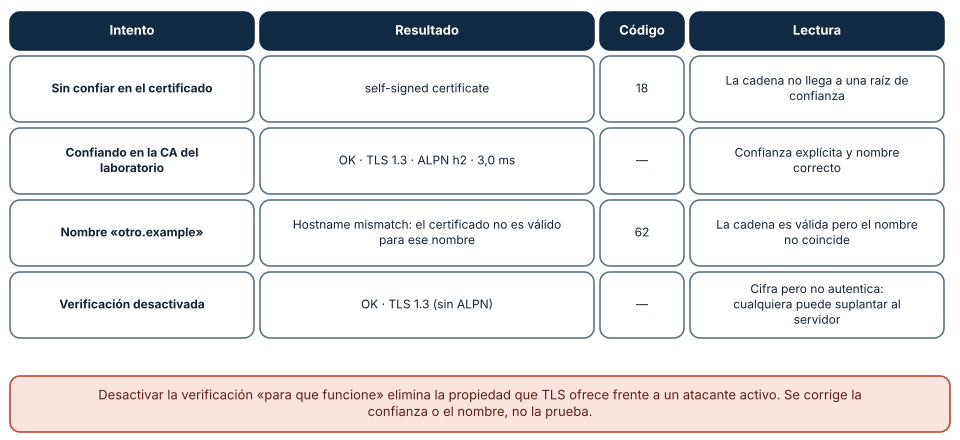
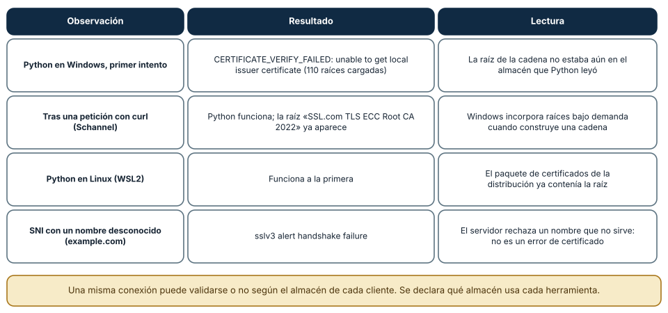

# SE-043 — TLS, certificados y confianza en tránsito

[← SE-042 — HTTP, semántica, caché y negociación](https://github.com/vladimiracunadev-create/modern-software-engineering-program/blob/main/classes/part-03-redes-internet-y-protocolos/se-042-http-semantica-cache-y-negociacion/README.md) · [↑ Parte 03](https://github.com/vladimiracunadev-create/modern-software-engineering-program/blob/main/classes/part-03-redes-internet-y-protocolos/README.md) · [📚 Índice completo](https://github.com/vladimiracunadev-create/modern-software-engineering-program/blob/main/classes/README.md) · [🌐 Portal](https://vladimiracunadev-create.github.io/modern-software-engineering-program/classes/SE-043.html) · [SE-044 — Proxies, balanceadores, gateways y CDN →](https://github.com/vladimiracunadev-create/modern-software-engineering-program/blob/main/classes/part-03-redes-internet-y-protocolos/se-044-proxies-balanceadores-gateways-y-cdn/README.md)


## Punto profesional y fundamento pedagógico

**Punto profesional.** La clase existe para explicar qué autentica y cifra TLS a partir de handshake, cadena y nombre del servicio.

**Por qué aparece aquí.** Se sitúa después de **HTTP, semántica, caché y negociación** y antes de **Proxies, balanceadores, gateways y CDN**: convierte el conocimiento anterior en una decisión observable que la clase siguiente podrá reutilizar. La continuidad se comprueba en el artefacto, no por compartir vocabulario.

**Error conceptual que debe corregir.** Creer que el candado prueba que el sitio es confiable o que TLS protege datos ya comprometidos en el endpoint.

**Secuencia de aprendizaje.** Antes de leer la solución, el estudiante predice el resultado del caso normal y del error conceptual anterior. Luego explica un caso resuelto paso a paso, construye un contraejemplo que cambie la decisión y, sin consultar el texto, reconstruye el mecanismo y lo aplica a una entrada nueva. La secuencia usa predicción, explicación propia, contraste y recuperación. [ICAP](https://icap.education.asu.edu/research) distingue participación de construcción de conocimiento; [How People Learn II](https://nap.nationalacademies.org/catalog/24783/how-people-learn-ii-learners-contexts-and-cultures) exige conectar conocimiento previo, contexto y transferencia; la [práctica de recuperación](https://pubmed.ncbi.nlm.nih.gov/16507066/) respalda producir de nuevo la explicación tras una demora; y [Education for Life and Work](https://nap.nationalacademies.org/resource/13398/dbasse_084153.pdf) exige devolución que explique la causa del error.

**Evidencia de aprendizaje.** Tls-evidence.md con certificado, SAN, cadena, protocolo y fallo de nombre. Debe contener predicción previa, observación, explicación causal, contraejemplo, criterio de aceptación y una nota de qué dato haría cambiar la conclusión.

**Límite de la conclusión.** La inspección del canal no audita la aplicación ni la CA.

### Trazabilidad fuente → afirmación

| Fuente primaria u oficial | Afirmación que respalda | Lo que no prueba |
|---|---|---|
| [RFC 8446 — TLS 1.3](https://www.rfc-editor.org/rfc/rfc8446) | define la semántica normativa del protocolo nombrado en el título y sus límites interoperables | No demuestra por sí sola que el artefacto del estudiante sea correcto. |
| [RFC 5280 — Internet X.509 PKI Certificate and CRL Profile](https://www.rfc-editor.org/rfc/rfc5280) | define la semántica normativa del protocolo nombrado en el título y sus límites interoperables | No demuestra por sí sola que el artefacto del estudiante sea correcto. |
| [RFC 9110 — HTTP Semantics](https://www.rfc-editor.org/rfc/rfc9110) | define la semántica normativa del protocolo nombrado en el título y sus límites interoperables | No demuestra por sí sola que el artefacto del estudiante sea correcto. |

## Antes de empezar

Esta clase continúa la **petición observable de extremo a extremo de la Parte 3**. No estudia redes como una lista de siglas: añade una decisión concreta al mismo recorrido y obliga a explicar dónde nace cada señal. Conserva una bitácora con cuatro columnas —hecho, interpretación, hipótesis rival y próxima prueba—; si una conclusión no apunta a evidencia, todavía no es diagnóstico.

## Prerrequisitos

- Haber completado `SE-042` o poder explicar su evidencia principal.
- Trabajar solo contra `localhost`, una red propia o un destino con autorización expresa.
- Disponer de navegador, `curl` y herramientas equivalentes del sistema; registra versiones y plataforma.

## Problema auténtico

La petición observable de extremo a extremo cifra tráfico, pero una instalación falla con «certificado inválido» y otra acepta un proxy corporativo. Cifrado no basta: el cliente debe validar nombre, cadena, vigencia y ancla de confianza, y el equipo debe distinguir una política administrada de una interceptación no autorizada.

## Objetivos observables

Al terminar podrás:

1. explicar objetivos y límites de TLS 1.3;
2. reconstruir cadena de certificación y validación de nombre;
3. distinguir certificado, clave privada y ancla de confianza;
4. diagnosticar fallos sin desactivar validación;
5. comunicar límites y una siguiente prueba sin presentar inferencias como hechos.

## Mapa conceptual



El ciclo evita el diagnóstico por intuición. La observación se ubica antes de interpretarse; la prueba debe producir resultados diferentes bajo hipótesis rivales; la decisión conserva una salida de recuperación. En esta clase la pregunta rectora es: **¿Qué identidad se autentica y qué garantías existen después del handshake?**

## Temas y por qué importan

| Núcleo | Pregunta de trabajo | Evidencia esperada |
|---|---|---|
| alcance | ¿dónde es válido este identificador o estado? | mapa de fronteras |
| mecanismo | ¿qué entrada produce qué transición? | secuencia comentada |
| garantía | ¿qué promete el protocolo y qué no? | ejemplo y contraejemplo |
| diagnóstico | ¿qué prueba separa causas plausibles? | comparación reproducible |
| operación | ¿cómo falla, se limita y se recupera? | caso sano, degradado y restaurado |
## Conceptos y decisiones

### 1. Handshake y claves de sesión

TLS negocia parámetros, autentica al servidor mediante su certificado y deriva claves efímeras para proteger registros posteriores. La clave privada no viaja. Un handshake exitoso acredita control de una identidad según la política del cliente; no demuestra que la aplicación sea segura o honesta.

### 2. Certificado y cadena

Un certificado vincula una clave pública con nombres y atributos durante un intervalo. El servidor suele enviar certificados intermedios; el cliente construye un camino hasta un ancla local. Un intermedio ausente puede fallar solo en clientes que no lo tienen almacenado.

### 3. Nombre, tiempo y propósito

La validación comprueba que el nombre solicitado esté autorizado por Subject Alternative Name, que el tiempo sea válido y que extensiones permitan el uso. Conectar por IP a un certificado para un DNS name falla correctamente aunque el cifrado matemático funcione.

### 4. SNI, ALPN y virtualización

SNI permite anunciar el nombre durante el handshake para que un servidor elija certificado; ALPN negocia protocolos como HTTP/2. Un balanceador puede terminar TLS y abrir una segunda conexión interna. El mapa de confianza debe incluir cada terminación, no asumir cifrado único extremo a extremo.

### 5. 0-RTT y límites de confianza

TLS 1.3 reduce viajes; algunos despliegues con QUIC permiten datos tempranos. Esos datos pueden reproducirse, por lo que no deben realizar efectos no idempotentes sin mitigación. TLS protege tránsito entre endpoints negociados, no datos en logs, caché o memoria del destino.

### Lo que revela una conexión TLS real

Conectar con `ssl` de Python a `example.com:443` y leer los datos de la sesión muestra qué se negoció y qué se verificó. Resultado observado en Linux: protocolo `TLSv1.3`, cifrado `TLS_AES_256_GCM_SHA384`, handshake de unos 145 ms (un viaje de ida y vuelta), un certificado con `commonName = example.com` y nombres alternativos (`subjectAltName`) `example.com` y `*.example.com`, emitido por «SSL Corporation»,
válido del 26 de septiembre al 25 de diciembre de 2026 (90 días). Con `openssl s_client` se vio la cadena presentada: la hoja, una CA intermedia («Cloudflare TLS Issuing ECC CA 3»), otra intermedia («SSL.com TLS Transit ECC CA R2») y la raíz «SSL.com TLS ECC Root CA 2022». Un cliente acepta la conexión si puede construir una cadena de confianza hasta una raíz que ya posee, el nombre que pidió coincide con la *SAN*,
la fecha actual está dentro de la validez y el certificado sirve para ese propósito.



**Cómo leer la figura.** Cada fila es un aspecto de la confianza: qué se negoció, a qué nombre responde el certificado, cuánto dura, cómo se llega a una raíz y cuánto cuesta. **Dónde deja de valer:** son datos de un sitio y un día; los certificados se renuevan y las cadenas cambian. Un certificado válido prueba que *alguien controla el nombre* y que una CA lo respalda; no prueba que el servicio sea honesto, ni que el contenido sea correcto.

### Cuatro veredictos locales con un certificado de laboratorio

Para estudiar los fallos sin depender de un sitio externo se puede crear un certificado autofirmado para `localhost` (`openssl req -x509 -newkey rsa:2048 -nodes -days 1 -subj "/CN=localhost" -addext "subjectAltName=DNS:localhost,IP:127.0.0.1"`), servirlo con un socket TLS local y conectarse de cuatro maneras. Resultados reales: (1) un cliente que *no confía* en ese certificado falló con
`self-signed certificate` (código 18); (2) uno que confía en la CA del laboratorio y pide el nombre correcto tuvo éxito en 3,0 ms con TLS 1.3 y ALPN `h2`; (3) pedir otro nombre (`otro.example`) falló con `Hostname mismatch, certificate is not valid for 'otro.example'` (código 62), aunque la cadena era confiable; y (4) con la verificación *desactivada* la conexión funcionó, cifrada pero sin
autenticar al servidor. El último caso muestra por qué «desactivar la verificación para que funcione» elimina la propiedad que TLS aporta frente a un atacante activo.



**Cómo leer la figura.** Cada fila es una configuración del cliente y su resultado; los códigos son los de OpenSSL. **Dónde deja de valer:** el laboratorio usa un certificado propio en loopback y no ejercita revocación, transparencia de certificados ni cadenas largas. No sustituye la práctica con un certificado emitido por una CA real, y el laboratorio de la Parte 03 *simula* la validación de nombre sin handshake criptográfico (límite que declara).

### El almacén de confianza también es parte del sistema

La confianza depende del *almacén de raíces* de cada cliente. En una prueba, Python en Windows falló al conectar con `example.com` con `CERTIFICATE_VERIFY_FAILED: unable to get local issuer certificate` (el almacén cargado tenía 110 raíces). Tras hacer una petición con `curl` (que usa Schannel, el componente de Windows), el mismo código de Python funcionó y la raíz «SSL.com TLS ECC Root CA 2022» ya aparecía. Windows incorpora raíces *bajo demanda* cuando
construye una cadena, y las herramientas que leen el almacén antes de que eso ocurra no la ven. En Linux, la primera conexión funcionó porque el paquete de certificados de la distribución ya incluía la raíz. Otra observación: pedir un nombre que el servidor no atiende (`www.ejemplo-incorrecto.org`) produjo `sslv3 alert handshake failure`: el servidor rechazó el nombre en el handshake, lo que no es un error de certificado.



**Cómo leer la figura.** Cada fila combina una observación, su resultado y la lectura. **Dónde deja de valer:** la explicación del comportamiento de Windows se infiere de la secuencia observada (fallo, petición con Schannel, éxito y presencia de la raíz); no se inspeccionó el mecanismo interno. Lo que se conserva es el principio: *la misma conexión puede validarse o no según el almacén de cada cliente*, y una prueba debe declarar qué almacén usa cada herramienta.

## Definiciones de trabajo

- **handshake:** negociación inicial de parámetros, identidad y claves.
- **certificado:** afirmación firmada que vincula una clave pública y atributos.
- **ancla de confianza:** certificado o clave aceptado localmente como inicio de validación.
- **SAN:** extensión que contiene identidades autorizadas.
- **ALPN:** negociación del protocolo de aplicación dentro de TLS.

Estas definiciones son operativas: precisan el uso dentro de la petición observable de extremo a extremo y deben leerse junto a las fuentes. No convierten un término histórico o dependiente de implementación en una garantía universal.

## Ejemplo mínimo

Inspecciona un sitio público con herramientas del navegador o `openssl s_client` sin copiar identificadores personales. Registra SAN pertinente, emisor, vigencia, cadena y protocolo negociado. Explica cuál dato valida el nombre.

El ejemplo se acepta cuando incluye predicción previa, salida relevante y explicación de qué hipótesis descarta. Copiar una salida sin interpretación no demuestra comprensión.

## Ejemplo profesional

La petición observable de extremo a extremo monitorea días hasta expiración y prueba la cadena desde un cliente limpio. La rotación instala certificado e intermedios antes del corte y conserva rollback. Ante un error, el informe distingue reloj incorrecto, nombre distinto, expiración, ancla ausente y cadena incompleta.

La diferencia profesional es la trazabilidad: la decisión conecta requisito, mecanismo, señal, riesgo y recuperación. El equipo puede cambiar de herramienta sin perder el razonamiento.

## Práctica guiada

1. observa el handshake de un origen autorizado.
2. dibuja hoja, intermedios y raíz local.
3. compara nombre solicitado con SAN.
4. prueba deliberadamente un nombre que no coincide en un servidor local.
5. documenta rotación de certificado y de clave como operaciones diferentes.
6. entrega `trace.md` con comandos redactados, marcas de tiempo y condiciones de repetición.

## Ejercicios

1. **Cadena:** dibuja la cadena observada de `example.com` y explica qué comprueba un cliente en cada eslabón.
2. **Veredictos:** predice el resultado de conectar al certificado de laboratorio con el nombre `127.0.0.1` y explica por qué depende de la SAN.
3. **Almacén:** explica por qué dos herramientas del mismo equipo pueden discrepar sobre un certificado y cómo lo demuestras.
4. **Renovación:** diseña la alerta y el procedimiento para que ningún certificado venza sin aviso.

## Reto verificable

Entrega una traza comentada que permita a otra persona responder: qué se intentó, qué frontera se observó, qué garantía aplicaba, qué falló, qué alternativa fue descartada y cómo se restauró el estado. La persona revisora debe poder repetir al menos una prueba sin instrucciones orales.

## Demostración guiada

1. Predice el primer evento observable y el resultado sano.
2. Ejecuta una sola petición de la petición observable de extremo a extremo y asigna cada marca a una frontera.
3. Introduce el fallo controlado descrito abajo.
4. Compara por **primera divergencia**, no por cantidad de errores posteriores.
5. Restaura, repite y conserva evidencia de recuperación.

Una demostración que no incluye restauración solo prueba cómo romper el laboratorio.

## Preguntas frecuentes

### ¿Qué demuestra un candado en el navegador?

Que la conexión se cifró y que el certificado valida para el nombre de la barra de direcciones según el almacén del navegador. No dice que el sitio sea legítimo, ni que el contenido sea seguro; un sitio malicioso también puede tener un certificado válido para su propio nombre.

### ¿Por qué los certificados duran cada vez menos?

Porque acortar la vigencia limita el daño de una clave comprometida y fuerza a automatizar la renovación (por ejemplo, con ACME). El ejemplo observado dura 90 días. Un sistema que renueva a mano tiene una fecha de fallo programada.

### ¿Qué es SNI y por qué el servidor rechazó un nombre?

*Server Name Indication* es una extensión del handshake en la que el cliente declara el nombre que busca, para que un mismo IP sirva varios certificados. Si el nombre no es uno que el servidor atiende, puede cerrar el handshake con una alerta, como ocurrió en la prueba.

### ¿Puedo desactivar la verificación solo en desarrollo?

Es una práctica peligrosa porque se filtra a producción. En su lugar se confía explícitamente en una CA de laboratorio (como en la figura 2) o se usa un certificado emitido para el entorno de desarrollo; así se prueba la misma ruta de validación que en producción.
## Fallo controlado y diagnóstico

Usa un certificado autofirmado en localhost. Comprueba que el cliente lo rechaza; confía solo en un almacén de laboratorio o pasa una CA explícita. Prohibido usar `-k` como arreglo: puede servir para aislar la hipótesis, pero el informe debe mantener el fallo visible.

Registra estado previo, acción, síntoma, primera divergencia, causa, corrección y estado posterior. Si la acción afecta red compartida, requiere privilegios amplios o no tiene rollback probado, reemplázala por una simulación local.


Una práctica recorre los veredictos con un certificado de laboratorio. En un directorio desechable, genera un certificado autofirmado para `localhost` con `openssl`, levanta un servidor TLS local en un puerto efímero y conéctate con cuatro configuraciones: sin confiar en el certificado, confiando en él, con otro nombre y con la verificación desactivada. **Síntomas esperados:** `self-signed certificate`, éxito, `Hostname mismatch` y éxito sin autenticación.
**Hipótesis:** cada fallo corresponde a una condición distinta de la validación (cadena, nombre, vigencia). **Prueba:** cambia una condición por vez. **Corrección de diseño:** nunca desactivar la verificación; confiar en la CA del laboratorio solo dentro de la prueba. Borra el directorio y las claves al terminar, y no reutilices el certificado.

## Errores comunes y cómo corregirlos

| Síntoma | Causa | Corrección |
|---|---|---|
| `unable to get local issuer certificate` | El almacén del cliente no tiene la raíz o falta una intermedia | Comprobar el almacén de esa herramienta y la cadena que presenta el servidor |
| `Hostname mismatch` con cadena válida | El nombre pedido no figura en la SAN | Usar el nombre correcto o emitir un certificado que lo incluya |
| «Arreglar» un fallo desactivando la verificación | Se elimina la autenticación del servidor | Corregir la confianza o el nombre; nunca desactivar la verificación |
| Servicio caído por certificado vencido | Renovación manual y sin alerta | Automatizar la renovación y alertar antes de la expiración |
| Concluir «el sitio es seguro» por el candado | Un certificado válido no prueba legitimidad | Evaluar otras señales y la reputación del destino |

## Entorno y archivos clave

```text
work/SE-043/
├── README.md          # alcance, autorización y reproducción
├── request.txt        # petición sin credenciales
├── trace.md           # línea temporal y evidencias
├── failure-report.md  # hipótesis, prueba y recuperación
└── diagram.mmd        # mapa accesible acompañado de texto
```

Los archivos son contenedores, no evidencia automática. `README.md` declara sistema operativo, versiones, red utilizada y limpieza. Nunca confirmes cambios de red destructivos sin una ruta de recuperación.

### Laboratorio integrado de la Parte 03

El escenario `tls_name_mismatch` de la [petición observable](https://github.com/vladimiracunadev-create/modern-software-engineering-program/tree/main/labs/part-03-observable-request) evalúa el orden de la política: un nombre no coincidente se rechaza antes de HTTP. Es un modelo, no un handshake. Completa `tls-evidence.md` con una inspección autorizada que sí registre SAN, cadena, vigencia, protocolo y estrategia de revocación; nunca guardes una clave privada ni presentes `-k` como corrección.

## Seguridad, ética y accesibilidad

- captura únicamente tráfico propio o autorizado y durante la ventana mínima;
- redacta cookies, tokens, query strings, IP privadas y nombres de personas;
- no desactives TLS, firewall o aislamiento como solución permanente;
- acompaña color y diagramas con orden, etiquetas y una explicación textual;
- ofrece comandos equivalentes o resultados esperados para quien no pueda modificar una red;
- considera que telemetría e IP pueden identificar o perfilar personas.

## Puente hacia el trabajo con agentes

Los clientes que usan los agentes (SDK, herramientas, navegadores automatizados) vienen a menudo con la opción de desactivar la verificación TLS, y un asistente que «arregla» un error de certificado suele sugerir precisamente eso. El harness debe prohibir esa corrección: los errores de certificado se informan con la causa (cadena, nombre, vigencia) y las excepciones se limitan a una CA de laboratorio declarada. Además, un agente que conecta con servicios por TLS debe registrar qué almacén de confianza usa y con
qué versión, y las llamadas hacia destinos distintos de los permitidos fallan aunque el certificado sea válido. Las partes de seguridad agentic y de cadena de suministro desarrollan estas políticas.

## Transferencia

Traslada el mecanismo a una segunda red o protocolo sin repetir comandos mecánicamente. Conserva la pregunta y el criterio de evidencia; cambia los supuestos de dirección, intermediación y política. Escribe qué observación seguiría siendo válida y cuál depende de la topología original.

## Evaluación y evidencia

| Criterio | Evidencia mínima | Señal de dominio |
|---|---|---|
| modelo causal | mapa con fronteras y unidades correctas | explica interacción y fugas del modelo |
| protocolo | garantía y límite apoyados en fuente | distingue semántica de implementación |
| diagnóstico | hipótesis rival y prueba discriminante | encuentra primera divergencia |
| reproducibilidad | contexto, comandos y salida redactada | otra persona repite el resultado |
| responsabilidad | autorización, minimización y rollback | reduce riesgo sin borrar evidencia |

La clase no se aprueba por ejecutar comandos. Se aprueba cuando la evidencia sostiene las conclusiones y declara lo que todavía no puede saberse.

## Fuentes


- [RFC 8446 — TLS 1.3](https://www.rfc-editor.org/rfc/rfc8446) — define la semántica normativa del protocolo nombrado en el título y sus límites interoperables.
- [RFC 5280 — Internet X.509 PKI Certificate and CRL Profile](https://www.rfc-editor.org/rfc/rfc5280) — define la semántica normativa del protocolo nombrado en el título y sus límites interoperables.
- [RFC 9110 — HTTP Semantics](https://www.rfc-editor.org/rfc/rfc9110) — define la semántica normativa del protocolo nombrado en el título y sus límites interoperables.

Las RFC describen contratos de protocolo, no certifican una red, proveedor o herramienta. Cada afirmación de comportamiento local debe contrastarse con evidencia de ese entorno.

- [RFC 8446, TLS 1.3](https://www.rfc-editor.org/rfc/rfc8446) y [RFC 6125, verificación de identidad de servicios](https://www.rfc-editor.org/rfc/rfc6125): handshake, cifrado y comprobación del nombre; respaldan las figuras 1 y 2.
- [Python `ssl`](https://docs.python.org/3/library/ssl.html) y [`openssl req`](https://docs.openssl.org/master/man1/openssl-req/): clases y opciones usadas para el certificado y los veredictos de laboratorio.
- [RFC 8555, ACME](https://www.rfc-editor.org/rfc/rfc8555): automatización de emisión y renovación de certificados.

## Límites y siguiente paso

No enseña diseño criptográfico ni operación completa de una PKI. La revocación depende del ecosistema y la política. La clase siguiente ubica dónde terminan TLS y HTTP al introducir intermediarios.

## Glosario

- **handshake:** negociación inicial de parámetros, identidad y claves.
- **certificado:** afirmación firmada que vincula una clave pública y atributos.
- **ancla de confianza:** certificado o clave aceptado localmente como inicio de validación.
- **SAN:** extensión que contiene identidades autorizadas.
- **ALPN:** negociación del protocolo de aplicación dentro de TLS.

---

[← SE-042 — HTTP, semántica, caché y negociación](https://github.com/vladimiracunadev-create/modern-software-engineering-program/blob/main/classes/part-03-redes-internet-y-protocolos/se-042-http-semantica-cache-y-negociacion/README.md) · [↑ Parte 03](https://github.com/vladimiracunadev-create/modern-software-engineering-program/blob/main/classes/part-03-redes-internet-y-protocolos/README.md) · [📚 Índice completo](https://github.com/vladimiracunadev-create/modern-software-engineering-program/blob/main/classes/README.md) · [🌐 Portal](https://vladimiracunadev-create.github.io/modern-software-engineering-program/classes/SE-043.html) · [SE-044 — Proxies, balanceadores, gateways y CDN →](https://github.com/vladimiracunadev-create/modern-software-engineering-program/blob/main/classes/part-03-redes-internet-y-protocolos/se-044-proxies-balanceadores-gateways-y-cdn/README.md)
