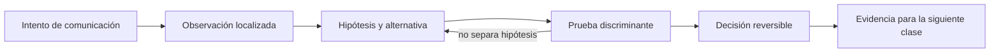
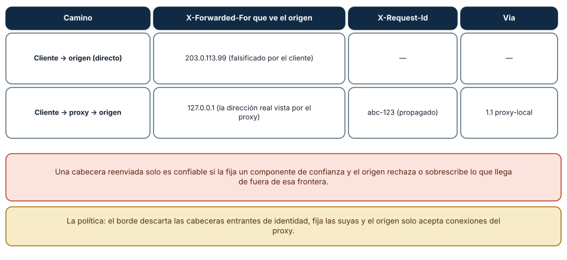
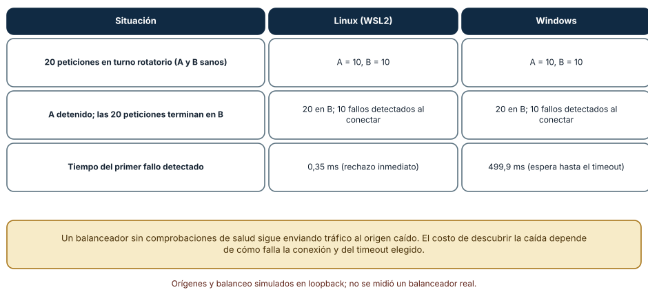
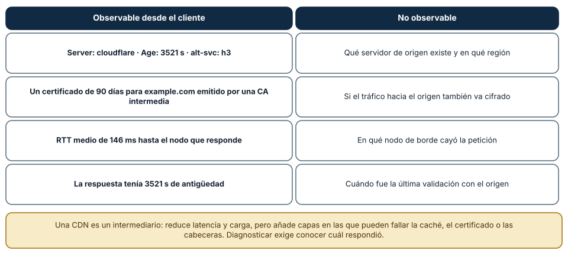

# SE-044 — Proxies, balanceadores, gateways y CDN

[← SE-043 — TLS, certificados y confianza en tránsito](https://github.com/vladimiracunadev-create/modern-software-engineering-program/blob/main/classes/part-03-redes-internet-y-protocolos/se-043-tls-certificados-y-confianza-en-transito/README.md) · [↑ Parte 03](https://github.com/vladimiracunadev-create/modern-software-engineering-program/blob/main/classes/part-03-redes-internet-y-protocolos/README.md) · [📚 Índice completo](https://github.com/vladimiracunadev-create/modern-software-engineering-program/blob/main/classes/README.md) · [🌐 Portal](https://vladimiracunadev-create.github.io/modern-software-engineering-program/classes/SE-044.html) · [SE-045 — Sockets, conexiones persistentes y tiempo real →](https://github.com/vladimiracunadev-create/modern-software-engineering-program/blob/main/classes/part-03-redes-internet-y-protocolos/se-045-sockets-conexiones-persistentes-y-tiempo-real/README.md)


## Punto profesional y fundamento pedagógico

**Punto profesional.** La clase existe para mapear cómo proxy, balanceador, gateway y CDN cambian conexiones, metadatos y caché.

**Por qué aparece aquí.** Se sitúa después de **TLS, certificados y confianza en tránsito** y antes de **Sockets, conexiones persistentes y tiempo real**: convierte el conocimiento anterior en una decisión observable que la clase siguiente podrá reutilizar. La continuidad se comprueba en el artefacto, no por compartir vocabulario.

**Error conceptual que debe corregir.** Suponer que el servidor ve directamente al cliente o que todos los intermediarios son transparentes.

**Secuencia de aprendizaje.** Antes de leer la solución, el estudiante predice el resultado del caso normal y del error conceptual anterior. Luego explica un caso resuelto paso a paso, construye un contraejemplo que cambie la decisión y, sin consultar el texto, reconstruye el mecanismo y lo aplica a una entrada nueva. La secuencia usa predicción, explicación propia, contraste y recuperación. [ICAP](https://icap.education.asu.edu/research) distingue participación de construcción de conocimiento; [How People Learn II](https://nap.nationalacademies.org/catalog/24783/how-people-learn-ii-learners-contexts-and-cultures) exige conectar conocimiento previo, contexto y transferencia; la [práctica de recuperación](https://pubmed.ncbi.nlm.nih.gov/16507066/) respalda producir de nuevo la explicación tras una demora; y [Education for Life and Work](https://nap.nationalacademies.org/resource/13398/dbasse_084153.pdf) exige devolución que explique la causa del error.

**Evidencia de aprendizaje.** Hop-map.md con terminaciones, headers confiables, caché y punto de fallo. Debe contener predicción previa, observación, explicación causal, contraejemplo, criterio de aceptación y una nota de qué dato haría cambiar la conclusión.

**Límite de la conclusión.** El diagrama de una arquitectura no generaliza a todos los proveedores.

### Trazabilidad fuente → afirmación

| Fuente primaria u oficial | Afirmación que respalda | Lo que no prueba |
|---|---|---|
| [RFC 9110 — HTTP Semantics](https://www.rfc-editor.org/rfc/rfc9110) | define la semántica normativa del protocolo nombrado en el título y sus límites interoperables | No demuestra por sí sola que el artefacto del estudiante sea correcto. |
| [RFC 9111 — HTTP Caching](https://www.rfc-editor.org/rfc/rfc9111) | define la semántica normativa del protocolo nombrado en el título y sus límites interoperables | No demuestra por sí sola que el artefacto del estudiante sea correcto. |
| [RFC 8446 — TLS 1.3](https://www.rfc-editor.org/rfc/rfc8446) | define la semántica normativa del protocolo nombrado en el título y sus límites interoperables | No demuestra por sí sola que el artefacto del estudiante sea correcto. |

## Antes de empezar

Esta clase continúa la **petición observable de extremo a extremo de la Parte 3**. No estudia redes como una lista de siglas: añade una decisión concreta al mismo recorrido y obliga a explicar dónde nace cada señal. Conserva una bitácora con cuatro columnas —hecho, interpretación, hipótesis rival y próxima prueba—; si una conclusión no apunta a evidencia, todavía no es diagnóstico.

## Prerrequisitos

- Haber completado `SE-043` o poder explicar su evidencia principal.
- Trabajar solo contra `localhost`, una red propia o un destino con autorización expresa.
- Disponer de navegador, `curl` y herramientas equivalentes del sistema; registra versiones y plataforma.

## Problema auténtico

La petición observable de extremo a extremo responde distinto según región. La petición atraviesa proxy de salida, CDN, balanceador y gateway. Llamarlos a todos «proxy» oculta propiedad, terminación TLS, caché, afinidad y encabezados de procedencia.

## Objetivos observables

Al terminar podrás:

1. distinguir forward proxy, reverse proxy, gateway, balanceador y CDN;
2. mapear terminaciones y cambios de identidad por salto;
3. explicar selección de backend, health checks y afinidad;
4. diagnosticar caché y errores generados por intermediarios;
5. comunicar límites y una siguiente prueba sin presentar inferencias como hechos.

## Mapa conceptual



El ciclo evita el diagnóstico por intuición. La observación se ubica antes de interpretarse; la prueba debe producir resultados diferentes bajo hipótesis rivales; la decisión conserva una salida de recuperación. En esta clase la pregunta rectora es: **¿Qué intermediario tomó qué decisión y qué identidad observó cada salto?**

## Temas y por qué importan

| Núcleo | Pregunta de trabajo | Evidencia esperada |
|---|---|---|
| alcance | ¿dónde es válido este identificador o estado? | mapa de fronteras |
| mecanismo | ¿qué entrada produce qué transición? | secuencia comentada |
| garantía | ¿qué promete el protocolo y qué no? | ejemplo y contraejemplo |
| diagnóstico | ¿qué prueba separa causas plausibles? | comparación reproducible |
| operación | ¿cómo falla, se limita y se recupera? | caso sano, degradado y restaurado |
## Conceptos y decisiones

### 1. Proxy directo y proxy inverso

El cliente elige o recibe política para un forward proxy que actúa hacia destinos. Un reverse proxy recibe en nombre del origen y selecciona servicios internos. La misma tecnología puede cumplir ambos roles; lo que importa es quién la configura, a qué lado representa y qué autoridad tiene.

### 2. Balanceo y salud

Round robin, menor carga o hashing son políticas de selección, no garantías de igualdad. Un health check confirma una ruta específica bajo un umbral; puede declarar sano un proceso incapaz de atender la operación real o expulsar todos los backends por una dependencia compartida.

### 3. Gateway y traducción de protocolo

Un gateway cruza contratos: autentica, aplica cuotas o traduce HTTP a otro protocolo. Cada transformación puede perder semántica o crear un nuevo timeout. Debe declarar qué cabeceras acepta, elimina y genera, y cómo correlaciona errores.

### 4. CDN y borde

Una CDN acerca caché y cómputo al consumidor. El punto de presencia puede responder sin contactar al origen, revalidar o fallar por política regional. `Age`, `Via`, identificadores de caché y logs de borde ayudan, pero son específicos del proveedor y no reemplazan un modelo.

### 5. Identidad, TLS y cabeceras reenviadas

Cada terminación ve una dirección de par diferente. Cabeceras como `Forwarded` o equivalentes solo son confiables si un perímetro elimina valores aportados por el cliente y agrega los suyos. De lo contrario, autorización y auditoría pueden aceptar identidad falsificada.

### Quién puede afirmar la dirección del cliente

Una cabecera como `X-Forwarded-For` informa la dirección del cliente original cuando hay un proxy en medio, pero es texto que *cualquiera puede escribir*. En una prueba local con un origen HTTP y un proxy inverso: una petición enviada *directamente al origen* con `X-Forwarded-For: 203.0.113.99` fue aceptada tal cual (el origen vio el valor falsificado); la misma petición enviada *a través del proxy* llegó al origen con `X-Forwarded-For: 127.0.0.1`
(la dirección real que el proxy vio), con el `X-Request-Id: abc-123` propagado y una cabecera `Via: 1.1 proxy-local` añadida. El proxy sustituyó la cabecera del cliente en lugar de confiar en ella. Esa es la regla de la frontera de confianza: solo un componente que controlas puede fijar los datos de identidad y los componentes interiores deben rechazar o sobrescribir lo que llega de fuera.



**Cómo leer la figura.** Cada fila es un camino y las columnas, lo que ve el origen. **Dónde deja de valer:** es un proxy mínimo en loopback; los sistemas reales encadenan varios intermediarios y cada uno añade su dirección a `X-Forwarded-For` (o usa la cabecera estándar `Forwarded`). Interpretar esa lista exige conocer *cuántos* saltos son de confianza y tomar la dirección correspondiente, no la primera. Y el origen debe aceptar conexiones solo del proxy: de lo contrario, el atajo directo elude la política.

### Balanceo y conmutación por falla

Un balanceador reparte peticiones entre varios orígenes y debe saber cuáles están sanos. En una simulación local con dos orígenes, A y B, 20 peticiones en turno rotatorio se repartieron 10 y 10. Al detener A, las 20 siguientes terminaron en B gracias a un reintento hacia el otro origen, y se detectaron 10 fallos de conexión. La *rapidez* de detección dependió de cómo falla la conexión: 0,35 ms en Linux (rechazo inmediato) frente a 499,9 ms en Windows
(la prueba esperó el timeout de 0,5 s). Sin comprobaciones de salud, un balanceador seguiría enviando tráfico al origen caído; con ellas, lo saca de rotación y lo reincorpora al recuperarse.



**Cómo leer la figura.** Las filas son situaciones y las columnas, plataformas. **Dónde deja de valer:** es una simulación sin carga real ni estado de sesión; un balanceador de producción añade algoritmos de reparto (menos conexiones, hash consistente), comprobaciones activas y pasivas, *drenaje* de conexiones y afinidad de sesión, y su propio punto único de fallo.

### Qué se ve y qué queda oculto detrás de una CDN

Una red de entrega de contenido pone intermediarios entre el cliente y el origen. Desde el cliente se observaron: `Server: cloudflare`, `Age: 3521` (la copia tenía casi una hora), `alt-svc: h3`, un certificado de 90 días emitido por una CA intermedia propia del proveedor y un RTT medio de 146 ms *hasta el nodo que respondió*. No se pudo observar: qué servidor de origen existe y dónde está, si el tramo entre la CDN y el origen va cifrado, en qué nodo de borde cayó la petición ni cuándo fue la última
validación con el origen.



**Cómo leer la figura.** La columna izquierda es evidencia directa; la derecha, preguntas que el cliente no puede responder. **Dónde deja de valer:** otras CDN exponen más o menos cabeceras (por ejemplo, el estado de caché `HIT` o `MISS`), y los proveedores ofrecen paneles y registros que el cliente final no ve. Para diagnosticar se pide al proveedor o al equipo que opera el borde la evidencia de su lado.

## Definiciones de trabajo

- **forward proxy:** intermediario que actúa por clientes hacia destinos.
- **reverse proxy:** intermediario que actúa frente a uno o más orígenes.
- **balanceador:** selector de un destino entre instancias elegibles.
- **CDN:** red de borde que distribuye y puede almacenar contenido.
- **health check:** prueba acotada usada para decidir elegibilidad de una instancia.

Estas definiciones son operativas: precisan el uso dentro de la petición observable de extremo a extremo y deben leerse junto a las fuentes. No convierten un término histórico o dependiente de implementación en una garantía universal.

## Ejemplo mínimo

Dibuja cliente → proxy → balanceador → dos backends. Marca en cada enlace quién inicia conexión, dónde termina TLS, qué Host se conserva y qué dirección ve el receptor.

El ejemplo se acepta cuando incluye predicción previa, salida relevante y explicación de qué hipótesis descarta. Copiar una salida sin interpretación no demuestra comprensión.

## Ejemplo profesional

La petición observable de extremo a extremo asigna un identificador de correlación en el primer componente confiable y lo propaga. El origen indica si la respuesta vino de caché y qué backend atendió sin exponer topología sensible al público. Los timeouts decrecen hacia dentro para que el gateway pueda responder antes del deadline del cliente.

La diferencia profesional es la trazabilidad: la decisión conecta requisito, mecanismo, señal, riesgo y recuperación. El equipo puede cambiar de herramienta sin perder el razonamiento.

## Práctica guiada

1. construye dos backends locales que revelen solo un ID.
2. configura un reverse proxy local.
3. observa distribución y retirada por health check.
4. añade caché a una ruta segura y comprueba hit/miss.
5. prueba una cabecera de cliente falsificada y demuestra que el perímetro la reemplaza.
6. entrega `trace.md` con comandos redactados, marcas de tiempo y condiciones de repetición.

## Ejercicios

1. **Confianza:** dado `X-Forwarded-For: 1.2.3.4, 10.0.0.5, 10.0.0.9` y dos proxies de confianza, indica qué dirección es la del cliente y por qué.
2. **Salud:** diseña las comprobaciones y los umbrales para sacar un origen de rotación y volver a incluirlo.
3. **Caché:** define las cabeceras para que una CDN guarde una página pública y no guarde una respuesta con datos personales.
4. **Diagnóstico:** ante un 502 con `Server: cloudflare`, enumera quién puede haberlo generado y qué observación lo distingue.

## Reto verificable

Entrega una traza comentada que permita a otra persona responder: qué se intentó, qué frontera se observó, qué garantía aplicaba, qué falló, qué alternativa fue descartada y cómo se restauró el estado. La persona revisora debe poder repetir al menos una prueba sin instrucciones orales.

## Demostración guiada

1. Predice el primer evento observable y el resultado sano.
2. Ejecuta una sola petición de la petición observable de extremo a extremo y asigna cada marca a una frontera.
3. Introduce el fallo controlado descrito abajo.
4. Compara por **primera divergencia**, no por cantidad de errores posteriores.
5. Restaura, repite y conserva evidencia de recuperación.

Una demostración que no incluye restauración solo prueba cómo romper el laboratorio.

## Preguntas frecuentes

### ¿Puedo confiar en `X-Forwarded-For`?

Solo si la fija un proxy de confianza y el origen acepta conexiones únicamente de ese proxy. Los valores que el cliente envía pueden ser falsos. Cuando hay varios proxies, se toma el valor que añadió el último de confianza, contando desde el extremo derecho.

### ¿Qué diferencia hay entre un proxy y un balanceador?

Un proxy inverso recibe peticiones y las reenvía a uno o más orígenes; un balanceador es un proxy (u otro dispositivo) cuyo propósito es repartir carga y conmutar ante fallas. En la práctica suelen ser el mismo componente con distintas funciones.

### ¿Una CDN acelera siempre?

Acelera contenido cacheable y reduce la carga del origen, pero añade un salto y una capa de políticas. El contenido personalizado o no cacheable puede ir más lento o requerir reglas explícitas, y una caché mal configurada puede servir datos obsoletos o de otra persona.

### ¿Quién termina TLS cuando hay un intermediario?

Normalmente el intermediario: el cliente valida su certificado y el proxy abre otra conexión hacia el origen. El tramo interior puede ir cifrado o no. Esa decisión se declara y se prueba, porque cambia quién puede leer el tráfico.
## Fallo controlado y diagnóstico

Marca un backend como sano en `/health` mientras falla la dependencia usada por `/report`. Registra el falso positivo y diseña readiness separada de liveness sin convertir la prueba en una llamada destructiva.

Registra estado previo, acción, síntoma, primera divergencia, causa, corrección y estado posterior. Si la acción afecta red compartida, requiere privilegios amplios o no tiene rollback probado, reemplázala por una simulación local.


Una práctica ejercita la frontera de confianza con un origen y un proxy locales. Envía al origen una petición con `X-Forwarded-For` falsificado y otra a través del proxy; compara qué ve el origen. **Síntoma:** el origen acepta cualquier valor cuando se llega directamente. **Hipótesis:** la política de identidad depende de que nadie eluda el proxy. **Prueba:** configura el origen para que solo acepte conexiones del proxy
(por ejemplo, vinculándolo a una dirección distinta o con una lista) y repite el atajo directo, que debe fallar. **Corrección:** el borde descarta las cabeceras de identidad entrantes y fija las suyas. Registra las cabeceras recibidas en cada camino, sin datos reales.

## Errores comunes y cómo corregirlos

| Síntoma | Causa | Corrección |
|---|---|---|
| El origen registra IP falsas | Confía en `X-Forwarded-For` que viene del cliente | Sobrescribir en el borde y aceptar conexiones solo del proxy |
| Tráfico a un origen caído tras detectarlo | Sin comprobaciones de salud o con intervalos largos | Comprobaciones activas y pasivas y reintento hacia otro origen |
| Atribuir un error 503 al origen | El intermediario también puede generarlo | Leer `Server`, `Via` y registros de cada salto |
| Datos de una persona servidos a otra | Caché compartida sin `Vary` ni `private` | Marcar respuestas personalizadas como no cacheables en compartidas |
| Suponer que el tramo interior va cifrado | TLS se terminó en el borde | Declarar y probar el cifrado entre el proxy y el origen |

## Entorno y archivos clave

```text
work/SE-044/
├── README.md          # alcance, autorización y reproducción
├── request.txt        # petición sin credenciales
├── trace.md           # línea temporal y evidencias
├── failure-report.md  # hipótesis, prueba y recuperación
└── diagram.mmd        # mapa accesible acompañado de texto
```

Los archivos son contenedores, no evidencia automática. `README.md` declara sistema operativo, versiones, red utilizada y limpieza. Nunca confirmes cambios de red destructivos sin una ruta de recuperación.

### Laboratorio integrado de la Parte 03

Usa el `request_id` de la [petición observable](https://github.com/vladimiracunadev-create/modern-software-engineering-program/tree/main/labs/part-03-observable-request) para diseñar `hop-map.md`. En cada frontera indica si conserva, valida, reemplaza o elimina `Forwarded`, `Via`, `X-Request-ID` y `traceparent`. Una cabecera aportada por Internet no adquiere autoridad por llamarse “forwarded”: el primer perímetro confiable debe aplicar una política explícita.

## Seguridad, ética y accesibilidad

- captura únicamente tráfico propio o autorizado y durante la ventana mínima;
- redacta cookies, tokens, query strings, IP privadas y nombres de personas;
- no desactives TLS, firewall o aislamiento como solución permanente;
- acompaña color y diagramas con orden, etiquetas y una explicación textual;
- ofrece comandos equivalentes o resultados esperados para quien no pueda modificar una red;
- considera que telemetría e IP pueden identificar o perfilar personas.

## Puente hacia el trabajo con agentes

Los sistemas con agentes también tienen intermediarios: un *gateway* de modelos, un proxy de herramientas, un servidor MCP. La regla de la frontera de confianza se aplica igual: el gateway debe fijar la identidad del agente y de la persona, propagar un identificador de correlación, descartar lo que un cliente pretenda declarar sobre sí mismo y registrar quién llamó a qué. Un balanceador de modelos con reintentos puede además duplicar acciones con efecto si el agente no usa claves de idempotencia, y
una caché mal definida puede entregar a un agente respuestas de otra sesión. Las partes de gateways, MCP y seguridad agentic desarrollan estos controles.

## Transferencia

Traslada el mecanismo a una segunda red o protocolo sin repetir comandos mecánicamente. Conserva la pregunta y el criterio de evidencia; cambia los supuestos de dirección, intermediación y política. Escribe qué observación seguiría siendo válida y cuál depende de la topología original.

## Evaluación y evidencia

| Criterio | Evidencia mínima | Señal de dominio |
|---|---|---|
| modelo causal | mapa con fronteras y unidades correctas | explica interacción y fugas del modelo |
| protocolo | garantía y límite apoyados en fuente | distingue semántica de implementación |
| diagnóstico | hipótesis rival y prueba discriminante | encuentra primera divergencia |
| reproducibilidad | contexto, comandos y salida redactada | otra persona repite el resultado |
| responsabilidad | autorización, minimización y rollback | reduce riesgo sin borrar evidencia |

La clase no se aprueba por ejecutar comandos. Se aprueba cuando la evidencia sostiene las conclusiones y declara lo que todavía no puede saberse.

## Fuentes


- [RFC 9110 — HTTP Semantics](https://www.rfc-editor.org/rfc/rfc9110) — define la semántica normativa del protocolo nombrado en el título y sus límites interoperables.
- [RFC 9111 — HTTP Caching](https://www.rfc-editor.org/rfc/rfc9111) — define la semántica normativa del protocolo nombrado en el título y sus límites interoperables.
- [RFC 8446 — TLS 1.3](https://www.rfc-editor.org/rfc/rfc8446) — define la semántica normativa del protocolo nombrado en el título y sus límites interoperables.
- [RFC 7239 — Forwarded HTTP Extension](https://www.rfc-editor.org/rfc/rfc7239) — estandariza metadatos reenviados y documenta sus consideraciones de seguridad y privacidad.

Las RFC describen contratos de protocolo, no certifican una red, proveedor o herramienta. Cada afirmación de comportamiento local debe contrastarse con evidencia de ese entorno.

- [RFC 7239, Forwarded HTTP Extension](https://www.rfc-editor.org/rfc/rfc7239) y [RFC 9110 §7.6 (Via)](https://www.rfc-editor.org/rfc/rfc9110): cabeceras de reenvío e intermediarios; respaldan la figura 1.
- [RFC 9111, HTTP Caching](https://www.rfc-editor.org/rfc/rfc9111): cachés compartidas y privadas, `Age` y `Vary`; respaldan la figura 3.
- [Python `http.server`](https://docs.python.org/3/library/http.server.html) y [`http.client`](https://docs.python.org/3/library/http.client.html): componentes del proxy y del origen locales de las pruebas.

## Límites y siguiente paso

No cubre configuración de un proveedor concreto ni DDoS. Más intermediarios aportan control y también estados de fallo. La siguiente clase estudia conexiones persistentes y comunicación en tiempo real.

## Glosario

- **forward proxy:** intermediario que actúa por clientes hacia destinos.
- **reverse proxy:** intermediario que actúa frente a uno o más orígenes.
- **balanceador:** selector de un destino entre instancias elegibles.
- **CDN:** red de borde que distribuye y puede almacenar contenido.
- **health check:** prueba acotada usada para decidir elegibilidad de una instancia.

---

[← SE-043 — TLS, certificados y confianza en tránsito](https://github.com/vladimiracunadev-create/modern-software-engineering-program/blob/main/classes/part-03-redes-internet-y-protocolos/se-043-tls-certificados-y-confianza-en-transito/README.md) · [↑ Parte 03](https://github.com/vladimiracunadev-create/modern-software-engineering-program/blob/main/classes/part-03-redes-internet-y-protocolos/README.md) · [📚 Índice completo](https://github.com/vladimiracunadev-create/modern-software-engineering-program/blob/main/classes/README.md) · [🌐 Portal](https://vladimiracunadev-create.github.io/modern-software-engineering-program/classes/SE-044.html) · [SE-045 — Sockets, conexiones persistentes y tiempo real →](https://github.com/vladimiracunadev-create/modern-software-engineering-program/blob/main/classes/part-03-redes-internet-y-protocolos/se-045-sockets-conexiones-persistentes-y-tiempo-real/README.md)
