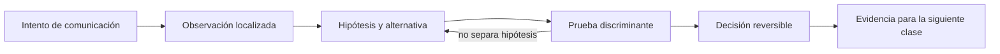
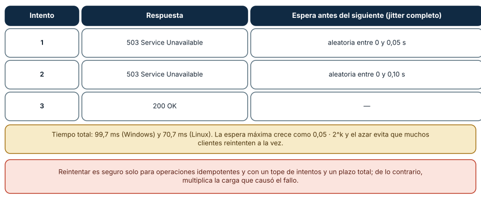
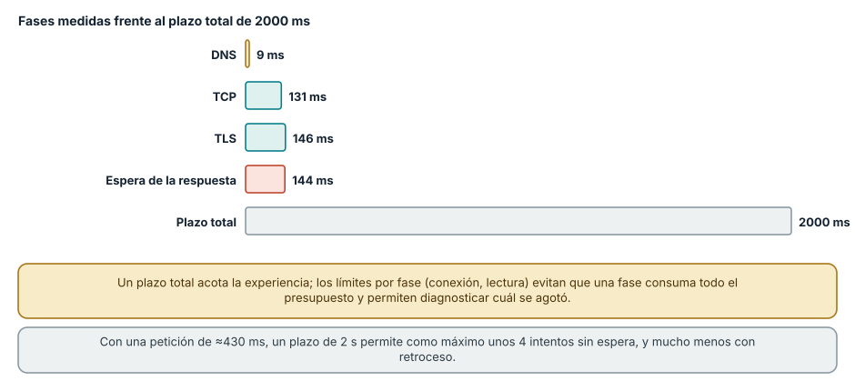
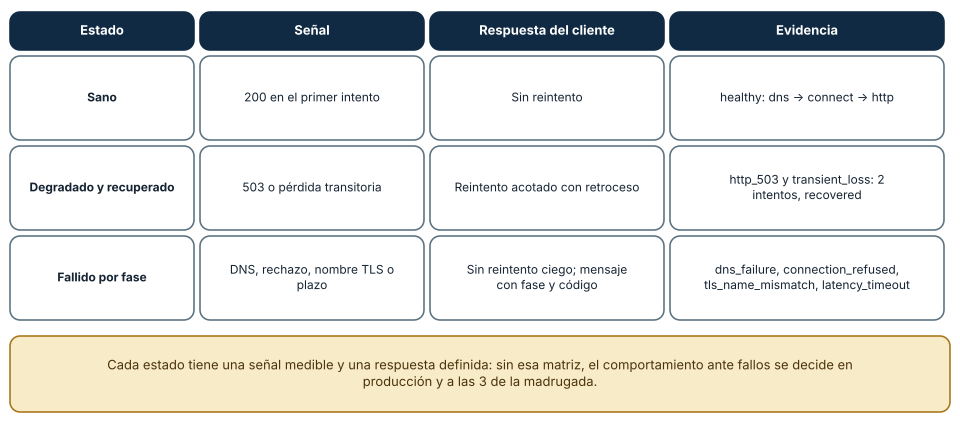

# SE-048 — Proyecto: servicio observable y tolerante a fallos de red

[← SE-047 — Taller: seguir una petición de extremo a extremo](https://github.com/vladimiracunadev-create/modern-software-engineering-program/blob/main/classes/part-03-redes-internet-y-protocolos/se-047-taller-seguir-una-peticion-de-extremo-a-extremo/README.md) · [↑ Parte 03](https://github.com/vladimiracunadev-create/modern-software-engineering-program/blob/main/classes/part-03-redes-internet-y-protocolos/README.md) · [📚 Índice completo](https://github.com/vladimiracunadev-create/modern-software-engineering-program/blob/main/classes/README.md) · [🌐 Portal](https://vladimiracunadev-create.github.io/modern-software-engineering-program/classes/SE-048.html) · [SE-049 — Descomposición, abstracción y reconocimiento de patrones →](https://github.com/vladimiracunadev-create/modern-software-engineering-program/blob/main/classes/part-04-pensamiento-computacional-y-resolucion-de-problemas/se-049-descomposicion-abstraccion-y-reconocimiento-de-patrones/README.md)


## Punto profesional y fundamento pedagógico

**Punto profesional.** La clase existe para construir un servicio observable que trate timeout, reintento e idempotencia como decisiones de producto.

**Por qué aparece aquí.** Se sitúa después de **Taller: seguir una petición de extremo a extremo** y antes de **Descomposición, abstracción y reconocimiento de patrones**: convierte el conocimiento anterior en una decisión observable que la clase siguiente podrá reutilizar. La continuidad se comprueba en el artefacto, no por compartir vocabulario.

**Error conceptual que debe corregir.** Reintentar cualquier fallo y duplicar efectos.

**Secuencia de aprendizaje.** Antes de leer la solución, el estudiante predice el resultado del caso normal y del error conceptual anterior. Luego explica un caso resuelto paso a paso, construye un contraejemplo que cambie la decisión y, sin consultar el texto, reconstruye el mecanismo y lo aplica a una entrada nueva. La secuencia usa predicción, explicación propia, contraste y recuperación. [ICAP](https://icap.education.asu.edu/research) distingue participación de construcción de conocimiento; [How People Learn II](https://nap.nationalacademies.org/catalog/24783/how-people-learn-ii-learners-contexts-and-cultures) exige conectar conocimiento previo, contexto y transferencia; la [práctica de recuperación](https://pubmed.ncbi.nlm.nih.gov/16507066/) respalda producir de nuevo la explicación tras una demora; y [Education for Life and Work](https://nap.nationalacademies.org/resource/13398/dbasse_084153.pdf) exige devolución que explique la causa del error.

**Evidencia de aprendizaje.** Servicio, cliente de prueba, fallos inyectados, trazas correlacionadas y matriz de reintentos. Debe contener predicción previa, observación, explicación causal, contraejemplo, criterio de aceptación y una nota de qué dato haría cambiar la conclusión.

**Límite de la conclusión.** El proyecto local no demuestra disponibilidad ni tolerancia regional.

### Trazabilidad fuente → afirmación

| Fuente primaria u oficial | Afirmación que respalda | Lo que no prueba |
|---|---|---|
| [RFC 9110 — HTTP Semantics](https://www.rfc-editor.org/rfc/rfc9110) | define la semántica normativa del protocolo nombrado en el título y sus límites interoperables | No demuestra por sí sola que el artefacto del estudiante sea correcto. |
| [RFC 9111 — HTTP Caching](https://www.rfc-editor.org/rfc/rfc9111) | define la semántica normativa del protocolo nombrado en el título y sus límites interoperables | No demuestra por sí sola que el artefacto del estudiante sea correcto. |
| [RFC 8446 — TLS 1.3](https://www.rfc-editor.org/rfc/rfc8446) | define la semántica normativa del protocolo nombrado en el título y sus límites interoperables | No demuestra por sí sola que el artefacto del estudiante sea correcto. |

## Antes de empezar

Esta clase continúa la **petición observable de extremo a extremo de la Parte 3**. No estudia redes como una lista de siglas: añade una decisión concreta al mismo recorrido y obliga a explicar dónde nace cada señal. Conserva una bitácora con cuatro columnas —hecho, interpretación, hipótesis rival y próxima prueba—; si una conclusión no apunta a evidencia, todavía no es diagnóstico.

## Prerrequisitos

- Haber completado `SE-047` o poder explicar su evidencia principal.
- Trabajar solo contra `localhost`, una red propia o un destino con autorización expresa.
- Disponer de navegador, `curl` y herramientas equivalentes del sistema; registra versiones y plataforma.

## Problema auténtico

El proyecto integra la petición observable de extremo a extremo como servicio local: recibe una URL autorizada, ejecuta comprobaciones acotadas y genera una traza comentada. Debe sobrevivir DNS lento, puerto cerrado, certificado inválido, 503, respuesta obsoleta y cliente lento sin filtrar secretos ni quedar bloqueado.

## Objetivos observables

Al terminar podrás:

1. definir SLI y presupuesto por fase;
2. implementar timeouts, cancelación y reintentos seguros;
3. exponer estados degradados y evidencia correlacionada;
4. demostrar recuperación con una matriz de fallos;
5. comunicar límites y una siguiente prueba sin presentar inferencias como hechos.

## Mapa conceptual



El ciclo evita el diagnóstico por intuición. La observación se ubica antes de interpretarse; la prueba debe producir resultados diferentes bajo hipótesis rivales; la decisión conserva una salida de recuperación. En esta clase la pregunta rectora es: **¿Cómo debe degradarse y recuperarse un servicio cuando la red incumple sus supuestos?**

## Temas y por qué importan

| Núcleo | Pregunta de trabajo | Evidencia esperada |
|---|---|---|
| alcance | ¿dónde es válido este identificador o estado? | mapa de fronteras |
| mecanismo | ¿qué entrada produce qué transición? | secuencia comentada |
| garantía | ¿qué promete el protocolo y qué no? | ejemplo y contraejemplo |
| diagnóstico | ¿qué prueba separa causas plausibles? | comparación reproducible |
| operación | ¿cómo falla, se limita y se recupera? | caso sano, degradado y restaurado |
## Conceptos y decisiones

### 1. Contrato y frontera de seguridad

La petición observable de extremo a extremo acepta solo esquemas y destinos permitidos, rechaza direcciones locales o metadatos cuando opera como servicio compartido y limita redirecciones. La validación evita convertir la herramienta en SSRF. El informe redacta credenciales, query sensible y direcciones privadas.

### 2. Presupuesto y deadline

Cada fase recibe un límite subordinado a un deadline total. Si DNS consume el presupuesto, no se inicia una operación que ya no puede completar. Los timeouts son resultados tipados por fase; `network error` no es suficientemente accionable.

### 3. Reintento, backoff y circuito

Solo fallos temporales y operaciones seguras/idempotentes se reintentan. Backoff con jitter evita sincronizar clientes. Un circuito abierto limita presión sobre una dependencia y ofrece una respuesta degradada; debe tener prueba de recuperación y no quedarse abierto para siempre.

### 4. Observabilidad útil

Logs estructurados incluyen timestamp, request ID, fase, duración, outcome y causa categorizada; métricas agregan tasa, latencia y saturación; una traza conecta saltos. Ninguna señal debe copiar secretos ni usar cardinalidad ilimitada como URL completa.

### 5. Degradación y recuperación

Un servicio tolerante a fallos no promete éxito universal. Puede servir último resultado marcado con edad, omitir una dependencia opcional o devolver error claro. La recuperación se prueba restaurando la red y verificando que colas, circuitos y caches regresen a estado coherente.

### Reintento con retroceso exponencial y jitter

Reintentar bien exige tres decisiones: cuántas veces, con qué espera y para qué operaciones. En una prueba local, un servidor respondió `503` con `Retry-After` las dos primeras veces y `200` la tercera. Un cliente con *retroceso exponencial con jitter completo* (espera aleatoria entre 0 y 0,05 · 2^k segundos antes del intento k+1) tuvo éxito en el tercer intento: estados `[503, 503, 200]`, con un total de 99,7 ms en Windows y 70,7 ms en Linux. El azar del *jitter* es esencial: si muchos clientes
fallan a la vez y esperan el mismo tiempo, reintentan a la vez y vuelven a saturar al servicio (*tormenta de reintentos*).

```python
import random, time

def con_reintento(operacion, intentos=5, base=0.05, tope=2.0):
    for k in range(intentos):
        respuesta = operacion()
        if respuesta.status != 503:
            return respuesta
        time.sleep(random.uniform(0, min(tope, base * 2 ** k)))
    raise TimeoutError("agotados los intentos")
```



**Cómo leer la figura.** Cada fila es un intento con su respuesta y la espera máxima posible antes del siguiente. **Dónde deja de valer:** esto solo es seguro para operaciones idempotentes; reintentar un pago sin una clave de idempotencia puede cobrarlo dos veces (SE-040). Además, el reintento amplifica la carga: con tres capas que reintentan cada una tres veces, una petición puede convertirse en 27, de modo que el reintento se hace en *una* capa y con un presupuesto global.

### Presupuesto de tiempo y plazos por fase

Un *plazo total* (deadline) acota la experiencia de la persona; los *límites por fase* (conexión, lectura) evitan que una fase consuma todo el presupuesto y permiten saber cuál se agotó. Con las fases medidas en SE-037 (DNS 9 ms, TCP 131 ms, TLS 146 ms y espera 144 ms, unos 430 ms en total), un plazo de 2000 ms deja unos 1570 ms de margen: caben unos cuatro intentos *sin espera* y menos con retroceso. El plazo debe *propagarse*: si el cliente concede 2 s, el
servicio que llama a otro no puede darle más de lo que queda. Un plazo sin propagar produce el peor caso: el cliente se rinde y el servidor sigue trabajando en una petición que nadie espera.



**Cómo leer la figura.** Las cuatro barras son las fases de una petición sana; la última es el plazo total. **Dónde deja de valer:** las fases medidas son de un destino y una hora; en producción hay colas, picos y fases adicionales (autenticación, base de datos). El presupuesto se calibra con percentiles altos, no con la mediana.

### La matriz sana, degradada y recuperada

El servicio se define por su comportamiento en tres estados. *Sano*: responde en el primer intento y no reintenta. *Degradado y recuperado*: ante una señal transitoria (un 503 o una pérdida) el cliente reintenta con límite y retroceso, y el resultado final es `recovered` con dos intentos (los escenarios `http_503` y `transient_loss` del laboratorio). *Fallido por fase*: ante DNS, rechazo, nombre TLS inválido o plazo agotado, el cliente *no reintenta a ciegas*: informa la
fase y el código (`dns_failure`, `connection_refused`, `tls_name_mismatch`, `latency_timeout`). Un *circuito* (circuit breaker) añade una cuarta opción: tras varias fallas consecutivas deja de intentar durante un tiempo y falla rápido, protegiendo al servicio degradado y a los recursos del cliente.



**Cómo leer la figura.** Cada fila es un estado con su señal observable, la respuesta del cliente y los escenarios que la demuestran. **Dónde deja de valer:** la matriz cubre un cliente y un servicio; en un sistema real hay degradación parcial (algunas funciones sí, otras no), y la respuesta correcta incluye comunicar el estado a las personas, no solo a otros programas. Un *runbook* convierte la matriz en pasos operativos con responsables, y se prueba con ejercicios de fallo.

## Definiciones de trabajo

- **SLI:** medida cuantitativa de comportamiento del servicio.
- **deadline:** instante límite para completar una operación.
- **backoff:** espera creciente entre intentos.
- **circuit breaker:** control que limita llamadas a una dependencia degradada.
- **SSRF:** abuso que induce a un servidor a solicitar destinos no autorizados.

Estas definiciones son operativas: precisan el uso dentro de la petición observable de extremo a extremo y deben leerse junto a las fuentes. No convierten un término histórico o dependiente de implementación en una garantía universal.

## Ejemplo mínimo

Define un resultado JSON con `phase`, `outcome`, `duration_ms`, `attempts` y `evidence`. Representa éxito, timeout DNS y error TLS sin usar texto libre como única señal.

El ejemplo se acepta cuando incluye predicción previa, salida relevante y explicación de qué hipótesis descarta. Copiar una salida sin interpretación no demuestra comprensión.

## Ejemplo profesional

El proyecto entrega un servidor local y CLI de consulta. Un entorno simulado ofrece DNS demorado, puerto cerrado, TLS autofirmado, 503 transitorio y caché. El tablero muestra tasa de éxito y p95 por fase; el runbook explica detección, mitigación, recuperación y límite de cada automatismo.

La diferencia profesional es la trazabilidad: la decisión conecta requisito, mecanismo, señal, riesgo y recuperación. El equipo puede cambiar de herramienta sin perder el razonamiento.

## Práctica guiada

1. especifica amenazas, destinos permitidos y presupuesto.
2. implementa fases con resultados tipados.
3. agrega request ID y redacción.
4. crea cinco fallos deterministas en laboratorio.
5. ejecuta matriz sana/degradada/recuperada.
6. entrega a otra persona para operación con el runbook.
7. entrega `trace.md` con comandos redactados, marcas de tiempo y condiciones de repetición.

## Ejercicios

1. **Cálculo:** con base 50 ms y tope 2 s, escribe el máximo de espera antes de los intentos 2 a 6 y el peor tiempo total con un plazo de 3 s.
2. **Idempotencia:** diseña la clave de deduplicación para «crear un pedido» y explica qué responde el servidor al repetirla.
3. **Presupuesto:** reparte un plazo de 2 s entre cliente, balanceador y servicio, y define qué propaga cada uno.
4. **Runbook:** redacta los pasos de operación para el escenario `latency_timeout`, con la señal, el responsable y la acción de recuperación.

## Reto verificable

Entrega una traza comentada que permita a otra persona responder: qué se intentó, qué frontera se observó, qué garantía aplicaba, qué falló, qué alternativa fue descartada y cómo se restauró el estado. La persona revisora debe poder repetir al menos una prueba sin instrucciones orales.

## Demostración guiada

1. Predice el primer evento observable y el resultado sano.
2. Ejecuta una sola petición de la petición observable de extremo a extremo y asigna cada marca a una frontera.
3. Introduce el fallo controlado descrito abajo.
4. Compara por **primera divergencia**, no por cantidad de errores posteriores.
5. Restaura, repite y conserva evidencia de recuperación.

Una demostración que no incluye restauración solo prueba cómo romper el laboratorio.

## Preguntas frecuentes

### ¿Cuántos reintentos son razonables?

Los suficientes para absorber fallos transitorios sin multiplicar la carga: típicamente dos o tres, con retroceso y *jitter*, un plazo total y un límite global compartido por las capas. Más reintentos aumentan la probabilidad de éxito individual y empeoran la saturación colectiva.

### ¿Cuándo no se debe reintentar?

Cuando el error es permanente (nombre inexistente, certificado inválido, 4xx por una petición mal formada), cuando la operación no es idempotente y no hay clave de deduplicación, o cuando el plazo restante no alcanza. Reintentar un error permanente solo retrasa el diagnóstico.

### ¿Qué hace un circuit breaker que no haga un reintento?

Un reintento insiste en una petición; el circuito deja de enviar *todas* las peticiones a un destino que está fallando, durante un tiempo, y prueba de vez en cuando si se recuperó. Protege al destino y evita que el cliente acumule esperas.

### ¿Cómo sé que mi degradación funciona antes de que ocurra un incidente?

Con ejercicios de fallo controlados (por ejemplo, la matriz del laboratorio en un entorno de prueba): se provoca cada fallo, se comprueba que la señal aparece y que el cliente responde según la política, y se corrige lo que no.
## Fallo controlado y diagnóstico

Encadena DNS lento y 503 para comprobar que el deadline total impide una tormenta de reintentos. Luego restaura ambos componentes y verifica cierre del circuito, vaciado controlado y ausencia de tareas huérfanas.

Registra estado previo, acción, síntoma, primera divergencia, causa, corrección y estado posterior. Si la acción afecta red compartida, requiere privilegios amplios o no tiene rollback probado, reemplázala por una simulación local.


Una práctica provoca una tormenta de reintentos y la corrige. Con un servidor local que falla las primeras N peticiones y varios clientes simultáneos, compara dos políticas: reintento inmediato y reintento con retroceso exponencial y jitter. **Síntoma:** con reintento inmediato, las peticiones fallidas se acumulan en ráfagas y el servidor tarda más en recuperarse. **Hipótesis:** el sincronismo de los reintentos mantiene la carga. **Prueba:** mide el
número total de peticiones recibidas y el tiempo hasta que todos los clientes tienen éxito con cada política. **Corrección:** retroceso con jitter, tope de intentos, plazo total y reintento solo de operaciones idempotentes. Limita el número de clientes y de peticiones para no presionar el equipo.

## Errores comunes y cómo corregirlos

| Síntoma | Causa | Corrección |
|---|---|---|
| El servicio se satura más al fallar | Reintentos inmediatos y sincronizados de muchos clientes | Retroceso exponencial con jitter y tope de intentos |
| Peticiones duplicadas tras un timeout | Se reintentan operaciones no idempotentes | Claves de idempotencia o consulta previa del estado |
| Reintentos multiplicados entre capas | Cada capa reintenta por su cuenta | Reintentar en una capa y fijar un presupuesto global |
| El servidor sigue trabajando tras la renuncia del cliente | El plazo no se propaga | Propagar el plazo restante y cancelar el trabajo |
| Fallos permanentes que se reintentan | No se distingue error transitorio de permanente | Clasificar por código y fase; no reintentar errores permanentes |

## Entorno y archivos clave

```text
work/SE-048/
├── README.md          # alcance, autorización y reproducción
├── request.txt        # petición sin credenciales
├── trace.md           # línea temporal y evidencias
├── failure-report.md  # hipótesis, prueba y recuperación
└── diagram.mmd        # mapa accesible acompañado de texto
```

Los archivos son contenedores, no evidencia automática. `README.md` declara sistema operativo, versiones, red utilizada y limpieza. Nunca confirmes cambios de red destructivos sin una ruta de recuperación.

### Laboratorio integrado de la Parte 03

El proyecto base es la [petición observable y fallos por fase](https://github.com/vladimiracunadev-create/modern-software-engineering-program/tree/main/labs/part-03-observable-request). Debes mantener sus límites de loopback, pruebas y resultados tipados, y ampliarlo con presupuesto total, cancelación, una clave idempotente para una escritura simulada y un runbook. La entrega incluye casos sano, degradado y recuperado; un resultado verde aislado no acredita tolerancia a fallos.

## Seguridad, ética y accesibilidad

- captura únicamente tráfico propio o autorizado y durante la ventana mínima;
- redacta cookies, tokens, query strings, IP privadas y nombres de personas;
- no desactives TLS, firewall o aislamiento como solución permanente;
- acompaña color y diagramas con orden, etiquetas y una explicación textual;
- ofrece comandos equivalentes o resultados esperados para quien no pueda modificar una red;
- considera que telemetría e IP pueden identificar o perfilar personas.

## Puente hacia el trabajo con agentes

Los agentes reintentan: llamadas a modelos con límites de tasa, herramientas con errores transitorios, ciclos de «intenta otra vez» que pueden no terminar. El diseño de esta clase es el contrato del harness: reintento con retroceso y *jitter*, un presupuesto global de intentos, tiempo y *costo* por tarea (porque cada reintento de un modelo cuesta dinero), claves de idempotencia para las herramientas con efecto, circuitos para los servicios degradados y una matriz explícita de qué hacer ante cada
fallo. Un agente sin esos límites puede entrar en un bucle que consume presupuesto o duplica acciones, y la regla se verifica con pruebas de regresión que provocan cada fallo. Las partes de harness, bucles de agentes y evaluación desarrollan esos controles.

## Transferencia

Traslada el mecanismo a una segunda red o protocolo sin repetir comandos mecánicamente. Conserva la pregunta y el criterio de evidencia; cambia los supuestos de dirección, intermediación y política. Escribe qué observación seguiría siendo válida y cuál depende de la topología original.

## Evaluación y evidencia

| Criterio | Evidencia mínima | Señal de dominio |
|---|---|---|
| modelo causal | mapa con fronteras y unidades correctas | explica interacción y fugas del modelo |
| protocolo | garantía y límite apoyados en fuente | distingue semántica de implementación |
| diagnóstico | hipótesis rival y prueba discriminante | encuentra primera divergencia |
| reproducibilidad | contexto, comandos y salida redactada | otra persona repite el resultado |
| responsabilidad | autorización, minimización y rollback | reduce riesgo sin borrar evidencia |

La clase no se aprueba por ejecutar comandos. Se aprueba cuando la evidencia sostiene las conclusiones y declara lo que todavía no puede saberse.

## Fuentes


- [RFC 9110 — HTTP Semantics](https://www.rfc-editor.org/rfc/rfc9110) — define la semántica normativa del protocolo nombrado en el título y sus límites interoperables.
- [RFC 9111 — HTTP Caching](https://www.rfc-editor.org/rfc/rfc9111) — define la semántica normativa del protocolo nombrado en el título y sus límites interoperables.
- [RFC 8446 — TLS 1.3](https://www.rfc-editor.org/rfc/rfc8446) — define la semántica normativa del protocolo nombrado en el título y sus límites interoperables.
- [RFC 9000 — QUIC](https://www.rfc-editor.org/rfc/rfc9000) — define la semántica normativa del protocolo nombrado en el título y sus límites interoperables.
- [RFC 1034 — Domain Names: Concepts and Facilities](https://www.rfc-editor.org/rfc/rfc1034) — define la semántica normativa del protocolo nombrado en el título y sus límites interoperables.

Las RFC describen contratos de protocolo, no certifican una red, proveedor o herramienta. Cada afirmación de comportamiento local debe contrastarse con evidencia de ese entorno.

- [AWS Builders' Library: Timeouts, retries and backoff with jitter](https://aws.amazon.com/builders-library/timeouts-retries-and-backoff-with-jitter/) y [Google SRE Book: Handling Overload](https://sre.google/sre-book/handling-overload/): práctica de retroceso con jitter, presupuestos de reintento y degradación; respaldan las figuras 1 y 2.
- [RFC 9110 §10.2.3, Retry-After](https://www.rfc-editor.org/rfc/rfc9110) y [Circuit Breaker (Fowler)](https://martinfowler.com/bliki/CircuitBreaker.html): pista de reintento del servidor y patrón de circuito.
- [Laboratorio de la Parte 03](https://github.com/vladimiracunadev-create/modern-software-engineering-program/tree/main/labs/part-03-observable-request): escenarios `http_503` y `transient_loss` y la matriz sana, degradada y recuperada.

## Límites y siguiente paso

El proyecto demuestra diseño y diagnóstico en laboratorio; no certifica disponibilidad productiva ni sustituye monitoreo externo. Sus resultados alimentan la Parte 4, donde el mismo incidente se formaliza como problema, invariantes y algoritmo.

## Glosario

- **SLI:** medida cuantitativa de comportamiento del servicio.
- **deadline:** instante límite para completar una operación.
- **backoff:** espera creciente entre intentos.
- **circuit breaker:** control que limita llamadas a una dependencia degradada.
- **SSRF:** abuso que induce a un servidor a solicitar destinos no autorizados.

---

[← SE-047 — Taller: seguir una petición de extremo a extremo](https://github.com/vladimiracunadev-create/modern-software-engineering-program/blob/main/classes/part-03-redes-internet-y-protocolos/se-047-taller-seguir-una-peticion-de-extremo-a-extremo/README.md) · [↑ Parte 03](https://github.com/vladimiracunadev-create/modern-software-engineering-program/blob/main/classes/part-03-redes-internet-y-protocolos/README.md) · [📚 Índice completo](https://github.com/vladimiracunadev-create/modern-software-engineering-program/blob/main/classes/README.md) · [🌐 Portal](https://vladimiracunadev-create.github.io/modern-software-engineering-program/classes/SE-048.html) · [SE-049 — Descomposición, abstracción y reconocimiento de patrones →](https://github.com/vladimiracunadev-create/modern-software-engineering-program/blob/main/classes/part-04-pensamiento-computacional-y-resolucion-de-problemas/se-049-descomposicion-abstraccion-y-reconocimiento-de-patrones/README.md)
