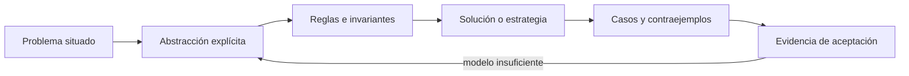
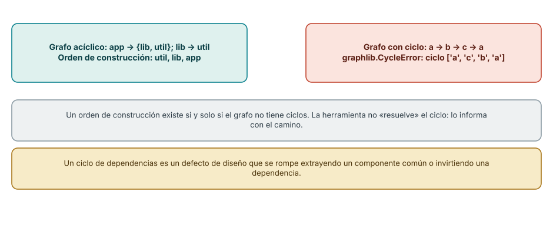
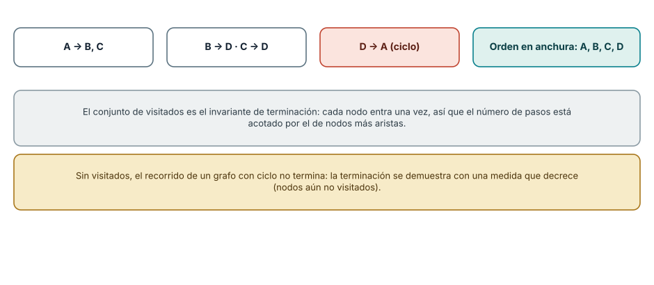
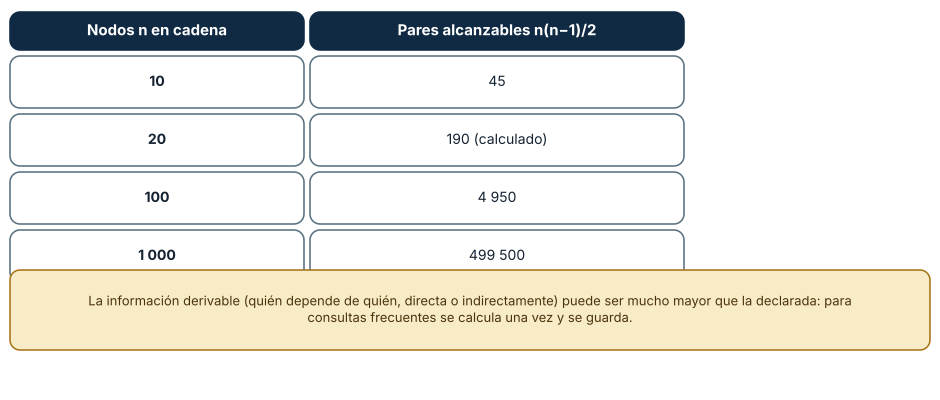

# SE-051 — Conjuntos, relaciones, funciones y grafos

[← SE-050 — Lógica proposicional, predicados e inferencia](https://github.com/vladimiracunadev-create/modern-software-engineering-program/blob/main/classes/part-04-pensamiento-computacional-y-resolucion-de-problemas/se-050-logica-proposicional-predicados-e-inferencia/README.md) · [↑ Parte 04](https://github.com/vladimiracunadev-create/modern-software-engineering-program/blob/main/classes/part-04-pensamiento-computacional-y-resolucion-de-problemas/README.md) · [📚 Índice completo](https://github.com/vladimiracunadev-create/modern-software-engineering-program/blob/main/classes/README.md) · [🌐 Portal](https://vladimiracunadev-create.github.io/modern-software-engineering-program/classes/SE-051.html) · [SE-052 — Invariantes, precondiciones y poscondiciones →](https://github.com/vladimiracunadev-create/modern-software-engineering-program/blob/main/classes/part-04-pensamiento-computacional-y-resolucion-de-problemas/se-052-invariantes-precondiciones-y-poscondiciones/README.md)


## Punto profesional y fundamento pedagógico

**Punto profesional.** La clase existe para elegir conjuntos, relaciones, funciones y grafos según la estructura que deben preservar.

**Por qué aparece aquí.** Se sitúa después de **Lógica proposicional, predicados e inferencia** y antes de **Invariantes, precondiciones y poscondiciones**: convierte el conocimiento anterior en una decisión observable que la clase siguiente podrá reutilizar. La continuidad se comprueba en el artefacto, no por compartir vocabulario.

**Error conceptual que debe corregir.** Usar una colección por conveniencia sintáctica sin modelar multiplicidad y dirección.

**Secuencia de aprendizaje.** Antes de leer la solución, el estudiante predice el resultado del caso normal y del error conceptual anterior. Luego explica un caso resuelto paso a paso, construye un contraejemplo que cambie la decisión y, sin consultar el texto, reconstruye el mecanismo y lo aplica a una entrada nueva. La secuencia usa predicción, explicación propia, contraste y recuperación. [ICAP](https://icap.education.asu.edu/research) distingue participación de construcción de conocimiento; [How People Learn II](https://nap.nationalacademies.org/catalog/24783/how-people-learn-ii-learners-contexts-and-cultures) exige conectar conocimiento previo, contexto y transferencia; la [práctica de recuperación](https://pubmed.ncbi.nlm.nih.gov/16507066/) respalda producir de nuevo la explicación tras una demora; y [Education for Life and Work](https://nap.nationalacademies.org/resource/13398/dbasse_084153.pdf) exige devolución que explique la causa del error.

**Evidencia de aprendizaje.** Model-comparison.md con el mismo dominio en dos estructuras y una consulta discriminante. Debe contener predicción previa, observación, explicación causal, contraejemplo, criterio de aceptación y una nota de qué dato haría cambiar la conclusión.

**Límite de la conclusión.** El modelo matemático abstrae costos de almacenamiento y concurrencia.

### Trazabilidad fuente → afirmación

| Fuente primaria u oficial | Afirmación que respalda | Lo que no prueba |
|---|---|---|
| [MIT 6.042J — Mathematics for Computer Science](https://ocw.mit.edu/courses/6-042j-mathematics-for-computer-science-spring-2015/) | aporta lógica, inducción, relaciones, grafos y técnicas de demostración aplicadas | No demuestra por sí sola que el artefacto del estudiante sea correcto. |
| [MIT 6.006 — Introduction to Algorithms](https://ocw.mit.edu/courses/6-006-introduction-to-algorithms-spring-2020/) | aporta definiciones, invariantes y análisis de estructuras y algoritmos usados en la clase | No demuestra por sí sola que el artefacto del estudiante sea correcto. |

## Antes de empezar

Esta clase continúa el **modelo de decisión diagnóstica**, que convierte la evidencia de la petición observable de extremo a extremo en una siguiente decisión explicable. Recupera `SE-050`: escribe qué artefacto dejó, qué supuesto permanece abierto y qué propiedad debe sobrevivir al nuevo modelo. La matemática se usa para restringir interpretaciones y encontrar errores; no como ornamentación.

## Prerrequisitos

- Poder separar hecho, interpretación, hipótesis y decisión.
- Manejar tablas, diagramas y pseudocódigo legible; Python es opcional.
- Trabajar con datos sintéticos del caso del modelo de decisión diagnóstica y conservar cada versión en Git.

## Problema auténtico

El modelo de decisión diagnóstica mezcla hosts, observaciones, pruebas y resultados en una lista. Ya no puede responder qué prueba aplica a qué hipótesis, si dos caminos alcanzan la misma conclusión o si existe un ciclo. Se requiere elegir estructuras según la pregunta, no por comodidad del formato.

## Objetivos observables

Al finalizar podrás explicar el mecanismo con ejemplo y contraejemplo; construir un modelo con dominio y límites; derivar una prueba que pueda refutarlo; comparar al menos dos representaciones; y entregar una decisión cuya evidencia pueda revisar otra persona.

## Mapa conceptual



El mapa separa el problema de su representación. Los casos no reemplazan reglas; las reglas no prueban que el problema esté bien encuadrado. La pregunta de esta clase es: **¿Qué estructura matemática representa mejor pertenencia, asociación, transformación y camino?**

## Temas y por qué importan

| Lente | Pregunta | Evidencia |
|---|---|---|
| dominio | ¿qué entradas y estados existen? | vocabulario y particiones |
| estructura | ¿qué relaciones se conservan? | modelo interpretado |
| regla | ¿qué debe ser cierto? | contrato o invariante |
| estrategia | ¿qué pasos producen el resultado? | pseudocódigo y traza |
| límite | ¿dónde falla el argumento? | contraejemplo y caso límite |
## Conceptos y decisiones

### 1. Conjuntos y universo

Un conjunto agrupa elementos por pertenencia, sin orden ni duplicados. Unión combina posibilidades; intersección conserva coincidencias; diferencia revela cobertura faltante. Toda operación depende de un universo explícito: «todas las pruebas» puede significar las autorizadas, las implementadas o las conocidas.

### 2. Relaciones

Una relación es un subconjunto del producto cartesiano. `prueba_refuta ⊆ Pruebas × Hipótesis` permite muchos a muchos. Propiedades como reflexividad, simetría y transitividad no se presumen: «correlacionado con» puede ser simétrico, «depende de» no.

### 3. Funciones y totalidad

Una función asigna a cada elemento del dominio exactamente un valor. Una tabla que no cubre todos los errores no es total; puede modelarse como función parcial o devolver un resultado explícito `UNKNOWN`. Inyectividad y sobreyectividad importan cuando se quiere reconstruir origen o cubrir todos los estados.

### 4. Grafos dirigidos

Vértices representan estados o tareas y aristas dependencias o transiciones. Dirección, peso y etiqueta tienen significado distinto. Alcanzabilidad responde si existe camino; un orden topológico solo existe en grafos dirigidos acíclicos y no decide prioridad por sí mismo.

### 5. Elección de representación

La misma realidad admite varios modelos. Un conjunto sirve para cobertura; una relación para trazabilidad; una función para asignación determinista; un grafo para rutas. El modelo de decisión diagnóstica conserva vistas derivadas de una fuente y prueba consistencia para evitar que tablas duplicadas diverjan.

### Dependencias, orden y ciclos

Un conjunto de componentes con relaciones «A depende de B» es un grafo dirigido. Si no tiene ciclos admite un *orden topológico*: en un grafo donde `app` depende de `lib` y `util`, y `lib` depende de `util`, el único orden de construcción posible es `util`, `lib`, `app`. Con la biblioteca estándar basta `graphlib.TopologicalSorter`. Si los componentes forman un ciclo (`a`→`b`→`c`→`a`), `graphlib` lanza `CycleError` e informa el ciclo `['a', 'c', 'b', 'a']`. Eso es lo importante: la herramienta no inventa una solución, *señala el camino* que rompe la propiedad. Un ciclo de dependencias es un defecto de diseño, no un problema del compilador, y se corrige extrayendo un componente común o invirtiendo una dependencia.



**Cómo leer la figura.** A la izquierda se muestra el grafo ordenable y su orden; a la derecha, el ciclo y el error. **Dónde deja de valer:** el orden topológico no es único cuando hay componentes independientes, y no representa dependencias de tiempo de ejecución (una carga perezosa o un evento) que no aparecen como aristas; un grafo de importaciones no es un grafo de comportamiento.

### Recorrer sin colgarse

Un recorrido de un grafo con ciclo, sin precauciones, no termina. En el grafo A→{B,C}, B→D, C→D, D→A, el recorrido en anchura con un *conjunto de visitados* produce A, B, C, D y se detiene: cada nodo entra una sola vez. Esa estructura es el invariante que garantiza la terminación, y se puede enunciar como medida: la cantidad de nodos aún no visitados decrece estrictamente. Sin ella, el número de pasos no está acotado. Es el mismo razonamiento que se usará en la clase de algoritmos: terminar *se demuestra*, no se espera.



**Cómo leer la figura.** Los cuadros muestran las aristas, el ciclo `D → A` y el orden de visita; los dos recuadros inferiores explican el papel del conjunto de visitados. **Dónde deja de valer:** el orden de visita depende del orden de los vecinos; dos implementaciones correctas pueden producir órdenes distintos, y una prueba no debe fijar uno a menos que el contrato lo exija.

### Información derivada: el cierre transitivo

La relación «depende directamente de» define otra, «depende directa o indirectamente de», que puede ser mucho mayor. En una cadena de 20 nodos hay 19 dependencias directas y 190 pares alcanzables, el resultado de n(n−1)/2; para 1000 nodos serían 499 500 pares. Responder «¿qué se rompe si cambia este componente?» es consultar el cierre. Calcularlo cada vez es costoso, de modo que se guarda y se invalida cuando el grafo cambia; esa decisión introduce el problema de mantener la coherencia, que reaparece como invalidación de cachés.



**Cómo leer la figura.** La tabla muestra cuántos pares alcanzables genera una cadena de longitud creciente; el valor de 20 nodos se calculó. **Dónde deja de valer:** una cadena es el caso extremo para pares alcanzables; en un grafo real con ramas la cifra varía. El patrón que se conserva es que lo derivable puede ser mucho mayor que lo declarado.

## Definiciones de trabajo

- **conjunto:** colección definida por pertenencia.
- **relación:** conjunto de pares entre dominios.
- **función:** asignación unívoca desde un dominio.
- **grafo:** vértices conectados por aristas.
- **alcanzabilidad:** existencia de un camino entre vértices.

Las definiciones fijan el uso en el modelo de decisión diagnóstica. Si una fuente usa otra convención, documenta la traducción. Una palabra definida no equivale a una propiedad demostrada.

## Ejemplo mínimo

Define H={DNS,TCP,TLS}, P={p1,p2,p3} y una relación `refuta`. Calcula qué hipótesis no tiene prueba y qué pruebas son redundantes. Después dibuja dependencias como grafo.

Antes de resolver, predice el resultado y la propiedad que debería conservarse. Después marca qué parte del resultado procede de la regla y cuál depende del ejemplo.

## Ejemplo profesional

El modelo de decisión diagnóstica usa un grafo dirigido acíclico para prerequisitos y una relación aparte para evidencia. Antes de ejecutar, valida que toda hipótesis terminal tenga al menos una prueba autorizada y que no existan ciclos de prerrequisitos. Un orden topológico genera una secuencia válida, no necesariamente óptima.

La entrega profesional hace visible el costo de simplificar. Incluye al menos una alternativa descartada y la condición que obligaría a revisar la decisión.

## Práctica guiada

1. declara universos y tipos de entidad.
2. modela pertenencia con conjuntos.
3. modela trazabilidad como relación.
4. elige una asignación total o parcial.
5. representa dependencias y detecta ciclos.
6. solicita una revisión adversarial y corrige el modelo sin borrar la versión que falló.

## Ejercicios

1. **Orden:** dibuja el grafo `app → {lib, util}`, `lib → util` y escribe todos los órdenes topológicos válidos.
2. **Ciclo:** modifica el grafo para introducir un ciclo y escribe el mensaje de error que esperas.
3. **Terminación:** enuncia la medida que decrece en un recorrido con visitados y explica qué ocurre si la quitas.
4. **Cierre:** para un grafo de 6 componentes con ramas, calcula el número de pares alcanzables y compáralo con el de una cadena de 6.

## Reto verificable

Entrega `problem.md`, `model.md` y `checks.md`. Una persona revisora debe poder reconstruir dominio, supuestos, regla, resultado y límite; además debe encontrar qué caso refutaría la solución sin preguntarte oralmente.

## Demostración guiada

1. Declara el dominio y selecciona un caso pequeño calculable a mano.
2. Ejecuta la estrategia paso a paso y conserva estados intermedios.
3. Comprueba el resultado contra la definición, no contra intuición.
4. Introduce el fallo controlado y localiza la primera regla violada.
5. Repara el modelo y repite el caso original y el contraejemplo.

## Preguntas frecuentes

### ¿Qué estructura elijo: lista, conjunto, mapa, grafo?

La que preserve la operación que importa. Si hay que preguntar «¿esto ya fue visto?», un conjunto; si hay que asociar clave y valor, un mapa; si las relaciones entre elementos son el dato, un grafo. Elegir la estructura es declarar las consultas que debe responder.

### ¿Un grafo con ciclo siempre es un error?

No. Los grafos de llamadas pueden tener ciclos legítimos (recursión) y los de estados también. Es un error cuando la relación exige un orden, como la construcción o la inicialización, donde un ciclo vuelve imposible empezar.

### ¿Por qué usar `graphlib` en vez de escribir mi ordenamiento?

Porque implementa el algoritmo de forma probada y señala los ciclos con un error específico. Escribirlo a mano es válido para aprender, pero en un producto se prefiere el componente revisado por mucha gente.

### ¿Cómo sé si necesito el cierre transitivo?

Cuando una pregunta recurrente sea de alcance («¿qué se ve afectado?»). Si se consulta una vez, un recorrido basta; si se consulta miles de veces sobre un grafo estable, se calcula y se guarda.
## Fallo controlado y diagnóstico

Modela `prueba → hipótesis` como función y añade una prueba que refuta dos hipótesis. Observa la pérdida; corrige a relación o a función hacia conjuntos.

Conserva el modelo fallido, la entrada que lo expone, la regla violada y la corrección. No ajustes solo el resultado esperado para hacer pasar el caso.


Provoca el ciclo a propósito con una dependencia circular entre dos módulos del laboratorio: añade a la especificación una prueba que dependa de otra que a su vez dependa de la primera. **Síntoma:** el planificador no puede ordenar las pruebas. **Hipótesis:** hay un ciclo. **Prueba:** ejecuta el ordenamiento topológico y lee el camino del error. **Conclusión:** el modelo debe rechazar el ciclo con un mensaje que nombre los nodos, no ocultarlo ni elegir un orden arbitrario. Desactiva el conjunto de visitados en un recorrido de prueba con un tope de pasos y confirma que sin él el recorrido consume el tope; anota la diferencia en `checks.md`.

## Errores comunes y cómo corregirlos

| Síntoma | Causa | Corrección |
|---|---|---|
| El recorrido no termina | No hay conjunto de visitados o medida decreciente | Registrar los nodos visitados y acotar los pasos |
| El orden de construcción cambia entre ejecuciones | Se fijó una prueba al orden de vecinos | Comprobar solo las propiedades exigidas por el contrato |
| Se ignora un ciclo y se «resuelve» a mano | La herramienta se silenció | Propagar el error y corregir el diseño |
| Se usa una lista donde se pregunta «¿ya está?» | Estructura equivocada para la consulta | Cambiar a conjunto o mapa y medir |
| El cierre transitivo se recalcula en cada consulta | No se guardó ni se invalidó | Calcular una vez e invalidar al cambiar el grafo |

## Entorno y archivos clave

```text
work/SE-051/
├── problem.md     # contexto, dominio, supuestos y exclusiones
├── model.md       # definiciones, reglas, diagrama y estrategia
├── checks.md      # ejemplos, contraejemplos y aceptación
└── review.md      # objeciones y revisión del modelo
```

El pseudocódigo debe ser independiente de lenguaje y cada diagrama necesita explicación textual. Si usas código para explorar, registra versión, entrada y salida; no lo presentes automáticamente como producto de la clase.

### Laboratorio integrado de la Parte 04

Representa hipótesis, pruebas y outcomes de la [especificación contrastable](https://github.com/vladimiracunadev-create/modern-software-engineering-program/tree/main/labs/part-04-contrastable-spec) como relación muchos-a-muchos y como grafo dirigido. Usa `reachable()` sobre un ciclo y explica por qué `visited` garantiza terminación del recorrido, pero no convierte la relación en función ni demuestra que el modelo del dominio esté completo.

## Seguridad, ética y accesibilidad

- usa incidentes sintéticos y evita convertir direcciones o usuarios en datos de práctica;
- trata autorización y privacidad como invariantes, no como pasos opcionales;
- registra a quién perjudica un falso positivo, falso negativo o prioridad automática;
- ofrece tablas y texto alternativo para diagramas y símbolos;
- define mecanismo de revisión humana y apelación para recomendaciones;
- no uses un modelo parcial para justificar una decisión irreversible.

## Puente hacia el trabajo con agentes

Las herramientas y subagentes que usa un sistema agentic forman un grafo de dependencias: una tarea requiere la salida de otra. Un harness que ordena pasos debe tratar los ciclos como un error de diseño y no pedirle al modelo que «los resuelva». Además, un agente que recorre archivos, enlaces o respuestas de herramientas necesita un conjunto de visitados y un tope de pasos: sin ellos, un enlace circular produce un bucle costoso. El cierre transitivo responde la pregunta que se le hace al agente antes de un cambio: qué se afecta.

## Transferencia

Aplica el mecanismo a otro dominio y conserva la estructura del argumento, no los nombres del modelo de decisión diagnóstica. Explica qué dominio, invariante o medida cambia. Si el razonamiento deja de funcionar, identifica el supuesto que pertenecía al caso original.

## Evaluación y evidencia

| Criterio | Para aprobar |
|---|---|
| precisión | dominio, términos y cuantificadores explícitos |
| mecanismo | pasos y relaciones explican el resultado |
| corrección | invariantes, casos o argumento adecuados a la afirmación |
| límites | contraejemplo, costo y supuestos visibles |
| revisión | trazabilidad y objeciones preservadas |

Completar archivos no concede aprobación. La evidencia debe sostener la afirmación exacta, y la revisión de otra persona debe poder contradecirla.

## Fuentes


- [MIT 6.042J — Mathematics for Computer Science](https://ocw.mit.edu/courses/6-042j-mathematics-for-computer-science-spring-2015/) — aporta lógica, inducción, relaciones, grafos y técnicas de demostración aplicadas.
- [MIT 6.006 — Introduction to Algorithms](https://ocw.mit.edu/courses/6-006-introduction-to-algorithms-spring-2020/) — aporta definiciones, invariantes y análisis de estructuras y algoritmos usados en la clase.

Los cursos y SWEBOK aportan definiciones y métodos; no validan automáticamente el modelo del modelo de decisión diagnóstica. Cada aplicación se sostiene con el artefacto y sus casos.

- [Python: `graphlib`, ordenamiento topológico](https://docs.python.org/3/library/graphlib.html): comportamiento de `TopologicalSorter` y de `CycleError`, usados en las Figuras 1 y 2.
- [Python: `collections` y estructuras de datos integradas](https://docs.python.org/3/library/collections.html): referencia de las estructuras comparadas en la clase.
- Thomas Cormen, Charles Leiserson, Ronald Rivest y Clifford Stein, *Introduction to Algorithms* (MIT Press), capítulos sobre recorridos de grafos y ordenamiento topológico.

## Límites y siguiente paso

La estructura no fija semántica ni calidad de datos. La siguiente clase expresa condiciones que deben mantenerse antes, durante y después de una transformación.

## Glosario

- **conjunto:** colección definida por pertenencia.
- **relación:** conjunto de pares entre dominios.
- **función:** asignación unívoca desde un dominio.
- **grafo:** vértices conectados por aristas.
- **alcanzabilidad:** existencia de un camino entre vértices.

---

[← SE-050 — Lógica proposicional, predicados e inferencia](https://github.com/vladimiracunadev-create/modern-software-engineering-program/blob/main/classes/part-04-pensamiento-computacional-y-resolucion-de-problemas/se-050-logica-proposicional-predicados-e-inferencia/README.md) · [↑ Parte 04](https://github.com/vladimiracunadev-create/modern-software-engineering-program/blob/main/classes/part-04-pensamiento-computacional-y-resolucion-de-problemas/README.md) · [📚 Índice completo](https://github.com/vladimiracunadev-create/modern-software-engineering-program/blob/main/classes/README.md) · [🌐 Portal](https://vladimiracunadev-create.github.io/modern-software-engineering-program/classes/SE-051.html) · [SE-052 — Invariantes, precondiciones y poscondiciones →](https://github.com/vladimiracunadev-create/modern-software-engineering-program/blob/main/classes/part-04-pensamiento-computacional-y-resolucion-de-problemas/se-052-invariantes-precondiciones-y-poscondiciones/README.md)
