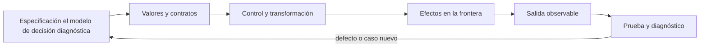
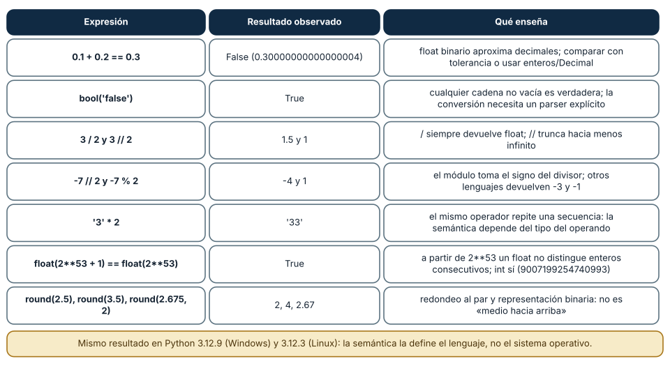
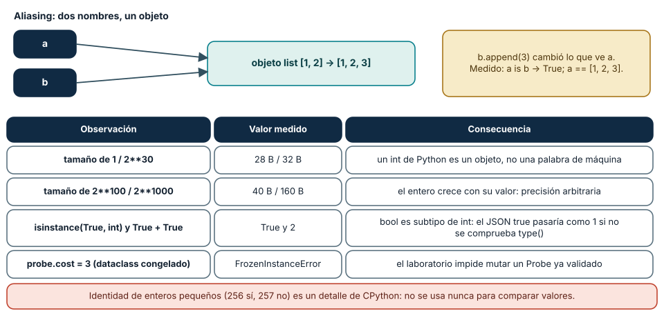
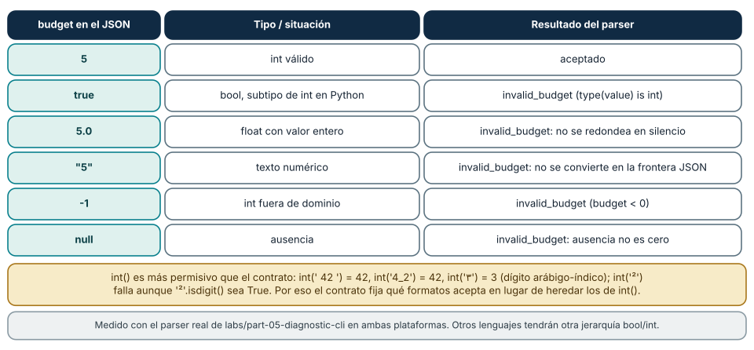

# SE-061 — Valores, expresiones, tipos y variables

[← SE-060 — Proyecto: especificación y solución contrastable](https://github.com/vladimiracunadev-create/modern-software-engineering-program/blob/main/classes/part-04-pensamiento-computacional-y-resolucion-de-problemas/se-060-proyecto-especificacion-y-solucion-contrastable/README.md) · [↑ Parte 05](https://github.com/vladimiracunadev-create/modern-software-engineering-program/blob/main/classes/part-05-fundamentos-de-programacion/README.md) · [📚 Índice completo](https://github.com/vladimiracunadev-create/modern-software-engineering-program/blob/main/classes/README.md) · [🌐 Portal](https://vladimiracunadev-create.github.io/modern-software-engineering-program/classes/SE-061.html) · [SE-062 — Control de flujo y decisiones →](https://github.com/vladimiracunadev-create/modern-software-engineering-program/blob/main/classes/part-05-fundamentos-de-programacion/se-062-control-de-flujo-y-decisiones/README.md)


## Punto profesional y fundamento pedagógico

**Punto profesional.** La clase existe para explicar valores, tipos, expresiones y nombres por su semántica y ciclo de vida.

**Por qué aparece aquí.** Se sitúa después de **Proyecto: especificación y solución contrastable** y antes de **Control de flujo y decisiones**: convierte el conocimiento anterior en una decisión observable que la clase siguiente podrá reutilizar. La continuidad se comprueba en el artefacto, no por compartir vocabulario.

**Error conceptual que debe corregir.** Tratar variable como caja idéntica en todos los lenguajes.

**Secuencia de aprendizaje.** Antes de leer la solución, el estudiante predice el resultado del caso normal y del error conceptual anterior. Luego explica un caso resuelto paso a paso, construye un contraejemplo que cambie la decisión y, sin consultar el texto, reconstruye el mecanismo y lo aplica a una entrada nueva. La secuencia usa predicción, explicación propia, contraste y recuperación. [ICAP](https://icap.education.asu.edu/research) distingue participación de construcción de conocimiento; [How People Learn II](https://nap.nationalacademies.org/catalog/24783/how-people-learn-ii-learners-contexts-and-cultures) exige conectar conocimiento previo, contexto y transferencia; la [práctica de recuperación](https://pubmed.ncbi.nlm.nih.gov/16507066/) respalda producir de nuevo la explicación tras una demora; y [Education for Life and Work](https://nap.nationalacademies.org/resource/13398/dbasse_084153.pdf) exige devolución que explique la causa del error.

**Evidencia de aprendizaje.** Value-trace.md con tipo, identidad, enlace, mutación y liberación. Debe contener predicción previa, observación, explicación causal, contraejemplo, criterio de aceptación y una nota de qué dato haría cambiar la conclusión.

**Límite de la conclusión.** La traza de Python no define la semántica de otros lenguajes.

### Trazabilidad fuente → afirmación

| Fuente primaria u oficial | Afirmación que respalda | Lo que no prueba |
|---|---|---|
| [Python Tutorial](https://docs.python.org/3/tutorial/) | define la semántica y los límites de la API de Python utilizada en el experimento | No demuestra por sí sola que el artefacto del estudiante sea correcto. |
| [Python Language Reference](https://docs.python.org/3/reference/) | define la semántica y los límites de la API de Python utilizada en el experimento | No demuestra por sí sola que el artefacto del estudiante sea correcto. |

## Antes de empezar

Esta clase construye la **CLI diagnóstica**, implementación incremental de la especificación del modelo de decisión diagnóstica. Recupera `SE-060` y convierte una regla ya modelada en comportamiento ejecutable o comprobable. Trabaja en cambios pequeños: predicción, código, ejecución, evidencia y explicación. Ejecutar sin poder explicar el resultado no completa la práctica.

## Prerrequisitos

- Python 3.11 o posterior disponible como `python` o `python3`; registra la versión real.
- Terminal, editor de texto y Git; no se requieren paquetes externos.
- Comprender el contrato del modelo de decisión diagnóstica: entradas, resultados, errores e invariantes.

## Problema auténtico

La especificación del modelo de decisión diagnóstica llega a implementación como la CLI diagnóstica. El primer prototipo mezcla milisegundos con segundos, texto con números y `None` con una medición real. Python ejecuta varias combinaciones, pero ejecución no equivale a significado correcto.

## Objetivos observables

Al terminar podrás explicar el mecanismo del lenguaje, predecir una ejecución, implementar un caso normal y sus fronteras, diagnosticar un fallo controlado, proteger el comportamiento con evidencia y separar lo transferible de lo específico de Python.

## Mapa conceptual



El código no reemplaza la especificación: la materializa bajo reglas concretas del lenguaje y del entorno. La pregunta de esta clase es: **¿Qué valor existe, qué operaciones admite y qué nombre conserva su intención?**

## Temas y por qué importan

| Lente | Pregunta | Evidencia |
|---|---|---|
| valor | ¿qué representa y qué tipo tiene? | ejemplo inspeccionable |
| control | ¿qué camino o repetición ocurre? | traza de estados |
| contrato | ¿qué acepta, retorna y rechaza? | casos frontera |
| efecto | ¿qué cambia fuera del cálculo? | archivo o stream controlado |
| mantenimiento | ¿cómo se detecta una regresión? | prueba y diff enfocado |

## Conceptos y decisiones

### 1. Valores y representación

Un valor es información concreta interpretada según un tipo: `800`, `800.0` y `'800'` no son intercambiables. Enteros de Python tienen precisión arbitraria práctica limitada por memoria; `float` aproxima números binarios y no representa exactamente muchos decimales. Unidades y dominio no vienen incluidos en el tipo incorporado.

### 2. Expresiones y evaluación

Una expresión combina literales, nombres, operadores y llamadas para producir un valor. Precedencia decide agrupación, pero paréntesis comunican intención. Operadores pueden tener semántica distinta por tipo: `+` suma números y concatena secuencias. Se evita depender de coerciones imaginadas.

### 3. Tipos y operaciones válidas

El tipo determina representación y protocolo de operaciones. `bool` modela dos valores, pero no sirve para distinguir desconocido de falso. `None` expresa ausencia, no cero ni cadena vacía. El tipado dinámico comprueba muchas operaciones al ejecutar; anotaciones ayudan a herramientas, pero no validan datos externas por sí solas.

### 4. Nombres, enlace y mutabilidad

Una asignación enlaza un nombre a un objeto; no copia necesariamente el objeto. Reasignar un entero cambia el enlace; modificar una lista compartida cambia el objeto visto por todos sus alias. Llamar `timeout_seconds` al nombre hace visible una unidad que `t` oculta.

### 5. Conversión y validación

`int(texto)` convierte si el formato es válido y puede fallar; no debe dispersarse por la lógica. Primero se valida el dato en la frontera, después el núcleo trabaja con valores ya interpretados. Convertir `bool('false')` produce `True` porque la cadena no está vacía: un contraejemplo clásico de conversión semánticamente incorrecta.

### Qué decide el tipo: expresiones ejecutadas

Un valor no lleva su significado escrito: lo decide el tipo del operando y la regla del lenguaje. Se ejecutaron siete expresiones en Python 3.12.9 (Windows 11) y 3.12.3 (Ubuntu 24.04 bajo WSL2) y dieron resultados idénticos. `0.1 + 0.2 == 0.3` es `False` porque un `float` guarda la fracción binaria más cercana, y 0.1 y 0.2 no son exactas en base 2; la suma da `0.30000000000000004`. `bool('false')` es `True` porque `bool` solo pregunta si la cadena está vacía, no qué dice. `3 / 2` devuelve siempre `float` (1.5) y `3 // 2` trunca hacia menos infinito (1); por eso `-7 // 2` vale -4 y `-7 % 2` vale 1, mientras que en C o en Rust el mismo par daría -3 y -1. Con enteros grandes ocurre lo contrario: `int` tiene precisión arbitraria (`2**53 + 1` es 9007199254740993) pero `float(2**53 + 1) == float(2**53)` es `True`, de modo que convertir a `float` pierde exactamente lo que el entero conservaba.

La consecuencia práctica es que cada valor del programa necesita una decisión explícita de representación. Un tiempo en milisegundos puede ser `int` si se mide en pasos discretos, `float` si viene de un reloj y se compara con tolerancia, o `Decimal` si hay dinero; mezclarlos sin decidir produce la clase de defecto que esta clase quiere hacer visible. El redondeo también engaña: `round(2.5)` da 2 y `round(3.5)` da 4 (redondeo al par), y `round(2.675, 2)` da 2.67 porque el 2.675 almacenado es en realidad 2.67499999999999982236431605997495353221893310546875.



**Cómo leer la figura.** Cada fila es una expresión que alguien podría escribir en la CLI diagnóstica; la columna central es lo que Python devolvió y la derecha, la regla que lo explica. Léela de izquierda a derecha y cubre la columna central para predecir antes de mirar. **Dónde deja de valer:** vale para CPython 3.12 con floats IEEE 754 de doble precisión. La división entera con signo y el redondeo son decisiones de cada lenguaje (Rust y C truncan, JavaScript no tiene enteros), y otra implementación de Python podría variar detalles como la identidad de objetos, no estos resultados.

### Nombres, objetos e identidad

En Python una variable no es una caja con un valor dentro: es un nombre enlazado a un objeto. La asignación `b = a` no copia, enlaza el segundo nombre al mismo objeto. Con `a = [1, 2]; b = a; b.append(3)`, el nombre `a` pasa a ver `[1, 2, 3]` y `a is b` es `True`, porque solo existe un objeto con dos nombres. Con enteros el efecto es invisible porque son inmutables: `x += 1` crea otro objeto y reenlaza `x`, sin tocar a quien compartía el anterior.

Esto cambia lo que significa «copiar» y qué puede salir mal en un núcleo de dominio. El laboratorio resuelve el problema con `dataclass(frozen=True)`: intentar `probe.cost = 3` lanza `FrozenInstanceError`, y las colecciones del estado son `tuple` y `frozenset`, que no admiten mutación. Medimos además que un entero pequeño ocupa 28 bytes (32 con `2**30`, 40 con `2**100`, 160 con `2**1000`): un `int` de Python es un objeto que crece con su valor, no una palabra de máquina. Y `isinstance(True, int)` es `True`, `True + True` es 2 y `type(True) is int` es `False`: `bool` es subtipo de `int`, el origen de la trampa que el parser del laboratorio evita con `type(value) is int`.

La identidad (`is`) responde otra pregunta que la igualdad (`==`): «¿es el mismo objeto?». Con enteros pequeños los resultados dependen de la implementación: `int('256') is int('256')` fue `True` y con 257 fue `False`. No se usa nunca `is` para comparar valores; solo para `None` y para centinelas.



**Cómo leer la figura.** El esquema superior muestra dos flechas que llegan al mismo objeto; el cambio hecho por b es visible por a. La tabla inferior reúne lo medido sobre tamaños y tipos. **Dónde deja de valer:** la imagen de «nombres que apuntan a objetos» describe el modelo de datos de Python. En Rust, un valor tiene un único dueño; en C++, una variable puede ser el objeto mismo. Los tamaños (28 B para un entero) son de CPython de 64 bits.

### La frontera: del texto externo al valor del dominio

El laboratorio separa dos preguntas: qué dice el JSON y qué valor admite el dominio. Se probó el campo `budget` con seis entradas: `5` se acepta; `true`, `5.0`, `"5"`, `-1` y `null` se rechazan con el mismo código `invalid_budget`. El caso `true` es el instructivo: Python lo convertiría a 1 sin avisar, pero `true` en un documento significa «sí», no «presupuesto de 1». `5.0` tiene valor entero pero tipo distinto, y aceptarlo en silencio convertiría el contrato en «lo que `int()` tolere».

Lo que tolera `int()` es mucho: `int(' 42 ')` da 42, `int('4_2')` da 42 y `int('٣')` (dígito arábigo-índico) da 3, mientras que `int('²')` falla aunque `'²'.isdigit()` sea `True` y `'²'.isdecimal()` sea `False`. Esa generosidad es útil en una consola y peligrosa en una frontera: dos sistemas que usan `int()` aceptan conjuntos de textos distintos. El contrato de entrada se escribe una vez, en el parser, y todo lo que está detrás trabaja con valores ya interpretados. La regla general es validar tipo y rango en el borde, convertir una vez y no repetir la conversión en el núcleo.

Un último matiz: ausencia y cero son valores distintos. `None` no es 0; un presupuesto desconocido y un presupuesto agotado exigen respuestas diferentes, y por eso el parser lo rechaza en lugar de interpretarlo.



**Cómo leer la figura.** La primera columna es el texto JSON, la segunda su tipo y la tercera la decisión del parser. Solo la primera fila entra al dominio; las demás se detienen en la frontera con el mismo código de error. **Dónde deja de valer:** el contrato del laboratorio es un acuerdo educativo, no el estándar de JSON. Otro servicio podría aceptar `5.0` como 5 legítimamente si lo documenta; lo que no vale es no haberlo decidido.

## Definiciones de trabajo

- **valor:** dato concreto manipulable por el programa.
- **tipo:** conjunto de valores y operaciones asociadas.
- **expresión:** combinación evaluable que produce un valor.
- **enlace:** asociación entre un nombre y un objeto.
- **mutabilidad:** capacidad de cambiar un objeto conservando identidad.

Estas definiciones describen el uso concreto en la CLI diagnóstica. Cuando Python permita varias conductas, el contrato del programa elige una y la hace visible con validación y pruebas.

## Ejemplo mínimo

```python
timeout_ms = 800
elapsed_ms = 615.4
phase = "tls"
within_budget = elapsed_ms <= timeout_ms

print({"phase": phase, "elapsed_ms": elapsed_ms, "ok": within_budget})
```

Evalúa `0.1 + 0.2`, `bool('false')`, `3 / 2`, `3 // 2` y `'3' * 2`. Antes de ejecutar predice valor y tipo; después explica qué interpretación sería peligrosa en la CLI diagnóstica.

Ejecuta el fragmento en un archivo, no solo en una conversación interactiva. Conserva comando, versión, salida y explicación de cada línea relevante.

## Ejemplo profesional

La CLI diagnóstica mantiene `duration_ms` como número no negativo y `outcome` como texto de un conjunto validado. La entrada textual se convierte una sola vez. El informe conserva la unidad en el nombre y en JSON para impedir que una persona trate 800 ms como 800 s.

El criterio profesional es que el comportamiento pueda ser consumido, diagnosticado y cambiado sin depender de conocimiento oral ni de estado oculto.

## Práctica guiada

1. crea valores válidos y límite para una observación.
2. predice cinco expresiones y comprueba con `type`.
3. demuestra aliasing con dos nombres para una lista.
4. centraliza una conversión de texto a milisegundos.
5. rechaza negativo, vacío y formato no numérico.
6. ejecuta `python -m unittest -v` cuando existan pruebas y registra el resultado exacto.

## Ejercicios

1. **Predicción:** antes de ejecutar, escribe valor y tipo de `7 // -2`, `7 % -2`, `True + True`, `'a' * 3` y `round(0.5)`; ejecuta y explica cada discrepancia.
2. **Frontera:** añade al parser una regla para `cost` y pruébala con `1`, `0`, `1.5`, `true` y `"1"`; escribe una prueba por cada rechazo con su código.
3. **Aliasing:** construye un `State` con una lista en lugar de una tupla y muestra cómo una función que «solo lee» modifica el estado original; vuelve a la tupla y explica qué garantía recuperaste.
4. **Transferencia:** describe en pseudocódigo cómo representarías `budget` en un lenguaje sin `bool` subtipo de entero y qué prueba mantienes idéntica.

## Reto verificable

Entrega un cambio que incluya comportamiento, caso normal, caso límite, fallo controlado y explicación. Otra persona debe poder ejecutar los comandos desde un checkout limpio y relacionar cada salida con una regla del modelo de decisión diagnóstica.

## Demostración guiada

1. Escribe la entrada y la salida esperada antes del código.
2. Ejecuta el caso mínimo y observa valores intermedios sin dejar prints permanentes en el núcleo.
3. Añade el caso frontera que obligue a decidir, no solo a teclear.
4. Introduce el fallo descrito abajo y confirma que la evidencia lo detecta.
5. Corrige, ejecuta toda la suite y revisa el diff por efectos no deseados.

## Preguntas frecuentes

### ¿`float` o `Decimal` para tiempos?

Un tiempo medido por un reloj es `float` y se compara con tolerancia; un tiempo contado en pasos o un presupuesto discreto es `int`; el dinero va en enteros de la unidad menor o en `Decimal`. Elegir por la naturaleza del dato, no por comodidad.

### ¿Por qué `is` a veces da `True` con números?

Porque CPython reutiliza objetos enteros pequeños (medimos que 256 sí y 257 no). Es un detalle de implementación: comparar valores se hace con `==`, e `is` queda para `None`.

### ¿Las anotaciones de tipo evitan el caso `true`?

No. Una anotación `budget: int` no impide que llegue `True` desde un JSON, porque `bool` es un `int` válido. La comprobación en ejecución (`type(value) is int`) es lo que protege.

### ¿Es lo mismo `None` que 0 o cadena vacía?

No. `None` indica ausencia; 0 es un valor. Comparar con `is None` evita que `if x:` mezcle ausencia con cero.

## Fallo controlado y diagnóstico

Prueba el parser con `budget: true`. Predice el resultado antes de ejecutarlo, ejecútalo con `python -m diagnostic_cli` y observa `invalid_budget` y el código de salida 3. Después sustituye en una copia `type(value) is int` por `isinstance(value, int)` y repite: el JSON `true` pasa como presupuesto 1 y el informe sale con un estado que parece válido. La prueba `test_parse_rejects_boolean_budget_without_silent_integer_coercion` falla en la copia modificada; es el único guardián de esa regla. Registra la causa (`bool` es subtipo de `int`), la regla que debe permanecer (tipo exacto) y la prueba de regresión.

## Errores comunes y cómo corregirlos

| Síntoma | Causa | Corrección |
|---|---|---|
| `0.1 + 0.2 == 0.3` es `False` | los floats guardan aproximaciones binarias | comparar con tolerancia (`math.isclose`) o trabajar con enteros/`Decimal` |
| `--enabled false` queda activado | `bool('false')` es `True` (cadena no vacía) | parser explícito que acepte solo valores documentados |
| un cambio en una lista aparece «en otra variable» | dos nombres para el mismo objeto | copiar (`list(a)`) o usar tuplas inmutables |
| un presupuesto `true` pasa como 1 | `bool` es subtipo de `int` | `type(value) is int` y prueba que lo cubra |
| `int('²')` falla pero `'²'.isdigit()` es `True` | `isdigit` y `isdecimal` no coinciden con lo que `int` acepta | no usar `isdigit` como validador; intentar la conversión y manejar `ValueError` |

## Entorno y archivos clave

```text
work/SE-061/
├── diagnostic_cli/
│   ├── __init__.py
│   ├── domain.py
│   ├── cli.py
│   └── __main__.py
├── tests/
│   └── test_diagnostic_cli.py
└── README.md
```

No instales dependencias para resolver lo que cubre la biblioteca estándar. `README.md` conserva versión, comandos, entradas, salida, limpieza y límites. Los fragmentos son pedagógicos; intégralos solo después de entender su contrato.

### Laboratorio integrado de la Parte 05

Trabaja sobre [`labs/part-05-diagnostic-cli`](https://github.com/vladimiracunadev-create/modern-software-engineering-program/tree/main/labs/part-05-diagnostic-cli). Traza `budget`, `authorized`, `Outcome` y `candidates` desde los bytes JSON hasta los objetos inmutables de `domain.py`. Después cambia `budget` por `true` y explica por qué aceptar esa entrada sería una coerción semánticamente incorrecta aunque `isinstance(True, int)` sea verdadero en Python. La evidencia aprobatoria es la predicción previa, el error `invalid_budget` observado y una regla que distinga representación externa, tipo del lenguaje y valor del dominio.

## Seguridad, ética y accesibilidad

- usa fixtures sintéticos y no incluyas tokens, rutas personales ni incidentes reales;
- limita tamaño, profundidad y tiempo de entradas no confiables;
- separa stdout parseable de stderr y redacta datos sensibles;
- ofrece mensajes accionables y no dependas solo de color;
- preserva autorización como regla del núcleo, no como checkbox de UI;
- no uses `eval`, `exec` ni construcción de shell con entrada externa.

## Puente hacia el trabajo con agentes

Un agente que llama herramientas recibe argumentos como JSON generado por un modelo. Todo lo medido aquí reaparece: el modelo puede emitir `"5"` donde se esperaba `5`, o `true` donde se esperaba un entero, y un servidor que acepte la coerción ejecutará una acción con un valor que nadie decidió. La defensa es la misma que en el laboratorio: un esquema estricto en la frontera de la herramienta, rechazo con un código estable (que el agente pueda leer y corregir) y ninguna conversión implícita en el núcleo. Un esquema JSON describe estructura, pero la regla «un `bool` no es un presupuesto» sigue necesitando una prueba que la fije. Las partes de herramientas y de seguridad agentic retoman este límite.

## Transferencia

Reimplementa el contrato, no la sintaxis. Identifica cómo el segundo lenguaje representa ausencia, error, mutabilidad y módulos. Conserva fixtures y resultados públicos para detectar una diferencia semántica.

## Evaluación y evidencia

| Criterio | Evidencia para aprobar |
|---|---|
| comprensión | predicción y explicación de ejecución |
| comportamiento | normal, límite e inválido según contrato |
| diseño | cálculo separado de efectos y dependencias visibles |
| diagnóstico | fallo mínimo, causa y regresión |
| reproducibilidad | versión, comandos y salidas desde checkout limpio |


## Fuentes


- [Python Tutorial](https://docs.python.org/3/tutorial/) — define la semántica y los límites de la API de Python utilizada en el experimento.
- [Python Language Reference](https://docs.python.org/3/reference/) — define la semántica y los límites de la API de Python utilizada en el experimento.
- [Python Data Model](https://docs.python.org/3/reference/datamodel.html): identidad, tipo y valor de un objeto, y objetos mutables e inmutables.
- [Floating-Point Arithmetic: Issues and Limitations](https://docs.python.org/3/tutorial/floatingpoint.html): por qué 0.1 + 0.2 no es 0.3 y cómo se representan los floats.
- [Built-in Types: Numeric Types](https://docs.python.org/3/library/stdtypes.html): operaciones numéricas, división entera y verdad de los valores.
- [decimal — Decimal fixed-point and floating-point arithmetic](https://docs.python.org/3/library/decimal.html): alternativa exacta para magnitudes decimales.
- [dataclasses — Data Classes](https://docs.python.org/3/library/dataclasses.html): `frozen=True` y la excepción `FrozenInstanceError`.

La documentación oficial define el lenguaje y la biblioteca; no demuestra que la CLI diagnóstica cumpla su dominio. Esa evidencia vive en contratos, pruebas y ejecución reproducible.

## Límites y siguiente paso

Los tipos incorporados no expresan todas las reglas del dominio ni eliminan precisión finita. La siguiente clase usa condiciones para elegir comportamiento sin perder casos.

**Lo que no se midió.** No se midió el comportamiento en macOS ni en otras implementaciones de Python (PyPy, MicroPython); los resultados de `float`, tamaños y redondeo son de CPython 3.12 con IEEE 754 de doble precisión.

## Glosario

- **valor:** dato concreto manipulable por el programa.
- **tipo:** conjunto de valores y operaciones asociadas.
- **expresión:** combinación evaluable que produce un valor.
- **enlace:** asociación entre un nombre y un objeto.
- **mutabilidad:** capacidad de cambiar un objeto conservando identidad.

---

[← SE-060 — Proyecto: especificación y solución contrastable](https://github.com/vladimiracunadev-create/modern-software-engineering-program/blob/main/classes/part-04-pensamiento-computacional-y-resolucion-de-problemas/se-060-proyecto-especificacion-y-solucion-contrastable/README.md) · [↑ Parte 05](https://github.com/vladimiracunadev-create/modern-software-engineering-program/blob/main/classes/part-05-fundamentos-de-programacion/README.md) · [📚 Índice completo](https://github.com/vladimiracunadev-create/modern-software-engineering-program/blob/main/classes/README.md) · [🌐 Portal](https://vladimiracunadev-create.github.io/modern-software-engineering-program/classes/SE-061.html) · [SE-062 — Control de flujo y decisiones →](https://github.com/vladimiracunadev-create/modern-software-engineering-program/blob/main/classes/part-05-fundamentos-de-programacion/se-062-control-de-flujo-y-decisiones/README.md)
