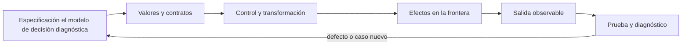
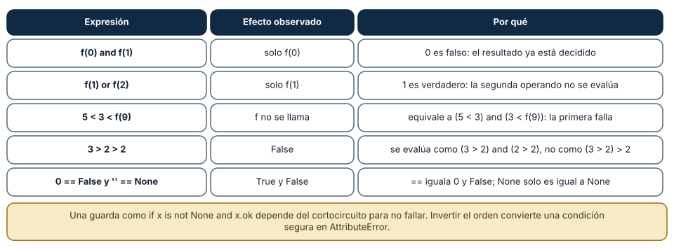
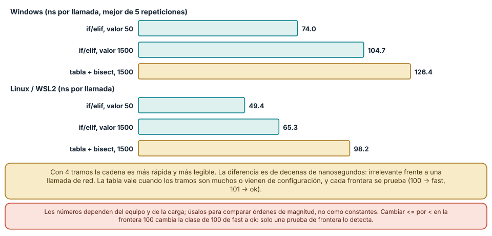

# SE-062 — Control de flujo y decisiones

[← SE-061 — Valores, expresiones, tipos y variables](https://github.com/vladimiracunadev-create/modern-software-engineering-program/blob/main/classes/part-05-fundamentos-de-programacion/se-061-valores-expresiones-tipos-y-variables/README.md) · [↑ Parte 05](https://github.com/vladimiracunadev-create/modern-software-engineering-program/blob/main/classes/part-05-fundamentos-de-programacion/README.md) · [📚 Índice completo](https://github.com/vladimiracunadev-create/modern-software-engineering-program/blob/main/classes/README.md) · [🌐 Portal](https://vladimiracunadev-create.github.io/modern-software-engineering-program/classes/SE-062.html) · [SE-063 — Iteración, recursión y recorridos →](https://github.com/vladimiracunadev-create/modern-software-engineering-program/blob/main/classes/part-05-fundamentos-de-programacion/se-063-iteracion-recursion-y-recorridos/README.md)


## Punto profesional y fundamento pedagógico

**Punto profesional.** La clase existe para diseñar control de flujo desde decisiones del dominio y caminos verificables.

**Por qué aparece aquí.** Se sitúa después de **Valores, expresiones, tipos y variables** y antes de **Iteración, recursión y recorridos**: convierte el conocimiento anterior en una decisión observable que la clase siguiente podrá reutilizar. La continuidad se comprueba en el artefacto, no por compartir vocabulario.

**Error conceptual que debe corregir.** Anidar condicionales hasta que las reglas quedan implícitas.

**Secuencia de aprendizaje.** Antes de leer la solución, el estudiante predice el resultado del caso normal y del error conceptual anterior. Luego explica un caso resuelto paso a paso, construye un contraejemplo que cambie la decisión y, sin consultar el texto, reconstruye el mecanismo y lo aplica a una entrada nueva. La secuencia usa predicción, explicación propia, contraste y recuperación. [ICAP](https://icap.education.asu.edu/research) distingue participación de construcción de conocimiento; [How People Learn II](https://nap.nationalacademies.org/catalog/24783/how-people-learn-ii-learners-contexts-and-cultures) exige conectar conocimiento previo, contexto y transferencia; la [práctica de recuperación](https://pubmed.ncbi.nlm.nih.gov/16507066/) respalda producir de nuevo la explicación tras una demora; y [Education for Life and Work](https://nap.nationalacademies.org/resource/13398/dbasse_084153.pdf) exige devolución que explique la causa del error.

**Evidencia de aprendizaje.** Decision-table.md enlazada a caminos, casos límite y ramas inalcanzables. Debe contener predicción previa, observación, explicación causal, contraejemplo, criterio de aceptación y una nota de qué dato haría cambiar la conclusión.

**Límite de la conclusión.** Cubrir ramas no equivale a cubrir combinaciones semánticas.

### Trazabilidad fuente → afirmación

| Fuente primaria u oficial | Afirmación que respalda | Lo que no prueba |
|---|---|---|
| [Python Tutorial](https://docs.python.org/3/tutorial/) | define la semántica y los límites de la API de Python utilizada en el experimento | No demuestra por sí sola que el artefacto del estudiante sea correcto. |
| [Python Language Reference](https://docs.python.org/3/reference/) | define la semántica y los límites de la API de Python utilizada en el experimento | No demuestra por sí sola que el artefacto del estudiante sea correcto. |

## Antes de empezar

Esta clase construye la **CLI diagnóstica**, implementación incremental de la especificación del modelo de decisión diagnóstica. Recupera `SE-061` y convierte una regla ya modelada en comportamiento ejecutable o comprobable. Trabaja en cambios pequeños: predicción, código, ejecución, evidencia y explicación. Ejecutar sin poder explicar el resultado no completa la práctica.

## Prerrequisitos

- Python 3.11 o posterior disponible como `python` o `python3`; registra la versión real.
- Terminal, editor de texto y Git; no se requieren paquetes externos.
- Comprender el contrato del modelo de decisión diagnóstica: entradas, resultados, errores e invariantes.

## Problema auténtico

La CLI diagnóstica clasifica resultados como sanos, lentos o fallidos. Un `if/elif` mal ordenado hace inalcanzable una rama y un `else` genérico convierte datos inválidos en fallos de red. Se debe diseñar la tabla de decisión antes del código.

## Objetivos observables

Al terminar podrás explicar el mecanismo del lenguaje, predecir una ejecución, implementar un caso normal y sus fronteras, diagnosticar un fallo controlado, proteger el comportamiento con evidencia y separar lo transferible de lo específico de Python.

## Mapa conceptual



El código no reemplaza la especificación: la materializa bajo reglas concretas del lenguaje y del entorno. La pregunta de esta clase es: **¿La decisión cubre todas las particiones y hace visible el caso no contemplado?**

## Temas y por qué importan

| Lente | Pregunta | Evidencia |
|---|---|---|
| valor | ¿qué representa y qué tipo tiene? | ejemplo inspeccionable |
| control | ¿qué camino o repetición ocurre? | traza de estados |
| contrato | ¿qué acepta, retorna y rechaza? | casos frontera |
| efecto | ¿qué cambia fuera del cálculo? | archivo o stream controlado |
| mantenimiento | ¿cómo se detecta una regresión? | prueba y diff enfocado |

## Conceptos y decisiones

### 1. Condición y verdad

`if` evalúa truthiness, que considera falsos `0`, `None` y colecciones vacías. Esa conveniencia puede mezclar ausencia, cero válido y lista sin elementos. En reglas de dominio se prefieren comparaciones explícitas para que el lector sepa qué caso se trata.

### 2. Particiones mutuamente excluyentes

Una cadena `if/elif/else` selecciona la primera condición verdadera. Las condiciones se diseñan como particiones completas sin solapamiento o con prioridad documentada. Ordenar `duration > 500` antes de `duration > 1000` vuelve inalcanzable el caso crítico.

### 3. Guard clauses

Una guarda rechaza temprano entrada inválida o estado incompatible y deja el camino principal menos anidado. Debe devolver o elevar un resultado claro. Muchas guardas desconectadas pueden dispersar reglas; se agrupan en la frontera correspondiente.

### 4. Cortocircuito

`and` deja de evaluar al encontrar falso y `or` al encontrar verdadero; además devuelven operandos, no siempre `bool`. El cortocircuito permite comprobar `value is not None and value >= 0`, pero no debe esconder una llamada con efectos en la segunda condición.

### 5. Tabla antes que ramas

Una tabla cruza estado, presupuesto y autorización para revelar combinaciones. Cada fila se convierte en caso. Si una combinación no es válida, se rechaza explícitamente; `else` no debe actuar como basurero semántico.

### Qué es verdadero: la tabla medida

Una condición `if x:` no pregunta «¿x es cierto?»; pregunta «¿bool(x) es `True`?», y esa conversión depende del tipo. Se midieron trece valores: son falsos `0`, `0.0`, `''`, `[]`, `{}`, `()`, `set()` y `None`; son verdaderos `' '`, `[0]`, `'false'`, `'0'` y `float('nan')`. El criterio es «vacío o cero» frente a «algo contiene», sin interpretar el contenido: la cadena `'0'` es verdadera porque tiene un carácter.

El problema aparece cuando una regla del dominio distingue lo que la verdad de Python mezcla. Si `budget = 0` significa «presupuesto agotado» y `budget = None` significa «no informado», `if budget:` trata ambos igual y la CLI respondería lo mismo ante dos situaciones distintas. La condición correcta nombra la pregunta: `budget is None` para ausencia y `budget == 0` para agotado. Los operadores lógicos agravan el efecto porque devuelven un operando, no un booleano: `None or 5` es 5, `0 or ''` es `''`, `[] and 3` es `[]`. Usar `x or valor_por_defecto` es cómodo hasta que 0 es un dato válido y se reemplaza por el valor por defecto sin aviso.

Una buena heurística es escribir la condición como una frase del dominio. «Hay observaciones» se escribe `len(observations) > 0` o, con una colección, `if observations:` solo si «vacío» es exactamente lo que se quiere decir.

![Figura 1. Dos filas de una tabla: los valores falsos de Python (0, cadena vacía, colecciones vacías, None) y los verdaderos (espacio, [0], 'false', '0', nan)](../../../content/part-05/figures/se-062-valores-verdaderos-y-falsos.svg)

**Cómo leer la figura.** Cada fila agrupa valores con el mismo resultado de `bool()`. La primera es la ausencia de contenido; la segunda, valores con contenido aunque «parezcan» falsos. Los recuadros inferiores dan la consecuencia para una condición del laboratorio. **Dónde deja de valer:** la tabla es de Python 3.12. JavaScript considera verdadero `[]` y falso `NaN`; Go no permite `if` sobre enteros. Un tipo propio puede definir `__bool__` y cambiar la respuesta: no asumas la tabla para clases ajenas.

### Cortocircuito y comparaciones encadenadas

`and` y `or` evalúan de izquierda a derecha y se detienen en cuanto el resultado está decidido. Se instrumentó una función que registra sus llamadas: `f(0) and f(1)` evaluó solo `f(0)` y `f(1) or f(2)` evaluó solo `f(1)`. Esta propiedad se usa a propósito en guardas como `x is not None and x.ok`; al invertir el orden, la misma condición lanza `AttributeError` cuando `x` es `None`. La corrección de la condición depende del orden, y por eso una guarda correcta se prueba con el caso `None`.

Python permite encadenar comparaciones: `1 < 2 < 3` equivale a `(1 < 2) and (2 < 3)`, con cada operando evaluado una vez, y `3 > 2 > 2` es `False`. Se midió además que `5 < 3 < f(9)` no llega a llamar a `f`. El encadenamiento es legible para rangos (`0 <= x < limite`), pero cambia la lectura de quien espera `(3 > 2) > 2`. Por último, `0 == False` es `True` y `'' == None` es `False`: `==` iguala numéricamente 0 y `False`, pero `None` solo es igual a `None`; para ausencia se usa `is None`.

La regla de diseño es colocar primero la condición barata o la que protege la segunda, y no poner efectos secundarios en una expresión que pueda no evaluarse. Un `and` que contiene una llamada con efecto es una rama escondida.



**Cómo leer la figura.** La columna central registra qué llamadas ocurrieron realmente. Si una función con efecto no aparece, esa parte de la expresión no se ejecutó. **Dónde deja de valer:** el cortocircuito es semántica garantizada de `and`/`or` en Python, pero no de operadores como `&` ni de funciones como `all()` con listas ya construidas. Un lenguaje con evaluación estricta de booleanos cambiaría el resultado de una guarda.

### Cadena de condiciones o tabla de umbrales

Clasificar la latencia en `fast` (≤ 100), `ok` (≤ 500), `slow` (≤ 1000) y `timeout` se puede escribir como una cadena de `if/elif` o como una tabla de límites con `bisect`. Se implementaron ambas y se compararon sobre 1000 muestras con valores frontera (-1, 0, 99, 100, 101, 499, 500, 501, 999, 1000, 1001, 5000): coincidieron en todas. El costo por llamada fue de 74.0 ns para 50 ms y 104.7 ns para 1500 ms con la cadena, y 126.4 ns con la tabla en Windows (49.4, 65.3 y 98.2 ns en Linux). Para cuatro tramos la cadena es más corta, más rápida y más fácil de leer; la tabla se justifica cuando hay muchos tramos o los umbrales vienen de configuración.

Lo importante no es el costo, sino dónde se equivoca una persona: en la frontera. Con la cadena, cambiar `<=` por `<` en el primer tramo hace que 100 pase de `fast` a `ok`, y ningún caso «típico» lo nota. Una buena prueba usa pares de valores a ambos lados de cada frontera (100 y 101, 500 y 501) y verifica la clase de cada uno. Las condiciones deben ser mutuamente excluyentes y exhaustivas: el último `else` captura lo que ninguna rama nombró, y `negativo` se rechaza antes con una guarda para que `-1` no se clasifique como `fast`.

`match` aporta otra forma: con patrones de diccionario, secuencia y clase se observó que `{"status": "ok"}` entra en el primer caso, `{"status": "x"}` en el segundo, `[1, 2]` como secuencia y `True` como número (otra vez `bool` es `int`). El orden de los `case` importa tanto como el de los `elif`.



**Cómo leer la figura.** Cada barra es el mejor de cinco bloques de 200 000 llamadas, en nanosegundos. Compara las barras verdes (cadena) con la dorada (tabla) dentro de cada plataforma, no entre plataformas. **Dónde deja de valer:** son nanosegundos de un equipo concreto y una sola función; no sirven como presupuesto. Con 4 tramos no se justifica optimizar; con cientos, una tabla ordenada cambiaría la complejidad de lineal a logarítmica.

## Definiciones de trabajo

- **condición:** expresión interpretada para elegir control.
- **truthiness:** regla que convierte valores a contexto booleano.
- **partición:** subdominio tratado por una rama.
- **guarda:** comprobación temprana que protege el camino principal.
- **cortocircuito:** evaluación que omite operandos innecesarios.

Estas definiciones describen el uso concreto en la CLI diagnóstica. Cuando Python permita varias conductas, el contrato del programa elige una y la hace visible con validación y pruebas.

## Ejemplo mínimo

```python
duration_ms = 1_250
outcome = "ok"

if duration_ms < 0:
    label = "invalid"
elif outcome != "ok":
    label = "failed"
elif duration_ms > 1_000:
    label = "critical"
elif duration_ms > 500:
    label = "slow"
else:
    label = "healthy
```

Construye la tabla para `outcome ∈ {ok,error}` y `duration ∈ {negativa,0..500,501..1000,>1000}`. Traduce la tabla a ramas y demuestra que cada fila alcanza exactamente un resultado.

Ejecuta el fragmento en un archivo, no solo en una conversación interactiva. Conserva comando, versión, salida y explicación de cada línea relevante.

## Ejemplo profesional

La CLI diagnóstica separa validación de clasificación. Una duración inválida genera `INPUT_INVALID`; un fallo de protocolo conserva su categoría; solo resultados `ok` se comparan con presupuesto. Así las métricas no cuentan errores de datos como degradación real.

El criterio profesional es que el comportamiento pueda ser consumido, diagnosticado y cambiado sin depender de conocimiento oral ni de estado oculto.

## Práctica guiada

1. enumera dimensiones de la decisión.
2. crea tabla completa.
3. ordena ramas de específica a general.
4. añade guardas para entrada inválida.
5. prueba fronteras exactas 500 y 1000.
6. ejecuta `python -m unittest -v` cuando existan pruebas y registra el resultado exacto.

## Ejercicios

1. **Tabla de verdad:** sin ejecutar, predice `bool` de `[[]]`, `' '`, `-0.0`, `float('inf')` y `{0}`; ejecuta y corrige tu modelo mental.
2. **Frontera:** para los umbrales 100/500/1000 escribe doce muestras que cubran ambos lados de cada frontera y compara la cadena con la tabla `bisect`.
3. **Guardas:** reescribe `if x.ok and x is not None` de forma correcta y escribe la prueba con `None` que muestra el fallo del orden original.
4. **Mutación:** cambia `<=` por `<` en una copia y comprueba qué pruebas de tu suite fallan; si ninguna, añade la que falta.

## Reto verificable

Entrega un cambio que incluya comportamiento, caso normal, caso límite, fallo controlado y explicación. Otra persona debe poder ejecutar los comandos desde un checkout limpio y relacionar cada salida con una regla del modelo de decisión diagnóstica.

## Demostración guiada

1. Escribe la entrada y la salida esperada antes del código.
2. Ejecuta el caso mínimo y observa valores intermedios sin dejar prints permanentes en el núcleo.
3. Añade el caso frontera que obligue a decidir, no solo a teclear.
4. Introduce el fallo descrito abajo y confirma que la evidencia lo detecta.
5. Corrige, ejecuta toda la suite y revisa el diff por efectos no deseados.

## Preguntas frecuentes

### ¿Por qué no escribir `if x == True`?

Porque compara con `True` por igualdad numérica: `1 == True`. Si `x` es booleano, basta `if x:`; si puede ser otro tipo, la pregunta real es `x is True` o una validación de tipo.

### ¿Cuándo conviene `match` y cuándo `if/elif`?

`match` aporta cuando se decide por la forma de un dato (diccionario con ciertas claves, secuencia, clase). Para comparar rangos numéricos, `if/elif` es más directo.

### ¿Es mala idea `x or default`?

Es correcta si 0, vacío y `None` significan lo mismo «sin valor». Si 0 es un dato válido, usa `default if x is None else x`.

### ¿Cuántas ramas son demasiadas?

No hay un número fijo: cuando la tabla de casos es el dato (umbrales, códigos, estados), cámbiala a una tabla o a un diccionario de despacho y prueba cada fila.

## Fallo controlado y diagnóstico

Reproduce la frontera silenciosa. Toma la función de clasificación y cambia `ms <= 100` por `ms < 100`. Ejecuta tus ejemplos típicos (50, 300, 800, 2000): todos siguen igual. Ejecuta el par 100/101: `100` pasa de `fast` a `ok`. Escribe la prueba de frontera que falla con el cambio, restaura el operador y confirma que pasa. Después prueba `-1`: sin la guarda de negativos queda clasificado como `fast`, que es el defecto que una guarda `ms < 0 → invalid` evita. Registra los dos casos y las dos pruebas.

## Errores comunes y cómo corregirlos

| Síntoma | Causa | Corrección |
|---|---|---|
| clases mal asignadas justo en el límite | `<=` y `<` intercambiados, sin prueba de frontera | probar ambos lados de cada umbral |
| `if budget:` responde igual con 0 y con `None` | verdad de Python mezcla ausencia y cero | comparar con `is None` y con 0 por separado |
| `AttributeError` solo con ciertos datos | guarda en orden inverso, sin cortocircuito protector | poner primero la comprobación `is not None` |
| un valor negativo se clasifica como válido | cadena sin rama de entrada inválida | guarda inicial que rechace el dominio no admitido |
| `match` no entra en el caso esperado | orden de los `case`: uno general oculta al específico | colocar los casos de más a menos específicos y probar cada uno |

## Entorno y archivos clave

```text
work/SE-062/
├── diagnostic_cli/
│   ├── __init__.py
│   ├── domain.py
│   ├── cli.py
│   └── __main__.py
├── tests/
│   └── test_diagnostic_cli.py
└── README.md
```

No instales dependencias para resolver lo que cubre la biblioteca estándar. `README.md` conserva versión, comandos, entradas, salida, limpieza y límites. Los fragmentos son pedagógicos; intégralos solo después de entender su contrato.

### Laboratorio integrado de la Parte 05

Usa [`labs/part-05-diagnostic-cli`](https://github.com/vladimiracunadev-create/modern-software-engineering-program/tree/main/labs/part-05-diagnostic-cli) para reconstruir la tabla de decisión de `apply_observation`: prueba desconocida, no autorizada, repetida, fuera de presupuesto, contradictoria y aceptada. Añade un caso de frontera sin cambiar el resultado esperado para acomodar la implementación. La revisión exige vincular cada guard clause con una regla, demostrar qué rama gana cuando se solapan condiciones y señalar una combinación no cubierta por el simple conteo de ramas.

## Seguridad, ética y accesibilidad

- usa fixtures sintéticos y no incluyas tokens, rutas personales ni incidentes reales;
- limita tamaño, profundidad y tiempo de entradas no confiables;
- separa stdout parseable de stderr y redacta datos sensibles;
- ofrece mensajes accionables y no dependas solo de color;
- preserva autorización como regla del núcleo, no como checkbox de UI;
- no uses `eval`, `exec` ni construcción de shell con entrada externa.

## Puente hacia el trabajo con agentes

Las políticas de un agente (qué herramienta puede usar, cuándo pide confirmación, cuánto puede gastar) son condiciones sobre datos, y heredan todos los riesgos de esta clase: una política escrita como `if allowed:` con `allowed = None` por una configuración ausente se comporta como «denegado» en un lenguaje y como «permitido» en otro. Dos controles se derivan: las decisiones de autorización se escriben con comparaciones explícitas y un caso por defecto que deniega, y cada frontera de la política (un límite de gasto, de pasos, de tamaño) tiene una prueba a ambos lados. Un agente que decide por una condición mal acotada no falla de forma visible, falla de forma plausible.

## Transferencia

Reimplementa el contrato, no la sintaxis. Identifica cómo el segundo lenguaje representa ausencia, error, mutabilidad y módulos. Conserva fixtures y resultados públicos para detectar una diferencia semántica.

## Evaluación y evidencia

| Criterio | Evidencia para aprobar |
|---|---|
| comprensión | predicción y explicación de ejecución |
| comportamiento | normal, límite e inválido según contrato |
| diseño | cálculo separado de efectos y dependencias visibles |
| diagnóstico | fallo mínimo, causa y regresión |
| reproducibilidad | versión, comandos y salidas desde checkout limpio |


## Fuentes


- [Python Tutorial](https://docs.python.org/3/tutorial/) — define la semántica y los límites de la API de Python utilizada en el experimento.
- [Python Language Reference](https://docs.python.org/3/reference/) — define la semántica y los límites de la API de Python utilizada en el experimento.
- [Python Language Reference — Expressions](https://docs.python.org/3/reference/expressions.html): orden de evaluación, cortocircuito y comparaciones encadenadas.
- [Built-in Types — Truth Value Testing](https://docs.python.org/3/library/stdtypes.html#truth-value-testing): qué valores se consideran falsos.
- [Compound statements — match](https://docs.python.org/3/reference/compound_stmts.html): patrones de `match` y su orden de evaluación.
- [Python Tutorial — More Control Flow Tools](https://docs.python.org/3/tutorial/controlflow.html): `if`, `for`, `match` y funciones, con ejemplos oficiales.

La documentación oficial define el lenguaje y la biblioteca; no demuestra que la CLI diagnóstica cumpla su dominio. Esa evidencia vive en contratos, pruebas y ejecución reproducible.

## Límites y siguiente paso

Las ramas secuenciales no modelan bien procesos largos ni estados concurrentes. La siguiente clase repite transformaciones sobre colecciones y estructuras.

**Lo que no se midió.** Los tiempos de la cadena y de la tabla son de una sola función con cuatro tramos en dos equipos; no se compararon tablas de cientos de umbrales ni se midió `match` con patrones complejos.

## Glosario

- **condición:** expresión interpretada para elegir control.
- **truthiness:** regla que convierte valores a contexto booleano.
- **partición:** subdominio tratado por una rama.
- **guarda:** comprobación temprana que protege el camino principal.
- **cortocircuito:** evaluación que omite operandos innecesarios.

---

[← SE-061 — Valores, expresiones, tipos y variables](https://github.com/vladimiracunadev-create/modern-software-engineering-program/blob/main/classes/part-05-fundamentos-de-programacion/se-061-valores-expresiones-tipos-y-variables/README.md) · [↑ Parte 05](https://github.com/vladimiracunadev-create/modern-software-engineering-program/blob/main/classes/part-05-fundamentos-de-programacion/README.md) · [📚 Índice completo](https://github.com/vladimiracunadev-create/modern-software-engineering-program/blob/main/classes/README.md) · [🌐 Portal](https://vladimiracunadev-create.github.io/modern-software-engineering-program/classes/SE-062.html) · [SE-063 — Iteración, recursión y recorridos →](https://github.com/vladimiracunadev-create/modern-software-engineering-program/blob/main/classes/part-05-fundamentos-de-programacion/se-063-iteracion-recursion-y-recorridos/README.md)
