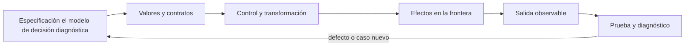
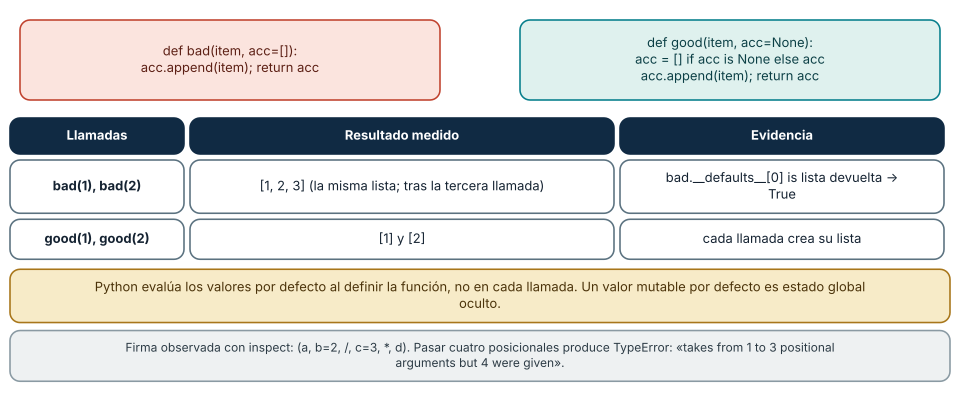
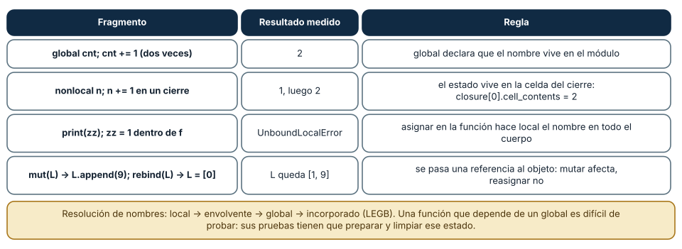
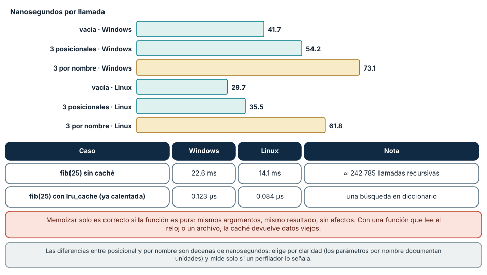

# SE-064 — Funciones, parámetros, retorno y alcance

[← SE-063 — Iteración, recursión y recorridos](https://github.com/vladimiracunadev-create/modern-software-engineering-program/blob/main/classes/part-05-fundamentos-de-programacion/se-063-iteracion-recursion-y-recorridos/README.md) · [↑ Parte 05](https://github.com/vladimiracunadev-create/modern-software-engineering-program/blob/main/classes/part-05-fundamentos-de-programacion/README.md) · [📚 Índice completo](https://github.com/vladimiracunadev-create/modern-software-engineering-program/blob/main/classes/README.md) · [🌐 Portal](https://vladimiracunadev-create.github.io/modern-software-engineering-program/classes/SE-064.html) · [SE-065 — Errores, excepciones y resultados explícitos →](https://github.com/vladimiracunadev-create/modern-software-engineering-program/blob/main/classes/part-05-fundamentos-de-programacion/se-065-errores-excepciones-y-resultados-explicitos/README.md)


## Punto profesional y fundamento pedagógico

**Punto profesional.** La clase existe para usar funciones como contratos con parámetros, retorno, efectos y alcance localizables.

**Por qué aparece aquí.** Se sitúa después de **Iteración, recursión y recorridos** y antes de **Errores, excepciones y resultados explícitos**: convierte el conocimiento anterior en una decisión observable que la clase siguiente podrá reutilizar. La continuidad se comprueba en el artefacto, no por compartir vocabulario.

**Error conceptual que debe corregir.** Confundir paso de argumentos con copia universal o depender de variables globales ocultas.

**Secuencia de aprendizaje.** Antes de leer la solución, el estudiante predice el resultado del caso normal y del error conceptual anterior. Luego explica un caso resuelto paso a paso, construye un contraejemplo que cambie la decisión y, sin consultar el texto, reconstruye el mecanismo y lo aplica a una entrada nueva. La secuencia usa predicción, explicación propia, contraste y recuperación. [ICAP](https://icap.education.asu.edu/research) distingue participación de construcción de conocimiento; [How People Learn II](https://nap.nationalacademies.org/catalog/24783/how-people-learn-ii-learners-contexts-and-cultures) exige conectar conocimiento previo, contexto y transferencia; la [práctica de recuperación](https://pubmed.ncbi.nlm.nih.gov/16507066/) respalda producir de nuevo la explicación tras una demora; y [Education for Life and Work](https://nap.nationalacademies.org/resource/13398/dbasse_084153.pdf) exige devolución que explique la causa del error.

**Evidencia de aprendizaje.** Call-contract.md con frame, aliasing, efecto y caso inválido. Debe contener predicción previa, observación, explicación causal, contraejemplo, criterio de aceptación y una nota de qué dato haría cambiar la conclusión.

**Límite de la conclusión.** El modelo de llamadas depende del lenguaje y runtime declarados.

### Trazabilidad fuente → afirmación

| Fuente primaria u oficial | Afirmación que respalda | Lo que no prueba |
|---|---|---|
| [Python Tutorial](https://docs.python.org/3/tutorial/) | define la semántica y los límites de la API de Python utilizada en el experimento | No demuestra por sí sola que el artefacto del estudiante sea correcto. |
| [Python Language Reference](https://docs.python.org/3/reference/) | define la semántica y los límites de la API de Python utilizada en el experimento | No demuestra por sí sola que el artefacto del estudiante sea correcto. |

## Antes de empezar

Esta clase construye la **CLI diagnóstica**, implementación incremental de la especificación del modelo de decisión diagnóstica. Recupera `SE-063` y convierte una regla ya modelada en comportamiento ejecutable o comprobable. Trabaja en cambios pequeños: predicción, código, ejecución, evidencia y explicación. Ejecutar sin poder explicar el resultado no completa la práctica.

## Prerrequisitos

- Python 3.11 o posterior disponible como `python` o `python3`; registra la versión real.
- Terminal, editor de texto y Git; no se requieren paquetes externos.
- Comprender el contrato del modelo de decisión diagnóstica: entradas, resultados, errores e invariantes.

## Problema auténtico

El prototipo de la CLI diagnóstica contiene un bloque que lee argumentos, clasifica, imprime y modifica una lista global. No puede probarse en aislamiento ni reutilizarse. Las funciones deben separar cálculo, coordinación y efectos mediante contratos pequeños.

## Objetivos observables

Al terminar podrás explicar el mecanismo del lenguaje, predecir una ejecución, implementar un caso normal y sus fronteras, diagnosticar un fallo controlado, proteger el comportamiento con evidencia y separar lo transferible de lo específico de Python.

## Mapa conceptual



El código no reemplaza la especificación: la materializa bajo reglas concretas del lenguaje y del entorno. La pregunta de esta clase es: **¿Qué promete una función y qué información debe permanecer fuera de su implementación?**

## Temas y por qué importan

| Lente | Pregunta | Evidencia |
|---|---|---|
| valor | ¿qué representa y qué tipo tiene? | ejemplo inspeccionable |
| control | ¿qué camino o repetición ocurre? | traza de estados |
| contrato | ¿qué acepta, retorna y rechaza? | casos frontera |
| efecto | ¿qué cambia fuera del cálculo? | archivo o stream controlado |
| mantenimiento | ¿cómo se detecta una regresión? | prueba y diff enfocado |

## Conceptos y decisiones

### 1. Definición, llamada y retorno

`def` crea una función; la llamada enlaza argumentos a parámetros y ejecuta un nuevo marco. `return` termina y entrega un valor; sin `return` explícito devuelve `None`. Imprimir un resultado no equivale a retornarlo: impide composición y pruebas simples.

### 2. Parámetros y argumentos

Parámetros posicionales comunican datos esenciales; keyword-only hacen visibles opciones; defaults se evalúan al definir la función. Un default mutable como `items=[]` se comparte entre llamadas. Se usa `None` y se crea la colección dentro.

### 3. Alcance y resolución de nombres

Python resuelve nombres en ámbitos local, envolvente, global y builtins. Leer global oculta una dependencia; modificarlo exige `global` y aumenta acoplamiento. La CLI diagnóstica pasa configuración y reloj como argumentos para repetir pruebas.

### 4. Pureza práctica y efectos

Una función pura depende de argumentos y retorna sin cambiar exterior; es fácil de razonar. Leer archivo, tiempo o red es efecto. No todos los efectos son malos: se aíslan en adaptadores y el núcleo recibe valores. Así el cálculo se prueba sin red ni disco.

### 5. Contrato y cohesión

Nombre, tipos, docstring, precondiciones y resultados forman el contrato. Una función cohesiva responde una pregunta a un nivel. Demasiados booleanos suelen indicar políticas mezcladas; se prefiere un objeto de opciones o funciones distintas.

### El argumento por defecto se evalúa una vez

Una función es un objeto que se crea cuando se ejecuta su `def`, y los valores por defecto de sus parámetros se evalúan en ese momento, una sola vez. Se definió `def bad(item, acc=[])` y se llamó tres veces: `bad(1)`, `bad(2)`, `bad(3)`; las tres devolvieron la misma lista, que terminó como `[1, 2, 3]`, y `bad.__defaults__[0]` resultó ser ese mismo objeto. La lista por defecto es estado global oculto: cada llamada lo hereda de la anterior, y el resultado de una función depende de cuántas veces se ejecutó antes.

La alternativa idiomática usa `None` como centinela y crea el objeto dentro: `acc = [] if acc is None else acc`. Con ella, `good(1)` devolvió `[1]` y `good(2)` devolvió `[2]`. El defecto es difícil de ver porque la primera llamada funciona; falla en la segunda y en un orden que cambia con las pruebas, lo que produce el síntoma clásico de «pasa solo, falla en la suite».

Esta clase también fija los vocabularios de la firma. `inspect.signature` de `def kw(a, b=2, /, c=3, *, d)` mostró `(a, b=2, /, c=3, *, d)`: `a` y `b` solo se pasan por posición, `c` admite ambas formas y `d` solo por nombre. Pasar cuatro posicionales produjo `TypeError: kw() takes from 1 to 3 positional arguments but 4 were given`. Los parámetros solo por nombre son una herramienta de diseño: una llamada como `evaluate(spec, budget=5)` documenta la unidad en el sitio de uso y no se rompe si se reordenan los parámetros.



**Cómo leer la figura.** A la izquierda, la versión que comparte la lista (en rojo); a la derecha, la que crea una nueva en cada llamada (en verde). La tabla da lo que devolvieron las llamadas. **Dónde deja de valer:** el comportamiento es de Python (los valores por defecto se evalúan al definir). En otros lenguajes (por ejemplo, JavaScript) se evalúan en cada llamada. Un valor por defecto inmutable (número, cadena, `None`, tupla) es seguro.

### Alcance, cierres y el paso de argumentos

Para resolver un nombre Python busca en este orden: local, función envolvente, global y predefinidos (LEGB). Si una función asigna a un nombre, ese nombre es local en todo el cuerpo, incluso antes de la asignación: `print(zz); zz = 1` lanzó `UnboundLocalError: cannot access local variable 'zz' where it is not associated with a value`. Con `global cnt; cnt += 1` dos veces el contador valió 2, a costa de que la función dependa de un estado que vive fuera de ella y que cualquier prueba debe preparar y limpiar.

Los cierres convierten el estado en una celda: con `nonlocal n; n += 1` dentro de una función interna, dos llamadas devolvieron 1 y 2, y `c1.__closure__[0].cell_contents` valía 2. Es útil para contadores y fábricas de funciones, pero esconde estado igual que un global, con alcance más limitado.

El paso de argumentos suele describirse mal. Python pasa referencias a objetos por valor: la función recibe un nombre nuevo enlazado al mismo objeto. Por eso `mut(L)` con `L.append(9)` modificó la lista del llamador y `rebind(L)` con `L = [0]` no la tocó: `L` quedó `[1, 9]`. Mutar un argumento es un efecto visible para quien llama; reasignarlo no. La consecuencia de diseño es que una función que modifica su argumento debe decirlo en su contrato (nombre, docstring), y el núcleo del laboratorio evita el problema devolviendo valores nuevos (`apply_observation` devuelve un `State` sin tocar el anterior).



**Cómo leer la figura.** Cada fila es un fragmento mínimo y su resultado medido; la columna derecha enuncia la regla del lenguaje que lo explica. **Dónde deja de valer:** la descripción «referencia por valor» es la de Python (y Java con objetos). C++ permite pasar por referencia real o por valor con copia; Rust mueve o presta. La regla del contrato (declarar si se muta) sí se transfiere.

### Costo de llamar, pureza y memoización

Llamar a una función no es gratis, pero cuesta poco: una función vacía costó 41.7 ns en Windows (29.7 en Linux), con tres argumentos posicionales 54.2 ns (35.5) y con tres por nombre 73.1 ns (61.8). Pasar por nombre añade unas decenas de nanosegundos, y a cambio documenta cada argumento. En un programa cuyo tiempo se va en I/O, esa diferencia es invisible; la razón para elegir llamadas por nombre es la legibilidad y la seguridad ante reordenamientos.

La pureza (mismos argumentos, mismo resultado, sin efectos observables) es lo que permite razonar y también optimizar. `fib_slow(25)` tardó 22.6 ms (14.1 ms en Linux) porque recalcula subproblemas (242 785 llamadas); con `functools.lru_cache` la misma consulta ya calentada tardó 0.123 µs (0.084 µs en Linux), una búsqueda en diccionario. Pero la caché es correcta solo si la función es pura: si lee un reloj, un archivo o una variable global, la caché devuelve resultados viejos y el defecto se manifiesta lejos de la causa.

La pureza práctica es más pobre que la teórica: imprimir, registrar y medir son efectos, pero se pueden confinar. El laboratorio separa `engine.py` (cálculo, sin archivos ni impresión) de `cli.py` (efectos), y esa frontera es la que permite probar el motor sin crear archivos. Contrato y cohesión van juntos: una función que hace una cosa, con nombre que dice cuál, con parámetros que declaran qué necesita y un resultado que declara qué devuelve.



**Cómo leer la figura.** Las barras doradas son llamadas con argumentos por nombre; las verdes, posicionales o vacías. La tabla inferior compara el cálculo recursivo con el memoizado. **Dónde deja de valer:** los nanosegundos son de una máquina y de CPython 3.12; las diferencias entre estilos de llamada se medirían distintas en PyPy o con otra versión. La memoización solo es válida para funciones puras y con argumentos hashables.

## Definiciones de trabajo

- **parámetro:** nombre local declarado por una función.
- **argumento:** valor suministrado en una llamada.
- **retorno:** valor entregado al llamador.
- **alcance:** región donde un nombre se resuelve.
- **efecto:** interacción observable fuera del valor retornado.

Estas definiciones describen el uso concreto en la CLI diagnóstica. Cuando Python permita varias conductas, el contrato del programa elige una y la hace visible con validación y pruebas.

## Ejemplo mínimo

```python
def classify(duration_ms: float, *, budget_ms: float) -> str:
    # Clasifica una duración ya validada.
    if duration_ms < 0 or budget_ms <= 0:
        raise ValueError("durations must be valid")
    return "slow" if duration_ms > budget_ms else "healthy
```

Transforma un bloque que lee `input`, clasifica e imprime en `parse`, `classify` y `present`. Ejecuta `classify` con 0, límite y límite+1 sin interacción.

Ejecuta el fragmento en un archivo, no solo en una conversación interactiva. Conserva comando, versión, salida y explicación de cada línea relevante.

## Ejemplo profesional

El núcleo de la CLI diagnóstica recibe observaciones y política y retorna un resultado estructurado. La CLI traduce argumentos y códigos de salida. Un reloj inyectado permite probar deadlines sin esperar tiempo real.

El criterio profesional es que el comportamiento pueda ser consumido, diagnosticado y cambiado sin depender de conocimiento oral ni de estado oculto.

## Práctica guiada

1. marca cálculo y efectos en un bloque.
2. extrae una función con retorno.
3. haz opcional un parámetro solo si tiene default seguro.
4. elimina lectura global.
5. escribe contrato y tres llamadas frontera.
6. ejecuta `python -m unittest -v` cuando existan pruebas y registra el resultado exacto.

## Ejercicios

1. **Lectura:** predice qué imprime `kw(1, 5, d=7)` y `kw(1, 2, 3, 4)` para la firma `(a, b=2, /, c=3, *, d)`; verifica con `inspect.signature`.
2. **Defecto:** reproduce el argumento mutable por defecto, escribe la prueba que lo detecta de forma independiente del orden y corrige.
3. **Pureza:** clasifica cinco funciones del laboratorio como puras o con efectos y justifica la clasificación con la línea que decide.
4. **Medición:** mide con `timeit` una llamada posicional y una por nombre en tu equipo y declara cuándo la diferencia importaría.

## Reto verificable

Entrega un cambio que incluya comportamiento, caso normal, caso límite, fallo controlado y explicación. Otra persona debe poder ejecutar los comandos desde un checkout limpio y relacionar cada salida con una regla del modelo de decisión diagnóstica.

## Demostración guiada

1. Escribe la entrada y la salida esperada antes del código.
2. Ejecuta el caso mínimo y observa valores intermedios sin dejar prints permanentes en el núcleo.
3. Añade el caso frontera que obligue a decidir, no solo a teclear.
4. Introduce el fallo descrito abajo y confirma que la evidencia lo detecta.
5. Corrige, ejecuta toda la suite y revisa el diff por efectos no deseados.

## Preguntas frecuentes

### ¿Python pasa por valor o por referencia?

Pasa una referencia a un objeto, por valor. Mutar el objeto es visible para quien llama; reasignar el parámetro no. Medido: la lista quedó `[1, 9]` tras mutar y reasignar.

### ¿Cuándo usar `global`?

Casi nunca en lógica de dominio: oculta una dependencia. Úsalo para configuración de módulo declarada y probada, y prefiere pasar el valor como parámetro.

### ¿Cuántos parámetros son demasiados?

No hay un número exacto; cuando varios viajan siempre juntos, forman un concepto con nombre (un `dataclass`). El laboratorio pasa `spec`, `state` y `observation`, no una lista de campos sueltos.

### ¿Una función pura puede imprimir?

Estrictamente no: imprimir es un efecto. En la práctica se confina: la función calcula y devuelve, y quien llama imprime.

## Fallo controlado y diagnóstico

Escribe `def agregar(observacion, historial=[])` que añade la observación al historial y lo devuelve. Llama dos veces con observaciones distintas y comprueba que el segundo resultado contiene la primera observación. Ejecuta tus pruebas en orden inverso y observa que el resultado cambia. Corrige con el centinela `None`, añade una prueba que llame dos veces sin pasar el historial y verifique que las listas son independientes, e inspecciona `agregar.__defaults__` antes y después para registrar la causa. Anota el síntoma («solo falla cuando se ejecuta junto a otra prueba») porque es el que lleva al diagnóstico en la práctica.

## Errores comunes y cómo corregirlos

| Síntoma | Causa | Corrección |
|---|---|---|
| el resultado de una función depende de llamadas anteriores | valor por defecto mutable compartido | `None` como centinela y crear el objeto dentro |
| `UnboundLocalError` al leer un nombre que «existe» | una asignación posterior lo hace local en toda la función | renombrar, pasar como parámetro o declarar `nonlocal`/`global` con razón |
| la prueba pasa sola y falla en la suite | estado global o por defecto compartido entre pruebas | eliminar el estado compartido o reiniciarlo en `setUp` |
| `lru_cache` devuelve datos viejos | función no pura memoizada | cachear solo funciones puras o añadir invalidación explícita |
| `TypeError` por argumentos posicionales de más | firma con parámetros solo por nombre o con barra | pasar por nombre y leer `inspect.signature` |

## Entorno y archivos clave

```text
work/SE-064/
├── diagnostic_cli/
│   ├── __init__.py
│   ├── domain.py
│   ├── cli.py
│   └── __main__.py
├── tests/
│   └── test_diagnostic_cli.py
└── README.md
```

No instales dependencias para resolver lo que cubre la biblioteca estándar. `README.md` conserva versión, comandos, entradas, salida, limpieza y límites. Los fragmentos son pedagógicos; intégralos solo después de entender su contrato.

### Laboratorio integrado de la Parte 05

En [`labs/part-05-diagnostic-cli`](https://github.com/vladimiracunadev-create/modern-software-engineering-program/tree/main/labs/part-05-diagnostic-cli), dibuja el contrato de `parse_spec`, `apply_observation`, `run_diagnosis` y `main`: parámetros, retorno, errores y efectos. Prueba el núcleo con `StringIO` y valores construidos, sin terminal ni archivos. Luego introduce deliberadamente una lectura de archivo en `engine.py`, explica qué prueba se vuelve más frágil y revierte el cambio. Se aprueba por localizar dependencias y efectos, no por reducir el número de funciones.

## Seguridad, ética y accesibilidad

- usa fixtures sintéticos y no incluyas tokens, rutas personales ni incidentes reales;
- limita tamaño, profundidad y tiempo de entradas no confiables;
- separa stdout parseable de stderr y redacta datos sensibles;
- ofrece mensajes accionables y no dependas solo de color;
- preserva autorización como regla del núcleo, no como checkbox de UI;
- no uses `eval`, `exec` ni construcción de shell con entrada externa.

## Puente hacia el trabajo con agentes

Una herramienta que se ofrece a un agente es una función con una firma, y el agente la llamará con los argumentos que haya generado. Lo aprendido se aplica sin cambios: una herramienta con parámetros solo por nombre y tipos claros reduce llamadas erróneas; un valor por defecto mutable en el servidor convierte dos peticiones independientes de agentes distintos en una sola con estado compartido; y una herramienta pura (mismas entradas, mismo resultado) puede reintentarse sin riesgo, mientras que una con efectos exige idempotencia o confirmación. Dos controles: la descripción de cada herramienta declara sus efectos y si es segura de repetir, y el núcleo de las herramientas no usa estado global. Las partes de herramientas y MCP retoman este contrato.

## Transferencia

Reimplementa el contrato, no la sintaxis. Identifica cómo el segundo lenguaje representa ausencia, error, mutabilidad y módulos. Conserva fixtures y resultados públicos para detectar una diferencia semántica.

## Evaluación y evidencia

| Criterio | Evidencia para aprobar |
|---|---|
| comprensión | predicción y explicación de ejecución |
| comportamiento | normal, límite e inválido según contrato |
| diseño | cálculo separado de efectos y dependencias visibles |
| diagnóstico | fallo mínimo, causa y regresión |
| reproducibilidad | versión, comandos y salidas desde checkout limpio |


## Fuentes


- [Python Tutorial](https://docs.python.org/3/tutorial/) — define la semántica y los límites de la API de Python utilizada en el experimento.
- [Python Language Reference](https://docs.python.org/3/reference/) — define la semántica y los límites de la API de Python utilizada en el experimento.
- [Python Tutorial — Defining Functions](https://docs.python.org/3/tutorial/controlflow.html): valores por defecto, argumentos por nombre y parámetros solo posicionales.
- [Execution model — Naming and binding](https://docs.python.org/3/reference/executionmodel.html): alcance, cierres y resolución de nombres.
- [Compound statements — Function definitions](https://docs.python.org/3/reference/compound_stmts.html): cuándo se evalúan los valores por defecto y cómo se crea la función.
- [functools — lru_cache](https://docs.python.org/3/library/functools.html): memoización y requisitos de hashabilidad.
- [inspect — Introspection of signatures](https://docs.python.org/3/library/inspect.html): `inspect.signature` y tipos de parámetro.

La documentación oficial define el lenguaje y la biblioteca; no demuestra que la CLI diagnóstica cumpla su dominio. Esa evidencia vive en contratos, pruebas y ejecución reproducible.

## Límites y siguiente paso

Funciones no sustituyen un diseño de módulos ni validación de fronteras. La próxima clase convierte fallos esperados e inesperados en contratos de error.

**Lo que no se midió.** No se compararon `functools.cache` con otras estrategias de caché ni se midió el efecto del perfilador; las llamadas por nombre y posicionales se midieron con un microbenchmark que no representa un programa completo.

## Glosario

- **parámetro:** nombre local declarado por una función.
- **argumento:** valor suministrado en una llamada.
- **retorno:** valor entregado al llamador.
- **alcance:** región donde un nombre se resuelve.
- **efecto:** interacción observable fuera del valor retornado.

---

[← SE-063 — Iteración, recursión y recorridos](https://github.com/vladimiracunadev-create/modern-software-engineering-program/blob/main/classes/part-05-fundamentos-de-programacion/se-063-iteracion-recursion-y-recorridos/README.md) · [↑ Parte 05](https://github.com/vladimiracunadev-create/modern-software-engineering-program/blob/main/classes/part-05-fundamentos-de-programacion/README.md) · [📚 Índice completo](https://github.com/vladimiracunadev-create/modern-software-engineering-program/blob/main/classes/README.md) · [🌐 Portal](https://vladimiracunadev-create.github.io/modern-software-engineering-program/classes/SE-064.html) · [SE-065 — Errores, excepciones y resultados explícitos →](https://github.com/vladimiracunadev-create/modern-software-engineering-program/blob/main/classes/part-05-fundamentos-de-programacion/se-065-errores-excepciones-y-resultados-explicitos/README.md)
