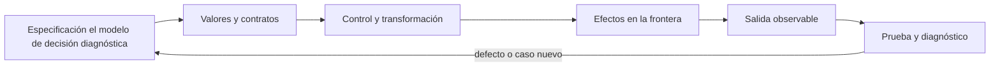
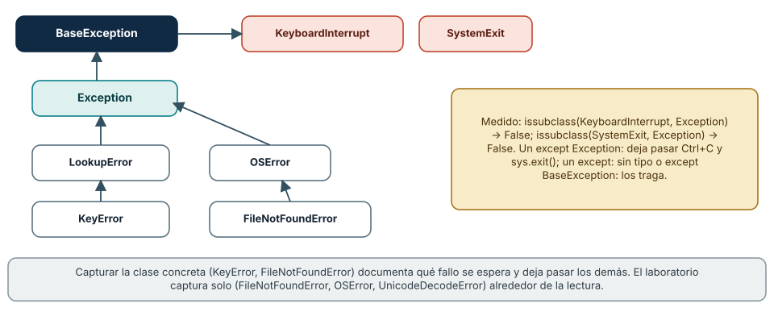
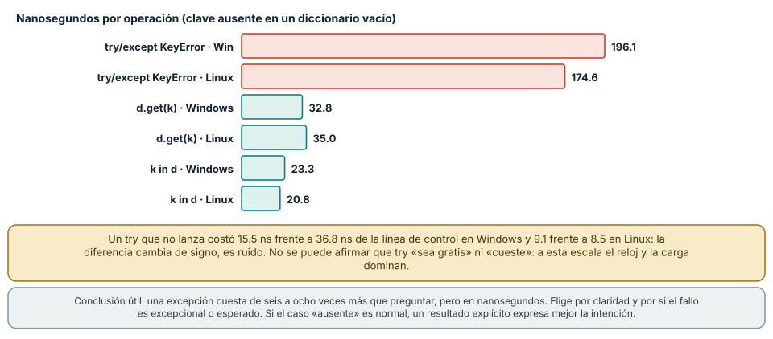
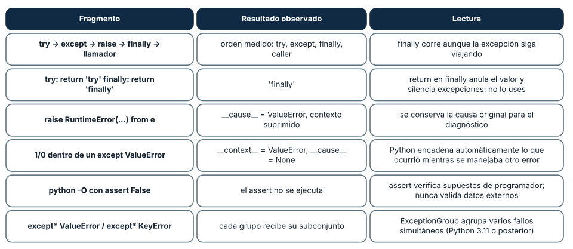

# SE-065 — Errores, excepciones y resultados explícitos

[← SE-064 — Funciones, parámetros, retorno y alcance](https://github.com/vladimiracunadev-create/modern-software-engineering-program/blob/main/classes/part-05-fundamentos-de-programacion/se-064-funciones-parametros-retorno-y-alcance/README.md) · [↑ Parte 05](https://github.com/vladimiracunadev-create/modern-software-engineering-program/blob/main/classes/part-05-fundamentos-de-programacion/README.md) · [📚 Índice completo](https://github.com/vladimiracunadev-create/modern-software-engineering-program/blob/main/classes/README.md) · [🌐 Portal](https://vladimiracunadev-create.github.io/modern-software-engineering-program/classes/SE-065.html) · [SE-066 — Colecciones y transformación de datos →](https://github.com/vladimiracunadev-create/modern-software-engineering-program/blob/main/classes/part-05-fundamentos-de-programacion/se-066-colecciones-y-transformacion-de-datos/README.md)


## Punto profesional y fundamento pedagógico

**Punto profesional.** La clase existe para distinguir error esperado, excepción, resultado explícito y fallo irrecuperable.

**Por qué aparece aquí.** Se sitúa después de **Funciones, parámetros, retorno y alcance** y antes de **Colecciones y transformación de datos**: convierte el conocimiento anterior en una decisión observable que la clase siguiente podrá reutilizar. La continuidad se comprueba en el artefacto, no por compartir vocabulario.

**Error conceptual que debe corregir.** Capturar toda excepción y continuar sin preservar causa.

**Secuencia de aprendizaje.** Antes de leer la solución, el estudiante predice el resultado del caso normal y del error conceptual anterior. Luego explica un caso resuelto paso a paso, construye un contraejemplo que cambie la decisión y, sin consultar el texto, reconstruye el mecanismo y lo aplica a una entrada nueva. La secuencia usa predicción, explicación propia, contraste y recuperación. [ICAP](https://icap.education.asu.edu/research) distingue participación de construcción de conocimiento; [How People Learn II](https://nap.nationalacademies.org/catalog/24783/how-people-learn-ii-learners-contexts-and-cultures) exige conectar conocimiento previo, contexto y transferencia; la [práctica de recuperación](https://pubmed.ncbi.nlm.nih.gov/16507066/) respalda producir de nuevo la explicación tras una demora; y [Education for Life and Work](https://nap.nationalacademies.org/resource/13398/dbasse_084153.pdf) exige devolución que explique la causa del error.

**Evidencia de aprendizaje.** Failure-taxonomy.md con propagación, contexto, recuperación y regresión. Debe contener predicción previa, observación, explicación causal, contraejemplo, criterio de aceptación y una nota de qué dato haría cambiar la conclusión.

**Límite de la conclusión.** Ninguna estrategia única sirve para todas las fronteras.

### Trazabilidad fuente → afirmación

| Fuente primaria u oficial | Afirmación que respalda | Lo que no prueba |
|---|---|---|
| [Python Tutorial — Errors and Exceptions](https://docs.python.org/3/tutorial/errors.html) | define la semántica y los límites de la API de Python utilizada en el experimento | No demuestra por sí sola que el artefacto del estudiante sea correcto. |
| [Python Language Reference](https://docs.python.org/3/reference/) | define la semántica y los límites de la API de Python utilizada en el experimento | No demuestra por sí sola que el artefacto del estudiante sea correcto. |
| [The Rust Programming Language](https://doc.rust-lang.org/stable/book/) | documenta ownership, tipos de error, traits y concurrencia usados como contraste semántico | No demuestra por sí sola que el artefacto del estudiante sea correcto. |

## Antes de empezar

Esta clase construye la **CLI diagnóstica**, implementación incremental de la especificación del modelo de decisión diagnóstica. Recupera `SE-064` y convierte una regla ya modelada en comportamiento ejecutable o comprobable. Trabaja en cambios pequeños: predicción, código, ejecución, evidencia y explicación. Ejecutar sin poder explicar el resultado no completa la práctica.

## Prerrequisitos

- Python 3.11 o posterior disponible como `python` o `python3`; registra la versión real.
- Terminal, editor de texto y Git; no se requieren paquetes externos.
- Comprender el contrato del modelo de decisión diagnóstica: entradas, resultados, errores e invariantes.

## Problema auténtico

La CLI diagnóstica atrapa `Exception` y continúa con datos incompletos. El usuario recibe éxito aunque el archivo no se leyó. Se deben distinguir errores de entrada, fallos esperados de I/O, defectos de programación y resultados de dominio.

## Objetivos observables

Al terminar podrás explicar el mecanismo del lenguaje, predecir una ejecución, implementar un caso normal y sus fronteras, diagnosticar un fallo controlado, proteger el comportamiento con evidencia y separar lo transferible de lo específico de Python.

## Mapa conceptual



El código no reemplaza la especificación: la materializa bajo reglas concretas del lenguaje y del entorno. La pregunta de esta clase es: **¿Quién puede recuperarse del fallo y qué información necesita para decidir?**

## Temas y por qué importan

| Lente | Pregunta | Evidencia |
|---|---|---|
| valor | ¿qué representa y qué tipo tiene? | ejemplo inspeccionable |
| control | ¿qué camino o repetición ocurre? | traza de estados |
| contrato | ¿qué acepta, retorna y rechaza? | casos frontera |
| efecto | ¿qué cambia fuera del cálculo? | archivo o stream controlado |
| mantenimiento | ¿cómo se detecta una regresión? | prueba y diff enfocado |

## Conceptos y decisiones

### 1. Sintaxis, excepción y resultado

Un error de sintaxis impide construir el programa. Una excepción interrumpe el flujo hasta un manejador compatible. Un resultado de dominio como `DNS_TIMEOUT` puede ser dato normal del diagnóstico y no una excepción. Mezclarlos produce APIs impredecibles.

### 2. Captura específica

Se captura la excepción que puede tratarse en esa frontera: `FileNotFoundError`, `JSONDecodeError`, `ValueError`. `except Exception` puede registrar y relanzar en un borde superior, pero no debe ocultar defectos. El bloque `try` se mantiene pequeño para no capturar otra operación accidental.

### 3. raise, chaining y contexto

`raise` conserva traceback; `raise ... from error` añade contexto causal sin perder origen. El mensaje explica acción y recurso seguro, pero no secretos. Traducir una excepción de biblioteca a una de dominio estabiliza la interfaz.

### 4. finally y recursos

`finally` se ejecuta haya o no excepción, útil para liberar recursos. Los context managers con `with` expresan adquisición y cierre de archivos de forma más segura. No se retorna desde `finally`, porque puede suprimir errores y resultados.

### 5. Resultado explícito

Cuando ausencia o rechazo es parte esperada del dominio, un resultado etiquetado evita usar excepciones como control ordinario. Python puede usar una estructura `{'ok': False, 'error': ...}` o tipos propios; Rust usa `Result<T,E>`. El contrato debe impedir estados ambiguos con valor y error simultáneos.

### La jerarquía de excepciones: qué captura cada `except`

Una excepción es un objeto, y las clases de excepción forman un árbol. `KeyError` desciende de `LookupError`, que desciende de `Exception`, que desciende de `BaseException`; `FileNotFoundError` desciende de `OSError`. Esa estructura decide qué captura cada `except`: `except LookupError` captura `KeyError` e `IndexError`, y `except OSError` captura `FileNotFoundError`, `PermissionError` y más. Capturar la clase concreta documenta qué fallo se espera y deja pasar los demás, que son defectos.

Hay una frontera especial. `KeyboardInterrupt` y `SystemExit` descienden de `BaseException` directamente, no de `Exception`: se midió que `issubclass(KeyboardInterrupt, Exception)` y `issubclass(SystemExit, Exception)` son `False`. Por eso `except Exception:` deja pasar Ctrl+C y `sys.exit()`, que es lo que se quiere, y un `except:` sin tipo, o `except BaseException:`, los traga: el programa deja de poder interrumpirse. El laboratorio captura solo `(FileNotFoundError, OSError, UnicodeDecodeError)` alrededor de la lectura de archivos, y devuelve para cada uno un código de salida 5; cualquier otro error (un defecto) sube hasta producir un traceback, que es lo correcto.

Python 3.11 añadió grupos de excepciones: `ExceptionGroup("g", [ValueError("a"), KeyError("b")])` se separa con `except* ValueError` y `except* KeyError`, y cada rama recibió solo su subconjunto. Sirve para tareas concurrentes que fallan a la vez; con una sola excepción por vez, `except` clásico basta.



**Cómo leer la figura.** Una flecha va de la clase hija a su base. Lo que cuelga de `Exception` lo captura `except Exception`; las dos clases en rojo no, y por eso Ctrl+C sobrevive a un `except Exception`. **Dónde deja de valer:** la jerarquía es la de la biblioteca estándar de Python 3.12; bibliotecas propias definen las suyas. Java separa `checked` de `unchecked`, Go y Rust no usan excepciones para errores esperados: la idea de «declarar qué se espera» se conserva, el mecanismo no.

### Cuánto cuesta una excepción y cuándo preguntar antes

Lanzar y capturar una excepción costó 192.1 ns en Windows (183.7 en Linux). Leer una clave ausente con `try/except KeyError` costó 196.1 ns (174.6), frente a 32.8 ns (35.0) con `d.get(k)` y 23.3 ns (20.8) con `k in d`. Una excepción cuesta de seis a ocho veces más que preguntar antes, pero todo en nanosegundos: no se justifica elegir por velocidad salvo en un bucle crítico medido.

Se intentó también medir el costo de un `try` que no lanza y el resultado es instructivo: 15.5 ns frente a 36.8 ns de la línea de control en Windows (y 9.1 frente a 8.5 en Linux). La diferencia cambia de signo entre plataformas, así que es ruido de medición, y no se puede afirmar ni que `try` «sea gratis» ni que «cueste». Un medidor honesto declara cuándo el efecto está por debajo de su resolución.

La decisión real es otra: ¿el caso es excepcional o esperado? Si la ausencia de una clave es lo normal, un resultado explícito (`d.get`, un `Result`, una comparación con `None`) expresa la intención y evita que el flujo normal pase por el mecanismo de errores. Si el caso rompe una precondición (un archivo obligatorio que no existe), la excepción comunica «esto no debería pasar» y arrastra la traza. Los errores esperados del dominio del laboratorio (`unauthorized_test`, `budget_exceeded`) no son excepciones: viajan como `Result` porque son salidas válidas del cálculo.



**Cómo leer la figura.** Barras rojas: la ruta con excepción. Barras verdes: preguntar antes. Las dos notas inferiores dicen qué conclusión sí y no se puede sacar de los números. **Dónde deja de valer:** el costo depende de la versión de CPython (3.11 abarató los `try` sin excepción) y de la profundidad de la pila. Ningún número aquí es una constante: compara órdenes de magnitud.

### Orden de ejecución, encadenamiento y lo que anula un `finally`

El orden de un `try/except/else/finally` con una excepción que se relanza se registró en una lista: `try`, `except`, `finally`, y después el código del llamador. El bloque `finally` corre siempre, también cuando la excepción sigue su camino, y es el lugar para liberar recursos (aunque el administrador `with` lo hace de forma más segura). Pero un `return` dentro de `finally` anula el valor que se iba a devolver y descarta cualquier excepción pendiente: `try: return 'try' finally: return 'finally'` devolvió `'finally'`. Es una de las pocas construcciones que silencian un fallo sin dejar rastro.

Para el diagnóstico importa conservar la causa. Con `raise RuntimeError('config inválida') from e` el nuevo error guarda `__cause__ = ValueError` y marca el contexto como suprimido; sin `from`, una excepción lanzada mientras se maneja otra guarda `__context__` (se midió `1/0` dentro de un `except ValueError` con `__context__` igual a `ValueError` y `__cause__` en `None`). El traceback muestra ambas, y por eso «traducir» un error de bajo nivel a uno de dominio no debe perder el original. También se midió que un traceback de tres marcos conserva la ruta completa: función, línea y llamada.

Una última precisión: `assert` no es validación. Con `python -O` el `assert False, 'x'` no se ejecutó (la salida fue `assert ignorado`). Un `assert` expresa una suposición del programador sobre su propio código; los datos externos se validan con comprobaciones que no desaparecen y devuelven un error del dominio.



**Cómo leer la figura.** Cada fila es un fragmento y su resultado. Las filas de `finally` y de `assert` son las que más sorprenden: ambas pueden ocultar un fallo. **Dónde deja de valer:** el encadenamiento (`__cause__`, `__context__`) y `except*` son de Python 3.11 o posterior; en versiones anteriores `except*` no existe. En otros lenguajes la semántica de `finally` con `return` difiere.

## Definiciones de trabajo

- **excepción:** objeto que señala interrupción anormal.
- **manejador:** bloque que trata una excepción compatible.
- **propagación:** búsqueda de un manejador en la pila.
- **chaining:** vínculo causal entre excepciones.
- **resultado explícito:** valor que representa éxito o fallo esperado.

Estas definiciones describen el uso concreto en la CLI diagnóstica. Cuando Python permita varias conductas, el contrato del programa elige una y la hace visible con validación y pruebas.

## Ejemplo mínimo

```python
def load_text(path):
    try:
        return {"ok": True, "value": path.read_text(encoding="utf-8")}
    except FileNotFoundError as error:
        return {"ok": False, "error": "INPUT_NOT_FOUND", "detail": str(error)}
    except OSError as error:
        raise RuntimeError("cannot read diagnostic input") from error
```

Clasifica: argumento inválido, archivo ausente, JSON malformado, permiso denegado y división por cero interna. Decide resultado explícito, excepción traducida o defecto que debe propagarse.

Ejecuta el fragmento en un archivo, no solo en una conversación interactiva. Conserva comando, versión, salida y explicación de cada línea relevante.

## Ejemplo profesional

La CLI diagnóstica devuelve código 2 para uso inválido, 3 para archivo no accesible y 1 para diagnóstico con fallo, reservando 0 para ejecución válida. `stderr` explica el error; `stdout` conserva salida parseable. Los errores internos mantienen traceback en modo debug.

El criterio profesional es que el comportamiento pueda ser consumido, diagnosticado y cambiado sin depender de conocimiento oral ni de estado oculto.

## Práctica guiada

1. enumera fallos por frontera.
2. define quién puede recuperarse.
3. reduce un bloque `try`.
4. añade exception chaining.
5. prueba que éxito no se emite tras fallo.
6. ejecuta `python -m unittest -v` cuando existan pruebas y registra el resultado exacto.

## Ejercicios

1. **Clasificación:** para `KeyError`, `ValueError`, `FileNotFoundError`, `ZeroDivisionError` y `KeyboardInterrupt`, indica cuál captura `except OSError` y cuál `except Exception` y comprueba con `issubclass`.
2. **Orden:** predice el orden de las trazas de un `try` con `except` que relanza y un `finally`, y compruébalo con una lista.
3. **Traducción:** convierte un `ValueError` de `int()` en un error de dominio `invalid_budget` conservando la causa y escribe la prueba que verifica `__cause__`.
4. **Resultado explícito:** reescribe una función que lanza `KeyError` para devolver un `Result` y compara el código del llamador antes y después.

## Reto verificable

Entrega un cambio que incluya comportamiento, caso normal, caso límite, fallo controlado y explicación. Otra persona debe poder ejecutar los comandos desde un checkout limpio y relacionar cada salida con una regla del modelo de decisión diagnóstica.

## Demostración guiada

1. Escribe la entrada y la salida esperada antes del código.
2. Ejecuta el caso mínimo y observa valores intermedios sin dejar prints permanentes en el núcleo.
3. Añade el caso frontera que obligue a decidir, no solo a teclear.
4. Introduce el fallo descrito abajo y confirma que la evidencia lo detecta.
5. Corrige, ejecuta toda la suite y revisa el diff por efectos no deseados.

## Preguntas frecuentes

### ¿`try/except` o `if`?

Usa `if`/`get` cuando el caso es normal y frecuente; usa excepciones cuando el caso viola una precondición. La diferencia de costo (unos 150 ns) rara vez decide.

### ¿Cuándo es válido `except Exception`?

En el borde de un proceso para registrar el fallo y salir con un código de error, nunca para continuar como si nada. Nunca `except:` sin tipo.

### ¿Por qué `Result` en lugar de excepciones?

Porque los rechazos del dominio son resultados esperados del cálculo, y un valor obliga a quien llama a tratarlos. Una excepción puede olvidarse; un `Result` no se desempaqueta sin mirar el error.

### ¿Cómo no perder la causa original?

Con `raise NuevoError(...) from e`. Verifica en el traceback que aparecen ambas excepciones.

## Fallo controlado y diagnóstico

Reproduce los dos fallos del dominio con el motor del laboratorio. Una observación de una prueba inexistente devuelve `unknown_test`; una de `production-capture`, `unauthorized_test`; `resolve` con resultado `unknown`, `contradictory_observation`; y un gasto que excede el presupuesto, `budget_exceeded`. Ninguno es una excepción: todos son `Result.fail(...)`. Después escribe una función que lea el archivo con `except Exception: pass` y observa que un error de permisos y un error de sintaxis desaparecen por igual. Sustituye por la captura de `OSError` y comprueba que el resto sube con su traceback. Registra qué fallos tienen un nombre en el dominio y cuáles son defectos.

## Errores comunes y cómo corregirlos

| Síntoma | Causa | Corrección |
|---|---|---|
| el programa no responde a Ctrl+C | `except:` o `except BaseException:` captura `KeyboardInterrupt` | capturar clases concretas; `Exception` solo en el borde |
| un error desaparece sin rastro | `except …: pass` o `return` dentro de `finally` | manejar solo lo recuperable y registrar o relanzar |
| el mensaje final no menciona el fallo original | se tradujo la excepción sin `from` | `raise … from e` para conservar la causa |
| una validación «deja de funcionar» en producción | se usó `assert` para datos externos y se ejecutó con `-O` | validar con comprobaciones normales y errores del dominio |
| una función devuelve `None` en unos fallos y lanza en otros | mezcla de estilos de error sin contrato | elegir y documentar un estilo por frontera |

## Entorno y archivos clave

```text
work/SE-065/
├── diagnostic_cli/
│   ├── __init__.py
│   ├── domain.py
│   ├── cli.py
│   └── __main__.py
├── tests/
│   └── test_diagnostic_cli.py
└── README.md
```

No instales dependencias para resolver lo que cubre la biblioteca estándar. `README.md` conserva versión, comandos, entradas, salida, limpieza y límites. Los fragmentos son pedagógicos; intégralos solo después de entender su contrato.

### Laboratorio integrado de la Parte 05

Clasifica los fallos reproducibles de [`labs/part-05-diagnostic-cli`](https://github.com/vladimiracunadev-create/modern-software-engineering-program/tree/main/labs/part-05-diagnostic-cli) como uso, entrada, dominio, I/O o defecto interno. Contrasta `Result.fail` con las excepciones capturadas en `cli.py` y no añadas un `except Exception`: una invariante rota debe seguir siendo visible como defecto. Ejecuta entrada inválida, observación contradictoria y archivo ausente; conserva `stderr`, código de salida y decisión de recuperación en una matriz.

## Seguridad, ética y accesibilidad

- usa fixtures sintéticos y no incluyas tokens, rutas personales ni incidentes reales;
- limita tamaño, profundidad y tiempo de entradas no confiables;
- separa stdout parseable de stderr y redacta datos sensibles;
- ofrece mensajes accionables y no dependas solo de color;
- preserva autorización como regla del núcleo, no como checkbox de UI;
- no uses `eval`, `exec` ni construcción de shell con entrada externa.

## Puente hacia el trabajo con agentes

Los agentes viven de errores: una herramienta falla, el agente lee el mensaje y decide qué hacer. La calidad de ese mensaje es calidad de diseño. Un error que dice `error` o un traceback de 200 líneas son igual de inútiles para un modelo; un código estable (`budget_exceeded`) con un detalle corto permite que el agente reintente con otro argumento o se detenga. Los controles que se derivan: los errores esperados de una herramienta se devuelven como valores con un código estable y un detalle acotado, los defectos no se ocultan (se registran con traza fuera del contexto del modelo) y ninguna captura amplia transforma un fallo de seguridad en un reintento silencioso. El contrato de salidas del laboratorio (SE-072) es un ejemplo mínimo de este diseño.

## Transferencia

Reimplementa el contrato, no la sintaxis. Identifica cómo el segundo lenguaje representa ausencia, error, mutabilidad y módulos. Conserva fixtures y resultados públicos para detectar una diferencia semántica.

## Evaluación y evidencia

| Criterio | Evidencia para aprobar |
|---|---|
| comprensión | predicción y explicación de ejecución |
| comportamiento | normal, límite e inválido según contrato |
| diseño | cálculo separado de efectos y dependencias visibles |
| diagnóstico | fallo mínimo, causa y regresión |
| reproducibilidad | versión, comandos y salidas desde checkout limpio |


## Fuentes


- [Python Tutorial — Errors and Exceptions](https://docs.python.org/3/tutorial/errors.html) — define la semántica y los límites de la API de Python utilizada en el experimento.
- [Python Language Reference](https://docs.python.org/3/reference/) — define la semántica y los límites de la API de Python utilizada en el experimento.
- [The Rust Programming Language](https://doc.rust-lang.org/stable/book/) — documenta ownership, tipos de error, traits y concurrencia usados como contraste semántico.
- [Built-in Exceptions](https://docs.python.org/3/library/exceptions.html): jerarquía completa y significado de cada excepción.
- [PEP 654 — Exception Groups and except*](https://peps.python.org/pep-0654/): motivación y semántica de `ExceptionGroup` y `except*`.
- [traceback](https://docs.python.org/3/library/traceback.html): lectura y formato de trazas.
- [Python cmdline — -O](https://docs.python.org/3/using/cmdline.html): efecto de `-O` sobre `assert`.

La documentación oficial define el lenguaje y la biblioteca; no demuestra que la CLI diagnóstica cumpla su dominio. Esa evidencia vive en contratos, pruebas y ejecución reproducible.

## Límites y siguiente paso

La taxonomía no evita todos los defectos ni reemplaza logs seguros. La siguiente clase representa múltiples observaciones y sus transformaciones.

**Lo que no se midió.** El costo de un `try` que no lanza quedó por debajo de la resolución de la medición y no se afirma; no se midió el costo de excepciones con pilas profundas ni la captura de grupos de excepciones.

## Glosario

- **excepción:** objeto que señala interrupción anormal.
- **manejador:** bloque que trata una excepción compatible.
- **propagación:** búsqueda de un manejador en la pila.
- **chaining:** vínculo causal entre excepciones.
- **resultado explícito:** valor que representa éxito o fallo esperado.

---

[← SE-064 — Funciones, parámetros, retorno y alcance](https://github.com/vladimiracunadev-create/modern-software-engineering-program/blob/main/classes/part-05-fundamentos-de-programacion/se-064-funciones-parametros-retorno-y-alcance/README.md) · [↑ Parte 05](https://github.com/vladimiracunadev-create/modern-software-engineering-program/blob/main/classes/part-05-fundamentos-de-programacion/README.md) · [📚 Índice completo](https://github.com/vladimiracunadev-create/modern-software-engineering-program/blob/main/classes/README.md) · [🌐 Portal](https://vladimiracunadev-create.github.io/modern-software-engineering-program/classes/SE-065.html) · [SE-066 — Colecciones y transformación de datos →](https://github.com/vladimiracunadev-create/modern-software-engineering-program/blob/main/classes/part-05-fundamentos-de-programacion/se-066-colecciones-y-transformacion-de-datos/README.md)
