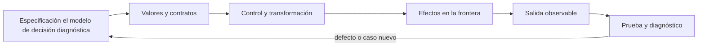
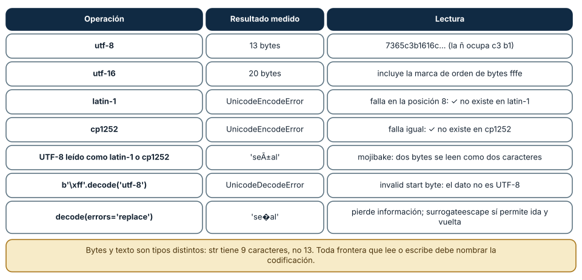
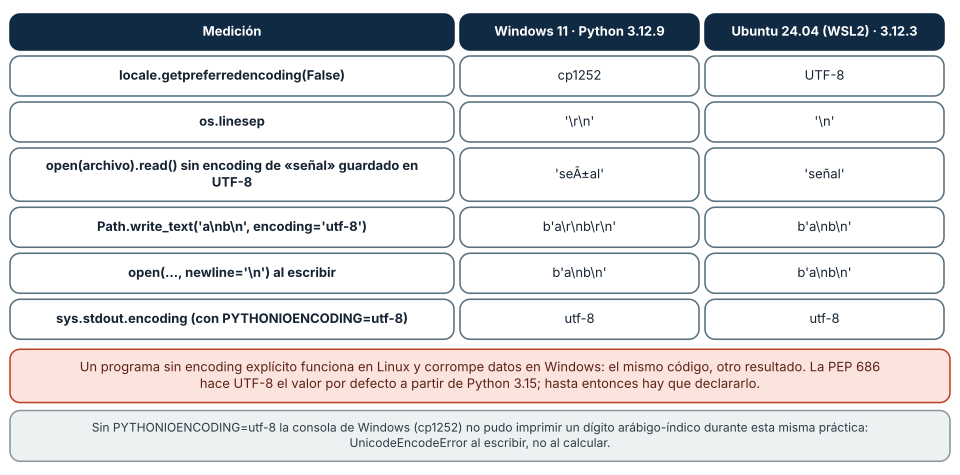
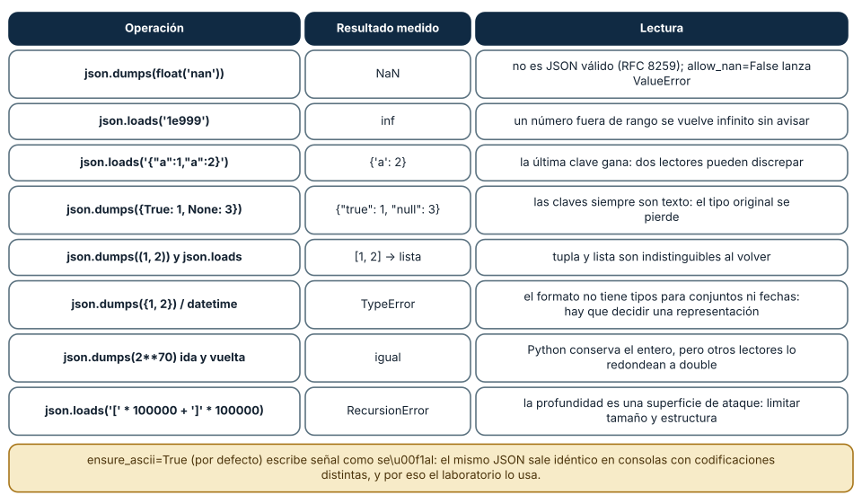

# SE-067 — Entrada, salida y serialización

[← SE-066 — Colecciones y transformación de datos](https://github.com/vladimiracunadev-create/modern-software-engineering-program/blob/main/classes/part-05-fundamentos-de-programacion/se-066-colecciones-y-transformacion-de-datos/README.md) · [↑ Parte 05](https://github.com/vladimiracunadev-create/modern-software-engineering-program/blob/main/classes/part-05-fundamentos-de-programacion/README.md) · [📚 Índice completo](https://github.com/vladimiracunadev-create/modern-software-engineering-program/blob/main/classes/README.md) · [🌐 Portal](https://vladimiracunadev-create.github.io/modern-software-engineering-program/classes/SE-067.html) · [SE-068 — Módulos, interfaces y separación de responsabilidades →](https://github.com/vladimiracunadev-create/modern-software-engineering-program/blob/main/classes/part-05-fundamentos-de-programacion/se-068-modulos-interfaces-y-separacion-de-responsabilidades/README.md)


## Punto profesional y fundamento pedagógico

**Punto profesional.** La clase existe para tratar entrada, salida y serialización como fronteras que validan y preservan significado.

**Por qué aparece aquí.** Se sitúa después de **Colecciones y transformación de datos** y antes de **Módulos, interfaces y separación de responsabilidades**: convierte el conocimiento anterior en una decisión observable que la clase siguiente podrá reutilizar. La continuidad se comprueba en el artefacto, no por compartir vocabulario.

**Error conceptual que debe corregir.** Confiar en datos parseables o asumir que JSON conserva todos los tipos.

**Secuencia de aprendizaje.** Antes de leer la solución, el estudiante predice el resultado del caso normal y del error conceptual anterior. Luego explica un caso resuelto paso a paso, construye un contraejemplo que cambie la decisión y, sin consultar el texto, reconstruye el mecanismo y lo aplica a una entrada nueva. La secuencia usa predicción, explicación propia, contraste y recuperación. [ICAP](https://icap.education.asu.edu/research) distingue participación de construcción de conocimiento; [How People Learn II](https://nap.nationalacademies.org/catalog/24783/how-people-learn-ii-learners-contexts-and-cultures) exige conectar conocimiento previo, contexto y transferencia; la [práctica de recuperación](https://pubmed.ncbi.nlm.nih.gov/16507066/) respalda producir de nuevo la explicación tras una demora; y [Education for Life and Work](https://nap.nationalacademies.org/resource/13398/dbasse_084153.pdf) exige devolución que explique la causa del error.

**Evidencia de aprendizaje.** Boundary-fixtures.md con válido, límite, inválido, round trip y error. Debe contener predicción previa, observación, explicación causal, contraejemplo, criterio de aceptación y una nota de qué dato haría cambiar la conclusión.

**Límite de la conclusión.** Serializar no autentica ni cifra los datos.

### Trazabilidad fuente → afirmación

| Fuente primaria u oficial | Afirmación que respalda | Lo que no prueba |
|---|---|---|
| [Python Tutorial — Input and Output](https://docs.python.org/3/tutorial/inputoutput.html) | define la semántica y los límites de la API de Python utilizada en el experimento | No demuestra por sí sola que el artefacto del estudiante sea correcto. |
| [Python `json` documentation](https://docs.python.org/3/library/json.html) | define la semántica y los límites de la API de Python utilizada en el experimento | No demuestra por sí sola que el artefacto del estudiante sea correcto. |
| [Python `pathlib` documentation](https://docs.python.org/3/library/pathlib.html) | define la semántica y los límites de la API de Python utilizada en el experimento | No demuestra por sí sola que el artefacto del estudiante sea correcto. |

## Antes de empezar

Esta clase construye la **CLI diagnóstica**, implementación incremental de la especificación del modelo de decisión diagnóstica. Recupera `SE-066` y convierte una regla ya modelada en comportamiento ejecutable o comprobable. Trabaja en cambios pequeños: predicción, código, ejecución, evidencia y explicación. Ejecutar sin poder explicar el resultado no completa la práctica.

## Prerrequisitos

- Python 3.11 o posterior disponible como `python` o `python3`; registra la versión real.
- Terminal, editor de texto y Git; no se requieren paquetes externos.
- Comprender el contrato del modelo de decisión diagnóstica: entradas, resultados, errores e invariantes.

## Problema auténtico

La CLI diagnóstica lee JSON, pero asume encoding, esquema y tamaño; escribe directamente sobre el archivo de salida. Un corte deja contenido parcial y una entrada enorme agota memoria. I/O y serialización requieren contrato, límites y actualización recuperable.

## Objetivos observables

Al terminar podrás explicar el mecanismo del lenguaje, predecir una ejecución, implementar un caso normal y sus fronteras, diagnosticar un fallo controlado, proteger el comportamiento con evidencia y separar lo transferible de lo específico de Python.

## Mapa conceptual



El código no reemplaza la especificación: la materializa bajo reglas concretas del lenguaje y del entorno. La pregunta de esta clase es: **¿Qué contrato cruza la frontera entre bytes externos y valores internos?**

## Temas y por qué importan

| Lente | Pregunta | Evidencia |
|---|---|---|
| valor | ¿qué representa y qué tipo tiene? | ejemplo inspeccionable |
| control | ¿qué camino o repetición ocurre? | traza de estados |
| contrato | ¿qué acepta, retorna y rechaza? | casos frontera |
| efecto | ¿qué cambia fuera del cálculo? | archivo o stream controlado |
| mantenimiento | ¿cómo se detecta una regresión? | prueba y diff enfocado |

## Conceptos y decisiones

### 1. Texto, bytes y encoding

Un archivo contiene bytes; abrir en modo texto decodifica con un encoding. Declarar UTF-8 evita depender de configuración local. Nueva línea y normalización pueden variar. Un `UnicodeDecodeError` describe una frontera, no un texto «corrupto» universal.

### 2. Streams y recursos

Archivos y stdin/stdout son streams con ciclo de vida. `with` garantiza cierre del archivo abierto. Leer todo es simple pero no escala; iterar por líneas limita memoria. La estrategia debe imponer tamaño y cantidad máximos antes de confiar en entrada.

### 3. JSON no es el modelo

JSON ofrece null, boolean, número, texto, array y objeto; no valida campos, unidades ni rangos. Después de `json.load` se comprueba estructura. Números no distinguen entero de decimal de dominio, y claves siempre son texto.

### 4. Salida estable

Para automatización, stdout contiene un documento o líneas bien definidas y stderr mensajes humanos. Orden de claves no debe ser contrato salvo declaración. `ensure_ascii=False` preserva lectura UTF-8; indentación es presentación, no semántica.

### 5. Escritura recuperable

Se escribe a temporal en el mismo sistema de archivos, se vacía/cierra y se reemplaza el destino. El reemplazo reduce ventanas parciales, pero no es una transacción universal ni garantiza durabilidad sin fsync. El programa conserva backup o no sobrescribe según riesgo.

### Texto y bytes: la codificación se declara

Un `str` es una secuencia de caracteres Unicode; un `bytes` es una secuencia de números de 0 a 255. Entre ambos hay una codificación, y sin ella no hay un texto sino bytes sin interpretar. El texto `'señal-ñ-✓'` tiene 9 caracteres y ocupa 13 bytes en UTF-8 (la `ñ` son los dos bytes `c3 b1`) y 20 en UTF-16 (incluye una marca de orden de bytes). En `latin-1` y en `cp1252` no se puede codificar: la marca de verificación no existe en esas tablas y `encode` lanzó `UnicodeEncodeError` en la posición 8.

La dirección inversa es peor porque a veces no falla. Los bytes UTF-8 de `señal` leídos como `latin-1` o como `cp1252` produjeron `'señal'`: dos bytes se leyeron como dos caracteres, sin ninguna excepción. Ese texto corrupto se llama *mojibake* y es el síntoma de una codificación equivocada en una frontera. Cuando los bytes no son válidos en la codificación declarada, `decode` sí lanza: `b'\xff'.decode('utf-8')` dio `UnicodeDecodeError: invalid start byte`. Los parámetros `errors` cambian la política: `'replace'` produjo `'se�al'` (pierde información), y `'surrogateescape'` permitió reconstruir exactamente los bytes originales (ida y vuelta verificada).

El laboratorio lee todo con `encoding="utf-8"` explícito, y cuando encuentra un byte inválido (`\xf1` suelto en un JSONL de prueba) devuelve el código de salida 5 con el mensaje «'utf-8' codec can't decode byte 0xf1…». Es una política: ante bytes que no son UTF-8 la CLI rechaza, no adivina. La alternativa de reemplazar caracteres en silencio pasaría la prueba y corrompería el dato.



**Cómo leer la figura.** Cada fila es una operación sobre el mismo texto. Las dos primeras filas son codificaciones que funcionan; las siguientes muestran fallos visibles (excepción) y fallos silenciosos (mojibake). **Dónde deja de valer:** UTF-8 es la codificación recomendada para intercambio, pero no es la única: archivos antiguos de Windows pueden estar en cp1252, y formatos binarios definen la suya. Los tamaños dependen del texto: cuanto más ASCII, más cerca de 1 byte por carácter.

### Valores por defecto que cambian con el sistema operativo

El mismo programa se ejecutó en Windows 11 (Python 3.12.9) y en Ubuntu 24.04 (WSL2, Python 3.12.3). `locale.getpreferredencoding(False)` devolvió `cp1252` en Windows y `UTF-8` en Linux; `os.linesep` fue `'\r\n'` y `'\n'`. La consecuencia es medible: `open(archivo).read()` sin `encoding` de un archivo guardado en UTF-8 con `señal` devolvió `'señal'` en Windows y `'señal'` en Linux, con el mismo código. Y `Path.write_text('a\nb\n', encoding='utf-8')` escribió `b'a\r\nb\r\n'` en Windows y `b'a\nb\n'` en Linux, porque el modo texto traduce el salto de línea.

Dos políticas evitan la sorpresa: declarar `encoding='utf-8'` en cada `open`/`read_text`/`write_text`, y declarar `newline` cuando el formato lo exige (`newline='\n'` escribió `b'a\nb\n'` en ambas plataformas; leer con `newline=''` conservó los `\r\n` originales). La PEP 686 hace de UTF-8 el valor por defecto a partir de Python 3.15, pero hasta que ese sea el intérprete de todos los que ejecutan el código, el valor por defecto sigue siendo una dependencia del entorno.

La práctica misma lo demostró: sin `PYTHONIOENCODING=utf-8`, la consola de Windows (cp1252) no pudo imprimir un dígito arábigo-índico y lanzó `UnicodeEncodeError` al escribir en pantalla, antes de que ningún cálculo fallara. La salida también es una frontera. El laboratorio escribe JSON con `ensure_ascii=True`, que convierte `señal` en `señal`, de modo que el mismo resultado sale byte a byte idéntico en consolas con codificaciones distintas.



**Cómo leer la figura.** Las dos columnas de resultados son plataformas; si coinciden en una fila, ese valor es portable. Las filas con valores distintos son las que obligan a declarar la opción. **Dónde deja de valer:** el resultado vale para Python 3.12 con la configuración regional de este equipo; otra configuración o `PYTHONUTF8=1` cambia la fila de codificación. macOS no se midió.

### JSON no es el modelo

JSON es un formato de texto con seis tipos; el modelo de dominio tiene los suyos. Entre ambos, `json` hace elecciones que conviene conocer. `json.dumps(float('nan'))` escribe `NaN`, que no es JSON válido según RFC 8259; con `allow_nan=False` lanza `ValueError`, y el laboratorio rechaza `NaN` al leer (`parse_constant` lanza). `json.loads('1e999')` devolvió `inf` sin avisar. Con claves duplicadas, `{"a":1,"a":2}` produce `{'a': 2}`: la última gana, y otro lector podría quedarse con la primera, de modo que dos sistemas leerían un documento distinto.

El viaje de ida y vuelta pierde tipos: una clave `True` se escribe como `"true"` y `None` como `"null"`; una tupla vuelve como lista; un `set` o un `datetime` lanzan `TypeError: Object of type … is not JSON serializable`, porque el formato no tiene esos tipos y alguien debe decidir su representación (lista ordenada, texto ISO 8601). Un entero de 70 bits hizo ida y vuelta en Python, pero un lector que use `double` lo redondearía: ese límite está en el consumidor, no en el emisor.

Una entrada hostil puede ser un problema de tamaño o de forma: `json.loads('[' * 100000 + ']' * 100000)` lanzó `RecursionError`. De ahí que el laboratorio limite la entrada a 1 MB, valide el esquema campo a campo y devuelva códigos de error estables en lugar de dejar pasar una excepción. En la salida conviene lo contrario: ordenar las claves (`sort_keys=True`), un formato estable y un `schema_version` explícito, para que un consumidor pueda detectar un cambio.



**Cómo leer la figura.** Cada fila es una operación de json con el resultado medido y su consecuencia. La mayoría no produce error: el dato cambia o se pierde sin aviso. **Dónde deja de valer:** el comportamiento es el del módulo `json` de la biblioteca estándar; otras bibliotecas JSON (de otros lenguajes o más estrictas) deciden diferente. RFC 8259 permite que un receptor limite profundidad y tamaño.

## Definiciones de trabajo

- **encoding:** regla entre bytes y caracteres.
- **stream:** secuencia de datos leída o escrita progresivamente.
- **serialización:** conversión entre valores y formato transferible.
- **esquema:** restricciones de forma y campos.
- **escritura atómica:** reemplazo observado como cambio indivisible bajo supuestos del sistema.

Estas definiciones describen el uso concreto en la CLI diagnóstica. Cuando Python permita varias conductas, el contrato del programa elige una y la hace visible con validación y pruebas.

## Ejemplo mínimo

```python
import json
from pathlib import Path

def read_observations(path: Path) -> list[dict]:
    with path.open(encoding="utf-8") as stream:
        payload = json.load(stream)
    if not isinstance(payload, list):
        raise ValueError("expected a JSON array")
    return payload
```

Lee un JSON válido, uno malformado, uno con raíz objeto y uno con duración negativa. Distingue error de sintaxis, forma y regla de dominio.

Ejecuta el fragmento en un archivo, no solo en una conversación interactiva. Conserva comando, versión, salida y explicación de cada línea relevante.

## Ejemplo profesional

La CLI diagnóstica acepta `--input -` para stdin y emite JSON en stdout. Limita bytes, valida cada registro y escribe reportes a temporal antes de reemplazar. Un `--dry-run` muestra destino y cantidad sin modificar archivos.

El criterio profesional es que el comportamiento pueda ser consumido, diagnosticado y cambiado sin depender de conocimiento oral ni de estado oculto.

## Práctica guiada

1. declara encoding y esquema mínimo.
2. lee con context manager.
3. separa parseo de validación.
4. envía errores a stderr.
5. simula interrupción antes del reemplazo.
6. ejecuta `python -m unittest -v` cuando existan pruebas y registra el resultado exacto.

## Ejercicios

1. **Codificaciones:** codifica `'señal'` en utf-8, utf-16 y latin-1 y cuenta los bytes; decodifica el resultado con la codificación equivocada y explica el mojibake.
2. **Plataforma:** ejecuta el script de «valores por plataforma» en dos sistemas distintos (o con `-X utf8`) y compara el resultado con la figura.
3. **JSON:** escribe cinco documentos hostiles (NaN, duplicados, 1e999, anidamiento, bytes inválidos) y la respuesta esperada de tu parser para cada uno.
4. **Escritura recuperable:** implementa `guardar(ruta, datos)` con temporal y `os.replace` y simula un fallo antes del reemplazo; verifica que el original sigue intacto.

## Reto verificable

Entrega un cambio que incluya comportamiento, caso normal, caso límite, fallo controlado y explicación. Otra persona debe poder ejecutar los comandos desde un checkout limpio y relacionar cada salida con una regla del modelo de decisión diagnóstica.

## Demostración guiada

1. Escribe la entrada y la salida esperada antes del código.
2. Ejecuta el caso mínimo y observa valores intermedios sin dejar prints permanentes en el núcleo.
3. Añade el caso frontera que obligue a decidir, no solo a teclear.
4. Introduce el fallo descrito abajo y confirma que la evidencia lo detecta.
5. Corrige, ejecuta toda la suite y revisa el diff por efectos no deseados.

## Preguntas frecuentes

### ¿Por qué UTF-8 explícito si ya es el predeterminado?

Porque en Windows con Python 3.12 no lo es (cp1252). El código que sea portable hoy declara la codificación; cuando Python 3.15 lo haga predeterminado, la declaración sigue siendo inocua.

### ¿`ensure_ascii=False` es mejor?

Produce JSON legible con acentos, pero la consola debe poder escribirlos. El laboratorio prefiere `ensure_ascii=True` para que stdout sea el mismo en cualquier codificación.

### ¿Escribir un archivo es una operación atómica?

No. `open(ruta, 'w')` trunca primero (medimos tamaño 0 antes de escribir), y un fallo a medias deja un archivo vacío o parcial. La escritura recuperable escribe un temporal y lo reemplaza con `os.replace`.

### ¿Puedo confiar en JSON de otro sistema?

No sin validarlo: límites de tamaño y profundidad, esquema y tipos estrictos, rechazo de `NaN` y de claves duplicadas si el contrato lo exige.

## Fallo controlado y diagnóstico

Guarda un archivo con `Path.write_text('señal', encoding='utf-8')` y léelo con `open(ruta).read()` sin `encoding`. En Linux obtendrás `'señal'`; en Windows, `'señal'`. Registra la plataforma, `locale.getpreferredencoding(False)` y el resultado de cada lectura. Corrige con `encoding='utf-8'` explícito y añade una prueba que escriba y lea un texto con acentos y una marca fuera de latin-1 (la `✓` de la práctica). Después genera un JSONL con un byte `\xf1` suelto, ejecuta la CLI y comprueba que sale con código 5, con stdout vacío y el error en stderr. Registra por qué rechazar es mejor que reemplazar caracteres.

## Errores comunes y cómo corregirlos

| Síntoma | Causa | Corrección |
|---|---|---|
| `señal` en lugar de `señal` | UTF-8 leído como cp1252/latin-1 | declarar `encoding='utf-8'` en la lectura |
| `UnicodeEncodeError` al imprimir | la consola no puede codificar el carácter | salida ASCII escapada o configurar la codificación de salida |
| el archivo cambia de tamaño entre Windows y Linux | `\n` traducido a `\r\n` en modo texto | `newline=''` o `newline='\n'` según el formato |
| el archivo queda vacío tras un fallo | `open('w')` trunca antes de escribir | escribir a un temporal y `os.replace` |
| dos sistemas leen valores distintos del mismo JSON | claves duplicadas o números fuera de rango | validar en la frontera y rechazar lo ambiguo |

## Entorno y archivos clave

```text
work/SE-067/
├── diagnostic_cli/
│   ├── __init__.py
│   ├── domain.py
│   ├── cli.py
│   └── __main__.py
├── tests/
│   └── test_diagnostic_cli.py
└── README.md
```

No instales dependencias para resolver lo que cubre la biblioteca estándar. `README.md` conserva versión, comandos, entradas, salida, limpieza y límites. Los fragmentos son pedagógicos; intégralos solo después de entender su contrato.

### Laboratorio integrado de la Parte 05

Ejecuta la CLI de [`labs/part-05-diagnostic-cli`](https://github.com/vladimiracunadev-create/modern-software-engineering-program/tree/main/labs/part-05-diagnostic-cli) con UTF-8 válido, JSON roto, `NaN`, línea JSONL malformada y archivo ausente. Verifica que nunca mezcle diagnóstico con el JSON de `stdout`, que identifique la línea y que limite tamaño antes de materializar el documento. Relaciona el comportamiento con RFC 8259 y explica por qué serializar un diccionario válido no prueba que el modelo de dominio sea válido.

## Seguridad, ética y accesibilidad

- usa fixtures sintéticos y no incluyas tokens, rutas personales ni incidentes reales;
- limita tamaño, profundidad y tiempo de entradas no confiables;
- separa stdout parseable de stderr y redacta datos sensibles;
- ofrece mensajes accionables y no dependas solo de color;
- preserva autorización como regla del núcleo, no como checkbox de UI;
- no uses `eval`, `exec` ni construcción de shell con entrada externa.

## Puente hacia el trabajo con agentes

Un agente que lee y escribe archivos, o que habla con herramientas por JSON, está en la frontera de esta clase: lo que el modelo emite es texto que alguien interpreta con una codificación y un esquema. Tres controles se derivan. Primero, toda herramienta que escribe lo hace de forma recuperable (temporal y reemplazo) para que un fallo a mitad no deje archivos truncados. Segundo, las entradas y salidas de herramientas declaran codificación, esquema y límites (tamaño, profundidad), y el harness las valida antes de actuar; un campo `NaN` o un anidamiento extremo es rechazo, no excepción. Tercero, los errores de codificación de una herramienta se devuelven con un código estable y no con un volcado de la entrada, que puede contener datos sensibles. El formato estable de salida del laboratorio es el modelo mínimo.

## Transferencia

Reimplementa el contrato, no la sintaxis. Identifica cómo el segundo lenguaje representa ausencia, error, mutabilidad y módulos. Conserva fixtures y resultados públicos para detectar una diferencia semántica.

## Evaluación y evidencia

| Criterio | Evidencia para aprobar |
|---|---|
| comprensión | predicción y explicación de ejecución |
| comportamiento | normal, límite e inválido según contrato |
| diseño | cálculo separado de efectos y dependencias visibles |
| diagnóstico | fallo mínimo, causa y regresión |
| reproducibilidad | versión, comandos y salidas desde checkout limpio |


## Fuentes


- [Python Tutorial — Input and Output](https://docs.python.org/3/tutorial/inputoutput.html) — define la semántica y los límites de la API de Python utilizada en el experimento.
- [Python `json` documentation](https://docs.python.org/3/library/json.html) — define la semántica y los límites de la API de Python utilizada en el experimento.
- [Python `pathlib` documentation](https://docs.python.org/3/library/pathlib.html) — define la semántica y los límites de la API de Python utilizada en el experimento.
- [Python Tutorial — Errors and Exceptions](https://docs.python.org/3/tutorial/errors.html) — define la semántica y los límites de la API de Python utilizada en el experimento.
- [Python HOWTO — Unicode](https://docs.python.org/3/howto/unicode.html): texto y bytes, codificaciones y manejo de errores.
- [io — Core tools for working with streams](https://docs.python.org/3/library/io.html): modo texto, `newline`, buffers y flujos.
- [RFC 8259 — The JSON Data Interchange Format](https://www.rfc-editor.org/rfc/rfc8259): gramática de JSON, números, codificación y límites para receptores.
- [PEP 686 — Make UTF-8 mode default](https://peps.python.org/pep-0686/): UTF-8 como valor por defecto a partir de Python 3.15.
- [os — os.replace](https://docs.python.org/3/library/os.html): reemplazo de archivos y semántica de la operación.

La documentación oficial define el lenguaje y la biblioteca; no demuestra que la CLI diagnóstica cumpla su dominio. Esa evidencia vive en contratos, pruebas y ejecución reproducible.

## Límites y siguiente paso

JSON no conserva todos los tipos ni define evolución de esquema. La siguiente clase separa el programa en módulos e interfaces.

**Lo que no se midió.** No se probó macOS ni otras configuraciones regionales de Windows; el `PYTHONUTF8=1` y el modo UTF-8 no se activaron en estas mediciones, y la PEP 686 se cita como documento, sin ejecutar Python 3.15.

## Glosario

- **encoding:** regla entre bytes y caracteres.
- **stream:** secuencia de datos leída o escrita progresivamente.
- **serialización:** conversión entre valores y formato transferible.
- **esquema:** restricciones de forma y campos.
- **escritura atómica:** reemplazo observado como cambio indivisible bajo supuestos del sistema.

---

[← SE-066 — Colecciones y transformación de datos](https://github.com/vladimiracunadev-create/modern-software-engineering-program/blob/main/classes/part-05-fundamentos-de-programacion/se-066-colecciones-y-transformacion-de-datos/README.md) · [↑ Parte 05](https://github.com/vladimiracunadev-create/modern-software-engineering-program/blob/main/classes/part-05-fundamentos-de-programacion/README.md) · [📚 Índice completo](https://github.com/vladimiracunadev-create/modern-software-engineering-program/blob/main/classes/README.md) · [🌐 Portal](https://vladimiracunadev-create.github.io/modern-software-engineering-program/classes/SE-067.html) · [SE-068 — Módulos, interfaces y separación de responsabilidades →](https://github.com/vladimiracunadev-create/modern-software-engineering-program/blob/main/classes/part-05-fundamentos-de-programacion/se-068-modulos-interfaces-y-separacion-de-responsabilidades/README.md)
