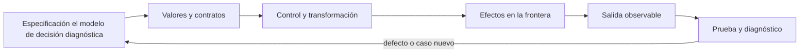
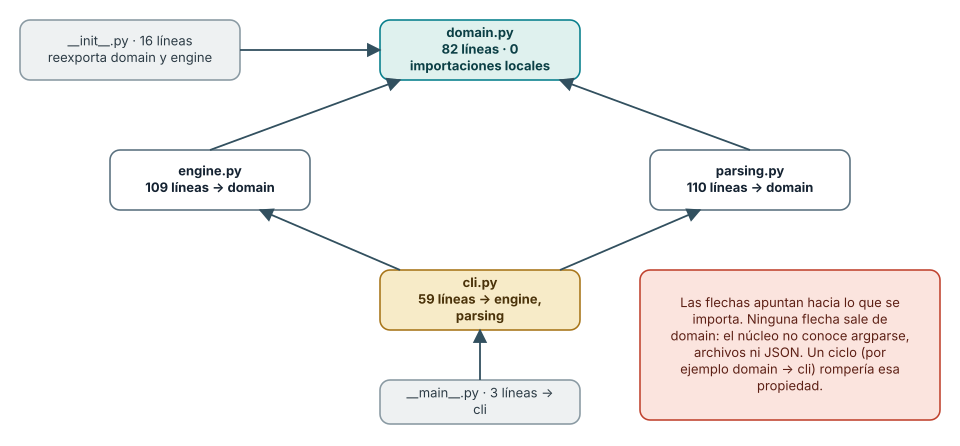
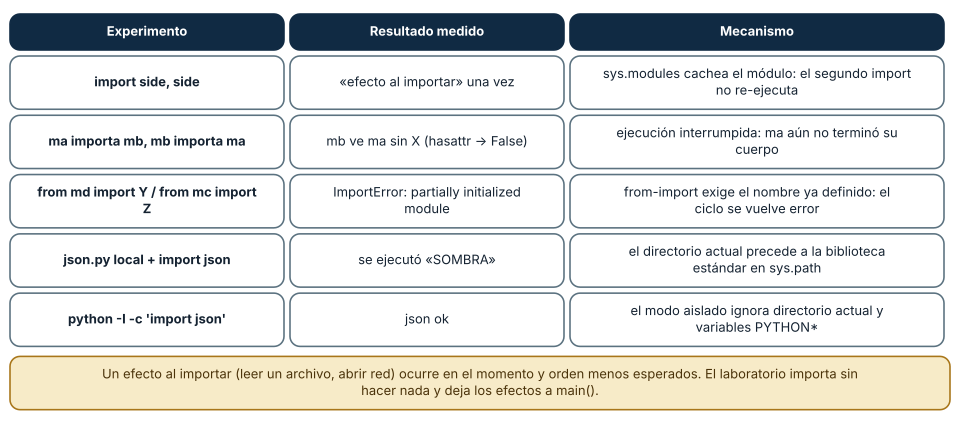
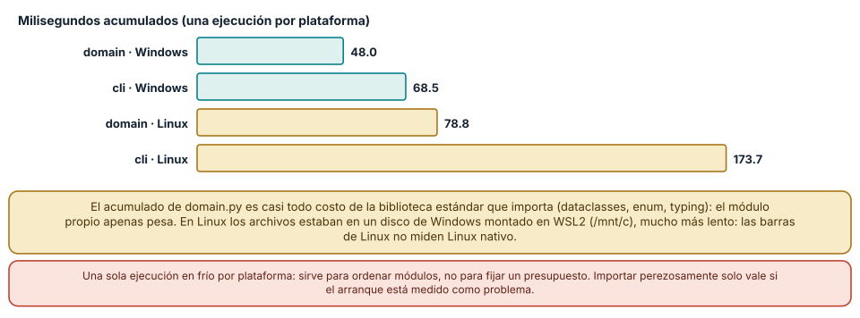

# SE-068 — Módulos, interfaces y separación de responsabilidades

[← SE-067 — Entrada, salida y serialización](https://github.com/vladimiracunadev-create/modern-software-engineering-program/blob/main/classes/part-05-fundamentos-de-programacion/se-067-entrada-salida-y-serializacion/README.md) · [↑ Parte 05](https://github.com/vladimiracunadev-create/modern-software-engineering-program/blob/main/classes/part-05-fundamentos-de-programacion/README.md) · [📚 Índice completo](https://github.com/vladimiracunadev-create/modern-software-engineering-program/blob/main/classes/README.md) · [🌐 Portal](https://vladimiracunadev-create.github.io/modern-software-engineering-program/classes/SE-068.html) · [SE-069 — Pruebas tempranas y diseño por ejemplos →](https://github.com/vladimiracunadev-create/modern-software-engineering-program/blob/main/classes/part-05-fundamentos-de-programacion/se-069-pruebas-tempranas-y-diseno-por-ejemplos/README.md)


## Punto profesional y fundamento pedagógico

**Punto profesional.** La clase existe para separar módulos por responsabilidades y contratos estables, no por tamaño de archivo.

**Por qué aparece aquí.** Se sitúa después de **Entrada, salida y serialización** y antes de **Pruebas tempranas y diseño por ejemplos**: convierte el conocimiento anterior en una decisión observable que la clase siguiente podrá reutilizar. La continuidad se comprueba en el artefacto, no por compartir vocabulario.

**Error conceptual que debe corregir.** Crear módulos que solo redistribuyen dependencias o exponen internals.

**Secuencia de aprendizaje.** Antes de leer la solución, el estudiante predice el resultado del caso normal y del error conceptual anterior. Luego explica un caso resuelto paso a paso, construye un contraejemplo que cambie la decisión y, sin consultar el texto, reconstruye el mecanismo y lo aplica a una entrada nueva. La secuencia usa predicción, explicación propia, contraste y recuperación. [ICAP](https://icap.education.asu.edu/research) distingue participación de construcción de conocimiento; [How People Learn II](https://nap.nationalacademies.org/catalog/24783/how-people-learn-ii-learners-contexts-and-cultures) exige conectar conocimiento previo, contexto y transferencia; la [práctica de recuperación](https://pubmed.ncbi.nlm.nih.gov/16507066/) respalda producir de nuevo la explicación tras una demora; y [Education for Life and Work](https://nap.nationalacademies.org/resource/13398/dbasse_084153.pdf) exige devolución que explique la causa del error.

**Evidencia de aprendizaje.** Dependency-map.md con API, consumidores, ciclo roto y prueba contractual. Debe contener predicción previa, observación, explicación causal, contraejemplo, criterio de aceptación y una nota de qué dato haría cambiar la conclusión.

**Límite de la conclusión.** Modularidad local no garantiza arquitectura mantenible.

### Trazabilidad fuente → afirmación

| Fuente primaria u oficial | Afirmación que respalda | Lo que no prueba |
|---|---|---|
| [Python Tutorial — Modules](https://docs.python.org/3/tutorial/modules.html) | define la semántica y los límites de la API de Python utilizada en el experimento | No demuestra por sí sola que el artefacto del estudiante sea correcto. |
| [Python Language Reference](https://docs.python.org/3/reference/) | define la semántica y los límites de la API de Python utilizada en el experimento | No demuestra por sí sola que el artefacto del estudiante sea correcto. |
| [SWEBOK Guide v4.0a](https://www.computer.org/education/bodies-of-knowledge/software-engineering) | sitúa la decisión dentro de construcción, diseño, pruebas y práctica profesional de ingeniería de software | No demuestra por sí sola que el artefacto del estudiante sea correcto. |

## Antes de empezar

Esta clase construye la **CLI diagnóstica**, implementación incremental de la especificación del modelo de decisión diagnóstica. Recupera `SE-067` y convierte una regla ya modelada en comportamiento ejecutable o comprobable. Trabaja en cambios pequeños: predicción, código, ejecución, evidencia y explicación. Ejecutar sin poder explicar el resultado no completa la práctica.

## Prerrequisitos

- Python 3.11 o posterior disponible como `python` o `python3`; registra la versión real.
- Terminal, editor de texto y Git; no se requieren paquetes externos.
- Comprender el contrato del modelo de decisión diagnóstica: entradas, resultados, errores e invariantes.

## Problema auténtico

La CLI diagnóstica funciona en `main.py`, pero cualquier cambio de formato afecta clasificación y pruebas. Importar el archivo ejecuta la CLI. Se necesita separar dominio, adaptadores y presentación sin crear módulos vacíos ni ciclos.

## Objetivos observables

Al terminar podrás explicar el mecanismo del lenguaje, predecir una ejecución, implementar un caso normal y sus fronteras, diagnosticar un fallo controlado, proteger el comportamiento con evidencia y separar lo transferible de lo específico de Python.

## Mapa conceptual



El código no reemplaza la especificación: la materializa bajo reglas concretas del lenguaje y del entorno. La pregunta de esta clase es: **¿Qué responsabilidad cambia por una razón distinta y qué contrato permite reemplazarla?**

## Temas y por qué importan

| Lente | Pregunta | Evidencia |
|---|---|---|
| valor | ¿qué representa y qué tipo tiene? | ejemplo inspeccionable |
| control | ¿qué camino o repetición ocurre? | traza de estados |
| contrato | ¿qué acepta, retorna y rechaza? | casos frontera |
| efecto | ¿qué cambia fuera del cálculo? | archivo o stream controlado |
| mantenimiento | ¿cómo se detecta una regresión? | prueba y diff enfocado |

## Conceptos y decisiones

### 1. Módulo y namespace

Un módulo es código cargable con su namespace. La primera importación ejecuta su nivel superior y se guarda en `sys.modules`; por eso el nivel superior evita I/O inesperado. `if __name__ == '__main__'` separa ejecución directa de importación.

### 2. Interfaz pública

La interfaz es el conjunto de nombres y comportamientos que consumidores usan. Un guion bajo comunica detalle interno por convención, pero no impone privacidad. Se documentan tipos, errores y efectos, no solo firmas.

### 3. Separación por política y mecanismo

El dominio decide elegibilidad; el adaptador JSON traduce bytes; la CLI coordina. Esta frontera permite probar reglas sin archivos y cambiar formato sin tocar cálculo. Separar cada función en archivo distinto aumenta navegación sin reducir acoplamiento.

### 4. Dependencias dirigidas

El núcleo no importa la CLI ni detalles de almacenamiento. Adaptadores dependen del contrato del núcleo. Un ciclo de imports suele revelar responsabilidades mezcladas o constantes compartidas en el lugar incorrecto.

### 5. Inyección y composición

La función principal recibe colaboradores —loader, clock, writer— o valores ya obtenidos. La composición ocurre en una raíz pequeña. No hace falta framework: pasar una función como argumento basta para sustituir I/O en pruebas.

### El grafo de dependencias del paquete, leído del código

Una arquitectura que solo existe en un diagrama no se puede verificar; una que se lee del código sí. Se analizaron con `ast` las importaciones de los seis módulos de `diagnostic_cli`. `domain.py` (82 líneas) no importa ningún módulo local; `engine.py` (109) y `parsing.py` (110) importan solo `domain`; `cli.py` (59) importa `engine` y `parsing`; `__init__.py` (16) reexporta `domain` y `engine`; `__main__.py` (3) importa `cli`. Las únicas dependencias externas son de la biblioteca estándar: `argparse`, `json`, `pathlib`, `dataclasses`, `enum`, `sys` y `typing`.

Esa forma tiene una propiedad: las flechas apuntan hacia el núcleo y nunca salen de él. `domain.py` no sabe que existen archivos, JSON ni terminales; `engine.py` no abre archivos ni imprime; `parsing.py` traduce JSON a valores del dominio; `cli.py` traduce fallos a códigos de salida. Por eso el motor se prueba sin crear archivos y el parser sin ejecutar la CLI. Un ciclo (por ejemplo, que `domain` importara `cli` para imprimir un aviso) rompería esa propiedad y haría imposible entender o cambiar un módulo sin los demás.

Separar política y mecanismo es la otra mitad. La política es la regla (elegir la prueba que más elimina por unidad de costo, en `select_next`); el mecanismo es cómo se lee y escribe. Cuando la política cambia, solo `engine.py` cambia; cuando cambia el formato de entrada, solo `parsing.py`. La inyección también es visible: `main(argv, stdout, stderr)` recibe los flujos como parámetros, y las pruebas pasan `io.StringIO` en lugar de redirigir la consola.



**Cómo leer la figura.** Una flecha de A a B significa «A importa B». Se lee de abajo hacia arriba: las capas externas (cli, main) dependen de las internas; el núcleo no depende de nadie. **Dónde deja de valer:** el grafo se extrajo de `import` estáticos del paquete; no ve importaciones dinámicas (`importlib`) ni dependencias de datos. Es una propiedad del código actual: nada impide que alguien añada un ciclo si no hay una prueba o una regla que lo detecte.

### El sistema de módulos: caché, ciclos y sombras

Importar un módulo ejecuta su cuerpo una vez y guarda el resultado en `sys.modules`. Se comprobó con un módulo con una línea `print`: `import side, side` imprimió el mensaje una sola vez. Dos consecuencias: un efecto en el nivel del módulo (abrir un archivo, una conexión) ocurre en un momento que depende de quién importe primero, y los módulos se comportan como singletons del proceso.

Los ciclos muestran la mecánica. Con `ma` que importa `mb` y `mb` que importa `ma`, la ejecución fue: `ma start`, `mb start`, `mb sees ma.X? False`, `ma end`. Cuando `mb` se ejecuta, `ma` existe en `sys.modules` pero aún no terminó su cuerpo, de modo que `X` no está definido. Con `from md import Y` / `from mc import Z` el resultado es un error: `ImportError: cannot import name 'Z' from partially initialized module 'mc' (most likely due to a circular import)`. La solución no es un truco de orden, sino reorganizar: extraer lo común a un tercer módulo del que ambos dependan, o invertir la dependencia.

Y el nombre de un módulo propio puede ocultar uno estándar. Se creó un `json.py` en el directorio actual y `import json` ejecutó el archivo propio (imprimió «SOMBRA»), porque el directorio del script o el directorio actual precede a la biblioteca estándar en `sys.path`. `python -I` (modo aislado) importó el `json` real. Las defensas son nombres que no colisionen con la biblioteca estándar, el modo aislado en scripts de infraestructura y entornos virtuales con dependencias fijadas.



**Cómo leer la figura.** Cada fila es un experimento real con módulos temporales. Observa que la caché y el ciclo se explican por el mismo mecanismo: el módulo está en `sys.modules` antes de terminar de ejecutarse. **Dónde deja de valer:** el orden de búsqueda de `sys.path` depende de cómo se lanza Python (`-m`, script o `-c`); la sombra del directorio actual no ocurre igual con `python script.py` que con `python -m`. Validar en tu forma de ejecución.

### Interfaz pública y costo de importar

Un módulo promete una interfaz y esconde el resto. `diagnostic_cli.__all__` lista nueve nombres (`DiagnosticReport`, `DiagnosticSpec`, `Observation`, `Outcome`, `Probe`, `Result`, `State`, `apply_observation`, `run_diagnosis`); lo demás (`parse_spec`, `iter_json_lines`, `select_next`) es de uso interno aunque Python no lo impide. `dir(diagnostic_cli)` mostró además los submódulos `cli`, `domain`, `engine` y `parsing`, porque importar un paquete deja sus submódulos como atributos: `__all__` solo controla `from paquete import *`. La interfaz se sostiene por convención, documentación y pruebas, no por el intérprete; un nombre con guion bajo inicial señala «interno».

El costo de importar es el costo de arrancar. Con `python -X importtime`, el acumulado de `diagnostic_cli.domain` fue 48.0 ms y el de `diagnostic_cli.cli` 68.5 ms en Windows (78.8 y 173.7 ms en Linux). Casi todo ese tiempo es de la biblioteca estándar que se importa (`dataclasses`, `enum`, `typing`, `argparse`), no del código del paquete: `parsing` costó 0.7 ms y `engine` 3.1 ms. La medición de Linux se hizo sobre archivos de Windows montados en WSL2 y no representa Linux nativo.

La conclusión es doble. El código propio es barato; la dependencia es lo que cuesta, y eso sustenta la regla de no importar bibliotecas para lo que la estándar resuelve. Y una interfaz bien acotada permite cambiar el interior sin romper a los consumidores: la clase siguiente (pruebas) protege esa promesa.



**Cómo leer la figura.** Las barras son milisegundos acumulados de una importación en frío; las verdes son Windows y las doradas Linux (sobre un disco montado, más lento). **Dónde deja de valer:** una sola ejecución en frío por plataforma: sirve para ordenar módulos, no para fijar presupuestos. La caché de bytecode (`__pycache__`) y la carga del disco cambian el resultado; el valor «de arranque» depende del equipo.

## Definiciones de trabajo

- **módulo:** unidad de código con namespace propio.
- **interfaz:** comportamiento público esperado por consumidores.
- **adaptador:** traducción entre contrato interno y sistema externo.
- **dependencia:** conocimiento de un componente sobre otro.
- **composition root:** punto donde se ensamblan colaboradores.

Estas definiciones describen el uso concreto en la CLI diagnóstica. Cuando Python permita varias conductas, el contrato del programa elige una y la hace visible con validación y pruebas.

## Ejemplo mínimo

```python
# diagnostic_cli/domain.py
def choose_next(hypotheses, tests, authorized_ids):
    eligible = [t for t in tests if t["id"] in authorized_ids]
    return min(eligible, key=lambda t: (t["cost"], t["id"]), default=None)

# diagnostic_cli/__main__.py
from .cli import main
raise SystemExit(main())
```

Divide un script en `domain.py`, `json_io.py`, `cli.py` y `__main__.py`. Dibuja flechas de importación y elimina toda flecha del dominio hacia CLI/I/O.

Ejecuta el fragmento en un archivo, no solo en una conversación interactiva. Conserva comando, versión, salida y explicación de cada línea relevante.

## Ejemplo profesional

La CLI diagnóstica expone `choose_next` como interfaz de dominio, estable y sin efectos. La CLI convierte excepciones de frontera a códigos de salida. Los módulos no imprimen al importarse y el paquete puede ejecutarse con `python -m diagnostic_cli`.

El criterio profesional es que el comportamiento pueda ser consumido, diagnosticado y cambiado sin depender de conocimiento oral ni de estado oculto.

## Práctica guiada

1. marca razones de cambio.
2. define interfaz del núcleo.
3. mueve efectos a adaptadores.
4. dibuja grafo de imports.
5. prueba que importar no emite salida.
6. ejecuta `python -m unittest -v` cuando existan pruebas y registra el resultado exacto.

## Ejercicios

1. **Grafo:** genera con `ast` el grafo de importaciones de tu propio proyecto y dibújalo; marca cualquier flecha que apunte hacia afuera del núcleo.
2. **Ciclo:** reproduce un ciclo de importación con `import` y con `from … import`, y explica por qué solo el segundo falla.
3. **Interfaz:** lista lo que debería estar en `__all__` de tu módulo y escribe una prueba que importe solo esos nombres.
4. **Costo:** mide con `-X importtime` el arranque de tu CLI y decide si alguna importación podría diferirse sin esconder un efecto.

## Reto verificable

Entrega un cambio que incluya comportamiento, caso normal, caso límite, fallo controlado y explicación. Otra persona debe poder ejecutar los comandos desde un checkout limpio y relacionar cada salida con una regla del modelo de decisión diagnóstica.

## Demostración guiada

1. Escribe la entrada y la salida esperada antes del código.
2. Ejecuta el caso mínimo y observa valores intermedios sin dejar prints permanentes en el núcleo.
3. Añade el caso frontera que obligue a decidir, no solo a teclear.
4. Introduce el fallo descrito abajo y confirma que la evidencia lo detecta.
5. Corrige, ejecuta toda la suite y revisa el diff por efectos no deseados.

## Preguntas frecuentes

### ¿Cuándo dividir un archivo en módulos?

Cuando una parte cambia por razones distintas al resto (formato de entrada, regla de negocio, salida). Contar líneas no sirve: el laboratorio tiene módulos de 82 a 110 líneas porque cada uno cambia por una sola razón.

### ¿`__all__` impide usar nombres internos?

No; define qué exporta `import *` y documenta la interfaz. Lo interno se marca con guion bajo y se protege con pruebas de la interfaz pública.

### ¿Importar dentro de una función es mala práctica?

Es una herramienta para ciclos o dependencias opcionales, y retrasa el costo. Si es habitual, el diseño de dependencias probablemente está al revés.

### ¿Por qué no un solo archivo?

Para un script de 50 líneas es correcto. Cuando crece, la separación permite probar el núcleo sin entradas/salidas y reemplazar un borde sin tocarlo.

## Fallo controlado y diagnóstico

Provoca un ciclo a propósito. En un directorio temporal crea `mc.py` con `from md import Y` y `md.py` con `from mc import Z`, y ejecuta `python -c "import mc"`. Lee el `ImportError` completo y explica por qué el módulo está «parcialmente inicializado». Luego rompe el ciclo extrayendo `Y` y `Z` a un tercer módulo y confirma que ambos importan sin error. Para el laboratorio, escribe una prueba que lea con `ast` las importaciones de `domain.py` y falle si aparece alguna local: es la forma de convertir la regla «el núcleo no depende de nadie» en una comprobación automática.

## Errores comunes y cómo corregirlos

| Síntoma | Causa | Corrección |
|---|---|---|
| `ImportError: partially initialized module` | importación circular con `from … import` | extraer lo común a un tercer módulo o invertir la dependencia |
| `import json` ejecuta código propio | un archivo `json.py` local sombrea la biblioteca estándar | renombrar el archivo y usar `python -I` en infraestructura |
| importar un módulo abre archivos o red | efectos al nivel del módulo | mover los efectos a `main()` o a una función llamada explícitamente |
| un cambio en el formato de entrada rompe el motor | el núcleo importa el parser o la CLI | dependencias dirigidas: el borde depende del núcleo, nunca al revés |
| los consumidores importan nombres internos y se rompen al refactorizar | no hay interfaz pública declarada | `__all__`, guion bajo y pruebas sobre la interfaz |

## Entorno y archivos clave

```text
work/SE-068/
├── diagnostic_cli/
│   ├── __init__.py
│   ├── domain.py
│   ├── cli.py
│   └── __main__.py
├── tests/
│   └── test_diagnostic_cli.py
└── README.md
```

No instales dependencias para resolver lo que cubre la biblioteca estándar. `README.md` conserva versión, comandos, entradas, salida, limpieza y límites. Los fragmentos son pedagógicos; intégralos solo después de entender su contrato.

### Laboratorio integrado de la Parte 05

Reconstruye el grafo de importaciones de [`labs/part-05-diagnostic-cli`](https://github.com/vladimiracunadev-create/modern-software-engineering-program/tree/main/labs/part-05-diagnostic-cli) y comprueba la dirección `cli → parsing/engine → domain`. Sustituye el stream por `StringIO` y demuestra que la política no cambia. Propón dónde ubicar una nueva salida CSV y rechaza cualquier diseño que obligue a `domain.py` a importar `argparse`, rutas o serializadores. La evidencia es el grafo antes/después y una prueba de interfaz pública.

## Seguridad, ética y accesibilidad

- usa fixtures sintéticos y no incluyas tokens, rutas personales ni incidentes reales;
- limita tamaño, profundidad y tiempo de entradas no confiables;
- separa stdout parseable de stderr y redacta datos sensibles;
- ofrece mensajes accionables y no dependas solo de color;
- preserva autorización como regla del núcleo, no como checkbox de UI;
- no uses `eval`, `exec` ni construcción de shell con entrada externa.

## Puente hacia el trabajo con agentes

Las herramientas de un agente se empaquetan como módulos o servidores, y la separación de esta clase es la que permite razonar sobre ellas: una herramienta cuyo núcleo no conoce el transporte (MCP, línea de comandos, HTTP) se prueba sin el agente y se reutiliza en otro. Dos controles se derivan: el módulo que implementa una capacidad (política) no importa el que la expone (mecanismo), y la interfaz que se ofrece al agente es la mínima necesaria, declarada y probada. Un agente que recibe una interfaz amplia tiene más acciones posibles que las que alguien revisó. El principio de interfaz mínima también reduce lo que hay que auditar por seguridad.

## Transferencia

Reimplementa el contrato, no la sintaxis. Identifica cómo el segundo lenguaje representa ausencia, error, mutabilidad y módulos. Conserva fixtures y resultados públicos para detectar una diferencia semántica.

## Evaluación y evidencia

| Criterio | Evidencia para aprobar |
|---|---|
| comprensión | predicción y explicación de ejecución |
| comportamiento | normal, límite e inválido según contrato |
| diseño | cálculo separado de efectos y dependencias visibles |
| diagnóstico | fallo mínimo, causa y regresión |
| reproducibilidad | versión, comandos y salidas desde checkout limpio |


## Fuentes


- [Python Tutorial — Modules](https://docs.python.org/3/tutorial/modules.html) — define la semántica y los límites de la API de Python utilizada en el experimento.
- [Python Language Reference](https://docs.python.org/3/reference/) — define la semántica y los límites de la API de Python utilizada en el experimento.
- [SWEBOK Guide v4.0a](https://www.computer.org/education/bodies-of-knowledge/software-engineering) — sitúa la decisión dentro de construcción, diseño, pruebas y práctica profesional de ingeniería de software.
- [The import system](https://docs.python.org/3/reference/import.html): `sys.modules`, módulos parcialmente inicializados y resolución de nombres.
- [Python cmdline — -I, -X importtime](https://docs.python.org/3/using/cmdline.html): modo aislado y medición del tiempo de importación.
- [ast — Abstract Syntax Trees](https://docs.python.org/3/library/ast.html): análisis estático de importaciones y funciones.
- [PEP 8 — Style Guide for Python Code](https://peps.python.org/pep-0008/): convenciones de nombres internos, importaciones y módulos.

La documentación oficial define el lenguaje y la biblioteca; no demuestra que la CLI diagnóstica cumpla su dominio. Esa evidencia vive en contratos, pruebas y ejecución reproducible.

## Límites y siguiente paso

Modularidad no garantiza buena API ni compatibilidad futura. La próxima clase usa ejemplos como pruebas tempranas para presionar el diseño.

**Lo que no se midió.** Las mediciones de importación son una sola ejecución en frío por plataforma, y la de Linux leyó archivos de un disco de Windows montado; no se midió un entorno virtual limpio ni una instalación del paquete.

## Glosario

- **módulo:** unidad de código con namespace propio.
- **interfaz:** comportamiento público esperado por consumidores.
- **adaptador:** traducción entre contrato interno y sistema externo.
- **dependencia:** conocimiento de un componente sobre otro.
- **composition root:** punto donde se ensamblan colaboradores.

---

[← SE-067 — Entrada, salida y serialización](https://github.com/vladimiracunadev-create/modern-software-engineering-program/blob/main/classes/part-05-fundamentos-de-programacion/se-067-entrada-salida-y-serializacion/README.md) · [↑ Parte 05](https://github.com/vladimiracunadev-create/modern-software-engineering-program/blob/main/classes/part-05-fundamentos-de-programacion/README.md) · [📚 Índice completo](https://github.com/vladimiracunadev-create/modern-software-engineering-program/blob/main/classes/README.md) · [🌐 Portal](https://vladimiracunadev-create.github.io/modern-software-engineering-program/classes/SE-068.html) · [SE-069 — Pruebas tempranas y diseño por ejemplos →](https://github.com/vladimiracunadev-create/modern-software-engineering-program/blob/main/classes/part-05-fundamentos-de-programacion/se-069-pruebas-tempranas-y-diseno-por-ejemplos/README.md)
