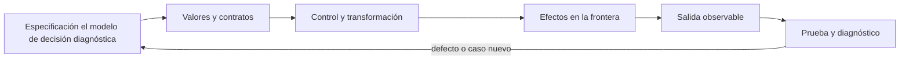
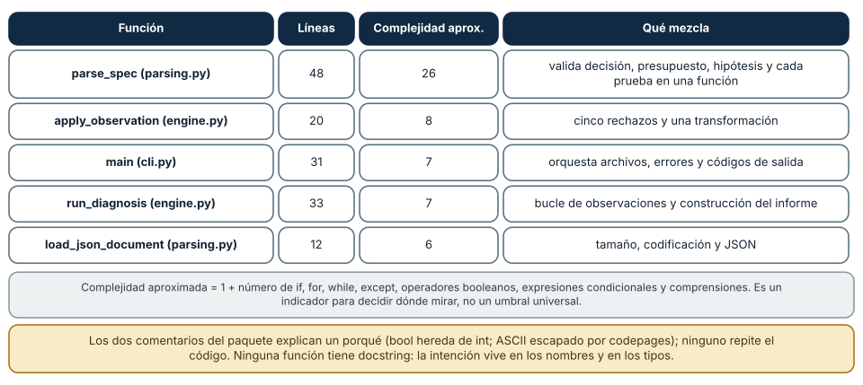
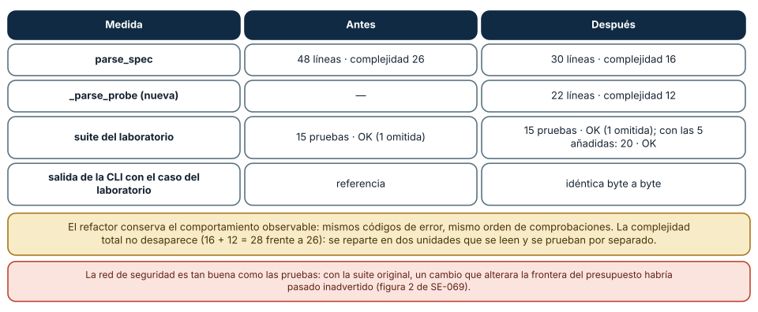

# SE-070 — Legibilidad, nombres y mantenimiento básico

[← SE-069 — Pruebas tempranas y diseño por ejemplos](https://github.com/vladimiracunadev-create/modern-software-engineering-program/blob/main/classes/part-05-fundamentos-de-programacion/se-069-pruebas-tempranas-y-diseno-por-ejemplos/README.md) · [↑ Parte 05](https://github.com/vladimiracunadev-create/modern-software-engineering-program/blob/main/classes/part-05-fundamentos-de-programacion/README.md) · [📚 Índice completo](https://github.com/vladimiracunadev-create/modern-software-engineering-program/blob/main/classes/README.md) · [🌐 Portal](https://vladimiracunadev-create.github.io/modern-software-engineering-program/classes/SE-070.html) · [SE-071 — Taller: transferir una solución entre lenguajes →](https://github.com/vladimiracunadev-create/modern-software-engineering-program/blob/main/classes/part-05-fundamentos-de-programacion/se-071-taller-transferir-una-solucion-entre-lenguajes/README.md)


## Punto profesional y fundamento pedagógico

**Punto profesional.** La clase existe para evaluar legibilidad por el costo de comprender y cambiar, no por preferencias estéticas.

**Por qué aparece aquí.** Se sitúa después de **Pruebas tempranas y diseño por ejemplos** y antes de **Taller: transferir una solución entre lenguajes**: convierte el conocimiento anterior en una decisión observable que la clase siguiente podrá reutilizar. La continuidad se comprueba en el artefacto, no por compartir vocabulario.

**Error conceptual que debe corregir.** Aplicar nombres o formato sin mejorar el modelo.

**Secuencia de aprendizaje.** Antes de leer la solución, el estudiante predice el resultado del caso normal y del error conceptual anterior. Luego explica un caso resuelto paso a paso, construye un contraejemplo que cambie la decisión y, sin consultar el texto, reconstruye el mecanismo y lo aplica a una entrada nueva. La secuencia usa predicción, explicación propia, contraste y recuperación. [ICAP](https://icap.education.asu.edu/research) distingue participación de construcción de conocimiento; [How People Learn II](https://nap.nationalacademies.org/catalog/24783/how-people-learn-ii-learners-contexts-and-cultures) exige conectar conocimiento previo, contexto y transferencia; la [práctica de recuperación](https://pubmed.ncbi.nlm.nih.gov/16507066/) respalda producir de nuevo la explicación tras una demora; y [Education for Life and Work](https://nap.nationalacademies.org/resource/13398/dbasse_084153.pdf) exige devolución que explique la causa del error.

**Evidencia de aprendizaje.** Maintenance-change.md con tarea antes/después, diff y explicación de carga cognitiva. Debe contener predicción previa, observación, explicación causal, contraejemplo, criterio de aceptación y una nota de qué dato haría cambiar la conclusión.

**Límite de la conclusión.** Una medición local no demuestra mantenibilidad a largo plazo.

### Trazabilidad fuente → afirmación

| Fuente primaria u oficial | Afirmación que respalda | Lo que no prueba |
|---|---|---|
| [SWEBOK Guide v4.0a](https://www.computer.org/education/bodies-of-knowledge/software-engineering) | sitúa la decisión dentro de construcción, diseño, pruebas y práctica profesional de ingeniería de software | No demuestra por sí sola que el artefacto del estudiante sea correcto. |
| [Python Tutorial](https://docs.python.org/3/tutorial/) | define la semántica y los límites de la API de Python utilizada en el experimento | No demuestra por sí sola que el artefacto del estudiante sea correcto. |
| [Python Language Reference](https://docs.python.org/3/reference/) | define la semántica y los límites de la API de Python utilizada en el experimento | No demuestra por sí sola que el artefacto del estudiante sea correcto. |

## Antes de empezar

Esta clase construye la **CLI diagnóstica**, implementación incremental de la especificación del modelo de decisión diagnóstica. Recupera `SE-069` y convierte una regla ya modelada en comportamiento ejecutable o comprobable. Trabaja en cambios pequeños: predicción, código, ejecución, evidencia y explicación. Ejecutar sin poder explicar el resultado no completa la práctica.

## Prerrequisitos

- Python 3.11 o posterior disponible como `python` o `python3`; registra la versión real.
- Terminal, editor de texto y Git; no se requieren paquetes externos.
- Comprender el contrato del modelo de decisión diagnóstica: entradas, resultados, errores e invariantes.

## Problema auténtico

La CLI diagnóstica pasa pruebas, pero usa nombres crípticos, funciones largas y comentarios que contradicen el código. La legibilidad no es cosmética: determina si una persona puede detectar una regla rota y modificarla con riesgo acotado.

## Objetivos observables

Al terminar podrás explicar el mecanismo del lenguaje, predecir una ejecución, implementar un caso normal y sus fronteras, diagnosticar un fallo controlado, proteger el comportamiento con evidencia y separar lo transferible de lo específico de Python.

## Mapa conceptual



El código no reemplaza la especificación: la materializa bajo reglas concretas del lenguaje y del entorno. La pregunta de esta clase es: **¿Puede una persona cambiar el comportamiento correcto sin reconstruir toda la intención?**

## Temas y por qué importan

| Lente | Pregunta | Evidencia |
|---|---|---|
| valor | ¿qué representa y qué tipo tiene? | ejemplo inspeccionable |
| control | ¿qué camino o repetición ocurre? | traza de estados |
| contrato | ¿qué acepta, retorna y rechaza? | casos frontera |
| efecto | ¿qué cambia fuera del cálculo? | archivo o stream controlado |
| mantenimiento | ¿cómo se detecta una regresión? | prueba y diff enfocado |

## Conceptos y decisiones

### 1. Nombres como modelo

Un nombre revela rol, unidad y alcance: `remaining_budget_ms` supera `b`. Los nombres no deben repetir el tipo sin intención ni prometer más que la función. `validate` es ambiguo si no dice qué acepta o retorna.

### 2. Nivel de abstracción

Una función legible mantiene un nivel: coordinar fases o calcular una regla, no ambos. Mezclar `json.loads`, política de autorización y `print` obliga a saltar entre detalles. Extraer debe crear conceptos, no fragmentos arbitrarios.

### 3. Comentarios y docstrings

El código explica cómo; un comentario útil registra por qué existe una decisión no obvia, límite o fuente. Un comentario que repite la línea se desactualiza. La docstring de API declara contrato, errores y efectos con brevedad.

### 4. Duplicación y simetría

Duplicar una regla permite divergencia; extraerla prematuramente puede unir casos que cambian por razones distintas. Se elimina duplicación de conocimiento, no toda semejanza textual. Estructuras paralelas se presentan con forma y orden consistentes.

### 5. Refactorización protegida

Un cambio estructural conserva comportamiento observable. Primero se caracteriza con pruebas, después se cambia en pasos pequeños y se revisa el diff. Renombrar, extraer y simplificar por separado hace reversible la decisión.

### Medir antes de opinar: métricas del paquete

«Código legible» se discute mejor con números como punto de partida, siempre que se lean como indicios. Con `ast` se midieron las 19 funciones del paquete: todas tienen retorno anotado, ninguna tiene docstring, la media es de 11.0 líneas por función y el máximo de parámetros es 3. El paquete completo tiene 379 líneas, 9 de ellas de más de 100 caracteres, y dos comentarios: uno explica por qué la salida usa ASCII escapado (consolas con codepages distintas) y el otro por qué se rechaza `bool` aunque herede de `int`. Ambos explican una causa, no repiten el código: es el uso correcto de un comentario.

La función que destaca es `parse_spec`: 48 líneas y una complejidad aproximada de 26 (1 más el número de `if`, `for`, `while`, `except`, operadores booleanos, expresiones condicionales y comprensiones). La siguen `apply_observation` (20 líneas, 8), `main` (31, 7) y `run_diagnosis` (33, 7). `parse_spec` es larga porque valida en un solo lugar decisión, presupuesto, hipótesis y cada prueba. Cada validación es sencilla; el costo está en que, para entender una, hay que leer todas.

Estas métricas no son umbrales universales: 26 no es «malo» por sí solo. Sirven para decidir dónde mirar y para comparar antes y después de un cambio. El criterio profesional es la pregunta «¿cuántas cosas debe tener en la cabeza quien modifique esta función?». Con diez reglas que se leen juntas, la respuesta es «diez a la vez», y eso es lo que un refactor puede reducir.



**Cómo leer la figura.** Las filas están ordenadas de mayor a menor complejidad. La columna final nombra lo que cada función hace a la vez; es la pista para decidir si dividirla. **Dónde deja de valer:** la complejidad aproximada cuenta ramas sintácticas y no equivale a la ciclomática oficial ni a la dificultad cognitiva. Cambia de herramienta a herramienta; compara siempre con la misma regla.

### Nombres y niveles de abstracción

Un nombre es un modelo mínimo: dice qué es el dato y qué se espera de él. En el paquete hay 78 nombres distintos y solo tres tienen una o dos letras: `T` (variable de tipo genérica, convención), `OK` (miembro de un `Enum`) y `_` (valor descartado). Leer un índice sobre una tupla frente a un atributo ilustra la diferencia: con `r = ('resolve', 1, True)`, `r[1]` obliga a abrir la definición para saber qué es 1; `probe.cost` lo dice en el sitio de uso. Y no hay un precio: leer `r[1]` costó 29.8 ns en Windows (20.5 en Linux) y `probe.cost` 21.7 ns (15.0). El nombre es más claro y no más lento; las diferencias de nanosegundos son ruido operativo.

Un buen nombre también puede mentir. Si `cost` dejara de ser un entero de unidades abstractas y pasara a ser dinero, el nombre seguiría prometiendo lo anterior; y `timeout_seconds` frente a `t` hace visible la unidad, pero solo mientras sea cierta. Los nombres necesitan mantenimiento igual que el código. La función `select_next` dice lo que hace; `_partition_size` explica que mide el tamaño del grupo más grande; ambos mantienen un mismo nivel de abstracción en su cuerpo (no mezclan detalles de bajo nivel con decisiones de alto nivel).

El nivel de abstracción importa más que la longitud. `run_diagnosis` cuenta la historia (aplicar cada observación, acumular la línea de tiempo, recomendar la próxima prueba), y delega lo detallado. Si una función mezcla «abrir el archivo», «validar el esquema» y «elegir el siguiente paso», cada lector tiene que subir y bajar niveles continuamente. Los comentarios se reservan para el porqué que el código no puede decir; docstrings, para la interfaz pública: el paquete tiene cero y la intención vive en nombres y tipos, algo defendible a este tamaño pero que cambiaría con más consumidores.

![Figura 2. Barras con el costo de leer r[1] de una tupla frente a probe.cost de un dataclass en Windows y Linux, y una tabla sobre qué obliga a saber cada lectura](../../../content/part-05/figures/se-070-nombre-o-indice.svg)

**Cómo leer la figura.** Las barras son nanosegundos por lectura, con la tupla en dorado y el atributo en verde. La tabla inferior resume la diferencia de claridad, que es la razón de la elección. **Dónde deja de valer:** las diferencias de nanosegundos no justifican nada por sí mismas, y un microbenchmark no mide el costo de entender. Un nombre específico no sustituye una descripción del contrato si el concepto es sutil.

### Refactorizar con una red de seguridad medida

Refactorizar es cambiar la estructura sin cambiar el comportamiento observable, y solo se puede afirmar con evidencia. Se hizo un refactor real en una copia del laboratorio: extraer de `parse_spec` el análisis de cada prueba a una función `_parse_probe`. Antes: `parse_spec` con 48 líneas y complejidad 26. Después: `parse_spec` con 30 líneas y 16, y `_parse_probe` con 22 líneas y 12. La suite de 15 pruebas pasó antes y después, y la salida de la CLI para el caso del laboratorio fue idéntica byte a byte. La complejidad total no desaparece (16 + 12 = 28 frente a 26): se reparte en dos unidades que se leen y se prueban por separado, y quien lee `parse_spec` ya no necesita los detalles de cada prueba.

La seguridad del cambio la da la evidencia previa. Con el análisis de mutaciones de SE-069 se sabe que la suite original no protegía la frontera del presupuesto ni las hipótesis duplicadas: un refactor que alterara esas reglas habría pasado en verde. Antes de refactorizar, conviene cerrar esos huecos; con las cinco pruebas añadidas (20 en total) el mismo refactor también pasó. La secuencia profesional es: fijar el comportamiento con pruebas, refactorizar en pasos pequeños, ejecutar la suite en cada paso y revisar el diff buscando cambios de comportamiento accidentales (el orden de las comprobaciones es parte del contrato: `invalid_test_id` antes que `duplicate_test`).

La duplicación se trata con el mismo cuidado. En el paquete no hay ventanas de cuatro líneas repetidas, pero «sin duplicación textual» no equivale a «sin duplicación de conocimiento»: la regla «un entero estricto» aparece en `_strict_int` una sola vez, y esa es la forma deseable. Quitar una duplicación que representa conceptos distintos que solo se parecen hoy es peor que dejarla.



**Cómo leer la figura.** Compara cada fila entre «antes» y «después»; las tres últimas muestran que el comportamiento observable no cambió. **Dónde deja de valer:** el refactor se aplicó a una copia temporal y no se incluyó en el laboratorio; no se midió legibilidad con personas, solo métricas y pruebas. Que dos números bajen no prueba que el código sea más claro.

## Definiciones de trabajo

- **legibilidad:** facilidad para reconstruir intención y comportamiento.
- **abstracción:** concepto que oculta detalle bajo contrato.
- **duplicación de conocimiento:** misma regla mantenida en varios lugares.
- **refactorización:** cambio de estructura que preserva comportamiento.
- **caracterización:** prueba que captura conducta existente.

Estas definiciones describen el uso concreto en la CLI diagnóstica. Cuando Python permita varias conductas, el contrato del programa elige una y la hace visible con validación y pruebas.

## Ejemplo mínimo

```python
def remaining_budget_ms(total_ms: float, elapsed_ms: float) -> float:
    # Return non-negative time available for the next diagnostic step.
    if total_ms < 0 or elapsed_ms < 0:
        raise ValueError("budgets cannot be negative")
    return max(0.0, total_ms - elapsed_ms)
```

Toma una función de 25 líneas que parsea, decide e imprime. Marca niveles, renombra cinco conceptos y extrae una función pura. Las mismas pruebas deben pasar antes y después.

Ejecuta el fragmento en un archivo, no solo en una conversación interactiva. Conserva comando, versión, salida y explicación de cada línea relevante.

## Ejemplo profesional

La CLI diagnóstica adopta vocabulario del modelo de decisión diagnóstica en código y mensajes. El README define convenciones de unidades y errores. Cada refactor mantiene commits pequeños, pruebas verdes y una explicación de qué cambio futuro facilita.

El criterio profesional es que el comportamiento pueda ser consumido, diagnosticado y cambiado sin depender de conocimiento oral ni de estado oculto.

## Práctica guiada

1. lee una función sin editar y resume intención.
2. subraya nombres que ocultan unidad.
3. separa niveles de abstracción.
4. elimina un comentario redundante.
5. refactoriza con pruebas y revisa diff.
6. ejecuta `python -m unittest -v` cuando existan pruebas y registra el resultado exacto.

## Ejercicios

1. **Medición:** calcula con `ast` líneas y complejidad aproximada de las funciones de tu proyecto y señala las tres mayores.
2. **Renombrado:** sustituye un índice de tupla por un campo con nombre y verifica con la suite que nada cambia.
3. **Comentarios:** revisa cinco comentarios de tu código: marca los que explican el porqué y borra los que repiten el cómo.
4. **Refactor protegido:** extrae una función de tu código más largo, ejecuta la suite en cada paso y compara la salida antes y después.

## Reto verificable

Entrega un cambio que incluya comportamiento, caso normal, caso límite, fallo controlado y explicación. Otra persona debe poder ejecutar los comandos desde un checkout limpio y relacionar cada salida con una regla del modelo de decisión diagnóstica.

## Demostración guiada

1. Escribe la entrada y la salida esperada antes del código.
2. Ejecuta el caso mínimo y observa valores intermedios sin dejar prints permanentes en el núcleo.
3. Añade el caso frontera que obligue a decidir, no solo a teclear.
4. Introduce el fallo descrito abajo y confirma que la evidencia lo detecta.
5. Corrige, ejecuta toda la suite y revisa el diff por efectos no deseados.

## Preguntas frecuentes

### ¿Cuántas líneas debe tener una función?

No hay una cifra; importa cuántas ideas mezcla. En el paquete, la media es 11 líneas y la mayor es 48, que justo es la candidata a dividir.

### ¿Se comenta todo?

No. Se comenta el porqué que el código no puede expresar; lo que el código dice, lo dice el código. Los dos comentarios del paquete explican causas.

### ¿Qué es el «código duplicado» que debo eliminar?

El conocimiento duplicado: la misma regla de negocio en dos sitios. Dos fragmentos que se parecen pero cambian por razones distintas no se unifican.

### ¿Cuándo no refactorizar?

Cuando no hay pruebas que fijen el comportamiento, o cuando el cambio se mezcla con uno funcional. Primero se protege, después se cambia, y en commits separados.

## Fallo controlado y diagnóstico

Extrae una función genérica `process(data, flag)` que sirva a dos reglas parecidas del laboratorio y observa cómo el booleano cambia de significado según la llamada. Lee las dos llamadas con otra persona y pídele que explique qué hace `flag=True` en cada una. Reemplaza el booleano por dos funciones con nombres específicos (o un concepto del dominio) y comprueba con la suite que el comportamiento no cambió. Después aplica el refactor `_parse_probe` en una copia y registra las métricas de `parse_spec` antes y después. Si la suite no detecta un cambio deliberado de orden en las comprobaciones, añade la prueba que lo fije y repite.

## Errores comunes y cómo corregirlos

| Síntoma | Causa | Corrección |
|---|---|---|
| nadie entiende una función de 50 líneas | mezcla varias responsabilidades en un solo nivel | extraer por responsabilidad con nombres que cuenten la historia |
| un booleano cambia el comportamiento de una función | función genérica con parámetro bandera | dos funciones con nombre específico o un tipo del dominio |
| un comentario contradice el código | el comentario repite el cómo y no se mantuvo | comentar el porqué o borrar el comentario |
| el refactor cambió un mensaje de error | se reordenaron comprobaciones sin una prueba de orden | pruebas que fijen el código de error para cada entrada inválida |
| un nombre ya no es cierto | el concepto cambió y el nombre no | renombrar con herramienta y ejecutar la suite |

## Entorno y archivos clave

```text
work/SE-070/
├── diagnostic_cli/
│   ├── __init__.py
│   ├── domain.py
│   ├── cli.py
│   └── __main__.py
├── tests/
│   └── test_diagnostic_cli.py
└── README.md
```

No instales dependencias para resolver lo que cubre la biblioteca estándar. `README.md` conserva versión, comandos, entradas, salida, limpieza y límites. Los fragmentos son pedagógicos; intégralos solo después de entender su contrato.

### Laboratorio integrado de la Parte 05

Selecciona una tarea de mantenimiento real en [`labs/part-05-diagnostic-cli`](https://github.com/vladimiracunadev-create/modern-software-engineering-program/tree/main/labs/part-05-diagnostic-cli), por ejemplo añadir un outcome, y registra qué archivos y símbolos debes comprender. Refactoriza un nombre o extrae una función bajo la suite; compara el esfuerzo antes/después y conserva un diff donde un cambio «más limpio» altere el contrato para explicar por qué fue rechazado. Legibilidad se evalúa por menor ambigüedad al cambiar, no por una cuota de líneas.

## Seguridad, ética y accesibilidad

- usa fixtures sintéticos y no incluyas tokens, rutas personales ni incidentes reales;
- limita tamaño, profundidad y tiempo de entradas no confiables;
- separa stdout parseable de stderr y redacta datos sensibles;
- ofrece mensajes accionables y no dependas solo de color;
- preserva autorización como regla del núcleo, no como checkbox de UI;
- no uses `eval`, `exec` ni construcción de shell con entrada externa.

## Puente hacia el trabajo con agentes

Un agente de programación lee tu código para actuar sobre él, y el código legible lo ayuda igual que a una persona: los nombres específicos le dicen qué es cada dato, las funciones cortas le dejan cambiar una regla sin tocar otras, y los comentarios de causa le impiden «arreglar» una decisión deliberada (como rechazar `bool`). Pero también aparece un riesgo propio: un agente refactoriza con confianza, y sin una red de seguridad un cambio plausible puede alterar el orden de comprobaciones o una frontera. Dos controles: los refactors de un agente van en un cambio aparte, con la suite en verde antes y después, y se revisa el diff buscando cambios de comportamiento; y los comentarios y docstrings que expresan restricciones de dominio se conservan como contexto que el agente debe leer antes de modificar.

## Transferencia

Reimplementa el contrato, no la sintaxis. Identifica cómo el segundo lenguaje representa ausencia, error, mutabilidad y módulos. Conserva fixtures y resultados públicos para detectar una diferencia semántica.

## Evaluación y evidencia

| Criterio | Evidencia para aprobar |
|---|---|
| comprensión | predicción y explicación de ejecución |
| comportamiento | normal, límite e inválido según contrato |
| diseño | cálculo separado de efectos y dependencias visibles |
| diagnóstico | fallo mínimo, causa y regresión |
| reproducibilidad | versión, comandos y salidas desde checkout limpio |


## Fuentes


- [SWEBOK Guide v4.0a](https://www.computer.org/education/bodies-of-knowledge/software-engineering) — sitúa la decisión dentro de construcción, diseño, pruebas y práctica profesional de ingeniería de software.
- [Python Tutorial](https://docs.python.org/3/tutorial/) — define la semántica y los límites de la API de Python utilizada en el experimento.
- [Python Language Reference](https://docs.python.org/3/reference/) — define la semántica y los límites de la API de Python utilizada en el experimento.
- [PEP 8 — Style Guide for Python Code](https://peps.python.org/pep-0008/): convenciones de nombres, comentarios y longitud de línea.
- [PEP 257 — Docstring Conventions](https://peps.python.org/pep-0257/): qué documenta un docstring y cuándo hace falta.
- [PEP 20 — The Zen of Python](https://peps.python.org/pep-0020/): principios sobre legibilidad y explicitud.
- [Refactoring (Martin Fowler)](https://refactoring.com/): definición de refactorización y catálogo de transformaciones.
- [ast — Abstract Syntax Trees](https://docs.python.org/3/library/ast.html): base de las métricas calculadas en esta clase.

La documentación oficial define el lenguaje y la biblioteca; no demuestra que la CLI diagnóstica cumpla su dominio. Esa evidencia vive en contratos, pruebas y ejecución reproducible.

## Límites y siguiente paso

Legibilidad depende de audiencia y contexto; una métrica no la certifica. La siguiente clase prueba transferibilidad al llevar la misma solución a Rust.

**Lo que no se midió.** El refactor se aplicó a una copia y no a la rama publicada; las métricas son sintácticas y no hubo lectura por terceras personas que confirmara la mejora de legibilidad.

## Glosario

- **legibilidad:** facilidad para reconstruir intención y comportamiento.
- **abstracción:** concepto que oculta detalle bajo contrato.
- **duplicación de conocimiento:** misma regla mantenida en varios lugares.
- **refactorización:** cambio de estructura que preserva comportamiento.
- **caracterización:** prueba que captura conducta existente.

---

[← SE-069 — Pruebas tempranas y diseño por ejemplos](https://github.com/vladimiracunadev-create/modern-software-engineering-program/blob/main/classes/part-05-fundamentos-de-programacion/se-069-pruebas-tempranas-y-diseno-por-ejemplos/README.md) · [↑ Parte 05](https://github.com/vladimiracunadev-create/modern-software-engineering-program/blob/main/classes/part-05-fundamentos-de-programacion/README.md) · [📚 Índice completo](https://github.com/vladimiracunadev-create/modern-software-engineering-program/blob/main/classes/README.md) · [🌐 Portal](https://vladimiracunadev-create.github.io/modern-software-engineering-program/classes/SE-070.html) · [SE-071 — Taller: transferir una solución entre lenguajes →](https://github.com/vladimiracunadev-create/modern-software-engineering-program/blob/main/classes/part-05-fundamentos-de-programacion/se-071-taller-transferir-una-solucion-entre-lenguajes/README.md)
