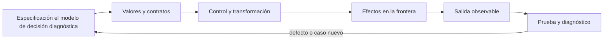
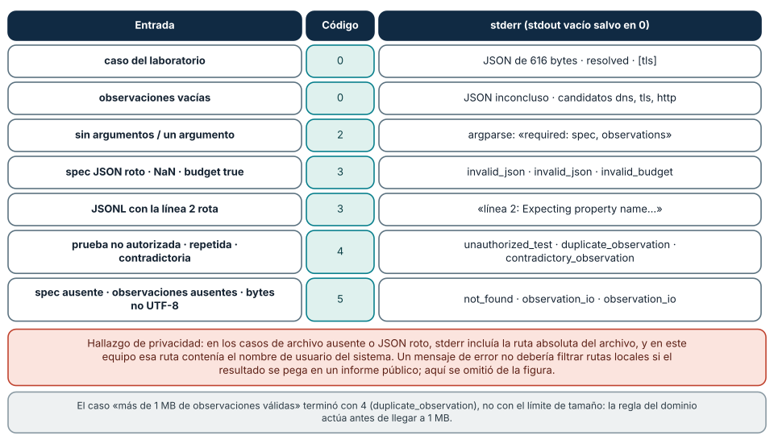
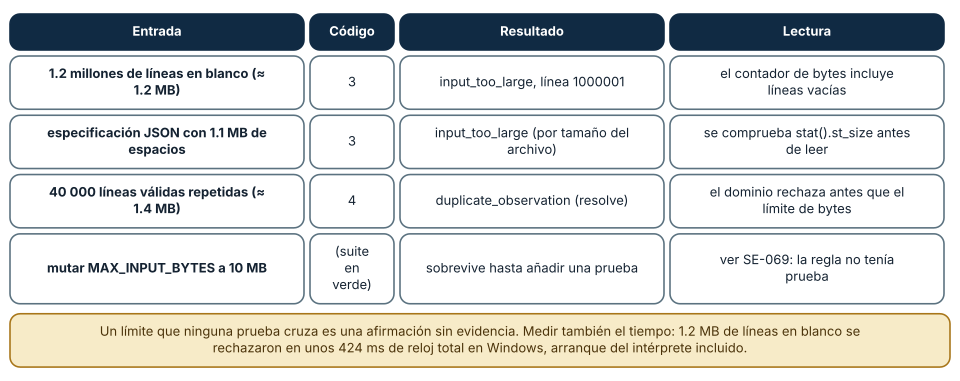
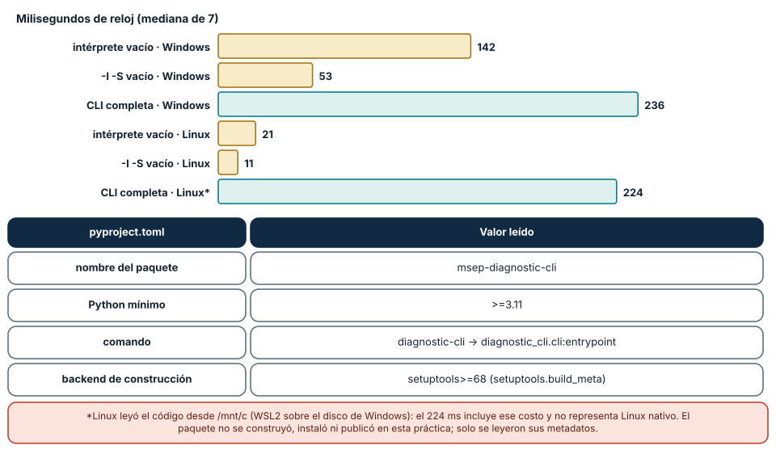

# SE-072 — Proyecto: herramienta de línea de comandos probada

[← SE-071 — Taller: transferir una solución entre lenguajes](https://github.com/vladimiracunadev-create/modern-software-engineering-program/blob/main/classes/part-05-fundamentos-de-programacion/se-071-taller-transferir-una-solucion-entre-lenguajes/README.md) · [↑ Parte 05](https://github.com/vladimiracunadev-create/modern-software-engineering-program/blob/main/classes/part-05-fundamentos-de-programacion/README.md) · [📚 Índice completo](https://github.com/vladimiracunadev-create/modern-software-engineering-program/blob/main/classes/README.md) · [🌐 Portal](https://vladimiracunadev-create.github.io/modern-software-engineering-program/classes/SE-072.html) · [SE-073 — Programación imperativa y estado mutable →](https://github.com/vladimiracunadev-create/modern-software-engineering-program/blob/main/classes/part-06-paradigmas-de-programacion/se-073-programacion-imperativa-y-estado-mutable/README.md)


## Punto profesional y fundamento pedagógico

**Punto profesional.** La clase existe para integrar CLI, validación, archivos, pruebas y diagnóstico en una herramienta reproducible.

**Por qué aparece aquí.** Se sitúa después de **Taller: transferir una solución entre lenguajes** y antes de **Programación imperativa y estado mutable**: convierte el conocimiento anterior en una decisión observable que la clase siguiente podrá reutilizar. La continuidad se comprueba en el artefacto, no por compartir vocabulario.

**Error conceptual que debe corregir.** Aceptar una salida correcta sin contrato de errores ni códigos de retorno.

**Secuencia de aprendizaje.** Antes de leer la solución, el estudiante predice el resultado del caso normal y del error conceptual anterior. Luego explica un caso resuelto paso a paso, construye un contraejemplo que cambie la decisión y, sin consultar el texto, reconstruye el mecanismo y lo aplica a una entrada nueva. La secuencia usa predicción, explicación propia, contraste y recuperación. [ICAP](https://icap.education.asu.edu/research) distingue participación de construcción de conocimiento; [How People Learn II](https://nap.nationalacademies.org/catalog/24783/how-people-learn-ii-learners-contexts-and-cultures) exige conectar conocimiento previo, contexto y transferencia; la [práctica de recuperación](https://pubmed.ncbi.nlm.nih.gov/16507066/) respalda producir de nuevo la explicación tras una demora; y [Education for Life and Work](https://nap.nationalacademies.org/resource/13398/dbasse_084153.pdf) exige devolución que explique la causa del error.

**Evidencia de aprendizaje.** CLI, fixtures, pruebas, help, códigos de salida y ejecución desde checkout limpio. Debe contener predicción previa, observación, explicación causal, contraejemplo, criterio de aceptación y una nota de qué dato haría cambiar la conclusión.

**Límite de la conclusión.** El proyecto no se considera distribuible ni compatible fuera de versiones declaradas.

### Trazabilidad fuente → afirmación

| Fuente primaria u oficial | Afirmación que respalda | Lo que no prueba |
|---|---|---|
| [Python `argparse` documentation](https://docs.python.org/3/library/argparse.html) | define la semántica y los límites de la API de Python utilizada en el experimento | No demuestra por sí sola que el artefacto del estudiante sea correcto. |
| [Python `unittest` documentation](https://docs.python.org/3/library/unittest.html) | define la semántica y los límites de la API de Python utilizada en el experimento | No demuestra por sí sola que el artefacto del estudiante sea correcto. |
| [Python `json` documentation](https://docs.python.org/3/library/json.html) | define la semántica y los límites de la API de Python utilizada en el experimento | No demuestra por sí sola que el artefacto del estudiante sea correcto. |

## Antes de empezar

Esta clase construye la **CLI diagnóstica**, implementación incremental de la especificación del modelo de decisión diagnóstica. Recupera `SE-071` y convierte una regla ya modelada en comportamiento ejecutable o comprobable. Trabaja en cambios pequeños: predicción, código, ejecución, evidencia y explicación. Ejecutar sin poder explicar el resultado no completa la práctica.

## Prerrequisitos

- Python 3.11 o posterior disponible como `python` o `python3`; registra la versión real.
- Terminal, editor de texto y Git; no se requieren paquetes externos.
- Comprender el contrato del modelo de decisión diagnóstica: entradas, resultados, errores e invariantes.

## Problema auténtico

El proyecto entrega la CLI diagnóstica como CLI probada. Lee la especificación del modelo de decisión diagnóstica, selecciona la siguiente prueba autorizada y emite una explicación. Debe comportarse bien con ayuda, entrada inválida, archivos, pipes, cancelación y códigos de salida; un script que funciona solo desde el IDE no alcanza.

## Objetivos observables

Al terminar podrás explicar el mecanismo del lenguaje, predecir una ejecución, implementar un caso normal y sus fronteras, diagnosticar un fallo controlado, proteger el comportamiento con evidencia y separar lo transferible de lo específico de Python.

## Mapa conceptual



El código no reemplaza la especificación: la materializa bajo reglas concretas del lenguaje y del entorno. La pregunta de esta clase es: **¿Puede otra persona instalar, usar, automatizar, diagnosticar y mantener la herramienta?**

## Temas y por qué importan

| Lente | Pregunta | Evidencia |
|---|---|---|
| valor | ¿qué representa y qué tipo tiene? | ejemplo inspeccionable |
| control | ¿qué camino o repetición ocurre? | traza de estados |
| contrato | ¿qué acepta, retorna y rechaza? | casos frontera |
| efecto | ¿qué cambia fuera del cálculo? | archivo o stream controlado |
| mantenimiento | ¿cómo se detecta una regresión? | prueba y diff enfocado |

## Conceptos y decisiones

### 1. Contrato CLI

Nombre, subcomandos, opciones, stdin/stdout/stderr y códigos de salida son interfaz pública. `--help` incluye propósito y ejemplos; argumentos inválidos fallan antes de modificar estado. La salida humana y JSON se seleccionan explícitamente.

### 2. Arquitectura de la CLI diagnóstica

`domain.py` conserva reglas puras; `json_io.py` valida frontera; `cli.py` traduce argumentos y errores; `__main__.py` compone. El núcleo no conoce terminal ni rutas. Esa separación permite usarlo después como biblioteca.

### 3. Validación y seguridad

Se limita tamaño, cantidad y profundidad; rutas se tratan como datos y no se concatenan en shell. Los mensajes redactan contenido sensible. La herramienta no ejecuta la prueba recomendada: produce un plan para revisión humana, manteniendo autorización como invariante.

### 4. Pruebas de consumidor

Las unitarias cubren dominio; integración ejecuta `python -m diagnostic_cli` con archivos temporales y captura streams/códigos. Casos incluyen ayuda, normal, sin elegibles, JSON malformado, duplicado, permiso simulado y salida existente.

### 5. Entrega y operación

README declara Python soportado, ejecución, formatos, ejemplos, limitaciones y limpieza. Una versión se identifica en `--version`. El proyecto no afirma paquete publicado si solo vive en repositorio. La demostración incluye caso sano, fallo y recuperación.

### El contrato de salida, probado con catorce invocaciones

Una herramienta de línea de comandos es una API cuyo consumidor es otro programa, y su contrato se compone de argumentos, flujos y códigos de salida. Se invocó `python -m diagnostic_cli` con catorce entradas, y en Windows y Linux el código de salida, el flujo usado y el código de error coincidieron. La ruta feliz produjo `0` y un JSON de 616 bytes (`status: resolved`, candidatos `[tls]`) en stdout, sin una línea en stderr. Observaciones vacías también produjeron `0` con un informe inconcluso (candidatos `dns, tls, http`): no es un error, es un resultado.

Sin argumentos o con uno solo, `argparse` terminó con `2` y un mensaje de uso. Un JSON roto, un `NaN` en la especificación, un presupuesto `true` o una línea 2 inválida del JSONL produjeron `3`; una prueba no autorizada, una repetida y una contradictoria produjeron `4`; un archivo ausente o con bytes que no son UTF-8, `5`. En todos los casos de error, stdout quedó vacío y stderr tuvo una línea JSON con `error` y `detail`. Esa separación es la que permite `diagnostic-cli ... | otra_herramienta` sin que un mensaje de error contamine los datos.

Hay un hallazgo a corregir. En los casos de archivo ausente o JSON roto, el detalle del error incluye la **ruta absoluta** del archivo, y en este equipo esa ruta contenía el nombre de usuario del sistema; la figura la omite. Un mensaje de error que se pega en un informe público no debería filtrar rutas locales ni datos de entrada. La mejora es devolver solo el nombre base o una etiqueta («spec», «observations») y conservar el detalle completo bajo una opción de depuración.



**Cómo leer la figura.** Cada fila agrupa invocaciones con el mismo código. La columna central es el código de salida; la derecha, qué escribió stderr. Solo las dos primeras filas escriben en stdout. **Dónde deja de valer:** los códigos 0/2/3/4/5 son el contrato de este laboratorio, no un estándar de todas las CLI (POSIX solo fija 0 como éxito). El código 2 lo decide `argparse`; otro parser usaría otro.

### Los límites de entrada, probados de verdad

Un límite que ninguna prueba cruza es una afirmación sin evidencia. El paquete rechaza entradas mayores de 1 MB, y se comprobó con tres casos. Un JSONL de 1.2 millones de líneas en blanco (unos 1.2 MB) terminó con código `3` y `input_too_large` en la línea 1000001: el contador de bytes incluye las líneas vacías, y se rechazó en unos 424 ms de reloj total en Windows, arranque del intérprete incluido. Una especificación JSON de 1.1 MB (casi todo espacios) terminó también con `3`: el tamaño se comprueba con `stat()` antes de leer el archivo. En cambio, 40 000 observaciones válidas repetidas (≈ 1.4 MB) terminaron con `4` y `duplicate_observation`: la regla del dominio actúa en la segunda línea, antes de alcanzar el límite de bytes.

Esto enseña dos cosas. Primero, los límites se componen: el tamaño, el número de pasos y la unicidad de pruebas son tres defensas distintas, y cada una necesita su propia prueba. Segundo, la medición de SE-069 mostró que multiplicar por diez el límite de bytes dejaba la suite en verde, hasta que se añadió la prueba con líneas en blanco. La defensa existía y estaba sin probar.

El diseño de una CLI debe pensar en el consumidor hostil o descuidado: entradas vacías (informe inconcluso válido), codificaciones erróneas (código 5), archivos enormes (código 3) y formas inesperadas (código 3 con ubicación). El mensaje incluye la línea (`línea 2`, `línea 1000001`) para que quien depure encuentre el defecto sin adivinar. La contrapartida es privacidad: ese detalle ayuda a depurar y no debe incluir contenido ni rutas.



**Cómo leer la figura.** Cada fila es una entrada que se acerca al límite desde un ángulo distinto. La última muestra por qué una prueba que cruce el límite era necesaria. **Dónde deja de valer:** el límite de 1 MB y el rechazo por tamaño son del contrato educativo; no protegen contra otros agotamientos (memoria por estructura profunda, CPU por entradas patológicas). No se hizo una prueba de carga.

### Arranque, empaquetado y operación

Una CLI se ejecuta a menudo y su arranque es parte de la experiencia. La mediana de siete ejecuciones: `python -c pass` tardó 142 ms en Windows (21 ms en Linux) y `python -I -S -c pass` 53 ms (11 ms); la CLI completa con el caso del laboratorio, 236 ms en Windows y 224 ms en Linux. El tiempo de Linux no es comparable: los archivos estaban en un disco de Windows montado en WSL2 (`/mnt/c`), que es mucho más lento que un disco nativo, de modo que esa cifra incluye el costo del montaje. Se concluye que el costo de arranque es del orden de cientos de milisegundos y que la mayor parte es del intérprete y de las importaciones, no del cálculo del diagnóstico.

El empaquetado se leyó, no se ejecutó. `pyproject.toml` declara el paquete `msep-diagnostic-cli`, `requires-python >=3.11`, el backend `setuptools>=68` y el comando `diagnostic-cli` que apunta a `diagnostic_cli.cli:entrypoint`. En esta práctica no se construyó, instaló ni publicó el paquete; lo que garantiza esa configuración es una prueba que lee los metadatos (`test_package_metadata_exposes_cli_and_python_floor`), no una instalación real. Una entrega profesional añade la verificación desde un entorno limpio: crear un entorno virtual, instalar el paquete y ejecutar `diagnostic-cli`.

La operación completa el contrato: versión y comandos de reproducción en el README, códigos de salida documentados (`0/2/3/4/5`), un esquema de salida con `schema_version` para detectar cambios, y límites honestos (no mide rendimiento, el adaptador Rust es mínimo, no se publicó). La CLI se aprueba cuando otra persona la reproduce desde un checkout limpio con esos pasos y obtiene las mismas salidas.



**Cómo leer la figura.** Las barras son milisegundos de reloj (mediana de siete). La tabla inferior son los datos del empaquetado leídos con `tomllib`; se leyeron, no se instalaron. **Dónde deja de valer:** una sola máquina y una sola versión de Python. La barra de Linux incluye el costo de leer desde un disco montado. El paquete no se construyó ni instaló, así que no se afirma nada sobre la instalación.

## Definiciones de trabajo

- **CLI:** interfaz consumida mediante argumentos y streams.
- **código de salida:** entero que comunica resultado al proceso llamador.
- **stdout:** stream de resultado normal.
- **stderr:** stream de diagnóstico.
- **dry-run:** modo que valida y explica sin aplicar efectos.

Estas definiciones describen el uso concreto en la CLI diagnóstica. Cuando Python permita varias conductas, el contrato del programa elige una y la hace visible con validación y pruebas.

## Ejemplo mínimo

```python
# diagnostic_cli/cli.py
import argparse

def parser() -> argparse.ArgumentParser:
    value = argparse.ArgumentParser(prog="diagnostic_cli", description="Choose the next authorized diagnostic test")
    value.add_argument("--input", required=True)
    value.add_argument("--format", choices=("text", "json"), default="text")
    return value

def main(argv=None) -> int:
    args = parser().parse_args(argv)
    # load → validate → choose → present
    return 0
```

Define la matriz comando/entrada/salida/código para ayuda, ejecución válida, sin opción elegible, archivo ausente y JSON inválido. Automatiza al menos esos cinco casos.

Ejecuta el fragmento en un archivo, no solo en una conversación interactiva. Conserva comando, versión, salida y explicación de cada línea relevante.

## Ejemplo profesional

La CLI diagnóstica acepta un paquete del modelo de decisión diagnóstica, genera recomendación y explica cobertura/costo. `--dry-run` valida sin escribir; JSON va a stdout y diagnóstico a stderr. La entrega incluye 12+ pruebas, fixtures pequeños, README y evidencia reproducible en Windows y Unix o una matriz honesta de lo no ejecutado.

El criterio profesional es que el comportamiento pueda ser consumido, diagnosticado y cambiado sin depender de conocimiento oral ni de estado oculto.

## Práctica guiada

1. congela contrato CLI.
2. implementa núcleo y adaptadores.
3. añade límites y códigos.
4. prueba como proceso consumidor.
5. ejecuta caso sano, fallo y recuperación.
6. entrega a una persona sin contexto.
7. ejecuta `python -m unittest -v` cuando existan pruebas y registra el resultado exacto.

## Ejercicios

1. **Contrato:** escribe una tabla de tu CLI con código, flujo y mensaje para cinco entradas distintas y verifícala con `subprocess`.
2. **Límites:** diseña tres entradas que cruzan un límite por ángulos distintos (bytes, líneas, estructura) y la respuesta esperada de cada una.
3. **Privacidad:** busca en los mensajes de error rutas, usuarios o datos de entrada; propón cómo reducirlos sin perder utilidad.
4. **Entrega:** redacta los pasos para instalar y ejecutar tu CLI desde cero y pídele a otra persona que los siga; registra dónde se atasca.

## Reto verificable

Entrega un cambio que incluya comportamiento, caso normal, caso límite, fallo controlado y explicación. Otra persona debe poder ejecutar los comandos desde un checkout limpio y relacionar cada salida con una regla del modelo de decisión diagnóstica.

## Demostración guiada

1. Escribe la entrada y la salida esperada antes del código.
2. Ejecuta el caso mínimo y observa valores intermedios sin dejar prints permanentes en el núcleo.
3. Añade el caso frontera que obligue a decidir, no solo a teclear.
4. Introduce el fallo descrito abajo y confirma que la evidencia lo detecta.
5. Corrige, ejecuta toda la suite y revisa el diff por efectos no deseados.

## Preguntas frecuentes

### ¿Por qué stdout y stderr separados?

Para que la salida de datos sea parseable y el diagnóstico no la contamine. En un pipeline, un mensaje de error en stdout rompería al consumidor.

### ¿Por qué códigos de salida distintos para 3 y 4?

El 3 dice «tu entrada no es válida» y el 4 «tu entrada es válida pero el dominio la rechaza». Un script puede reintentar con otro dato, o corregir el formato, según el código.

### ¿Es un resultado inconcluso un error?

No. Con observaciones vacías la CLI devuelve 0 y `status: inconclusive`; el cálculo fue válido y la respuesta es «aún no se puede concluir».

### ¿Cuándo basta una CLI frente a un servicio?

Cuando la ejecución es puntual, local y sin estado compartido; un servicio añade concurrencia, autenticación y operación. El laboratorio es lo primero.

## Fallo controlado y diagnóstico

Ejecuta cada fallo del contrato y comprueba tres cosas por invocación: código de salida, que stdout esté vacío y que stderr sea JSON de una línea. Usa `budget: true`, una línea 2 rota, una prueba `production-capture`, una repetida, un archivo ausente y un archivo con el byte `\xf1`. Después revisa el detalle de los errores de archivo y detecta la ruta absoluta: propón y aplica en una copia un cambio que devuelva solo el nombre base, escribe la prueba que lo exige y vuelve a ejecutar la suite. Registra qué información necesita quien depura y cuál no debe salir de la máquina.

## Errores comunes y cómo corregirlos

| Síntoma | Causa | Corrección |
|---|---|---|
| el consumidor falla al leer stdout | mensajes de diagnóstico mezclados con los datos | stdout solo datos; stderr solo diagnóstico |
| un script no distingue un uso incorrecto de un rechazo del dominio | todos los fallos devuelven el mismo código | códigos distintos y documentados |
| el error revela la ruta y el usuario del equipo | el mensaje incluye la ruta absoluta | devolver etiqueta o nombre base; el detalle completo bajo depuración |
| el límite de tamaño no funciona | ninguna prueba cruza el límite | una prueba con entrada de tamaño límite y otra por encima |
| «funciona en mi máquina» al instalar | no se probó desde un checkout y un entorno limpios | crear un entorno virtual, instalar y ejecutar el comando |

## Entorno y archivos clave

```text
work/SE-072/
├── diagnostic_cli/
│   ├── __init__.py
│   ├── domain.py
│   ├── cli.py
│   └── __main__.py
├── tests/
│   └── test_diagnostic_cli.py
└── README.md
```

No instales dependencias para resolver lo que cubre la biblioteca estándar. `README.md` conserva versión, comandos, entradas, salida, limpieza y límites. Los fragmentos son pedagógicos; intégralos solo después de entender su contrato.

### Laboratorio integrado de la Parte 05

Entrega [`labs/part-05-diagnostic-cli`](https://github.com/vladimiracunadev-create/modern-software-engineering-program/tree/main/labs/part-05-diagnostic-cli) desde un checkout limpio: ejecuta sus quince pruebas, compila Python, compila el puerto Rust y usa `python -m diagnostic_cli` con las fixtures. Un par revisa ayuda, `stdout`, `stderr`, códigos `0/2/3/4/5`, metadatos, límites y comandos. La aprobación exige que otra persona reproduzca la salida sin conocimiento tácito y que el informe distinga plataforma verificada, prueba omitida y capacidad todavía no implementada.

## Seguridad, ética y accesibilidad

- usa fixtures sintéticos y no incluyas tokens, rutas personales ni incidentes reales;
- limita tamaño, profundidad y tiempo de entradas no confiables;
- separa stdout parseable de stderr y redacta datos sensibles;
- ofrece mensajes accionables y no dependas solo de color;
- preserva autorización como regla del núcleo, no como checkbox de UI;
- no uses `eval`, `exec` ni construcción de shell con entrada externa.

## Puente hacia el trabajo con agentes

Una CLI bien hecha es la forma más simple de dar a un agente una herramienta: la invoca como proceso, lee stdout, mira el código de salida y, ante un error, lee stderr. Todo lo de esta clase es lo que hace que ese ciclo funcione: salida parseable, códigos estables que distinguen «reintenta con otro dato» de «no insistas», límites de entrada que impiden que el agente agote recursos con una entrada enorme y mensajes de error acotados. Dos controles se derivan: las herramientas que se exponen a un agente no devuelven rutas, secretos ni contenido de la entrada en los errores, y los límites (tamaño, pasos, tiempo) se aplican en la herramienta, no se confían al agente. El agente es un consumidor más: no confiable por defecto, pero capaz de actuar bien si el contrato es claro. Las partes de herramientas retoman este diseño.

## Transferencia

Reimplementa el contrato, no la sintaxis. Identifica cómo el segundo lenguaje representa ausencia, error, mutabilidad y módulos. Conserva fixtures y resultados públicos para detectar una diferencia semántica.

## Evaluación y evidencia

| Criterio | Evidencia para aprobar |
|---|---|
| comprensión | predicción y explicación de ejecución |
| comportamiento | normal, límite e inválido según contrato |
| diseño | cálculo separado de efectos y dependencias visibles |
| diagnóstico | fallo mínimo, causa y regresión |
| reproducibilidad | versión, comandos y salidas desde checkout limpio |


## Fuentes


- [Python `argparse` documentation](https://docs.python.org/3/library/argparse.html) — define la semántica y los límites de la API de Python utilizada en el experimento.
- [Python `unittest` documentation](https://docs.python.org/3/library/unittest.html) — define la semántica y los límites de la API de Python utilizada en el experimento.
- [Python `json` documentation](https://docs.python.org/3/library/json.html) — define la semántica y los límites de la API de Python utilizada en el experimento.
- [Python `pathlib` documentation](https://docs.python.org/3/library/pathlib.html) — define la semántica y los límites de la API de Python utilizada en el experimento.
- [SWEBOK Guide v4.0a](https://www.computer.org/education/bodies-of-knowledge/software-engineering) — sitúa la decisión dentro de construcción, diseño, pruebas y práctica profesional de ingeniería de software.
- [Python Packaging User Guide — pyproject.toml](https://packaging.python.org/en/latest/guides/writing-pyproject-toml/): metadatos, `requires-python`, scripts y backend de construcción.
- [Python cmdline](https://docs.python.org/3/using/cmdline.html): `-m`, `-I` y variables de entorno del intérprete.
- [RFC 8259 — JSON](https://www.rfc-editor.org/rfc/rfc8259): formato de las líneas de entrada y salida.
- [sys — sys.exit y códigos de salida](https://docs.python.org/3/library/sys.html): convención de códigos de salida y flujos estándar.

La documentación oficial define el lenguaje y la biblioteca; no demuestra que la CLI diagnóstica cumpla su dominio. Esa evidencia vive en contratos, pruebas y ejecución reproducible.

## Límites y siguiente paso

El proyecto demuestra fundamentos y un contrato local; no publica paquete, no ejecuta diagnósticos reales ni certifica seguridad productiva. La Parte 6 comparará paradigmas para evolucionar el mismo comportamiento.

**Lo que no se midió.** No se construyó, instaló ni publicó el paquete; no se probó macOS, ni concurrencia, ni cargas grandes. La medición de arranque en Linux incluye el costo de un disco montado y no es comparable con Linux nativo.

## Glosario

- **CLI:** interfaz consumida mediante argumentos y streams.
- **código de salida:** entero que comunica resultado al proceso llamador.
- **stdout:** stream de resultado normal.
- **stderr:** stream de diagnóstico.
- **dry-run:** modo que valida y explica sin aplicar efectos.

---

[← SE-071 — Taller: transferir una solución entre lenguajes](https://github.com/vladimiracunadev-create/modern-software-engineering-program/blob/main/classes/part-05-fundamentos-de-programacion/se-071-taller-transferir-una-solucion-entre-lenguajes/README.md) · [↑ Parte 05](https://github.com/vladimiracunadev-create/modern-software-engineering-program/blob/main/classes/part-05-fundamentos-de-programacion/README.md) · [📚 Índice completo](https://github.com/vladimiracunadev-create/modern-software-engineering-program/blob/main/classes/README.md) · [🌐 Portal](https://vladimiracunadev-create.github.io/modern-software-engineering-program/classes/SE-072.html) · [SE-073 — Programación imperativa y estado mutable →](https://github.com/vladimiracunadev-create/modern-software-engineering-program/blob/main/classes/part-06-paradigmas-de-programacion/se-073-programacion-imperativa-y-estado-mutable/README.md)
