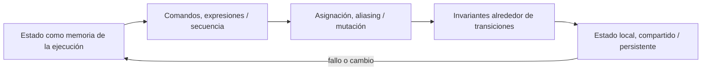
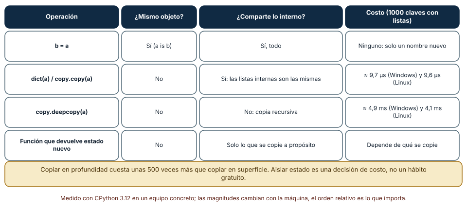
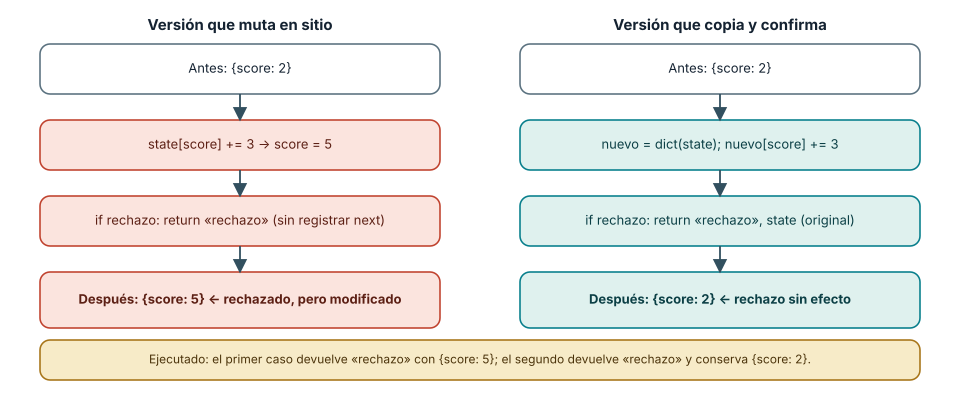
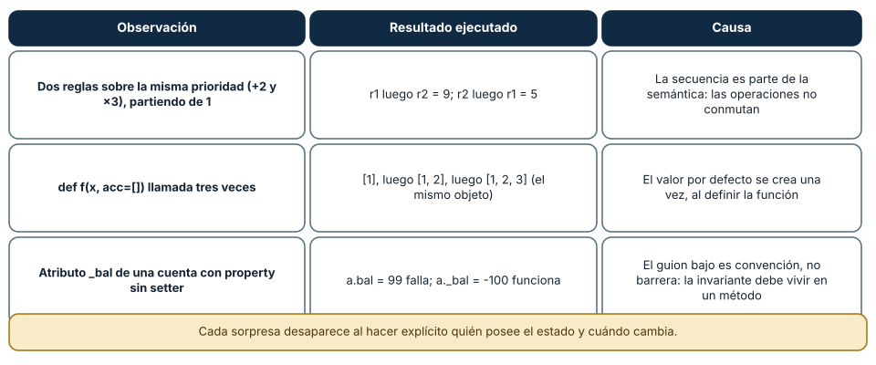

# SE-073 — Programación imperativa y estado mutable

[← SE-072 — Proyecto: herramienta de línea de comandos probada](https://github.com/vladimiracunadev-create/modern-software-engineering-program/blob/main/classes/part-05-fundamentos-de-programacion/se-072-proyecto-herramienta-de-linea-de-comandos-probada/README.md) · [↑ Parte 06](https://github.com/vladimiracunadev-create/modern-software-engineering-program/blob/main/classes/part-06-paradigmas-de-programacion/README.md) · [📚 Índice completo](https://github.com/vladimiracunadev-create/modern-software-engineering-program/blob/main/classes/README.md) · [🌐 Portal](https://vladimiracunadev-create.github.io/modern-software-engineering-program/classes/SE-073.html) · [SE-074 — Programación procedural y descomposición funcional →](https://github.com/vladimiracunadev-create/modern-software-engineering-program/blob/main/classes/part-06-paradigmas-de-programacion/se-074-programacion-procedural-y-descomposicion-funcional/README.md)


## Punto profesional y fundamento pedagógico

**Punto profesional.** La clase existe para usar estado mutable con propietario, vida útil e invariantes visibles.

**Por qué aparece aquí.** Se sitúa después de **Proyecto: herramienta de línea de comandos probada** y antes de **Programación procedural y descomposición funcional**: convierte el conocimiento anterior en una decisión observable que la clase siguiente podrá reutilizar. La continuidad se comprueba en el artefacto, no por compartir vocabulario.

**Error conceptual que debe corregir.** Suponer que asignación local evita aliasing o estados intermedios.

**Secuencia de aprendizaje.** Antes de leer la solución, el estudiante predice el resultado del caso normal y del error conceptual anterior. Luego explica un caso resuelto paso a paso, construye un contraejemplo que cambie la decisión y, sin consultar el texto, reconstruye el mecanismo y lo aplica a una entrada nueva. La secuencia usa predicción, explicación propia, contraste y recuperación. [ICAP](https://icap.education.asu.edu/research) distingue participación de construcción de conocimiento; [How People Learn II](https://nap.nationalacademies.org/catalog/24783/how-people-learn-ii-learners-contexts-and-cultures) exige conectar conocimiento previo, contexto y transferencia; la [práctica de recuperación](https://pubmed.ncbi.nlm.nih.gov/16507066/) respalda producir de nuevo la explicación tras una demora; y [Education for Life and Work](https://nap.nationalacademies.org/resource/13398/dbasse_084153.pdf) exige devolución que explique la causa del error.

**Evidencia de aprendizaje.** State-transitions.md con traza, alias, invariante y retorno temprano defectuoso. Debe contener predicción previa, observación, explicación causal, contraejemplo, criterio de aceptación y una nota de qué dato haría cambiar la conclusión.

**Límite de la conclusión.** El caso secuencial no resuelve concurrencia ni persistencia.

### Trazabilidad fuente → afirmación

| Fuente primaria u oficial | Afirmación que respalda | Lo que no prueba |
|---|---|---|
| [Python Language Reference](https://docs.python.org/3/reference/) | Semántica de sentencias, funciones, clases, generadores y corrutinas; autoridad: Python Software Foundation | No demuestra por sí sola que el artefacto del estudiante sea correcto. |
| [The Rust Programming Language](https://doc.rust-lang.org/stable/book/) | Ownership, enums, traits, errores y concurrencia sin carreras de datos; autoridad: Rust project | No demuestra por sí sola que el artefacto del estudiante sea correcto. |
| [SWEBOK Guide v4.0a](https://www.computer.org/education/bodies-of-knowledge/software-engineering) | Construcción, diseño y fundamentos profesionales; autoridad: IEEE Computer Society | No demuestra por sí sola que el artefacto del estudiante sea correcto. |

## Antes de empezar

Esta clase continúa el **motor de reglas comparado de la Parte 06**. Recupera la evidencia de la clase anterior, añade una decisión propia de **Programación imperativa y estado mutable** y deja un artefacto que la clase siguiente deberá consumir. La pregunta activa es: **¿Cómo cambia una decisión cuando el estado se modifica paso a paso?**

## Prerrequisitos

- Haber completado la clase anterior o reconstruir su contrato y evidencia.
- Python 3.11 o posterior, terminal, editor y Git; un segundo runtime es opcional y debe declararse.
- Trabajar con fixtures sintéticos: ninguna observación necesita datos de una persona o sistema real.

## Problema auténtico

El motor de reglas comparado acumula observaciones en una estructura compartida. Dos ramas actualizan prioridad y autorización; el resultado depende del orden y un retorno temprano deja el contador incoherente.

## Objetivos observables

Al terminar podrás explicar los cinco mecanismos de esta clase, predecir su comportamiento antes de ejecutar, construir un caso normal y uno límite, diagnosticar el fallo controlado, comparar una alternativa y entregar evidencia que otra persona pueda reproducir.

## Mapa conceptual



El mapa se lee como una cadena de razonamiento, no como fases obligatorias del runtime. La flecha de retorno indica que un fallo o cambio de requisito obliga a revisar el modelo inicial; no autoriza a parchear solo la última salida.

## Temas y por qué importan

| Tema | Por qué cambia una decisión profesional | Evidencia mínima |
|---|---|---|
| Estado como memoria de la ejecución | Una variable mutable conserva información entre instrucciones. | Predicción, traza causal y contraejemplo de **Estado como memoria de la ejecución** en `state-transitions.md` |
| Comandos, expresiones y secuencia | Un comando produce un efecto; una expresión produce un valor, aunque algunos lenguajes permiten mezclar ambos papeles. | Predicción, traza causal y contraejemplo de **Comandos, expresiones y secuencia** en `state-transitions.md` |
| Asignación, aliasing y mutación | Dos nombres pueden referirse al mismo objeto mutable. | Predicción, traza causal y contraejemplo de **Asignación, aliasing y mutación** en `state-transitions.md` |
| Invariantes alrededor de transiciones | La disciplina no consiste en prohibir mutación, sino en acotarla. | Predicción, traza causal y contraejemplo de **Invariantes alrededor de transiciones** en `state-transitions.md` |
| Estado local, compartido y persistente | El estado local desaparece al terminar la activación; el compartido puede ser observado por varios componentes; el persistente sobrevive al proceso. | Predicción, traza causal y contraejemplo de **Estado local, compartido y persistente** en `state-transitions.md` |
## Conceptos y decisiones

### 1. Estado como memoria de la ejecución

Una variable mutable conserva información entre instrucciones. El mecanismo es temporal: leer obtiene el valor actual, asignar lo reemplaza y la siguiente instrucción observa la nueva versión. Esa comodidad exige identificar propietario, vida útil e invariante; de otro modo el resultado depende de un orden que el nombre de la función no revela.

### 2. Comandos, expresiones y secuencia

Un comando produce un efecto; una expresión produce un valor, aunque algunos lenguajes permiten mezclar ambos papeles. La secuencia impone un antes y un después. Reordenar dos comandos solo es seguro cuando no comparten dependencias ni efectos, una condición que debe demostrarse y no asumirse.

### 3. Asignación, aliasing y mutación

Dos nombres pueden referirse al mismo objeto mutable. Modificar mediante un alias cambia lo visto por el otro sin que exista una nueva asignación local. Copia superficial, copia profunda e inmutabilidad resuelven problemas distintos; copiar indiscriminadamente también puede romper identidad o elevar el costo.

### 4. Invariantes alrededor de transiciones

La disciplina no consiste en prohibir mutación, sino en acotarla. Antes de una transición se comprueban precondiciones; después deben sostenerse invariantes como prioridad no negativa y autorización preservada. Una función que deja estado intermedio observable rompe el razonamiento incluso si luego intenta repararlo.

### 5. Estado local, compartido y persistente

El estado local desaparece al terminar la activación; el compartido puede ser observado por varios componentes; el persistente sobrevive al proceso. Tratarlos como equivalentes oculta concurrencia, fallos parciales y recuperación. El motor de reglas comparado empieza con estado local y documenta explícitamente cuándo una frontera obliga a otro modelo.

### Alias y copias: tres niveles de aislamiento

Asignar `b = a` no copia nada: crea otro nombre para el mismo objeto, y por eso `b["score"] += 3` cambia lo que ve `a`. La confusión empieza porque en lenguajes con variables que contienen valores la asignación copia, y en Python (y en Java, JavaScript o C# con tipos por referencia) enlaza. Una prueba ejecutada lo muestra: tras `b = a`, `a is b` es `True` y el puntaje de `a` pasó de 2 a 5 sin que nadie lo tocara.

La copia superficial (`dict(a)` o `copy.copy(a)`) crea un contenedor nuevo pero conserva las mismas referencias internas: al añadir un elemento a una lista interna de la copia, la original lo ve (`['x', 'y']` en ambas). La copia profunda (`copy.deepcopy`) aísla todo, a un precio. Con un diccionario de mil claves cuyas listas tenían cinco números, la copia superficial tardó unos 9,7 µs en Windows y 9,6 µs en Linux; la profunda, 4,9 ms y 4,1 ms, unas 500 veces más. Aislar estado es una decisión de costo, y conviene copiar solo la parte que va a cambiar.



**Cómo leer la figura.** Cada fila es una forma de «obtener otro estado»; las columnas dicen si el objeto es el mismo, qué se comparte y qué cuesta. **Dónde deja de valer:** los tiempos son de un diccionario sintético de mil claves con listas pequeñas; con objetos grandes o referencias circulares el orden de magnitud cambia, y `deepcopy` maneja ciclos mediante una tabla de memoria que añade más costo. La figura no dice cuál elegir: dice qué se compra con cada una.

### Retorno temprano y estado a medias

El fallo más común del estado mutable no es la mutación, sino la mutación parcial. Una función que suma 3 al puntaje y luego, al detectar una condición de rechazo, devuelve sin registrar la acción siguiente deja `{score: 5}` mientras devuelve «rechazo». Quien la llamó ve un rechazo normal y, si reutiliza el mismo diccionario, la siguiente decisión parte de un estado que nadie aprobó. La ejecución de la clase lo muestra: el estado inicial `{score: 2}` terminó en `{score: 5}` tras un rechazo.

La corrección no es «no mutar nunca», sino acotar el cambio: se trabaja sobre una copia y solo al final se confirma. La versión que crea `nuevo = dict(state)`, modifica `nuevo` y devuelve el original si hay rechazo conservó `{score: 2}` (y `s2 is s` fue `True`: el objeto original no se tocó). El patrón se llama transacción en memoria: el estado intermedio existe solo en la copia, y el estado observable cambia en una sola operación. Es el mismo principio que la atomicidad de una base de datos, a escala de una función.



**Cómo leer la figura.** Las dos columnas siguen el mismo caso; los recuadros coral marcan los pasos que dejan el estado inconsistente. **Dónde deja de valer:** la copia protege frente a un retorno temprano, no frente a otro hilo que lea el diccionario mientras se copia; la concurrencia se trata en `SE-081`. Tampoco sirve cuando el estado es tan grande que copiarlo en cada llamada es inviable: ahí se necesitan estructuras con registro de cambios.

### Tres sorpresas de estado que se reproducen en un minuto

La primera es el **orden**: dos reglas que modifican la misma prioridad, `+2` y `×3`, partiendo de 1, dan 9 en un orden y 5 en el otro. Cuando las operaciones no conmutan, la secuencia es significado, y quien reordena líneas «por limpieza» cambia el programa. La segunda es el **argumento por defecto mutable**: `def f(x, acc=[])` crea la lista una sola vez, al definir la función, de modo que tres llamadas devolvieron `[1]`, `[1, 2]` y `[1, 2, 3]` sobre el mismo objeto. La solución idiomática es `acc=None` y crear la lista dentro. La tercera es la **privacidad por convención**: una propiedad sin setter rechaza `a.bal = 99`, pero `a._bal = -100` se acepta; el guion bajo comunica intención, no impone nada, así que la invariante (saldo no negativo) debe vivir dentro del método que modifica, no en el nombre del atributo.



**Cómo leer la figura.** Cada fila combina el experimento, el resultado ejecutado y la causa; las tres desaparecen cuando se declara quién posee el estado. **Dónde deja de valer:** son comportamientos de Python 3.12; en lenguajes con ownership, como Rust, el compilador rechaza buena parte del aliasing mutable, y en otros (C, por ejemplo) los argumentos por defecto no existen. La lección transferible es la pregunta, no la sintaxis: ¿quién puede cambiar esto, y cuándo?

## Definiciones de trabajo

- **estado como memoria de la ejecución:** una variable mutable conserva información entre instrucciones.
- **comandos, expresiones y secuencia:** un comando produce un efecto; una expresión produce un valor, aunque algunos lenguajes permiten mezclar ambos papeles.
- **asignación, aliasing y mutación:** dos nombres pueden referirse al mismo objeto mutable.
- **invariantes alrededor de transiciones:** la disciplina no consiste en prohibir mutación, sino en acotarla.
- **estado local, compartido y persistente:** el estado local desaparece al terminar la activación; el compartido puede ser observado por varios componentes; el persistente sobrevive al proceso.

Las definiciones son operativas para el motor de reglas comparado. No convierten términos con historia más amplia en sinónimos y deben contrastarse con la documentación primaria enlazada al final.

## Ejemplo mínimo

```python
state = {"score": 2, "authorized": True}
state["score"] += 3
if state["authorized"] and state["score"] >= 5:
    state["next"] = "inspect-transport"
assert state == {"score": 5, "authorized": True, "next": "inspect-transport"}
```

Antes de ejecutar, predice estado, resultado y error. Después registra versión, comando y salida. Si el fragmento es pseudocódigo o pertenece a otro lenguaje, etiquétalo como tal y no afirmes que fue ejecutado.

## Ejemplo profesional

En el motor de reglas comparado, una recomendación contiene acción, evidencia usada, versión de política y explicación. La implementación de esta clase debe conservar ese contrato aunque cambie la forma interna. El caso profesional no pregunta únicamente si devuelve una cadena: pregunta quién puede producirla, qué estado observa, cómo falla y qué rastro permite disputar una decisión incorrecta.

Compara el caso normal con autorización falsa, evidencia incompleta, empate y repetición. Un mecanismo es apropiado cuando esas diferencias quedan visibles y localizadas; es peligroso cuando dependen de orden accidental, estado oculto o una convención que el consumidor no puede conocer.

## Práctica guiada

1. Copia el contrato de entrada y salida antes de escribir implementación.
2. Predice el caso normal y un límite; identifica la invariante que no puede romperse.
3. Implementa la versión mínima sin I/O dentro del núcleo.
4. Ejecuta el caso y conserva comando, versión y salida bajo `evidence/`.
5. Introduce el fallo controlado, reduce la reproducción y formula dos hipótesis rivales.
6. Corrige la causa, añade regresión y ejecuta el conjunto completo.
7. Compara con otro paradigma o lenguaje indicando qué semántica se preserva.

## Ejercicios

1. **Alias:** predice qué imprime el fragmento `a = {"x": [1]}; b = dict(a); b["x"].append(2); print(a)` y explica en una línea por qué la copia superficial no aísla.
2. **Transacción:** reescribe `risky` con el patrón copiar-y-confirmar y añade una prueba que compare el estado antes y después de un rechazo.
3. **Orden:** construye dos reglas cuyo resultado dependa del orden y una prueba que falle si alguien las reordena; explica qué documentación evita el cambio accidental.
4. **Costo:** mide con `timeit` la copia superficial y la profunda de una estructura de tu dominio y decide, con números, cuál usarías en una función llamada diez mil veces por segundo.

## Reto verificable

Entrega implementación, fixtures, pruebas y un informe corto. Se aprueba si otra persona ejecuta desde checkout limpio, obtiene los mismos resultados y puede relacionar cada rama o transformación con una regla del dominio. No se aprueba por cantidad de archivos ni por usar la sintaxis característica del paradigma.

## Caso conductor

El motor de reglas comparado recibe una observación autorizada, evalúa reglas y devuelve una recomendación explicable. En esta clase, ejecuta el caso `latency_ms=900`, el límite `latency_ms=800`, el contraejemplo `authorized=false` y una entrada incompleta. Cambia después una sola regla y revisa qué archivos, pruebas y trazas debieron modificarse. Esa superficie de cambio alimenta la comparación final de la parte.

## Preguntas frecuentes

### ¿`copy.copy` basta para aislar un diccionario?

Solo si sus valores son inmutables (números, cadenas, tuplas de inmutables). Si contiene listas o diccionarios, la copia comparte esos objetos internos; la prueba de la clase añadió un elemento a una lista de la copia y la original lo reflejó.

### ¿Evitar la mutación es siempre mejor?

No. Copiar para actualizar un elemento de una lista de 10 000 tardó unos 98 µs frente a 81 ns en sitio (Parte 06, `SE-076`). Mutar en un ámbito pequeño y con propietario claro es más barato; el riesgo está en la mutación visible desde lejos.

### ¿Por qué `acc=[]` como argumento por defecto es un error si «funciona»?

Porque la lista se crea una vez, al ejecutar `def`, y todas las llamadas que no pasan `acc` la comparten. Funciona en la primera llamada y falla en la segunda, lo que lo hace difícil de detectar con una sola prueba.

### ¿Un guion bajo protege un atributo?

No. Es una convención de lectura: ningún mecanismo impide `a._bal = -100`. Para garantizar una invariante hay que validarla en el único método que cambia el atributo.

## Fallo controlado y diagnóstico

Introduce un retorno después de incrementar `score` pero antes de registrar `next`. La salida parece un rechazo normal, aunque el estado quedó parcialmente modificado. Captura el estado antes/después, formula la invariante y mueve la transición a una operación atómica a nivel del dominio.

Registra síntoma, entrada mínima, hipótesis, observación que descarta cada hipótesis, causa, corrección y prueba de regresión. No cambies simultáneamente implementación, fixture y expectativa.

Una práctica concreta: escribe `risky(state, fail)` como en esta clase, ejecútala con `fail=True` y comprueba que el estado cambió aunque se devolvió «rechazo». **Síntoma esperado:** `{score: 5}` tras un rechazo. **Hipótesis rivales:** (a) el rechazo debería revertir; (b) el contador debería incrementarse solo en aceptación. **Observación que las separa:** repetir la llamada tres veces; si el puntaje llega a 11, el estado acumula rechazos y la hipótesis (b) describe el requisito correcto. **Corrección:** calcular sobre una copia y devolver el original en el rechazo. **Prueba de regresión:** el diccionario original es idéntico (`is`) y tiene el mismo contenido después de un rechazo.

## Errores comunes y cómo corregirlos

| Síntoma | Causa | Corrección |
|---|---|---|
| La copia «aislada» cambia cuando se modifica la original | Copia superficial con listas o diccionarios internos | Copiar en profundidad solo lo mutable o usar estructuras inmutables |
| Un rechazo deja el puntaje distinto del inicial | Mutación antes de decidir el resultado | Calcular sobre una copia y confirmar al final |
| Una función acumula resultados entre llamadas | Argumento por defecto mutable | Usar `None` y crear el objeto dentro |
| Reordenar dos líneas cambia el resultado | Operaciones que no conmutan | Documentar el orden como parte del contrato y probarlo |
| Un saldo negativo aparece pese a la propiedad | La invariante vive en el nombre, no en el método | Validar en el único punto de escritura |

## Entorno y archivos clave

```text
work/SE-073/
├── README.md
├── rule_engine/
│   ├── domain.py
│   └── se_073.py
├── fixtures/cases.json
├── tests/test_se_073.py
└── evidence/diagnosis.md
```

El `README` declara plataforma, runtimes, comandos, limpieza y límites. Evita dependencias externas cuando la biblioteca estándar permita observar el mecanismo; si agregas una, fija procedencia y versión.

## Seguridad, ética y accesibilidad

- la autorización forma parte del dominio y no se infiere por ausencia de rechazo;
- no uses `eval`, reglas descargadas ni serialización insegura;
- limita colas, recursión, tamaño de entrada y tiempo de evaluación;
- redacta trazas y conserva una explicación textual además de color o animación;
- una recomendación automatizada debe poder revisarse, impugnarse y corregirse;
- respeta licencias de ejemplos y atribuye adaptaciones.

## Puente hacia el trabajo con agentes

Un agente que edita código o estructuras de datos comparte con el estudiante el mismo riesgo: modifica un objeto que otro paso del flujo también lee. Si el harness entrega a la herramienta una referencia al estado de la conversación en lugar de una copia, una herramienta que falla a medias deja el estado corrupto para el resto de la sesión. La práctica es la de esta clase: las herramientas trabajan sobre una copia o un delta y el estado compartido se actualiza en un solo punto, con registro de qué cambió. La Parte 08 vuelve sobre esto al hablar de contratos de herramientas.

## Transferencia

Traslada un fixture al segundo modelo o lenguaje. Compara representación de ausencia, error, mutabilidad, orden y cancelación. La transferencia está lograda cuando el contrato se conserva y las diferencias están explicadas, no cuando la sintaxis se parece.

## Evaluación y evidencia

| Criterio | Evidencia para aprobar |
|---|---|
| comprensión | explicación causal de los cinco mecanismos |
| corrección | normal, límite, inválido y contraejemplo |
| diseño | estado, efectos y contrato localizables |
| diagnóstico | reproducción mínima y regresión |
| transferencia | comparación semántica, no estética |
| reproducibilidad | versiones, comandos, salida y límites |


## Fuentes


- [Python Language Reference](https://docs.python.org/3/reference/) — Semántica de sentencias, funciones, clases, generadores y corrutinas; autoridad: Python Software Foundation.
- [The Rust Programming Language](https://doc.rust-lang.org/stable/book/) — Ownership, enums, traits, errores y concurrencia sin carreras de datos; autoridad: Rust project.
- [SWI-Prolog Reference Manual](https://www.swi-prolog.org/pldoc/man?section=intro) — Hechos, reglas, unificación, búsqueda y límites operacionales; autoridad: SWI-Prolog project.
- [ReactiveX Observable Contract](https://reactivex.io/documentation/contract.html) — Notificaciones, terminación, errores y control de flujo observable; autoridad: ReactiveX project.
- [Erlang System Documentation: Processes](https://www.erlang.org/doc/system/ref_man_processes.html) — Procesos, buzones, envío de mensajes, enlaces y monitores; autoridad: Erlang/OTP project.
- [SWEBOK Guide v4.0a](https://www.computer.org/education/bodies-of-knowledge/software-engineering) — Construcción, diseño y fundamentos profesionales; autoridad: IEEE Computer Society.

Fuentes verificadas para las mediciones de esta clase (enlaces comprobados con `curl` el 2026-11-13):

- [Python Data Model](https://docs.python.org/3/reference/datamodel.html) y [módulo `copy`](https://docs.python.org/3/library/copy.html): identidad de objetos, copia superficial y profunda; respaldan la figura 1.
- [Tutorial de Python, valores por defecto](https://docs.python.org/3/tutorial/controlflow.html): el valor por defecto se evalúa una vez; respalda la figura 3.
- [Modelo de ejecución de Python](https://docs.python.org/3/reference/executionmodel.html): nombres, ámbitos y enlace; respalda la distinción entre asignar y copiar.

Cada fuente respalda el mecanismo indicado; ninguna demuestra que la implementación del motor de reglas comparado sea correcta. Esa afirmación depende de fixtures, pruebas, trazas y revisión reproducible.

## Límites y siguiente paso

La ejecución secuencial no explica por sí sola concurrencia, persistencia ni consistencia distribuida. La siguiente clase reduce superficie mutable mediante procedimientos con contratos estrechos.

## Glosario

- **estado como memoria de la ejecución:** una variable mutable conserva información entre instrucciones.
- **comandos, expresiones y secuencia:** un comando produce un efecto; una expresión produce un valor, aunque algunos lenguajes permiten mezclar ambos papeles.
- **asignación, aliasing y mutación:** dos nombres pueden referirse al mismo objeto mutable.
- **invariantes alrededor de transiciones:** la disciplina no consiste en prohibir mutación, sino en acotarla.
- **estado local, compartido y persistente:** el estado local desaparece al terminar la activación; el compartido puede ser observado por varios componentes; el persistente sobrevive al proceso.

---

[← SE-072 — Proyecto: herramienta de línea de comandos probada](https://github.com/vladimiracunadev-create/modern-software-engineering-program/blob/main/classes/part-05-fundamentos-de-programacion/se-072-proyecto-herramienta-de-linea-de-comandos-probada/README.md) · [↑ Parte 06](https://github.com/vladimiracunadev-create/modern-software-engineering-program/blob/main/classes/part-06-paradigmas-de-programacion/README.md) · [📚 Índice completo](https://github.com/vladimiracunadev-create/modern-software-engineering-program/blob/main/classes/README.md) · [🌐 Portal](https://vladimiracunadev-create.github.io/modern-software-engineering-program/classes/SE-073.html) · [SE-074 — Programación procedural y descomposición funcional →](https://github.com/vladimiracunadev-create/modern-software-engineering-program/blob/main/classes/part-06-paradigmas-de-programacion/se-074-programacion-procedural-y-descomposicion-funcional/README.md)
