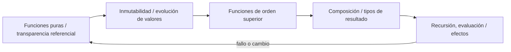
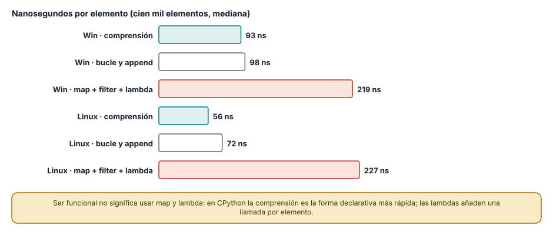
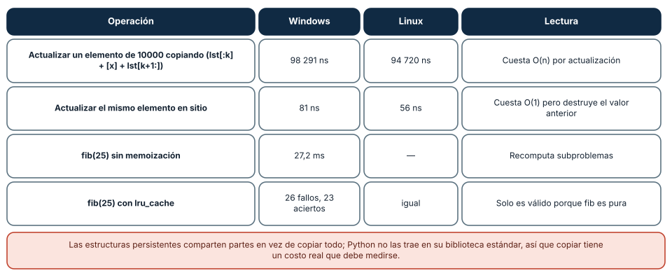
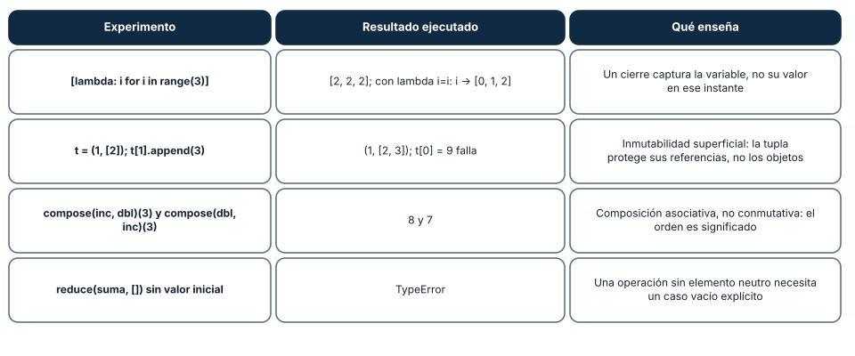

# SE-076 — Programación funcional, composición e inmutabilidad

[← SE-075 — Orientación a objetos, mensajes y encapsulación](https://github.com/vladimiracunadev-create/modern-software-engineering-program/blob/main/classes/part-06-paradigmas-de-programacion/se-075-orientacion-a-objetos-mensajes-y-encapsulacion/README.md) · [↑ Parte 06](https://github.com/vladimiracunadev-create/modern-software-engineering-program/blob/main/classes/part-06-paradigmas-de-programacion/README.md) · [📚 Índice completo](https://github.com/vladimiracunadev-create/modern-software-engineering-program/blob/main/classes/README.md) · [🌐 Portal](https://vladimiracunadev-create.github.io/modern-software-engineering-program/classes/SE-076.html) · [SE-077 — Programación declarativa y basada en reglas →](https://github.com/vladimiracunadev-create/modern-software-engineering-program/blob/main/classes/part-06-paradigmas-de-programacion/se-077-programacion-declarativa-y-basada-en-reglas/README.md)


## Punto profesional y fundamento pedagógico

**Punto profesional.** La clase existe para razonar con composición, valores inmutables y efectos localizados.

**Por qué aparece aquí.** Se sitúa después de **Orientación a objetos, mensajes y encapsulación** y antes de **Programación declarativa y basada en reglas**: convierte el conocimiento anterior en una decisión observable que la clase siguiente podrá reutilizar. La continuidad se comprueba en el artefacto, no por compartir vocabulario.

**Error conceptual que debe corregir.** Llamar funcional a cualquier uso de map o lambda.

**Secuencia de aprendizaje.** Antes de leer la solución, el estudiante predice el resultado del caso normal y del error conceptual anterior. Luego explica un caso resuelto paso a paso, construye un contraejemplo que cambie la decisión y, sin consultar el texto, reconstruye el mecanismo y lo aplica a una entrada nueva. La secuencia usa predicción, explicación propia, contraste y recuperación. [ICAP](https://icap.education.asu.edu/research) distingue participación de construcción de conocimiento; [How People Learn II](https://nap.nationalacademies.org/catalog/24783/how-people-learn-ii-learners-contexts-and-cultures) exige conectar conocimiento previo, contexto y transferencia; la [práctica de recuperación](https://pubmed.ncbi.nlm.nih.gov/16507066/) respalda producir de nuevo la explicación tras una demora; y [Education for Life and Work](https://nap.nationalacademies.org/resource/13398/dbasse_084153.pdf) exige devolución que explique la causa del error.

**Evidencia de aprendizaje.** Composition.md con función pura, efecto aislado y contraste mutable. Debe contener predicción previa, observación, explicación causal, contraejemplo, criterio de aceptación y una nota de qué dato haría cambiar la conclusión.

**Límite de la conclusión.** Inmutabilidad puede trasladar costos y no elimina I/O.

### Trazabilidad fuente → afirmación

| Fuente primaria u oficial | Afirmación que respalda | Lo que no prueba |
|---|---|---|
| [Python Language Reference](https://docs.python.org/3/reference/) | Semántica de sentencias, funciones, clases, generadores y corrutinas; autoridad: Python Software Foundation | No demuestra por sí sola que el artefacto del estudiante sea correcto. |
| [The Rust Programming Language](https://doc.rust-lang.org/stable/book/) | Ownership, enums, traits, errores y concurrencia sin carreras de datos; autoridad: Rust project | No demuestra por sí sola que el artefacto del estudiante sea correcto. |
| [SWEBOK Guide v4.0a](https://www.computer.org/education/bodies-of-knowledge/software-engineering) | Construcción, diseño y fundamentos profesionales; autoridad: IEEE Computer Society | No demuestra por sí sola que el artefacto del estudiante sea correcto. |

## Antes de empezar

Esta clase continúa el **motor de reglas comparado de la Parte 06**. Recupera la evidencia de la clase anterior, añade una decisión propia de **Programación funcional, composición e inmutabilidad** y deja un artefacto que la clase siguiente deberá consumir. La pregunta activa es: **¿Qué se gana al expresar la decisión como transformación de valores sin efectos ocultos?**

## Prerrequisitos

- Haber completado la clase anterior o reconstruir su contrato y evidencia.
- Python 3.11 o posterior, terminal, editor y Git; un segundo runtime es opcional y debe declararse.
- Trabajar con fixtures sintéticos: ninguna observación necesita datos de una persona o sistema real.

## Problema auténtico

El motor de reglas comparado necesita evaluar la misma evidencia en pruebas, CLI y simulaciones paralelas. El núcleo orientado a objetos conserva cachés internas y el orden de llamadas cambia el resultado.

## Objetivos observables

Al terminar podrás explicar los cinco mecanismos de esta clase, predecir su comportamiento antes de ejecutar, construir un caso normal y uno límite, diagnosticar el fallo controlado, comparar una alternativa y entregar evidencia que otra persona pueda reproducir.

## Mapa conceptual



El mapa se lee como una cadena de razonamiento, no como fases obligatorias del runtime. La flecha de retorno indica que un fallo o cambio de requisito obliga a revisar el modelo inicial; no autoriza a parchear solo la última salida.

## Temas y por qué importan

| Tema | Por qué cambia una decisión profesional | Evidencia mínima |
|---|---|---|
| Funciones puras y transparencia referencial | Una función pura devuelve el mismo valor para los mismos argumentos y no modifica estado observable. | Predicción, traza causal y contraejemplo de **Funciones puras y transparencia referencial** en `composition.md` |
| Inmutabilidad y evolución de valores | En vez de cambiar un registro se produce otro que comparte o copia lo necesario. | Predicción, traza causal y contraejemplo de **Inmutabilidad y evolución de valores** en `composition.md` |
| Funciones de orden superior | Pasar una regla como valor permite parametrizar evaluación sin condicionales globales. | Predicción, traza causal y contraejemplo de **Funciones de orden superior** en `composition.md` |
| Composición y tipos de resultado | Funciones pequeñas se conectan cuando la salida de una satisface la entrada de otra. | Predicción, traza causal y contraejemplo de **Composición y tipos de resultado** en `composition.md` |
| Recursión, evaluación y efectos | La recursión describe estructuras inductivas, aunque Python no optimiza llamadas terminales y un bucle puede ser más seguro. | Predicción, traza causal y contraejemplo de **Recursión, evaluación y efectos** en `composition.md` |
## Conceptos y decisiones

### 1. Funciones puras y transparencia referencial

Una función pura devuelve el mismo valor para los mismos argumentos y no modifica estado observable. Esto permite sustituir una llamada por su resultado al razonar. Pureza no significa ausencia total de efectos en el programa: significa empujarlos a fronteras explícitas.

### 2. Inmutabilidad y evolución de valores

En vez de cambiar un registro se produce otro que comparte o copia lo necesario. Cada versión puede inspeccionarse y compararse. La inmutabilidad reduce aliasing, pero estructuras copiadas ingenuamente pueden costar memoria; las estructuras persistentes comparten internamente sin exponer mutación.

### 3. Funciones de orden superior

Pasar una regla como valor permite parametrizar evaluación sin condicionales globales. `map`, `filter` y `reduce` expresan transformaciones, pero una cadena excesiva puede ocultar orden, errores o complejidad. La forma debe servir al modelo y no demostrar virtuosismo sintáctico.

### 4. Composición y tipos de resultado

Funciones pequeñas se conectan cuando la salida de una satisface la entrada de otra. Un resultado explícito distingue éxito y error sin lanzar a distancia. La composición falla si cada paso usa convenciones distintas para ausencia, error o contexto.

### 5. Recursión, evaluación y efectos

La recursión describe estructuras inductivas, aunque Python no optimiza llamadas terminales y un bucle puede ser más seguro. La evaluación perezosa evita trabajo hasta consumirlo, pero también desplaza errores y vida de recursos. El motor de reglas comparado mide antes de adoptar cualquiera de las dos.

### Tres maneras de filtrar y por qué «funcional» no es «lento»

Filtrar los pares de una lista de cien mil números admite tres escrituras: una comprensión de listas, un bucle con `append` y la combinación `map` + `filter` con funciones anónimas. La medición, en nanosegundos por elemento, fue 93, 98 y 219 en Windows, y 56, 72 y 227 en Linux. La comprensión, que es la forma declarativa idiomática de Python, fue la más rápida o empató; `map` y `filter` con `lambda` fueron entre 2,4 y 4 veces más lentos, porque cada elemento ejecuta una llamada de función en el intérprete.

La lectura profesional separa dos cosas que suelen confundirse. El estilo funcional trata de expresar el resultado como una composición de transformaciones sin efectos; no obliga a usar `map` y `lambda`. En CPython, la comprensión cumple ese estilo y además es la más eficiente. Elegir una forma por «parecer funcional» sin medir produce código más lento y no más claro.



**Cómo leer la figura.** Las barras teal son la comprensión, las blancas el bucle con `append` y las coral `map`+`filter` con `lambda`; los pares Windows y Linux permiten ver que el orden se mantiene aunque cambie la magnitud. **Dónde deja de valer:** son funciones triviales sobre enteros; con funciones con nombre en lugar de `lambda`, o con pereza (`itertools`), el balance cambia. Tampoco mide legibilidad, que depende del equipo.

### El precio de no mutar: copiar para actualizar

La inmutabilidad elimina una clase de errores (nadie cambia el valor bajo tus pies) y se paga con copias. Actualizar un elemento de una lista de 10 000 construyendo una lista nueva (`lst[:k] + [x] + lst[k+1:]`) tardó unos 98 µs en Windows y 95 µs en Linux; hacerlo en sitio tardó 81 ns y 56 ns, unas 1200 y 1700 veces menos. Esa diferencia es la razón por la que existen las **estructuras persistentes**, que comparten partes entre versiones en lugar de copiarlo todo; la biblioteca estándar de Python no las incluye, así que en esta práctica copiar tiene su costo completo.

Un caso contrario muestra que la pureza también ahorra. `fib(25)` recursivo sin memoización tardó unos 27 ms en Windows; con `lru_cache` hizo 26 cálculos y 23 aciertos de caché. La memoización solo es válida porque `fib` es pura: el mismo argumento produce siempre el mismo valor y no hay efectos que omitir (comprobado en `SE-074`, donde una función con efecto perdió el efecto). Inmutabilidad y pureza compran razonamiento local; el precio está en las copias y se compensa con estructuras persistentes o con memoización.



**Cómo leer la figura.** Las dos primeras filas comparan una actualización con copia y en sitio; las dos últimas muestran una ganancia que solo la pureza permite. **Dónde deja de valer:** el costo de copiar crece con el tamaño de la lista y es lineal; con listas pequeñas la diferencia es de nanosegundos. Una estructura persistente (por ejemplo, en Clojure o en la biblioteca `pyrsistent`) tiene otro balance que aquí no se midió.

### Cierres, tuplas y composición: cuatro comportamientos que sorprenden

Un **cierre** captura la variable, no su valor. La lista `[lambda: i for i in range(3)]` devolvió `[2, 2, 2]` al llamar a cada función, porque todas leen `i` al invocarse, cuando el bucle ya terminó; fijar el valor con un argumento por defecto (`lambda i=i: i`) dio `[0, 1, 2]`. Una **tupla** es inmutable en sus referencias, no en sus contenidos: `t = (1, [2])` aceptó `t[1].append(3)` y quedó `(1, [2, 3])`, aunque `t[0] = 9` falló. La **composición** es asociativa pero no conmutativa: componer «sumar 1» y luego «duplicar» a 3 dio 8, y en orden inverso dio 7, así que el orden es significado. Y `reduce` sobre una lista vacía sin valor inicial lanzó `TypeError`: una operación sin elemento neutro necesita un caso vacío explícito.



**Cómo leer la figura.** Cada fila es un experimento ejecutado, su resultado y la lección. **Dónde deja de valer:** el comportamiento de cierres es el de Python; en JavaScript `let` en un bucle crea una variable nueva por iteración y el resultado sería distinto. La inmutabilidad superficial de la tupla se aplica a cualquier contenedor que guarde referencias.

## Definiciones de trabajo

- **funciones puras y transparencia referencial:** una función pura devuelve el mismo valor para los mismos argumentos y no modifica estado observable.
- **inmutabilidad y evolución de valores:** en vez de cambiar un registro se produce otro que comparte o copia lo necesario.
- **funciones de orden superior:** pasar una regla como valor permite parametrizar evaluación sin condicionales globales.
- **composición y tipos de resultado:** funciones pequeñas se conectan cuando la salida de una satisface la entrada de otra.
- **recursión, evaluación y efectos:** la recursión describe estructuras inductivas, aunque python no optimiza llamadas terminales y un bucle puede ser más seguro.

Las definiciones son operativas para el motor de reglas comparado. No convierten términos con historia más amplia en sinónimos y deben contrastarse con la documentación primaria enlazada al final.

## Ejemplo mínimo

```python
from dataclasses import replace

def add_evidence(state, item):
    return replace(state, evidence=state.evidence + (item,))

def eligible(rule, evidence):
    return rule.authorized and rule.predicate(evidence)
```

Antes de ejecutar, predice estado, resultado y error. Después registra versión, comando y salida. Si el fragmento es pseudocódigo o pertenece a otro lenguaje, etiquétalo como tal y no afirmes que fue ejecutado.

## Ejemplo profesional

En el motor de reglas comparado, una recomendación contiene acción, evidencia usada, versión de política y explicación. La implementación de esta clase debe conservar ese contrato aunque cambie la forma interna. El caso profesional no pregunta únicamente si devuelve una cadena: pregunta quién puede producirla, qué estado observa, cómo falla y qué rastro permite disputar una decisión incorrecta.

Compara el caso normal con autorización falsa, evidencia incompleta, empate y repetición. Un mecanismo es apropiado cuando esas diferencias quedan visibles y localizadas; es peligroso cuando dependen de orden accidental, estado oculto o una convención que el consumidor no puede conocer.

## Práctica guiada

1. Copia el contrato de entrada y salida antes de escribir implementación.
2. Predice el caso normal y un límite; identifica la invariante que no puede romperse.
3. Implementa la versión mínima sin I/O dentro del núcleo.
4. Ejecuta el caso y conserva comando, versión y salida bajo `evidence/`.
5. Introduce el fallo controlado, reduce la reproducción y formula dos hipótesis rivales.
6. Corrige la causa, añade regresión y ejecuta el conjunto completo.
7. Compara con otro paradigma o lenguaje indicando qué semántica se preserva.

## Ejercicios

1. **Medir:** repite las tres formas de filtrar con una función con nombre en lugar de `lambda` y explica el cambio.
2. **Cierre:** predice y corrige una lista de funciones creadas en un bucle que debe devolver `[0, 1, 2]`, y explica por qué la corrección funciona.
3. **Pureza:** escribe una función pura que calcule la prioridad de una regla y una impura que la lea de un archivo; decide cuál memoizas y por qué.
4. **Composición:** define `componer(*funciones)` y una prueba que verifique la asociatividad y que detecte que `componer(f, g)` no equivale a `componer(g, f)`.

## Reto verificable

Entrega implementación, fixtures, pruebas y un informe corto. Se aprueba si otra persona ejecuta desde checkout limpio, obtiene los mismos resultados y puede relacionar cada rama o transformación con una regla del dominio. No se aprueba por cantidad de archivos ni por usar la sintaxis característica del paradigma.

## Caso conductor

El motor de reglas comparado recibe una observación autorizada, evalúa reglas y devuelve una recomendación explicable. En esta clase, ejecuta el caso `latency_ms=900`, el límite `latency_ms=800`, el contraejemplo `authorized=false` y una entrada incompleta. Cambia después una sola regla y revisa qué archivos, pruebas y trazas debieron modificarse. Esa superficie de cambio alimenta la comparación final de la parte.

## Preguntas frecuentes

### ¿La programación funcional es siempre más lenta?

No. En CPython, la comprensión (forma declarativa) igualó o superó al bucle imperativo; lo lento fue `map` con `lambda`. La velocidad depende de qué hace el intérprete por elemento, no del paradigma.

### ¿Inmutable significa que no se puede cambiar nada?

Significa que un valor no cambia después de creado; se «cambia» creando otro. La tupla de la clase conserva sus referencias, pero si una referencia apunta a una lista mutable, esa lista sí cambia: la inmutabilidad es superficial salvo que se garantice recursivamente.

### ¿Por qué mi lista de funciones devuelve siempre el último valor?

Porque cada función lee la variable del bucle cuando se llama, no cuando se crea. La variable ya valía 2 al terminar el bucle. Se corrige capturando el valor como argumento por defecto o con `functools.partial`.

### ¿Cuándo no conviene memoizar?

Cuando la función tiene efectos, depende del tiempo o de estado externo, o recibe argumentos que casi nunca se repiten: la caché ocupa memoria y no produce aciertos.

## Fallo controlado y diagnóstico

Inserta una consulta al reloj dentro de `eligible`; la misma entrada cambia entre ejecuciones. Pasa `now` como valor de contexto y congélalo en pruebas para restaurar determinismo.

Registra síntoma, entrada mínima, hipótesis, observación que descarta cada hipótesis, causa, corrección y prueba de regresión. No cambies simultáneamente implementación, fixture y expectativa.

Práctica: crea `fs = [lambda: i for i in range(3)]` y llama a cada función. **Síntoma esperado:** `[2, 2, 2]`. **Hipótesis rivales:** (a) `range` devuelve valores incorrectos; (b) las lambdas leen `i` tarde. **Observación que las separa:** imprimir `list(range(3))` (correcto) y la versión con `i=i` (`[0, 1, 2]`). **Corrección:** capturar el valor en el momento de la creación. **Regresión:** una prueba que compara la lista de resultados con `[0, 1, 2]`, y otra que cambia `i` después de crear las funciones y comprueba que no se altera.

## Errores comunes y cómo corregirlos

| Síntoma | Causa | Corrección |
|---|---|---|
| Todas las funciones de una lista devuelven el último valor | Cierre que captura la variable y no su valor | Capturar con argumento por defecto o `partial` |
| Una «tupla inmutable» cambia | Contiene un objeto mutable | Usar contenidos inmutables o copiar al construir |
| `TypeError` al reducir una lista vacía | `reduce` sin valor inicial | Pasar un elemento neutro explícito |
| Resultados distintos al reordenar una composición | La composición no es conmutativa | Documentar y probar el orden |
| La caché devuelve resultados viejos | Se memoizó una función que depende de estado externo | Memoizar solo funciones puras |

## Entorno y archivos clave

```text
work/SE-076/
├── README.md
├── rule_engine/
│   ├── domain.py
│   └── se_076.py
├── fixtures/cases.json
├── tests/test_se_076.py
└── evidence/diagnosis.md
```

El `README` declara plataforma, runtimes, comandos, limpieza y límites. Evita dependencias externas cuando la biblioteca estándar permita observar el mecanismo; si agregas una, fija procedencia y versión.

## Seguridad, ética y accesibilidad

- la autorización forma parte del dominio y no se infiere por ausencia de rechazo;
- no uses `eval`, reglas descargadas ni serialización insegura;
- limita colas, recursión, tamaño de entrada y tiempo de evaluación;
- redacta trazas y conserva una explicación textual además de color o animación;
- una recomendación automatizada debe poder revisarse, impugnarse y corregirse;
- respeta licencias de ejemplos y atribuye adaptaciones.

## Puente hacia el trabajo con agentes

Los marcos de agentes tratan cada paso como una función de estado a estado, y las trazas son más fáciles de reproducir cuando esa función es pura: misma entrada, misma salida. La práctica de esta clase es la de dejar los efectos (llamar a un modelo, escribir en disco) en los bordes y mantener el núcleo que decide como funciones puras que se pueden repetir y probar con fixtures. Un registro inmutable de eventos (en lugar de un estado que se sobrescribe) también permite reconstruir qué vio el agente en cada paso, lo que las partes de evaluación y de observabilidad aprovechan.

## Transferencia

Traslada un fixture al segundo modelo o lenguaje. Compara representación de ausencia, error, mutabilidad, orden y cancelación. La transferencia está lograda cuando el contrato se conserva y las diferencias están explicadas, no cuando la sintaxis se parece.

## Evaluación y evidencia

| Criterio | Evidencia para aprobar |
|---|---|
| comprensión | explicación causal de los cinco mecanismos |
| corrección | normal, límite, inválido y contraejemplo |
| diseño | estado, efectos y contrato localizables |
| diagnóstico | reproducción mínima y regresión |
| transferencia | comparación semántica, no estética |
| reproducibilidad | versiones, comandos, salida y límites |


## Fuentes


- [Python Language Reference](https://docs.python.org/3/reference/) — Semántica de sentencias, funciones, clases, generadores y corrutinas; autoridad: Python Software Foundation.
- [The Rust Programming Language](https://doc.rust-lang.org/stable/book/) — Ownership, enums, traits, errores y concurrencia sin carreras de datos; autoridad: Rust project.
- [SWI-Prolog Reference Manual](https://www.swi-prolog.org/pldoc/man?section=intro) — Hechos, reglas, unificación, búsqueda y límites operacionales; autoridad: SWI-Prolog project.
- [ReactiveX Observable Contract](https://reactivex.io/documentation/contract.html) — Notificaciones, terminación, errores y control de flujo observable; autoridad: ReactiveX project.
- [Erlang System Documentation: Processes](https://www.erlang.org/doc/system/ref_man_processes.html) — Procesos, buzones, envío de mensajes, enlaces y monitores; autoridad: Erlang/OTP project.
- [SWEBOK Guide v4.0a](https://www.computer.org/education/bodies-of-knowledge/software-engineering) — Construcción, diseño y fundamentos profesionales; autoridad: IEEE Computer Society.

Fuentes verificadas para las mediciones de esta clase (enlaces comprobados con `curl` el 2026-11-13):

- [Programación funcional HOWTO](https://docs.python.org/3/howto/functional.html), [`itertools`](https://docs.python.org/3/library/itertools.html) y [`functools`](https://docs.python.org/3/library/functools.html): comprensiones, iteradores, composición y `lru_cache`; respaldan las figuras 1 y 2.
- [Gotchas de Python: late binding de cierres](https://docs.python-guide.org/writing/gotchas/): captura tardía de variables; respalda la figura 3.
- [Python Data Model](https://docs.python.org/3/reference/datamodel.html): inmutabilidad de tuplas y cadenas y semántica de objetos.
- Hughes, J. (1989), «Why Functional Programming Matters», *The Computer Journal* 32(2), [doi:10.1093/comjnl/32.2.98](https://doi.org/10.1093/comjnl/32.2.98): composición y modularidad como argumento central. El editor devolvió 403 a `curl`, por lo que el DOI no se verificó por red.

Cada fuente respalda el mecanismo indicado; ninguna demuestra que la implementación del motor de reglas comparado sea correcta. Esa afirmación depende de fixtures, pruebas, trazas y revisión reproducible.

## Límites y siguiente paso

Pureza y composición no resuelven automáticamente interacción, latencia ni grandes flujos. La siguiente clase expresa el resultado deseado como reglas declarativas.

## Glosario

- **funciones puras y transparencia referencial:** una función pura devuelve el mismo valor para los mismos argumentos y no modifica estado observable.
- **inmutabilidad y evolución de valores:** en vez de cambiar un registro se produce otro que comparte o copia lo necesario.
- **funciones de orden superior:** pasar una regla como valor permite parametrizar evaluación sin condicionales globales.
- **composición y tipos de resultado:** funciones pequeñas se conectan cuando la salida de una satisface la entrada de otra.
- **recursión, evaluación y efectos:** la recursión describe estructuras inductivas, aunque python no optimiza llamadas terminales y un bucle puede ser más seguro.

---

[← SE-075 — Orientación a objetos, mensajes y encapsulación](https://github.com/vladimiracunadev-create/modern-software-engineering-program/blob/main/classes/part-06-paradigmas-de-programacion/se-075-orientacion-a-objetos-mensajes-y-encapsulacion/README.md) · [↑ Parte 06](https://github.com/vladimiracunadev-create/modern-software-engineering-program/blob/main/classes/part-06-paradigmas-de-programacion/README.md) · [📚 Índice completo](https://github.com/vladimiracunadev-create/modern-software-engineering-program/blob/main/classes/README.md) · [🌐 Portal](https://vladimiracunadev-create.github.io/modern-software-engineering-program/classes/SE-076.html) · [SE-077 — Programación declarativa y basada en reglas →](https://github.com/vladimiracunadev-create/modern-software-engineering-program/blob/main/classes/part-06-paradigmas-de-programacion/se-077-programacion-declarativa-y-basada-en-reglas/README.md)
