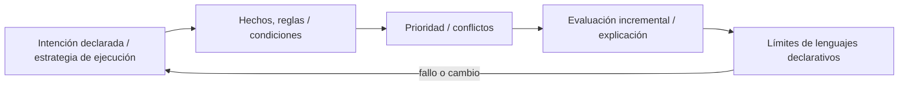
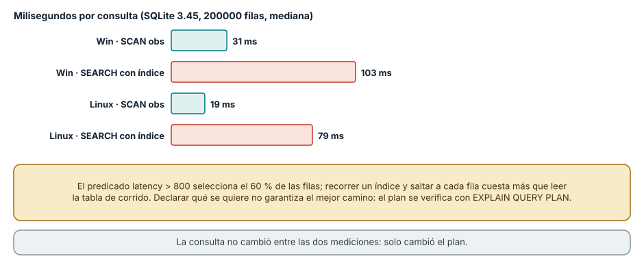
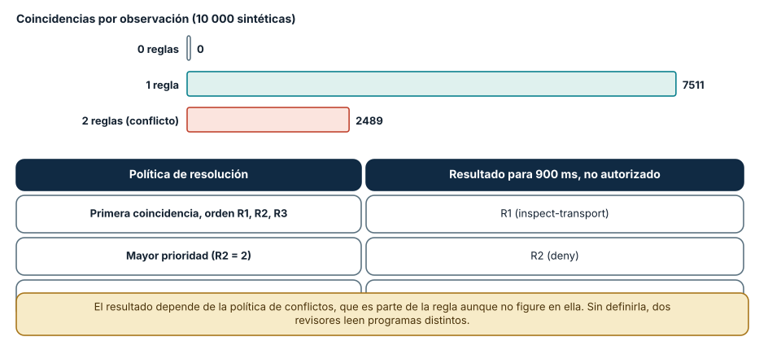
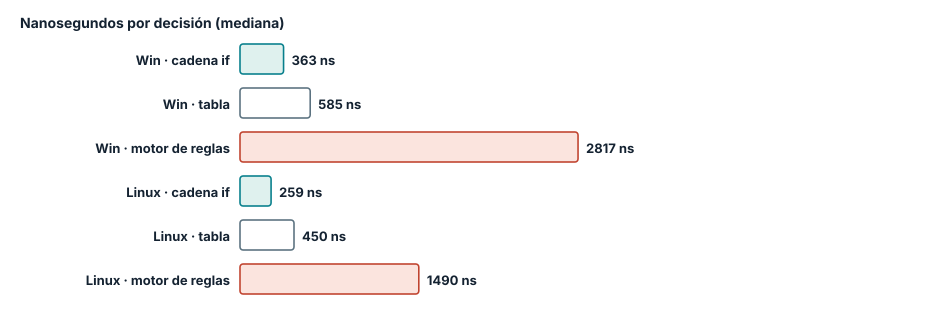

# SE-077 — Programación declarativa y basada en reglas

[← SE-076 — Programación funcional, composición e inmutabilidad](https://github.com/vladimiracunadev-create/modern-software-engineering-program/blob/main/classes/part-06-paradigmas-de-programacion/se-076-programacion-funcional-composicion-e-inmutabilidad/README.md) · [↑ Parte 06](https://github.com/vladimiracunadev-create/modern-software-engineering-program/blob/main/classes/part-06-paradigmas-de-programacion/README.md) · [📚 Índice completo](https://github.com/vladimiracunadev-create/modern-software-engineering-program/blob/main/classes/README.md) · [🌐 Portal](https://vladimiracunadev-create.github.io/modern-software-engineering-program/classes/SE-077.html) · [SE-078 — Programación lógica y resolución →](https://github.com/vladimiracunadev-create/modern-software-engineering-program/blob/main/classes/part-06-paradigmas-de-programacion/se-078-programacion-logica-y-resolucion/README.md)


## Punto profesional y fundamento pedagógico

**Punto profesional.** La clase existe para expresar el qué mediante relaciones o restricciones y reconocer el motor que decide el cómo.

**Por qué aparece aquí.** Se sitúa después de **Programación funcional, composición e inmutabilidad** y antes de **Programación lógica y resolución**: convierte el conocimiento anterior en una decisión observable que la clase siguiente podrá reutilizar. La continuidad se comprueba en el artefacto, no por compartir vocabulario.

**Error conceptual que debe corregir.** Confundir declarativo con ausencia de orden o costo.

**Secuencia de aprendizaje.** Antes de leer la solución, el estudiante predice el resultado del caso normal y del error conceptual anterior. Luego explica un caso resuelto paso a paso, construye un contraejemplo que cambie la decisión y, sin consultar el texto, reconstruye el mecanismo y lo aplica a una entrada nueva. La secuencia usa predicción, explicación propia, contraste y recuperación. [ICAP](https://icap.education.asu.edu/research) distingue participación de construcción de conocimiento; [How People Learn II](https://nap.nationalacademies.org/catalog/24783/how-people-learn-ii-learners-contexts-and-cultures) exige conectar conocimiento previo, contexto y transferencia; la [práctica de recuperación](https://pubmed.ncbi.nlm.nih.gov/16507066/) respalda producir de nuevo la explicación tras una demora; y [Education for Life and Work](https://nap.nationalacademies.org/resource/13398/dbasse_084153.pdf) exige devolución que explique la causa del error.

**Evidencia de aprendizaje.** Declarative-model.md con regla, consulta, plan observado y contraejemplo. Debe contener predicción previa, observación, explicación causal, contraejemplo, criterio de aceptación y una nota de qué dato haría cambiar la conclusión.

**Límite de la conclusión.** La sintaxis declarativa no garantiza optimización.

### Trazabilidad fuente → afirmación

| Fuente primaria u oficial | Afirmación que respalda | Lo que no prueba |
|---|---|---|
| [SWI-Prolog Reference Manual](https://www.swi-prolog.org/pldoc/man?section=intro) | Hechos, reglas, unificación, búsqueda y límites operacionales; autoridad: SWI-Prolog project | No demuestra por sí sola que el artefacto del estudiante sea correcto. |
| [SWEBOK Guide v4.0a](https://www.computer.org/education/bodies-of-knowledge/software-engineering) | Construcción, diseño y fundamentos profesionales; autoridad: IEEE Computer Society | No demuestra por sí sola que el artefacto del estudiante sea correcto. |

## Antes de empezar

Esta clase continúa el **motor de reglas comparado de la Parte 06**. Recupera la evidencia de la clase anterior, añade una decisión propia de **Programación declarativa y basada en reglas** y deja un artefacto que la clase siguiente deberá consumir. La pregunta activa es: **¿Qué significa declarar una relación sin fijar todos los pasos para obtenerla?**

## Prerrequisitos

- Haber completado la clase anterior o reconstruir su contrato y evidencia.
- Python 3.11 o posterior, terminal, editor y Git; un segundo runtime es opcional y debe declararse.
- Trabajar con fixtures sintéticos: ninguna observación necesita datos de una persona o sistema real.

## Problema auténtico

Las reglas del motor de reglas comparado cambian con frecuencia y están enterradas entre bucles y asignaciones. Producto puede describir condiciones, pero no auditar la precedencia ni detectar conflictos sin leer control imperativo.

## Objetivos observables

Al terminar podrás explicar los cinco mecanismos de esta clase, predecir su comportamiento antes de ejecutar, construir un caso normal y uno límite, diagnosticar el fallo controlado, comparar una alternativa y entregar evidencia que otra persona pueda reproducir.

## Mapa conceptual



El mapa se lee como una cadena de razonamiento, no como fases obligatorias del runtime. La flecha de retorno indica que un fallo o cambio de requisito obliga a revisar el modelo inicial; no autoriza a parchear solo la última salida.

## Temas y por qué importan

| Tema | Por qué cambia una decisión profesional | Evidencia mínima |
|---|---|---|
| Intención declarada y estrategia de ejecución | Una descripción declarativa especifica qué relación debe cumplirse y delega parte del cómo a un motor. | Predicción, traza causal y contraejemplo de **Intención declarada y estrategia de ejecución** en `declarative-model.md` |
| Hechos, reglas y condiciones | Un hecho representa una observación; una regla deriva una consecuencia cuando su antecedente se satisface. | Predicción, traza causal y contraejemplo de **Hechos, reglas y condiciones** en `declarative-model.md` |
| Prioridad y conflictos | Dos reglas pueden habilitar acciones incompatibles. | Predicción, traza causal y contraejemplo de **Prioridad y conflictos** en `declarative-model.md` |
| Evaluación incremental y explicación | Un motor puede reevaluar todo o actualizar solo consecuencias afectadas por hechos nuevos. | Predicción, traza causal y contraejemplo de **Evaluación incremental y explicación** en `declarative-model.md` |
| Límites de lenguajes declarativos | Expresar estado temporal, efectos externos o algoritmos irregulares puede volverse difícil. | Predicción, traza causal y contraejemplo de **Límites de lenguajes declarativos** en `declarative-model.md` |
## Conceptos y decisiones

### 1. Intención declarada y estrategia de ejecución

Una descripción declarativa especifica qué relación debe cumplirse y delega parte del cómo a un motor. SQL, CSS y sistemas de reglas no son equivalentes, pero comparten esa separación. El costo y el orden no desaparecen: quedan en el planificador, la especificidad o la estrategia de resolución.

### 2. Hechos, reglas y condiciones

Un hecho representa una observación; una regla deriva una consecuencia cuando su antecedente se satisface. Las reglas necesitan vocabulario, tipos y alcance temporal. Una condición ambigua como `high_latency` debe vincularse a unidad, umbral y fuente de medición.

### 3. Prioridad y conflictos

Dos reglas pueden habilitar acciones incompatibles. Salience, orden textual o una política explícita deciden cuál vence. Confiar en un orden accidental hace que añadir una regla cambie otra sin señal; el motor de reglas comparado conserva una matriz de conflictos y exige desempate documentado.

### 4. Evaluación incremental y explicación

Un motor puede reevaluar todo o actualizar solo consecuencias afectadas por hechos nuevos. La segunda opción mejora escala pero mantiene dependencias internas. Cada recomendación debe incluir reglas activadas y hechos usados para que una persona pueda revisar la decisión.

### 5. Límites de lenguajes declarativos

Expresar estado temporal, efectos externos o algoritmos irregulares puede volverse difícil. Insertar funciones opacas dentro de reglas recupera poder pero pierde análisis y portabilidad. Una capa declarativa sirve cuando el dominio comparte un vocabulario estable y auditable.

### Declarar qué se quiere no garantiza el mejor camino

Una consulta SQL es declarativa: dice qué filas se necesitan, no cómo recorrerlas. El motor elige un plan. Con 200 000 filas de observaciones, la consulta `select count(*) where latency > 800 and auth = 1` (que devolvió 60 000) usó un `SCAN` de toda la tabla en 31 ms (Windows) y 19 ms (Linux). Tras crear un índice sobre la latencia, `EXPLAIN QUERY PLAN` informó `SEARCH obs USING INDEX ix (latency>?)`, y la misma consulta, sin tocarla, tardó 103 ms y 79 ms: entre tres y cuatro veces más lenta.

La causa es la selectividad. El predicado `latency > 800` selecciona el 60 % de las filas; recorrer un índice y saltar a cada fila de la tabla cuesta más que leerla de corrido. Un índice ayuda cuando el predicado descarta la mayoría de las filas. La documentación de SQLite lo anticipa: el planificador estima costos, y las estimaciones pueden equivocarse sin estadísticas actualizadas. La lección para el paradigma es doble: lo declarativo traslada el «cómo» al motor, y por eso el plan (aquí `EXPLAIN QUERY PLAN`) es una evidencia que hay que mirar, no un detalle de implementación.



**Cómo leer la figura.** Las barras teal son el plan de recorrido completo y las coral el plan con índice; la consulta es la misma en ambos casos. **Dónde deja de valer:** el resultado depende de la selectividad del predicado y de SQLite 3.45 con una base en memoria; con un predicado que descartara el 99 % de las filas, el índice ganaría. Otros motores (PostgreSQL, por ejemplo) tienen estadísticas y planificadores distintos que no se probaron.

### Cuando dos reglas se activan a la vez

Un sistema basado en reglas tiene una pregunta que el código imperativo responde por la posición de las líneas: ¿qué ocurre cuando varias reglas aplican? En el motor de la clase, con tres reglas (R1: latencia mayor que 800 recomienda inspección; R2: latencia mayor que 800 y sin autorización recomienda denegar; R3: latencia hasta 800 no actúa) y diez mil observaciones aleatorias, ninguna quedó sin regla, 7511 activaron una y 2489 activaron dos. Esas 2489 son el espacio de conflicto.

Con la política «primera coincidencia», una observación de 900 ms sin autorización dio R1 en el orden original y R2 en el orden invertido; con la política «mayor prioridad» dio R2 en ambos. Moraleja: la política de resolución de conflictos es parte del significado de las reglas aunque no figure en ninguna, y un cambio de orden en una lista que parece un conjunto altera decisiones. Se documenta, se prueba con las observaciones que activan varias reglas y se mide cuántas observaciones caen en conflicto, que es un indicador de salud del conjunto.



**Cómo leer la figura.** Las barras cuentan observaciones por número de reglas activadas; la tabla muestra la decisión para el mismo caso según la política. **Dónde deja de valer:** las observaciones son sintéticas y uniformes, no de producción; el motor no usa un algoritmo de encadenamiento hacia delante como Rete, que organiza reglas de forma eficiente para miles de ellas.

### Tres codificaciones de la misma decisión

La misma decisión (denegar, inspeccionar o no actuar) se escribió como cadena de `if`, como tabla de decisión por tupla de booleanos y como motor que evalúa reglas como datos. Los costos por decisión en Windows fueron 363 ns, 585 ns y 2817 ns; en Linux, 259, 450 y 1490 ns. El motor cuesta entre cinco y ocho veces más que la cadena.

Lo que compra ese costo es otra cosa: las reglas son datos que se pueden listar, contar, probar una por una y cambiar sin editar la lógica de evaluación. Una cadena de `if` que crece a 80 ramas se vuelve ilegible y nadie sabe cuántos casos distintos cubre; una tabla de reglas permite preguntar qué observaciones no activan ninguna. Cuando las reglas son pocas y estables, la cadena es la mejor opción. Cuando cambian a menudo, las revisa gente que no programa o requieren auditoría, el costo de interpretación se justifica.



**Cómo leer la figura.** Cada barra es la misma decisión con una codificación distinta; el motor de reglas paga la interpretación. **Dónde deja de valer:** el microbenchmark evalúa una observación sin E/S; en un servicio real el costo de la regla suele ser despreciable frente a la red. Lo que no se midió es el costo humano de mantener 80 ramas frente a 80 filas.

## Definiciones de trabajo

- **intención declarada y estrategia de ejecución:** una descripción declarativa especifica qué relación debe cumplirse y delega parte del cómo a un motor.
- **hechos, reglas y condiciones:** un hecho representa una observación; una regla deriva una consecuencia cuando su antecedente se satisface.
- **prioridad y conflictos:** dos reglas pueden habilitar acciones incompatibles.
- **evaluación incremental y explicación:** un motor puede reevaluar todo o actualizar solo consecuencias afectadas por hechos nuevos.
- **límites de lenguajes declarativos:** expresar estado temporal, efectos externos o algoritmos irregulares puede volverse difícil.

Las definiciones son operativas para el motor de reglas comparado. No convierten términos con historia más amplia en sinónimos y deben contrastarse con la documentación primaria enlazada al final.

## Ejemplo mínimo

```python
rules = [
    {"when": {"authorized": True, "latency_ms_gte": 800},
     "then": "inspect-transport", "priority": 20},
    {"when": {"dns_failed": True},
     "then": "inspect-dns", "priority": 30},
]
```

Antes de ejecutar, predice estado, resultado y error. Después registra versión, comando y salida. Si el fragmento es pseudocódigo o pertenece a otro lenguaje, etiquétalo como tal y no afirmes que fue ejecutado.

## Ejemplo profesional

En el motor de reglas comparado, una recomendación contiene acción, evidencia usada, versión de política y explicación. La implementación de esta clase debe conservar ese contrato aunque cambie la forma interna. El caso profesional no pregunta únicamente si devuelve una cadena: pregunta quién puede producirla, qué estado observa, cómo falla y qué rastro permite disputar una decisión incorrecta.

Compara el caso normal con autorización falsa, evidencia incompleta, empate y repetición. Un mecanismo es apropiado cuando esas diferencias quedan visibles y localizadas; es peligroso cuando dependen de orden accidental, estado oculto o una convención que el consumidor no puede conocer.

## Práctica guiada

1. Copia el contrato de entrada y salida antes de escribir implementación.
2. Predice el caso normal y un límite; identifica la invariante que no puede romperse.
3. Implementa la versión mínima sin I/O dentro del núcleo.
4. Ejecuta el caso y conserva comando, versión y salida bajo `evidence/`.
5. Introduce el fallo controlado, reduce la reproducción y formula dos hipótesis rivales.
6. Corrige la causa, añade regresión y ejecuta el conjunto completo.
7. Compara con otro paradigma o lenguaje indicando qué semántica se preserva.

## Ejercicios

1. **Plan:** crea una tabla de 100 000 filas, ejecuta `EXPLAIN QUERY PLAN` de una consulta con un predicado que descarta el 99 % de las filas, compara con y sin índice y explica el resultado frente al de la clase.
2. **Conflictos:** cuenta cuántas de tus observaciones de prueba activan más de una regla y escribe la política que las resuelve.
3. **Cobertura:** encuentra una observación válida que no active ninguna regla en tu conjunto y decide si falta una regla o una regla por defecto.
4. **Codificación:** convierte tu cadena de condiciones a una lista de reglas como datos y comprueba con una prueba diferencial que ambas dan lo mismo en 10 000 entradas.

## Reto verificable

Entrega implementación, fixtures, pruebas y un informe corto. Se aprueba si otra persona ejecuta desde checkout limpio, obtiene los mismos resultados y puede relacionar cada rama o transformación con una regla del dominio. No se aprueba por cantidad de archivos ni por usar la sintaxis característica del paradigma.

## Caso conductor

El motor de reglas comparado recibe una observación autorizada, evalúa reglas y devuelve una recomendación explicable. En esta clase, ejecuta el caso `latency_ms=900`, el límite `latency_ms=800`, el contraejemplo `authorized=false` y una entrada incompleta. Cambia después una sola regla y revisa qué archivos, pruebas y trazas debieron modificarse. Esa superficie de cambio alimenta la comparación final de la parte.

## Preguntas frecuentes

### ¿Declarativo significa que no hay orden?

No siempre. SQL no fija el orden de evaluación, pero un sistema de reglas de «primera coincidencia» sí lo fija, y la clase mostró que invertir la lista cambió una decisión. Hay que saber qué política usa cada motor.

### ¿Por qué un índice puede hacer más lenta una consulta?

Porque acceder a muchas filas por el índice implica saltos aleatorios que cuestan más que leer la tabla secuencialmente. El índice conviene cuando el predicado selecciona pocas filas.

### ¿Cuándo conviene sacar las reglas del código?

Cuando cambian con más frecuencia que el código, las revisa quien no programa o hay que auditar cuáles se aplicaron. Si son tres y estables, una cadena de condiciones es más simple.

### ¿Cómo sé si mis reglas son completas?

Generando entradas (incluidas las inválidas) y contando cuántas activan cero, una o varias reglas. En la clase, ninguna de 10 000 quedó sin regla, pero un dato `None` lanzó `TypeError`: la completitud también incluye los datos que no son del tipo esperado.

## Fallo controlado y diagnóstico

Crea dos reglas de igual prioridad que recomiendan acciones incompatibles. Verifica que el motor no dependa del orden del archivo: debe devolver conflicto explícito o aplicar un desempate publicado.

Registra síntoma, entrada mínima, hipótesis, observación que descarta cada hipótesis, causa, corrección y prueba de regresión. No cambies simultáneamente implementación, fixture y expectativa.

Práctica: ejecuta la regla R1 con una observación cuya latencia es `None`. **Síntoma esperado:** `TypeError: '>' not supported between instances of 'NoneType' and 'int'`, que escapa del motor en lugar de producir una decisión de rechazo. **Hipótesis rivales:** (a) la regla está mal escrita; (b) falta una regla de validación previa. **Observación que las separa:** una observación válida pasa; una incompleta falla antes de evaluar reglas. **Corrección:** una regla de mayor prioridad (`R0`, rechazo por incompletitud) o una validación antes del motor. **Regresión:** una prueba por cada campo ausente o de tipo incorrecto, con resultado `reject-incomplete`.

## Errores comunes y cómo corregirlos

| Síntoma | Causa | Corrección |
|---|---|---|
| Cambia una decisión al reordenar reglas | Política de conflicto de «primera coincidencia» no documentada | Declarar la política y probar las observaciones en conflicto |
| La consulta empeora al crear un índice | Predicado poco selectivo | Revisar `EXPLAIN QUERY PLAN` y medir antes de conservarlo |
| Una observación incompleta lanza `TypeError` | No hay regla ni validación para datos ausentes | Añadir una regla de rechazo por incompletitud antes de las demás |
| Nadie sabe cuántos casos cubre el conjunto | Reglas escritas como ramas dispersas | Representarlas como datos y contar coincidencias |
| El motor es lento para una carga alta | Interpretación de reglas en cada decisión | Medir y compilar o precalcular solo si es el cuello de botella |

## Entorno y archivos clave

```text
work/SE-077/
├── README.md
├── rule_engine/
│   ├── domain.py
│   └── se_077.py
├── fixtures/cases.json
├── tests/test_se_077.py
└── evidence/diagnosis.md
```

El `README` declara plataforma, runtimes, comandos, limpieza y límites. Evita dependencias externas cuando la biblioteca estándar permita observar el mecanismo; si agregas una, fija procedencia y versión.

## Seguridad, ética y accesibilidad

- la autorización forma parte del dominio y no se infiere por ausencia de rechazo;
- no uses `eval`, reglas descargadas ni serialización insegura;
- limita colas, recursión, tamaño de entrada y tiempo de evaluación;
- redacta trazas y conserva una explicación textual además de color o animación;
- una recomendación automatizada debe poder revisarse, impugnarse y corregirse;
- respeta licencias de ejemplos y atribuye adaptaciones.

## Puente hacia el trabajo con agentes

Las políticas de un agente (qué herramientas puede llamar, qué requiere aprobación) son reglas, y muchas organizaciones las expresan como datos declarativos en lugar de código. Lo aprendido aquí aplica de forma directa: la política de conflicto debe estar explícita (¿gana la denegación o la primera coincidencia?), las entradas incompletas deben producir un rechazo y no una excepción, y el motor debe poder explicar qué regla decidió. Las partes de seguridad agentic y de gobernanza retoman las políticas como datos auditables.

## Transferencia

Traslada un fixture al segundo modelo o lenguaje. Compara representación de ausencia, error, mutabilidad, orden y cancelación. La transferencia está lograda cuando el contrato se conserva y las diferencias están explicadas, no cuando la sintaxis se parece.

## Evaluación y evidencia

| Criterio | Evidencia para aprobar |
|---|---|
| comprensión | explicación causal de los cinco mecanismos |
| corrección | normal, límite, inválido y contraejemplo |
| diseño | estado, efectos y contrato localizables |
| diagnóstico | reproducción mínima y regresión |
| transferencia | comparación semántica, no estética |
| reproducibilidad | versiones, comandos, salida y límites |


## Fuentes


- [Python Language Reference](https://docs.python.org/3/reference/) — Semántica de sentencias, funciones, clases, generadores y corrutinas; autoridad: Python Software Foundation.
- [The Rust Programming Language](https://doc.rust-lang.org/stable/book/) — Ownership, enums, traits, errores y concurrencia sin carreras de datos; autoridad: Rust project.
- [SWI-Prolog Reference Manual](https://www.swi-prolog.org/pldoc/man?section=intro) — Hechos, reglas, unificación, búsqueda y límites operacionales; autoridad: SWI-Prolog project.
- [ReactiveX Observable Contract](https://reactivex.io/documentation/contract.html) — Notificaciones, terminación, errores y control de flujo observable; autoridad: ReactiveX project.
- [Erlang System Documentation: Processes](https://www.erlang.org/doc/system/ref_man_processes.html) — Procesos, buzones, envío de mensajes, enlaces y monitores; autoridad: Erlang/OTP project.
- [SWEBOK Guide v4.0a](https://www.computer.org/education/bodies-of-knowledge/software-engineering) — Construcción, diseño y fundamentos profesionales; autoridad: IEEE Computer Society.

Fuentes verificadas para las mediciones de esta clase (enlaces comprobados con `curl` el 2026-11-13):

- [SQLite: EXPLAIN QUERY PLAN](https://www.sqlite.org/eqp.html) y [El planificador de consultas](https://www.sqlite.org/optoverview.html): cómo se elige y se informa un plan; respaldan la figura 1.
- [Módulo `sqlite3` de Python](https://docs.python.org/3/library/sqlite3.html): API usada en el experimento.
- Forgy, C. L. (1982), «Rete: A fast algorithm for the many pattern/many object pattern match problem», *Artificial Intelligence* 19(1), [doi:10.1016/0004-3702(82)90020-0](https://doi.org/10.1016/0004-3702(82)90020-0): encadenamiento hacia delante eficiente; contexto de la figura 2.
- Codd, E. F. (1970), «A Relational Model of Data for Large Shared Data Banks», *Communications of the ACM* 13(6), [doi:10.1145/362384.362685](https://doi.org/10.1145/362384.362685): origen del modelo declarativo relacional. El editor devolvió 403 a `curl`, por lo que este DOI no se verificó por red.

Cada fuente respalda el mecanismo indicado; ninguna demuestra que la implementación del motor de reglas comparado sea correcta. Esa afirmación depende de fixtures, pruebas, trazas y revisión reproducible.

## Límites y siguiente paso

Una tabla de reglas no prueba consistencia ni completitud. La siguiente clase usa unificación y búsqueda para estudiar resolución lógica y sus costos.

## Glosario

- **intención declarada y estrategia de ejecución:** una descripción declarativa especifica qué relación debe cumplirse y delega parte del cómo a un motor.
- **hechos, reglas y condiciones:** un hecho representa una observación; una regla deriva una consecuencia cuando su antecedente se satisface.
- **prioridad y conflictos:** dos reglas pueden habilitar acciones incompatibles.
- **evaluación incremental y explicación:** un motor puede reevaluar todo o actualizar solo consecuencias afectadas por hechos nuevos.
- **límites de lenguajes declarativos:** expresar estado temporal, efectos externos o algoritmos irregulares puede volverse difícil.

---

[← SE-076 — Programación funcional, composición e inmutabilidad](https://github.com/vladimiracunadev-create/modern-software-engineering-program/blob/main/classes/part-06-paradigmas-de-programacion/se-076-programacion-funcional-composicion-e-inmutabilidad/README.md) · [↑ Parte 06](https://github.com/vladimiracunadev-create/modern-software-engineering-program/blob/main/classes/part-06-paradigmas-de-programacion/README.md) · [📚 Índice completo](https://github.com/vladimiracunadev-create/modern-software-engineering-program/blob/main/classes/README.md) · [🌐 Portal](https://vladimiracunadev-create.github.io/modern-software-engineering-program/classes/SE-077.html) · [SE-078 — Programación lógica y resolución →](https://github.com/vladimiracunadev-create/modern-software-engineering-program/blob/main/classes/part-06-paradigmas-de-programacion/se-078-programacion-logica-y-resolucion/README.md)
