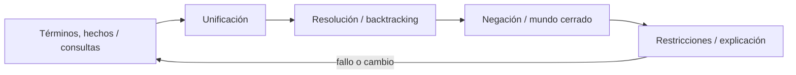
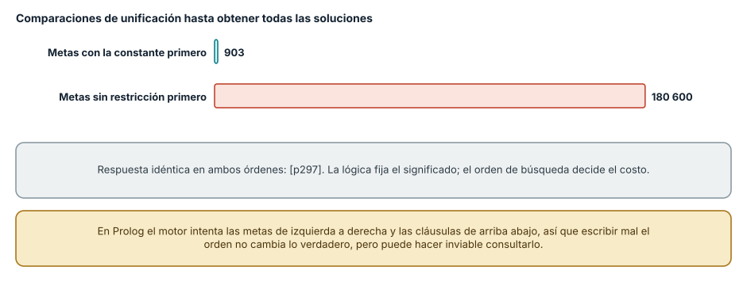
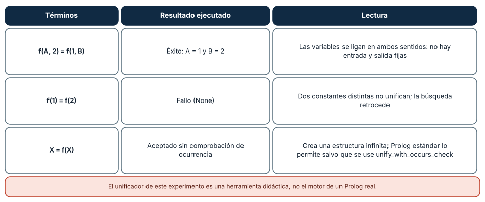
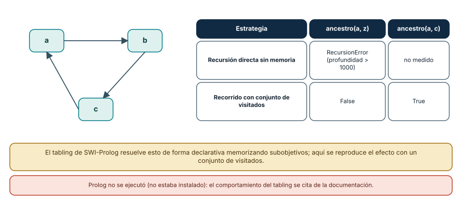

# SE-078 — Programación lógica y resolución

[← SE-077 — Programación declarativa y basada en reglas](https://github.com/vladimiracunadev-create/modern-software-engineering-program/blob/main/classes/part-06-paradigmas-de-programacion/se-077-programacion-declarativa-y-basada-en-reglas/README.md) · [↑ Parte 06](https://github.com/vladimiracunadev-create/modern-software-engineering-program/blob/main/classes/part-06-paradigmas-de-programacion/README.md) · [📚 Índice completo](https://github.com/vladimiracunadev-create/modern-software-engineering-program/blob/main/classes/README.md) · [🌐 Portal](https://vladimiracunadev-create.github.io/modern-software-engineering-program/classes/SE-078.html) · [SE-079 — Programación orientada a eventos →](https://github.com/vladimiracunadev-create/modern-software-engineering-program/blob/main/classes/part-06-paradigmas-de-programacion/se-079-programacion-orientada-a-eventos/README.md)


## Punto profesional y fundamento pedagógico

**Punto profesional.** La clase existe para explicar unificación, búsqueda y backtracking como mecanismo operacional de la lógica.

**Por qué aparece aquí.** Se sitúa después de **Programación declarativa y basada en reglas** y antes de **Programación orientada a eventos**: convierte el conocimiento anterior en una decisión observable que la clase siguiente podrá reutilizar. La continuidad se comprueba en el artefacto, no por compartir vocabulario.

**Error conceptual que debe corregir.** Leer Prolog como ejecución exhaustiva sin depender de orden.

**Secuencia de aprendizaje.** Antes de leer la solución, el estudiante predice el resultado del caso normal y del error conceptual anterior. Luego explica un caso resuelto paso a paso, construye un contraejemplo que cambie la decisión y, sin consultar el texto, reconstruye el mecanismo y lo aplica a una entrada nueva. La secuencia usa predicción, explicación propia, contraste y recuperación. [ICAP](https://icap.education.asu.edu/research) distingue participación de construcción de conocimiento; [How People Learn II](https://nap.nationalacademies.org/catalog/24783/how-people-learn-ii-learners-contexts-and-cultures) exige conectar conocimiento previo, contexto y transferencia; la [práctica de recuperación](https://pubmed.ncbi.nlm.nih.gov/16507066/) respalda producir de nuevo la explicación tras una demora; y [Education for Life and Work](https://nap.nationalacademies.org/resource/13398/dbasse_084153.pdf) exige devolución que explique la causa del error.

**Evidencia de aprendizaje.** Resolution-trace.md con sustituciones, árbol de búsqueda y corte problemático. Debe contener predicción previa, observación, explicación causal, contraejemplo, criterio de aceptación y una nota de qué dato haría cambiar la conclusión.

**Límite de la conclusión.** La verdad lógica y el comportamiento operacional no son equivalentes.

### Trazabilidad fuente → afirmación

| Fuente primaria u oficial | Afirmación que respalda | Lo que no prueba |
|---|---|---|
| [SWI-Prolog Reference Manual](https://www.swi-prolog.org/pldoc/man?section=intro) | Hechos, reglas, unificación, búsqueda y límites operacionales; autoridad: SWI-Prolog project | No demuestra por sí sola que el artefacto del estudiante sea correcto. |
| [SWEBOK Guide v4.0a](https://www.computer.org/education/bodies-of-knowledge/software-engineering) | Construcción, diseño y fundamentos profesionales; autoridad: IEEE Computer Society | No demuestra por sí sola que el artefacto del estudiante sea correcto. |

## Antes de empezar

Esta clase continúa el **motor de reglas comparado de la Parte 06**. Recupera la evidencia de la clase anterior, añade una decisión propia de **Programación lógica y resolución** y deja un artefacto que la clase siguiente deberá consumir. La pregunta activa es: **¿Cómo produce respuestas un motor lógico a partir de relaciones, variables y búsqueda?**

## Prerrequisitos

- Haber completado la clase anterior o reconstruir su contrato y evidencia.
- Python 3.11 o posterior, terminal, editor y Git; un segundo runtime es opcional y debe declararse.
- Trabajar con fixtures sintéticos: ninguna observación necesita datos de una persona o sistema real.

## Problema auténtico

El motor de reglas comparado debe responder qué prueba es admisible y también por qué. Enumerar rutas a mano duplica combinaciones; una relación lógica puede derivarlas, pero una regla recursiva mal ordenada no termina.

## Objetivos observables

Al terminar podrás explicar los cinco mecanismos de esta clase, predecir su comportamiento antes de ejecutar, construir un caso normal y uno límite, diagnosticar el fallo controlado, comparar una alternativa y entregar evidencia que otra persona pueda reproducir.

## Mapa conceptual



El mapa se lee como una cadena de razonamiento, no como fases obligatorias del runtime. La flecha de retorno indica que un fallo o cambio de requisito obliga a revisar el modelo inicial; no autoriza a parchear solo la última salida.

## Temas y por qué importan

| Tema | Por qué cambia una decisión profesional | Evidencia mínima |
|---|---|---|
| Términos, hechos y consultas | Un programa lógico describe relaciones mediante términos. | Predicción, traza causal y contraejemplo de **Términos, hechos y consultas** en `resolution-trace.md` |
| Unificación | Unificar busca una sustitución compatible entre estructuras. | Predicción, traza causal y contraejemplo de **Unificación** en `resolution-trace.md` |
| Resolución y backtracking | El motor selecciona metas, prueba cláusulas y retrocede cuando una elección falla. | Predicción, traza causal y contraejemplo de **Resolución y backtracking** en `resolution-trace.md` |
| Negación y mundo cerrado | En muchos sistemas Prolog, no poder demostrar una meta permite tratarla como falsa bajo supuestos de mundo cerrado. | Predicción, traza causal y contraejemplo de **Negación y mundo cerrado** en `resolution-trace.md` |
| Restricciones y explicación | La programación lógica con restricciones mantiene dominios posibles y propaga reducciones antes de enumerar. | Predicción, traza causal y contraejemplo de **Restricciones y explicación** en `resolution-trace.md` |
## Conceptos y decisiones

### 1. Términos, hechos y consultas

Un programa lógico describe relaciones mediante términos. Una consulta pregunta qué sustituciones vuelven verdadera una relación. La dirección no siempre está fijada como en una función, aunque la implementación y los modos de uso sí afectan terminación y rendimiento.

### 2. Unificación

Unificar busca una sustitución compatible entre estructuras. No es asignación mutable: una variable lógica queda vinculada dentro de una rama de búsqueda. El chequeo de ocurrencia y las extensiones del sistema determinan qué términos son admitidos, por lo que no conviene extrapolar desde pseudocódigo.

### 3. Resolución y backtracking

El motor selecciona metas, prueba cláusulas y retrocede cuando una elección falla. Ese mecanismo enumera alternativas sin escribir bucles explícitos. Orden de metas y cláusulas puede cambiar drásticamente costo o terminación aunque el significado declarativo pretendido parezca igual.

### 4. Negación y mundo cerrado

En muchos sistemas Prolog, no poder demostrar una meta permite tratarla como falsa bajo supuestos de mundo cerrado. Eso no equivale a negar un hecho desconocido. El motor de reglas comparado distingue `denied`, `not_proven` y `not_applicable` para no convertir ausencia de evidencia en evidencia de ausencia.

### 5. Restricciones y explicación

La programación lógica con restricciones mantiene dominios posibles y propaga reducciones antes de enumerar. Puede expresar horarios o compatibilidad con claridad, pero requiere inspeccionar qué restricciones sustentan una respuesta. La traza bruta del motor no reemplaza una explicación de dominio.

### El orden de las metas: misma respuesta, otro trabajo

En programación lógica se declaran hechos y reglas y se pregunta; el motor busca por unificación y retroceso. Para observar el costo se implementó un resolvedor mínimo en Python (unificación, retroceso, sin optimizaciones) y se contó cuántas comparaciones de unificación hacía. Con 300 hechos `padre(pN, pN+1)` y la consulta «¿quién es ancestro de `p300` a tres pasos?», escribir las metas empezando por la que tiene la constante `p300` necesitó 903 comparaciones; escribirlas con las metas sin restricción primero necesitó 180 600, unas 200 veces más, con la misma respuesta (`p297`) en ambos casos.

Esa es la diferencia entre lo que la lógica garantiza (el significado de la consulta) y lo que el motor hace (una búsqueda ordenada de izquierda a derecha y de arriba abajo). Un motor de Prolog real trabaja así por defecto, y por eso ordenar las metas de más a menos restrictivas es una técnica básica de rendimiento. Mover una meta no cambia lo verdadero; puede cambiar lo calculable.



**Cómo leer la figura.** Cada barra es el trabajo de buscar todas las soluciones con un orden de metas; las respuestas coinciden. **Dónde deja de valer:** el resolvedor es didáctico, sin indexación de argumentos ni los trucos de un Prolog real (SWI-Prolog indexa por primer argumento y por otros), de modo que la cifra de 180 600 sería menor allí. El mecanismo, que el orden decide el costo, sí generaliza.

### Unificación: ligar variables en ambos sentidos

Unificar dos términos significa encontrar una sustitución que los haga idénticos. Tres casos ejecutados: `f(A, 2)` con `f(1, B)` tuvo éxito con `A = 1` y `B = 2`, de modo que una misma relación sirve de entrada y de salida; `f(1)` con `f(2)` falló, y el fallo es lo que hace retroceder a la búsqueda; y `X` con `f(X)` fue aceptado, porque el resolvedor mínimo no hace la **comprobación de ocurrencia**: crea una estructura infinita. SWI-Prolog tiene `unify_with_occurs_check/2` para exigir la comprobación, y por defecto la omite por costo.

La consecuencia de diseño es que en lógica no hay «parámetros de entrada» y «de salida» fijos: la relación `padre(X, Y)` responde quién es padre de quién, o de quién es padre ana, según qué argumentos vengan instanciados. Eso permite reutilizar reglas en varias direcciones, a cambio de que los predicados no siempre terminen para cualquier combinación.



**Cómo leer la figura.** Cada fila es una unificación ejecutada y su lectura. **Dónde deja de valer:** el unificador es una versión mínima con tuplas y un diccionario; no maneja listas con barra, ni predicados aritméticos con `is`, ni atributos de variables. Prolog no estaba instalado en el equipo, por lo que no se ejecutó un Prolog real.

### Ciclos y terminación

La lógica declarativa no asegura que una consulta termine. Con hechos que forman un ciclo `a → b → c → a`, la definición recursiva ingenua «`a` es ancestro de `z` si hay un arco de `a` a `y` y `y` es ancestro de `z`» recorre el ciclo para siempre; en Python terminó con `RecursionError` (profundidad superior a 1000) en lugar de responder «no». Un recorrido con un conjunto de visitados respondió `False` para `z` y `True` para `c`.

En Prolog, este problema se resuelve con **tabling** (memorización de subobjetivos), que SWI-Prolog implementa y documenta; sin tabling, la consulta equivalente también puede no terminar. La lección general es que escribir «lo que es verdad» no basta cuando el motor la busca de forma ordenada: hay que pensar en el espacio de búsqueda, igual que se piensa en la pila en la clase de procedimientos.



**Cómo leer la figura.** El grafo muestra el ciclo; la tabla compara la recursión sin memoria con el recorrido con visitados para dos consultas. **Dónde deja de valer:** el «tabling» no se ejecutó; se reproduce su efecto con visitados, que es un algoritmo distinto (búsqueda en profundidad) que sirve para ilustrar. El comportamiento en SWI-Prolog se cita de su manual.

## Definiciones de trabajo

- **términos, hechos y consultas:** un programa lógico describe relaciones mediante términos.
- **unificación:** unificar busca una sustitución compatible entre estructuras.
- **resolución y backtracking:** el motor selecciona metas, prueba cláusulas y retrocede cuando una elección falla.
- **negación y mundo cerrado:** en muchos sistemas prolog, no poder demostrar una meta permite tratarla como falsa bajo supuestos de mundo cerrado.
- **restricciones y explicación:** la programación lógica con restricciones mantiene dominios posibles y propaga reducciones antes de enumerar.

Las definiciones son operativas para el motor de reglas comparado. No convierten términos con historia más amplia en sinónimos y deben contrastarse con la documentación primaria enlazada al final.

## Ejemplo mínimo

```python
authorized(case_17).
observed(case_17, high_latency).
next(Case, inspect_transport) :-
    authorized(Case),
    observed(Case, high_latency).
% Consulta: ?- next(case_17, Action).
```

Antes de ejecutar, predice estado, resultado y error. Después registra versión, comando y salida. Si el fragmento es pseudocódigo o pertenece a otro lenguaje, etiquétalo como tal y no afirmes que fue ejecutado.

## Ejemplo profesional

En el motor de reglas comparado, una recomendación contiene acción, evidencia usada, versión de política y explicación. La implementación de esta clase debe conservar ese contrato aunque cambie la forma interna. El caso profesional no pregunta únicamente si devuelve una cadena: pregunta quién puede producirla, qué estado observa, cómo falla y qué rastro permite disputar una decisión incorrecta.

Compara el caso normal con autorización falsa, evidencia incompleta, empate y repetición. Un mecanismo es apropiado cuando esas diferencias quedan visibles y localizadas; es peligroso cuando dependen de orden accidental, estado oculto o una convención que el consumidor no puede conocer.

## Práctica guiada

1. Copia el contrato de entrada y salida antes de escribir implementación.
2. Predice el caso normal y un límite; identifica la invariante que no puede romperse.
3. Implementa la versión mínima sin I/O dentro del núcleo.
4. Ejecuta el caso y conserva comando, versión y salida bajo `evidence/`.
5. Introduce el fallo controlado, reduce la reproducción y formula dos hipótesis rivales.
6. Corrige la causa, añade regresión y ejecuta el conjunto completo.
7. Compara con otro paradigma o lenguaje indicando qué semántica se preserva.

## Ejercicios

1. **Orden:** escribe tres metas encadenadas sobre un conjunto de hechos propio y mide inferencias en los dos órdenes; explica cuál conviene y por qué.
2. **Unificar a mano:** unifica `g(X, h(Y), 3)` con `g(a, h(b), Z)` y escribe la sustitución resultante; luego escribe un caso que falle.
3. **Terminación:** define una relación recursiva que no termine en un grafo con ciclo y arregla su terminación con visitados.
4. **Reversibilidad:** usa la misma relación `padre` para preguntar quién es padre de `carla` y de quién es padre `ana`, y explica qué argumentos cambian de papel.

## Reto verificable

Entrega implementación, fixtures, pruebas y un informe corto. Se aprueba si otra persona ejecuta desde checkout limpio, obtiene los mismos resultados y puede relacionar cada rama o transformación con una regla del dominio. No se aprueba por cantidad de archivos ni por usar la sintaxis característica del paradigma.

## Caso conductor

El motor de reglas comparado recibe una observación autorizada, evalúa reglas y devuelve una recomendación explicable. En esta clase, ejecuta el caso `latency_ms=900`, el límite `latency_ms=800`, el contraejemplo `authorized=false` y una entrada incompleta. Cambia después una sola regla y revisa qué archivos, pruebas y trazas debieron modificarse. Esa superficie de cambio alimenta la comparación final de la parte.

## Preguntas frecuentes

### ¿Programación lógica es lo mismo que Prolog?

No. Prolog es un lenguaje concreto, con orden de búsqueda y operaciones extralógicas (corte, aritmética). La programación lógica es el paradigma: hechos, reglas y resolución. Otros sistemas, como Datalog, evitan el retroceso infinito limitando el lenguaje.

### ¿Por qué el orden de las metas importa si la lógica no tiene orden?

Porque el motor ejecuta una estrategia concreta (de izquierda a derecha, con retroceso). La respuesta correcta no depende del orden, pero el costo y la terminación sí.

### ¿Qué es la comprobación de ocurrencia?

Una verificación al unificar una variable con un término que la contiene (`X` con `f(X)`). Se omite por costo en Prolog estándar; si se omite, aparecen estructuras infinitas que pueden colgar el programa.

### ¿Cuándo es útil este paradigma en software real?

Para problemas de búsqueda con restricciones, análisis de reglas, verificación y consultas sobre relaciones (Datalog en análisis de código y en seguridad). No es el modelo habitual para servicios con E/S.

## Fallo controlado y diagnóstico

Define una regla recursiva que se invoca antes del caso base y observa no terminación. Reordena metas, acota el dominio y conserva una consulta que demuestre respuesta y finalización.

Registra síntoma, entrada mínima, hipótesis, observación que descarta cada hipótesis, causa, corrección y prueba de regresión. No cambies simultáneamente implementación, fixture y expectativa.

Práctica: define el ancestro con recursión por la izquierda sobre un ciclo y lánzalo con un destino inexistente. **Síntoma esperado:** `RecursionError` en Python (o una consulta que no responde en Prolog sin tabling). **Hipótesis rivales:** (a) el destino no existe; (b) el motor entra en un ciclo. **Observación que las separa:** limitar la profundidad y registrar los nodos visitados; si se repite `a`, hay ciclo. **Corrección:** conjunto de visitados (o tabling en Prolog). **Regresión:** una prueba con un grafo cíclico que exige la respuesta «no» en tiempo acotado.

## Errores comunes y cómo corregirlos

| Síntoma | Causa | Corrección |
|---|---|---|
| La consulta no termina | Recursión por la izquierda sobre datos con ciclos | Memorizar subobjetivos (tabling) o llevar un conjunto de visitados |
| La respuesta es correcta pero tarda mucho | Metas poco restrictivas primero | Ordenar de más a menos restrictiva |
| Una variable queda ligada a una estructura infinita | Unificación sin comprobación de ocurrencia | Usar la versión con comprobación cuando el dominio lo requiera |
| Un predicado solo funciona en un sentido | Se asumieron argumentos de entrada y salida fijos | Probar la relación en todas las combinaciones previstas |
| Se confunde «no hay solución» con «no demostrado» | Mundo cerrado: lo no derivable se toma como falso | Declarar el supuesto de mundo cerrado en la documentación |

## Entorno y archivos clave

```text
work/SE-078/
├── README.md
├── rule_engine/
│   ├── domain.py
│   └── se_078.py
├── fixtures/cases.json
├── tests/test_se_078.py
└── evidence/diagnosis.md
```

El `README` declara plataforma, runtimes, comandos, limpieza y límites. Evita dependencias externas cuando la biblioteca estándar permita observar el mecanismo; si agregas una, fija procedencia y versión.

## Seguridad, ética y accesibilidad

- la autorización forma parte del dominio y no se infiere por ausencia de rechazo;
- no uses `eval`, reglas descargadas ni serialización insegura;
- limita colas, recursión, tamaño de entrada y tiempo de evaluación;
- redacta trazas y conserva una explicación textual además de color o animación;
- una recomendación automatizada debe poder revisarse, impugnarse y corregirse;
- respeta licencias de ejemplos y atribuye adaptaciones.

## Puente hacia el trabajo con agentes

Los agentes que razonan sobre restricciones o planes (qué herramienta puede cumplir una condición) usan a veces solvers o motores de reglas que buscan por resolución, y heredan sus problemas: la respuesta depende del orden de las metas y la búsqueda puede no terminar. El harness debe limitar el presupuesto de inferencia (profundidad, pasos y tiempo) y tratar el agotamiento como un resultado explícito, no como una respuesta negativa. Las partes sobre planificación y verificación de agentes retoman la terminación acotada.

## Transferencia

Traslada un fixture al segundo modelo o lenguaje. Compara representación de ausencia, error, mutabilidad, orden y cancelación. La transferencia está lograda cuando el contrato se conserva y las diferencias están explicadas, no cuando la sintaxis se parece.

## Evaluación y evidencia

| Criterio | Evidencia para aprobar |
|---|---|
| comprensión | explicación causal de los cinco mecanismos |
| corrección | normal, límite, inválido y contraejemplo |
| diseño | estado, efectos y contrato localizables |
| diagnóstico | reproducción mínima y regresión |
| transferencia | comparación semántica, no estética |
| reproducibilidad | versiones, comandos, salida y límites |


## Fuentes


- [Python Language Reference](https://docs.python.org/3/reference/) — Semántica de sentencias, funciones, clases, generadores y corrutinas; autoridad: Python Software Foundation.
- [The Rust Programming Language](https://doc.rust-lang.org/stable/book/) — Ownership, enums, traits, errores y concurrencia sin carreras de datos; autoridad: Rust project.
- [SWI-Prolog Reference Manual](https://www.swi-prolog.org/pldoc/man?section=intro) — Hechos, reglas, unificación, búsqueda y límites operacionales; autoridad: SWI-Prolog project.
- [ReactiveX Observable Contract](https://reactivex.io/documentation/contract.html) — Notificaciones, terminación, errores y control de flujo observable; autoridad: ReactiveX project.
- [Erlang System Documentation: Processes](https://www.erlang.org/doc/system/ref_man_processes.html) — Procesos, buzones, envío de mensajes, enlaces y monitores; autoridad: Erlang/OTP project.
- [SWEBOK Guide v4.0a](https://www.computer.org/education/bodies-of-knowledge/software-engineering) — Construcción, diseño y fundamentos profesionales; autoridad: IEEE Computer Society.

Fuentes verificadas para las mediciones de esta clase (enlaces comprobados con `curl` el 2026-11-13):

- [SWI-Prolog: tabling](https://www.swi-prolog.org/pldoc/man?section=tabling) y [`unify_with_occurs_check/2`](https://www.swi-prolog.org/pldoc/doc_for?object=unify_with_occurs_check/2): memorización de subobjetivos y unificación con comprobación; respaldan las figuras 2 y 3.
- [SWI-Prolog Reference Manual](https://www.swi-prolog.org/pldoc/man?section=intro): estrategia de búsqueda y orden de cláusulas; respalda la figura 1.
- Robinson, J. A. (1965), «A Machine-Oriented Logic Based on the Resolution Principle», *Journal of the ACM* 12(1), [doi:10.1145/321250.321253](https://doi.org/10.1145/321250.321253): origen de la resolución y la unificación. El editor devolvió 403 a `curl`, por lo que el DOI no se verificó por red.

Cada fuente respalda el mecanismo indicado; ninguna demuestra que la implementación del motor de reglas comparado sea correcta. Esa afirmación depende de fixtures, pruebas, trazas y revisión reproducible.

## Límites y siguiente paso

La resolución lógica depende de supuestos operacionales y no gestiona por sí sola una secuencia temporal de eventos. La siguiente clase convierte entradas externas en eventos con contrato y ciclo de vida.

## Glosario

- **términos, hechos y consultas:** un programa lógico describe relaciones mediante términos.
- **unificación:** unificar busca una sustitución compatible entre estructuras.
- **resolución y backtracking:** el motor selecciona metas, prueba cláusulas y retrocede cuando una elección falla.
- **negación y mundo cerrado:** en muchos sistemas prolog, no poder demostrar una meta permite tratarla como falsa bajo supuestos de mundo cerrado.
- **restricciones y explicación:** la programación lógica con restricciones mantiene dominios posibles y propaga reducciones antes de enumerar.

---

[← SE-077 — Programación declarativa y basada en reglas](https://github.com/vladimiracunadev-create/modern-software-engineering-program/blob/main/classes/part-06-paradigmas-de-programacion/se-077-programacion-declarativa-y-basada-en-reglas/README.md) · [↑ Parte 06](https://github.com/vladimiracunadev-create/modern-software-engineering-program/blob/main/classes/part-06-paradigmas-de-programacion/README.md) · [📚 Índice completo](https://github.com/vladimiracunadev-create/modern-software-engineering-program/blob/main/classes/README.md) · [🌐 Portal](https://vladimiracunadev-create.github.io/modern-software-engineering-program/classes/SE-078.html) · [SE-079 — Programación orientada a eventos →](https://github.com/vladimiracunadev-create/modern-software-engineering-program/blob/main/classes/part-06-paradigmas-de-programacion/se-079-programacion-orientada-a-eventos/README.md)
