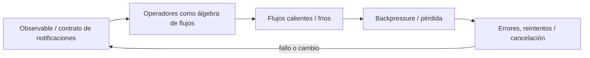
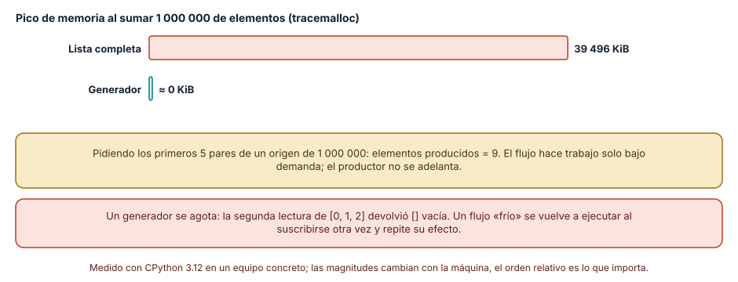
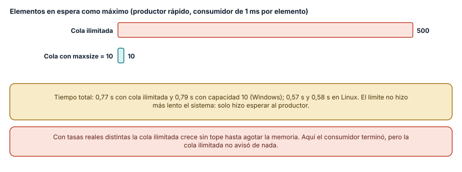
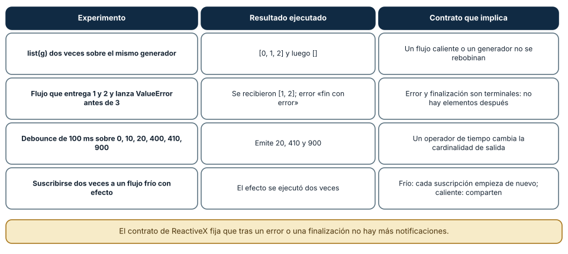

# SE-080 — Programación reactiva y flujos

[← SE-079 — Programación orientada a eventos](https://github.com/vladimiracunadev-create/modern-software-engineering-program/blob/main/classes/part-06-paradigmas-de-programacion/se-079-programacion-orientada-a-eventos/README.md) · [↑ Parte 06](https://github.com/vladimiracunadev-create/modern-software-engineering-program/blob/main/classes/part-06-paradigmas-de-programacion/README.md) · [📚 Índice completo](https://github.com/vladimiracunadev-create/modern-software-engineering-program/blob/main/classes/README.md) · [🌐 Portal](https://vladimiracunadev-create.github.io/modern-software-engineering-program/classes/SE-080.html) · [SE-081 — Programación concurrente y actores →](https://github.com/vladimiracunadev-create/modern-software-engineering-program/blob/main/classes/part-06-paradigmas-de-programacion/se-081-programacion-concurrente-y-actores/README.md)


## Punto profesional y fundamento pedagógico

**Punto profesional.** La clase existe para diseñar flujos reactivos por contrato de notificación, terminación, error y presión.

**Por qué aparece aquí.** Se sitúa después de **Programación orientada a eventos** y antes de **Programación concurrente y actores**: convierte el conocimiento anterior en una decisión observable que la clase siguiente podrá reutilizar. La continuidad se comprueba en el artefacto, no por compartir vocabulario.

**Error conceptual que debe corregir.** Tratar stream como lista diferida o ignorar consumidores lentos.

**Secuencia de aprendizaje.** Antes de leer la solución, el estudiante predice el resultado del caso normal y del error conceptual anterior. Luego explica un caso resuelto paso a paso, construye un contraejemplo que cambie la decisión y, sin consultar el texto, reconstruye el mecanismo y lo aplica a una entrada nueva. La secuencia usa predicción, explicación propia, contraste y recuperación. [ICAP](https://icap.education.asu.edu/research) distingue participación de construcción de conocimiento; [How People Learn II](https://nap.nationalacademies.org/catalog/24783/how-people-learn-ii-learners-contexts-and-cultures) exige conectar conocimiento previo, contexto y transferencia; la [práctica de recuperación](https://pubmed.ncbi.nlm.nih.gov/16507066/) respalda producir de nuevo la explicación tras una demora; y [Education for Life and Work](https://nap.nationalacademies.org/resource/13398/dbasse_084153.pdf) exige devolución que explique la causa del error.

**Evidencia de aprendizaje.** Stream-contract.md con next/error/complete, cancelación y backpressure. Debe contener predicción previa, observación, explicación causal, contraejemplo, criterio de aceptación y una nota de qué dato haría cambiar la conclusión.

**Límite de la conclusión.** ReactiveX no define una política universal de presión.

### Trazabilidad fuente → afirmación

| Fuente primaria u oficial | Afirmación que respalda | Lo que no prueba |
|---|---|---|
| [ReactiveX Observable Contract](https://reactivex.io/documentation/contract.html) | Notificaciones, terminación, errores y control de flujo observable; autoridad: ReactiveX project | No demuestra por sí sola que el artefacto del estudiante sea correcto. |
| [Python Language Reference](https://docs.python.org/3/reference/) | Semántica de sentencias, funciones, clases, generadores y corrutinas; autoridad: Python Software Foundation | No demuestra por sí sola que el artefacto del estudiante sea correcto. |

## Antes de empezar

Esta clase continúa el **motor de reglas comparado de la Parte 06**. Recupera la evidencia de la clase anterior, añade una decisión propia de **Programación reactiva y flujos** y deja un artefacto que la clase siguiente deberá consumir. La pregunta activa es: **¿Cómo modelar un flujo que produce cero, uno o muchos valores y también termina o falla?**

## Prerrequisitos

- Haber completado la clase anterior o reconstruir su contrato y evidencia.
- Python 3.11 o posterior, terminal, editor y Git; un segundo runtime es opcional y debe declararse.
- Trabajar con fixtures sintéticos: ninguna observación necesita datos de una persona o sistema real.

## Problema auténtico

El motor de reglas comparado recibe telemetría más rápido de lo que puede evaluarla. Un callback por muestra crece sin límite y combinar la última autorización con latencia antigua genera decisiones incoherentes.

## Objetivos observables

Al terminar podrás explicar los cinco mecanismos de esta clase, predecir su comportamiento antes de ejecutar, construir un caso normal y uno límite, diagnosticar el fallo controlado, comparar una alternativa y entregar evidencia que otra persona pueda reproducir.

## Mapa conceptual



El mapa se lee como una cadena de razonamiento, no como fases obligatorias del runtime. La flecha de retorno indica que un fallo o cambio de requisito obliga a revisar el modelo inicial; no autoriza a parchear solo la última salida.

## Temas y por qué importan

| Tema | Por qué cambia una decisión profesional | Evidencia mínima |
|---|---|---|
| Observable y contrato de notificaciones | Un flujo emite valores y termina una sola vez por completitud o error. | Predicción, traza causal y contraejemplo de **Observable y contrato de notificaciones** en `stream-contract.md` |
| Operadores como álgebra de flujos | Mapear transforma, filtrar descarta, combinar relaciona y reducir acumula. | Predicción, traza causal y contraejemplo de **Operadores como álgebra de flujos** en `stream-contract.md` |
| Flujos calientes y fríos | Un flujo frío comienza por suscriptor y puede repetir el origen; uno caliente existe independientemente y un suscriptor tardío pierde historia salvo replay. | Predicción, traza causal y contraejemplo de **Flujos calientes y fríos** en `stream-contract.md` |
| Backpressure y pérdida | Si el productor supera al consumidor hay que bloquear, almacenar, agrupar, muestrear o descartar con política. | Predicción, traza causal y contraejemplo de **Backpressure y pérdida** en `stream-contract.md` |
| Errores, reintentos y cancelación | Un error terminal corta el flujo; `retry` vuelve a suscribirse y puede repetir efectos. | Predicción, traza causal y contraejemplo de **Errores, reintentos y cancelación** en `stream-contract.md` |
## Conceptos y decisiones

### 1. Observable y contrato de notificaciones

Un flujo emite valores y termina una sola vez por completitud o error. Después de una señal terminal no debe emitir más. Esta gramática permite componer secuencias, siempre que la implementación respete serialización y vida de la suscripción.

### 2. Operadores como álgebra de flujos

Mapear transforma, filtrar descarta, combinar relaciona y reducir acumula. La elección expresa semántica temporal: `merge`, `concat`, `zip` y `combineLatest` producen resultados diferentes. Elegir por nombre familiar puede mezclar mediciones que nunca coexistieron.

### 3. Flujos calientes y fríos

Un flujo frío comienza por suscriptor y puede repetir el origen; uno caliente existe independientemente y un suscriptor tardío pierde historia salvo replay. La distinción cambia efectos, costo y pruebas. No debe deducirse solo del tipo de variable.

### 4. Backpressure y pérdida

Si el productor supera al consumidor hay que bloquear, almacenar, agrupar, muestrear o descartar con política. Una cola infinita solo pospone el fallo a memoria. El motor de reglas comparado registra volumen perdido y explica por qué la política sigue siendo válida para diagnóstico.

### 5. Errores, reintentos y cancelación

Un error terminal corta el flujo; `retry` vuelve a suscribirse y puede repetir efectos. La recuperación requiere clasificar transitorio y permanente, aplicar límites y cancelar recursos aguas arriba. Ocultar un error con valor por defecto puede convertir falta de señal en decisión segura falsa.

### Un flujo perezoso evita materializar los datos

En un flujo, los elementos se producen y se consumen a lo largo del tiempo, en vez de existir todos a la vez. Python lo expresa con generadores. Sumar un millón de elementos construyendo primero una lista alcanzó un pico de memoria de 39 496 KiB según `tracemalloc`; con un generador, el pico fue prácticamente cero. Y la pereza evita trabajo: al pedir los cinco primeros números pares de un origen de un millón con `itertools.islice`, el origen produjo solo 9 elementos.

La propiedad útil es que el consumidor controla el ritmo: nada se produce antes de ser pedido. Eso es lo que permite procesar archivos o respuestas más grandes que la memoria. Tiene dos contrapartidas: el trabajo ocurre cuando se consume (un error puede aparecer mucho después de definir el flujo), y un generador se **agota**: la segunda lectura del mismo generador de `[0, 1, 2]` devolvió una lista vacía.



**Cómo leer la figura.** Las barras comparan el pico de memoria de la lista y del generador; los recuadros recogen las dos consecuencias de la pereza, trabajo bajo demanda y agotamiento. **Dónde deja de valer:** `tracemalloc` mide asignaciones de Python, no la memoria total del proceso, y los enteros pequeños se comparten; con objetos grandes la brecha sería mayor. Un generador no es todavía un flujo reactivo: no tiene suscripciones ni operadores de tiempo.

### Contrapresión: quién frena a quién

Cuando un productor es más rápido que el consumidor, algo debe esperar. En el experimento, un productor envió 500 elementos a un consumidor que tardaba 1 ms por elemento. Con una cola **ilimitada**, la cola llegó a tener 500 elementos en espera; con una cola de capacidad **10**, nunca pasó de 10, porque `put` bloqueó al productor hasta que había espacio. El tiempo total fue casi el mismo: 0,77 s y 0,79 s en Windows, 0,57 s y 0,58 s en Linux.

El límite no empeoró el sistema: solo trasladó la espera al productor, que es quien puede decidir qué hacer (frenar, descartar, avisar). Con la cola ilimitada, el sistema parece funcionar mientras acumula memoria sin avisar, hasta que la agota. Es el principio de la especificación Reactive Streams: el consumidor solicita cuántos elementos acepta y el productor no envía más de los solicitados.



**Cómo leer la figura.** Cada barra es el máximo de elementos en espera; la caja dorada compara tiempos. **Dónde deja de valer:** son hilos con una cola de la biblioteca estándar y un consumidor de velocidad constante; en un sistema real la tasa del consumidor varía y el productor puede ser externo e incapaz de esperar, en cuyo caso hay que descartar o rechazar. No se probó un sistema reactivo con protocolo de solicitud como el de Reactive Streams.

### Semántica de los flujos: lo que ocurre al agotar, fallar y esperar

Cuatro comportamientos se pueden comprobar sin una biblioteca reactiva. Un generador agotado no se rebobina (`[0, 1, 2]` y luego `[]`). Un flujo que entrega 1 y 2 y lanza un error no entrega nada después: el consumidor recibió `[1, 2]` y el error, y el 3 nunca llegó, lo que coincide con el contrato de ReactiveX, donde error y finalización son terminales. Un operador de tiempo como el **debounce** cambia la cantidad de salidas: con eventos en 0, 10, 20, 400, 410 y 900 ms y una ventana de 100 ms, solo salieron los de 20, 410 y 900. Y un flujo **frío** (que ejecuta su efecto al suscribirse) lo ejecutó dos veces con dos suscripciones, mientras que un flujo caliente comparte la fuente.

Esa clasificación frío-caliente decide si añadir un segundo observador cambia el sistema: en un flujo caliente se pierden los elementos anteriores a la suscripción; en uno frío se repite el trabajo.



**Cómo leer la figura.** Cada fila es un experimento con generadores de Python y su lectura contractual. **Dónde deja de valer:** el debounce se calculó sobre marcas de tiempo fijas, no con un reloj real; un flujo reactivo de verdad (RxPY, Reactor, RxJS) añade planificadores y cancelación que no se ejercitaron. Rx no estaba instalado y no se ejecutó.

## Definiciones de trabajo

- **observable y contrato de notificaciones:** un flujo emite valores y termina una sola vez por completitud o error.
- **operadores como álgebra de flujos:** mapear transforma, filtrar descarta, combinar relaciona y reducir acumula.
- **flujos calientes y fríos:** un flujo frío comienza por suscriptor y puede repetir el origen; uno caliente existe independientemente y un suscriptor tardío pierde historia salvo replay.
- **backpressure y pérdida:** si el productor supera al consumidor hay que bloquear, almacenar, agrupar, muestrear o descartar con política.
- **errores, reintentos y cancelación:** un error terminal corta el flujo; `retry` vuelve a suscribirse y puede repetir efectos.

Las definiciones son operativas para el motor de reglas comparado. No convierten términos con historia más amplia en sinónimos y deben contrastarse con la documentación primaria enlazada al final.

## Ejemplo mínimo

```python
# Pseudocódigo ReactiveX
decisions = observations.pipe(
    buffer_with_time(0.5),
    filter(lambda batch: bool(batch)),
    map(validate_batch),
    map(choose_next),
)
subscription = decisions.subscribe(on_next, on_error, on_complete)
```

Antes de ejecutar, predice estado, resultado y error. Después registra versión, comando y salida. Si el fragmento es pseudocódigo o pertenece a otro lenguaje, etiquétalo como tal y no afirmes que fue ejecutado.

## Ejemplo profesional

En el motor de reglas comparado, una recomendación contiene acción, evidencia usada, versión de política y explicación. La implementación de esta clase debe conservar ese contrato aunque cambie la forma interna. El caso profesional no pregunta únicamente si devuelve una cadena: pregunta quién puede producirla, qué estado observa, cómo falla y qué rastro permite disputar una decisión incorrecta.

Compara el caso normal con autorización falsa, evidencia incompleta, empate y repetición. Un mecanismo es apropiado cuando esas diferencias quedan visibles y localizadas; es peligroso cuando dependen de orden accidental, estado oculto o una convención que el consumidor no puede conocer.

## Práctica guiada

1. Copia el contrato de entrada y salida antes de escribir implementación.
2. Predice el caso normal y un límite; identifica la invariante que no puede romperse.
3. Implementa la versión mínima sin I/O dentro del núcleo.
4. Ejecuta el caso y conserva comando, versión y salida bajo `evidence/`.
5. Introduce el fallo controlado, reduce la reproducción y formula dos hipótesis rivales.
6. Corrige la causa, añade regresión y ejecuta el conjunto completo.
7. Compara con otro paradigma o lenguaje indicando qué semántica se preserva.

## Ejercicios

1. **Memoria:** mide el pico de memoria de leer 5 millones de números con una lista y con un generador y explica cuándo la pereza no ayuda.
2. **Contrapresión:** modifica el experimento para que el productor descarte elementos cuando la cola esté llena y cuenta cuántos se pierden.
3. **Contrato:** escribe un flujo que termine con error tras tres elementos y una prueba que verifique que no se emite nada después.
4. **Frío y caliente:** transforma un generador frío en uno que comparta la fuente entre dos consumidores y describe qué elementos ve cada uno.

## Reto verificable

Entrega implementación, fixtures, pruebas y un informe corto. Se aprueba si otra persona ejecuta desde checkout limpio, obtiene los mismos resultados y puede relacionar cada rama o transformación con una regla del dominio. No se aprueba por cantidad de archivos ni por usar la sintaxis característica del paradigma.

## Caso conductor

El motor de reglas comparado recibe una observación autorizada, evalúa reglas y devuelve una recomendación explicable. En esta clase, ejecuta el caso `latency_ms=900`, el límite `latency_ms=800`, el contraejemplo `authorized=false` y una entrada incompleta. Cambia después una sola regla y revisa qué archivos, pruebas y trazas debieron modificarse. Esa superficie de cambio alimenta la comparación final de la parte.

## Preguntas frecuentes

### ¿Un generador es lo mismo que un flujo reactivo?

No. Un generador es perezoso y lo consume quien pide el siguiente elemento (modelo de tirón). Un flujo reactivo tiene suscripciones, operadores, errores terminales y, en Reactive Streams, solicitud de cantidad; el productor puede ser externo y empujar eventos.

### ¿Qué pasa si el consumidor es más lento que el productor?

Algo se acumula, se descarta o se frena. La cola ilimitada acumula hasta agotar la memoria; la acotada frena al productor; también se puede descartar los más viejos o los más nuevos. Cada decisión pierde algo distinto y debe declararse.

### ¿Un flujo frío y uno caliente se escriben igual?

Pueden verse iguales, pero se comportan distinto: el frío rehace el trabajo en cada suscripción y el caliente reparte lo que ocurre ahora. En una prueba, suscribirse dos veces a un flujo frío ejecutó el efecto dos veces.

### ¿Por qué mi flujo no hace nada?

Porque es perezoso: define el cálculo pero nadie lo consume. Hasta que algo pide elementos, no se ejecuta ninguna etapa.

## Fallo controlado y diagnóstico

Sustituye `zip` por `combine_latest` entre autorización y latencia. Produce una combinación temporalmente inválida. Añade identificador de evaluación y una prueba con diagrama de mármol que muestre emisiones exactas.

Registra síntoma, entrada mínima, hipótesis, observación que descarta cada hipótesis, causa, corrección y prueba de regresión. No cambies simultáneamente implementación, fixture y expectativa.

Práctica: crea una cola ilimitada, un productor rápido y un consumidor lento y observa el tamaño de la cola. **Síntoma esperado:** crecimiento hasta 500 elementos sin ningún aviso. **Hipótesis rivales:** (a) el sistema está sano; (b) la cola oculta una acumulación. **Observación que las separa:** registrar el tamaño máximo; si crece con el tiempo, hay acumulación. **Corrección:** fijar un límite (`maxsize`) y decidir qué hace el productor al llenarse. **Regresión:** una prueba que verifica que el tamaño nunca supera el límite.

## Errores comunes y cómo corregirlos

| Síntoma | Causa | Corrección |
|---|---|---|
| La memoria crece con el tiempo en un pipeline | Cola ilimitada con productor más rápido | Fijar un límite y decidir entre frenar, descartar o rechazar |
| El segundo recorrido de un generador sale vacío | El generador se agotó | Volver a crearlo o materializarlo si hace falta repetir |
| Llegan elementos tras un error | Se rompió el contrato de terminal | Cerrar el flujo tras el primer error o finalización |
| El efecto se ejecuta dos veces | Flujo frío con dos suscripciones | Compartir la fuente o aceptar la repetición |
| El debounce descarta eventos importantes | Ventana de tiempo inadecuada | Elegir la ventana según el significado y probar con tiempos límite |

## Entorno y archivos clave

```text
work/SE-080/
├── README.md
├── rule_engine/
│   ├── domain.py
│   └── se_080.py
├── fixtures/cases.json
├── tests/test_se_080.py
└── evidence/diagnosis.md
```

El `README` declara plataforma, runtimes, comandos, limpieza y límites. Evita dependencias externas cuando la biblioteca estándar permita observar el mecanismo; si agregas una, fija procedencia y versión.

## Seguridad, ética y accesibilidad

- la autorización forma parte del dominio y no se infiere por ausencia de rechazo;
- no uses `eval`, reglas descargadas ni serialización insegura;
- limita colas, recursión, tamaño de entrada y tiempo de evaluación;
- redacta trazas y conserva una explicación textual además de color o animación;
- una recomendación automatizada debe poder revisarse, impugnarse y corregirse;
- respeta licencias de ejemplos y atribuye adaptaciones.

## Puente hacia el trabajo con agentes

Las respuestas de un modelo de lenguaje llegan como flujo de fragmentos, y las herramientas devuelven resultados que pueden ser largos: sin límites, un agente acumula contexto y memoria sin aviso. Las prácticas de la clase se trasladan: consumir de forma perezosa lo que se pueda, acotar los buffers, tratar el error como terminal y distinguir los flujos que se pueden repetir de los que no. Un harness que recibe salida de herramienta debe poner un tope de tamaño y de tiempo, y registrar cuándo lo aplicó. Las partes sobre contexto y memoria de agentes retoman este control de flujo.

## Transferencia

Traslada un fixture al segundo modelo o lenguaje. Compara representación de ausencia, error, mutabilidad, orden y cancelación. La transferencia está lograda cuando el contrato se conserva y las diferencias están explicadas, no cuando la sintaxis se parece.

## Evaluación y evidencia

| Criterio | Evidencia para aprobar |
|---|---|
| comprensión | explicación causal de los cinco mecanismos |
| corrección | normal, límite, inválido y contraejemplo |
| diseño | estado, efectos y contrato localizables |
| diagnóstico | reproducción mínima y regresión |
| transferencia | comparación semántica, no estética |
| reproducibilidad | versiones, comandos, salida y límites |


## Fuentes


- [Python Language Reference](https://docs.python.org/3/reference/) — Semántica de sentencias, funciones, clases, generadores y corrutinas; autoridad: Python Software Foundation.
- [The Rust Programming Language](https://doc.rust-lang.org/stable/book/) — Ownership, enums, traits, errores y concurrencia sin carreras de datos; autoridad: Rust project.
- [SWI-Prolog Reference Manual](https://www.swi-prolog.org/pldoc/man?section=intro) — Hechos, reglas, unificación, búsqueda y límites operacionales; autoridad: SWI-Prolog project.
- [ReactiveX Observable Contract](https://reactivex.io/documentation/contract.html) — Notificaciones, terminación, errores y control de flujo observable; autoridad: ReactiveX project.
- [Erlang System Documentation: Processes](https://www.erlang.org/doc/system/ref_man_processes.html) — Procesos, buzones, envío de mensajes, enlaces y monitores; autoridad: Erlang/OTP project.
- [SWEBOK Guide v4.0a](https://www.computer.org/education/bodies-of-knowledge/software-engineering) — Construcción, diseño y fundamentos profesionales; autoridad: IEEE Computer Society.

Fuentes verificadas para las mediciones de esta clase (enlaces comprobados con `curl` el 2026-11-13):

- [Contrato de Observable de ReactiveX](https://reactivex.io/documentation/contract.html) y [Reactive Streams](https://www.reactive-streams.org/): notificaciones, terminación y solicitud de elementos; respaldan las figuras 2 y 3.
- [Manifiesto reactivo](https://www.reactivemanifesto.org/): resiliencia, elasticidad y contrapresión como propiedades de sistema.
- [Expresiones `yield` de Python](https://docs.python.org/3/reference/expressions.html) y [`queue`](https://docs.python.org/3/library/queue.html): generadores y colas acotadas; respaldan las figuras 1 y 2.

Cada fuente respalda el mecanismo indicado; ninguna demuestra que la implementación del motor de reglas comparado sea correcta. Esa afirmación depende de fixtures, pruebas, trazas y revisión reproducible.

## Límites y siguiente paso

Los operadores no eliminan límites de recursos ni garantizan entrega distribuida. La siguiente clase compara memoria compartida con actores y mensajes.

## Glosario

- **observable y contrato de notificaciones:** un flujo emite valores y termina una sola vez por completitud o error.
- **operadores como álgebra de flujos:** mapear transforma, filtrar descarta, combinar relaciona y reducir acumula.
- **flujos calientes y fríos:** un flujo frío comienza por suscriptor y puede repetir el origen; uno caliente existe independientemente y un suscriptor tardío pierde historia salvo replay.
- **backpressure y pérdida:** si el productor supera al consumidor hay que bloquear, almacenar, agrupar, muestrear o descartar con política.
- **errores, reintentos y cancelación:** un error terminal corta el flujo; `retry` vuelve a suscribirse y puede repetir efectos.

---

[← SE-079 — Programación orientada a eventos](https://github.com/vladimiracunadev-create/modern-software-engineering-program/blob/main/classes/part-06-paradigmas-de-programacion/se-079-programacion-orientada-a-eventos/README.md) · [↑ Parte 06](https://github.com/vladimiracunadev-create/modern-software-engineering-program/blob/main/classes/part-06-paradigmas-de-programacion/README.md) · [📚 Índice completo](https://github.com/vladimiracunadev-create/modern-software-engineering-program/blob/main/classes/README.md) · [🌐 Portal](https://vladimiracunadev-create.github.io/modern-software-engineering-program/classes/SE-080.html) · [SE-081 — Programación concurrente y actores →](https://github.com/vladimiracunadev-create/modern-software-engineering-program/blob/main/classes/part-06-paradigmas-de-programacion/se-081-programacion-concurrente-y-actores/README.md)
