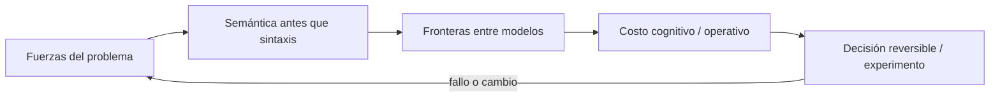
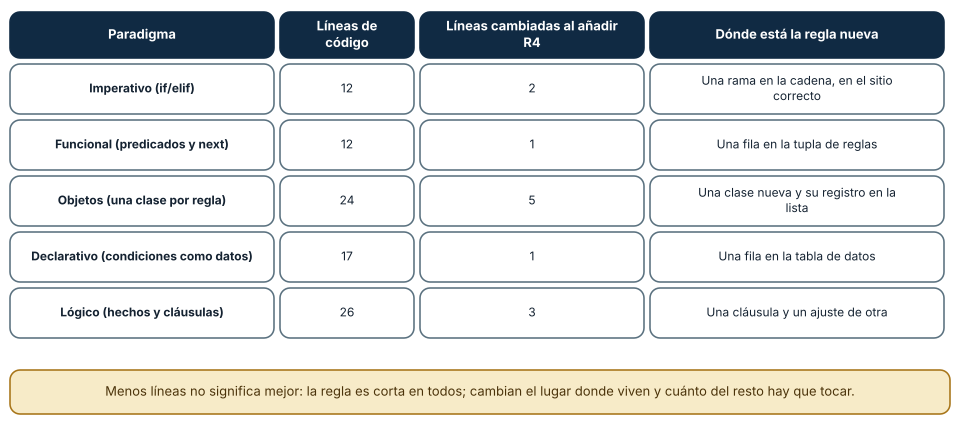
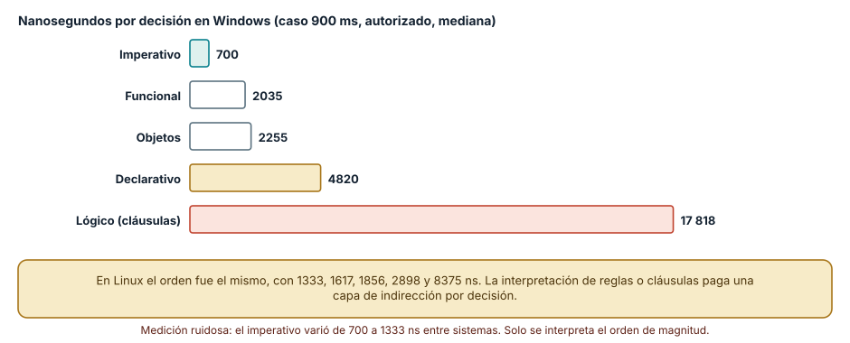
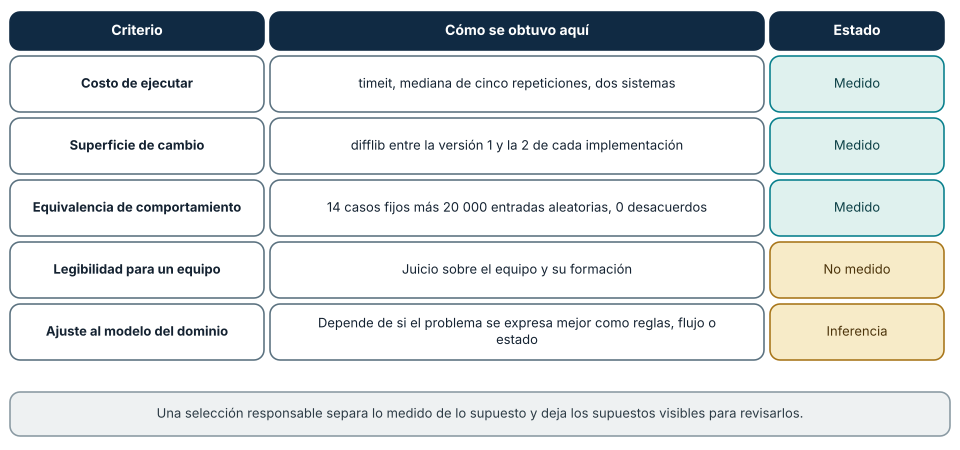

# SE-082 — Selección y combinación responsable de paradigmas

[← SE-081 — Programación concurrente y actores](https://github.com/vladimiracunadev-create/modern-software-engineering-program/blob/main/classes/part-06-paradigmas-de-programacion/se-081-programacion-concurrente-y-actores/README.md) · [↑ Parte 06](https://github.com/vladimiracunadev-create/modern-software-engineering-program/blob/main/classes/part-06-paradigmas-de-programacion/README.md) · [📚 Índice completo](https://github.com/vladimiracunadev-create/modern-software-engineering-program/blob/main/classes/README.md) · [🌐 Portal](https://vladimiracunadev-create.github.io/modern-software-engineering-program/classes/SE-082.html) · [SE-083 — Taller: una regla de negocio en cinco paradigmas →](https://github.com/vladimiracunadev-create/modern-software-engineering-program/blob/main/classes/part-06-paradigmas-de-programacion/se-083-taller-una-regla-de-negocio-en-cinco-paradigmas/README.md)


## Punto profesional y fundamento pedagógico

**Punto profesional.** La clase existe para seleccionar y combinar paradigmas por fuerzas del problema y costo de adaptación.

**Por qué aparece aquí.** Se sitúa después de **Programación concurrente y actores** y antes de **Taller: una regla de negocio en cinco paradigmas**: convierte el conocimiento anterior en una decisión observable que la clase siguiente podrá reutilizar. La continuidad se comprueba en el artefacto, no por compartir vocabulario.

**Error conceptual que debe corregir.** Elegir paradigma por moda o forzar uno sobre todas las capas.

**Secuencia de aprendizaje.** Antes de leer la solución, el estudiante predice el resultado del caso normal y del error conceptual anterior. Luego explica un caso resuelto paso a paso, construye un contraejemplo que cambie la decisión y, sin consultar el texto, reconstruye el mecanismo y lo aplica a una entrada nueva. La secuencia usa predicción, explicación propia, contraste y recuperación. [ICAP](https://icap.education.asu.edu/research) distingue participación de construcción de conocimiento; [How People Learn II](https://nap.nationalacademies.org/catalog/24783/how-people-learn-ii-learners-contexts-and-cultures) exige conectar conocimiento previo, contexto y transferencia; la [práctica de recuperación](https://pubmed.ncbi.nlm.nih.gov/16507066/) respalda producir de nuevo la explicación tras una demora; y [Education for Life and Work](https://nap.nationalacademies.org/resource/13398/dbasse_084153.pdf) exige devolución que explique la causa del error.

**Evidencia de aprendizaje.** Decision-record.md con alternativas, fuerzas, adaptadores y pérdida aceptada. Debe contener predicción previa, observación, explicación causal, contraejemplo, criterio de aceptación y una nota de qué dato haría cambiar la conclusión.

**Límite de la conclusión.** La matriz orienta una decisión contextual, no produce un ganador universal.

### Trazabilidad fuente → afirmación

| Fuente primaria u oficial | Afirmación que respalda | Lo que no prueba |
|---|---|---|
| [Python Language Reference](https://docs.python.org/3/reference/) | Semántica de sentencias, funciones, clases, generadores y corrutinas; autoridad: Python Software Foundation | No demuestra por sí sola que el artefacto del estudiante sea correcto. |
| [The Rust Programming Language](https://doc.rust-lang.org/stable/book/) | Ownership, enums, traits, errores y concurrencia sin carreras de datos; autoridad: Rust project | No demuestra por sí sola que el artefacto del estudiante sea correcto. |
| [SWEBOK Guide v4.0a](https://www.computer.org/education/bodies-of-knowledge/software-engineering) | Construcción, diseño y fundamentos profesionales; autoridad: IEEE Computer Society | No demuestra por sí sola que el artefacto del estudiante sea correcto. |

## Antes de empezar

Esta clase continúa el **motor de reglas comparado de la Parte 06**. Recupera la evidencia de la clase anterior, añade una decisión propia de **Selección y combinación responsable de paradigmas** y deja un artefacto que la clase siguiente deberá consumir. La pregunta activa es: **¿Cómo elegir y combinar paradigmas a partir de fuerzas del problema y evidencia?**

## Prerrequisitos

- Haber completado la clase anterior o reconstruir su contrato y evidencia.
- Python 3.11 o posterior, terminal, editor y Git; un segundo runtime es opcional y debe declararse.
- Trabajar con fixtures sintéticos: ninguna observación necesita datos de una persona o sistema real.

## Problema auténtico

El equipo quiere objetos para el dominio, flujos reactivos para entradas y reglas declarativas para política. Cada elección aislada parece razonable, pero las conversiones multiplican tipos, errores y puntos de depuración.

## Objetivos observables

Al terminar podrás explicar los cinco mecanismos de esta clase, predecir su comportamiento antes de ejecutar, construir un caso normal y uno límite, diagnosticar el fallo controlado, comparar una alternativa y entregar evidencia que otra persona pueda reproducir.

## Mapa conceptual



El mapa se lee como una cadena de razonamiento, no como fases obligatorias del runtime. La flecha de retorno indica que un fallo o cambio de requisito obliga a revisar el modelo inicial; no autoriza a parchear solo la última salida.

## Temas y por qué importan

| Tema | Por qué cambia una decisión profesional | Evidencia mínima |
|---|---|---|
| Fuerzas del problema | La elección parte de estado, temporalidad, concurrencia, tasa de cambio, auditabilidad y habilidades del equipo. | Predicción, traza causal y contraejemplo de **Fuerzas del problema** en `decision-record.md` |
| Semántica antes que sintaxis | Dos implementaciones son comparables si aceptan el mismo dominio y producen resultados equivalentes para normal, límite y error. | Predicción, traza causal y contraejemplo de **Semántica antes que sintaxis** en `decision-record.md` |
| Fronteras entre modelos | Combinar modelos exige adaptadores: evento a valor, objeto a registro, resultado a excepción o mensaje. | Predicción, traza causal y contraejemplo de **Fronteras entre modelos** en `decision-record.md` |
| Costo cognitivo y operativo | Una solución elegante para especialistas puede ser inoperable para el equipo que la mantiene. | Predicción, traza causal y contraejemplo de **Costo cognitivo y operativo** en `decision-record.md` |
| Decisión reversible y experimento | Cuando la evidencia no basta, se limita la apuesta: un slice, criterios y fecha de revisión. | Predicción, traza causal y contraejemplo de **Decisión reversible y experimento** en `decision-record.md` |
## Conceptos y decisiones

### 1. Fuerzas del problema

La elección parte de estado, temporalidad, concurrencia, tasa de cambio, auditabilidad y habilidades del equipo. Un paradigma es adecuado cuando vuelve directas las propiedades dominantes. Popularidad o brevedad no son fuerzas técnicas suficientes.

### 2. Semántica antes que sintaxis

Dos implementaciones son comparables si aceptan el mismo dominio y producen resultados equivalentes para normal, límite y error. Contar líneas o tokens sin verificar semántica premia omisiones. El motor de reglas comparado usa fixtures comunes y normaliza solo diferencias de presentación.

### 3. Fronteras entre modelos

Combinar modelos exige adaptadores: evento a valor, objeto a registro, resultado a excepción o mensaje. Cada traducción puede perder orden, identidad o información de error. El contrato de la frontera debe declarar qué se preserva y qué se descarta.

### 4. Costo cognitivo y operativo

Una solución elegante para especialistas puede ser inoperable para el equipo que la mantiene. Se consideran trazabilidad, tooling, profiling, contratación, ecosistema y respuesta a incidentes. El costo no invalida innovación, pero impide presentarla como gratuita.

### 5. Decisión reversible y experimento

Cuando la evidencia no basta, se limita la apuesta: un slice, criterios y fecha de revisión. Una matriz ponderada ayuda a hacer supuestos visibles, no produce una verdad automática. El resultado debe registrar contraejemplos que cambiarían la decisión.

### La misma regla, cinco formas: lo que se midió y lo que no

Para comparar paradigmas sin discutir en abstracto se implementó una sola regla de dominio de cinco maneras, con el mismo contrato de entrada (`latency_ms`, `authorized`) y de salida (`action`, `rule`). La regla: entrada incompleta o inválida se rechaza; sin autorización se deniega; con latencia superior a 800 ms se recomienda inspeccionar el transporte; en otro caso no se actúa. Las cinco versiones fueron: imperativa (`if/elif`), funcional (tupla de predicados evaluada con `next`), orientada a objetos (una clase por regla y un motor), declarativa (condiciones como datos interpretadas por un evaluador) y lógica (hechos y cláusulas con resolución). Las cinco aprobaron los mismos 14 casos fijos y no discreparon en ninguna de 20 000 entradas aleatorias, en Windows y en Linux.

El tamaño en líneas no vacías fue 12 (imperativa), 12 (funcional), 24 (objetos), 17 (declarativa) y 26 (lógica). Después se añadió una regla nueva (R4: latencia superior a 2000 ms y autorizado, escalar) y se contó cuántas líneas cambiaron: 2, 1, 5, 1 y 3. Lo que la cifra expresa es la superficie de cambio, no la calidad: la regla es una sola frase en todas, pero en la versión de objetos exige una clase nueva y su registro, y en la lógica obliga a ajustar la cláusula vecina para que sigan siendo excluyentes.



**Cómo leer la figura.** Cada fila es un paradigma; las dos columnas numéricas son el tamaño y el costo de cambio de la misma regla. **Dónde deja de valer:** una regla de una condición favorece las formas que añaden una fila; con reglas que dependen unas de otras, o con estado entre decisiones, la comparación cambiaría y el imperativo podría ser el más claro. Las líneas son una medida tosca de esfuerzo y no incluyen pruebas ni documentación.

### El costo de ejecutar cada interpretación

El mismo caso (900 ms, autorizado) tardó, por decisión y en Windows, unos 700 ns en la versión imperativa, 2035 ns en la funcional, 2255 ns en la de objetos, 4820 ns en la declarativa y 17 818 ns en la lógica. En Linux fueron 1333, 1617, 1856, 2898 y 8375 ns. La medición es ruidosa (la imperativa varió casi el doble entre sistemas) y solo el orden de magnitud es sólido: cuanto más se interpreta la regla en tiempo de ejecución (predicados, objetos, datos, cláusulas), más indirección se paga por decisión.

Esa indirección es la contrapartida de lo que se gana: reglas que se pueden listar, cambiar sin editar el evaluador o explicar. Que cinco decisiones por segundo cuesten 90 µs o 3,6 µs no cambia nada; que cinco millones por segundo cuesten una diferencia de núcleos sí. La elección se toma con la carga prevista, no con el microbenchmark.



**Cómo leer la figura.** Cada barra es la mediana de cinco repeticiones de 20 000 llamadas para una implementación, en el orden de menor a mayor interpretación. **Dónde deja de valer:** no incluye entrada y salida, serialización ni concurrencia; los motores reales (Prolog, bases de reglas) se compilan y son más rápidos que una cláusula interpretada en Python. Es una comparación de cinco programas en Python, no de cinco lenguajes.

### Qué evidencia respalda cada criterio

Elegir un paradigma es una decisión con criterios, y no todos se pueden medir del mismo modo. En esta práctica el costo de ejecutar se midió con `timeit`, la superficie de cambio con la diferencia de líneas entre dos versiones, y la equivalencia de comportamiento con 14 casos y 20 000 entradas aleatorias. En cambio, la legibilidad para un equipo concreto no se midió: depende de su formación. Y el ajuste al modelo del dominio es una inferencia: un problema de reglas encaja con declarativo o lógico, un flujo de eventos con reactivo y un cálculo transformador con funcional, pero ninguna medición lo prueba.

Una selección responsable deja visible esa frontera. Escribe qué criterios se midieron, cuáles son juicios y con qué dato cambiaría la conclusión (por ejemplo, «si las reglas pasan de 5 a 500, o las edita un equipo no programador, se revisa»).



**Cómo leer la figura.** Las filas teal son criterios con medición reproducible; las doradas son juicio o inferencia. **Dónde deja de valer:** la lista es la de este experimento; un proyecto real añade criterios como contratación, herramientas, madurez de bibliotecas, requisitos regulatorios y dominio del equipo. Ningún criterio de la tabla es una regla universal.

## Definiciones de trabajo

- **fuerzas del problema:** la elección parte de estado, temporalidad, concurrencia, tasa de cambio, auditabilidad y habilidades del equipo.
- **semántica antes que sintaxis:** dos implementaciones son comparables si aceptan el mismo dominio y producen resultados equivalentes para normal, límite y error.
- **fronteras entre modelos:** combinar modelos exige adaptadores: evento a valor, objeto a registro, resultado a excepción o mensaje.
- **costo cognitivo y operativo:** una solución elegante para especialistas puede ser inoperable para el equipo que la mantiene.
- **decisión reversible y experimento:** cuando la evidencia no basta, se limita la apuesta: un slice, criterios y fecha de revisión.

Las definiciones son operativas para el motor de reglas comparado. No convierten términos con historia más amplia en sinónimos y deben contrastarse con la documentación primaria enlazada al final.

## Ejemplo mínimo

```python
| Fuerza | Imperativo | Funcional | Reglas | Reactivo | Actores |
|---|---:|---:|---:|---:|---:|
| auditar decisión | 2 | 3 | 5 | 2 | 3 |
| presión de flujo | 2 | 3 | 2 | 5 | 4 |
| fallo aislado | 1 | 3 | 2 | 3 | 5 |
```

Antes de ejecutar, predice estado, resultado y error. Después registra versión, comando y salida. Si el fragmento es pseudocódigo o pertenece a otro lenguaje, etiquétalo como tal y no afirmes que fue ejecutado.

## Ejemplo profesional

En el motor de reglas comparado, una recomendación contiene acción, evidencia usada, versión de política y explicación. La implementación de esta clase debe conservar ese contrato aunque cambie la forma interna. El caso profesional no pregunta únicamente si devuelve una cadena: pregunta quién puede producirla, qué estado observa, cómo falla y qué rastro permite disputar una decisión incorrecta.

Compara el caso normal con autorización falsa, evidencia incompleta, empate y repetición. Un mecanismo es apropiado cuando esas diferencias quedan visibles y localizadas; es peligroso cuando dependen de orden accidental, estado oculto o una convención que el consumidor no puede conocer.

## Práctica guiada

1. Copia el contrato de entrada y salida antes de escribir implementación.
2. Predice el caso normal y un límite; identifica la invariante que no puede romperse.
3. Implementa la versión mínima sin I/O dentro del núcleo.
4. Ejecuta el caso y conserva comando, versión y salida bajo `evidence/`.
5. Introduce el fallo controlado, reduce la reproducción y formula dos hipótesis rivales.
6. Corrige la causa, añade regresión y ejecuta el conjunto completo.
7. Compara con otro paradigma o lenguaje indicando qué semántica se preserva.

## Ejercicios

1. **Medir:** implementa tu regla en dos paradigmas, mide líneas, líneas cambiadas al añadir una regla y tiempo por decisión, y presenta una tabla como la de la figura 1.
2. **Frontera:** identifica en tu tabla qué criterios son medidos y cuáles son juicio, y escribe qué dato cambiaría tu elección.
3. **Carga:** calcula a cuántas decisiones por segundo la diferencia de costo entre dos implementaciones llena un núcleo.
4. **Combinar:** diseña un sistema donde el núcleo de decisión sea declarativo y el borde (E/S, eventos) sea otro paradigma; indica qué contrato une ambos.

## Reto verificable

Entrega implementación, fixtures, pruebas y un informe corto. Se aprueba si otra persona ejecuta desde checkout limpio, obtiene los mismos resultados y puede relacionar cada rama o transformación con una regla del dominio. No se aprueba por cantidad de archivos ni por usar la sintaxis característica del paradigma.

## Caso conductor

El motor de reglas comparado recibe una observación autorizada, evalúa reglas y devuelve una recomendación explicable. En esta clase, ejecuta el caso `latency_ms=900`, el límite `latency_ms=800`, el contraejemplo `authorized=false` y una entrada incompleta. Cambia después una sola regla y revisa qué archivos, pruebas y trazas debieron modificarse. Esa superficie de cambio alimenta la comparación final de la parte.

## Preguntas frecuentes

### ¿Hay un paradigma mejor?

No. Cada uno hace explícitas unas cosas y oculta otras. La comparación de la clase mostró que lo que gana uno (cambio en una fila) se paga con indirección en ejecución. Se elige con el problema, la carga y el equipo.

### ¿Puedo combinar paradigmas en un mismo programa?

Sí, y es lo habitual: un núcleo funcional con borde imperativo, reglas declarativas dentro de un servicio orientado a objetos. Es válido si el adaptador entre ambos preserva identidad, orden y errores, y se prueba el contrato que los une.

### ¿Menos líneas significa mejor código?

No necesariamente. La versión funcional y la declarativa añadieron una regla con una línea, pero eso no dice nada sobre si un equipo las lee mejor ni sobre el costo de ejecución.

### ¿Cuánto debo creerle a un microbenchmark?

Poco, salvo el orden de magnitud. La versión imperativa varió casi el doble entre ejecuciones y sistemas; solo la diferencia de entre seis y veinticinco veces entre implementaciones fue estable. Para decidir, mide con tu carga.

## Fallo controlado y diagnóstico

Elige el mayor total de una matriz sin revisar pesos. Cambia la prioridad de auditabilidad y observa que vence otra alternativa. Documenta sensibilidad y condiciones de reversión.

Registra síntoma, entrada mínima, hipótesis, observación que descarta cada hipótesis, causa, corrección y prueba de regresión. No cambies simultáneamente implementación, fixture y expectativa.

Práctica: toma la versión imperativa con el mutante «acepta booleanos» de `SE-083` y una versión correcta, y ejecuta ambas con una entrada que ninguna prueba contempla (`latency_ms` booleano `True`). **Síntoma esperado:** una implementación lo trata como el entero 1 y decide «no-action»; otra lo rechaza. **Hipótesis rivales:** (a) las dos son correctas, pero con otro contrato; (b) una tiene un caso sin definir. **Observación que las separa:** comparar con el contrato escrito, que dice «entero no negativo». **Corrección:** validar el tipo de forma explícita y añadir `True` a los casos. **Regresión:** el caso entra en las 14 pruebas comunes y se ejecuta contra todas las versiones.

## Errores comunes y cómo corregirlos

| Síntoma | Causa | Corrección |
|---|---|---|
| Se elige un paradigma por moda | Falta de criterios explícitos | Escribir criterios y la evidencia de cada uno |
| La comparación favorece al paradigma que se conoce | Reglas simples que no ejercen lo propio de otros | Incluir una regla que dependa de otra o de estado |
| Dos versiones «equivalentes» divergen en un borde | Contrato incompleto para tipos o ausencias | Definir el contrato de entrada y probar contra todas |
| Se concluye de un microbenchmark | Medición ruidosa y trivial | Medir con la carga real y repetir |
| Un sistema mezcla paradigmas sin frontera | No hay adaptador con contrato | Definir el contrato entre núcleo y borde |

## Entorno y archivos clave

```text
work/SE-082/
├── README.md
├── rule_engine/
│   ├── domain.py
│   └── se_082.py
├── fixtures/cases.json
├── tests/test_se_082.py
└── evidence/diagnosis.md
```

El `README` declara plataforma, runtimes, comandos, limpieza y límites. Evita dependencias externas cuando la biblioteca estándar permita observar el mecanismo; si agregas una, fija procedencia y versión.

## Seguridad, ética y accesibilidad

- la autorización forma parte del dominio y no se infiere por ausencia de rechazo;
- no uses `eval`, reglas descargadas ni serialización insegura;
- limita colas, recursión, tamaño de entrada y tiempo de evaluación;
- redacta trazas y conserva una explicación textual además de color o animación;
- una recomendación automatizada debe poder revisarse, impugnarse y corregirse;
- respeta licencias de ejemplos y atribuye adaptaciones.

## Puente hacia el trabajo con agentes

Elegir cómo expresar la lógica de un agente es la misma decisión: reglas declarativas para políticas, funciones puras para transformaciones, un bucle imperativo para la orquestación y flujos para la salida. La lección de la clase es la disciplina de registrar qué criterio sustenta la elección y qué dato la haría cambiar, algo que un agente que propone arquitecturas debe incluir en su respuesta para que una persona pueda revisarla. Las partes de arquitectura y de evaluación retoman las decisiones con evidencia y límites declarados.

## Transferencia

Traslada un fixture al segundo modelo o lenguaje. Compara representación de ausencia, error, mutabilidad, orden y cancelación. La transferencia está lograda cuando el contrato se conserva y las diferencias están explicadas, no cuando la sintaxis se parece.

## Evaluación y evidencia

| Criterio | Evidencia para aprobar |
|---|---|
| comprensión | explicación causal de los cinco mecanismos |
| corrección | normal, límite, inválido y contraejemplo |
| diseño | estado, efectos y contrato localizables |
| diagnóstico | reproducción mínima y regresión |
| transferencia | comparación semántica, no estética |
| reproducibilidad | versiones, comandos, salida y límites |


## Fuentes


- [Python Language Reference](https://docs.python.org/3/reference/) — Semántica de sentencias, funciones, clases, generadores y corrutinas; autoridad: Python Software Foundation.
- [The Rust Programming Language](https://doc.rust-lang.org/stable/book/) — Ownership, enums, traits, errores y concurrencia sin carreras de datos; autoridad: Rust project.
- [SWI-Prolog Reference Manual](https://www.swi-prolog.org/pldoc/man?section=intro) — Hechos, reglas, unificación, búsqueda y límites operacionales; autoridad: SWI-Prolog project.
- [ReactiveX Observable Contract](https://reactivex.io/documentation/contract.html) — Notificaciones, terminación, errores y control de flujo observable; autoridad: ReactiveX project.
- [Erlang System Documentation: Processes](https://www.erlang.org/doc/system/ref_man_processes.html) — Procesos, buzones, envío de mensajes, enlaces y monitores; autoridad: Erlang/OTP project.
- [SWEBOK Guide v4.0a](https://www.computer.org/education/bodies-of-knowledge/software-engineering) — Construcción, diseño y fundamentos profesionales; autoridad: IEEE Computer Society.

Fuentes verificadas para las mediciones de esta clase (enlaces comprobados con `curl` el 2026-11-13):

- Van Roy, P. (2009), [«Programming Paradigms for Dummies: What Every Programmer Should Know»](https://www.info.ucl.ac.be/~pvr/VanRoyChapter.pdf): taxonomía de paradigmas por conceptos; respalda la figura 3.
- Floyd, R. W. (1979), «The Paradigms of Programming», *Communications of the ACM* 22(8), [doi:10.1145/359138.359140](https://doi.org/10.1145/359138.359140): origen del término. El editor devolvió 403 a `curl`, por lo que el DOI no se verificó por red.
- [`timeit`](https://docs.python.org/3/library/timeit.html) y [`difflib`](https://docs.python.org/3/library/difflib.html): herramientas de medición del experimento; respaldan las figuras 1 y 2.

Cada fuente respalda el mecanismo indicado; ninguna demuestra que la implementación del motor de reglas comparado sea correcta. Esa afirmación depende de fixtures, pruebas, trazas y revisión reproducible.

## Límites y siguiente paso

Una matriz organiza juicio, no sustituye un prototipo ni datos de mantenimiento. El taller siguiente implementa una regla en cinco modelos y obliga a contrastar sus trazas.

## Glosario

- **fuerzas del problema:** la elección parte de estado, temporalidad, concurrencia, tasa de cambio, auditabilidad y habilidades del equipo.
- **semántica antes que sintaxis:** dos implementaciones son comparables si aceptan el mismo dominio y producen resultados equivalentes para normal, límite y error.
- **fronteras entre modelos:** combinar modelos exige adaptadores: evento a valor, objeto a registro, resultado a excepción o mensaje.
- **costo cognitivo y operativo:** una solución elegante para especialistas puede ser inoperable para el equipo que la mantiene.
- **decisión reversible y experimento:** cuando la evidencia no basta, se limita la apuesta: un slice, criterios y fecha de revisión.

---

[← SE-081 — Programación concurrente y actores](https://github.com/vladimiracunadev-create/modern-software-engineering-program/blob/main/classes/part-06-paradigmas-de-programacion/se-081-programacion-concurrente-y-actores/README.md) · [↑ Parte 06](https://github.com/vladimiracunadev-create/modern-software-engineering-program/blob/main/classes/part-06-paradigmas-de-programacion/README.md) · [📚 Índice completo](https://github.com/vladimiracunadev-create/modern-software-engineering-program/blob/main/classes/README.md) · [🌐 Portal](https://vladimiracunadev-create.github.io/modern-software-engineering-program/classes/SE-082.html) · [SE-083 — Taller: una regla de negocio en cinco paradigmas →](https://github.com/vladimiracunadev-create/modern-software-engineering-program/blob/main/classes/part-06-paradigmas-de-programacion/se-083-taller-una-regla-de-negocio-en-cinco-paradigmas/README.md)
