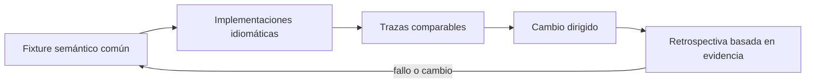
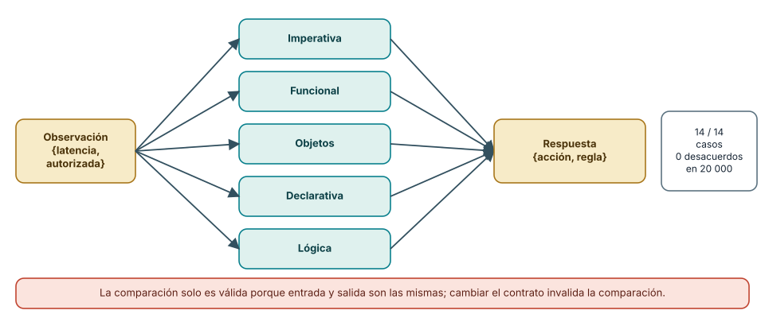
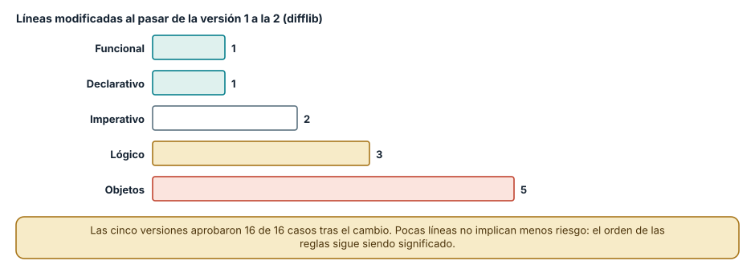
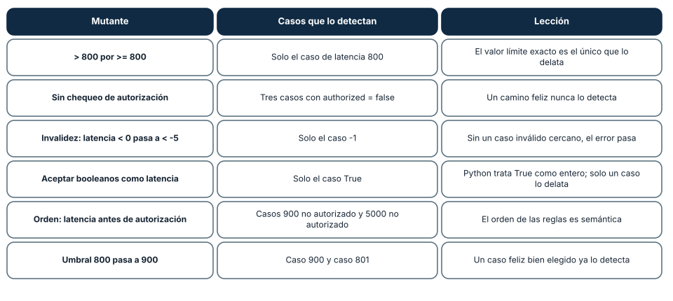

# SE-083 — Taller: una regla de negocio en cinco paradigmas

[← SE-082 — Selección y combinación responsable de paradigmas](https://github.com/vladimiracunadev-create/modern-software-engineering-program/blob/main/classes/part-06-paradigmas-de-programacion/se-082-seleccion-y-combinacion-responsable-de-paradigmas/README.md) · [↑ Parte 06](https://github.com/vladimiracunadev-create/modern-software-engineering-program/blob/main/classes/part-06-paradigmas-de-programacion/README.md) · [📚 Índice completo](https://github.com/vladimiracunadev-create/modern-software-engineering-program/blob/main/classes/README.md) · [🌐 Portal](https://vladimiracunadev-create.github.io/modern-software-engineering-program/classes/SE-083.html) · [SE-084 — Proyecto: comparación semántica con pruebas comunes →](https://github.com/vladimiracunadev-create/modern-software-engineering-program/blob/main/classes/part-06-paradigmas-de-programacion/se-084-proyecto-comparacion-semantica-con-pruebas-comunes/README.md)


## Punto profesional y fundamento pedagógico

**Punto profesional.** La clase existe para comparar cinco paradigmas sobre la misma regla y los mismos casos.

**Por qué aparece aquí.** Se sitúa después de **Selección y combinación responsable de paradigmas** y antes de **Proyecto: comparación semántica con pruebas comunes**: convierte el conocimiento anterior en una decisión observable que la clase siguiente podrá reutilizar. La continuidad se comprueba en el artefacto, no por compartir vocabulario.

**Error conceptual que debe corregir.** Cambiar los fixtures para favorecer cada implementación.

**Secuencia de aprendizaje.** Antes de leer la solución, el estudiante predice el resultado del caso normal y del error conceptual anterior. Luego explica un caso resuelto paso a paso, construye un contraejemplo que cambie la decisión y, sin consultar el texto, reconstruye el mecanismo y lo aplica a una entrada nueva. La secuencia usa predicción, explicación propia, contraste y recuperación. [ICAP](https://icap.education.asu.edu/research) distingue participación de construcción de conocimiento; [How People Learn II](https://nap.nationalacademies.org/catalog/24783/how-people-learn-ii-learners-contexts-and-cultures) exige conectar conocimiento previo, contexto y transferencia; la [práctica de recuperación](https://pubmed.ncbi.nlm.nih.gov/16507066/) respalda producir de nuevo la explicación tras una demora; y [Education for Life and Work](https://nap.nationalacademies.org/resource/13398/dbasse_084153.pdf) exige devolución que explique la causa del error.

**Evidencia de aprendizaje.** Cinco implementaciones o modelos, contrato común, fixtures y tabla semántica. Debe contener predicción previa, observación, explicación causal, contraejemplo, criterio de aceptación y una nota de qué dato haría cambiar la conclusión.

**Límite de la conclusión.** La comparación no controla ecosistema, equipo ni operación.

### Trazabilidad fuente → afirmación

| Fuente primaria u oficial | Afirmación que respalda | Lo que no prueba |
|---|---|---|
| [Python Language Reference](https://docs.python.org/3/reference/) | Semántica de sentencias, funciones, clases, generadores y corrutinas; autoridad: Python Software Foundation | No demuestra por sí sola que el artefacto del estudiante sea correcto. |
| [The Rust Programming Language](https://doc.rust-lang.org/stable/book/) | Ownership, enums, traits, errores y concurrencia sin carreras de datos; autoridad: Rust project | No demuestra por sí sola que el artefacto del estudiante sea correcto. |
| [SWI-Prolog Reference Manual](https://www.swi-prolog.org/pldoc/man?section=intro) | Hechos, reglas, unificación, búsqueda y límites operacionales; autoridad: SWI-Prolog project | No demuestra por sí sola que el artefacto del estudiante sea correcto. |
| [ReactiveX Observable Contract](https://reactivex.io/documentation/contract.html) | Notificaciones, terminación, errores y control de flujo observable; autoridad: ReactiveX project | No demuestra por sí sola que el artefacto del estudiante sea correcto. |
| [Erlang System Documentation: Processes](https://www.erlang.org/doc/system/ref_man_processes.html) | Procesos, buzones, envío de mensajes, enlaces y monitores; autoridad: Erlang/OTP project | No demuestra por sí sola que el artefacto del estudiante sea correcto. |

## Antes de empezar

Esta clase continúa el **motor de reglas comparado de la Parte 06**. Recupera la evidencia de la clase anterior, añade una decisión propia de **Taller: una regla de negocio en cinco paradigmas** y deja un artefacto que la clase siguiente deberá consumir. La pregunta activa es: **¿Qué diferencias reales aparecen al implementar la misma regla en cinco modelos?**

## Prerrequisitos

- Haber completado la clase anterior o reconstruir su contrato y evidencia.
- Python 3.11 o posterior, terminal, editor y Git; un segundo runtime es opcional y debe declararse.
- Trabajar con fixtures sintéticos: ninguna observación necesita datos de una persona o sistema real.

## Problema auténtico

El equipo discute paradigmas con ejemplos distintos. El motor de reglas comparado fija un solo contrato: dada evidencia autorizada, devolver acción, explicación o error; luego compara imperativo, objetos, funcional, reglas y eventos.

## Objetivos observables

Al terminar podrás explicar los cinco mecanismos de esta clase, predecir su comportamiento antes de ejecutar, construir un caso normal y uno límite, diagnosticar el fallo controlado, comparar una alternativa y entregar evidencia que otra persona pueda reproducir.

## Mapa conceptual



El mapa se lee como una cadena de razonamiento, no como fases obligatorias del runtime. La flecha de retorno indica que un fallo o cambio de requisito obliga a revisar el modelo inicial; no autoriza a parchear solo la última salida.

## Temas y por qué importan

| Tema | Por qué cambia una decisión profesional | Evidencia mínima |
|---|---|---|
| Fixture semántico común | El taller comienza por entradas y salidas canónicas, no por código. | Predicción, traza causal y contraejemplo de **Fixture semántico común** en `cinco implementaciones o modelos` |
| Implementaciones idiomáticas | Equivalencia no exige traducir línea por línea. | Predicción, traza causal y contraejemplo de **Implementaciones idiomáticas** en `cinco implementaciones o modelos` |
| Trazas comparables | Se registra entrada normalizada, reglas consideradas, decisión, error y efectos. | Predicción, traza causal y contraejemplo de **Trazas comparables** en `cinco implementaciones o modelos` |
| Cambio dirigido | Después de lograr equivalencia se introduce una regla nueva y se observa el diff. | Predicción, traza causal y contraejemplo de **Cambio dirigido** en `cinco implementaciones o modelos` |
| Retrospectiva basada en evidencia | La conclusión relaciona claridad, pruebas, diagnóstico y costo de cambio con artefactos concretos. | Predicción, traza causal y contraejemplo de **Retrospectiva basada en evidencia** en `cinco implementaciones o modelos` |
## Conceptos y decisiones

### 1. Fixture semántico común

El taller comienza por entradas y salidas canónicas, no por código. Cada implementación debe cubrir autorización falsa, evidencia vacía, empate y dato inválido. Si un modelo no puede representar un caso, esa imposibilidad es un hallazgo y no se elimina del fixture.

### 2. Implementaciones idiomáticas

Equivalencia no exige traducir línea por línea. Cada versión usa el mecanismo propio: transición explícita, objeto que protege invariantes, composición de valores, tabla de reglas o evento correlacionado. Aun así, no puede inventar una política distinta para lucir mejor.

### 3. Trazas comparables

Se registra entrada normalizada, reglas consideradas, decisión, error y efectos. La traza debe ser estable y no revelar detalles internos irrelevantes. Comparar solo el resultado final oculta por qué dos programas coinciden por accidente.

### 4. Cambio dirigido

Después de lograr equivalencia se introduce una regla nueva y se observa el diff. El objetivo es medir superficie de cambio, no velocidad de tecleo. Una solución que exige tocar cinco lugares revela dispersión aunque conserve el resultado.

### 5. Retrospectiva basada en evidencia

La conclusión relaciona claridad, pruebas, diagnóstico y costo de cambio con artefactos concretos. `Me gustó más` puede registrarse como preferencia, no como evidencia. Las diferencias del lenguaje y librerías quedan separadas de las del paradigma.

### El contrato común: lo que hace comparable el taller

Un taller que implementa la misma regla en cinco paradigmas solo compara algo si las cinco versiones aceptan la misma entrada y producen la misma salida. El contrato de este taller fue una observación `{latency_ms, authorized}` y una respuesta `{action, rule}`; la validación es parte del contrato: ausente, `None`, negativo, texto o booleano en `latency_ms` producen `reject-incomplete`. Los 14 casos fijos cubren el límite (800 y 801), cada tipo de entrada inválida, la combinación de no autorizado con latencia alta y la observación vacía. Las cinco versiones los aprobaron todos (70 de 70) y, con 20 000 entradas aleatorias generadas con una semilla fija, no discreparon ni una vez.

Esa prueba diferencial es más potente de lo que parece: no necesita saber la respuesta correcta, solo que las implementaciones coincidan; un desacuerdo señala dónde mirar. Su límite es la imaginación del generador: tipos que no genera (listas, números de coma flotante, cadenas con números) no se cubren.



**Cómo leer la figura.** El flujo va de izquierda a derecha: una entrada, cinco caminos y una salida común; el recuadro final resume el resultado. **Dónde deja de valer:** la equivalencia vale para el contrato y para el espacio que genera la prueba, no para todo el universo de entradas. Si el contrato cambia (otro formato de salida), hay que repetir la comparación.

### Superficie de cambio: añadir una regla en cinco paradigmas

La comparación más reveladora no es la implementación inicial sino el primer cambio. Se añadió R4 (latencia superior a 2000 ms, autorizado: escalar). Líneas modificadas: funcional 1, declarativo 1, imperativo 2, lógico 3, objetos 5. En el imperativo hay que insertar una rama antes de la de 800, en un lugar donde el orden importa; en el funcional y el declarativo, una fila con la misma prioridad; en los objetos, una clase y su alta en el motor; en el lógico, una cláusula y un ajuste de `R2` (añadir «y no más de 2000») para que las cláusulas sigan siendo excluyentes. Las cinco versiones aprobaron 16 de 16 casos tras el cambio (los 14 anteriores más 2001 y 2000).

La lectura útil no es «ganó el funcional» sino dónde vive el conocimiento del orden: en el imperativo, en la posición de la rama; en las reglas como datos, en el orden de la lista; en la lógica, en la exclusión mutua de las cláusulas. Cada versión tiene una forma distinta de equivocarse al insertar una regla en el lugar equivocado, y un buen taller prueba justo eso.



**Cómo leer la figura.** Cada barra cuenta las líneas que cambian entre la versión 1 y la 2 de esa implementación, según `difflib`. **Dónde deja de valer:** una línea de cambio no pesa lo mismo en todos los paradigmas; en objetos la clase nueva es código nuevo, no una modificación de lo existente, lo que algunos consideran más seguro (principio abierto-cerrado). La cifra mide esfuerzo de edición, no riesgo.

### Mutantes: qué detecta cada caso de prueba

¿Son suficientes 14 casos? Se escribieron seis **mutantes** (versiones de la implementación imperativa con un defecto plantado a mano) y se vio qué casos los detectaban. `>` cambiado por `>=` solo lo detectó el caso de latencia 800. Quitar el chequeo de autorización lo detectaron los tres casos no autorizados. Cambiar la invalidez de `lat < 0` a `lat < -5` solo lo detectó el caso `-1`. Aceptar booleanos (Python trata `True` como el entero 1) solo lo detectó el caso `True`. Mover la comprobación de latencia antes de la de autorización lo detectaron los casos no autorizados con latencia alta (900 y 5000). Y mover el umbral de 800 a 900 lo detectaron el caso 900 y el 801.

Cada caso de prueba existe porque protege una regla concreta; cada mutante que sobrevive indica un hueco. Si se suprime el caso `True`, el mutante de booleanos sobrevive y nadie se entera.



**Cómo leer la figura.** Cada fila describe un defecto plantado, qué casos lo detectan y qué enseña sobre diseño de pruebas. **Dónde deja de valer:** seis mutantes escritos a mano no son un análisis de mutación sistemático (que genera cientos de variantes automáticamente); sirven para razonar sobre la relación entre casos y reglas, no para estimar la calidad de la suite.

## Definiciones de trabajo

- **fixture semántico común:** el taller comienza por entradas y salidas canónicas, no por código.
- **implementaciones idiomáticas:** equivalencia no exige traducir línea por línea.
- **trazas comparables:** se registra entrada normalizada, reglas consideradas, decisión, error y efectos.
- **cambio dirigido:** después de lograr equivalencia se introduce una regla nueva y se observa el diff.
- **retrospectiva basada en evidencia:** la conclusión relaciona claridad, pruebas, diagnóstico y costo de cambio con artefactos concretos.

Las definiciones son operativas para el motor de reglas comparado. No convierten términos con historia más amplia en sinónimos y deben contrastarse con la documentación primaria enlazada al final.

## Ejemplo mínimo

```python
cases = [
    ({"authorized": True, "latency_ms": 900}, {"action": "inspect-transport"}),
    ({"authorized": False, "latency_ms": 900}, {"error": "not-authorized"}),
    ({"authorized": True}, {"error": "insufficient-evidence"}),
]
```

Antes de ejecutar, predice estado, resultado y error. Después registra versión, comando y salida. Si el fragmento es pseudocódigo o pertenece a otro lenguaje, etiquétalo como tal y no afirmes que fue ejecutado.

## Ejemplo profesional

En el motor de reglas comparado, una recomendación contiene acción, evidencia usada, versión de política y explicación. La implementación de esta clase debe conservar ese contrato aunque cambie la forma interna. El caso profesional no pregunta únicamente si devuelve una cadena: pregunta quién puede producirla, qué estado observa, cómo falla y qué rastro permite disputar una decisión incorrecta.

Compara el caso normal con autorización falsa, evidencia incompleta, empate y repetición. Un mecanismo es apropiado cuando esas diferencias quedan visibles y localizadas; es peligroso cuando dependen de orden accidental, estado oculto o una convención que el consumidor no puede conocer.

## Práctica guiada

1. Copia el contrato de entrada y salida antes de escribir implementación.
2. Predice el caso normal y un límite; identifica la invariante que no puede romperse.
3. Implementa la versión mínima sin I/O dentro del núcleo.
4. Ejecuta el caso y conserva comando, versión y salida bajo `evidence/`.
5. Introduce el fallo controlado, reduce la reproducción y formula dos hipótesis rivales.
6. Corrige la causa, añade regresión y ejecuta el conjunto completo.
7. Compara con otro paradigma o lenguaje indicando qué semántica se preserva.

## Ejercicios

1. **Contrato:** escribe el contrato de entrada y salida de tu regla, con las entradas inválidas, y comprueba que tus cinco versiones lo cumplen con los mismos casos.
2. **Diferencial:** genera 20 000 entradas aleatorias con semilla y cuenta desacuerdos; si hay alguno, minimiza la entrada y decide qué versión tiene razón.
3. **Cambio:** añade una regla nueva a las cinco versiones y cuenta las líneas modificadas; identifica en cuál el orden de inserción es más peligroso.
4. **Mutantes:** planta dos defectos en una versión y escribe el caso mínimo que los detecte; verifica que sin ese caso sobreviven.

## Reto verificable

Entrega implementación, fixtures, pruebas y un informe corto. Se aprueba si otra persona ejecuta desde checkout limpio, obtiene los mismos resultados y puede relacionar cada rama o transformación con una regla del dominio. No se aprueba por cantidad de archivos ni por usar la sintaxis característica del paradigma.

## Caso conductor

El motor de reglas comparado recibe una observación autorizada, evalúa reglas y devuelve una recomendación explicable. En esta clase, ejecuta el caso `latency_ms=900`, el límite `latency_ms=800`, el contraejemplo `authorized=false` y una entrada incompleta. Cambia después una sola regla y revisa qué archivos, pruebas y trazas debieron modificarse. Esa superficie de cambio alimenta la comparación final de la parte.

## Preguntas frecuentes

### ¿Por qué las cinco versiones deben tener la misma salida?

Porque la comparación solo es válida si lo que se compara es el cómo. Con salidas distintas se compararían decisiones diferentes. El contrato común es lo que convierte un conjunto de programas en un experimento.

### ¿Qué demuestra que no haya desacuerdos?

Que las versiones coinciden en lo que el generador produjo. No prueba corrección: si todas se equivocan igual (por ejemplo, tratando `True` como 1), el desacuerdo cero lo oculta. Los casos fijos escritos desde el contrato cubren esa posibilidad.

### ¿Qué es una prueba de mutación?

Introducir defectos pequeños y automáticos en el código y comprobar si las pruebas fallan. Un mutante que sobrevive indica una regla que ninguna prueba ejercita. Aquí se hizo con seis mutantes a mano para razonar, no como medición.

### ¿Para qué sirven cinco versiones si el servicio usará una?

Para entender qué hace cada forma con el cambio, el error y el orden. El resultado típico no es «adoptar las cinco», sino elegir una para el núcleo con criterios explícitos y conservar las pruebas comunes como contrato.

## Fallo controlado y diagnóstico

Permite que la versión basada en eventos responda antes de validar autorización. El fixture de resultado puede pasar por orden favorable; añade traza causal y ejecuta autorización tardía para revelar el defecto.

Registra síntoma, entrada mínima, hipótesis, observación que descarta cada hipótesis, causa, corrección y prueba de regresión. No cambies simultáneamente implementación, fixture y expectativa.

Práctica: elimina de la suite el caso `latency_ms=True` y ejecuta los 14 casos restantes contra una versión que acepta booleanos. **Síntoma esperado:** la suite pasa en verde pese al defecto. **Hipótesis rivales:** (a) el comportamiento con `True` es correcto; (b) la suite no lo ejercita. **Observación que las separa:** el contrato dice «entero no negativo», y `isinstance(True, int)` es verdadero en Python. **Corrección:** validación explícita del tipo y restitución del caso. **Regresión:** el caso con `True` en las 16 pruebas, contra las cinco versiones.

## Errores comunes y cómo corregirlos

| Síntoma | Causa | Corrección |
|---|---|---|
| Las pruebas pasan pero un defecto plantado sobrevive | Falta el caso que ejercita esa regla | Añadir el caso mínimo y comprobar que el mutante falla |
| Dos versiones divergen solo con ciertos tipos | El contrato no define tipos inválidos | Ampliar el contrato y los casos fijos |
| Añadir una regla cambia decisiones previas | Orden de las reglas no probado | Probar casos que activan varias reglas |
| Se cuenta solo cantidad de líneas | Medida tosca de esfuerzo | Añadir riesgo y dónde vive el conocimiento del orden |
| El taller compara sintaxis y no semántica | El contrato no es común | Fijar entrada, salida, errores y orden antes de implementar |

## Entorno y archivos clave

```text
work/SE-083/
├── README.md
├── rule_engine/
│   ├── domain.py
│   └── se_083.py
├── fixtures/cases.json
├── tests/test_se_083.py
└── evidence/diagnosis.md
```

El `README` declara plataforma, runtimes, comandos, limpieza y límites. Evita dependencias externas cuando la biblioteca estándar permita observar el mecanismo; si agregas una, fija procedencia y versión.

## Seguridad, ética y accesibilidad

- la autorización forma parte del dominio y no se infiere por ausencia de rechazo;
- no uses `eval`, reglas descargadas ni serialización insegura;
- limita colas, recursión, tamaño de entrada y tiempo de evaluación;
- redacta trazas y conserva una explicación textual además de color o animación;
- una recomendación automatizada debe poder revisarse, impugnarse y corregirse;
- respeta licencias de ejemplos y atribuye adaptaciones.

## Puente hacia el trabajo con agentes

Los agentes de programación proponen implementaciones alternativas de una misma función, y su valor depende de que el harness las compare con el mismo contrato: casos fijos, pruebas diferenciales y mutantes. Un agente que genera una versión «equivalente» sin ejecutar esa comparación está afirmando algo sin evidencia. La práctica del taller (contrato, diferencial, superficie de cambio y mutantes) es la base de una revisión automatizada de cambios generados, que las partes sobre evaluación de agentes y sobre pruebas retoman con más escala.

## Transferencia

Traslada un fixture al segundo modelo o lenguaje. Compara representación de ausencia, error, mutabilidad, orden y cancelación. La transferencia está lograda cuando el contrato se conserva y las diferencias están explicadas, no cuando la sintaxis se parece.

## Evaluación y evidencia

| Criterio | Evidencia para aprobar |
|---|---|
| comprensión | explicación causal de los cinco mecanismos |
| corrección | normal, límite, inválido y contraejemplo |
| diseño | estado, efectos y contrato localizables |
| diagnóstico | reproducción mínima y regresión |
| transferencia | comparación semántica, no estética |
| reproducibilidad | versiones, comandos, salida y límites |


## Fuentes


- [Python Language Reference](https://docs.python.org/3/reference/) — Semántica de sentencias, funciones, clases, generadores y corrutinas; autoridad: Python Software Foundation.
- [The Rust Programming Language](https://doc.rust-lang.org/stable/book/) — Ownership, enums, traits, errores y concurrencia sin carreras de datos; autoridad: Rust project.
- [SWI-Prolog Reference Manual](https://www.swi-prolog.org/pldoc/man?section=intro) — Hechos, reglas, unificación, búsqueda y límites operacionales; autoridad: SWI-Prolog project.
- [ReactiveX Observable Contract](https://reactivex.io/documentation/contract.html) — Notificaciones, terminación, errores y control de flujo observable; autoridad: ReactiveX project.
- [Erlang System Documentation: Processes](https://www.erlang.org/doc/system/ref_man_processes.html) — Procesos, buzones, envío de mensajes, enlaces y monitores; autoridad: Erlang/OTP project.
- [SWEBOK Guide v4.0a](https://www.computer.org/education/bodies-of-knowledge/software-engineering) — Construcción, diseño y fundamentos profesionales; autoridad: IEEE Computer Society.

Fuentes verificadas para las mediciones de esta clase (enlaces comprobados con `curl` el 2026-11-13):

- [`unittest`](https://docs.python.org/3/library/unittest.html) y [`difflib`](https://docs.python.org/3/library/difflib.html): ejecución de casos y diferencia de versiones; respaldan las figuras 1 y 2.
- Jia, Y. y Harman, M. (2011), «An Analysis and Survey of the Development of Mutation Testing», *IEEE Transactions on Software Engineering* 37(5), [doi:10.1109/TSE.2010.62](https://doi.org/10.1109/TSE.2010.62): fundamentos y límites de las pruebas de mutación; respalda la figura 3.
- [Python Language Reference: tipos numéricos y bool](https://docs.python.org/3/reference/datamodel.html): `bool` como subtipo de `int`.

Cada fuente respalda el mecanismo indicado; ninguna demuestra que la implementación del motor de reglas comparado sea correcta. Esa afirmación depende de fixtures, pruebas, trazas y revisión reproducible.

## Límites y siguiente paso

El taller compara un cambio y una carga pequeña; no demuestra mantenibilidad a largo plazo. El proyecto siguiente amplía pruebas, criterios y reporte para una comparación defendible.

## Glosario

- **fixture semántico común:** el taller comienza por entradas y salidas canónicas, no por código.
- **implementaciones idiomáticas:** equivalencia no exige traducir línea por línea.
- **trazas comparables:** se registra entrada normalizada, reglas consideradas, decisión, error y efectos.
- **cambio dirigido:** después de lograr equivalencia se introduce una regla nueva y se observa el diff.
- **retrospectiva basada en evidencia:** la conclusión relaciona claridad, pruebas, diagnóstico y costo de cambio con artefactos concretos.

---

[← SE-082 — Selección y combinación responsable de paradigmas](https://github.com/vladimiracunadev-create/modern-software-engineering-program/blob/main/classes/part-06-paradigmas-de-programacion/se-082-seleccion-y-combinacion-responsable-de-paradigmas/README.md) · [↑ Parte 06](https://github.com/vladimiracunadev-create/modern-software-engineering-program/blob/main/classes/part-06-paradigmas-de-programacion/README.md) · [📚 Índice completo](https://github.com/vladimiracunadev-create/modern-software-engineering-program/blob/main/classes/README.md) · [🌐 Portal](https://vladimiracunadev-create.github.io/modern-software-engineering-program/classes/SE-083.html) · [SE-084 — Proyecto: comparación semántica con pruebas comunes →](https://github.com/vladimiracunadev-create/modern-software-engineering-program/blob/main/classes/part-06-paradigmas-de-programacion/se-084-proyecto-comparacion-semantica-con-pruebas-comunes/README.md)
