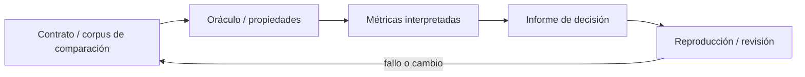
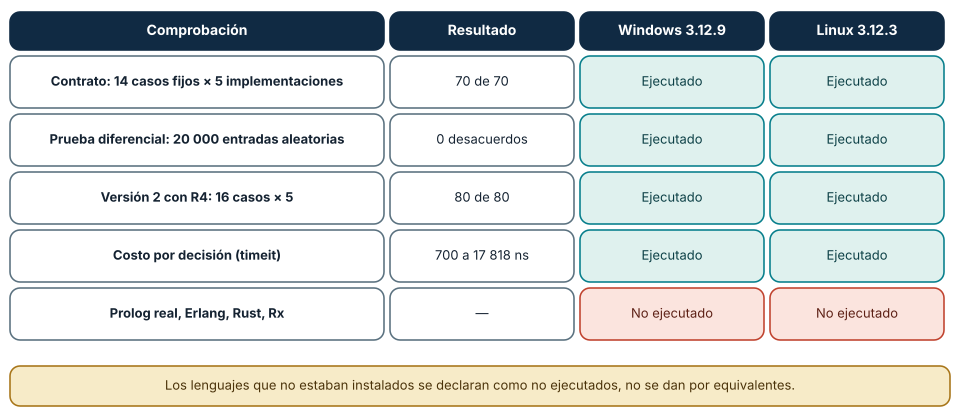
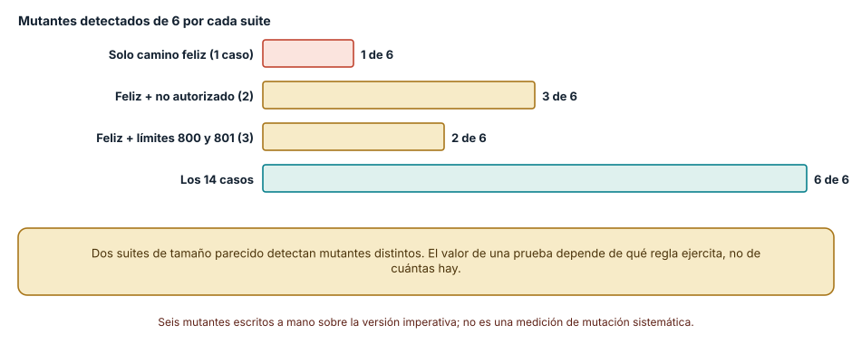
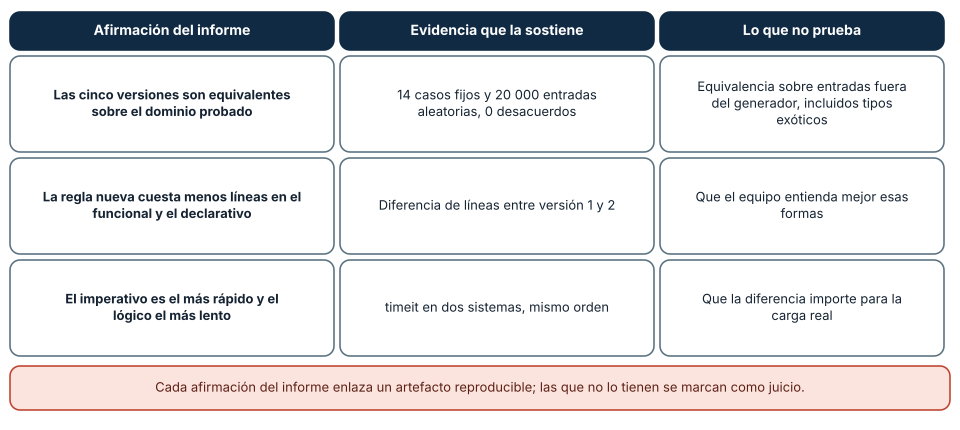

# SE-084 — Proyecto: comparación semántica con pruebas comunes

[← SE-083 — Taller: una regla de negocio en cinco paradigmas](https://github.com/vladimiracunadev-create/modern-software-engineering-program/blob/main/classes/part-06-paradigmas-de-programacion/se-083-taller-una-regla-de-negocio-en-cinco-paradigmas/README.md) · [↑ Parte 06](https://github.com/vladimiracunadev-create/modern-software-engineering-program/blob/main/classes/part-06-paradigmas-de-programacion/README.md) · [📚 Índice completo](https://github.com/vladimiracunadev-create/modern-software-engineering-program/blob/main/classes/README.md) · [🌐 Portal](https://vladimiracunadev-create.github.io/modern-software-engineering-program/classes/SE-084.html) · [SE-085 — Arreglos, listas y secuencias →](https://github.com/vladimiracunadev-create/modern-software-engineering-program/blob/main/classes/part-07-estructuras-de-datos-y-algoritmos/se-085-arreglos-listas-y-secuencias/README.md)


## Punto profesional y fundamento pedagógico

**Punto profesional.** La clase existe para demostrar qué semántica se conserva y cuál cambia mediante pruebas comunes.

**Por qué aparece aquí.** Se sitúa después de **Taller: una regla de negocio en cinco paradigmas** y antes de **Arreglos, listas y secuencias**: convierte el conocimiento anterior en una decisión observable que la clase siguiente podrá reutilizar. La continuidad se comprueba en el artefacto, no por compartir vocabulario.

**Error conceptual que debe corregir.** Concluir equivalencia por resultados felices o cantidad de líneas.

**Secuencia de aprendizaje.** Antes de leer la solución, el estudiante predice el resultado del caso normal y del error conceptual anterior. Luego explica un caso resuelto paso a paso, construye un contraejemplo que cambie la decisión y, sin consultar el texto, reconstruye el mecanismo y lo aplica a una entrada nueva. La secuencia usa predicción, explicación propia, contraste y recuperación. [ICAP](https://icap.education.asu.edu/research) distingue participación de construcción de conocimiento; [How People Learn II](https://nap.nationalacademies.org/catalog/24783/how-people-learn-ii-learners-contexts-and-cultures) exige conectar conocimiento previo, contexto y transferencia; la [práctica de recuperación](https://pubmed.ncbi.nlm.nih.gov/16507066/) respalda producir de nuevo la explicación tras una demora; y [Education for Life and Work](https://nap.nationalacademies.org/resource/13398/dbasse_084153.pdf) exige devolución que explique la causa del error.

**Evidencia de aprendizaje.** Suite común, matriz de diferencias, fallos y costo de cambio medido. Debe contener predicción previa, observación, explicación causal, contraejemplo, criterio de aceptación y una nota de qué dato haría cambiar la conclusión.

**Límite de la conclusión.** Las pruebas observadas no prueban equivalencia completa.

### Trazabilidad fuente → afirmación

| Fuente primaria u oficial | Afirmación que respalda | Lo que no prueba |
|---|---|---|
| [Python Language Reference](https://docs.python.org/3/reference/) | Semántica de sentencias, funciones, clases, generadores y corrutinas; autoridad: Python Software Foundation | No demuestra por sí sola que el artefacto del estudiante sea correcto. |
| [The Rust Programming Language](https://doc.rust-lang.org/stable/book/) | Ownership, enums, traits, errores y concurrencia sin carreras de datos; autoridad: Rust project | No demuestra por sí sola que el artefacto del estudiante sea correcto. |
| [SWI-Prolog Reference Manual](https://www.swi-prolog.org/pldoc/man?section=intro) | Hechos, reglas, unificación, búsqueda y límites operacionales; autoridad: SWI-Prolog project | No demuestra por sí sola que el artefacto del estudiante sea correcto. |
| [ReactiveX Observable Contract](https://reactivex.io/documentation/contract.html) | Notificaciones, terminación, errores y control de flujo observable; autoridad: ReactiveX project | No demuestra por sí sola que el artefacto del estudiante sea correcto. |
| [Erlang System Documentation: Processes](https://www.erlang.org/doc/system/ref_man_processes.html) | Procesos, buzones, envío de mensajes, enlaces y monitores; autoridad: Erlang/OTP project | No demuestra por sí sola que el artefacto del estudiante sea correcto. |
| [SWEBOK Guide v4.0a](https://www.computer.org/education/bodies-of-knowledge/software-engineering) | Construcción, diseño y fundamentos profesionales; autoridad: IEEE Computer Society | No demuestra por sí sola que el artefacto del estudiante sea correcto. |

## Antes de empezar

Esta clase continúa el **motor de reglas comparado de la Parte 06**. Recupera la evidencia de la clase anterior, añade una decisión propia de **Proyecto: comparación semántica con pruebas comunes** y deja un artefacto que la clase siguiente deberá consumir. La pregunta activa es: **¿Cómo sostener una comparación semántica reproducible sin declarar un ganador universal?**

## Prerrequisitos

- Haber completado la clase anterior o reconstruir su contrato y evidencia.
- Python 3.11 o posterior, terminal, editor y Git; un segundo runtime es opcional y debe declararse.
- Trabajar con fixtures sintéticos: ninguna observación necesita datos de una persona o sistema real.

## Problema auténtico

El motor de reglas comparado debe entregar una recomendación de paradigma para dos contextos: política auditable de baja tasa y telemetría continua. Una sola demo no cubre ambos y los resultados se vuelven opiniones.

## Objetivos observables

Al terminar podrás explicar los cinco mecanismos de esta clase, predecir su comportamiento antes de ejecutar, construir un caso normal y uno límite, diagnosticar el fallo controlado, comparar una alternativa y entregar evidencia que otra persona pueda reproducir.

## Mapa conceptual



El mapa se lee como una cadena de razonamiento, no como fases obligatorias del runtime. La flecha de retorno indica que un fallo o cambio de requisito obliga a revisar el modelo inicial; no autoriza a parchear solo la última salida.

## Temas y por qué importan

| Tema | Por qué cambia una decisión profesional | Evidencia mínima |
|---|---|---|
| Contrato y corpus de comparación | El proyecto congela vocabulario, esquema de entrada, resultados y errores. | Predicción, traza causal y contraejemplo de **Contrato y corpus de comparación** en `suite común` |
| Oráculo y propiedades | Un oráculo de referencia produce resultados esperados, pero también puede estar equivocado. | Predicción, traza causal y contraejemplo de **Oráculo y propiedades** en `suite común` |
| Métricas interpretadas | Se observa superficie de cambio, complejidad de traza, aislamiento de pruebas y costo bajo carga representativa. | Predicción, traza causal y contraejemplo de **Métricas interpretadas** en `suite común` |
| Informe de decisión | El informe conecta fuerza, observación, consecuencia y elección por contexto. | Predicción, traza causal y contraejemplo de **Informe de decisión** en `suite común` |
| Reproducción y revisión | Otra persona ejecuta un comando documentado, obtiene el mismo corpus y revisa diferencias. | Predicción, traza causal y contraejemplo de **Reproducción y revisión** en `suite común` |
## Conceptos y decisiones

### 1. Contrato y corpus de comparación

El proyecto congela vocabulario, esquema de entrada, resultados y errores. El corpus incluye ejemplos, límites, secuencias y cambios de política. Versionarlo evita ajustar casos después de ver qué implementación favorecen.

### 2. Oráculo y propiedades

Un oráculo de referencia produce resultados esperados, pero también puede estar equivocado. Se añaden propiedades: una decisión nunca pierde autorización, el desempate es estable y repetir un evento no duplica evidencia. Implementaciones distintas que coinciden con ambas fuentes ofrecen confianza mayor.

### 3. Métricas interpretadas

Se observa superficie de cambio, complejidad de traza, aislamiento de pruebas y costo bajo carga representativa. Líneas de código y tiempo bruto se presentan con contexto. No se mezcla calentamiento, I/O o runtimes diferentes sin declarar el sesgo.

### 4. Informe de decisión

El informe conecta fuerza, observación, consecuencia y elección por contexto. Puede recomendar reglas para política y flujo reactivo para telemetría, unidos por un adaptador pequeño. También declara cuándo esa combinación dejaría de ser adecuada.

### 5. Reproducción y revisión

Otra persona ejecuta un comando documentado, obtiene el mismo corpus y revisa diferencias. Versiones, plataforma y límites quedan registrados. Si una implementación es pseudocódigo, no se presenta como benchmark ejecutado.

### La matriz de evidencia: qué se ejecutó y qué no

El proyecto final es una comparación semántica con pruebas comunes, y lo que la distingue de una opinión es que cada afirmación apunta a algo ejecutado. La matriz del proyecto tiene cuatro comprobaciones realizadas en Windows (CPython 3.12.9) y en Linux bajo WSL2 (CPython 3.12.3): el contrato de 14 casos contra cinco implementaciones (70 de 70), la prueba diferencial de 20 000 entradas aleatorias (0 desacuerdos), la versión 2 con la regla R4 y 16 casos (80 de 80) y el costo por decisión (de 700 a 17 818 ns según la implementación y el sistema).

También registra lo que no se ejecutó: Prolog (no instalado), Erlang, Rust y las bibliotecas reactivas. Las cinco «versiones» comparadas son programas de Python que imitan el estilo de cada paradigma; no son un Prolog ni un Erlang reales. Declararlo no resta valor al proyecto: evita que una conclusión sobre «el paradigma lógico» se atribuya a un intérprete de juguete.



**Cómo leer la figura.** Cada fila es una comprobación con su resultado; las celdas teal son lo ejecutado y la coral lo declarado como no ejecutado. **Dónde deja de valer:** los resultados valen para estas implementaciones, esta regla y estas versiones de CPython; la matriz no certifica nada sobre otros lenguajes, otras reglas ni cargas de producción.

### El tamaño de la suite no es el valor de la suite

La pregunta de la evaluación es cuánta confianza da la suite de pruebas. Con los seis mutantes de `SE-083`, se evaluaron cuatro suites sobre la versión imperativa. Solo el camino feliz (un caso) detectó **1** de 6 mutantes. El camino feliz más un caso no autorizado detectó **3**. El camino feliz más los límites 800 y 801 detectó **2**. Los 14 casos detectaron **6**. Una suite de tres casos puede detectar menos que una de dos si los dos casos ejercitan reglas distintas.

El valor de una prueba está en qué regla protege, no en su cantidad. Por eso el informe del proyecto relaciona cada caso con la regla que protege (la matriz de trazabilidad del proyecto) y no presenta «14 pruebas» como un mérito.



**Cómo leer la figura.** Cada barra es el número de mutantes que esa suite detecta de los seis plantados. **Dónde deja de valer:** los mutantes fueron escritos por la misma persona que escribió las pruebas, lo que sesga hacia los defectos que ya imaginaba; un análisis de mutación automático generaría variantes que nadie anticipó. Es un ejercicio de razonamiento, no una métrica de calidad.

### Estructura del informe: afirmación, evidencia y límite

Un informe de comparación semántica que otra persona pueda reproducir tiene tres columnas para cada afirmación: qué se afirma, qué evidencia la sostiene y qué no prueba. Tres afirmaciones de este proyecto: «las cinco versiones son equivalentes en el dominio probado» (sostenida por 14 casos fijos y 20 000 entradas aleatorias; no prueba equivalencia fuera del generador); «la regla nueva cuesta menos líneas en el funcional y el declarativo» (diferencia de líneas entre la versión 1 y la 2; no prueba que el equipo las entienda mejor); y «el imperativo es el más rápido y el lógico el más lento» (`timeit` en dos sistemas con el mismo orden; no prueba que la diferencia importe para la carga real).

Las afirmaciones sin evidencia reproducible se marcan como juicio. Eso incluye las recomendaciones de la parte final: «para este dominio, el núcleo declarativo con borde imperativo» es una decisión que depende del tamaño del conjunto de reglas, de quién las edita y de la carga, y el informe debe decir con qué dato se revisaría.



**Cómo leer la figura.** Cada fila es una afirmación; las dos columnas siguientes obligan a nombrar la evidencia y el límite. **Dónde deja de valer:** es una plantilla de informe, no un método de decisión; no dice qué paradigma elegir. Su utilidad es que una persona ajena pueda reproducir cada comprobación o discutir una premisa concreta.

## Definiciones de trabajo

- **contrato y corpus de comparación:** el proyecto congela vocabulario, esquema de entrada, resultados y errores.
- **oráculo y propiedades:** un oráculo de referencia produce resultados esperados, pero también puede estar equivocado.
- **métricas interpretadas:** se observa superficie de cambio, complejidad de traza, aislamiento de pruebas y costo bajo carga representativa.
- **informe de decisión:** el informe conecta fuerza, observación, consecuencia y elección por contexto.
- **reproducción y revisión:** otra persona ejecuta un comando documentado, obtiene el mismo corpus y revisa diferencias.

Las definiciones son operativas para el motor de reglas comparado. No convierten términos con historia más amplia en sinónimos y deben contrastarse con la documentación primaria enlazada al final.

## Ejemplo mínimo

```python
python -m unittest -v
python compare.py --corpus fixtures/cases.json --format json
# El informe conserva versión, plataforma, resultados y divergencias.
```

Antes de ejecutar, predice estado, resultado y error. Después registra versión, comando y salida. Si el fragmento es pseudocódigo o pertenece a otro lenguaje, etiquétalo como tal y no afirmes que fue ejecutado.

## Ejemplo profesional

En el motor de reglas comparado, una recomendación contiene acción, evidencia usada, versión de política y explicación. La implementación de esta clase debe conservar ese contrato aunque cambie la forma interna. El caso profesional no pregunta únicamente si devuelve una cadena: pregunta quién puede producirla, qué estado observa, cómo falla y qué rastro permite disputar una decisión incorrecta.

Compara el caso normal con autorización falsa, evidencia incompleta, empate y repetición. Un mecanismo es apropiado cuando esas diferencias quedan visibles y localizadas; es peligroso cuando dependen de orden accidental, estado oculto o una convención que el consumidor no puede conocer.

## Práctica guiada

1. Copia el contrato de entrada y salida antes de escribir implementación.
2. Predice el caso normal y un límite; identifica la invariante que no puede romperse.
3. Implementa la versión mínima sin I/O dentro del núcleo.
4. Ejecuta el caso y conserva comando, versión y salida bajo `evidence/`.
5. Introduce el fallo controlado, reduce la reproducción y formula dos hipótesis rivales.
6. Corrige la causa, añade regresión y ejecuta el conjunto completo.
7. Compara con otro paradigma o lenguaje indicando qué semántica se preserva.

## Ejercicios

1. **Matriz:** construye la matriz de evidencia de tu proyecto con una fila por comprobación, el resultado y el sistema donde se ejecutó, y una fila de lo no ejecutado.
2. **Trazabilidad:** relaciona cada caso de prueba con la regla que protege y señala las reglas sin caso.
3. **Mutantes:** planta tres defectos en tu implementación, mide qué casos los detectan y reduce la suite al mínimo que detecte los tres.
4. **Informe:** escribe tres afirmaciones con su evidencia y su límite y pide a otra persona que reproduzca una desde cero.

## Reto verificable

Entrega implementación, fixtures, pruebas y un informe corto. Se aprueba si otra persona ejecuta desde checkout limpio, obtiene los mismos resultados y puede relacionar cada rama o transformación con una regla del dominio. No se aprueba por cantidad de archivos ni por usar la sintaxis característica del paradigma.

## Caso conductor

El motor de reglas comparado recibe una observación autorizada, evalúa reglas y devuelve una recomendación explicable. En esta clase, ejecuta el caso `latency_ms=900`, el límite `latency_ms=800`, el contraejemplo `authorized=false` y una entrada incompleta. Cambia después una sola regla y revisa qué archivos, pruebas y trazas debieron modificarse. Esa superficie de cambio alimenta la comparación final de la parte.

## Preguntas frecuentes

### ¿Qué hace que un informe de comparación sea reproducible?

Que cada cifra tenga un comando, una versión y un entorno, y que otra persona pueda ejecutarlos y obtener lo mismo. Las afirmaciones sin ese camino son opiniones, y se rotulan así.

### ¿Cuántos casos de prueba son suficientes?

La pregunta no tiene respuesta numérica: depende de qué reglas protegen. En la clase, un caso bien elegido detectó un mutante y tres casos mal elegidos detectaron menos que dos buenos.

### ¿Puedo afirmar que mis cinco versiones representan los paradigmas?

Solo como ejercicio: son programas de Python con el estilo de cada paradigma. Un Prolog real tiene indexación, tabling y corte que cambian el comportamiento; hay que decir qué no se ejecutó.

### ¿Qué hago si dos versiones discrepan en una entrada?

Minimizar la entrada, consultar el contrato y decidir cuál es la correcta; después se añade el caso a la suite común y se corrige la otra versión. Un desacuerdo es un hallazgo, no un fallo del experimento.

## Fallo controlado y diagnóstico

Modifica una implementación para devolver un error con otro nombre y normalízalo silenciosamente en el comparador. La divergencia desaparece. Restringe normalización a presentación y falla ante diferencias del contrato.

Registra síntoma, entrada mínima, hipótesis, observación que descarta cada hipótesis, causa, corrección y prueba de regresión. No cambies simultáneamente implementación, fixture y expectativa.

Práctica: reduce la suite a los casos de camino feliz y ejecuta los seis mutantes. **Síntoma esperado:** cinco de seis sobreviven y la suite sigue en verde. **Hipótesis rivales:** (a) los mutantes son equivalentes al original; (b) la suite no los alcanza. **Observación que las separa:** una entrada concreta donde el original y el mutante difieran; si existe, el mutante no es equivalente. **Corrección:** añadir el caso mínimo para cada mutante vivo. **Regresión:** la suite completa detecta los seis y la matriz de evidencia lo registra.

## Errores comunes y cómo corregirlos

| Síntoma | Causa | Corrección |
|---|---|---|
| El informe afirma sin comando reproducible | No se registró la evidencia | Añadir comando, versión y salida a cada afirmación |
| La suite pasa y hay defectos | Casos de camino feliz sin límites ni inválidos | Derivar casos del contrato y de los mutantes |
| Se generaliza a un paradigma completo | Implementaciones didácticas en un solo lenguaje | Declarar lo no ejecutado y el alcance |
| Los resultados cambian entre equipos | Medición de tiempos sin repetición ni sistema declarado | Repetir, usar la mediana y declarar el entorno |
| Una discrepancia se descarta como ruido | Falta de política para desacuerdos | Minimizar, decidir con el contrato y añadir el caso |

## Entorno y archivos clave

```text
work/SE-084/
├── README.md
├── rule_engine/
│   ├── domain.py
│   └── se_084.py
├── fixtures/cases.json
├── tests/test_se_084.py
└── evidence/diagnosis.md
```

El `README` declara plataforma, runtimes, comandos, limpieza y límites. Evita dependencias externas cuando la biblioteca estándar permita observar el mecanismo; si agregas una, fija procedencia y versión.

## Seguridad, ética y accesibilidad

- la autorización forma parte del dominio y no se infiere por ausencia de rechazo;
- no uses `eval`, reglas descargadas ni serialización insegura;
- limita colas, recursión, tamaño de entrada y tiempo de evaluación;
- redacta trazas y conserva una explicación textual además de color o animación;
- una recomendación automatizada debe poder revisarse, impugnarse y corregirse;
- respeta licencias de ejemplos y atribuye adaptaciones.

## Puente hacia el trabajo con agentes

Cuando un agente propone cambiar una implementación por otra «equivalente», la revisión debería exigir la misma matriz de evidencia: contrato común, prueba diferencial, superficie de cambio, mutantes y límites declarados. El informe de este proyecto es, en pequeño, el artefacto que un revisor humano o automático necesita para aceptar o rechazar un cambio generado. La Parte 07 aplica este tipo de comparación a estructuras de datos y algoritmos, y las partes sobre evaluación de agentes la generalizan a cambios hechos por modelos.

## Transferencia

Traslada un fixture al segundo modelo o lenguaje. Compara representación de ausencia, error, mutabilidad, orden y cancelación. La transferencia está lograda cuando el contrato se conserva y las diferencias están explicadas, no cuando la sintaxis se parece.

## Evaluación y evidencia

| Criterio | Evidencia para aprobar |
|---|---|
| comprensión | explicación causal de los cinco mecanismos |
| corrección | normal, límite, inválido y contraejemplo |
| diseño | estado, efectos y contrato localizables |
| diagnóstico | reproducción mínima y regresión |
| transferencia | comparación semántica, no estética |
| reproducibilidad | versiones, comandos, salida y límites |


## Fuentes


- [Python Language Reference](https://docs.python.org/3/reference/) — Semántica de sentencias, funciones, clases, generadores y corrutinas; autoridad: Python Software Foundation.
- [The Rust Programming Language](https://doc.rust-lang.org/stable/book/) — Ownership, enums, traits, errores y concurrencia sin carreras de datos; autoridad: Rust project.
- [SWI-Prolog Reference Manual](https://www.swi-prolog.org/pldoc/man?section=intro) — Hechos, reglas, unificación, búsqueda y límites operacionales; autoridad: SWI-Prolog project.
- [ReactiveX Observable Contract](https://reactivex.io/documentation/contract.html) — Notificaciones, terminación, errores y control de flujo observable; autoridad: ReactiveX project.
- [Erlang System Documentation: Processes](https://www.erlang.org/doc/system/ref_man_processes.html) — Procesos, buzones, envío de mensajes, enlaces y monitores; autoridad: Erlang/OTP project.
- [SWEBOK Guide v4.0a](https://www.computer.org/education/bodies-of-knowledge/software-engineering) — Construcción, diseño y fundamentos profesionales; autoridad: IEEE Computer Society.

Fuentes verificadas para las mediciones de esta clase (enlaces comprobados con `curl` el 2026-11-13):

- [`unittest`](https://docs.python.org/3/library/unittest.html), [`timeit`](https://docs.python.org/3/library/timeit.html) y [`difflib`](https://docs.python.org/3/library/difflib.html): herramientas de la matriz de evidencia; respaldan las figuras 1 y 3.
- Jia, Y. y Harman, M. (2011), «An Analysis and Survey of the Development of Mutation Testing», *IEEE Transactions on Software Engineering* 37(5), [doi:10.1109/TSE.2010.62](https://doi.org/10.1109/TSE.2010.62): pruebas de mutación y su interpretación; respalda la figura 2.
- [SWEBOK Guide v4.0a](https://www.computer.org/education/bodies-of-knowledge/software-engineering): prácticas de pruebas y de construcción como contexto profesional.

Cada fuente respalda el mecanismo indicado; ninguna demuestra que la implementación del motor de reglas comparado sea correcta. Esa afirmación depende de fixtures, pruebas, trazas y revisión reproducible.

## Límites y siguiente paso

El proyecto demuestra equivalencia para el corpus y propiedades declaradas, no para todas las entradas posibles ni para cargas de producción. La Parte 7 usará el comportamiento acordado para estudiar estructuras y algoritmos bajo una carga explícita.

## Glosario

- **contrato y corpus de comparación:** el proyecto congela vocabulario, esquema de entrada, resultados y errores.
- **oráculo y propiedades:** un oráculo de referencia produce resultados esperados, pero también puede estar equivocado.
- **métricas interpretadas:** se observa superficie de cambio, complejidad de traza, aislamiento de pruebas y costo bajo carga representativa.
- **informe de decisión:** el informe conecta fuerza, observación, consecuencia y elección por contexto.
- **reproducción y revisión:** otra persona ejecuta un comando documentado, obtiene el mismo corpus y revisa diferencias.

---

[← SE-083 — Taller: una regla de negocio en cinco paradigmas](https://github.com/vladimiracunadev-create/modern-software-engineering-program/blob/main/classes/part-06-paradigmas-de-programacion/se-083-taller-una-regla-de-negocio-en-cinco-paradigmas/README.md) · [↑ Parte 06](https://github.com/vladimiracunadev-create/modern-software-engineering-program/blob/main/classes/part-06-paradigmas-de-programacion/README.md) · [📚 Índice completo](https://github.com/vladimiracunadev-create/modern-software-engineering-program/blob/main/classes/README.md) · [🌐 Portal](https://vladimiracunadev-create.github.io/modern-software-engineering-program/classes/SE-084.html) · [SE-085 — Arreglos, listas y secuencias →](https://github.com/vladimiracunadev-create/modern-software-engineering-program/blob/main/classes/part-07-estructuras-de-datos-y-algoritmos/se-085-arreglos-listas-y-secuencias/README.md)
