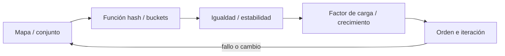
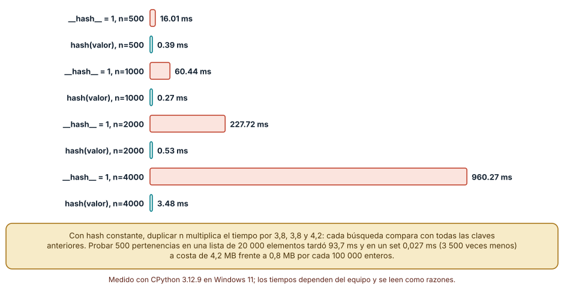
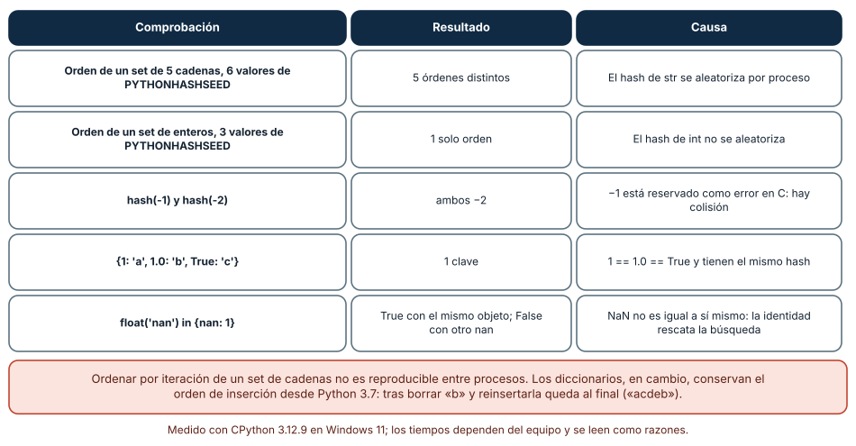
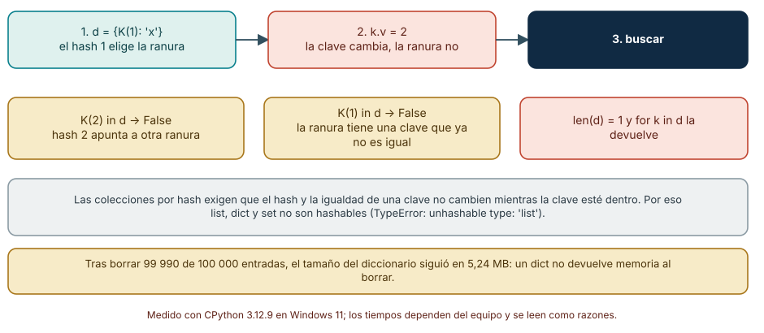

# SE-087 — Tablas hash, mapas y conjuntos

[← SE-086 — Pilas, colas, deques y prioridades](https://github.com/vladimiracunadev-create/modern-software-engineering-program/blob/main/classes/part-07-estructuras-de-datos-y-algoritmos/se-086-pilas-colas-deques-y-prioridades/README.md) · [↑ Parte 07](https://github.com/vladimiracunadev-create/modern-software-engineering-program/blob/main/classes/part-07-estructuras-de-datos-y-algoritmos/README.md) · [📚 Índice completo](https://github.com/vladimiracunadev-create/modern-software-engineering-program/blob/main/classes/README.md) · [🌐 Portal](https://vladimiracunadev-create.github.io/modern-software-engineering-program/classes/SE-087.html) · [SE-088 — Árboles, tries y estructuras jerárquicas →](https://github.com/vladimiracunadev-create/modern-software-engineering-program/blob/main/classes/part-07-estructuras-de-datos-y-algoritmos/se-088-arboles-tries-y-estructuras-jerarquicas/README.md)


## Punto profesional y fundamento pedagógico

**Punto profesional.** La clase existe para diseñar tablas hash, mapas y conjuntos con igualdad, hash, colisiones y mutabilidad coherentes.

**Por qué aparece aquí.** Se sitúa después de **Pilas, colas, deques y prioridades** y antes de **Árboles, tries y estructuras jerárquicas**: convierte el conocimiento anterior en una decisión observable que la clase siguiente podrá reutilizar. La continuidad se comprueba en el artefacto, no por compartir vocabulario.

**Error conceptual que debe corregir.** Suponer acceso O(1) incondicional o usar claves mutables.

**Secuencia de aprendizaje.** Antes de leer la solución, el estudiante predice el resultado del caso normal y del error conceptual anterior. Luego explica un caso resuelto paso a paso, construye un contraejemplo que cambie la decisión y, sin consultar el texto, reconstruye el mecanismo y lo aplica a una entrada nueva. La secuencia usa predicción, explicación propia, contraste y recuperación. [ICAP](https://icap.education.asu.edu/research) distingue participación de construcción de conocimiento; [How People Learn II](https://nap.nationalacademies.org/catalog/24783/how-people-learn-ii-learners-contexts-and-cultures) exige conectar conocimiento previo, contexto y transferencia; la [práctica de recuperación](https://pubmed.ncbi.nlm.nih.gov/16507066/) respalda producir de nuevo la explicación tras una demora; y [Education for Life and Work](https://nap.nationalacademies.org/resource/13398/dbasse_084153.pdf) exige devolución que explique la causa del error.

**Evidencia de aprendizaje.** Hash-contract.md con igualdad/hash, colisión y degradación observada. Debe contener predicción previa, observación, explicación causal, contraejemplo, criterio de aceptación y una nota de qué dato haría cambiar la conclusión.

**Límite de la conclusión.** El promedio esperado no es garantía de peor caso.

### Trazabilidad fuente → afirmación

| Fuente primaria u oficial | Afirmación que respalda | Lo que no prueba |
|---|---|---|
| [MIT 6.006 Introduction to Algorithms](https://ocw.mit.edu/courses/6-006-introduction-to-algorithms-spring-2020/) | Estructuras, algoritmos, corrección y análisis de complejidad; autoridad: MIT OpenCourseWare | No demuestra por sí sola que el artefacto del estudiante sea correcto. |
| [Python Data Model](https://docs.python.org/3/reference/datamodel.html) | Semántica de secuencias, conjuntos, mappings, igualdad y hash; autoridad: Python Software Foundation | No demuestra por sí sola que el artefacto del estudiante sea correcto. |
| [Mathematics for Computer Science](https://ocw.mit.edu/courses/6-042j-mathematics-for-computer-science-spring-2015/) | Inducción, grafos, conteo y razonamiento discreto; autoridad: MIT OpenCourseWare | No demuestra por sí sola que el artefacto del estudiante sea correcto. |

## Antes de empezar

Esta clase continúa la **biblioteca de estructuras y algoritmos de la Parte 07**. Recupera la evidencia de la clase anterior, añade una decisión propia de **Tablas hash, mapas y conjuntos** y deja un artefacto que la clase siguiente deberá consumir. La pregunta activa es: **¿Qué exige una búsqueda por clave para seguir siendo correcta y predecible?**

## Prerrequisitos

- Haber completado la clase anterior o reconstruir su contrato y evidencia.
- Python 3.11 o posterior, terminal, editor y Git; un segundo runtime es opcional y debe declararse.
- Trabajar con fixtures sintéticos: ninguna observación necesita datos de una persona o sistema real.

## Problema auténtico

La biblioteca de estructuras y algoritmos necesita deduplicar eventos y encontrar un caso por ID. Recorrer la lista escala linealmente; un diccionario acelera el caso esperado, pero una clave mutable vuelve entradas inalcanzables.

## Objetivos observables

Al terminar podrás explicar los cinco mecanismos de esta clase, predecir su comportamiento antes de ejecutar, construir un caso normal y uno límite, diagnosticar el fallo controlado, comparar una alternativa y entregar evidencia que otra persona pueda reproducir.

## Mapa conceptual



El mapa se lee como una cadena de razonamiento, no como fases obligatorias del runtime. La flecha de retorno indica que un fallo o cambio de requisito obliga a revisar el modelo inicial; no autoriza a parchear solo la última salida.

## Temas y por qué importan

| Tema | Por qué cambia una decisión profesional | Evidencia mínima |
|---|---|---|
| Mapa y conjunto | Un mapa asocia claves únicas con valores; un conjunto conserva pertenencia sin payload separado. | Predicción, traza causal y contraejemplo de **Mapa y conjunto** en `hash-contract.md` |
| Función hash y buckets | El hash transforma una clave en un entero usado para elegir ubicación. | Predicción, traza causal y contraejemplo de **Función hash y buckets** en `hash-contract.md` |
| Igualdad y estabilidad | Si dos claves son iguales deben compartir hash. | Predicción, traza causal y contraejemplo de **Igualdad y estabilidad** en `hash-contract.md` |
| Factor de carga y crecimiento | Al aumentar ocupación crecen colisiones; la tabla reserva una capacidad mayor y redistribuye. | Predicción, traza causal y contraejemplo de **Factor de carga y crecimiento** en `hash-contract.md` |
| Orden e iteración | Python garantiza orden de inserción en `dict`, pero `set` no promete orden estable entre ejecuciones. | Predicción, traza causal y contraejemplo de **Orden e iteración** en `hash-contract.md` |
## Conceptos y decisiones

### 1. Mapa y conjunto

Un mapa asocia claves únicas con valores; un conjunto conserva pertenencia sin payload separado. Ambos expresan identidad lógica y suelen usar hash. Elegir conjunto elimina accidentalmente multiplicidad y orden si esas propiedades eran parte del contrato.

### 2. Función hash y buckets

El hash transforma una clave en un entero usado para elegir ubicación. Colisiones son inevitables y la implementación las resuelve. La complejidad esperada constante depende de distribución, redimensionamiento y protección frente a entradas adversarias.

### 3. Igualdad y estabilidad

Si dos claves son iguales deben compartir hash. El valor usado por igualdad y hash no puede cambiar mientras la clave esté almacenada. Confundir identidad de objeto con identidad de dominio produce duplicados o reemplazos inesperados.

### 4. Factor de carga y crecimiento

Al aumentar ocupación crecen colisiones; la tabla reserva una capacidad mayor y redistribuye. Esa operación introduce picos y memoria adicional. El detalle exacto depende del runtime, por lo que se documenta la garantía del lenguaje y se mide la implementación usada.

### 5. Orden e iteración

Python garantiza orden de inserción en `dict`, pero `set` no promete orden estable entre ejecuciones. Usar el orden observado de un conjunto como desempate crea pruebas frágiles. Si el orden importa, debe representarse explícitamente.

### Colisiones: cuando el hash deja de repartir

Una tabla hash promete búsqueda en tiempo constante *si* el hash reparte las claves. Lo rompimos a propósito: una clase cuyo `__hash__` devuelve siempre 1 y otra con `hash(self.valor)`, ambas con `__eq__` correcto. Buscar `n` claves tardó 16,0, 60,4, 227,7 y 960,3 ms con hash constante (n = 500, 1 000, 2 000 y 4 000) y 0,39, 0,27, 0,53 y 3,48 ms con el hash razonable. Con hash constante, duplicar `n` multiplica el tiempo por 3,8, 3,8 y 4,2: cada búsqueda compara con las claves previas, de modo que el costo total es cuadrático. Los resultados fueron iguales en Linux (1 219 ms con 4 000).

El peligro práctico no es solo el código propio. Un atacante que controle las claves (parámetros de una petición, nombres de campo) puede fabricar colisiones; por eso CPython aleatoriza el hash de `str` y `bytes` por proceso. La ventaja frente a una lista también se midió: 500 pertenencias sobre 20 000 claves tardaron 93,7 ms en una lista y 0,027 ms en un `set`, aproximadamente 3 500 veces menos, al precio de 4,19 MB frente a 0,80 MB cada 100 000 enteros.



**Cómo leer la figura.** Cada par es un tamaño; fíjate en la razón entre barras consecutivas coral, no en los milisegundos. **Dónde deja de valer:** el `O(1)` es esperado bajo un hash uniforme; no es garantía. El experimento usa claves de una clase propia; con enteros o cadenas el intérprete ya reparte bien, y el riesgo se desplaza a quien define `__hash__`.

### Hash e igualdad: cinco sorpresas

`__hash__` y `__eq__` deben ser coherentes: dos objetos iguales deben tener el mismo hash. De ahí salen sorpresas que medimos. (1) Un `set` de cinco cadenas se iteró en 5 órdenes distintos con 6 valores de `PYTHONHASHSEED`: el hash de `str` se aleatoriza por proceso. (2) Un `set` de enteros produjo un solo orden con 3 semillas: el hash de `int` no se aleatoriza. (3) `hash(-1)` y `hash(-2)` valen ambos −2, porque −1 está reservado como señal de error en C. (4) `{1: 'a', 1.0: 'b', True: 'c'}` tiene una sola clave, porque `1 == 1.0 == True` y sus hashes coinciden. (5) `float('nan') in {nan: 1}` es `True` con el mismo objeto y `False` con otro NaN: NaN no es igual a sí mismo y solo la identidad rescata la búsqueda.

La consecuencia de diseño: el orden de iteración de un `set` o de un `dict` por hash no debe usarse como dato. Los `dict` conservan el orden de inserción desde Python 3.7 (tras borrar `b` y reinsertarla, el orden fue `acdeb`), pero los `set` no ofrecen esa garantía.



**Cómo leer la figura.** Lee cada fila como una pregunta de entrevista con respuesta comprobada: la columna central es la observación, la derecha su causa. **Dónde deja de valer:** estas observaciones son de CPython 3.12; otros intérpretes pueden aleatorizar o no. La igualdad de `1` y `True` es una decisión del lenguaje que podría sorprender en otros dominios (identificadores, banderas).

### Claves mutables: la entrada que existe y no se encuentra

Insertamos `K(1)` en un diccionario, cambiamos su atributo a 2 y probamos las búsquedas. `K(2) in d` dio `False`, `K(1) in d` dio `False`, `len(d)` seguía en 1 y la iteración devolvía la clave. La entrada quedó en la ranura que corresponde al hash 1, pero la clave ya no es igual a `K(1)`; y el hash 2 apunta a otra ranura. La entrada existe y es inalcanzable. Por eso `list`, `dict` y `set` no son hashables (`TypeError: unhashable type: 'list'`).

El tamaño del diccionario también tiene un matiz: tras insertar 100 000 entradas y borrar 99 990, `sys.getsizeof` siguió en 5,24 MB. Un `dict` no devuelve memoria al borrar; se reconstruye (`dict(d)`) si importa. La regla de diseño es sencilla: las claves son valores inmutables o se tratan como tales; si el estado de una clave puede cambiar, la clave debe ser su identificador estable (un `id` o una tupla congelada), no el objeto.



**Cómo leer la figura.** Sigue las tres cajas de arriba de izquierda a derecha: insertar, mutar, buscar. La fila de abajo muestra los tres resultados. **Dónde deja de valer:** el experimento define `__hash__` a partir del atributo mutable, que es justo lo que se desaconseja. Una clase con hash por identidad (el comportamiento por defecto) no sufre este fallo, pero entonces dos objetos «iguales» en contenido son claves distintas.

## Definiciones de trabajo

- **mapa y conjunto:** un mapa asocia claves únicas con valores; un conjunto conserva pertenencia sin payload separado.
- **función hash y buckets:** el hash transforma una clave en un entero usado para elegir ubicación.
- **igualdad y estabilidad:** si dos claves son iguales deben compartir hash.
- **factor de carga y crecimiento:** al aumentar ocupación crecen colisiones; la tabla reserva una capacidad mayor y redistribuye.
- **orden e iteración:** python garantiza orden de inserción en `dict`, pero `set` no promete orden estable entre ejecuciones.

Las definiciones son operativas para la biblioteca de estructuras y algoritmos. No convierten términos con historia más amplia en sinónimos y deben contrastarse con la documentación primaria enlazada al final.

## Ejemplo mínimo

```python
by_id = {"c-17": {"priority": 5}}
seen = {"event-1"}
assert by_id["c-17"]["priority"] == 5
assert "event-1" in seen
```

Antes de ejecutar, predice estado, resultado y error. Después registra versión, comando y salida. Si el fragmento es pseudocódigo o pertenece a otro lenguaje, etiquétalo como tal y no afirmes que fue ejecutado.

## Ejemplo profesional

En la biblioteca de estructuras y algoritmos, un caso conserva identidad, prioridad, dependencias, instante de llegada y estado de resolución. La implementación de esta clase debe conservar ese contrato aunque cambie la forma interna. El caso profesional no pregunta únicamente si produce una salida: pregunta quién puede producirla, qué estado observa, cómo falla y qué rastro permite disputar una decisión incorrecta.

Compara el caso normal con autorización falsa, evidencia incompleta, empate y repetición. Un mecanismo es apropiado cuando esas diferencias quedan visibles y localizadas; es peligroso cuando dependen de orden accidental, estado oculto o una convención que el consumidor no puede conocer.

## Práctica guiada

1. Copia el contrato de entrada y salida antes de escribir implementación.
2. Predice el caso normal y un límite; identifica la invariante que no puede romperse.
3. Implementa la versión mínima sin I/O dentro del núcleo.
4. Ejecuta el caso y conserva comando, versión y salida bajo `evidence/`.
5. Introduce el fallo controlado, reduce la reproducción y formula dos hipótesis rivales.
6. Corrige la causa, añade regresión y ejecuta el conjunto completo.
7. Compara con otro paradigma o lenguaje indicando qué semántica se preserva.

## Ejercicios

1. **Colisiones:** reproduce el experimento con `__hash__` constante y con `hash(valor)` para cuatro tamaños; calcula las razones y explica por qué la primera es cuadrática.
2. **Semillas:** ejecuta un script que imprima un `set` de cinco cadenas con seis valores de `PYTHONHASHSEED` y cuenta cuántos órdenes distintos obtienes.
3. **Clave mutada:** construye el caso `K(1)` mutado y escribe una prueba que lo detecte; propón dos diseños que lo eviten.
4. **Igualdad:** predice el tamaño de `{1: 'a', 1.0: 'b', True: 'c'}` antes de ejecutarlo y explica el resultado con `hash` y `==`.

## Reto verificable

Entrega implementación, fixtures, pruebas y un informe corto. Se aprueba si otra persona ejecuta desde checkout limpio, obtiene los mismos resultados y puede relacionar cada rama o transformación con una regla del dominio. No se aprueba por cantidad de archivos ni por usar la sintaxis característica del paradigma.

## Caso conductor

La biblioteca de estructuras y algoritmos recibe casos del motor de reglas comparado, mantiene una frontera de trabajo priorizada y explica por qué el siguiente caso es elegible. Ejecuta una carga pequeña trazable, duplicados, prioridades iguales y una dependencia ausente. Cambia después una sola regla o condición y revisa qué archivos, pruebas y trazas debieron modificarse. Esa superficie de cambio alimenta el proyecto final de la parte.

## Preguntas frecuentes

### ¿`set` es siempre más rápido que una lista para saber si algo está?

No siempre: construir el set cuesta. Con 10 000 elementos y una sola consulta la lista fue más rápida; con tres consultas ya conviene el set (véase SE-095). Depende de cuántas veces se consulta.

### ¿Puedo usar una lista como clave?

No: `TypeError: unhashable type`. Usa una tupla (si sus elementos son hashables) o un `frozenset`. Si necesitas mutar, usa un identificador estable como clave.

### ¿Por qué el orden de mi `set` de cadenas cambia entre ejecuciones?

Porque el hash de `str` se aleatoriza por proceso (5 órdenes distintos con 6 semillas). No dependas del orden; ordena con `sorted` cuando necesites reproducibilidad.

### ¿Es seguro escribir mi propio `__hash__`?

Solo si iguales ⇒ mismo hash y la clave no cambia mientras esté dentro. Con hash constante, 4 000 búsquedas tardaron 960 ms frente a 3,5 ms.

## Fallo controlado y diagnóstico

Define una clave cuyo hash depende de una lista modificable y cambia la lista tras insertar. Reemplázala por identificador inmutable y prueba igualdad, hash y duplicado.

Registra síntoma, entrada mínima, hipótesis, observación que descarta cada hipótesis, causa, corrección y prueba de regresión. No cambies simultáneamente implementación, fixture y expectativa.

Define una clase con `__hash__` basado en un atributo, inserta una instancia en un `dict`, cambia el atributo y busca con el valor nuevo y con el antiguo. **Síntoma:** ninguna búsqueda encuentra la entrada y `len` sigue en 1. **Hipótesis rivales:** (a) el diccionario perdió la clave; (b) el hash apunta ahora a otra ranura mientras la entrada permanece en la original. **Prueba:** itera el diccionario y observa que la clave sigue allí; restaura el valor original y observa que la búsqueda vuelve a funcionar. **Conclusión:** la entrada nunca desapareció, quedó en una ranura que ya no corresponde a su hash. Registra la regla «claves inmutables» en el contrato.

## Errores comunes y cómo corregirlos

| Síntoma | Causa probable | Corrección |
|---|---|---|
| Una búsqueda en un `dict` falla para una clave que «seguro» se insertó | La clave se mutó después de insertarla | Usar claves inmutables o un identificador estable; añadir una prueba que mute y busque |
| El orden de salida cambia entre ejecuciones | Se itera un `set` de cadenas con hash aleatorizado | Ordenar explícitamente antes de producir resultados |
| `1` y `True` colapsan en una sola clave | `1 == True` y tienen el mismo hash | Normalizar o separar el tipo antes de usarlos como claves |
| `nan in d` da distinto resultado según el objeto | NaN no es igual a sí mismo; solo la identidad lo rescata | Rechazar o normalizar NaN antes de indexar |
| El consumo de memoria no baja tras borrar | El `dict` conserva su tabla al borrar | Reconstruir el diccionario si el tamaño importa |

## Entorno y archivos clave

```text
work/SE-087/
├── README.md
├── algorithm_library/
│   ├── domain.py
│   └── se_087.py
├── fixtures/cases.json
├── tests/test_se_087.py
└── evidence/diagnosis.md
```

El `README` declara plataforma, runtimes, comandos, limpieza y límites. Evita dependencias externas cuando la biblioteca estándar permita observar el mecanismo; si agregas una, fija procedencia y versión.

## Seguridad, ética y accesibilidad

- la autorización forma parte del dominio y no se infiere por ausencia de rechazo;
- no uses `eval`, reglas descargadas ni serialización insegura;
- limita colas, recursión, tamaño de entrada y tiempo de evaluación;
- redacta trazas y conserva una explicación textual además de color o animación;
- una recomendación automatizada debe poder revisarse, impugnarse y corregirse;
- respeta licencias de ejemplos y atribuye adaptaciones.

## Puente hacia el trabajo con agentes

Cuando un agente propone usar objetos como claves de un diccionario, la pregunta para su plan es: ¿cuál es el hash, cuál la igualdad y puede cambiar el objeto mientras es clave? Un agente que cachea resultados por objeto mutable produce fallos que no se reproducen con la misma entrada. Exige que su caché use claves inmutables y que una prueba mute el objeto y verifique el resultado; esa prueba rara vez aparece sin pedirla.

## Transferencia

Traslada un fixture al segundo modelo o lenguaje. Compara representación de ausencia, error, mutabilidad, orden y cancelación. La transferencia está lograda cuando el contrato se conserva y las diferencias están explicadas, no cuando la sintaxis se parece.

## Evaluación y evidencia

| Criterio | Evidencia para aprobar |
|---|---|
| comprensión | explicación causal de los cinco mecanismos |
| corrección | normal, límite, inválido y contraejemplo |
| diseño | estado, efectos y contrato localizables |
| diagnóstico | reproducción mínima y regresión |
| transferencia | comparación semántica, no estética |
| reproducibilidad | versiones, comandos, salida y límites |


## Fuentes


- [MIT 6.006 Introduction to Algorithms](https://ocw.mit.edu/courses/6-006-introduction-to-algorithms-spring-2020/) — Estructuras, algoritmos, corrección y análisis de complejidad; autoridad: MIT OpenCourseWare.
- [Python Data Model](https://docs.python.org/3/reference/datamodel.html) — Semántica de secuencias, conjuntos, mappings, igualdad y hash; autoridad: Python Software Foundation.
- [Python Standard Library](https://docs.python.org/3/library/index.html) — Deque, heapq, bisect, graphlib y contenedores disponibles; autoridad: Python Software Foundation.
- [Python Debugging and Profiling](https://docs.python.org/3/library/debug.html) — Timeit, cprofile y tracemalloc con sus límites; autoridad: Python Software Foundation.
- [Mathematics for Computer Science](https://ocw.mit.edu/courses/6-042j-mathematics-for-computer-science-spring-2015/) — Inducción, grafos, conteo y razonamiento discreto; autoridad: MIT OpenCourseWare.
- [SWEBOK Guide v4.0a](https://www.computer.org/education/bodies-of-knowledge/software-engineering) — Construcción, medición y fundamentos de ingeniería; autoridad: IEEE Computer Society.

Cada fuente respalda el mecanismo indicado; ninguna demuestra que la implementación de la biblioteca de estructuras y algoritmos sea correcta. Esa afirmación depende de fixtures, pruebas, trazas y revisión reproducible.

- [Python: modelo de datos, `object.__hash__`](https://docs.python.org/3/reference/datamodel.html#object.__hash__) — contrato de hash e igualdad y requisito de inmutabilidad práctica.
- [Python: `PYTHONHASHSEED`](https://docs.python.org/3/using/cmdline.html#envvar-PYTHONHASHSEED) — aleatorización del hash de `str` y `bytes` por proceso.
- [Python: tipos de mapeo, `dict`](https://docs.python.org/3/library/stdtypes.html#mapping-types-dict) — orden de inserción garantizado desde Python 3.7 y operaciones del diccionario.
- [Crosby y Wallach, «Denial of Service via Algorithmic Complexity Attacks» (USENIX Security 2003)](https://www.usenix.org/legacy/events/sec03/tech/full_papers/crosby/crosby.pdf) — ataque por colisiones deliberadas contra tablas hash.

## Límites y siguiente paso

Las tablas hash no mantienen rangos ni prefijos ordenados. La siguiente clase estudia árboles, tries y jerarquías con invariantes estructurales.

## Glosario

- **mapa y conjunto:** un mapa asocia claves únicas con valores; un conjunto conserva pertenencia sin payload separado.
- **función hash y buckets:** el hash transforma una clave en un entero usado para elegir ubicación.
- **igualdad y estabilidad:** si dos claves son iguales deben compartir hash.
- **factor de carga y crecimiento:** al aumentar ocupación crecen colisiones; la tabla reserva una capacidad mayor y redistribuye.
- **orden e iteración:** python garantiza orden de inserción en `dict`, pero `set` no promete orden estable entre ejecuciones.

---

[← SE-086 — Pilas, colas, deques y prioridades](https://github.com/vladimiracunadev-create/modern-software-engineering-program/blob/main/classes/part-07-estructuras-de-datos-y-algoritmos/se-086-pilas-colas-deques-y-prioridades/README.md) · [↑ Parte 07](https://github.com/vladimiracunadev-create/modern-software-engineering-program/blob/main/classes/part-07-estructuras-de-datos-y-algoritmos/README.md) · [📚 Índice completo](https://github.com/vladimiracunadev-create/modern-software-engineering-program/blob/main/classes/README.md) · [🌐 Portal](https://vladimiracunadev-create.github.io/modern-software-engineering-program/classes/SE-087.html) · [SE-088 — Árboles, tries y estructuras jerárquicas →](https://github.com/vladimiracunadev-create/modern-software-engineering-program/blob/main/classes/part-07-estructuras-de-datos-y-algoritmos/se-088-arboles-tries-y-estructuras-jerarquicas/README.md)
