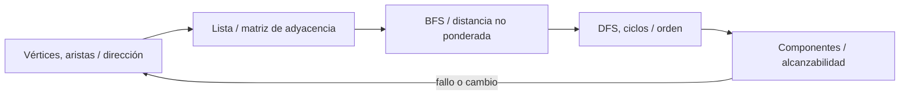
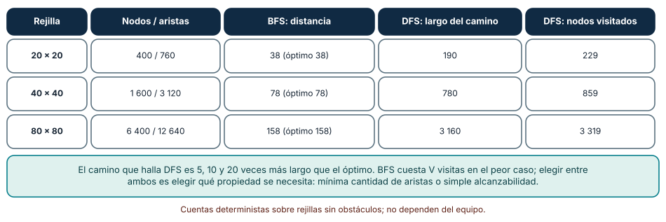
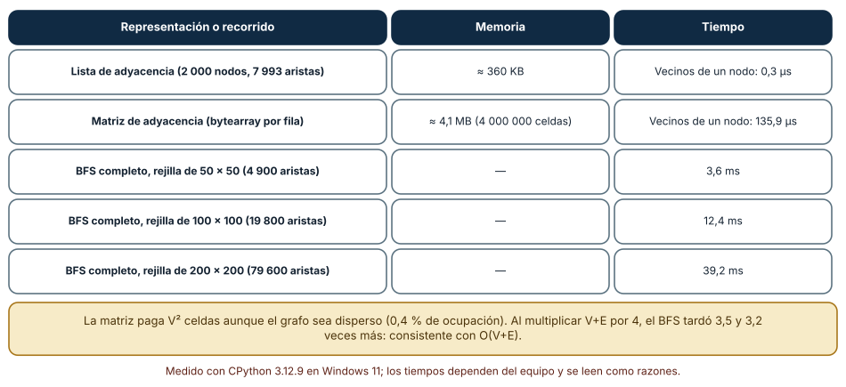
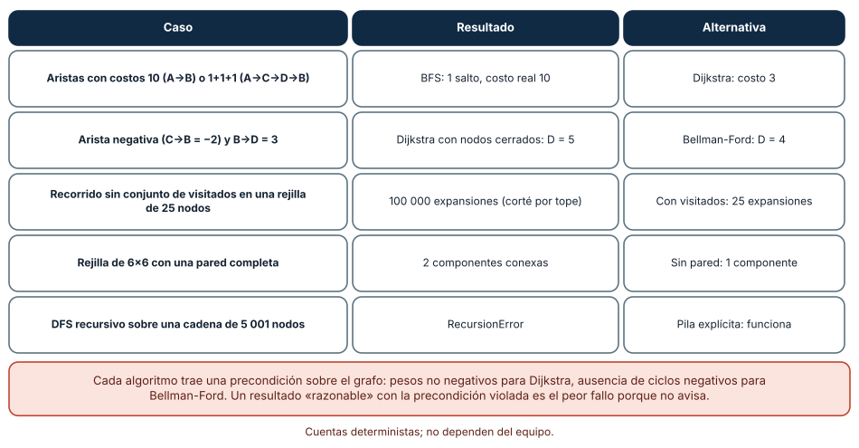

# SE-089 — Grafos y recorridos

[← SE-088 — Árboles, tries y estructuras jerárquicas](https://github.com/vladimiracunadev-create/modern-software-engineering-program/blob/main/classes/part-07-estructuras-de-datos-y-algoritmos/se-088-arboles-tries-y-estructuras-jerarquicas/README.md) · [↑ Parte 07](https://github.com/vladimiracunadev-create/modern-software-engineering-program/blob/main/classes/part-07-estructuras-de-datos-y-algoritmos/README.md) · [📚 Índice completo](https://github.com/vladimiracunadev-create/modern-software-engineering-program/blob/main/classes/README.md) · [🌐 Portal](https://vladimiracunadev-create.github.io/modern-software-engineering-program/classes/SE-089.html) · [SE-090 — Búsqueda, ordenamiento y selección →](https://github.com/vladimiracunadev-create/modern-software-engineering-program/blob/main/classes/part-07-estructuras-de-datos-y-algoritmos/se-090-busqueda-ordenamiento-y-seleccion/README.md)


## Punto profesional y fundamento pedagógico

**Punto profesional.** La clase existe para representar relaciones como grafos y elegir recorrido por la pregunta que se responde.

**Por qué aparece aquí.** Se sitúa después de **Árboles, tries y estructuras jerárquicas** y antes de **Búsqueda, ordenamiento y selección**: convierte el conocimiento anterior en una decisión observable que la clase siguiente podrá reutilizar. La continuidad se comprueba en el artefacto, no por compartir vocabulario.

**Error conceptual que debe corregir.** Usar BFS o DFS por costumbre sin definir visitados y dirección.

**Secuencia de aprendizaje.** Antes de leer la solución, el estudiante predice el resultado del caso normal y del error conceptual anterior. Luego explica un caso resuelto paso a paso, construye un contraejemplo que cambie la decisión y, sin consultar el texto, reconstruye el mecanismo y lo aplica a una entrada nueva. La secuencia usa predicción, explicación propia, contraste y recuperación. [ICAP](https://icap.education.asu.edu/research) distingue participación de construcción de conocimiento; [How People Learn II](https://nap.nationalacademies.org/catalog/24783/how-people-learn-ii-learners-contexts-and-cultures) exige conectar conocimiento previo, contexto y transferencia; la [práctica de recuperación](https://pubmed.ncbi.nlm.nih.gov/16507066/) respalda producir de nuevo la explicación tras una demora; y [Education for Life and Work](https://nap.nationalacademies.org/resource/13398/dbasse_084153.pdf) exige devolución que explique la causa del error.

**Evidencia de aprendizaje.** Graph-trace.md con frontera, visitados, camino y ciclo. Debe contener predicción previa, observación, explicación causal, contraejemplo, criterio de aceptación y una nota de qué dato haría cambiar la conclusión.

**Límite de la conclusión.** Un recorrido no resuelve automáticamente pesos ni restricciones.

### Trazabilidad fuente → afirmación

| Fuente primaria u oficial | Afirmación que respalda | Lo que no prueba |
|---|---|---|
| [MIT 6.006 Introduction to Algorithms](https://ocw.mit.edu/courses/6-006-introduction-to-algorithms-spring-2020/) | Estructuras, algoritmos, corrección y análisis de complejidad; autoridad: MIT OpenCourseWare | No demuestra por sí sola que el artefacto del estudiante sea correcto. |
| [Python Standard Library](https://docs.python.org/3/library/index.html) | Deque, heapq, bisect, graphlib y contenedores disponibles; autoridad: Python Software Foundation | No demuestra por sí sola que el artefacto del estudiante sea correcto. |
| [Mathematics for Computer Science](https://ocw.mit.edu/courses/6-042j-mathematics-for-computer-science-spring-2015/) | Inducción, grafos, conteo y razonamiento discreto; autoridad: MIT OpenCourseWare | No demuestra por sí sola que el artefacto del estudiante sea correcto. |

## Antes de empezar

Esta clase continúa la **biblioteca de estructuras y algoritmos de la Parte 07**. Recupera la evidencia de la clase anterior, añade una decisión propia de **Grafos y recorridos** y deja un artefacto que la clase siguiente deberá consumir. La pregunta activa es: **¿Cómo explorar relaciones arbitrarias sin perder visitados, distancia ni causa del camino?**

## Prerrequisitos

- Haber completado la clase anterior o reconstruir su contrato y evidencia.
- Python 3.11 o posterior, terminal, editor y Git; un segundo runtime es opcional y debe declararse.
- Trabajar con fixtures sintéticos: ninguna observación necesita datos de una persona o sistema real.

## Problema auténtico

Un caso de la biblioteca de estructuras y algoritmos depende de varios servicios y una falla puede propagarse por rutas distintas. La jerarquía única ya no representa el dominio y un recorrido sin conjunto de visitados entra en ciclo.

## Objetivos observables

Al terminar podrás explicar los cinco mecanismos de esta clase, predecir su comportamiento antes de ejecutar, construir un caso normal y uno límite, diagnosticar el fallo controlado, comparar una alternativa y entregar evidencia que otra persona pueda reproducir.

## Mapa conceptual



El mapa se lee como una cadena de razonamiento, no como fases obligatorias del runtime. La flecha de retorno indica que un fallo o cambio de requisito obliga a revisar el modelo inicial; no autoriza a parchear solo la última salida.

## Temas y por qué importan

| Tema | Por qué cambia una decisión profesional | Evidencia mínima |
|---|---|---|
| Vértices, aristas y dirección | Un grafo modela entidades y relaciones. | Predicción, traza causal y contraejemplo de **Vértices, aristas y dirección** en `graph-trace.md` |
| Lista y matriz de adyacencia | Una lista almacena vecinos y favorece grafos dispersos; una matriz permite consultar arista directa de forma constante a costo cuadrático de espacio. | Predicción, traza causal y contraejemplo de **Lista y matriz de adyacencia** en `graph-trace.md` |
| BFS y distancia no ponderada | BFS usa cola y descubre por capas; el primer camino hallado tiene menos aristas en un grafo no ponderado. | Predicción, traza causal y contraejemplo de **BFS y distancia no ponderada** en `graph-trace.md` |
| DFS, ciclos y orden | DFS usa pila implícita o explícita y profundiza antes de retroceder. | Predicción, traza causal y contraejemplo de **DFS, ciclos y orden** en `graph-trace.md` |
| Componentes y alcanzabilidad | Alcanzabilidad responde si existe camino; componentes agrupan conectividad bajo definición dirigida o no dirigida. | Predicción, traza causal y contraejemplo de **Componentes y alcanzabilidad** en `graph-trace.md` |
## Conceptos y decisiones

### 1. Vértices, aristas y dirección

Un grafo modela entidades y relaciones. Dirección, peso, multiplicidad y autoaristas cambian las preguntas admisibles. Dibujar flechas sin definir su significado impide distinguir `depende de` de `impacta a`.

### 2. Lista y matriz de adyacencia

Una lista almacena vecinos y favorece grafos dispersos; una matriz permite consultar arista directa de forma constante a costo cuadrático de espacio. La densidad y operaciones, no el tamaño aislado, guían la representación.

### 3. BFS y distancia no ponderada

BFS usa cola y descubre por capas; el primer camino hallado tiene menos aristas en un grafo no ponderado. Si pesos importan, esa garantía deja de valer. Registrar predecesor permite reconstruir explicación, no solo distancia.

### 4. DFS, ciclos y orden

DFS usa pila implícita o explícita y profundiza antes de retroceder. Colores o estados distinguen no visto, activo y terminado para detectar ciclos dirigidos. Un conjunto visitado simple puede perder la diferencia necesaria para explicar un back edge.

### 5. Componentes y alcanzabilidad

Alcanzabilidad responde si existe camino; componentes agrupan conectividad bajo definición dirigida o no dirigida. En dependencias, estar en la misma componente no implica impacto simétrico. La biblioteca de estructuras y algoritmos etiqueta la relación y conserva el camino que sostiene la conclusión.

### BFS y DFS no responden la misma pregunta

Sobre rejillas sin obstáculos de 20×20, 40×40 y 80×80 (400, 1 600 y 6 400 nodos; 760, 3 120 y 12 640 aristas) comparamos dos recorridos desde una esquina hasta la opuesta. La búsqueda en anchura (BFS, con cola) devolvió distancias de 38, 78 y 158 pasos, exactamente el óptimo `2·(n−1)`, y visitó todos los nodos. La búsqueda en profundidad (DFS, con pila) también llegó, pero con caminos de 190, 780 y 3 160 pasos: 5, 10 y 20 veces más largos que el óptimo. DFS visitó 229, 859 y 3 319 nodos, menos que BFS, porque se detiene cuando encuentra *un* camino.

No son dos variantes de lo mismo: BFS garantiza el menor número de aristas porque explora por capas; DFS garantiza alcanzabilidad y sirve para ordenación topológica, componentes y detección de ciclos. Elegir uno es elegir la propiedad que necesita la consulta. Un componente conexo también se calcula con cualquiera: una pared que cruza una rejilla de 6×6 dejó 2 componentes en vez de 1.



**Cómo leer la figura.** Compara la tercera columna con la cuarta: ambas llegan al destino, solo una conserva la propiedad de camino mínimo. **Dónde deja de valer:** la rejilla es un grafo regular, no ponderado y sin obstáculos. En un grafo con pesos, el camino con menos aristas no es el de menor costo (véase la tercera sección).

### Representación: lista de adyacencia o matriz

Generamos un grafo aleatorio disperso de 2 000 nodos y 7 993 aristas no dirigidas. En lista de adyacencia ocupó unos 360 KB; en matriz (un `bytearray` por fila, 4 000 000 de celdas) 4,1 MB, aunque solo el 0,4 % de las celdas es una arista. Obtener los vecinos de un nodo tardó 0,3 µs con la lista y 135,9 µs con la matriz (0,2 µs y 128,2 µs en Linux): la matriz recorre una fila entera, `V` celdas, para hallar una docena de vecinos. En cambio, preguntar «¿existe la arista (u, v)?» es instantáneo en la matriz y exige recorrer la lista de `u`.

Un recorrido completo por BFS sobre rejillas de 50×50, 100×100 y 200×200 (4 900, 19 800 y 79 600 aristas) tardó 3,6, 12,4 y 39,2 ms: al multiplicar `V+E` por unas 4, el tiempo se multiplicó por 3,5 y 3,2, coherente con `O(V+E)`. La elección depende de la densidad y de la operación dominante: lista para recorrer, matriz para preguntar adyacencia en grafos densos o pequeños.



**Cómo leer la figura.** Las filas tercera a quinta muestran cómo crece el tiempo del recorrido con el número de aristas. **Dónde deja de valer:** el grafo aleatorio no tiene la estructura de una red real (comunidades, nodos de grado altísimo). Un nodo con millones de vecinos cambia el costo de cada recorrido, y los 135 µs de la matriz cambian con el tamaño.

### Cuando el algoritmo requiere una precondición que el grafo no cumple

BFS minimiza saltos, no costo. En un grafo con una arista A→B de costo 10 y un camino A→C→D→B de costo 1+1+1, BFS devolvió 1 salto (costo real 10) y Dijkstra devolvió costo 3. Dijkstra, a su vez, exige pesos no negativos: con una arista C→B de −2, Dijkstra con nodos cerrados dio D = 5 y Bellman-Ford dio D = 4 (el valor correcto), porque Dijkstra ya había cerrado B cuando apareció el camino mejor. El resultado era *razonable pero incorrecto*, y no hubo ninguna excepción.

Otros dos fallos se midieron. Un recorrido sin conjunto de visitados sobre una rejilla de 25 nodos alcanzó 100 000 expansiones antes de cortarlo con un tope; con visitados son 25. Y un DFS recursivo sobre una cadena de 5 001 nodos falló con `RecursionError`, mientras que la versión con pila explícita no. Cada algoritmo trae precondiciones (pesos, ciclos, tamaño) que deben comprobarse o documentarse.



**Cómo leer la figura.** Lee la columna central como el síntoma y la derecha como la corrección; la fila de Dijkstra es la más peligrosa porque no avisa. **Dónde deja de valer:** los grafos de los experimentos son mínimos, diseñados para exhibir la precondición. En un grafo real, un ciclo negativo hace que Bellman-Ford no tenga solución; hay que detectarlo explícitamente.

## Definiciones de trabajo

- **vértices, aristas y dirección:** un grafo modela entidades y relaciones.
- **lista y matriz de adyacencia:** una lista almacena vecinos y favorece grafos dispersos; una matriz permite consultar arista directa de forma constante a costo cuadrático de espacio.
- **bfs y distancia no ponderada:** bfs usa cola y descubre por capas; el primer camino hallado tiene menos aristas en un grafo no ponderado.
- **dfs, ciclos y orden:** dfs usa pila implícita o explícita y profundiza antes de retroceder.
- **componentes y alcanzabilidad:** alcanzabilidad responde si existe camino; componentes agrupan conectividad bajo definición dirigida o no dirigida.

Las definiciones son operativas para la biblioteca de estructuras y algoritmos. No convierten términos con historia más amplia en sinónimos y deben contrastarse con la documentación primaria enlazada al final.

## Ejemplo mínimo

```python
from collections import deque
graph = {"api": ["auth", "db"], "auth": ["db"], "db": []}
queue, seen = deque(["api"]), {"api"}
while queue:
    node = queue.popleft()
    for nxt in graph[node]:
        if nxt not in seen:
            seen.add(nxt); queue.append(nxt)
assert seen == {"api", "auth", "db"}
```

Antes de ejecutar, predice estado, resultado y error. Después registra versión, comando y salida. Si el fragmento es pseudocódigo o pertenece a otro lenguaje, etiquétalo como tal y no afirmes que fue ejecutado.

## Ejemplo profesional

En la biblioteca de estructuras y algoritmos, un caso conserva identidad, prioridad, dependencias, instante de llegada y estado de resolución. La implementación de esta clase debe conservar ese contrato aunque cambie la forma interna. El caso profesional no pregunta únicamente si produce una salida: pregunta quién puede producirla, qué estado observa, cómo falla y qué rastro permite disputar una decisión incorrecta.

Compara el caso normal con autorización falsa, evidencia incompleta, empate y repetición. Un mecanismo es apropiado cuando esas diferencias quedan visibles y localizadas; es peligroso cuando dependen de orden accidental, estado oculto o una convención que el consumidor no puede conocer.

## Práctica guiada

1. Copia el contrato de entrada y salida antes de escribir implementación.
2. Predice el caso normal y un límite; identifica la invariante que no puede romperse.
3. Implementa la versión mínima sin I/O dentro del núcleo.
4. Ejecuta el caso y conserva comando, versión y salida bajo `evidence/`.
5. Introduce el fallo controlado, reduce la reproducción y formula dos hipótesis rivales.
6. Corrige la causa, añade regresión y ejecuta el conjunto completo.
7. Compara con otro paradigma o lenguaje indicando qué semántica se preserva.

## Ejercicios

1. **Capas:** implementa BFS con distancias en una rejilla 20×20 y verifica que la distancia máxima desde una esquina es `2·(n−1)`.
2. **Contraste:** corre DFS sobre la misma rejilla, compara longitud de camino y número de nodos visitados, y explica qué propiedad pierdes.
3. **Representación:** construye un grafo disperso de 2 000 nodos y mide memoria y vecinos con lista y matriz; indica la densidad a partir de la cual la matriz empezaría a ser razonable.
4. **Precondición:** construye un grafo con una arista negativa y muestra que Dijkstra falla; implementa Bellman-Ford y compara.

## Reto verificable

Entrega implementación, fixtures, pruebas y un informe corto. Se aprueba si otra persona ejecuta desde checkout limpio, obtiene los mismos resultados y puede relacionar cada rama o transformación con una regla del dominio. No se aprueba por cantidad de archivos ni por usar la sintaxis característica del paradigma.

## Caso conductor

La biblioteca de estructuras y algoritmos recibe casos del motor de reglas comparado, mantiene una frontera de trabajo priorizada y explica por qué el siguiente caso es elegible. Ejecuta una carga pequeña trazable, duplicados, prioridades iguales y una dependencia ausente. Cambia después una sola regla o condición y revisa qué archivos, pruebas y trazas debieron modificarse. Esa superficie de cambio alimenta el proyecto final de la parte.

## Preguntas frecuentes

### ¿BFS o DFS para el camino más corto?

BFS en grafos sin pesos: en las tres rejillas dio el óptimo. DFS dio caminos 5 a 20 veces más largos. Con pesos usa Dijkstra (no negativos) o Bellman-Ford.

### ¿Matriz de adyacencia o lista?

La lista para grafos dispersos y recorridos (360 KB y 0,3 µs aquí); la matriz si el grafo es denso o necesitas preguntar adyacencia en tiempo constante.

### ¿Cómo evito que un recorrido no termine?

Con un conjunto de visitados marcado al *encolar*, no al sacar. Sin él, la rejilla de 25 nodos alcanzó 100 000 expansiones.

### ¿Dijkstra sirve con costos negativos?

No: con una arista de −2 devolvió 5 en vez de 4. Si puede haber costos negativos, usa Bellman-Ford y detecta ciclos negativos.

## Fallo controlado y diagnóstico

Añade `db -> api` y elimina `seen`. Reduce el caso hasta tres nodos, restaura el conjunto y prueba que cada vértice se procesa una vez.

Registra síntoma, entrada mínima, hipótesis, observación que descarta cada hipótesis, causa, corrección y prueba de regresión. No cambies simultáneamente implementación, fixture y expectativa.

Quita el conjunto de visitados de un BFS sobre una rejilla de 5×5 y limita las expansiones a 100 000. **Síntoma:** el recorrido nunca termina (alcanza el tope). **Hipótesis rivales:** (a) hay un ciclo en el grafo; (b) falta el control de visitados. **Prueba:** un grafo sin ciclos (un árbol) termina sin visitados; la rejilla tiene ciclos; con visitados son 25 expansiones. **Conclusión:** el control de visitados no es una optimización, es lo que hace que el recorrido sea un algoritmo y no una búsqueda infinita. Añade como regresión un ciclo de tres nodos.

## Errores comunes y cómo corregirlos

| Síntoma | Causa probable | Corrección |
|---|---|---|
| El «camino más corto» devuelto es largo | Se usó DFS donde se necesitaba BFS | Usar BFS (sin pesos) y comprobarlo contra una fórmula conocida en rejillas |
| El recorrido no termina o repite nodos | Falta el conjunto de visitados | Marcar al encolar y probar un ciclo mínimo |
| Dijkstra da un costo plausible pero equivocado | Hay aristas negativas | Validar pesos ≥ 0 o cambiar a Bellman-Ford |
| `RecursionError` en un grafo grande | DFS recursivo sobre una cadena larga | Usar una pila explícita |
| Operación de vecinos lenta y memoria enorme | Matriz para un grafo disperso | Cambiar a lista de adyacencia y medir |

## Entorno y archivos clave

```text
work/SE-089/
├── README.md
├── algorithm_library/
│   ├── domain.py
│   └── se_089.py
├── fixtures/cases.json
├── tests/test_se_089.py
└── evidence/diagnosis.md
```

El `README` declara plataforma, runtimes, comandos, limpieza y límites. Evita dependencias externas cuando la biblioteca estándar permita observar el mecanismo; si agregas una, fija procedencia y versión.

## Seguridad, ética y accesibilidad

- la autorización forma parte del dominio y no se infiere por ausencia de rechazo;
- no uses `eval`, reglas descargadas ni serialización insegura;
- limita colas, recursión, tamaño de entrada y tiempo de evaluación;
- redacta trazas y conserva una explicación textual además de color o animación;
- una recomendación automatizada debe poder revisarse, impugnarse y corregirse;
- respeta licencias de ejemplos y atribuye adaptaciones.

## Puente hacia el trabajo con agentes

Un agente al que se le pide «encuentra la ruta más corta» puede entregar DFS, o Dijkstra sobre pesos negativos, y sus pruebas con tres nodos pasarán. Dale un conjunto de pruebas con una rejilla de óptimo conocido, un grafo con ciclo y una arista negativa, y pide que declare las precondiciones de su algoritmo. Si usa una biblioteca de grafos, exige que cite la función exacta y su documentación: la corrección depende de condiciones que el prompt rara vez menciona.

## Transferencia

Traslada un fixture al segundo modelo o lenguaje. Compara representación de ausencia, error, mutabilidad, orden y cancelación. La transferencia está lograda cuando el contrato se conserva y las diferencias están explicadas, no cuando la sintaxis se parece.

## Evaluación y evidencia

| Criterio | Evidencia para aprobar |
|---|---|
| comprensión | explicación causal de los cinco mecanismos |
| corrección | normal, límite, inválido y contraejemplo |
| diseño | estado, efectos y contrato localizables |
| diagnóstico | reproducción mínima y regresión |
| transferencia | comparación semántica, no estética |
| reproducibilidad | versiones, comandos, salida y límites |


## Fuentes


- [MIT 6.006 Introduction to Algorithms](https://ocw.mit.edu/courses/6-006-introduction-to-algorithms-spring-2020/) — Estructuras, algoritmos, corrección y análisis de complejidad; autoridad: MIT OpenCourseWare.
- [Python Data Model](https://docs.python.org/3/reference/datamodel.html) — Semántica de secuencias, conjuntos, mappings, igualdad y hash; autoridad: Python Software Foundation.
- [Python Standard Library](https://docs.python.org/3/library/index.html) — Deque, heapq, bisect, graphlib y contenedores disponibles; autoridad: Python Software Foundation.
- [Python Debugging and Profiling](https://docs.python.org/3/library/debug.html) — Timeit, cprofile y tracemalloc con sus límites; autoridad: Python Software Foundation.
- [Mathematics for Computer Science](https://ocw.mit.edu/courses/6-042j-mathematics-for-computer-science-spring-2015/) — Inducción, grafos, conteo y razonamiento discreto; autoridad: MIT OpenCourseWare.
- [SWEBOK Guide v4.0a](https://www.computer.org/education/bodies-of-knowledge/software-engineering) — Construcción, medición y fundamentos de ingeniería; autoridad: IEEE Computer Society.

Cada fuente respalda el mecanismo indicado; ninguna demuestra que la implementación de la biblioteca de estructuras y algoritmos sea correcta. Esa afirmación depende de fixtures, pruebas, trazas y revisión reproducible.

- [Python: `graphlib`](https://docs.python.org/3/library/graphlib.html) — ordenación topológica y detección de ciclos con `CycleError`.
- [Python: `collections.deque`](https://docs.python.org/3/library/collections.html#collections.deque) — cola doble para BFS con `popleft` en tiempo constante.
- [Dijkstra, «A note on two problems in connexion with graphs» (Numerische Mathematik, 1959)](https://doi.org/10.1007/BF01386390) — algoritmo de camino mínimo con pesos no negativos.
- [MIT 6.006: Graphs, BFS, DFS y caminos mínimos](https://ocw.mit.edu/courses/6-006-introduction-to-algorithms-spring-2020/) — análisis de BFS, DFS, Dijkstra y Bellman-Ford.

## Límites y siguiente paso

BFS no resuelve pesos negativos ni toda forma de optimización de caminos. La siguiente clase contrasta búsqueda, ordenamiento y selección bajo contratos precisos.

## Glosario

- **vértices, aristas y dirección:** un grafo modela entidades y relaciones.
- **lista y matriz de adyacencia:** una lista almacena vecinos y favorece grafos dispersos; una matriz permite consultar arista directa de forma constante a costo cuadrático de espacio.
- **bfs y distancia no ponderada:** bfs usa cola y descubre por capas; el primer camino hallado tiene menos aristas en un grafo no ponderado.
- **dfs, ciclos y orden:** dfs usa pila implícita o explícita y profundiza antes de retroceder.
- **componentes y alcanzabilidad:** alcanzabilidad responde si existe camino; componentes agrupan conectividad bajo definición dirigida o no dirigida.

---

[← SE-088 — Árboles, tries y estructuras jerárquicas](https://github.com/vladimiracunadev-create/modern-software-engineering-program/blob/main/classes/part-07-estructuras-de-datos-y-algoritmos/se-088-arboles-tries-y-estructuras-jerarquicas/README.md) · [↑ Parte 07](https://github.com/vladimiracunadev-create/modern-software-engineering-program/blob/main/classes/part-07-estructuras-de-datos-y-algoritmos/README.md) · [📚 Índice completo](https://github.com/vladimiracunadev-create/modern-software-engineering-program/blob/main/classes/README.md) · [🌐 Portal](https://vladimiracunadev-create.github.io/modern-software-engineering-program/classes/SE-089.html) · [SE-090 — Búsqueda, ordenamiento y selección →](https://github.com/vladimiracunadev-create/modern-software-engineering-program/blob/main/classes/part-07-estructuras-de-datos-y-algoritmos/se-090-busqueda-ordenamiento-y-seleccion/README.md)
