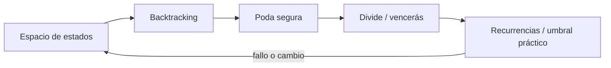
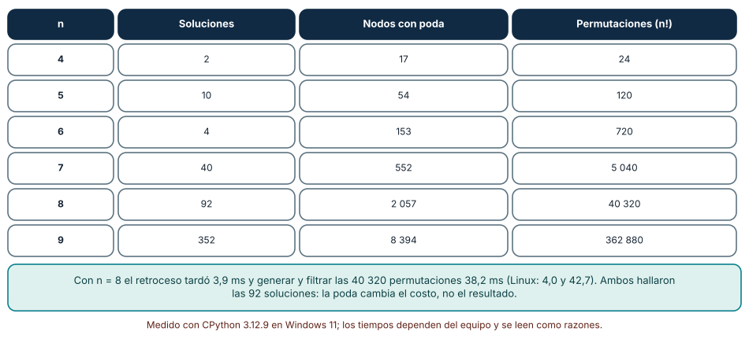
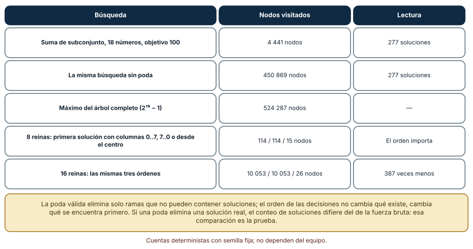
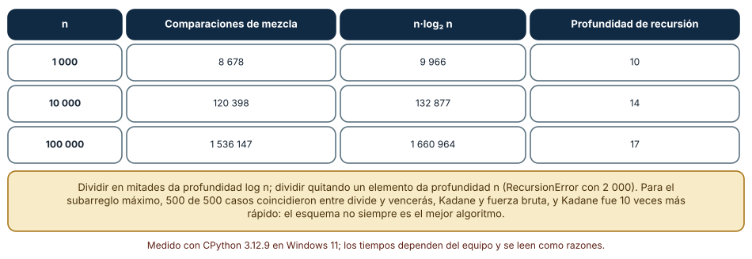

# SE-092 — Backtracking, divide y vencerás

[← SE-091 — Algoritmos voraces y programación dinámica](https://github.com/vladimiracunadev-create/modern-software-engineering-program/blob/main/classes/part-07-estructuras-de-datos-y-algoritmos/se-091-algoritmos-voraces-y-programacion-dinamica/README.md) · [↑ Parte 07](https://github.com/vladimiracunadev-create/modern-software-engineering-program/blob/main/classes/part-07-estructuras-de-datos-y-algoritmos/README.md) · [📚 Índice completo](https://github.com/vladimiracunadev-create/modern-software-engineering-program/blob/main/classes/README.md) · [🌐 Portal](https://vladimiracunadev-create.github.io/modern-software-engineering-program/classes/SE-092.html) · [SE-093 — Índices, probabilísticas y estructuras persistentes →](https://github.com/vladimiracunadev-create/modern-software-engineering-program/blob/main/classes/part-07-estructuras-de-datos-y-algoritmos/se-093-indices-probabilisticas-y-estructuras-persistentes/README.md)


## Punto profesional y fundamento pedagógico

**Punto profesional.** La clase existe para usar backtracking o divide y vencerás con espacio de búsqueda, poda y combinación explícitos.

**Por qué aparece aquí.** Se sitúa después de **Algoritmos voraces y programación dinámica** y antes de **Índices, probabilísticas y estructuras persistentes**: convierte el conocimiento anterior en una decisión observable que la clase siguiente podrá reutilizar. La continuidad se comprueba en el artefacto, no por compartir vocabulario.

**Error conceptual que debe corregir.** Confundir recursión con estrategia o podar sin preservar soluciones.

**Secuencia de aprendizaje.** Antes de leer la solución, el estudiante predice el resultado del caso normal y del error conceptual anterior. Luego explica un caso resuelto paso a paso, construye un contraejemplo que cambie la decisión y, sin consultar el texto, reconstruye el mecanismo y lo aplica a una entrada nueva. La secuencia usa predicción, explicación propia, contraste y recuperación. [ICAP](https://icap.education.asu.edu/research) distingue participación de construcción de conocimiento; [How People Learn II](https://nap.nationalacademies.org/catalog/24783/how-people-learn-ii-learners-contexts-and-cultures) exige conectar conocimiento previo, contexto y transferencia; la [práctica de recuperación](https://pubmed.ncbi.nlm.nih.gov/16507066/) respalda producir de nuevo la explicación tras una demora; y [Education for Life and Work](https://nap.nationalacademies.org/resource/13398/dbasse_084153.pdf) exige devolución que explique la causa del error.

**Evidencia de aprendizaje.** Search-tree.md con ramas, poda válida, recurrencia y peor caso. Debe contener predicción previa, observación, explicación causal, contraejemplo, criterio de aceptación y una nota de qué dato haría cambiar la conclusión.

**Límite de la conclusión.** Poda efectiva en ejemplos no cambia necesariamente la complejidad.

### Trazabilidad fuente → afirmación

| Fuente primaria u oficial | Afirmación que respalda | Lo que no prueba |
|---|---|---|
| [MIT 6.006 Introduction to Algorithms](https://ocw.mit.edu/courses/6-006-introduction-to-algorithms-spring-2020/) | Estructuras, algoritmos, corrección y análisis de complejidad; autoridad: MIT OpenCourseWare | No demuestra por sí sola que el artefacto del estudiante sea correcto. |
| [Mathematics for Computer Science](https://ocw.mit.edu/courses/6-042j-mathematics-for-computer-science-spring-2015/) | Inducción, grafos, conteo y razonamiento discreto; autoridad: MIT OpenCourseWare | No demuestra por sí sola que el artefacto del estudiante sea correcto. |
| [Python Debugging and Profiling](https://docs.python.org/3/library/debug.html) | Timeit, cprofile y tracemalloc con sus límites; autoridad: Python Software Foundation | No demuestra por sí sola que el artefacto del estudiante sea correcto. |

## Antes de empezar

Esta clase continúa la **biblioteca de estructuras y algoritmos de la Parte 07**. Recupera la evidencia de la clase anterior, añade una decisión propia de **Backtracking, divide y vencerás** y deja un artefacto que la clase siguiente deberá consumir. La pregunta activa es: **¿Cómo explorar alternativas sin confundir búsqueda exhaustiva, poda y descomposición independiente?**

## Prerrequisitos

- Haber completado la clase anterior o reconstruir su contrato y evidencia.
- Python 3.11 o posterior, terminal, editor y Git; un segundo runtime es opcional y debe declararse.
- Trabajar con fixtures sintéticos: ninguna observación necesita datos de una persona o sistema real.

## Problema auténtico

La biblioteca de estructuras y algoritmos debe construir un orden válido de tareas con restricciones. Probar permutaciones encuentra solución, pero crece factorialmente; una poda incorrecta elimina la única ruta válida.

## Objetivos observables

Al terminar podrás explicar los cinco mecanismos de esta clase, predecir su comportamiento antes de ejecutar, construir un caso normal y uno límite, diagnosticar el fallo controlado, comparar una alternativa y entregar evidencia que otra persona pueda reproducir.

## Mapa conceptual



El mapa se lee como una cadena de razonamiento, no como fases obligatorias del runtime. La flecha de retorno indica que un fallo o cambio de requisito obliga a revisar el modelo inicial; no autoriza a parchear solo la última salida.

## Temas y por qué importan

| Tema | Por qué cambia una decisión profesional | Evidencia mínima |
|---|---|---|
| Espacio de estados | Cada nodo representa una decisión parcial y cada arista una elección. | Predicción, traza causal y contraejemplo de **Espacio de estados** en `search-tree.md` |
| Backtracking | El backtracking elige, avanza, detecta imposibilidad y revierte. | Predicción, traza causal y contraejemplo de **Backtracking** en `search-tree.md` |
| Poda segura | Una poda descarta ramas que no pueden mejorar o satisfacer. | Predicción, traza causal y contraejemplo de **Poda segura** en `search-tree.md` |
| Divide y vencerás | Se divide en subproblemas independientes, se resuelven y combinan. | Predicción, traza causal y contraejemplo de **Divide y vencerás** en `search-tree.md` |
| Recurrencias y umbral práctico | El árbol de recursión explica tiempo y trabajo de combinación. | Predicción, traza causal y contraejemplo de **Recurrencias y umbral práctico** en `search-tree.md` |
## Conceptos y decisiones

### 1. Espacio de estados

Cada nodo representa una decisión parcial y cada arista una elección. Antes de programar se define estado, acciones, objetivo e invalidez. Si dos rutas producen el mismo estado relevante, pueden memoizarse; si no, fusionarlas pierde historia necesaria.

### 2. Backtracking

El backtracking elige, avanza, detecta imposibilidad y revierte. La restauración debe ser simétrica incluso ante error. Copiar estado simplifica razonamiento pero cuesta; mutar y deshacer exige invariantes y pruebas de que no queda contaminación entre ramas.

### 3. Poda segura

Una poda descarta ramas que no pueden mejorar o satisfacer. Debe derivarse de una cota o restricción necesaria. Una heurística que parece improbable no es poda correcta: puede usarse para ordenar exploración, no para eliminar sin prueba.

### 4. Divide y vencerás

Se divide en subproblemas independientes, se resuelven y combinan. La independencia y el costo de combinar determinan la recurrencia. Llamar divide-and-conquer a cualquier recursión oculta dependencias y resultados duplicados.

### 5. Recurrencias y umbral práctico

El árbol de recursión explica tiempo y trabajo de combinación. En tamaños pequeños, overhead domina y un algoritmo simple puede ganar; implementaciones híbridas usan umbral medido sin cambiar corrección.

### Retroceso con poda: contar nodos, no solo soluciones

El problema de las n reinas coloca una reina por fila y retrocede cuando una columna o diagonal está ocupada. Contamos los nodos del árbol de búsqueda con poda: para n = 4 a 9, soluciones 2, 10, 4, 40, 92 y 352; nodos visitados 17, 54, 153, 552, 2 057 y 8 394; permutaciones totales (n!) 24, 120, 720, 5 040, 40 320 y 362 880. Para n = 8, generar todas las permutaciones y filtrar tardó 38,2 ms (42,7 en Linux) y el retroceso con poda 3,9 ms (4,0); ambos hallaron las 92 soluciones. La poda cambió el costo, no el resultado.

Ese contraste es la prueba de la poda: una poda es válida si el número de soluciones coincide con el de la enumeración completa en tamaños pequeños. Si difiere, la poda eliminó una rama que sí contenía soluciones.



**Cómo leer la figura.** Compara la tercera con la cuarta columna: la ventaja crece con n. **Dónde deja de valer:** el retroceso sigue siendo exponencial en el peor caso; solo cambia la constante y el exponente efectivo. Para n grande se necesitan otras técnicas (heurísticas o reparación local).

### Orden de las decisiones y poda por cota

En la suma de subconjunto (18 números, objetivo 100) el árbol completo tiene 2¹⁹ − 1 = 524 287 nodos. Sin poda el retroceso visitó 450 869 nodos; con dos podas (se pasa del objetivo, o aun sumando todo lo que queda no se alcanza) visitó 4 441, 100 veces menos, y encontró las mismas 277 soluciones. La poda por cota usa una suma de sufijos precomputada: una cota barata que descarta ramas enteras.

El orden en que se prueban las decisiones cambia qué se encuentra primero. Para hallar la primera solución de n reinas, probar las columnas de izquierda a derecha o de derecha a izquierda necesitó 114 nodos con n = 8, 262 con n = 12 y 10 053 con n = 16; comenzar por las columnas centrales necesitó 15, 18 y 26 nodos (387 veces menos con n = 16). No cambia qué soluciones existen; cambia cuánto cuesta llegar a la primera.



**Cómo leer la figura.** Las dos primeras filas comparten el resultado y difieren en 100× el trabajo; las dos últimas muestran el efecto del orden. **Dónde deja de valer:** las cifras dependen de los datos concretos (18 números elegidos con semilla fija). El orden central funciona bien para reinas; en otros problemas el mejor orden se descubre con heurísticas (primero la variable más restringida).

### Divide y vencerás: profundidad, costo y cuándo no conviene

La ordenación por mezcla divide en mitades: con 1 000, 10 000 y 100 000 elementos usó 8 678, 120 398 y 1 536 147 comparaciones, cerca de `n·log₂ n` (9 966; 132 877; 1 660 964), con profundidad de recursión 10, 14 y 17. Si la división es desigual (quitar un elemento cada vez), la profundidad pasa a ser `n`: una recursión de ese tipo con 2 000 elementos agotó la pila con `RecursionError`. Dividir bien es parte de la corrección práctica del algoritmo.

El problema del subarreglo de suma máxima admite divide y vencerás (6,22 ms para 2 000 enteros), pero el algoritmo de Kadane, lineal e iterativo, tardó 0,62 ms: 10 veces menos. Los tres métodos (divide y vencerás, Kadane y fuerza bruta) coincidieron en 500 de 500 casos pequeños. Un esquema general no siempre da el mejor algoritmo.



**Cómo leer la figura.** La penúltima y la antepenúltima columnas son casi iguales: la mezcla se comporta como predice la teoría. **Dónde deja de valer:** las comparaciones se contaron con datos aleatorios; con duplicados o datos ordenados cambia la cuenta exacta. El tiempo del subarreglo (Linux: 14,5 ms y 1,59 ms) varió entre sistemas aunque la razón fue parecida.

## Definiciones de trabajo

- **espacio de estados:** cada nodo representa una decisión parcial y cada arista una elección.
- **backtracking:** el backtracking elige, avanza, detecta imposibilidad y revierte.
- **poda segura:** una poda descarta ramas que no pueden mejorar o satisfacer.
- **divide y vencerás:** se divide en subproblemas independientes, se resuelven y combinan.
- **recurrencias y umbral práctico:** el árbol de recursión explica tiempo y trabajo de combinación.

Las definiciones son operativas para la biblioteca de estructuras y algoritmos. No convierten términos con historia más amplia en sinónimos y deben contrastarse con la documentación primaria enlazada al final.

## Ejemplo mínimo

```python
def search(prefix, remaining):
    if not remaining:
        return prefix
    for case in sorted(remaining):
        if prerequisites_met(case, prefix):
            found = search(prefix + [case], remaining - {case})
            if found is not None:
                return found
    return None
```

Antes de ejecutar, predice estado, resultado y error. Después registra versión, comando y salida. Si el fragmento es pseudocódigo o pertenece a otro lenguaje, etiquétalo como tal y no afirmes que fue ejecutado.

## Ejemplo profesional

En la biblioteca de estructuras y algoritmos, un caso conserva identidad, prioridad, dependencias, instante de llegada y estado de resolución. La implementación de esta clase debe conservar ese contrato aunque cambie la forma interna. El caso profesional no pregunta únicamente si produce una salida: pregunta quién puede producirla, qué estado observa, cómo falla y qué rastro permite disputar una decisión incorrecta.

Compara el caso normal con autorización falsa, evidencia incompleta, empate y repetición. Un mecanismo es apropiado cuando esas diferencias quedan visibles y localizadas; es peligroso cuando dependen de orden accidental, estado oculto o una convención que el consumidor no puede conocer.

## Práctica guiada

1. Copia el contrato de entrada y salida antes de escribir implementación.
2. Predice el caso normal y un límite; identifica la invariante que no puede romperse.
3. Implementa la versión mínima sin I/O dentro del núcleo.
4. Ejecuta el caso y conserva comando, versión y salida bajo `evidence/`.
5. Introduce el fallo controlado, reduce la reproducción y formula dos hipótesis rivales.
6. Corrige la causa, añade regresión y ejecuta el conjunto completo.
7. Compara con otro paradigma o lenguaje indicando qué semántica se preserva.

## Ejercicios

1. **Nodos:** instrumenta las n reinas para contar nodos con y sin poda para n = 4 a 9 y verifica que ambas versiones dan el mismo número de soluciones.
2. **Cota:** implementa la suma de subconjunto con la poda de sufijo y mide cuántos nodos ahorra frente al árbol completo.
3. **Orden:** compara tres órdenes de columnas para encontrar la primera solución de 12 reinas y explica la diferencia.
4. **Profundidad:** escribe una división desigual y una en mitades, y reporta la profundidad de recursión para n = 1 000 y 100 000.

## Reto verificable

Entrega implementación, fixtures, pruebas y un informe corto. Se aprueba si otra persona ejecuta desde checkout limpio, obtiene los mismos resultados y puede relacionar cada rama o transformación con una regla del dominio. No se aprueba por cantidad de archivos ni por usar la sintaxis característica del paradigma.

## Caso conductor

La biblioteca de estructuras y algoritmos recibe casos del motor de reglas comparado, mantiene una frontera de trabajo priorizada y explica por qué el siguiente caso es elegible. Ejecuta una carga pequeña trazable, duplicados, prioridades iguales y una dependencia ausente. Cambia después una sola regla o condición y revisa qué archivos, pruebas y trazas debieron modificarse. Esa superficie de cambio alimenta el proyecto final de la parte.

## Preguntas frecuentes

### ¿Cómo sé que mi poda es válida?

Compara el número de soluciones con la enumeración completa en tamaños pequeños: 92 soluciones para 8 reinas con y sin poda. Si difieren, la poda elimina ramas con soluciones.

### ¿El retroceso siempre es exponencial?

En el peor caso, sí. Con poda y buen orden puede resolver instancias grandes: 16 reinas necesitaron 26 nodos para la primera solución con el orden central y 10 053 con el orden natural.

### ¿Cuándo no usar divide y vencerás?

Cuando existe un algoritmo lineal más simple: Kadane fue 10 veces más rápido y más corto. O cuando la partición es desigual y la recursión profunda.

### ¿Qué límite de recursión debo esperar?

Si divides en mitades la profundidad es `log₂ n` (17 para 100 000). Si quitas un elemento por llamada es `n` y el límite por defecto (1 000) se supera con facilidad.

## Fallo controlado y diagnóstico

Poda una tarea porque hoy no cumple prerrequisitos, aunque otra tarea de la misma rama los satisface antes. Cambia la poda por chequeo de ciclo/imposibilidad demostrable y añade ese orden como regresión.

Registra síntoma, entrada mínima, hipótesis, observación que descarta cada hipótesis, causa, corrección y prueba de regresión. No cambies simultáneamente implementación, fixture y expectativa.

Cambia la poda de la suma de subconjunto de `s > objetivo` a `s >= objetivo` con elementos positivos y busca todas las soluciones. **Síntoma:** el número de soluciones baja respecto de la búsqueda sin poda. **Hipótesis rivales:** (a) la enumeración sin poda cuenta repetidos; (b) la poda descarta una rama que ya alcanzó el objetivo. **Prueba:** contraste con la versión sin poda en un tamaño pequeño (277 soluciones frente a menos). **Conclusión:** una desigualdad estricta/no estricta mal elegida destruye soluciones sin lanzar error. Guarda el conteo de referencia como prueba.

## Errores comunes y cómo corregirlos

| Síntoma | Causa probable | Corrección |
|---|---|---|
| El algoritmo encuentra menos soluciones que la fuerza bruta | Poda que elimina una rama válida | Contrastar el conteo con enumeración completa en n pequeño |
| La búsqueda es lenta aunque el algoritmo es correcto | Orden de decisiones desfavorable | Probar el orden de variables más restringidas primero y medir nodos |
| `RecursionError` en divide y vencerás | Partición desigual con profundidad `n` | Dividir por la mitad o usar iteración |
| El esquema divide y vencerás es más lento que un bucle | Constantes de la recursión y copias | Comparar con la solución lineal antes de adoptar el esquema |
| El mismo caso da soluciones en otro orden | Orden de exploración distinto | Definir el orden o comparar conjuntos, no listas |

## Entorno y archivos clave

```text
work/SE-092/
├── README.md
├── algorithm_library/
│   ├── domain.py
│   └── se_092.py
├── fixtures/cases.json
├── tests/test_se_092.py
└── evidence/diagnosis.md
```

El `README` declara plataforma, runtimes, comandos, limpieza y límites. Evita dependencias externas cuando la biblioteca estándar permita observar el mecanismo; si agregas una, fija procedencia y versión.

## Seguridad, ética y accesibilidad

- la autorización forma parte del dominio y no se infiere por ausencia de rechazo;
- no uses `eval`, reglas descargadas ni serialización insegura;
- limita colas, recursión, tamaño de entrada y tiempo de evaluación;
- redacta trazas y conserva una explicación textual además de color o animación;
- una recomendación automatizada debe poder revisarse, impugnarse y corregirse;
- respeta licencias de ejemplos y atribuye adaptaciones.

## Puente hacia el trabajo con agentes

Cuando se le pide a un agente que resuelva un problema combinatorio, tiende a entregar fuerza bruta o una poda que «parece» razonable. Pide que reporte nodos visitados y que compare el conteo de soluciones con la enumeración completa en una instancia pequeña. Una poda defectuosa es un error silencioso; el harness puede incluir ese contraste como prueba obligatoria con un límite de tiempo.

## Transferencia

Traslada un fixture al segundo modelo o lenguaje. Compara representación de ausencia, error, mutabilidad, orden y cancelación. La transferencia está lograda cuando el contrato se conserva y las diferencias están explicadas, no cuando la sintaxis se parece.

## Evaluación y evidencia

| Criterio | Evidencia para aprobar |
|---|---|
| comprensión | explicación causal de los cinco mecanismos |
| corrección | normal, límite, inválido y contraejemplo |
| diseño | estado, efectos y contrato localizables |
| diagnóstico | reproducción mínima y regresión |
| transferencia | comparación semántica, no estética |
| reproducibilidad | versiones, comandos, salida y límites |


## Fuentes


- [MIT 6.006 Introduction to Algorithms](https://ocw.mit.edu/courses/6-006-introduction-to-algorithms-spring-2020/) — Estructuras, algoritmos, corrección y análisis de complejidad; autoridad: MIT OpenCourseWare.
- [Python Data Model](https://docs.python.org/3/reference/datamodel.html) — Semántica de secuencias, conjuntos, mappings, igualdad y hash; autoridad: Python Software Foundation.
- [Python Standard Library](https://docs.python.org/3/library/index.html) — Deque, heapq, bisect, graphlib y contenedores disponibles; autoridad: Python Software Foundation.
- [Python Debugging and Profiling](https://docs.python.org/3/library/debug.html) — Timeit, cprofile y tracemalloc con sus límites; autoridad: Python Software Foundation.
- [Mathematics for Computer Science](https://ocw.mit.edu/courses/6-042j-mathematics-for-computer-science-spring-2015/) — Inducción, grafos, conteo y razonamiento discreto; autoridad: MIT OpenCourseWare.
- [SWEBOK Guide v4.0a](https://www.computer.org/education/bodies-of-knowledge/software-engineering) — Construcción, medición y fundamentos de ingeniería; autoridad: IEEE Computer Society.

Cada fuente respalda el mecanismo indicado; ninguna demuestra que la implementación de la biblioteca de estructuras y algoritmos sea correcta. Esa afirmación depende de fixtures, pruebas, trazas y revisión reproducible.

- [MIT 6.006: Divide and Conquer y recurrencias](https://ocw.mit.edu/courses/6-006-introduction-to-algorithms-spring-2020/) — ordenación por mezcla, recurrencias y teorema maestro.
- [Python: `itertools`](https://docs.python.org/3/library/itertools.html) — permutaciones y combinaciones para fuerza bruta de contraste.
- [Python: `sys.setrecursionlimit`](https://docs.python.org/3/library/sys.html#sys.setrecursionlimit) — límite de recursión y sus riesgos.
- [MIT 6.042J: Mathematics for Computer Science](https://ocw.mit.edu/courses/6-042j-mathematics-for-computer-science-spring-2015/) — conteo, recurrencias e inducción para razonar sobre el tamaño del árbol de búsqueda.

## Límites y siguiente paso

La exploración exacta puede seguir siendo intratable. La siguiente clase presenta índices, estructuras probabilísticas y persistentes con garantías explícitas, no magia de rendimiento.

## Glosario

- **espacio de estados:** cada nodo representa una decisión parcial y cada arista una elección.
- **backtracking:** el backtracking elige, avanza, detecta imposibilidad y revierte.
- **poda segura:** una poda descarta ramas que no pueden mejorar o satisfacer.
- **divide y vencerás:** se divide en subproblemas independientes, se resuelven y combinan.
- **recurrencias y umbral práctico:** el árbol de recursión explica tiempo y trabajo de combinación.

---

[← SE-091 — Algoritmos voraces y programación dinámica](https://github.com/vladimiracunadev-create/modern-software-engineering-program/blob/main/classes/part-07-estructuras-de-datos-y-algoritmos/se-091-algoritmos-voraces-y-programacion-dinamica/README.md) · [↑ Parte 07](https://github.com/vladimiracunadev-create/modern-software-engineering-program/blob/main/classes/part-07-estructuras-de-datos-y-algoritmos/README.md) · [📚 Índice completo](https://github.com/vladimiracunadev-create/modern-software-engineering-program/blob/main/classes/README.md) · [🌐 Portal](https://vladimiracunadev-create.github.io/modern-software-engineering-program/classes/SE-092.html) · [SE-093 — Índices, probabilísticas y estructuras persistentes →](https://github.com/vladimiracunadev-create/modern-software-engineering-program/blob/main/classes/part-07-estructuras-de-datos-y-algoritmos/se-093-indices-probabilisticas-y-estructuras-persistentes/README.md)
