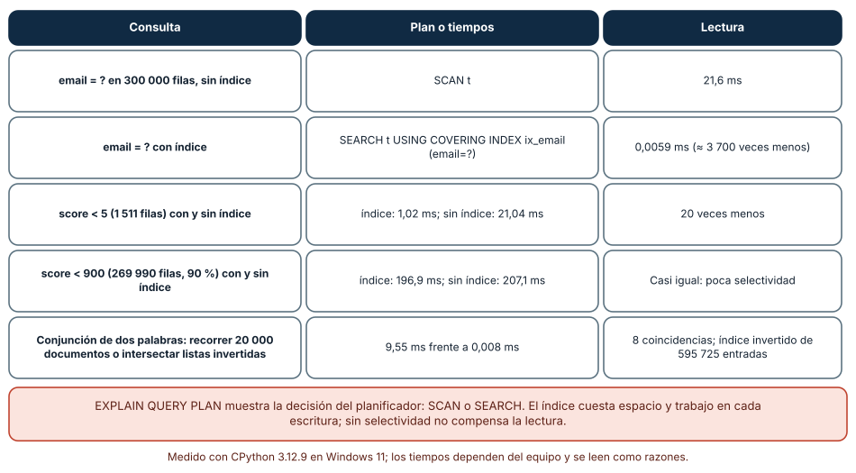
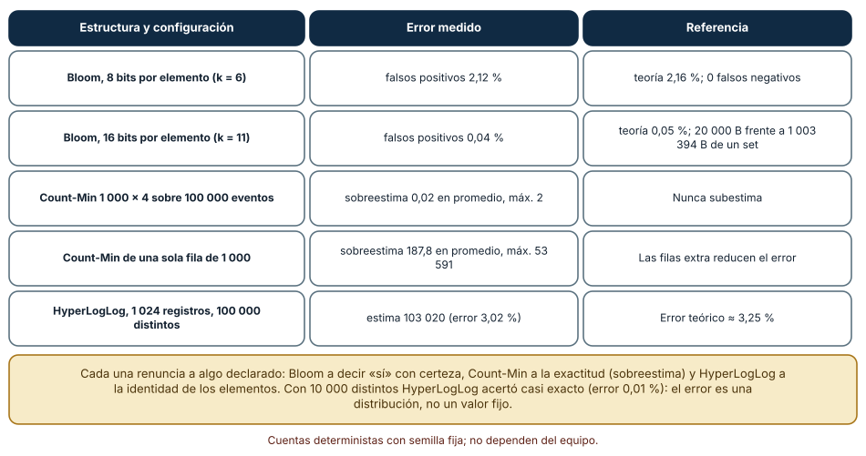
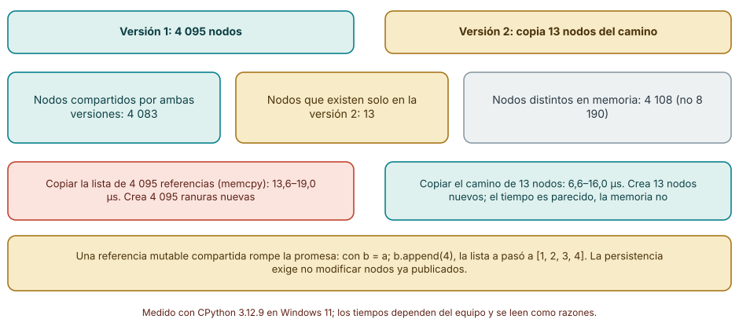

# SE-093 — Índices, probabilísticas y estructuras persistentes

[← SE-092 — Backtracking, divide y vencerás](https://github.com/vladimiracunadev-create/modern-software-engineering-program/blob/main/classes/part-07-estructuras-de-datos-y-algoritmos/se-092-backtracking-divide-y-venceras/README.md) · [↑ Parte 07](https://github.com/vladimiracunadev-create/modern-software-engineering-program/blob/main/classes/part-07-estructuras-de-datos-y-algoritmos/README.md) · [📚 Índice completo](https://github.com/vladimiracunadev-create/modern-software-engineering-program/blob/main/classes/README.md) · [🌐 Portal](https://vladimiracunadev-create.github.io/modern-software-engineering-program/classes/SE-093.html) · [SE-094 — Complejidad empírica, benchmarks y perfiles →](https://github.com/vladimiracunadev-create/modern-software-engineering-program/blob/main/classes/part-07-estructuras-de-datos-y-algoritmos/se-094-complejidad-empirica-benchmarks-y-perfiles/README.md)


## Punto profesional y fundamento pedagógico

**Punto profesional.** La clase existe para evaluar índices, estructuras probabilísticas y persistentes por errores permitidos y patrones de actualización.

**Por qué aparece aquí.** Se sitúa después de **Backtracking, divide y vencerás** y antes de **Complejidad empírica, benchmarks y perfiles**: convierte el conocimiento anterior en una decisión observable que la clase siguiente podrá reutilizar. La continuidad se comprueba en el artefacto, no por compartir vocabulario.

**Error conceptual que debe corregir.** Tratar falsos positivos o structural sharing como detalles gratuitos.

**Secuencia de aprendizaje.** Antes de leer la solución, el estudiante predice el resultado del caso normal y del error conceptual anterior. Luego explica un caso resuelto paso a paso, construye un contraejemplo que cambie la decisión y, sin consultar el texto, reconstruye el mecanismo y lo aplica a una entrada nueva. La secuencia usa predicción, explicación propia, contraste y recuperación. [ICAP](https://icap.education.asu.edu/research) distingue participación de construcción de conocimiento; [How People Learn II](https://nap.nationalacademies.org/catalog/24783/how-people-learn-ii-learners-contexts-and-cultures) exige conectar conocimiento previo, contexto y transferencia; la [práctica de recuperación](https://pubmed.ncbi.nlm.nih.gov/16507066/) respalda producir de nuevo la explicación tras una demora; y [Education for Life and Work](https://nap.nationalacademies.org/resource/13398/dbasse_084153.pdf) exige devolución que explique la causa del error.

**Evidencia de aprendizaje.** Advanced-structures.md con contrato, tasa de error o sharing y carga adversa. Debe contener predicción previa, observación, explicación causal, contraejemplo, criterio de aceptación y una nota de qué dato haría cambiar la conclusión.

**Límite de la conclusión.** Los parámetros de laboratorio no generalizan a producción.

### Trazabilidad fuente → afirmación

| Fuente primaria u oficial | Afirmación que respalda | Lo que no prueba |
|---|---|---|
| [MIT 6.006 Introduction to Algorithms](https://ocw.mit.edu/courses/6-006-introduction-to-algorithms-spring-2020/) | Estructuras, algoritmos, corrección y análisis de complejidad; autoridad: MIT OpenCourseWare | No demuestra por sí sola que el artefacto del estudiante sea correcto. |
| [Python Data Model](https://docs.python.org/3/reference/datamodel.html) | Semántica de secuencias, conjuntos, mappings, igualdad y hash; autoridad: Python Software Foundation | No demuestra por sí sola que el artefacto del estudiante sea correcto. |
| [Mathematics for Computer Science](https://ocw.mit.edu/courses/6-042j-mathematics-for-computer-science-spring-2015/) | Inducción, grafos, conteo y razonamiento discreto; autoridad: MIT OpenCourseWare | No demuestra por sí sola que el artefacto del estudiante sea correcto. |

## Antes de empezar

Esta clase continúa la **biblioteca de estructuras y algoritmos de la Parte 07**. Recupera la evidencia de la clase anterior, añade una decisión propia de **Índices, probabilísticas y estructuras persistentes** y deja un artefacto que la clase siguiente deberá consumir. La pregunta activa es: **¿Qué garantía se intercambia al usar un índice especializado, probabilidad o versiones persistentes?**

## Prerrequisitos

- Haber completado la clase anterior o reconstruir su contrato y evidencia.
- Python 3.11 o posterior, terminal, editor y Git; un segundo runtime es opcional y debe declararse.
- Trabajar con fixtures sintéticos: ninguna observación necesita datos de una persona o sistema real.

## Problema auténtico

La biblioteca de estructuras y algoritmos consulta rangos temporales, filtra millones de IDs vistos y necesita conservar snapshots auditables. Una sola tabla hash no satisface rango, memoria y versión al mismo tiempo.

## Objetivos observables

Al terminar podrás explicar los cinco mecanismos de esta clase, predecir su comportamiento antes de ejecutar, construir un caso normal y uno límite, diagnosticar el fallo controlado, comparar una alternativa y entregar evidencia que otra persona pueda reproducir.

## Mapa conceptual


El mapa se lee como una cadena de razonamiento, no como fases obligatorias del runtime. La flecha de retorno indica que un fallo o cambio de requisito obliga a revisar el modelo inicial; no autoriza a parchear solo la última salida.

## Temas y por qué importan

| Tema | Por qué cambia una decisión profesional | Evidencia mínima |
|---|---|---|
| Índices ordenados y consultas de rango | Un índice ordenado localiza fronteras y recorre un intervalo sin escanear todo. | Predicción, traza causal y contraejemplo de **Índices ordenados y consultas de rango** en `advanced-structures.md` |
| Bloom filter | Un Bloom filter marca varios bits por elemento. | Predicción, traza causal y contraejemplo de **Bloom filter** en `advanced-structures.md` |
| Sketches y aproximación | Estructuras de resumen estiman frecuencia o cardinalidad con memoria acotada. | Predicción, traza causal y contraejemplo de **Sketches y aproximación** en `advanced-structures.md` |
| Estructuras persistentes | Una actualización produce nueva versión compartiendo partes inmutables con la anterior. | Predicción, traza causal y contraejemplo de **Estructuras persistentes** en `advanced-structures.md` |
| Índice como proyección | Todo índice duplica una vista derivada y puede quedar desincronizado. | Predicción, traza causal y contraejemplo de **Índice como proyección** en `advanced-structures.md` |
## Conceptos y decisiones

### 1. Índices ordenados y consultas de rango

Un índice ordenado localiza fronteras y recorre un intervalo sin escanear todo. Mantenerlo encarece escritura y requiere coherencia con la fuente. `bisect` encuentra posición logarítmica en una lista, pero insertar sigue siendo lineal por desplazamiento.

### 2. Bloom filter

Un Bloom filter marca varios bits por elemento. Puede afirmar `posiblemente presente` o `definitivamente ausente`: admite falsos positivos, no falsos negativos bajo operación correcta sin borrado. Tamaño, hashes y tasa esperada deben calcularse para la carga.

### 3. Sketches y aproximación

Estructuras de resumen estiman frecuencia o cardinalidad con memoria acotada. El error es parte del contrato e incluye probabilidad y cota. No sirven cuando una decisión individual exige exactitud o derecho de corrección.

### 4. Estructuras persistentes

Una actualización produce nueva versión compartiendo partes inmutables con la anterior. Persistente aquí significa conservar versiones, no necesariamente guardar en disco. Compartir reduce copia pero retiene memoria mientras haya referencias a raíces antiguas.

### 5. Índice como proyección

Todo índice duplica una vista derivada y puede quedar desincronizado. Se define quién lo actualiza, cómo se reconstruye y qué ocurre ante fallo parcial. La biblioteca de estructuras y algoritmos prueba equivalencia entre consulta indexada y escaneo para fixtures pequeños.

### Índices: la selectividad decide si ayudan

Cargamos 300 000 filas en SQLite (en memoria) con un correo de 9 cifras y una puntuación de 0 a 999, y consultamos con y sin índice. `EXPLAIN QUERY PLAN` muestra la decisión: sin índice, `SCAN t`; con índice, `SEARCH t USING COVERING INDEX ix_email (email=?)`. Buscar un correo exacto tardó 21,6 ms con recorrido completo y 0,0059 ms con índice, unas 3 700 veces menos (en Linux 18,4 ms y 0,0074 ms). Una condición `score < 5` que selecciona 1 511 filas pasó de 21,0 a 1,0 ms; en cambio `score < 900`, que selecciona 269 990 filas (90 %), tardó 207,1 ms sin índice y 196,9 ms con él: casi igual. Un índice ayuda cuando la consulta descarta casi todo; si devuelve la mayor parte de la tabla, el recorrido es igual de bueno y el índice solo cuesta espacio y escrituras.

El mismo principio explica un índice invertido: sobre 20 000 documentos de 30 palabras, encontrar los que contienen dos palabras tardó 9,55 ms recorriéndolos y 0,008 ms intersectando dos conjuntos de identificadores (8 coincidencias, 595 725 entradas de índice en total). A cambio se construye y se mantiene el índice.



**Cómo leer la figura.** Cada fila es una consulta distinta; la tercera y la cuarta muestran el mismo índice con selectividad muy diferente. **Dónde deja de valer:** SQLite en memoria no incluye lectura de disco; en un disco el recorrido completo es aún más caro y el índice más valioso. El planificador puede elegir otro plan con otras estadísticas (`ANALYZE`).

### Estructuras probabilísticas: un error que se elige

Un filtro de Bloom responde «posiblemente está» o «seguro que no está». Implementamos uno con `blake2b` y probamos 10 000 elementos insertados y 100 000 ausentes. Con 8 bits por elemento y 6 funciones: 2,12 % de falsos positivos (teoría 2,16 %) y ningún falso negativo; con 16 bits y 11 funciones: 0,04 % (teoría 0,05 %), usando 20 000 bytes frente a 1 003 394 bytes del `set` de cadenas equivalente. Un Count-Min Sketch sobre 100 000 eventos con 396 claves distintas nunca subestimó; con 4 filas de 1 000 columnas sobrestimó 0,02 de media (máximo 2) y con una sola fila de 1 000, 187,8 de media (máximo 53 591): las filas adicionales reducen el error. HyperLogLog con 1 024 registros estimó 1 029, 9 999 y 103 020 para 1 000, 10 000 y 100 000 elementos distintos (errores de 2,87 %, 0,01 % y 3,02 %; teoría ≈ 3,25 %).

Cada estructura renuncia a algo declarado: Bloom a certificar presencia, Count-Min a la exactitud (siempre por exceso) y HyperLogLog a la identidad de los elementos. Un contrato que no diga cuál es el error y en qué dirección falla es incompleto.



**Cómo leer la figura.** La columna derecha es la referencia teórica o el contraste contra una estructura exacta. **Dónde deja de valer:** las estructuras se probaron con datos sintéticos y funciones de hash de calidad; un hash débil o datos adversarios cambian el error. Los parámetros se eligieron para el experimento, no como recomendación universal.

### Estructuras persistentes: compartir en vez de copiar

Una estructura persistente conserva versiones anteriores sin mutarlas. Construimos un árbol binario balanceado de 4 095 nodos e insertamos una clave copiando solo el camino desde la raíz: se crearon 13 nodos nuevos y 4 083 nodos quedaron compartidos entre las dos versiones; en memoria existen 4 108 nodos distintos, no 8 190. Copiar la lista completa de 4 095 referencias (un `memcpy`) tardó entre 13,6 y 19,0 µs y copiar el camino entre 6,6 y 16,0 µs: el tiempo fue parecido, la ganancia es de memoria y de poder conservar ambas versiones.

La persistencia exige no modificar nodos ya publicados. Una referencia mutable compartida la rompe: con `b = a; b.append(4)`, la lista `a` pasó a `[1, 2, 3, 4]`. Los historiales auditables y los snapshots baratos usan este principio, pero también se paga con más punteros y mayor recolección de basura.



**Cómo leer la figura.** Las cajas verdes y doradas dividen los nodos en compartidos y nuevos; la fila inferior advierte sobre la mutación. **Dónde deja de valer:** el experimento mide un árbol de Python con objetos pequeños; los costos de asignación y recolección de basura de una implementación real (por ejemplo `pyrsistent`) son distintos. No se midió recolección de basura con muchas versiones vivas.

## Definiciones de trabajo

- **índices ordenados y consultas de rango:** un índice ordenado localiza fronteras y recorre un intervalo sin escanear todo.
- **bloom filter:** un bloom filter marca varios bits por elemento.
- **sketches y aproximación:** estructuras de resumen estiman frecuencia o cardinalidad con memoria acotada.
- **estructuras persistentes:** una actualización produce nueva versión compartiendo partes inmutables con la anterior.
- **índice como proyección:** todo índice duplica una vista derivada y puede quedar desincronizado.

Las definiciones son operativas para la biblioteca de estructuras y algoritmos. No convierten términos con historia más amplia en sinónimos y deben contrastarse con la documentación primaria enlazada al final.

## Ejemplo mínimo

```python
from bisect import bisect_left
timestamps = [10, 20, 35, 50]
start = bisect_left(timestamps, 20)
end = bisect_left(timestamps, 50)
assert timestamps[start:end] == [20, 35]
```

Antes de ejecutar, predice estado, resultado y error. Después registra versión, comando y salida. Si el fragmento es pseudocódigo o pertenece a otro lenguaje, etiquétalo como tal y no afirmes que fue ejecutado.

## Ejemplo profesional

En la biblioteca de estructuras y algoritmos, un caso conserva identidad, prioridad, dependencias, instante de llegada y estado de resolución. La implementación de esta clase debe conservar ese contrato aunque cambie la forma interna. El caso profesional no pregunta únicamente si produce una salida: pregunta quién puede producirla, qué estado observa, cómo falla y qué rastro permite disputar una decisión incorrecta.

Compara el caso normal con autorización falsa, evidencia incompleta, empate y repetición. Un mecanismo es apropiado cuando esas diferencias quedan visibles y localizadas; es peligroso cuando dependen de orden accidental, estado oculto o una convención que el consumidor no puede conocer.

## Práctica guiada

1. Copia el contrato de entrada y salida antes de escribir implementación.
2. Predice el caso normal y un límite; identifica la invariante que no puede romperse.
3. Implementa la versión mínima sin I/O dentro del núcleo.
4. Ejecuta el caso y conserva comando, versión y salida bajo `evidence/`.
5. Introduce el fallo controlado, reduce la reproducción y formula dos hipótesis rivales.
6. Corrige la causa, añade regresión y ejecuta el conjunto completo.
7. Compara con otro paradigma o lenguaje indicando qué semántica se preserva.

## Ejercicios

1. **Plan:** crea una tabla de 100 000 filas, consulta por una columna con y sin índice y pega el resultado de `EXPLAIN QUERY PLAN` en tu informe.
2. **Selectividad:** mide una consulta que selecciona el 1 % y otra el 90 % de las filas; explica cuándo el índice deja de compensar.
3. **Bloom:** implementa un filtro con `m = 8·n` bits y `k = 6`, mide falsos positivos con 100 000 ausentes y compara con la fórmula teórica.
4. **Persistencia:** construye un árbol persistente, inserta una clave y cuenta cuántos nodos se comparten entre versiones.

## Reto verificable

Entrega implementación, fixtures, pruebas y un informe corto. Se aprueba si otra persona ejecuta desde checkout limpio, obtiene los mismos resultados y puede relacionar cada rama o transformación con una regla del dominio. No se aprueba por cantidad de archivos ni por usar la sintaxis característica del paradigma.

## Caso conductor

La biblioteca de estructuras y algoritmos recibe casos del motor de reglas comparado, mantiene una frontera de trabajo priorizada y explica por qué el siguiente caso es elegible. Ejecuta una carga pequeña trazable, duplicados, prioridades iguales y una dependencia ausente. Cambia después una sola regla o condición y revisa qué archivos, pruebas y trazas debieron modificarse. Esa superficie de cambio alimenta el proyecto final de la parte.

## Preguntas frecuentes

### ¿Un índice siempre acelera una consulta?

No: `score < 900` (90 % de las filas) tardó 207,1 ms sin índice y 196,9 ms con él. Ayuda cuando la consulta es selectiva, no cuando devuelve la mayor parte de la tabla.

### ¿Cómo sé si mi consulta usa el índice?

Con `EXPLAIN QUERY PLAN`: `SCAN` indica recorrido completo; `SEARCH ... USING INDEX` indica búsqueda por índice. Se revisa tras cambiar la consulta o los datos.

### ¿Cuándo es aceptable un filtro de Bloom?

Cuando un falso positivo cuesta poco (una consulta extra) y un falso negativo es inadmisible: aquí hubo 0 falsos negativos y 2,12 % de falsos positivos con 8 bits por elemento.

### ¿HyperLogLog sirve para contar exactamente?

No: tiene error relativo de ≈ 1,04/√m (3,25 % con 1 024 registros). Es adecuado para cardinalidades grandes cuando no importa el último dígito.

## Fallo controlado y diagnóstico

Interpreta `possibly present` de Bloom como confirmación y omite una escritura necesaria. Usa el filtro solo para descartar ausentes y confirma positivos contra la fuente exacta.

Registra síntoma, entrada mínima, hipótesis, observación que descarta cada hipótesis, causa, corrección y prueba de regresión. No cambies simultáneamente implementación, fixture y expectativa.

Crea un índice sobre una columna cuya consulta devuelve el 90 % de la tabla y mide con y sin él. **Síntoma:** sin mejora apreciable (196,9 ms frente a 207,1 ms). **Hipótesis rivales:** (a) el índice no se usó; (b) se usó pero no ayuda. **Prueba:** `EXPLAIN QUERY PLAN` muestra `SEARCH ... USING COVERING INDEX`, así que se usó; con un umbral que selecciona el 0,5 % el tiempo baja de 21,0 a 1,0 ms. **Conclusión:** el índice funciona, la consulta no es selectiva. Registra la selectividad esperada en el diseño del índice.

## Errores comunes y cómo corregirlos

| Síntoma | Causa probable | Corrección |
|---|---|---|
| La consulta sigue lenta tras crear el índice | Poca selectividad o el planificador no lo usa | Leer `EXPLAIN QUERY PLAN` y medir con y sin índice |
| Un filtro de Bloom reporta «posiblemente» demasiado a menudo | Pocos bits por elemento o demasiadas inserciones | Dimensionar `m` y `k` según el error objetivo y verificar con ausentes |
| El contador aproximado se infla | Count-Min con pocas columnas y mucha cardinalidad | Aumentar anchura y filas y reportar la dirección del error |
| Una versión «antigua» cambia sola | Se mutó un nodo compartido | Tratar los nodos publicados como inmutables y probar con dos versiones |
| Las escrituras se vuelven lentas | Demasiados índices que mantener | Medir el costo de escritura y retirar los que no se usan |

## Entorno y archivos clave

```text
work/SE-093/
├── README.md
├── algorithm_library/
│   ├── domain.py
│   └── se_093.py
├── fixtures/cases.json
├── tests/test_se_093.py
└── evidence/diagnosis.md
```

El `README` declara plataforma, runtimes, comandos, limpieza y límites. Evita dependencias externas cuando la biblioteca estándar permita observar el mecanismo; si agregas una, fija procedencia y versión.

## Seguridad, ética y accesibilidad

- la autorización forma parte del dominio y no se infiere por ausencia de rechazo;
- no uses `eval`, reglas descargadas ni serialización insegura;
- limita colas, recursión, tamaño de entrada y tiempo de evaluación;
- redacta trazas y conserva una explicación textual además de color o animación;
- una recomendación automatizada debe poder revisarse, impugnarse y corregirse;
- respeta licencias de ejemplos y atribuye adaptaciones.

## Puente hacia el trabajo con agentes

Un agente que «optimiza una consulta» suele crear un índice y declarar éxito tras una medición. Pide que adjunte el plan antes y después, la selectividad de la consulta y el costo de escritura añadido. Para estructuras probabilísticas, exige la tasa de error medida, su dirección y el tamaño de la muestra de ausentes; sin esos tres datos no se puede decidir si el error es aceptable.

## Transferencia

Traslada un fixture al segundo modelo o lenguaje. Compara representación de ausencia, error, mutabilidad, orden y cancelación. La transferencia está lograda cuando el contrato se conserva y las diferencias están explicadas, no cuando la sintaxis se parece.

## Evaluación y evidencia

| Criterio | Evidencia para aprobar |
|---|---|
| comprensión | explicación causal de los cinco mecanismos |
| corrección | normal, límite, inválido y contraejemplo |
| diseño | estado, efectos y contrato localizables |
| diagnóstico | reproducción mínima y regresión |
| transferencia | comparación semántica, no estética |
| reproducibilidad | versiones, comandos, salida y límites |


## Fuentes


- [MIT 6.006 Introduction to Algorithms](https://ocw.mit.edu/courses/6-006-introduction-to-algorithms-spring-2020/) — Estructuras, algoritmos, corrección y análisis de complejidad; autoridad: MIT OpenCourseWare.
- [Python Data Model](https://docs.python.org/3/reference/datamodel.html) — Semántica de secuencias, conjuntos, mappings, igualdad y hash; autoridad: Python Software Foundation.
- [Python Standard Library](https://docs.python.org/3/library/index.html) — Deque, heapq, bisect, graphlib y contenedores disponibles; autoridad: Python Software Foundation.
- [Python Debugging and Profiling](https://docs.python.org/3/library/debug.html) — Timeit, cprofile y tracemalloc con sus límites; autoridad: Python Software Foundation.
- [Mathematics for Computer Science](https://ocw.mit.edu/courses/6-042j-mathematics-for-computer-science-spring-2015/) — Inducción, grafos, conteo y razonamiento discreto; autoridad: MIT OpenCourseWare.
- [SWEBOK Guide v4.0a](https://www.computer.org/education/bodies-of-knowledge/software-engineering) — Construcción, medición y fundamentos de ingeniería; autoridad: IEEE Computer Society.

Cada fuente respalda el mecanismo indicado; ninguna demuestra que la implementación de la biblioteca de estructuras y algoritmos sea correcta. Esa afirmación depende de fixtures, pruebas, trazas y revisión reproducible.

- [SQLite: The Query Planner](https://www.sqlite.org/queryplanner.html) — cómo se eligen los índices y el costo de recorrido.
- [SQLite: EXPLAIN QUERY PLAN](https://www.sqlite.org/eqp.html) — interpretación de SCAN y SEARCH en los planes.
- [Bloom, «Space/time trade-offs in hash coding with allowable errors» (CACM, 1970)](https://doi.org/10.1145/362686.362692) — definición original del filtro y de su tasa de falsos positivos.
- [Cormode y Muthukrishnan, «An improved data stream summary: the count-min sketch» (J. Algorithms, 2005)](https://doi.org/10.1016/j.jalgor.2003.12.001) — Count-Min Sketch y sus garantías de error.

## Límites y siguiente paso

Una garantía teórica no predice constantes, asignaciones ni distribución real. La siguiente clase diseña medición empírica y perfilado sin sesgos obvios.

## Glosario

- **índices ordenados y consultas de rango:** un índice ordenado localiza fronteras y recorre un intervalo sin escanear todo.
- **bloom filter:** un bloom filter marca varios bits por elemento.
- **sketches y aproximación:** estructuras de resumen estiman frecuencia o cardinalidad con memoria acotada.
- **estructuras persistentes:** una actualización produce nueva versión compartiendo partes inmutables con la anterior.
- **índice como proyección:** todo índice duplica una vista derivada y puede quedar desincronizado.

---

[← SE-092 — Backtracking, divide y vencerás](https://github.com/vladimiracunadev-create/modern-software-engineering-program/blob/main/classes/part-07-estructuras-de-datos-y-algoritmos/se-092-backtracking-divide-y-venceras/README.md) · [↑ Parte 07](https://github.com/vladimiracunadev-create/modern-software-engineering-program/blob/main/classes/part-07-estructuras-de-datos-y-algoritmos/README.md) · [📚 Índice completo](https://github.com/vladimiracunadev-create/modern-software-engineering-program/blob/main/classes/README.md) · [🌐 Portal](https://vladimiracunadev-create.github.io/modern-software-engineering-program/classes/SE-093.html) · [SE-094 — Complejidad empírica, benchmarks y perfiles →](https://github.com/vladimiracunadev-create/modern-software-engineering-program/blob/main/classes/part-07-estructuras-de-datos-y-algoritmos/se-094-complejidad-empirica-benchmarks-y-perfiles/README.md)
