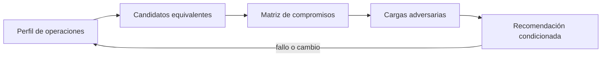
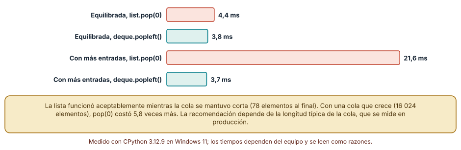
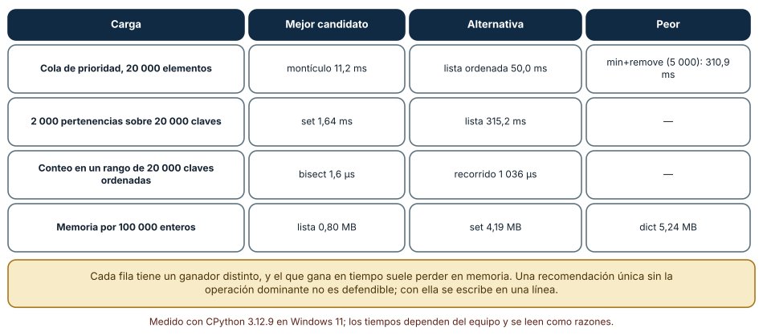
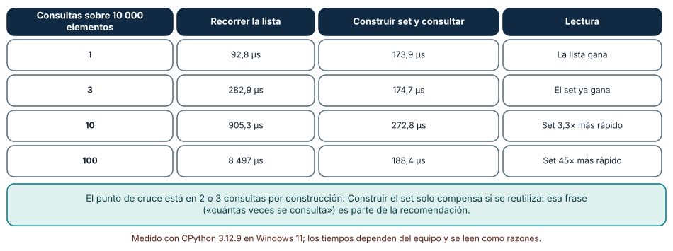

# SE-095 — Taller: elegir por carga y no por costumbre

[← SE-094 — Complejidad empírica, benchmarks y perfiles](https://github.com/vladimiracunadev-create/modern-software-engineering-program/blob/main/classes/part-07-estructuras-de-datos-y-algoritmos/se-094-complejidad-empirica-benchmarks-y-perfiles/README.md) · [↑ Parte 07](https://github.com/vladimiracunadev-create/modern-software-engineering-program/blob/main/classes/part-07-estructuras-de-datos-y-algoritmos/README.md) · [📚 Índice completo](https://github.com/vladimiracunadev-create/modern-software-engineering-program/blob/main/classes/README.md) · [🌐 Portal](https://vladimiracunadev-create.github.io/modern-software-engineering-program/classes/SE-095.html) · [SE-096 — Proyecto: biblioteca comparada con casos límite →](https://github.com/vladimiracunadev-create/modern-software-engineering-program/blob/main/classes/part-07-estructuras-de-datos-y-algoritmos/se-096-proyecto-biblioteca-comparada-con-casos-limite/README.md)


## Punto profesional y fundamento pedagógico

**Punto profesional.** La clase existe para elegir estructura y algoritmo por distribución de carga, no por familiaridad.

**Por qué aparece aquí.** Se sitúa después de **Complejidad empírica, benchmarks y perfiles** y antes de **Proyecto: biblioteca comparada con casos límite**: convierte el conocimiento anterior en una decisión observable que la clase siguiente podrá reutilizar. La continuidad se comprueba en el artefacto, no por compartir vocabulario.

**Error conceptual que debe corregir.** Usar promedios que ocultan colas largas o casos adversos.

**Secuencia de aprendizaje.** Antes de leer la solución, el estudiante predice el resultado del caso normal y del error conceptual anterior. Luego explica un caso resuelto paso a paso, construye un contraejemplo que cambie la decisión y, sin consultar el texto, reconstruye el mecanismo y lo aplica a una entrada nueva. La secuencia usa predicción, explicación propia, contraste y recuperación. [ICAP](https://icap.education.asu.edu/research) distingue participación de construcción de conocimiento; [How People Learn II](https://nap.nationalacademies.org/catalog/24783/how-people-learn-ii-learners-contexts-and-cultures) exige conectar conocimiento previo, contexto y transferencia; la [práctica de recuperación](https://pubmed.ncbi.nlm.nih.gov/16507066/) respalda producir de nuevo la explicación tras una demora; y [Education for Life and Work](https://nap.nationalacademies.org/resource/13398/dbasse_084153.pdf) exige devolución que explique la causa del error.

**Evidencia de aprendizaje.** Decision-evidence.md con workload, candidatos, percentiles y decisión reversible. Debe contener predicción previa, observación, explicación causal, contraejemplo, criterio de aceptación y una nota de qué dato haría cambiar la conclusión.

**Límite de la conclusión.** La carga sintetizada debe declararse y puede no representar tráfico real.

### Trazabilidad fuente → afirmación

| Fuente primaria u oficial | Afirmación que respalda | Lo que no prueba |
|---|---|---|
| [MIT 6.006 Introduction to Algorithms](https://ocw.mit.edu/courses/6-006-introduction-to-algorithms-spring-2020/) | Estructuras, algoritmos, corrección y análisis de complejidad; autoridad: MIT OpenCourseWare | No demuestra por sí sola que el artefacto del estudiante sea correcto. |
| [Python Debugging and Profiling](https://docs.python.org/3/library/debug.html) | Timeit, cprofile y tracemalloc con sus límites; autoridad: Python Software Foundation | No demuestra por sí sola que el artefacto del estudiante sea correcto. |
| [SWEBOK Guide v4.0a](https://www.computer.org/education/bodies-of-knowledge/software-engineering) | Construcción, medición y fundamentos de ingeniería; autoridad: IEEE Computer Society | No demuestra por sí sola que el artefacto del estudiante sea correcto. |

## Antes de empezar

Esta clase continúa la **biblioteca de estructuras y algoritmos de la Parte 07**. Recupera la evidencia de la clase anterior, añade una decisión propia de **Taller: elegir por carga y no por costumbre** y deja un artefacto que la clase siguiente deberá consumir. La pregunta activa es: **¿Cómo elegir una estructura por perfil de operaciones en lugar de preferencia personal?**

## Prerrequisitos

- Haber completado la clase anterior o reconstruir su contrato y evidencia.
- Python 3.11 o posterior, terminal, editor y Git; un segundo runtime es opcional y debe declararse.
- Trabajar con fixtures sintéticos: ninguna observación necesita datos de una persona o sistema real.

## Problema auténtico

Tres equipos piden una recomendación única para historial, cola urgente y consulta por ID. Ninguna estructura domina las tres cargas y una media global oculta la operación crítica.

## Objetivos observables

Al terminar podrás explicar los cinco mecanismos de esta clase, predecir su comportamiento antes de ejecutar, construir un caso normal y uno límite, diagnosticar el fallo controlado, comparar una alternativa y entregar evidencia que otra persona pueda reproducir.

## Mapa conceptual



El mapa se lee como una cadena de razonamiento, no como fases obligatorias del runtime. La flecha de retorno indica que un fallo o cambio de requisito obliga a revisar el modelo inicial; no autoriza a parchear solo la última salida.

## Temas y por qué importan

| Tema | Por qué cambia una decisión profesional | Evidencia mínima |
|---|---|---|
| Perfil de operaciones | El taller expresa porcentajes y ráfagas de insertar, extraer, buscar, recorrer y borrar. | Predicción, traza causal y contraejemplo de **Perfil de operaciones** en `decision-evidence.md` |
| Candidatos equivalentes | Cada candidato implementa la misma interfaz y errores. | Predicción, traza causal y contraejemplo de **Candidatos equivalentes** en `decision-evidence.md` |
| Matriz de compromisos | Se registran tiempo, espacio, orden, estabilidad, complejidad de implementación y recuperación. | Predicción, traza causal y contraejemplo de **Matriz de compromisos** en `decision-evidence.md` |
| Cargas adversarias | Entradas ordenadas, hashes conflictivos, prioridades iguales y grafos cíclicos revelan peor caso. | Predicción, traza causal y contraejemplo de **Cargas adversarias** en `decision-evidence.md` |
| Recomendación condicionada | La conclusión usa forma `si carga y garantía, entonces opción; si cambia umbral, revisar`. | Predicción, traza causal y contraejemplo de **Recomendación condicionada** en `decision-evidence.md` |
## Conceptos y decisiones

### 1. Perfil de operaciones

El taller expresa porcentajes y ráfagas de insertar, extraer, buscar, recorrer y borrar. También fija tamaño, distribución y SLO. Un porcentaje bajo puede dominar impacto si la operación es muy costosa o bloquea el flujo.

### 2. Candidatos equivalentes

Cada candidato implementa la misma interfaz y errores. Adaptadores no deben hacer trabajo extra solo para uno. Se validan resultados antes de medir para evitar que una simplificación incorrecta parezca más eficiente.

### 3. Matriz de compromisos

Se registran tiempo, espacio, orden, estabilidad, complejidad de implementación y recuperación. Pesos pertenecen al contexto y se someten a sensibilidad. La tabla organiza evidencia; no genera decisión automática.

### 4. Cargas adversarias

Entradas ordenadas, hashes conflictivos, prioridades iguales y grafos cíclicos revelan peor caso. No toda entrada adversaria es probable, pero seguridad y disponibilidad pueden exigir acotar impacto incluso si la mediana es buena.

### 5. Recomendación condicionada

La conclusión usa forma `si carga y garantía, entonces opción; si cambia umbral, revisar`. Declarar condiciones evita convertir un benchmark del taller en estándar universal. Los datos y scripts quedan junto al informe.

### La misma estructura, dos cargas, dos respuestas

El taller parte de una regla: no se elige una estructura, se elige para una carga. Probamos una cola con 40 000 operaciones al azar con la lista (`pop(0)`) y con `deque`. Con una carga equilibrada (50 % entradas, 50 % salidas), la cola quedó con 78 elementos y la lista tardó 4,4 ms frente a 3,8 ms del deque: casi nada. Con una carga que favorece las entradas (70 %), la cola terminó con 16 024 elementos y la lista tardó 21,6 ms frente a 3,7 ms: 5,8 veces más. En Linux 3,9/3,3 ms y 17,7/3,3 ms. Una recomendación «usa `deque`» es válida en ambos casos, pero la urgencia no lo es. Lo que cambia la decisión es la longitud típica de la cola.

El perfil de operaciones es entonces un dato de entrada del taller: proporciones de lectura, inserción y extracción, tamaño típico y tamaño máximo. Se registra antes de medir, porque una recomendación sin ese perfil es una opinión.



**Cómo leer la figura.** El par de arriba (carga equilibrada) y el de abajo (más entradas) usan los mismos dos candidatos. **Dónde deja de valer:** las cargas son sintéticas con semilla fija. Una cola real tiene ráfagas; el peor caso puede ser un pico corto que la media oculta. Hay que medir con trazas reales, anonimizadas.

### Matriz de compromisos con números

Un taller produce una matriz: operación dominante frente a estructura, con medidas. Una cola de prioridad de 20 000 elementos: montículo 11,2 ms, lista ordenada con `bisect` 50,0 ms y búsqueda del mínimo con `remove` 310,9 ms (sobre 5 000). 2 000 pertenencias sobre 20 000 claves: `set` 1,64 ms, lista 315,2 ms. Conteo de claves en un rango sobre 20 000 ordenadas: `bisect` 1,6 µs, recorrido 1 036 µs. Memoria por 100 000 enteros: lista 0,80 MB, `deque` 0,83 MB, `set` 4,19 MB, `dict` 5,24 MB.

Cada fila tiene un ganador distinto, y el ganador en tiempo suele ser el perdedor en memoria. Por eso la matriz no concluye «la mejor estructura»: concluye «la mejor para esta operación dominante, con este costo de memoria». Documentar el perdedor y por qué se descartó es parte de la entrega.



**Cómo leer la figura.** Lee cada fila de izquierda a derecha como una decisión: carga, ganador, alternativa, descartado. **Dónde deja de valer:** los tiempos son de un equipo, pero las razones se repitieron en Linux. Otros tamaños, tipos de dato o patrones de acceso cambian la matriz; no es un catálogo.

### ¿Cuántas consultas justifican construir un índice?

Construir un `set` sobre una lista cuesta tiempo. Con 10 000 elementos y una sola consulta, recorrer la lista tardó 92,8 µs y construir el set más consultar 173,9 µs: la lista gana. Con 3 consultas 282,9 frente a 174,7 µs: el set ya gana. Con 10 consultas, 905,3 frente a 272,8 µs; con 100, 8 497 frente a 188,4 µs, 45 veces menos. El punto de cruce está en 2-3 consultas por construcción para este tamaño; con 100 elementos fue otro (49,7 µs de lista y 13,4 µs de set para 29 consultas).

La frase de la recomendación debe llevar esa condición: «construir un set compensa si la lista se consulta más de dos o tres veces antes de cambiar». Si la lista cambia con cada consulta, la reconstrucción se paga siempre y la conclusión se invierte.



**Cómo leer la figura.** La última columna indica quién gana en cada fila; el cambio ocurre entre 1 y 3 consultas. **Dónde deja de valer:** el umbral depende del tipo de clave (enteros) y del tamaño; con claves cuyo hash es caro (cadenas largas) se desplazaría. Y con 1 000 000 de elementos la memoria de un set puede decidir antes que el tiempo.

## Definiciones de trabajo

- **perfil de operaciones:** el taller expresa porcentajes y ráfagas de insertar, extraer, buscar, recorrer y borrar.
- **candidatos equivalentes:** cada candidato implementa la misma interfaz y errores.
- **matriz de compromisos:** se registran tiempo, espacio, orden, estabilidad, complejidad de implementación y recuperación.
- **cargas adversarias:** entradas ordenadas, hashes conflictivos, prioridades iguales y grafos cíclicos revelan peor caso.
- **recomendación condicionada:** la conclusión usa forma `si carga y garantía, entonces opción; si cambia umbral, revisar`.

Las definiciones son operativas para la biblioteca de estructuras y algoritmos. No convierten términos con historia más amplia en sinónimos y deben contrastarse con la documentación primaria enlazada al final.

## Ejemplo mínimo

```python
| Carga | operación dominante | candidato | criterio de salida |
|---|---|---|---|
| historial | append/iterar | list | p95 y memoria |
| urgente | push/pop mínimo | heap | orden y p95 |
| identidad | lookup/dedup | dict+set | exactitud y p95 |
```

Antes de ejecutar, predice estado, resultado y error. Después registra versión, comando y salida. Si el fragmento es pseudocódigo o pertenece a otro lenguaje, etiquétalo como tal y no afirmes que fue ejecutado.

## Ejemplo profesional

En la biblioteca de estructuras y algoritmos, un caso conserva identidad, prioridad, dependencias, instante de llegada y estado de resolución. La implementación de esta clase debe conservar ese contrato aunque cambie la forma interna. El caso profesional no pregunta únicamente si produce una salida: pregunta quién puede producirla, qué estado observa, cómo falla y qué rastro permite disputar una decisión incorrecta.

Compara el caso normal con autorización falsa, evidencia incompleta, empate y repetición. Un mecanismo es apropiado cuando esas diferencias quedan visibles y localizadas; es peligroso cuando dependen de orden accidental, estado oculto o una convención que el consumidor no puede conocer.

## Práctica guiada

1. Copia el contrato de entrada y salida antes de escribir implementación.
2. Predice el caso normal y un límite; identifica la invariante que no puede romperse.
3. Implementa la versión mínima sin I/O dentro del núcleo.
4. Ejecuta el caso y conserva comando, versión y salida bajo `evidence/`.
5. Introduce el fallo controlado, reduce la reproducción y formula dos hipótesis rivales.
6. Corrige la causa, añade regresión y ejecuta el conjunto completo.
7. Compara con otro paradigma o lenguaje indicando qué semántica se preserva.

## Ejercicios

1. **Perfil:** escribe el perfil de operaciones de tres cargas (historial, cola urgente, búsqueda por ID) con proporciones y tamaños.
2. **Umbral:** mide a partir de cuántas consultas compensa construir un `set` para tres tamaños de lista.
3. **Matriz:** construye la matriz de compromisos de cuatro estructuras para dos operaciones dominantes y marca el ganador de cada una.
4. **Disparador:** formula una recomendación con una condición medible que obligue a reevaluarla.

## Reto verificable

Entrega implementación, fixtures, pruebas y un informe corto. Se aprueba si otra persona ejecuta desde checkout limpio, obtiene los mismos resultados y puede relacionar cada rama o transformación con una regla del dominio. No se aprueba por cantidad de archivos ni por usar la sintaxis característica del paradigma.

## Caso conductor

La biblioteca de estructuras y algoritmos recibe casos del motor de reglas comparado, mantiene una frontera de trabajo priorizada y explica por qué el siguiente caso es elegible. Ejecuta una carga pequeña trazable, duplicados, prioridades iguales y una dependencia ausente. Cambia después una sola regla o condición y revisa qué archivos, pruebas y trazas debieron modificarse. Esa superficie de cambio alimenta el proyecto final de la parte.

## Preguntas frecuentes

### ¿Cuál es la mejor estructura de datos?

No existe fuera de una carga: la lista como cola fue aceptable con 78 elementos y mala con 16 024. La respuesta correcta es «depende de la operación dominante y del tamaño».

### ¿Qué entrego en este taller?

Un perfil de operaciones, una matriz de compromisos con mediciones y una recomendación condicionada con la medición que la invalidaría.

### ¿Cómo elijo cuando dos estructuras empatan?

Por el criterio secundario declarado de antemano: memoria, simplicidad, riesgo de aliasing. Documenta el descarte.

### ¿Y si mi carga cambia en un año?

La recomendación incluye el disparador: «si la cola supera 5 000 elementos, repetir la medición». Sin disparador, la decisión envejece sin avisar.

## Fallo controlado y diagnóstico

Promedia las tres cargas y elige lista. Revisa por escenario: la cola urgente viola su SLO. Produce recomendaciones condicionadas y sensibilidad al mix.

Registra síntoma, entrada mínima, hipótesis, observación que descarta cada hipótesis, causa, corrección y prueba de regresión. No cambies simultáneamente implementación, fixture y expectativa.

Recomienda `deque` para toda cola y valida con una carga equilibrada. **Síntoma:** la prueba muestra casi igualdad (4,4 ms frente a 3,8 ms) y el equipo concluye que «da lo mismo». **Hipótesis rivales:** (a) las estructuras son equivalentes; (b) la carga de prueba no estresa la diferencia. **Prueba:** repite con una carga que haga crecer la cola (16 024 elementos): 21,6 ms frente a 3,7 ms. **Conclusión:** la carga de prueba ocultaba la diferencia. Guarda ambas cargas en la suite.

## Errores comunes y cómo corregirlos

| Síntoma | Causa probable | Corrección |
|---|---|---|
| La recomendación no convence a otro equipo | No declara la carga ni el tamaño | Escribir perfil de operaciones y tamaños antes de medir |
| Se elige `set` para todo | Se ignoró el costo de construirlo y la memoria | Calcular el umbral de reutilización y la memoria |
| La media de latencia es buena pero hay picos | Se reporta solo el promedio | Reportar percentiles y el peor caso |
| La matriz mezcla tiempos de máquinas distintas | Mediciones sin protocolo común | Repetir en una sola máquina y reportar razones |
| La decisión se reabre cada semana | No hay disparador de reevaluación | Escribir la condición medible que cambia la elección |

## Entorno y archivos clave

```text
work/SE-095/
├── README.md
├── algorithm_library/
│   ├── domain.py
│   └── se_095.py
├── fixtures/cases.json
├── tests/test_se_095.py
└── evidence/diagnosis.md
```

El `README` declara plataforma, runtimes, comandos, limpieza y límites. Evita dependencias externas cuando la biblioteca estándar permita observar el mecanismo; si agregas una, fija procedencia y versión.

## Seguridad, ética y accesibilidad

- la autorización forma parte del dominio y no se infiere por ausencia de rechazo;
- no uses `eval`, reglas descargadas ni serialización insegura;
- limita colas, recursión, tamaño de entrada y tiempo de evaluación;
- redacta trazas y conserva una explicación textual además de color o animación;
- una recomendación automatizada debe poder revisarse, impugnarse y corregirse;
- respeta licencias de ejemplos y atribuye adaptaciones.

## Puente hacia el trabajo con agentes

Un agente al que se le pide «elige la mejor estructura» responderá con una opinión sólida y sin datos. Convierte la tarea: dale el perfil de operaciones y pide que produzca la matriz con mediciones reproducibles en el mismo script. Una buena entrega incluye el candidato descartado y el umbral que lo reabriría; una que no, no es reutilizable por el siguiente agente ni por una persona.

## Transferencia

Traslada un fixture al segundo modelo o lenguaje. Compara representación de ausencia, error, mutabilidad, orden y cancelación. La transferencia está lograda cuando el contrato se conserva y las diferencias están explicadas, no cuando la sintaxis se parece.

## Evaluación y evidencia

| Criterio | Evidencia para aprobar |
|---|---|
| comprensión | explicación causal de los cinco mecanismos |
| corrección | normal, límite, inválido y contraejemplo |
| diseño | estado, efectos y contrato localizables |
| diagnóstico | reproducción mínima y regresión |
| transferencia | comparación semántica, no estética |
| reproducibilidad | versiones, comandos, salida y límites |


## Fuentes


- [MIT 6.006 Introduction to Algorithms](https://ocw.mit.edu/courses/6-006-introduction-to-algorithms-spring-2020/) — Estructuras, algoritmos, corrección y análisis de complejidad; autoridad: MIT OpenCourseWare.
- [Python Data Model](https://docs.python.org/3/reference/datamodel.html) — Semántica de secuencias, conjuntos, mappings, igualdad y hash; autoridad: Python Software Foundation.
- [Python Standard Library](https://docs.python.org/3/library/index.html) — Deque, heapq, bisect, graphlib y contenedores disponibles; autoridad: Python Software Foundation.
- [Python Debugging and Profiling](https://docs.python.org/3/library/debug.html) — Timeit, cprofile y tracemalloc con sus límites; autoridad: Python Software Foundation.
- [Mathematics for Computer Science](https://ocw.mit.edu/courses/6-042j-mathematics-for-computer-science-spring-2015/) — Inducción, grafos, conteo y razonamiento discreto; autoridad: MIT OpenCourseWare.
- [SWEBOK Guide v4.0a](https://www.computer.org/education/bodies-of-knowledge/software-engineering) — Construcción, medición y fundamentos de ingeniería; autoridad: IEEE Computer Society.

Cada fuente respalda el mecanismo indicado; ninguna demuestra que la implementación de la biblioteca de estructuras y algoritmos sea correcta. Esa afirmación depende de fixtures, pruebas, trazas y revisión reproducible.

- [Python Wiki: TimeComplexity](https://wiki.python.org/moin/TimeComplexity) — costos documentados de las operaciones de los contenedores integrados.
- [Python: `collections`](https://docs.python.org/3/library/collections.html) — deque, defaultdict, Counter y sus garantías.
- [Python: `bisect`](https://docs.python.org/3/library/bisect.html) — listas ordenadas con búsqueda binaria.
- [Georges, Buytaert y Eeckhout, «Statistically rigorous Java performance evaluation» (OOPSLA 2007)](https://doi.org/10.1145/1297027.1297033) — protocolo de comparación de rendimiento con intervalos de confianza.

## Límites y siguiente paso

El taller cubre cargas sintéticas y una plataforma. El proyecto siguiente empaqueta alternativas, propiedades y benchmarks para revisión reproducible.

## Glosario

- **perfil de operaciones:** el taller expresa porcentajes y ráfagas de insertar, extraer, buscar, recorrer y borrar.
- **candidatos equivalentes:** cada candidato implementa la misma interfaz y errores.
- **matriz de compromisos:** se registran tiempo, espacio, orden, estabilidad, complejidad de implementación y recuperación.
- **cargas adversarias:** entradas ordenadas, hashes conflictivos, prioridades iguales y grafos cíclicos revelan peor caso.
- **recomendación condicionada:** la conclusión usa forma `si carga y garantía, entonces opción; si cambia umbral, revisar`.

---

[← SE-094 — Complejidad empírica, benchmarks y perfiles](https://github.com/vladimiracunadev-create/modern-software-engineering-program/blob/main/classes/part-07-estructuras-de-datos-y-algoritmos/se-094-complejidad-empirica-benchmarks-y-perfiles/README.md) · [↑ Parte 07](https://github.com/vladimiracunadev-create/modern-software-engineering-program/blob/main/classes/part-07-estructuras-de-datos-y-algoritmos/README.md) · [📚 Índice completo](https://github.com/vladimiracunadev-create/modern-software-engineering-program/blob/main/classes/README.md) · [🌐 Portal](https://vladimiracunadev-create.github.io/modern-software-engineering-program/classes/SE-095.html) · [SE-096 — Proyecto: biblioteca comparada con casos límite →](https://github.com/vladimiracunadev-create/modern-software-engineering-program/blob/main/classes/part-07-estructuras-de-datos-y-algoritmos/se-096-proyecto-biblioteca-comparada-con-casos-limite/README.md)
