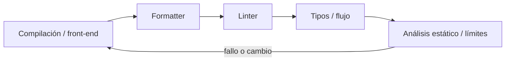
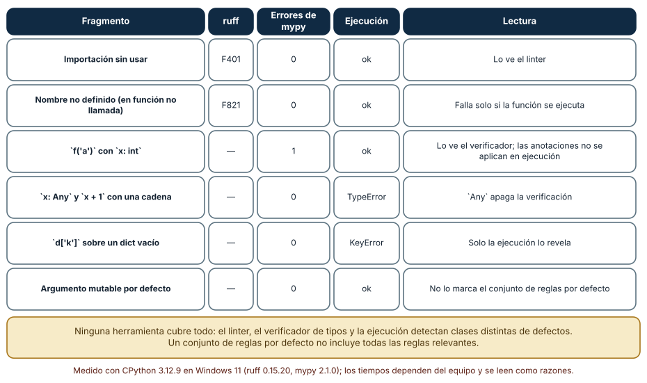
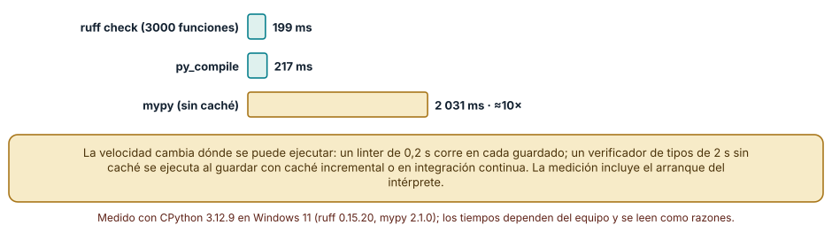
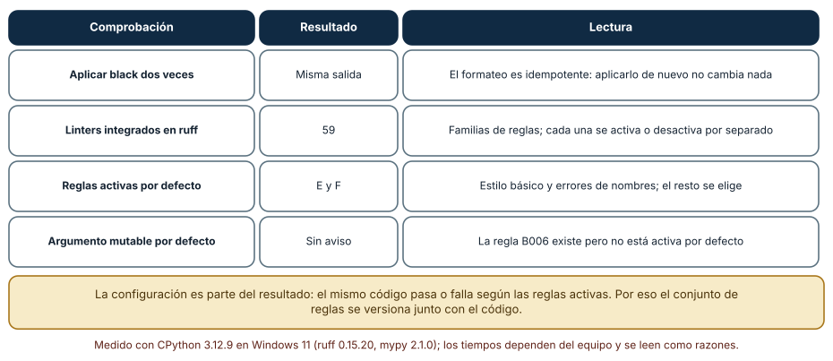

# SE-100 — Compiladores, linters, formatters y análisis estático

[← SE-099 — Profilers de CPU, memoria, I/O y red](https://github.com/vladimiracunadev-create/modern-software-engineering-program/blob/main/classes/part-08-entornos-herramientas-y-depuracion/se-099-profilers-de-cpu-memoria-i-o-y-red/README.md) · [↑ Parte 08](https://github.com/vladimiracunadev-create/modern-software-engineering-program/blob/main/classes/part-08-entornos-herramientas-y-depuracion/README.md) · [📚 Índice completo](https://github.com/vladimiracunadev-create/modern-software-engineering-program/blob/main/classes/README.md) · [🌐 Portal](https://vladimiracunadev-create.github.io/modern-software-engineering-program/classes/SE-100.html) · [SE-101 — REPL, notebooks y desarrollo exploratorio →](https://github.com/vladimiracunadev-create/modern-software-engineering-program/blob/main/classes/part-08-entornos-herramientas-y-depuracion/se-101-repl-notebooks-y-desarrollo-exploratorio/README.md)


## Punto profesional y fundamento pedagógico

**Punto profesional.** La clase existe para separar compilación, formato, lint y análisis estático por la propiedad que verifican.

**Por qué aparece aquí.** Se sitúa después de **Profilers de CPU, memoria, I/O y red** y antes de **REPL, notebooks y desarrollo exploratorio**: convierte el conocimiento anterior en una decisión observable que la clase siguiente podrá reutilizar. La continuidad se comprueba en el artefacto, no por compartir vocabulario.

**Error conceptual que debe corregir.** Tratar cero advertencias como prueba de corrección.

**Secuencia de aprendizaje.** Antes de leer la solución, el estudiante predice el resultado del caso normal y del error conceptual anterior. Luego explica un caso resuelto paso a paso, construye un contraejemplo que cambie la decisión y, sin consultar el texto, reconstruye el mecanismo y lo aplica a una entrada nueva. La secuencia usa predicción, explicación propia, contraste y recuperación. [ICAP](https://icap.education.asu.edu/research) distingue participación de construcción de conocimiento; [How People Learn II](https://nap.nationalacademies.org/catalog/24783/how-people-learn-ii-learners-contexts-and-cultures) exige conectar conocimiento previo, contexto y transferencia; la [práctica de recuperación](https://pubmed.ncbi.nlm.nih.gov/16507066/) respalda producir de nuevo la explicación tras una demora; y [Education for Life and Work](https://nap.nationalacademies.org/resource/13398/dbasse_084153.pdf) exige devolución que explique la causa del error.

**Evidencia de aprendizaje.** Static-analysis.md con hallazgo real, falso positivo, configuración y límite. Debe contener predicción previa, observación, explicación causal, contraejemplo, criterio de aceptación y una nota de qué dato haría cambiar la conclusión.

**Límite de la conclusión.** El análisis estático aproxima comportamientos y no ejecuta todos los caminos.

### Trazabilidad fuente → afirmación

| Fuente primaria u oficial | Afirmación que respalda | Lo que no prueba |
|---|---|---|
| [Language Server Protocol 3.18](https://microsoft.github.io/language-server-protocol/specifications/lsp/3.18/specification/) | Mensajes, capacidades y sincronización entre editor y servidor; autoridad: Microsoft | No demuestra por sí sola que el artefacto del estudiante sea correcto. |
| [Python Debugging and Profiling](https://docs.python.org/3/library/debug.html) | Pdb, cprofile, timeit, tracemalloc y límites instrumentales; autoridad: Python Software Foundation | No demuestra por sí sola que el artefacto del estudiante sea correcto. |
| [Python ast](https://docs.python.org/3/library/ast.html) | define el árbol sintáctico que un análisis puede inspeccionar | No demuestra por sí sola que el artefacto del estudiante sea correcto. |
| [Ruff documentation](https://docs.astral.sh/ruff/) | documenta alcance, reglas y configuración del linter | No demuestra por sí sola que el artefacto del estudiante sea correcto. |

## Antes de empezar

Esta clase continúa el **entorno reproducible de diagnóstico de la Parte 08**. Recupera la evidencia de la clase anterior, añade una decisión propia de **Compiladores, linters, formatters y análisis estático** y deja un artefacto que la clase siguiente deberá consumir. La pregunta activa es: **¿Qué garantía aporta cada herramienta estática y qué no puede concluir sin ejecutar?**

## Prerrequisitos

- Haber completado la clase anterior o reconstruir su contrato y evidencia.
- Python 3.11 o posterior, terminal, editor y Git; un segundo runtime es opcional y debe declararse.
- Trabajar con fixtures sintéticos: ninguna observación necesita datos de una persona o sistema real.

## Problema auténtico

El entorno reproducible de diagnóstico reúne mensajes de compilador, formatter, linter y type checker bajo `errores`. El equipo ignora todos porque algunos son estilo, perdiendo una incompatibilidad de tipo real.

## Objetivos observables

Al terminar podrás explicar los cinco mecanismos de esta clase, predecir su comportamiento antes de ejecutar, construir un caso normal y uno límite, diagnosticar el fallo controlado, comparar una alternativa y entregar evidencia que otra persona pueda reproducir.

## Mapa conceptual



El mapa se lee como una cadena de razonamiento, no como fases obligatorias del runtime. La flecha de retorno indica que un fallo o cambio de requisito obliga a revisar el modelo inicial; no autoriza a parchear solo la última salida.

## Temas y por qué importan

| Tema | Por qué cambia una decisión profesional | Evidencia mínima |
|---|---|---|
| Compilación y front-end | El compilador tokeniza, parsea, comprueba reglas y puede producir representación o ejecutable. | Predicción, traza causal y contraejemplo de **Compilación y front-end** en `static-analysis.md` |
| Formatter | Un formatter transforma presentación bajo reglas deterministas y reduce discusiones de estilo. | Predicción, traza causal y contraejemplo de **Formatter** en `static-analysis.md` |
| Linter | Un linter detecta patrones, APIs riesgosas o convenciones. | Predicción, traza causal y contraejemplo de **Linter** en `static-analysis.md` |
| Tipos y flujo | El análisis de tipos aproxima valores posibles sin ejecutar todas las rutas. | Predicción, traza causal y contraejemplo de **Tipos y flujo** en `static-analysis.md` |
| Análisis estático y límites | Análisis de datos, taint o control explora modelos conservadores. | Predicción, traza causal y contraejemplo de **Análisis estático y límites** en `static-analysis.md` |
## Conceptos y decisiones

### 1. Compilación y front-end

El compilador tokeniza, parsea, comprueba reglas y puede producir representación o ejecutable. Un error sintáctico impide construir; que compile no demuestra contrato de negocio ni ausencia de comportamiento inseguro.

### 2. Formatter

Un formatter transforma presentación bajo reglas deterministas y reduce discusiones de estilo. No mejora nombres, cohesión ni corrección. Versionarlo evita diffs masivos por cambios de regla y permite reproducir formato en CI.

### 3. Linter

Un linter detecta patrones, APIs riesgosas o convenciones. Cada regla tiene intención, severidad y posibles falsos positivos. Desactivar globalmente por un caso local elimina señal; una supresión debe incluir razón y alcance mínimo.

### 4. Tipos y flujo

El análisis de tipos aproxima valores posibles sin ejecutar todas las rutas. Refinamiento de flujo puede reconocer chequeos, pero entrada externa sigue necesitando validación runtime. `Any` o casts silencian al analizador y trasladan la obligación al autor.

### 5. Análisis estático y límites

Análisis de datos, taint o control explora modelos conservadores. Puede reportar ruta imposible o no ver reflexión. La calidad depende de configuración, stubs y lenguaje; un reporte se triagea como hipótesis con evidencia.

### Qué detecta cada herramienta y qué no

Seis fragmentos de código se analizaron con tres métodos: `ruff check`, `mypy` y la ejecución. Una importación sin usar la detecta ruff (`F401`) y la ejecución no falla. Un nombre no definido dentro de una función sin llamar la detecta ruff (`F821`), pero el programa se ejecuta sin error porque nadie llama a la función. Llamar `f('a')` con `x: int` lo detecta mypy (un error) y la ejecución *no* falla: las anotaciones no se aplican en tiempo de ejecución. Usar `x: Any` apaga la verificación: mypy no ve el error y la ejecución lanza `TypeError`. Un `d['k']` sobre un diccionario vacío lo descubre solo la ejecución (`KeyError`). Y un argumento mutable por defecto no genera aviso con el conjunto de reglas por defecto.



**Cómo leer la figura.** Cada fila es un defecto distinto; cada columna, un método. Ninguna columna cubre todas las filas. **Dónde deja de valer:** el resultado depende de la configuración y las versiones usadas (ruff 0.15.20, mypy 2.1.0); con otras reglas activas, la columna de ruff cambiaría.

### Velocidad y lugar de ejecución

Sobre un archivo de 3 000 funciones (6 000 líneas) `ruff check` tardó 199 ms, `py_compile` 217 ms y `mypy` sin caché 2 031 ms, unas diez veces más. La velocidad decide dónde se ejecuta cada herramienta: un linter de 0,2 s corre al guardar y en cada compromiso; un verificador de tipos de 2 s sin caché se ejecuta con caché incremental o en integración continua. Estos tiempos incluyen el arranque del intérprete (unos 127 ms en esta máquina), por lo que sobreestiman el costo del análisis puro en archivos pequeños.



**Cómo leer la figura.** La escala muestra que mypy cuesta un orden de magnitud más. **Dónde deja de valer:** con caché, mypy reanaliza solo lo que cambia y la brecha se reduce; con un proyecto con miles de módulos y dependencias, los tiempos se alejan de los de un archivo único.

### Formato, reglas y configuración

`black` es idempotente: aplicarlo dos veces produjo la misma salida, una propiedad que permite usarlo en un gancho de confirmación sin generar cambios infinitos. `ruff` integra 59 familias de reglas, pero activa por defecto solo errores y estilo básico (`E` y `F`); la regla de argumentos mutables por defecto (`B006`) existe pero no está activa. La consecuencia es que *el mismo código pasa o falla según la configuración*, de modo que la configuración se versiona junto al código y se revisa como código. Un linter sin configuración fijada produce resultados que cambian al actualizar la herramienta.



**Cómo leer la figura.** Cada fila es una comprobación y su lectura operativa. **Dónde deja de valer:** el número de familias y las reglas por defecto cambian entre versiones; se leen en la documentación de la versión fijada.

## Definiciones de trabajo

- **compilación y front-end:** el compilador tokeniza, parsea, comprueba reglas y puede producir representación o ejecutable.
- **formatter:** un formatter transforma presentación bajo reglas deterministas y reduce discusiones de estilo.
- **linter:** un linter detecta patrones, apis riesgosas o convenciones.
- **tipos y flujo:** el análisis de tipos aproxima valores posibles sin ejecutar todas las rutas.
- **análisis estático y límites:** análisis de datos, taint o control explora modelos conservadores.

Las definiciones son operativas para el entorno reproducible de diagnóstico. No convierten términos con historia más amplia en sinónimos y deben contrastarse con la documentación primaria enlazada al final.

## Ejemplo mínimo

```shell
python -m compileall -q algorithm_library tests
python -m unittest -v
# Si el proyecto declara herramientas: ejecutar versiones fijadas de formatter, linter y type checker.
```

Antes de ejecutar, predice estado, resultado y error. Después registra versión, comando y salida. Si el fragmento es pseudocódigo o pertenece a otro lenguaje, etiquétalo como tal y no afirmes que fue ejecutado.

## Ejemplo profesional

En el entorno reproducible de diagnóstico, una investigación conserva síntoma, entorno, reproducción, hipótesis, observaciones, causa, corrección y regresión. La implementación de esta clase debe conservar ese contrato aunque cambie la forma interna. El caso profesional no pregunta únicamente si produce una salida: pregunta quién puede producirla, qué estado observa, cómo falla y qué rastro permite disputar una decisión incorrecta.

Compara el caso normal con autorización falsa, evidencia incompleta, empate y repetición. Un mecanismo es apropiado cuando esas diferencias quedan visibles y localizadas; es peligroso cuando dependen de orden accidental, estado oculto o una convención que el consumidor no puede conocer.

## Práctica guiada

1. Copia el contrato de entrada y salida antes de escribir implementación.
2. Predice el caso normal y un límite; identifica la invariante que no puede romperse.
3. Implementa la versión mínima sin I/O dentro del núcleo.
4. Ejecuta el caso y conserva comando, versión y salida bajo `evidence/`.
5. Introduce el fallo controlado, reduce la reproducción y formula dos hipótesis rivales.
6. Corrige la causa, añade regresión y ejecuta el conjunto completo.
7. Compara con otro paradigma o lenguaje indicando qué semántica se preserva.

## Ejercicios

1. **Clasificación:** asigna cada defecto de la Figura 1 a la herramienta que lo detecta y a la que no.
2. **Velocidad:** decide en qué punto del flujo (al guardar, al confirmar, en CI) ejecutarías ruff y mypy según sus tiempos y justifica.
3. **Idempotencia:** comprueba que tu formateador es idempotente aplicándolo dos veces a un archivo.
4. **Configuración:** escribe las reglas que activarías además de las de por defecto y una razón por cada una.

## Reto verificable

Entrega implementación, fixtures, pruebas y un informe corto. Se aprueba si otra persona ejecuta desde checkout limpio, obtiene los mismos resultados y puede relacionar cada rama o transformación con una regla del dominio. No se aprueba por cantidad de archivos ni por usar la sintaxis característica del paradigma.

## Caso conductor

El entorno reproducible de diagnóstico parte de una inversión de empates en la biblioteca de estructuras y algoritmos, captura versión y entrada mínima, compara un entorno sano con uno afectado y conserva la primera divergencia observable. Cambia después una sola regla o condición y revisa qué archivos, pruebas y trazas debieron modificarse. Esa superficie de cambio alimenta el proyecto final de la parte.

## Preguntas frecuentes

### ¿Es lo mismo un linter que un verificador de tipos?

No. El linter aplica reglas sobre la forma del código (importaciones sin usar, nombres no definidos); el verificador de tipos razona sobre los tipos declarados y detecta usos incompatibles. Cubren defectos distintos y se complementan.

### ¿Los tipos se comprueban al ejecutar?

En Python no: las anotaciones son información para herramientas. El código con un tipo incorrecto se ejecuta hasta que una operación concreta falla.

### ¿Qué hago con un falso positivo?

Se documenta el motivo y se desactiva la regla en la línea mínima necesaria, con un comentario que lo justifique. Desactivarla en todo el proyecto oculta defectos reales.

### ¿Por qué no activar todas las reglas?

Porque algunas se contradicen y otras generan ruido que hace que se ignore todo. Se elige un conjunto con una razón por regla y se amplía por decisión.
## Fallo controlado y diagnóstico

Añade `# type: ignore` a un acceso opcional y provoca `None` en runtime. Reemplaza la supresión por validación/refinamiento y prueba el caso ausente.

Registra síntoma, entrada mínima, hipótesis, observación que descarta cada hipótesis, causa, corrección y prueba de regresión. No cambies simultáneamente implementación, fixture y expectativa.


Comprueba el límite de cada herramienta con un defecto que ninguna ve. Escribe una función que acceda a una clave de un diccionario construido dinámicamente y ejecútala solo con una entrada que la contiene. **Síntoma:** ruff y mypy pasan limpios y la prueba también. **Hipótesis:** el defecto depende de datos que no se ejercitaron. **Prueba:** llama a la función con una entrada sin la clave. **Conclusión:** ninguna herramienta estática puede reemplazar una prueba con la entrada que expone el defecto. Registra en `checks.md` qué herramienta habría detectado el defecto y cuál no, y añade el caso como prueba.

## Errores comunes y cómo corregirlos

| Síntoma | Causa | Corrección |
|---|---|---|
| El código pasa mypy y falla al ejecutar | `Any` o falta de anotaciones | Reducir `Any` en las fronteras y probar con datos reales |
| El linter pasa pero hay un defecto conocido | La regla no está activa | Revisar el conjunto de reglas y activar la relevante |
| El resultado cambia al actualizar la herramienta | Versión o reglas por defecto cambiaron | Fijar versión y configuración |
| Se desactiva una regla en todo el proyecto | Falso positivo local | Desactivar solo en la línea y justificar |
| El verificador es tan lento que se omite | Se ejecuta sin caché | Usar caché incremental o ejecutarlo en CI |

## Entorno y archivos clave

```text
work/SE-100/
├── README.md
├── diagnostic_environment/
│   ├── domain.py
│   └── se_100.py
├── fixtures/cases.json
├── tests/test_se_100.py
└── evidence/diagnosis.md
```

El `README` declara plataforma, runtimes, comandos, limpieza y límites. Evita dependencias externas cuando la biblioteca estándar permita observar el mecanismo; si agregas una, fija procedencia y versión.

## Seguridad, ética y accesibilidad

- la autorización forma parte del dominio y no se infiere por ausencia de rechazo;
- no uses `eval`, reglas descargadas ni serialización insegura;
- limita colas, recursión, tamaño de entrada y tiempo de evaluación;
- redacta trazas y conserva una explicación textual además de color o animación;
- una recomendación automatizada debe poder revisarse, impugnarse y corregirse;
- respeta licencias de ejemplos y atribuye adaptaciones.

## Puente hacia el trabajo con agentes

El análisis estático es la primera barrera barata contra el código que genera un agente: ruff en 0,2 s lo vuelve viable como paso obligatorio tras cada edición. Pero la matriz de la Figura 1 se aplica igual: un agente puede producir código que pasa linter y tipos y falla al ejecutar, de modo que el harness combina las tres capas (reglas, tipos, pruebas) y registra cuál detectó cada defecto. Que el agente edite la configuración del linter para silenciar un aviso es un patrón de riesgo que se revisa.

## Transferencia

Traslada un fixture al segundo modelo, herramienta, plataforma o lenguaje. Compara representación de ausencia, error, mutabilidad, orden y cancelación. La transferencia está lograda cuando el contrato se conserva y las diferencias están explicadas, no cuando la interfaz se parece.

## Evaluación y evidencia

| Criterio | Evidencia para aprobar |
|---|---|
| comprensión | explicación causal de los cinco mecanismos |
| corrección | normal, límite, inválido y contraejemplo |
| diseño | estado, efectos y contrato localizables |
| diagnóstico | reproducción mínima y regresión |
| transferencia | comparación semántica, no estética |
| reproducibilidad | versiones, comandos, salida y límites |


## Fuentes


- [Language Server Protocol 3.18](https://microsoft.github.io/language-server-protocol/specifications/lsp/3.18/specification/) — Mensajes, capacidades y sincronización entre editor y servidor; autoridad: Microsoft.
- [Debug Adapter Protocol](https://microsoft.github.io/debug-adapter-protocol/) — Breakpoints, frames, variables y negociación de capacidades; autoridad: Microsoft.
- [Python Debugging and Profiling](https://docs.python.org/3/library/debug.html) — Pdb, cprofile, timeit, tracemalloc y límites instrumentales; autoridad: Python Software Foundation.
- [Python venv](https://docs.python.org/3/library/venv.html) — Aislamiento de intérprete, scripts y entorno virtual; autoridad: Python Software Foundation.
- [Development Container Specification](https://containers.dev/implementors/spec/) — Configuración reproducible de herramientas y ciclo de vida del contenedor; autoridad: Dev Container Specification maintainers.
- [Web Content Accessibility Guidelines 2.2](https://www.w3.org/TR/WCAG22/) — Percepción, operación por teclado y reducción de barreras en interfaces; autoridad: W3C.

Cada fuente respalda el mecanismo indicado; ninguna demuestra que la implementación del entorno reproducible de diagnóstico sea correcta. Esa afirmación depende de fixtures, pruebas, trazas y revisión reproducible.

- [Ruff: reglas y configuración](https://docs.astral.sh/ruff/rules/): catálogo de reglas y cuáles están activas por defecto.
- [mypy: documentación](https://mypy.readthedocs.io/en/stable/): funcionamiento del verificador de tipos y el papel de `Any`.
- [Black: estilo y estabilidad del formato](https://black.readthedocs.io/en/stable/the_black_code_style/index.html): garantías de idempotencia del formateador.

## Límites y siguiente paso

La señal estática no sustituye experimentación y puede ser ruidosa durante exploración. La siguiente clase diseña REPL y notebooks con una ruta explícita hacia artefactos reproducibles.

## Glosario

- **compilación y front-end:** el compilador tokeniza, parsea, comprueba reglas y puede producir representación o ejecutable.
- **formatter:** un formatter transforma presentación bajo reglas deterministas y reduce discusiones de estilo.
- **linter:** un linter detecta patrones, apis riesgosas o convenciones.
- **tipos y flujo:** el análisis de tipos aproxima valores posibles sin ejecutar todas las rutas.
- **análisis estático y límites:** análisis de datos, taint o control explora modelos conservadores.

---

[← SE-099 — Profilers de CPU, memoria, I/O y red](https://github.com/vladimiracunadev-create/modern-software-engineering-program/blob/main/classes/part-08-entornos-herramientas-y-depuracion/se-099-profilers-de-cpu-memoria-i-o-y-red/README.md) · [↑ Parte 08](https://github.com/vladimiracunadev-create/modern-software-engineering-program/blob/main/classes/part-08-entornos-herramientas-y-depuracion/README.md) · [📚 Índice completo](https://github.com/vladimiracunadev-create/modern-software-engineering-program/blob/main/classes/README.md) · [🌐 Portal](https://vladimiracunadev-create.github.io/modern-software-engineering-program/classes/SE-100.html) · [SE-101 — REPL, notebooks y desarrollo exploratorio →](https://github.com/vladimiracunadev-create/modern-software-engineering-program/blob/main/classes/part-08-entornos-herramientas-y-depuracion/se-101-repl-notebooks-y-desarrollo-exploratorio/README.md)
