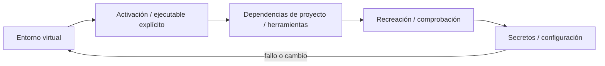
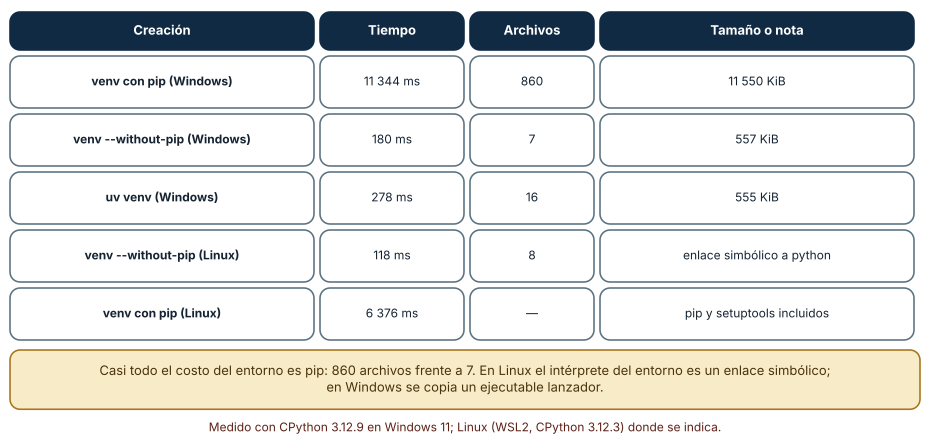
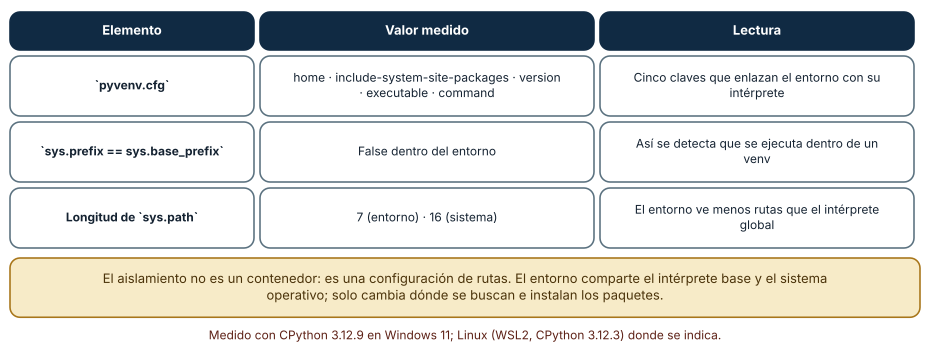
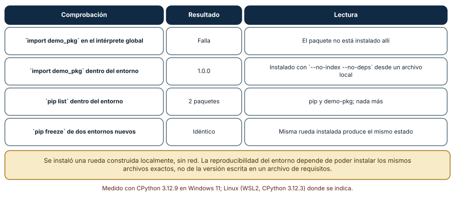

# SE-103 — Entornos virtuales y aislamiento de dependencias

[← SE-102 — Gestores de versiones de runtimes](https://github.com/vladimiracunadev-create/modern-software-engineering-program/blob/main/classes/part-08-entornos-herramientas-y-depuracion/se-102-gestores-de-versiones-de-runtimes/README.md) · [↑ Parte 08](https://github.com/vladimiracunadev-create/modern-software-engineering-program/blob/main/classes/part-08-entornos-herramientas-y-depuracion/README.md) · [📚 Índice completo](https://github.com/vladimiracunadev-create/modern-software-engineering-program/blob/main/classes/README.md) · [🌐 Portal](https://vladimiracunadev-create.github.io/modern-software-engineering-program/classes/SE-103.html) · [SE-104 — Dev Containers y entornos desechables →](https://github.com/vladimiracunadev-create/modern-software-engineering-program/blob/main/classes/part-08-entornos-herramientas-y-depuracion/se-104-dev-containers-y-entornos-desechables/README.md)


## Punto profesional y fundamento pedagógico

**Punto profesional.** La clase existe para aislar dependencias y explicar qué comparte un entorno virtual con el sistema.

**Por qué aparece aquí.** Se sitúa después de **Gestores de versiones de runtimes** y antes de **Dev Containers y entornos desechables**: convierte el conocimiento anterior en una decisión observable que la clase siguiente podrá reutilizar. La continuidad se comprueba en el artefacto, no por compartir vocabulario.

**Error conceptual que debe corregir.** Tratar venv como contenedor o lockfile.

**Secuencia de aprendizaje.** Antes de leer la solución, el estudiante predice el resultado del caso normal y del error conceptual anterior. Luego explica un caso resuelto paso a paso, construye un contraejemplo que cambie la decisión y, sin consultar el texto, reconstruye el mecanismo y lo aplica a una entrada nueva. La secuencia usa predicción, explicación propia, contraste y recuperación. [ICAP](https://icap.education.asu.edu/research) distingue participación de construcción de conocimiento; [How People Learn II](https://nap.nationalacademies.org/catalog/24783/how-people-learn-ii-learners-contexts-and-cultures) exige conectar conocimiento previo, contexto y transferencia; la [práctica de recuperación](https://pubmed.ncbi.nlm.nih.gov/16507066/) respalda producir de nuevo la explicación tras una demora; y [Education for Life and Work](https://nap.nationalacademies.org/resource/13398/dbasse_084153.pdf) exige devolución que explique la causa del error.

**Evidencia de aprendizaje.** Environment-audit.md con intérprete, rutas, paquetes, recreación y contaminación inducida. Debe contener predicción previa, observación, explicación causal, contraejemplo, criterio de aceptación y una nota de qué dato haría cambiar la conclusión.

**Límite de la conclusión.** El entorno virtual no aísla kernel, red ni bibliotecas del sistema.

### Trazabilidad fuente → afirmación

| Fuente primaria u oficial | Afirmación que respalda | Lo que no prueba |
|---|---|---|
| [Python venv](https://docs.python.org/3/library/venv.html) | Aislamiento de intérprete, scripts y entorno virtual; autoridad: Python Software Foundation | No demuestra por sí sola que el artefacto del estudiante sea correcto. |
| [Development Container Specification](https://containers.dev/implementors/spec/) | Configuración reproducible de herramientas y ciclo de vida del contenedor; autoridad: Dev Container Specification maintainers | No demuestra por sí sola que el artefacto del estudiante sea correcto. |

## Antes de empezar

Esta clase continúa el **entorno reproducible de diagnóstico de la Parte 08**. Recupera la evidencia de la clase anterior, añade una decisión propia de **Entornos virtuales y aislamiento de dependencias** y deja un artefacto que la clase siguiente deberá consumir. La pregunta activa es: **¿Qué aísla realmente un entorno virtual y qué sigue compartiendo con el sistema?**

## Prerrequisitos

- Haber completado la clase anterior o reconstruir su contrato y evidencia.
- Python 3.11 o posterior, terminal, editor y Git; un segundo runtime es opcional y debe declararse.
- Trabajar con fixtures sintéticos: ninguna observación necesita datos de una persona o sistema real.

## Problema auténtico

La prueba de la biblioteca de estructuras y algoritmos pasa porque un paquete quedó instalado globalmente. En checkout limpio falta; activar un venv existente tampoco ayuda porque apunta a otra ruta de Python.

## Objetivos observables

Al terminar podrás explicar los cinco mecanismos de esta clase, predecir su comportamiento antes de ejecutar, construir un caso normal y uno límite, diagnosticar el fallo controlado, comparar una alternativa y entregar evidencia que otra persona pueda reproducir.

## Mapa conceptual



El mapa se lee como una cadena de razonamiento, no como fases obligatorias del runtime. La flecha de retorno indica que un fallo o cambio de requisito obliga a revisar el modelo inicial; no autoriza a parchear solo la última salida.

## Temas y por qué importan

| Tema | Por qué cambia una decisión profesional | Evidencia mínima |
|---|---|---|
| Entorno virtual | `venv` crea un prefijo con scripts y configuración que usa una instalación base. | Predicción, traza causal y contraejemplo de **Entorno virtual** en `environment-audit.md` |
| Activación y ejecutable explícito | Activar antepone scripts al PATH para conveniencia. | Predicción, traza causal y contraejemplo de **Activación y ejecutable explícito** en `environment-audit.md` |
| Dependencias de proyecto y herramientas | Runtime, dependencias de ejecución, desarrollo y herramientas globales tienen ciclos distintos. | Predicción, traza causal y contraejemplo de **Dependencias de proyecto y herramientas** en `environment-audit.md` |
| Recreación y comprobación | El test real borra o ignora el entorno, crea uno nuevo, instala desde fuentes declaradas y ejecuta. | Predicción, traza causal y contraejemplo de **Recreación y comprobación** en `environment-audit.md` |
| Secretos y configuración | Variables y archivos locales pueden entrar al proceso pese al aislamiento de paquetes. | Predicción, traza causal y contraejemplo de **Secretos y configuración** en `environment-audit.md` |
## Conceptos y decisiones

### 1. Entorno virtual

`venv` crea un prefijo con scripts y configuración que usa una instalación base. Aísla paquetes por defecto, no kernel, variables, herramientas del sistema ni red. El entorno se recrea; no se copia entre rutas como artefacto portable.

### 2. Activación y ejecutable explícito

Activar antepone scripts al PATH para conveniencia. No es requisito: llamar `.venv/bin/python` o equivalente selecciona explícitamente. Los scripts tienen rutas de plataforma; por eso documentación incluye comandos Windows y POSIX cuando aplica.

### 3. Dependencias de proyecto y herramientas

Runtime, dependencias de ejecución, desarrollo y herramientas globales tienen ciclos distintos. Mezclarlas amplía superficie. El manifest declara intención y el lock o resolución registra selección; un freeze indiscriminado puede incluir paquetes ajenos.

### 4. Recreación y comprobación

El test real borra o ignora el entorno, crea uno nuevo, instala desde fuentes declaradas y ejecuta. Caches aceleran sin ser fuente de verdad. La guía incluye limpieza recuperable y no elimina rutas fuera del workspace.

### 5. Secretos y configuración

Variables y archivos locales pueden entrar al proceso pese al aislamiento de paquetes. `.env` no debe versionar secretos; se usan ejemplos sin credenciales y validación de variables requeridas. Logs no imprimen tokens durante diagnóstico.

### Cuánto cuesta un entorno virtual y por qué

Crear un entorno con `python -m venv` tomó 11 344 ms en Windows y dejó 860 archivos y 11 550 KiB. Con `--without-pip` tomó 180 ms, 7 archivos y 557 KiB. Con `uv venv`, 278 ms, 16 archivos y 555 KiB. En Linux (WSL2), `venv --without-pip` tomó 118 ms con 8 archivos y con pip 6 376 ms. Casi todo el costo es instalar pip: 860 archivos frente a 7. En Linux, además, el intérprete del entorno es un enlace simbólico al base; en Windows se copia un lanzador. Un entorno es barato; lo caro es lo que se instala dentro.



**Cómo leer la figura.** Cada fila es una forma de crear el entorno con su tiempo y tamaño. **Dónde deja de valer:** el tiempo de 11 s incluye la instalación de pip desde la copia empaquetada con Python y el antivirus del equipo; en otra máquina cambia. Que `uv` sea 40 veces más rápido en este caso no significa que lo sea con un conjunto grande de dependencias.

### Cómo se aísla realmente

Un entorno virtual no es un contenedor: es un archivo `pyvenv.cfg` y una forma de calcular rutas. El archivo del entorno medido tiene cinco claves (`home`, `include-system-site-packages`, `version`, `executable`, `command`). Dentro del entorno, `sys.prefix` difiere de `sys.base_prefix` (así se detecta que se ejecuta dentro de un entorno) y `sys.path` tiene 7 entradas frente a 16 del intérprete del sistema. El entorno comparte el intérprete base y el sistema operativo; solo cambia dónde se buscan e instalan los paquetes. Por eso un entorno no protege de variables de entorno, de bibliotecas del sistema ni de la versión del sistema.



**Cómo leer la figura.** Cada fila es un hecho comprobable dentro y fuera del entorno. **Dónde deja de valer:** con `include-system-site-packages = true` el entorno ve también los paquetes del sistema, y el aislamiento desaparece.

### Instalar sin tocar el sistema

Se construyó una rueda local de un paquete diminuto (`demo-pkg`) y se instaló con `--no-index --no-deps` en dos entornos nuevos. `import demo_pkg` falló en el intérprete global y devolvió `1.0.0` dentro del entorno; `pip list` mostró solo dos paquetes (pip y `demo-pkg`) y `pip freeze` fue idéntico en los dos entornos. Esa es la comprobación de aislamiento: lo instalado en un entorno no aparece fuera, y el mismo archivo instalado dos veces produce el mismo estado. La instalación sin red es también una propiedad útil: demuestra que no se depende de un índice externo para reconstruir el entorno.



**Cómo leer la figura.** Las filas comparan dentro y fuera, y entre dos entornos. **Dónde deja de valer:** con dependencias transitivas la instalación sin red exige tener todos los archivos; aquí se usó `--no-deps` porque el paquete no tiene ninguna.

## Definiciones de trabajo

- **entorno virtual:** `venv` crea un prefijo con scripts y configuración que usa una instalación base.
- **activación y ejecutable explícito:** activar antepone scripts al path para conveniencia.
- **dependencias de proyecto y herramientas:** runtime, dependencias de ejecución, desarrollo y herramientas globales tienen ciclos distintos.
- **recreación y comprobación:** el test real borra o ignora el entorno, crea uno nuevo, instala desde fuentes declaradas y ejecuta.
- **secretos y configuración:** variables y archivos locales pueden entrar al proceso pese al aislamiento de paquetes.

Las definiciones son operativas para el entorno reproducible de diagnóstico. No convierten términos con historia más amplia en sinónimos y deben contrastarse con la documentación primaria enlazada al final.

## Ejemplo mínimo

```shell
python -m venv .venv
.venv\Scripts\python -m pip --version   # Windows
# .venv/bin/python -m pip --version      # POSIX
.venv\Scripts\python -m unittest -v
```

Antes de ejecutar, predice estado, resultado y error. Después registra versión, comando y salida. Si el fragmento es pseudocódigo o pertenece a otro lenguaje, etiquétalo como tal y no afirmes que fue ejecutado.

## Ejemplo profesional

En el entorno reproducible de diagnóstico, una investigación conserva síntoma, entorno, reproducción, hipótesis, observaciones, causa, corrección y regresión. La implementación de esta clase debe conservar ese contrato aunque cambie la forma interna. El caso profesional no pregunta únicamente si produce una salida: pregunta quién puede producirla, qué estado observa, cómo falla y qué rastro permite disputar una decisión incorrecta.

Compara el caso normal con autorización falsa, evidencia incompleta, empate y repetición. Un mecanismo es apropiado cuando esas diferencias quedan visibles y localizadas; es peligroso cuando dependen de orden accidental, estado oculto o una convención que el consumidor no puede conocer.

## Práctica guiada

1. Copia el contrato de entrada y salida antes de escribir implementación.
2. Predice el caso normal y un límite; identifica la invariante que no puede romperse.
3. Implementa la versión mínima sin I/O dentro del núcleo.
4. Ejecuta el caso y conserva comando, versión y salida bajo `evidence/`.
5. Introduce el fallo controlado, reduce la reproducción y formula dos hipótesis rivales.
6. Corrige la causa, añade regresión y ejecuta el conjunto completo.
7. Compara con otro paradigma o lenguaje indicando qué semántica se preserva.

## Ejercicios

1. **Costo:** crea un entorno con y sin pip, y calcula la razón de tiempos y de archivos.
2. **Detección:** escribe una línea que determine si el proceso corre dentro de un entorno virtual.
3. **Aislamiento:** instala un paquete local en un entorno y demuestra que no se puede importar fuera.
4. **Receta:** escribe el comando único que recrea tu entorno desde cero y la prueba que lo verifica.

## Reto verificable

Entrega implementación, fixtures, pruebas y un informe corto. Se aprueba si otra persona ejecuta desde checkout limpio, obtiene los mismos resultados y puede relacionar cada rama o transformación con una regla del dominio. No se aprueba por cantidad de archivos ni por usar la sintaxis característica del paradigma.

## Caso conductor

El entorno reproducible de diagnóstico parte de una inversión de empates en la biblioteca de estructuras y algoritmos, captura versión y entrada mínima, compara un entorno sano con uno afectado y conserva la primera divergencia observable. Cambia después una sola regla o condición y revisa qué archivos, pruebas y trazas debieron modificarse. Esa superficie de cambio alimenta el proyecto final de la parte.

## Preguntas frecuentes

### ¿Por qué un entorno por proyecto?

Porque proyectos distintos necesitan versiones distintas de las mismas bibliotecas, y mezclarlos en el intérprete global hace que instalar una dependencia rompa otro proyecto.

### ¿Se versiona la carpeta del entorno?

No. Se versiona la definición (archivo de requisitos con versiones y hashes, o un archivo de bloqueo) y el entorno se recrea desde ella. La carpeta contiene rutas absolutas que no se trasladan entre máquinas.

### ¿Puedo mover un entorno a otra ruta?

No de forma fiable: contiene rutas absolutas al intérprete. Se recrea en la nueva ubicación.

### ¿Qué diferencia hay entre `pip freeze` y un archivo de bloqueo?

`pip freeze` lista lo instalado, sin hashes ni marcadores de plataforma; un archivo de bloqueo describe cómo reconstruirlo con hashes. El primero es un informe; el segundo, una receta.
## Fallo controlado y diagnóstico

Importa un paquete presente solo globalmente. Ejecuta con `-I` cuando corresponda, crea venv limpio y declara la dependencia o elimínala.

Registra síntoma, entrada mínima, hipótesis, observación que descarta cada hipótesis, causa, corrección y prueba de regresión. No cambies simultáneamente implementación, fixture y expectativa.


Reproduce la contaminación. Instala un paquete en el intérprete global (en una máquina de prueba) y comprueba que un proyecto lo importa sin declararlo. **Síntoma:** funciona en tu máquina y falla en otra limpia. **Hipótesis:** hay una dependencia no declarada que el entorno global satisface. **Prueba:** crea un entorno vacío, ejecuta el proyecto y observa el `ModuleNotFoundError`. **Conclusión:** declarar las dependencias exige ejecutar en un entorno vacío. Guarda el error, la dependencia faltante y la corrección en `checks.md`, y añade la prueba «importar desde un entorno nuevo» a la CI.

## Errores comunes y cómo corregirlos

| Síntoma | Causa | Corrección |
|---|---|---|
| Funciona aquí y no en otra máquina | Dependencia no declarada presente en el sistema | Probar siempre en un entorno vacío |
| El entorno deja de funcionar al moverlo | Rutas absolutas | Recrearlo desde su definición |
| Crear el entorno tarda mucho | Instalación de pip y antivirus | Usar `--without-pip` con `uv` o un caché de ruedas |
| Se versiona la carpeta del entorno | Se confunde entorno con definición | Versionar la receta, ignorar la carpeta |
| `pip freeze` se toma como bloqueo | No contiene hashes ni plataforma | Usar un archivo de bloqueo con hashes |

## Entorno y archivos clave

```text
work/SE-103/
├── README.md
├── diagnostic_environment/
│   ├── domain.py
│   └── se_103.py
├── fixtures/cases.json
├── tests/test_se_103.py
└── evidence/diagnosis.md
```

El `README` declara plataforma, runtimes, comandos, limpieza y límites. Evita dependencias externas cuando la biblioteca estándar permita observar el mecanismo; si agregas una, fija procedencia y versión.

## Seguridad, ética y accesibilidad

- la autorización forma parte del dominio y no se infiere por ausencia de rechazo;
- no uses `eval`, reglas descargadas ni serialización insegura;
- limita colas, recursión, tamaño de entrada y tiempo de evaluación;
- redacta trazas y conserva una explicación textual además de color o animación;
- una recomendación automatizada debe poder revisarse, impugnarse y corregirse;
- respeta licencias de ejemplos y atribuye adaptaciones.

## Puente hacia el trabajo con agentes

Un agente instala paquetes cuando le parece necesario. Si lo hace en el intérprete global, contamina el sistema y el resultado deja de ser reproducible. El harness debe darle un entorno desechable y una política explícita sobre qué puede instalar, registrar cada instalación y fallar si el agente intenta modificar el sistema. La prueba «ejecutar desde un entorno vacío» es la verificación más sencilla de que el agente declaró lo que usa.

## Transferencia

Traslada un fixture al segundo modelo, herramienta, plataforma o lenguaje. Compara representación de ausencia, error, mutabilidad, orden y cancelación. La transferencia está lograda cuando el contrato se conserva y las diferencias están explicadas, no cuando la interfaz se parece.

## Evaluación y evidencia

| Criterio | Evidencia para aprobar |
|---|---|
| comprensión | explicación causal de los cinco mecanismos |
| corrección | normal, límite, inválido y contraejemplo |
| diseño | estado, efectos y contrato localizables |
| diagnóstico | reproducción mínima y regresión |
| transferencia | comparación semántica, no estética |
| reproducibilidad | versiones, comandos, salida y límites |


## Fuentes


- [Language Server Protocol 3.18](https://microsoft.github.io/language-server-protocol/specifications/lsp/3.18/specification/) — Mensajes, capacidades y sincronización entre editor y servidor; autoridad: Microsoft.
- [Debug Adapter Protocol](https://microsoft.github.io/debug-adapter-protocol/) — Breakpoints, frames, variables y negociación de capacidades; autoridad: Microsoft.
- [Python Debugging and Profiling](https://docs.python.org/3/library/debug.html) — Pdb, cprofile, timeit, tracemalloc y límites instrumentales; autoridad: Python Software Foundation.
- [Python venv](https://docs.python.org/3/library/venv.html) — Aislamiento de intérprete, scripts y entorno virtual; autoridad: Python Software Foundation.
- [Development Container Specification](https://containers.dev/implementors/spec/) — Configuración reproducible de herramientas y ciclo de vida del contenedor; autoridad: Dev Container Specification maintainers.
- [Web Content Accessibility Guidelines 2.2](https://www.w3.org/TR/WCAG22/) — Percepción, operación por teclado y reducción de barreras en interfaces; autoridad: W3C.

Cada fuente respalda el mecanismo indicado; ninguna demuestra que la implementación del entorno reproducible de diagnóstico sea correcta. Esa afirmación depende de fixtures, pruebas, trazas y revisión reproducible.

- [Python: módulo `venv`](https://docs.python.org/3/library/venv.html): creación de entornos y estructura de `pyvenv.cfg`.
- [PEP 405: entornos virtuales de Python](https://peps.python.org/pep-0405/): diseño del aislamiento por rutas.
- [uv: entornos virtuales](https://docs.astral.sh/uv/pip/environments/): creación y uso de entornos con `uv`.

## Límites y siguiente paso

El venv comparte sistema operativo y toolchain nativa. La siguiente clase encapsula un entorno de desarrollo desechable sin afirmar reproducibilidad absoluta.

## Glosario

- **entorno virtual:** `venv` crea un prefijo con scripts y configuración que usa una instalación base.
- **activación y ejecutable explícito:** activar antepone scripts al path para conveniencia.
- **dependencias de proyecto y herramientas:** runtime, dependencias de ejecución, desarrollo y herramientas globales tienen ciclos distintos.
- **recreación y comprobación:** el test real borra o ignora el entorno, crea uno nuevo, instala desde fuentes declaradas y ejecuta.
- **secretos y configuración:** variables y archivos locales pueden entrar al proceso pese al aislamiento de paquetes.

---

[← SE-102 — Gestores de versiones de runtimes](https://github.com/vladimiracunadev-create/modern-software-engineering-program/blob/main/classes/part-08-entornos-herramientas-y-depuracion/se-102-gestores-de-versiones-de-runtimes/README.md) · [↑ Parte 08](https://github.com/vladimiracunadev-create/modern-software-engineering-program/blob/main/classes/part-08-entornos-herramientas-y-depuracion/README.md) · [📚 Índice completo](https://github.com/vladimiracunadev-create/modern-software-engineering-program/blob/main/classes/README.md) · [🌐 Portal](https://vladimiracunadev-create.github.io/modern-software-engineering-program/classes/SE-103.html) · [SE-104 — Dev Containers y entornos desechables →](https://github.com/vladimiracunadev-create/modern-software-engineering-program/blob/main/classes/part-08-entornos-herramientas-y-depuracion/se-104-dev-containers-y-entornos-desechables/README.md)
