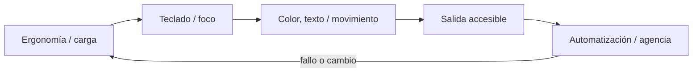
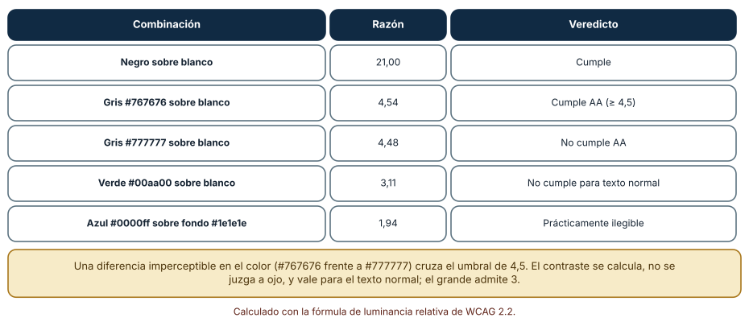
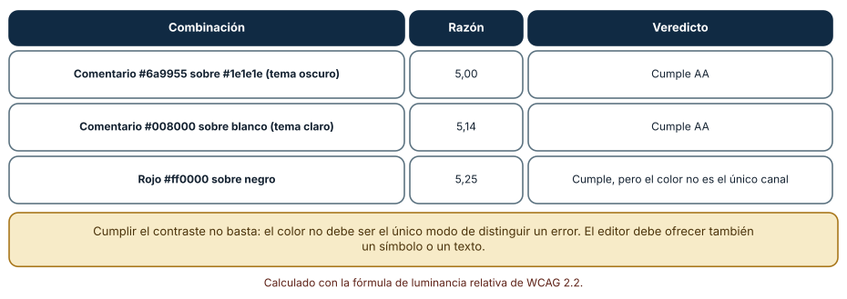
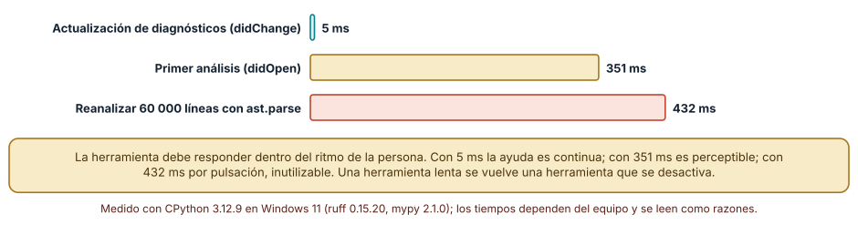

# SE-106 — Ergonomía, accesibilidad y productividad del entorno

[← SE-105 — Reproducción de errores y reducción de casos](https://github.com/vladimiracunadev-create/modern-software-engineering-program/blob/main/classes/part-08-entornos-herramientas-y-depuracion/se-105-reproduccion-de-errores-y-reduccion-de-casos/README.md) · [↑ Parte 08](https://github.com/vladimiracunadev-create/modern-software-engineering-program/blob/main/classes/part-08-entornos-herramientas-y-depuracion/README.md) · [📚 Índice completo](https://github.com/vladimiracunadev-create/modern-software-engineering-program/blob/main/classes/README.md) · [🌐 Portal](https://vladimiracunadev-create.github.io/modern-software-engineering-program/classes/SE-106.html) · [SE-107 — Taller: diagnosticar un fallo desconocido →](https://github.com/vladimiracunadev-create/modern-software-engineering-program/blob/main/classes/part-08-entornos-herramientas-y-depuracion/se-107-taller-diagnosticar-un-fallo-desconocido/README.md)


## Punto profesional y fundamento pedagógico

**Punto profesional.** La clase existe para evaluar productividad del entorno junto con teclado, zoom, contraste, movimiento y carga cognitiva.

**Por qué aparece aquí.** Se sitúa después de **Reproducción de errores y reducción de casos** y antes de **Taller: diagnosticar un fallo desconocido**: convierte el conocimiento anterior en una decisión observable que la clase siguiente podrá reutilizar. La continuidad se comprueba en el artefacto, no por compartir vocabulario.

**Error conceptual que debe corregir.** Optimizar atajos para una persona y llamarlo ergonomía universal.

**Secuencia de aprendizaje.** Antes de leer la solución, el estudiante predice el resultado del caso normal y del error conceptual anterior. Luego explica un caso resuelto paso a paso, construye un contraejemplo que cambie la decisión y, sin consultar el texto, reconstruye el mecanismo y lo aplica a una entrada nueva. La secuencia usa predicción, explicación propia, contraste y recuperación. [ICAP](https://icap.education.asu.edu/research) distingue participación de construcción de conocimiento; [How People Learn II](https://nap.nationalacademies.org/catalog/24783/how-people-learn-ii-learners-contexts-and-cultures) exige conectar conocimiento previo, contexto y transferencia; la [práctica de recuperación](https://pubmed.ncbi.nlm.nih.gov/16507066/) respalda producir de nuevo la explicación tras una demora; y [Education for Life and Work](https://nap.nationalacademies.org/resource/13398/dbasse_084153.pdf) exige devolución que explique la causa del error.

**Evidencia de aprendizaje.** Accessibility-check.md con tareas, barreras, ajustes y verificación por teclado. Debe contener predicción previa, observación, explicación causal, contraejemplo, criterio de aceptación y una nota de qué dato haría cambiar la conclusión.

**Límite de la conclusión.** La revisión básica no sustituye auditoría especializada ni pruebas con usuarios.

### Trazabilidad fuente → afirmación

| Fuente primaria u oficial | Afirmación que respalda | Lo que no prueba |
|---|---|---|
| [Web Content Accessibility Guidelines 2.2](https://www.w3.org/TR/WCAG22/) | Percepción, operación por teclado y reducción de barreras en interfaces; autoridad: W3C | No demuestra por sí sola que el artefacto del estudiante sea correcto. |
| [Language Server Protocol 3.18](https://microsoft.github.io/language-server-protocol/specifications/lsp/3.18/specification/) | Mensajes, capacidades y sincronización entre editor y servidor; autoridad: Microsoft | No demuestra por sí sola que el artefacto del estudiante sea correcto. |

## Antes de empezar

Esta clase continúa el **entorno reproducible de diagnóstico de la Parte 08**. Recupera la evidencia de la clase anterior, añade una decisión propia de **Ergonomía, accesibilidad y productividad del entorno** y deja un artefacto que la clase siguiente deberá consumir. La pregunta activa es: **¿Cómo reducir fricción sin imponer una única capacidad física, interfaz o estilo de trabajo?**

## Prerrequisitos

- Haber completado la clase anterior o reconstruir su contrato y evidencia.
- Python 3.11 o posterior, terminal, editor y Git; un segundo runtime es opcional y debe declararse.
- Trabajar con fixtures sintéticos: ninguna observación necesita datos de una persona o sistema real.

## Problema auténtico

El entorno del entorno reproducible de diagnóstico requiere atajos no documentados, color rojo/verde y texto diminuto; una sesión larga de depuración produce errores y excluye a quien usa teclado o lector de pantalla.

## Objetivos observables

Al terminar podrás explicar los cinco mecanismos de esta clase, predecir su comportamiento antes de ejecutar, construir un caso normal y uno límite, diagnosticar el fallo controlado, comparar una alternativa y entregar evidencia que otra persona pueda reproducir.

## Mapa conceptual



El mapa se lee como una cadena de razonamiento, no como fases obligatorias del runtime. La flecha de retorno indica que un fallo o cambio de requisito obliga a revisar el modelo inicial; no autoriza a parchear solo la última salida.

## Temas y por qué importan

| Tema | Por qué cambia una decisión profesional | Evidencia mínima |
|---|---|---|
| Ergonomía y carga | Postura, pausas, repetición y legibilidad influyen en fatiga y errores, pero no existe configuración corporal universal. | Predicción, traza causal y contraejemplo de **Ergonomía y carga** en `accessibility-check.md` |
| Teclado y foco | Todas las acciones esenciales necesitan ruta por teclado con foco visible y orden lógico. | Predicción, traza causal y contraejemplo de **Teclado y foco** en `accessibility-check.md` |
| Color, texto y movimiento | Color refuerza pero no porta solo error o estado. | Predicción, traza causal y contraejemplo de **Color, texto y movimiento** en `accessibility-check.md` |
| Salida accesible | Trazas y diagnósticos requieren texto seleccionable, orden de lectura y niveles claros. | Predicción, traza causal y contraejemplo de **Salida accesible** en `accessibility-check.md` |
| Automatización y agencia | Automatizar formato, prueba o navegación reduce repetición, pero debe ser predecible, reversible y explicable. | Predicción, traza causal y contraejemplo de **Automatización y agencia** en `accessibility-check.md` |
## Conceptos y decisiones

### 1. Ergonomía y carga

Postura, pausas, repetición y legibilidad influyen en fatiga y errores, pero no existe configuración corporal universal. El entorno permite tamaño, contraste, input alternativo y pausas. Productividad no justifica daño ni vigilancia invasiva.

### 2. Teclado y foco

Todas las acciones esenciales necesitan ruta por teclado con foco visible y orden lógico. Atajos deben poder descubrirse y personalizarse. Capturar combinaciones del sistema o depender de chord complejo puede bloquear tecnología asistiva.

### 3. Color, texto y movimiento

Color refuerza pero no porta solo error o estado. Contraste, etiquetas y símbolos textuales conservan significado. Animación de seguimiento o minimap puede desactivarse cuando distrae o provoca malestar.

### 4. Salida accesible

Trazas y diagnósticos requieren texto seleccionable, orden de lectura y niveles claros. Diagramas aportan notación fuente o explicación. Una terminal con mensajes accionables suele ser una alternativa robusta a una vista exclusivamente visual.

### 5. Automatización y agencia

Automatizar formato, prueba o navegación reduce repetición, pero debe ser predecible, reversible y explicable. Métricas de pulsaciones o tiempo activo no miden valor y pueden dañar privacidad y confianza.

### El contraste se calcula

La accesibilidad del entorno de trabajo no es una cuestión de gusto. La razón de contraste de WCAG se calcula a partir de la luminancia relativa de dos colores, y los umbrales son numéricos: 4,5 para texto normal (nivel AA) y 3 para texto grande. Resultados calculados: negro sobre blanco, 21,00; gris `#767676` sobre blanco, 4,54 (cumple); gris `#777777` sobre blanco, 4,48 (no cumple); verde `#00aa00` sobre blanco, 3,11 (no cumple para texto normal); azul `#0000ff` sobre `#1e1e1e`, 1,94 (prácticamente ilegible). Una diferencia imperceptible entre `#767676` y `#777777` cruza el umbral, y por eso se calcula en lugar de juzgarse a ojo.



**Cómo leer la figura.** La columna «Razón» es el cálculo y la última, el veredicto frente al umbral. **Dónde deja de valer:** el contraste mide luminancia, no discriminación de color ni comodidad de lectura prolongada; una combinación que cumple puede cansar, y personas con distintas condiciones visuales necesitan opciones, no un único valor.

### Temas del editor

Los temas de sintaxis eligen colores para comentarios, cadenas y palabras clave. Un tema oscuro con comentarios `#6a9955` sobre `#1e1e1e` da 5,00 (cumple), y uno claro con `#008000` sobre blanco, 5,14. Que el rojo `#ff0000` sobre negro dé 5,25 no basta como criterio: el color no debe ser el único canal que distinga un error; hace falta un símbolo, un subrayado o un texto. Un editor accesible permite cambiar el tamaño de la fuente, el tema y el espaciado, y respeta la configuración del sistema.



**Cómo leer la figura.** Las razones están calculadas, no tomadas del tema. **Dónde deja de valer:** los editores aplican más de un color por elemento y mezclas con transparencia; una prueba completa recorre los colores reales del tema en uso.

### Presupuesto de latencia

La productividad del entorno también tiene un componente de tiempo. La actualización de diagnósticos tras una edición tomó 5 ms (continua), el primer análisis 351 ms (perceptible) y reanalizar 60 000 líneas con `ast.parse`, 432 ms (inutilizable por pulsación). Una herramienta que responde dentro del ritmo de la persona se usa; una que no, se desactiva y su valor se pierde. Medir la latencia de las herramientas del entorno es parte de su evaluación, igual que su precisión.



**Cómo leer la figura.** Las barras comparan tres respuestas de herramientas. **Dónde deja de valer:** los umbrales de percepción dependen de la tarea; para escribir, 100 ms ya se nota, mientras que una compilación completa tolera segundos.

## Definiciones de trabajo

- **ergonomía y carga:** postura, pausas, repetición y legibilidad influyen en fatiga y errores, pero no existe configuración corporal universal.
- **teclado y foco:** todas las acciones esenciales necesitan ruta por teclado con foco visible y orden lógico.
- **color, texto y movimiento:** color refuerza pero no porta solo error o estado.
- **salida accesible:** trazas y diagnósticos requieren texto seleccionable, orden de lectura y niveles claros.
- **automatización y agencia:** automatizar formato, prueba o navegación reduce repetición, pero debe ser predecible, reversible y explicable.

Las definiciones son operativas para el entorno reproducible de diagnóstico. No convierten términos con historia más amplia en sinónimos y deben contrastarse con la documentación primaria enlazada al final.

## Ejemplo mínimo

```text
# Checklist observable
- tarea completa solo con teclado
- foco visible y orden lógico
- error indicado por texto además de color
- zoom 200 % sin pérdida de controles
- movimiento no esencial desactivable
```

Antes de ejecutar, predice estado, resultado y error. Después registra versión, comando y salida. Si el fragmento es pseudocódigo o pertenece a otro lenguaje, etiquétalo como tal y no afirmes que fue ejecutado.

## Ejemplo profesional

En el entorno reproducible de diagnóstico, una investigación conserva síntoma, entorno, reproducción, hipótesis, observaciones, causa, corrección y regresión. La implementación de esta clase debe conservar ese contrato aunque cambie la forma interna. El caso profesional no pregunta únicamente si produce una salida: pregunta quién puede producirla, qué estado observa, cómo falla y qué rastro permite disputar una decisión incorrecta.

Compara el caso normal con autorización falsa, evidencia incompleta, empate y repetición. Un mecanismo es apropiado cuando esas diferencias quedan visibles y localizadas; es peligroso cuando dependen de orden accidental, estado oculto o una convención que el consumidor no puede conocer.

## Práctica guiada

1. Copia el contrato de entrada y salida antes de escribir implementación.
2. Predice el caso normal y un límite; identifica la invariante que no puede romperse.
3. Implementa la versión mínima sin I/O dentro del núcleo.
4. Ejecuta el caso y conserva comando, versión y salida bajo `evidence/`.
5. Introduce el fallo controlado, reduce la reproducción y formula dos hipótesis rivales.
6. Corrige la causa, añade regresión y ejecuta el conjunto completo.
7. Compara con otro paradigma o lenguaje indicando qué semántica se preserva.

## Ejercicios

1. **Cálculo:** calcula la razón de contraste de `#595959` sobre blanco y di si cumple AA y AAA.
2. **Tema:** elige tres colores de tu tema (comentario, cadena, error) y calcula su contraste con el fondo.
3. **Canal:** propone para un error de compilación al menos dos señales además del color.
4. **Latencia:** mide el tiempo entre guardar y recibir diagnósticos en tu editor y compáralo con el presupuesto de la Figura 3.

## Reto verificable

Entrega implementación, fixtures, pruebas y un informe corto. Se aprueba si otra persona ejecuta desde checkout limpio, obtiene los mismos resultados y puede relacionar cada rama o transformación con una regla del dominio. No se aprueba por cantidad de archivos ni por usar la sintaxis característica del paradigma.

## Caso conductor

El entorno reproducible de diagnóstico parte de una inversión de empates en la biblioteca de estructuras y algoritmos, captura versión y entrada mínima, compara un entorno sano con uno afectado y conserva la primera divergencia observable. Cambia después una sola regla o condición y revisa qué archivos, pruebas y trazas debieron modificarse. Esa superficie de cambio alimenta el proyecto final de la parte.

## Preguntas frecuentes

### ¿Cumplir el contraste AA hace accesible mi editor?

Es necesario pero no suficiente. Hace falta además tamaño ajustable, no depender solo del color, navegación por teclado y compatibilidad con lectores de pantalla.

### ¿Qué es el nivel AAA?

Un umbral más estricto: 7 para texto normal. Se usa donde la lectura prolongada o el público lo exigen; AA es el mínimo habitual.

### ¿Cómo mido el contraste de mi tema?

Con la fórmula de WCAG sobre los colores reales, o con una herramienta de verificación. Se calcula para cada par de primer plano y fondo, incluidos los estados de selección y de error.

### ¿Por qué importa la ergonomía del teclado?

Porque el trabajo prolongado con atajos mal diseñados produce fatiga y errores; personas con movilidad reducida dependen del teclado. Los atajos se configuran y se documentan.
## Fallo controlado y diagnóstico

Desactiva outlines para estética y pierde ubicación del foco. Restaura `:focus-visible`, prueba recorrido completo y documenta atajos equivalentes.

Registra síntoma, entrada mínima, hipótesis, observación que descarta cada hipótesis, causa, corrección y prueba de regresión. No cambies simultáneamente implementación, fixture y expectativa.


Reproduce un tema que parece legible y no cumple. Elige un color de comentario gris medio sobre blanco (por ejemplo `#808080`) y calcula su razón de contraste con la fórmula. **Síntoma:** se lee bien en tu monitor. **Hipótesis:** la razón está por debajo del umbral. **Prueba:** calcula la razón (3,95 en este caso) y simula un monitor con poco brillo o luz ambiente. **Conclusión:** la percepción personal no sustituye el cálculo. Guarda en `tooling-map.md` los colores, la razón, el umbral y la decisión.

## Errores comunes y cómo corregirlos

| Síntoma | Causa | Corrección |
|---|---|---|
| Un tema «se ve bien» y no cumple | Se juzga a ojo | Calcular la razón con la fórmula de WCAG |
| Los errores solo se distinguen por el color | Color como único canal | Añadir símbolo, subrayado o texto |
| La herramienta se desactiva | Latencia mayor que el ritmo de trabajo | Medir y reducir la latencia, o ejecutarla en otro momento |
| Atajos que causan fatiga | Configuración por defecto sin revisar | Revisar y documentar atajos |
| Tamaño de fuente fijo en la configuración | No respeta ajustes del usuario | Usar unidades relativas y el ajuste del sistema |

## Entorno y archivos clave

```text
work/SE-106/
├── README.md
├── diagnostic_environment/
│   ├── domain.py
│   └── se_106.py
├── fixtures/cases.json
├── tests/test_se_106.py
└── evidence/diagnosis.md
```

El `README` declara plataforma, runtimes, comandos, limpieza y límites. Evita dependencias externas cuando la biblioteca estándar permita observar el mecanismo; si agregas una, fija procedencia y versión.

## Seguridad, ética y accesibilidad

- la autorización forma parte del dominio y no se infiere por ausencia de rechazo;
- no uses `eval`, reglas descargadas ni serialización insegura;
- limita colas, recursión, tamaño de entrada y tiempo de evaluación;
- redacta trazas y conserva una explicación textual además de color o animación;
- una recomendación automatizada debe poder revisarse, impugnarse y corregirse;
- respeta licencias de ejemplos y atribuye adaptaciones.

## Puente hacia el trabajo con agentes

La interfaz de un agente (texto en un terminal, resúmenes, diferencias) también debe ser accesible: salidas que dependen solo del color o de caracteres especiales no llegan a lectores de pantalla. Además, la latencia es parte de la experiencia: una herramienta de agente que tarda segundos en cada paso rompe el ritmo de revisión. Medir y declarar esas latencias es parte de evaluar un harness, junto con su corrección.

## Transferencia

Traslada un fixture al segundo modelo, herramienta, plataforma o lenguaje. Compara representación de ausencia, error, mutabilidad, orden y cancelación. La transferencia está lograda cuando el contrato se conserva y las diferencias están explicadas, no cuando la interfaz se parece.

## Evaluación y evidencia

| Criterio | Evidencia para aprobar |
|---|---|
| comprensión | explicación causal de los cinco mecanismos |
| corrección | normal, límite, inválido y contraejemplo |
| diseño | estado, efectos y contrato localizables |
| diagnóstico | reproducción mínima y regresión |
| transferencia | comparación semántica, no estética |
| reproducibilidad | versiones, comandos, salida y límites |


## Fuentes


- [Language Server Protocol 3.18](https://microsoft.github.io/language-server-protocol/specifications/lsp/3.18/specification/) — Mensajes, capacidades y sincronización entre editor y servidor; autoridad: Microsoft.
- [Debug Adapter Protocol](https://microsoft.github.io/debug-adapter-protocol/) — Breakpoints, frames, variables y negociación de capacidades; autoridad: Microsoft.
- [Python Debugging and Profiling](https://docs.python.org/3/library/debug.html) — Pdb, cprofile, timeit, tracemalloc y límites instrumentales; autoridad: Python Software Foundation.
- [Python venv](https://docs.python.org/3/library/venv.html) — Aislamiento de intérprete, scripts y entorno virtual; autoridad: Python Software Foundation.
- [Development Container Specification](https://containers.dev/implementors/spec/) — Configuración reproducible de herramientas y ciclo de vida del contenedor; autoridad: Dev Container Specification maintainers.
- [Web Content Accessibility Guidelines 2.2](https://www.w3.org/TR/WCAG22/) — Percepción, operación por teclado y reducción de barreras en interfaces; autoridad: W3C.

Cada fuente respalda el mecanismo indicado; ninguna demuestra que la implementación del entorno reproducible de diagnóstico sea correcta. Esa afirmación depende de fixtures, pruebas, trazas y revisión reproducible.

- [WCAG 2.2: contraste mínimo](https://www.w3.org/WAI/WCAG22/Understanding/contrast-minimum.html): umbral de 4,5 y fórmula de luminancia relativa usados en las Figuras 1 y 2.
- [WCAG 2.2: uso del color](https://www.w3.org/WAI/WCAG22/Understanding/use-of-color.html): el color no debe ser el único medio de transmitir información.
- [Visual Studio Code: accesibilidad](https://code.visualstudio.com/docs/configure/accessibility/accessibility): opciones de accesibilidad del editor.

## Límites y siguiente paso

Una checklist básica no sustituye auditoría con personas y tecnologías asistivas. El taller siguiente aplica método y herramientas a un fallo desconocido.

## Glosario

- **ergonomía y carga:** postura, pausas, repetición y legibilidad influyen en fatiga y errores, pero no existe configuración corporal universal.
- **teclado y foco:** todas las acciones esenciales necesitan ruta por teclado con foco visible y orden lógico.
- **color, texto y movimiento:** color refuerza pero no porta solo error o estado.
- **salida accesible:** trazas y diagnósticos requieren texto seleccionable, orden de lectura y niveles claros.
- **automatización y agencia:** automatizar formato, prueba o navegación reduce repetición, pero debe ser predecible, reversible y explicable.

---

[← SE-105 — Reproducción de errores y reducción de casos](https://github.com/vladimiracunadev-create/modern-software-engineering-program/blob/main/classes/part-08-entornos-herramientas-y-depuracion/se-105-reproduccion-de-errores-y-reduccion-de-casos/README.md) · [↑ Parte 08](https://github.com/vladimiracunadev-create/modern-software-engineering-program/blob/main/classes/part-08-entornos-herramientas-y-depuracion/README.md) · [📚 Índice completo](https://github.com/vladimiracunadev-create/modern-software-engineering-program/blob/main/classes/README.md) · [🌐 Portal](https://vladimiracunadev-create.github.io/modern-software-engineering-program/classes/SE-106.html) · [SE-107 — Taller: diagnosticar un fallo desconocido →](https://github.com/vladimiracunadev-create/modern-software-engineering-program/blob/main/classes/part-08-entornos-herramientas-y-depuracion/se-107-taller-diagnosticar-un-fallo-desconocido/README.md)
