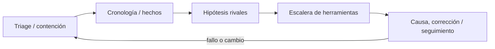
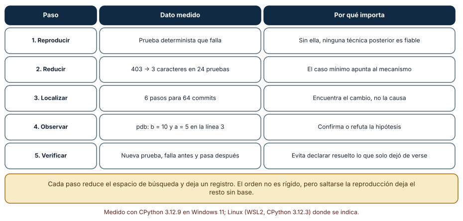
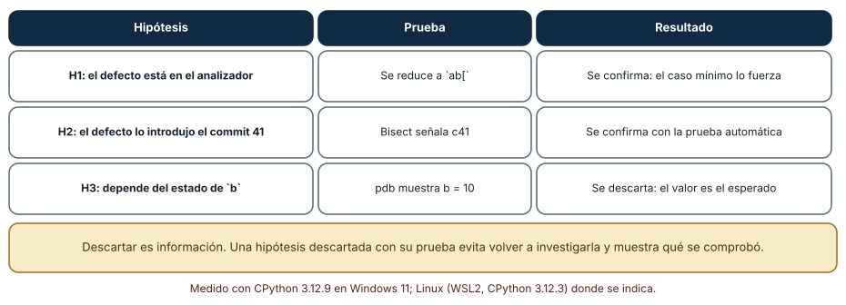
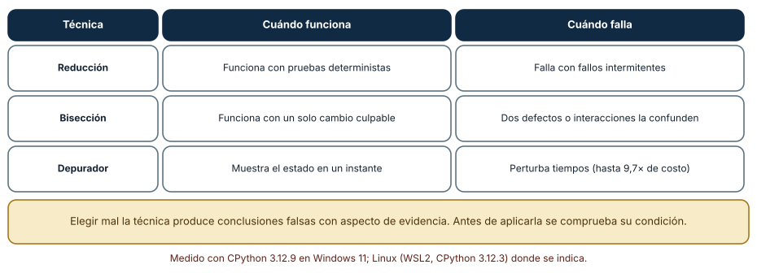

# SE-107 — Taller: diagnosticar un fallo desconocido

[← SE-106 — Ergonomía, accesibilidad y productividad del entorno](https://github.com/vladimiracunadev-create/modern-software-engineering-program/blob/main/classes/part-08-entornos-herramientas-y-depuracion/se-106-ergonomia-accesibilidad-y-productividad-del-entorno/README.md) · [↑ Parte 08](https://github.com/vladimiracunadev-create/modern-software-engineering-program/blob/main/classes/part-08-entornos-herramientas-y-depuracion/README.md) · [📚 Índice completo](https://github.com/vladimiracunadev-create/modern-software-engineering-program/blob/main/classes/README.md) · [🌐 Portal](https://vladimiracunadev-create.github.io/modern-software-engineering-program/classes/SE-107.html) · [SE-108 — Proyecto: entorno de desarrollo autocontenido →](https://github.com/vladimiracunadev-create/modern-software-engineering-program/blob/main/classes/part-08-entornos-herramientas-y-depuracion/se-108-proyecto-entorno-de-desarrollo-autocontenido/README.md)


## Punto profesional y fundamento pedagógico

**Punto profesional.** La clase existe para diagnosticar un fallo desconocido desde síntoma hasta causa usando instrumentos elegidos por hipótesis.

**Por qué aparece aquí.** Se sitúa después de **Ergonomía, accesibilidad y productividad del entorno** y antes de **Proyecto: entorno de desarrollo autocontenido**: convierte el conocimiento anterior en una decisión observable que la clase siguiente podrá reutilizar. La continuidad se comprueba en el artefacto, no por compartir vocabulario.

**Error conceptual que debe corregir.** Abrir todas las herramientas sin una pregunta discriminante.

**Secuencia de aprendizaje.** Antes de leer la solución, el estudiante predice el resultado del caso normal y del error conceptual anterior. Luego explica un caso resuelto paso a paso, construye un contraejemplo que cambie la decisión y, sin consultar el texto, reconstruye el mecanismo y lo aplica a una entrada nueva. La secuencia usa predicción, explicación propia, contraste y recuperación. [ICAP](https://icap.education.asu.edu/research) distingue participación de construcción de conocimiento; [How People Learn II](https://nap.nationalacademies.org/catalog/24783/how-people-learn-ii-learners-contexts-and-cultures) exige conectar conocimiento previo, contexto y transferencia; la [práctica de recuperación](https://pubmed.ncbi.nlm.nih.gov/16507066/) respalda producir de nuevo la explicación tras una demora; y [Education for Life and Work](https://nap.nationalacademies.org/resource/13398/dbasse_084153.pdf) exige devolución que explique la causa del error.

**Evidencia de aprendizaje.** Diagnosis.md con reproducción, hipótesis rivales, evidencia, causa y recuperación. Debe contener predicción previa, observación, explicación causal, contraejemplo, criterio de aceptación y una nota de qué dato haría cambiar la conclusión.

**Límite de la conclusión.** Resolver el caso no demuestra que no existan causas adicionales.

### Trazabilidad fuente → afirmación

| Fuente primaria u oficial | Afirmación que respalda | Lo que no prueba |
|---|---|---|
| [Debug Adapter Protocol](https://microsoft.github.io/debug-adapter-protocol/) | Breakpoints, frames, variables y negociación de capacidades; autoridad: Microsoft | No demuestra por sí sola que el artefacto del estudiante sea correcto. |
| [Python Debugging and Profiling](https://docs.python.org/3/library/debug.html) | Pdb, cprofile, timeit, tracemalloc y límites instrumentales; autoridad: Python Software Foundation | No demuestra por sí sola que el artefacto del estudiante sea correcto. |
| [Development Container Specification](https://containers.dev/implementors/spec/) | Configuración reproducible de herramientas y ciclo de vida del contenedor; autoridad: Dev Container Specification maintainers | No demuestra por sí sola que el artefacto del estudiante sea correcto. |

## Antes de empezar

Esta clase continúa el **entorno reproducible de diagnóstico de la Parte 08**. Recupera la evidencia de la clase anterior, añade una decisión propia de **Taller: diagnosticar un fallo desconocido** y deja un artefacto que la clase siguiente deberá consumir. La pregunta activa es: **¿Cómo investigar un fallo desconocido sin saltar de herramienta en herramienta?**

## Prerrequisitos

- Haber completado la clase anterior o reconstruir su contrato y evidencia.
- Python 3.11 o posterior, terminal, editor y Git; un segundo runtime es opcional y debe declararse.
- Trabajar con fixtures sintéticos: ninguna observación necesita datos de una persona o sistema real.

## Problema auténtico

Se entrega una versión de la biblioteca de estructuras y algoritmos que a veces invierte empates y consume memoria. No se revela si la causa está en algoritmo, runtime, fixture, extensión o entorno.

## Objetivos observables

Al terminar podrás explicar los cinco mecanismos de esta clase, predecir su comportamiento antes de ejecutar, construir un caso normal y uno límite, diagnosticar el fallo controlado, comparar una alternativa y entregar evidencia que otra persona pueda reproducir.

## Mapa conceptual



El mapa se lee como una cadena de razonamiento, no como fases obligatorias del runtime. La flecha de retorno indica que un fallo o cambio de requisito obliga a revisar el modelo inicial; no autoriza a parchear solo la última salida.

## Temas y por qué importan

| Tema | Por qué cambia una decisión profesional | Evidencia mínima |
|---|---|---|
| Triage y contención | Primero se describe impacto, alcance, seguridad y acción reversible para evitar daño. | Predicción, traza causal y contraejemplo de **Triage y contención** en `diagnosis.md` |
| Cronología y hechos | El equipo registra qué cambió, cuándo apareció y en qué entornos, separando observación de interpretación. | Predicción, traza causal y contraejemplo de **Cronología y hechos** en `diagnosis.md` |
| Hipótesis rivales | Se formulan al menos dos explicaciones con predicciones distintas. | Predicción, traza causal y contraejemplo de **Hipótesis rivales** en `diagnosis.md` |
| Escalera de herramientas | Se empieza por versión, logs y reproducción; luego debugger, profiler o análisis según la pregunta. | Predicción, traza causal y contraejemplo de **Escalera de herramientas** en `diagnosis.md` |
| Causa, corrección y seguimiento | La causa explica mecanismo y condiciones; la corrección cambia ese mecanismo; la regresión falla antes y pasa después. | Predicción, traza causal y contraejemplo de **Causa, corrección y seguimiento** en `diagnosis.md` |
## Conceptos y decisiones

### 1. Triage y contención

Primero se describe impacto, alcance, seguridad y acción reversible para evitar daño. Contener no es corregir: puede fijar versión o desactivar ruta mientras se investiga. La evidencia original se conserva antes de limpiar.

### 2. Cronología y hechos

El equipo registra qué cambió, cuándo apareció y en qué entornos, separando observación de interpretación. Una cronología evita reconstrucciones de memoria. Correlación con un deploy orienta, pero no demuestra causalidad.

### 3. Hipótesis rivales

Se formulan al menos dos explicaciones con predicciones distintas. Cada experimento elige la observación que más separa. Confirmar solo la favorita genera sesgo; una hipótesis que no puede refutarse todavía no guía diagnóstico.

### 4. Escalera de herramientas

Se empieza por versión, logs y reproducción; luego debugger, profiler o análisis según la pregunta. Herramienta más sofisticada no implica mejor evidencia. Cada paso registra qué descartó y qué incertidumbre queda.

### 5. Causa, corrección y seguimiento

La causa explica mecanismo y condiciones; la corrección cambia ese mecanismo; la regresión falla antes y pasa después. El informe añade factores contribuyentes y acciones con owner, sin culpar a la persona que activó una debilidad sistémica.

### Una secuencia de diagnóstico con datos

El taller aplica las técnicas de la parte a un fallo desconocido. La secuencia usada tiene cinco pasos y cada uno deja una cifra. **Reproducir:** una prueba determinista que falla; sin ella nada posterior es fiable. **Reducir:** una entrada de 403 caracteres bajó a 3 con 24 pruebas. **Localizar:** 6 pasos de bisección para 64 commits señalaron `c41`. **Observar:** `pdb` mostró `b = 10` y `a = 5` en la línea 3. **Verificar:** una prueba nueva que falla antes y pasa después. Cada paso reduce el espacio de búsqueda y deja un registro que otra persona puede revisar.



**Cómo leer la figura.** Cada fila liga un paso con su dato y su motivo. **Dónde deja de valer:** el orden no es rígido (a veces se observa antes de reducir), pero saltarse la reproducción deja el resto sin base. Los datos son de un defecto sintético y sencillo; uno real tiene más ruido.

### Registrar hipótesis y descartes

Un diagnóstico sin registro se repite. El registro del taller tiene tres hipótesis: H1 (el defecto está en el analizador) se confirma, porque el caso mínimo `ab[` lo fuerza; H2 (lo introdujo el commit 41) se confirma, porque la bisección lo señala con una prueba automática; H3 (depende del estado de `b`) se descarta, porque `pdb` muestra el valor esperado. Descartar es información: evita que otra persona vuelva a investigar H3 y muestra qué se comprobó. El registro también protege contra el sesgo de confirmación, porque la predicción se escribe antes del resultado.



**Cómo leer la figura.** Cada hipótesis tiene su prueba y su veredicto. **Dónde deja de valer:** un registro formal tiene un costo; para fallos triviales basta una nota. Se justifica cuando el diagnóstico dura más de una sesión o participan varias personas.

### Cada técnica tiene su condición

La reducción funciona con pruebas deterministas y falla con fallos intermitentes. La bisección funciona con un único cambio culpable y la confunden dos defectos o una interacción. El depurador muestra el estado en un instante, pero perturba los tiempos (hasta 9,7 veces de costo con trazado de líneas). Aplicar una técnica fuera de su condición produce conclusiones falsas con aspecto de evidencia: por eso, antes de aplicarla, se comprueba que se cumple su condición, y si no se cumple, se elige otra o se estabiliza el problema primero.



**Cómo leer la figura.** La tercera columna es la que se olvida en la práctica. **Dónde deja de valer:** existen variantes tolerantes a ruido de cada técnica (bisección estadística, reducción con repeticiones) con un costo mayor, y su condición es otra.

## Definiciones de trabajo

- **triage y contención:** primero se describe impacto, alcance, seguridad y acción reversible para evitar daño.
- **cronología y hechos:** el equipo registra qué cambió, cuándo apareció y en qué entornos, separando observación de interpretación.
- **hipótesis rivales:** se formulan al menos dos explicaciones con predicciones distintas.
- **escalera de herramientas:** se empieza por versión, logs y reproducción; luego debugger, profiler o análisis según la pregunta.
- **causa, corrección y seguimiento:** la causa explica mecanismo y condiciones; la corrección cambia ese mecanismo; la regresión falla antes y pasa después.

Las definiciones son operativas para el entorno reproducible de diagnóstico. No convierten términos con historia más amplia en sinónimos y deben contrastarse con la documentación primaria enlazada al final.

## Ejemplo mínimo

```text
| Hipótesis | Predicción | Observación | Estado |
|---|---|---|---|
| comparador inestable | diverge antes del heap | traza de claves | abierta |
| runtime distinto | solo falla en 3.13 | matriz limpia | abierta |
| fixture mutado | hash cambia antes de ordenar | snapshot | abierta |
```

Antes de ejecutar, predice estado, resultado y error. Después registra versión, comando y salida. Si el fragmento es pseudocódigo o pertenece a otro lenguaje, etiquétalo como tal y no afirmes que fue ejecutado.

## Ejemplo profesional

En el entorno reproducible de diagnóstico, una investigación conserva síntoma, entorno, reproducción, hipótesis, observaciones, causa, corrección y regresión. La implementación de esta clase debe conservar ese contrato aunque cambie la forma interna. El caso profesional no pregunta únicamente si produce una salida: pregunta quién puede producirla, qué estado observa, cómo falla y qué rastro permite disputar una decisión incorrecta.

Compara el caso normal con autorización falsa, evidencia incompleta, empate y repetición. Un mecanismo es apropiado cuando esas diferencias quedan visibles y localizadas; es peligroso cuando dependen de orden accidental, estado oculto o una convención que el consumidor no puede conocer.

## Práctica guiada

1. Copia el contrato de entrada y salida antes de escribir implementación.
2. Predice el caso normal y un límite; identifica la invariante que no puede romperse.
3. Implementa la versión mínima sin I/O dentro del núcleo.
4. Ejecuta el caso y conserva comando, versión y salida bajo `evidence/`.
5. Introduce el fallo controlado, reduce la reproducción y formula dos hipótesis rivales.
6. Corrige la causa, añade regresión y ejecuta el conjunto completo.
7. Compara con otro paradigma o lenguaje indicando qué semántica se preserva.

## Ejercicios

1. **Secuencia:** ordena los cinco pasos de la Figura 1 y di qué evidencia deja cada uno.
2. **Registro:** redacta tres hipótesis para un fallo propio con su prueba y su veredicto.
3. **Condición:** para cada técnica de la Figura 3, escribe cómo comprobarías que su condición se cumple.
4. **Presupuesto:** fija un presupuesto de tiempo para un diagnóstico y describe qué entregas a quien te ayude.

## Reto verificable

Entrega implementación, fixtures, pruebas y un informe corto. Se aprueba si otra persona ejecuta desde checkout limpio, obtiene los mismos resultados y puede relacionar cada rama o transformación con una regla del dominio. No se aprueba por cantidad de archivos ni por usar la sintaxis característica del paradigma.

## Caso conductor

El entorno reproducible de diagnóstico parte de una inversión de empates en la biblioteca de estructuras y algoritmos, captura versión y entrada mínima, compara un entorno sano con uno afectado y conserva la primera divergencia observable. Cambia después una sola regla o condición y revisa qué archivos, pruebas y trazas debieron modificarse. Esa superficie de cambio alimenta el proyecto final de la parte.

## Preguntas frecuentes

### ¿Por dónde empiezo si no sé qué falla?

Por conseguir una reproducción determinista y por registrar qué se observa y qué se espera. Sin eso, cualquier técnica trabaja sobre una impresión.

### ¿Cuánto tiempo dedico a un diagnóstico antes de pedir ayuda?

Se fija un presupuesto antes de empezar (por ejemplo 90 minutos) y se pide ayuda al agotarlo con el registro en la mano. Quien ayuda debe poder retomar sin repetir lo hecho.

### ¿Cómo sé que el arreglo es el correcto y no un parche?

Si la prueba que falla pasa, y la causa se explica por el mecanismo observado (no solo porque el síntoma desapareció). Un arreglo que no se puede explicar es una sospecha.

### ¿Qué hago con un fallo que solo ocurre en producción?

Se mejora la observación en producción (registros con contexto, trazas) y se reproduce en un entorno controlado. Depurar en producción se evita salvo con autorización y límites.
## Fallo controlado y diagnóstico

Actualiza dependencia, runtime y comparador a la vez; el fallo desaparece sin causa. Revierte en rama aislada y construye una matriz que cambie una dimensión por ejecución.

Registra síntoma, entrada mínima, hipótesis, observación que descarta cada hipótesis, causa, corrección y prueba de regresión. No cambies simultáneamente implementación, fixture y expectativa.


Aplica la secuencia a un defecto que no hayas escrito tú. Pide a otra persona (o a un compañero) un fragmento con un fallo plantado y su historial de 20 commits. **Síntoma:** una prueba falla en el último commit. **Hipótesis:** el defecto está en un commit concreto. **Prueba:** escribe la prueba determinista, bisecciona, reduce la entrada del commit culpable y observa con `pdb`. **Conclusión:** redacta el registro con hipótesis, pruebas, descartes y la prueba de regresión. Compara con la solución de quien plantó el fallo y anota en `review.md` qué hipótesis tardaste más en descartar.

## Errores comunes y cómo corregirlos

| Síntoma | Causa | Corrección |
|---|---|---|
| Se cambia código antes de reproducir | Se actúa sobre una impresión | Escribir la prueba determinista primero |
| El diagnóstico se repite entre personas | No hay registro | Escribir hipótesis, pruebas y descartes |
| Se concluye con la primera explicación plausible | Sesgo de confirmación | Escribir la predicción antes de observar y buscar una hipótesis rival |
| La bisección apunta a un commit inocente | Condición no cumplida | Estabilizar la prueba antes de bisecar |
| El arreglo desaparece el síntoma pero no la causa | Parche sin explicación | Explicar el mecanismo y añadir una prueba de regresión |

## Entorno y archivos clave

```text
work/SE-107/
├── README.md
├── diagnostic_environment/
│   ├── domain.py
│   └── se_107.py
├── fixtures/cases.json
├── tests/test_se_107.py
└── evidence/diagnosis.md
```

El `README` declara plataforma, runtimes, comandos, limpieza y límites. Evita dependencias externas cuando la biblioteca estándar permita observar el mecanismo; si agregas una, fija procedencia y versión.

## Seguridad, ética y accesibilidad

- la autorización forma parte del dominio y no se infiere por ausencia de rechazo;
- no uses `eval`, reglas descargadas ni serialización insegura;
- limita colas, recursión, tamaño de entrada y tiempo de evaluación;
- redacta trazas y conserva una explicación textual además de color o animación;
- una recomendación automatizada debe poder revisarse, impugnarse y corregirse;
- respeta licencias de ejemplos y atribuye adaptaciones.

## Puente hacia el trabajo con agentes

La secuencia del taller es un procedimiento que un agente puede ejecutar si el harness le da las herramientas: una para reproducir, una para reducir, una para bisecar y una para observar. La disciplina del registro es lo que permite auditar su trabajo: hipótesis, prueba, resultado, descarte. Un agente que arregla sin reproducir ni explicar el mecanismo produce el parche del que advierte la tabla de errores; por eso, la aceptación de su trabajo exige la prueba de regresión y la explicación.

## Transferencia

Traslada un fixture al segundo modelo, herramienta, plataforma o lenguaje. Compara representación de ausencia, error, mutabilidad, orden y cancelación. La transferencia está lograda cuando el contrato se conserva y las diferencias están explicadas, no cuando la interfaz se parece.

## Evaluación y evidencia

| Criterio | Evidencia para aprobar |
|---|---|
| comprensión | explicación causal de los cinco mecanismos |
| corrección | normal, límite, inválido y contraejemplo |
| diseño | estado, efectos y contrato localizables |
| diagnóstico | reproducción mínima y regresión |
| transferencia | comparación semántica, no estética |
| reproducibilidad | versiones, comandos, salida y límites |


## Fuentes


- [Language Server Protocol 3.18](https://microsoft.github.io/language-server-protocol/specifications/lsp/3.18/specification/) — Mensajes, capacidades y sincronización entre editor y servidor; autoridad: Microsoft.
- [Debug Adapter Protocol](https://microsoft.github.io/debug-adapter-protocol/) — Breakpoints, frames, variables y negociación de capacidades; autoridad: Microsoft.
- [Python Debugging and Profiling](https://docs.python.org/3/library/debug.html) — Pdb, cprofile, timeit, tracemalloc y límites instrumentales; autoridad: Python Software Foundation.
- [Python venv](https://docs.python.org/3/library/venv.html) — Aislamiento de intérprete, scripts y entorno virtual; autoridad: Python Software Foundation.
- [Development Container Specification](https://containers.dev/implementors/spec/) — Configuración reproducible de herramientas y ciclo de vida del contenedor; autoridad: Dev Container Specification maintainers.
- [Web Content Accessibility Guidelines 2.2](https://www.w3.org/TR/WCAG22/) — Percepción, operación por teclado y reducción de barreras en interfaces; autoridad: W3C.

Cada fuente respalda el mecanismo indicado; ninguna demuestra que la implementación del entorno reproducible de diagnóstico sea correcta. Esa afirmación depende de fixtures, pruebas, trazas y revisión reproducible.

- [Zeller, *Why Programs Fail*](https://www.whyprogramsfail.com/): método TRAFFIC de seguimiento, reproducción, automatización, localización y corrección.
- [Git: `git bisect`](https://git-scm.com/docs/git-bisect): localización automática del cambio defectuoso.
- [Python: `pdb`](https://docs.python.org/3/library/pdb.html): observación del estado en un punto de la ejecución.

## Límites y siguiente paso

El taller produce diagnóstico del caso dado; no demuestra que todo el equipo pueda recrearlo. El proyecto siguiente convierte el proceso en entorno autocontenido con ruta de recuperación.

## Glosario

- **triage y contención:** primero se describe impacto, alcance, seguridad y acción reversible para evitar daño.
- **cronología y hechos:** el equipo registra qué cambió, cuándo apareció y en qué entornos, separando observación de interpretación.
- **hipótesis rivales:** se formulan al menos dos explicaciones con predicciones distintas.
- **escalera de herramientas:** se empieza por versión, logs y reproducción; luego debugger, profiler o análisis según la pregunta.
- **causa, corrección y seguimiento:** la causa explica mecanismo y condiciones; la corrección cambia ese mecanismo; la regresión falla antes y pasa después.

---

[← SE-106 — Ergonomía, accesibilidad y productividad del entorno](https://github.com/vladimiracunadev-create/modern-software-engineering-program/blob/main/classes/part-08-entornos-herramientas-y-depuracion/se-106-ergonomia-accesibilidad-y-productividad-del-entorno/README.md) · [↑ Parte 08](https://github.com/vladimiracunadev-create/modern-software-engineering-program/blob/main/classes/part-08-entornos-herramientas-y-depuracion/README.md) · [📚 Índice completo](https://github.com/vladimiracunadev-create/modern-software-engineering-program/blob/main/classes/README.md) · [🌐 Portal](https://vladimiracunadev-create.github.io/modern-software-engineering-program/classes/SE-107.html) · [SE-108 — Proyecto: entorno de desarrollo autocontenido →](https://github.com/vladimiracunadev-create/modern-software-engineering-program/blob/main/classes/part-08-entornos-herramientas-y-depuracion/se-108-proyecto-entorno-de-desarrollo-autocontenido/README.md)
