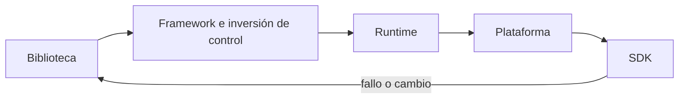
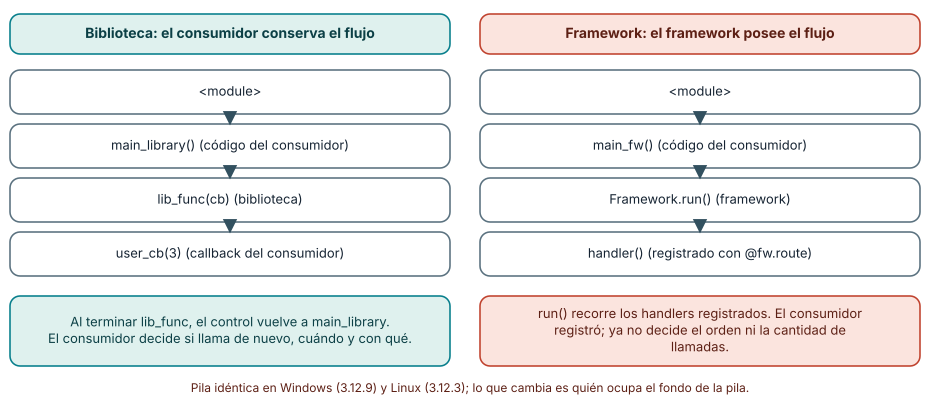
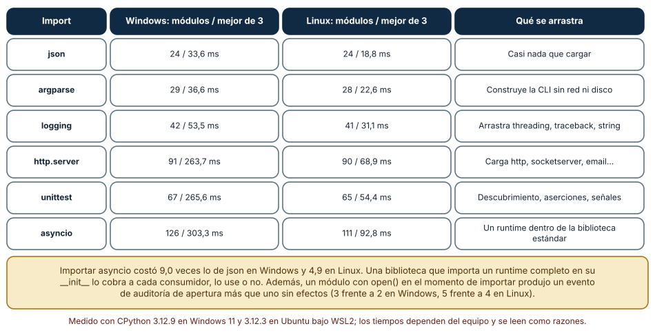
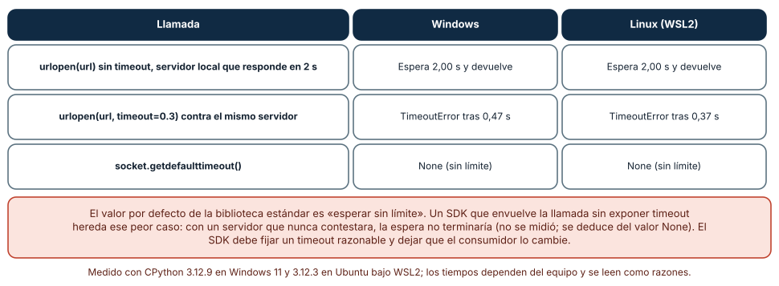

# SE-109 — Biblioteca, framework, runtime, plataforma y SDK

[← SE-108 — Proyecto: entorno de desarrollo autocontenido](https://github.com/vladimiracunadev-create/modern-software-engineering-program/blob/main/classes/part-08-entornos-herramientas-y-depuracion/se-108-proyecto-entorno-de-desarrollo-autocontenido/README.md) · [↑ Parte 09](https://github.com/vladimiracunadev-create/modern-software-engineering-program/blob/main/classes/part-09-bibliotecas-paquetes-sdk-y-automatizacion/README.md) · [📚 Índice completo](https://github.com/vladimiracunadev-create/modern-software-engineering-program/blob/main/classes/README.md) · [🌐 Portal](https://vladimiracunadev-create.github.io/modern-software-engineering-program/classes/SE-109.html) · [SE-110 — SemVer, compatibilidad y contratos públicos →](https://github.com/vladimiracunadev-create/modern-software-engineering-program/blob/main/classes/part-09-bibliotecas-paquetes-sdk-y-automatizacion/se-110-semver-compatibilidad-y-contratos-publicos/README.md)


## Punto profesional y fundamento pedagógico

**Punto profesional.** La clase existe para distinguir biblioteca, framework, runtime, plataforma y SDK por control, contrato y superficie de actualización.

**Por qué aparece aquí.** Se sitúa después de **Proyecto: entorno de desarrollo autocontenido** y antes de **SemVer, compatibilidad y contratos públicos**: convierte el conocimiento anterior en una decisión observable que la clase siguiente podrá reutilizar. La continuidad se comprueba en el artefacto, no por compartir vocabulario.

**Error conceptual que debe corregir.** Clasificar por marketing o por el nombre del paquete.

**Secuencia de aprendizaje.** Antes de leer la solución, el estudiante predice el resultado del caso normal y del error conceptual anterior. Luego explica un caso resuelto paso a paso, construye un contraejemplo que cambie la decisión y, sin consultar el texto, reconstruye el mecanismo y lo aplica a una entrada nueva. La secuencia usa predicción, explicación propia, contraste y recuperación. [ICAP](https://icap.education.asu.edu/research) distingue participación de construcción de conocimiento; [How People Learn II](https://nap.nationalacademies.org/catalog/24783/how-people-learn-ii-learners-contexts-and-cultures) exige conectar conocimiento previo, contexto y transferencia; la [práctica de recuperación](https://pubmed.ncbi.nlm.nih.gov/16507066/) respalda producir de nuevo la explicación tras una demora; y [Education for Life and Work](https://nap.nationalacademies.org/resource/13398/dbasse_084153.pdf) exige devolución que explique la causa del error.

**Evidencia de aprendizaje.** Capability-map.md con quién llama a quién, artefactos, runtime y contrato público. Debe contener predicción previa, observación, explicación causal, contraejemplo, criterio de aceptación y una nota de qué dato haría cambiar la conclusión.

**Límite de la conclusión.** Un producto puede ocupar más de una categoría según la frontera.

### Trazabilidad fuente → afirmación

| Fuente primaria u oficial | Afirmación que respalda | Lo que no prueba |
|---|---|---|
| [Python Packaging User Guide: Specifications](https://packaging.python.org/en/latest/specifications/) | Metadata, nombres, versiones, dependencias y artefactos de distribución; autoridad: Python Packaging Authority | No demuestra por sí sola que el artefacto del estudiante sea correcto. |
| [Python Standard Library](https://docs.python.org/3/library/index.html) | Argparse, importlib.metadata, subprocess y apis de automatización; autoridad: Python Software Foundation | No demuestra por sí sola que el artefacto del estudiante sea correcto. |
| [Semantic Versioning 2.0.0](https://semver.org/spec/v2.0.0.html) | Api pública, versiones, prereleases y compatibilidad declarada; autoridad: Semantic Versioning project | No demuestra por sí sola que el artefacto del estudiante sea correcto. |
| [Python importlib.metadata](https://docs.python.org/3/library/importlib.metadata.html) | define acceso a metadata de distribuciones instaladas | No demuestra por sí sola que el artefacto del estudiante sea correcto. |

## Antes de empezar

Esta clase continúa el **producto reutilizable con SDK y CLI de la Parte 09**. Recupera la evidencia de la clase anterior, añade una decisión propia de **Biblioteca, framework, runtime, plataforma y SDK** y deja un artefacto que la clase siguiente deberá consumir. La pregunta activa es: **¿Qué papel cumple cada capa reusable y quién controla el flujo?**

## Prerrequisitos

- Haber completado la clase anterior o reconstruir su contrato y evidencia.
- Python 3.11 o posterior, terminal, editor y Git; un segundo runtime es opcional y debe declararse.
- Trabajar con fixtures sintéticos: ninguna observación necesita datos de una persona o sistema real.

## Problema auténtico

El producto reutilizable con SDK y CLI se anuncia a la vez como biblioteca, framework, SDK y plataforma. Los consumidores no saben qué instalar, quién inicia el proceso ni qué parte es contrato estable.

## Objetivos observables

Al terminar podrás explicar los cinco mecanismos de esta clase, predecir su comportamiento antes de ejecutar, construir un caso normal y uno límite, diagnosticar el fallo controlado, comparar una alternativa y entregar evidencia que otra persona pueda reproducir.

## Mapa conceptual



El mapa se lee como una cadena de razonamiento, no como fases obligatorias del runtime. La flecha de retorno indica que un fallo o cambio de requisito obliga a revisar el modelo inicial; no autoriza a parchear solo la última salida.

## Temas y por qué importan

| Tema | Por qué cambia una decisión profesional | Evidencia mínima |
|---|---|---|
| Biblioteca | Una biblioteca ofrece funciones o tipos que el programa consumidor llama y compone. | Predicción, traza causal y contraejemplo de **Biblioteca** en `capability-map.md` |
| Framework e inversión de control | Un framework define estructura y llama código del usuario en puntos de extensión. | Predicción, traza causal y contraejemplo de **Framework e inversión de control** en `capability-map.md` |
| Runtime | El runtime ejecuta o soporta programas mediante memoria, carga, garbage collection, event loop o stdlib. | Predicción, traza causal y contraejemplo de **Runtime** en `capability-map.md` |
| Plataforma | Una plataforma combina capacidades, políticas, interfaces y operación para que otros construyan. | Predicción, traza causal y contraejemplo de **Plataforma** en `capability-map.md` |
| SDK | Un SDK reduce fricción para integrar una capacidad: cliente, modelos, autenticación, ejemplos, tooling y documentación. | Predicción, traza causal y contraejemplo de **SDK** en `capability-map.md` |
## Conceptos y decisiones

### 1. Biblioteca

Una biblioteca ofrece funciones o tipos que el programa consumidor llama y compone. El consumidor conserva el flujo principal. Una biblioteca puede traer efectos o runtime, pero debe declarar inicialización, thread safety y ciclo de vida en su API.

### 2. Framework e inversión de control

Un framework define estructura y llama código del usuario en puntos de extensión. Esa inversión permite convenciones y lifecycle común, pero aumenta acoplamiento. Usar una utilidad del framework no convierte automáticamente todo el producto en framework.

### 3. Runtime

El runtime ejecuta o soporta programas mediante memoria, carga, garbage collection, event loop o stdlib. Es una dependencia operacional distinta del paquete. Versiones compatibles deben incluir implementación y plataforma cuando afectan ABI o comportamiento.

### 4. Plataforma

Una plataforma combina capacidades, políticas, interfaces y operación para que otros construyan. No es solo un conjunto de librerías ni una marca. Ownership, SLO, autenticación, cuotas y soporte forman parte de su producto.

### 5. SDK

Un SDK reduce fricción para integrar una capacidad: cliente, modelos, autenticación, ejemplos, tooling y documentación. Debe representar el contrato remoto sin ocultar timeout, paginación o error. Puede incluir biblioteca y CLI, pero su promesa es experiencia coherente.

### Quién lleva el control: la pila de llamadas como prueba

La diferencia entre biblioteca y framework no está en el tamaño ni en el nombre sino en quién ocupa el fondo de la pila. Se comprobó con `traceback.extract_stack()` dentro de código del consumidor. Con la biblioteca, la pila fue `<module>`, `main_library`, `lib_func`, `user_cb`: el consumidor llamó a `lib_func`, esta le pasó el control en un callback y, al terminar, el control volvió a `main_library`. Con el framework fue `<module>`, `main_fw`, `run`, `handler`: el consumidor solo registró su función con un decorador y entregó el flujo a `Framework.run()`, que decide cuántas veces y en qué orden llama a los handlers.

Esa inversión tiene consecuencias de ingeniería medibles sin ejecutar nada más: para probar un handler hace falta el framework o un doble de `run`; el orden de ejecución pertenece al framework, de modo que una actualización que lo cambie rompe al consumidor aunque ninguna firma cambie; y el consumidor no puede decidir salir antes ni llamar dos veces. Una biblioteca, en cambio, se prueba llamando a sus funciones. Por eso un producto puede ser ambas cosas según la frontera: usar `argparse` como biblioteca no obliga a que un programa se estructure alrededor de él, pero el ejecutor de `unittest` sí llama a los casos.



**Cómo leer la figura.** Cada columna es una pila medida de arriba (fondo) a abajo (la función en ejecución). La pregunta es qué caja de la columna pertenece al consumidor y cuál al producto reutilizable. **Dónde deja de valer:** la pila solo prueba el control en el momento de la medición; un framework con hilos o con un bucle de eventos asíncrono puede llamar a tus funciones desde pilas distintas, y una biblioteca con callbacks puede parecer un framework si los callbacks son la regla.

### El costo de importar: la biblioteca que arrastra un runtime

Importar una biblioteca ejecuta su código en el proceso del consumidor. Se midió en un intérprete limpio (`python -S`) cuántos módulos nuevos carga cada import y cuánto tarda. `json` cargó 24 módulos en 33,6 ms en Windows y 18,8 ms en Linux; `asyncio` cargó 126 y 111 módulos en 303,3 y 92,8 ms. Un intérprete limpio parte con 25 módulos en Windows y 23 en Linux, así que el costo de `asyncio` es 9,0 veces el de `json` en Windows y 4,9 en Linux: la diferencia entre plataformas es mayor que la diferencia entre algunos módulos, razón para comparar razones y no milisegundos.

Los efectos laterales al importar son el segundo costo. Con un gancho de auditoría (`sys.addaudithook`) se contaron los eventos `open` al importar dos módulos sintéticos: el que lee un archivo y consulta una variable de entorno en su cuerpo produjo un evento de apertura más (3 frente a 2 en Windows, 5 frente a 4 en Linux; la base la ponen los eventos del propio cargador). Una biblioteca que lee configuración o abre conexiones al importarse hace que `import` falle sin credenciales, que las pruebas de descubrimiento sean frágiles y que el orden de importación importe. La regla de diseño es mover los efectos a una función explícita (`configure`, `connect`) que el consumidor invoque.



**Cómo leer la figura.** Lee cada fila como «cuántas cosas se cargan solo por escribir `import X`». Compara la columna de módulos (estable entre plataformas) con la de tiempo (no estable). **Dónde deja de valer:** son mejores de tres arranques con el caché de bytecode ya creado; un primer arranque tras instalar paga la compilación. No se midió memoria ni importaciones perezosas, que reducen el costo inicial a cambio de trasladarlo al primer uso.

### Un SDK es un contrato remoto, y el peor caso es parte del contrato

Un SDK envuelve un contrato remoto: autenticación, paginación, errores, tiempos. Lo que el SDK decide por defecto lo hereda cada consumidor sin saberlo. Se midió con un servidor local en el bucle de retorno que tarda 2 s en contestar: `urllib.request.urlopen(url)` sin timeout esperó 2,00 s y devolvió; con `timeout=0.3` lanzó `TimeoutError` a los 0,47 s en Windows y a los 0,37 s en Linux; y `socket.getdefaulttimeout()` es `None`, es decir, «esperar sin límite». Si el servidor no contestara nunca, una llamada sin timeout no terminaría (no se midió: se deduce del valor `None`).

El criterio de diseño es que el SDK haga visible lo que la red hace visible. Un cliente que fija un timeout por defecto razonable, lo expone como parámetro, convierte el vencimiento en una excepción propia documentada y no reintenta operaciones no idempotentes sin identificador cumple con el contrato; uno que «simplifica» ocultando esas decisiones traslada el peor caso al producto del consumidor. Lo mismo vale para la paginación (un iterador que oculta N llamadas es una decisión de costo) y para los errores (un tipo propio, no un `Exception` desnudo).



**Cómo leer la figura.** Lee la segunda fila como el comportamiento que el SDK debería ofrecer por defecto y la primera como el que heredaría si no decide nada. **Dónde deja de valer:** el servidor era local y respondía siempre a los 2 s; en una red real los fallos incluyen resolución de nombres, TLS y caídas parciales, y `timeout` en `urllib` se aplica a cada operación de socket, no al total de la solicitud.

## Definiciones de trabajo

- **biblioteca:** una biblioteca ofrece funciones o tipos que el programa consumidor llama y compone.
- **framework e inversión de control:** un framework define estructura y llama código del usuario en puntos de extensión.
- **runtime:** el runtime ejecuta o soporta programas mediante memoria, carga, garbage collection, event loop o stdlib.
- **plataforma:** una plataforma combina capacidades, políticas, interfaces y operación para que otros construyan.
- **sdk:** un sdk reduce fricción para integrar una capacidad: cliente, modelos, autenticación, ejemplos, tooling y documentación.

Las definiciones son operativas para el producto reutilizable con SDK y CLI. No convierten términos con historia más amplia en sinónimos y deben contrastarse con la documentación primaria enlazada al final.

## Ejemplo mínimo

```python
from engineering_sdk import choose_next
result = choose_next(cases, policy=policy)
if result.is_error:
    handle(result.error)
else:
    print(result.action)
```

Antes de ejecutar, predice estado, resultado y error. Después registra versión, comando y salida. Si el fragmento es pseudocódigo o pertenece a otro lenguaje, etiquétalo como tal y no afirmes que fue ejecutado.

## Ejemplo profesional

En el producto reutilizable con SDK y CLI, un release contiene contrato público, artefactos inmutables, dependencias, procedencia, ejemplos, errores y ruta de migración. La implementación de esta clase debe conservar ese contrato aunque cambie la forma interna. El caso profesional no pregunta únicamente si produce una salida: pregunta quién puede producirla, qué estado observa, cómo falla y qué rastro permite disputar una decisión incorrecta.

Compara el caso normal con autorización falsa, evidencia incompleta, empate y repetición. Un mecanismo es apropiado cuando esas diferencias quedan visibles y localizadas; es peligroso cuando dependen de orden accidental, estado oculto o una convención que el consumidor no puede conocer.

## Práctica guiada

1. Copia el contrato de entrada y salida antes de escribir implementación.
2. Predice el caso normal y un límite; identifica la invariante que no puede romperse.
3. Implementa la versión mínima sin I/O dentro del núcleo.
4. Ejecuta el caso y conserva comando, versión y salida bajo `evidence/`.
5. Introduce el fallo controlado, reduce la reproducción y formula dos hipótesis rivales.
6. Corrige la causa, añade regresión y ejecuta el conjunto completo.
7. Compara con otro paradigma o lenguaje indicando qué semántica se preserva.

## Ejercicios

1. **Pila de llamadas:** escribe una función de biblioteca que reciba un callback y un mini framework con `route` y `run`; imprime `traceback.extract_stack()` desde el callback en ambos casos y explica quién ocupa el fondo de cada pila.
2. **Presupuesto de importación:** mide con `python -X importtime -c "import tu_modulo"` (o con un contador de `sys.modules`) cuántos módulos nuevos carga una de tus bibliotecas; propón qué import mover a una función y repite.
3. **Timeout:** levanta un servidor local que tarda 2 s, llama con y sin `timeout` y registra el tiempo y la excepción en cada caso; añade una prueba que falle si el cliente del SDK no tiene timeout por defecto.
4. **Clasificación con evidencia:** elige cinco productos que uses y clasifícalos como biblioteca, framework, runtime, plataforma o SDK usando tres preguntas (quién controla el flujo, quién opera, qué contrato publica); marca uno que ocupe dos categorías y explica en qué frontera.

## Reto verificable

Entrega implementación, fixtures, pruebas y un informe corto. Se aprueba si otra persona ejecuta desde checkout limpio, obtiene los mismos resultados y puede relacionar cada rama o transformación con una regla del dominio. No se aprueba por cantidad de archivos ni por usar la sintaxis característica del paradigma.

## Caso conductor

El producto reutilizable con SDK y CLI empaqueta el motor de la biblioteca de estructuras y algoritmos como `engineering_sdk`, expone `choose_next`, una CLI y un punto de extensión. Ejecuta instalación limpia, entrada válida, configuración ausente, plugin incompatible y actualización entre dos versiones. Cambia después una sola regla o condición y revisa qué archivos, pruebas y trazas debieron modificarse. Esa superficie de cambio alimenta el proyecto final de la parte.

## Preguntas frecuentes

### ¿Un producto puede ser biblioteca y framework a la vez?

Sí, según la frontera. La prueba es la pila: si tu código llama al producto y recupera el control, lo usas como biblioteca; si lo registras y el producto te llama, lo usas como framework. `unittest` ofrece ambas cosas (aserciones que invocas y un ejecutor que invoca tus casos).

### ¿El runtime forma parte del SDK que publico?

No, es otra dependencia con su propio ciclo de versiones. En este programa se midió con CPython 3.12.9 y 3.12.3; un consumidor con otro intérprete puede ver otros módulos cargados y otros tiempos. El contrato debe declarar versiones y plataformas soportadas.

### ¿Cuántos módulos puede cargar un SDK al importarse?

No hay un número correcto; hay un presupuesto que se mide. `json` cargó 24 módulos y `asyncio` 126. Si el SDK necesita un runtime pesado solo para una función, esa función debería importarlo de forma perezosa o vivir en un subpaquete opcional.

### ¿El SDK debe elegir un timeout por defecto?

Sí. El valor por defecto de la biblioteca estándar es no tener límite, y un SDK que no lo cambia entrega ese riesgo a todos. Elige un valor, documéntalo, hazlo configurable y prueba el vencimiento con un servidor local lento.

## Fallo controlado y diagnóstico

Haz que importar la biblioteca lea configuración y se conecte a red. Una prueba de descubrimiento falla sin credenciales. Mueve efectos a cliente/main y documenta lifecycle.

Registra síntoma, entrada mínima, hipótesis, observación que descarta cada hipótesis, causa, corrección y prueba de regresión. No cambies simultáneamente implementación, fixture y expectativa.

Haz que importar la biblioteca lea un archivo y consulte una variable de entorno, y escribe una prueba de descubrimiento que falle sin credenciales. **Síntoma:** `import` falla o cambia de comportamiento según el entorno. **Hipótesis rivales:** (a) el módulo hace trabajo al importarse; (b) una dependencia transitiva lo hace. **Prueba:** importa el módulo con un gancho `sys.addaudithook` y cuenta eventos `open`; en el experimento, el módulo con efectos produjo un evento más que el limpio (3 frente a 2 en Windows, 5 frente a 4 en Linux). Repite importando solo la dependencia sospechosa. **Conclusión:** la causa es el cuerpo del módulo; la corrección mueve el trabajo a `configure()` y la regresión es una prueba que importa bajo el gancho y exige cero aperturas propias. No cambies a la vez el módulo y el umbral de la prueba.

## Errores comunes y cómo corregirlos

| Síntoma | Causa probable | Corrección |
|---|---|---|
| Clasificar un producto por su nombre: «es un SDK porque se llama SDK» | Se clasificó por marketing y no por control ni contrato | Imprimir la pila desde un callback y decidir por quién ocupa el fondo |
| `import mi_sdk` tarda 300 ms y carga más de 100 módulos | El `__init__` importa un runtime completo aunque se use una función | Importar de forma perezosa dentro de la función o dividir en extras |
| `import mi_sdk` falla en CI sin credenciales | El módulo lee variables de entorno o abre red al importarse | Mover los efectos a `connect()` y comprobar con un gancho de auditoría |
| Una llamada del SDK se queda colgada indefinidamente | El cliente hereda el timeout `None` de los sockets | Fijar un timeout por defecto, exponerlo y probar el vencimiento |
| El producto se anuncia como «plataforma» pero no tiene responsable ni SLO | Se confundió conjunto de librerías con plataforma | Escribir propiedad, soporte, cuotas y política de cambios, o llamarlo biblioteca |

## Entorno y archivos clave

```text
work/SE-109/
├── README.md
├── engineering_sdk/
│   ├── domain.py
│   └── se_109.py
├── fixtures/cases.json
├── tests/test_se_109.py
└── evidence/diagnosis.md
```

El `README` declara plataforma, runtimes, comandos, limpieza y límites. Evita dependencias externas cuando la biblioteca estándar permita observar el mecanismo; si agregas una, fija procedencia y versión.

## Seguridad, ética y accesibilidad

- la autorización forma parte del dominio y no se infiere por ausencia de rechazo;
- no uses `eval`, reglas descargadas ni serialización insegura;
- limita colas, recursión, tamaño de entrada y tiempo de evaluación;
- redacta trazas y conserva una explicación textual además de color o animación;
- una recomendación automatizada debe poder revisarse, impugnarse y corregirse;
- respeta licencias de ejemplos y atribuye adaptaciones.

## Puente hacia el trabajo con agentes

Un agente que genera un cliente para un servicio suele escribir `requests.get(url)` o `urlopen(url)` sin timeout y a nivel de módulo importar todo lo que podría necesitar. Dale como criterio de aceptación tres comprobaciones ejecutables: el cliente tiene un timeout por defecto y una prueba que lo ejerce contra un servidor local lento, `import` no produce eventos de apertura ni de red bajo un gancho de auditoría, y el número de módulos nuevos que carga está por debajo de un presupuesto escrito. Pídele además que diga quién ocupa el fondo de la pila en cada ejemplo del README: si no puede, la clasificación es decorativa.

## Transferencia

Traslada un fixture al segundo modelo, herramienta, plataforma o lenguaje. Compara representación de ausencia, error, mutabilidad, orden y cancelación. La transferencia está lograda cuando el contrato se conserva y las diferencias están explicadas, no cuando la interfaz se parece.

## Evaluación y evidencia

| Criterio | Evidencia para aprobar |
|---|---|
| comprensión | explicación causal de los cinco mecanismos |
| corrección | normal, límite, inválido y contraejemplo |
| diseño | estado, efectos y contrato localizables |
| diagnóstico | reproducción mínima y regresión |
| transferencia | comparación semántica, no estética |
| reproducibilidad | versiones, comandos, salida y límites |


## Fuentes


- [Semantic Versioning 2.0.0](https://semver.org/spec/v2.0.0.html) — Api pública, versiones, prereleases y compatibilidad declarada; autoridad: Semantic Versioning project.
- [Python Packaging User Guide: Specifications](https://packaging.python.org/en/latest/specifications/) — Metadata, nombres, versiones, dependencias y artefactos de distribución; autoridad: Python Packaging Authority.
- [pylock.toml Specification](https://packaging.python.org/en/latest/specifications/pylock-toml/) — Lock files para instalaciones reproducibles y selección por entorno; autoridad: Python Packaging Authority.
- [Python Standard Library](https://docs.python.org/3/library/index.html) — Argparse, importlib.metadata, subprocess y apis de automatización; autoridad: Python Software Foundation.
- [SPDX Specification 3.0](https://spdx.dev/use/specifications/) — Identificadores, sbom y procedencia legible por máquinas; autoridad: Linux Foundation.
- [REUSE Specification](https://reuse.software/spec-3.3/) — Declaración inequívoca y verificable de copyright y licencias por archivo; autoridad: Free Software Foundation Europe.

Cada fuente respalda el mecanismo indicado; ninguna demuestra que la implementación del producto reutilizable con SDK y CLI sea correcta. Esa afirmación depende de fixtures, pruebas, trazas y revisión reproducible.

- [Martin Fowler: Inversion of Control](https://martinfowler.com/bliki/InversionOfControl.html) — define la inversión de control y la distingue del uso de una biblioteca; es una explicación de práctica, no una norma.
- [Python: `sys.addaudithook`](https://docs.python.org/3/library/sys.html) — eventos de auditoría del intérprete usados para observar efectos al importar.
- [Python: `urllib.request`](https://docs.python.org/3/library/urllib.request.html) — documenta el parámetro `timeout` de `urlopen` y su comportamiento por defecto.
- [Python: opciones de línea de comandos (`-X importtime`, `-S`)](https://docs.python.org/3/using/cmdline.html) — opciones usadas para medir el costo de importar en un intérprete limpio.

## Límites y siguiente paso

Nombrar el producto no define qué cambios son compatibles. La siguiente clase delimita API pública y usa SemVer como comunicación, no como garantía automática.

## Glosario

- **biblioteca:** una biblioteca ofrece funciones o tipos que el programa consumidor llama y compone.
- **framework e inversión de control:** un framework define estructura y llama código del usuario en puntos de extensión.
- **runtime:** el runtime ejecuta o soporta programas mediante memoria, carga, garbage collection, event loop o stdlib.
- **plataforma:** una plataforma combina capacidades, políticas, interfaces y operación para que otros construyan.
- **sdk:** un sdk reduce fricción para integrar una capacidad: cliente, modelos, autenticación, ejemplos, tooling y documentación.

---

[← SE-108 — Proyecto: entorno de desarrollo autocontenido](https://github.com/vladimiracunadev-create/modern-software-engineering-program/blob/main/classes/part-08-entornos-herramientas-y-depuracion/se-108-proyecto-entorno-de-desarrollo-autocontenido/README.md) · [↑ Parte 09](https://github.com/vladimiracunadev-create/modern-software-engineering-program/blob/main/classes/part-09-bibliotecas-paquetes-sdk-y-automatizacion/README.md) · [📚 Índice completo](https://github.com/vladimiracunadev-create/modern-software-engineering-program/blob/main/classes/README.md) · [🌐 Portal](https://vladimiracunadev-create.github.io/modern-software-engineering-program/classes/SE-109.html) · [SE-110 — SemVer, compatibilidad y contratos públicos →](https://github.com/vladimiracunadev-create/modern-software-engineering-program/blob/main/classes/part-09-bibliotecas-paquetes-sdk-y-automatizacion/se-110-semver-compatibilidad-y-contratos-publicos/README.md)
