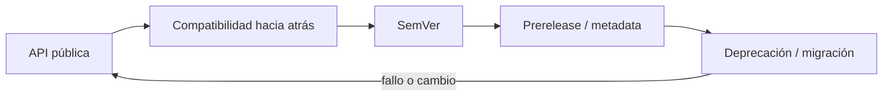
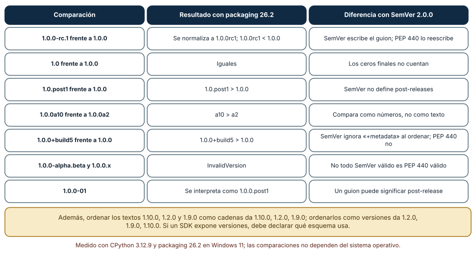
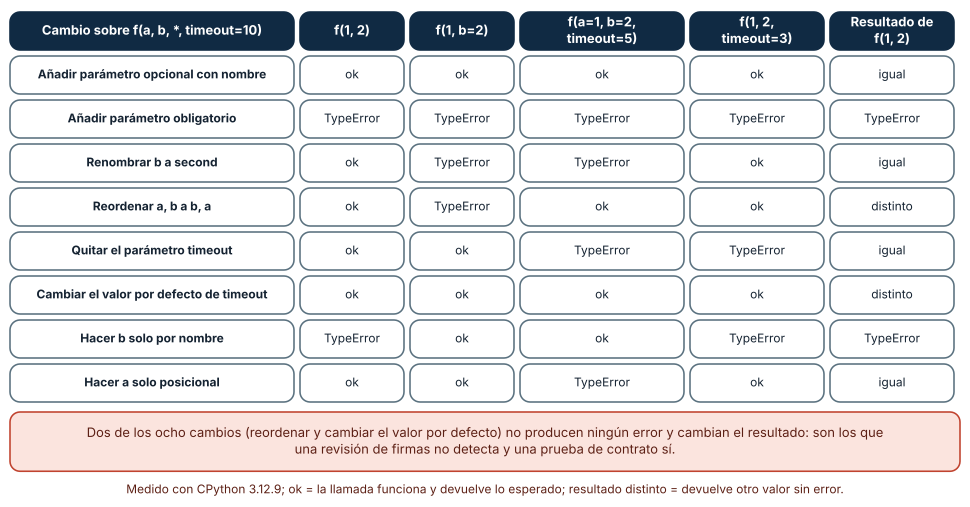
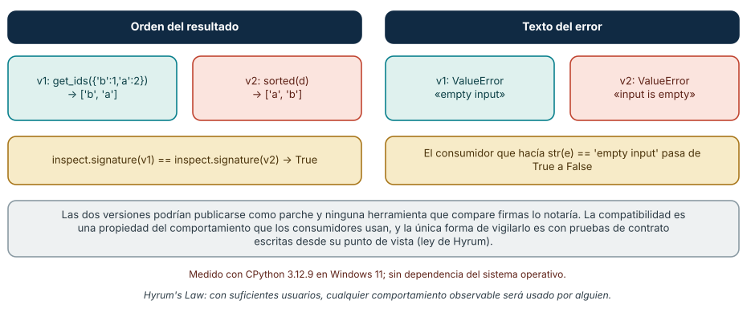

# SE-110 — SemVer, compatibilidad y contratos públicos

[← SE-109 — Biblioteca, framework, runtime, plataforma y SDK](https://github.com/vladimiracunadev-create/modern-software-engineering-program/blob/main/classes/part-09-bibliotecas-paquetes-sdk-y-automatizacion/se-109-biblioteca-framework-runtime-plataforma-y-sdk/README.md) · [↑ Parte 09](https://github.com/vladimiracunadev-create/modern-software-engineering-program/blob/main/classes/part-09-bibliotecas-paquetes-sdk-y-automatizacion/README.md) · [📚 Índice completo](https://github.com/vladimiracunadev-create/modern-software-engineering-program/blob/main/classes/README.md) · [🌐 Portal](https://vladimiracunadev-create.github.io/modern-software-engineering-program/classes/SE-110.html) · [SE-111 — Resolución de dependencias y lockfiles →](https://github.com/vladimiracunadev-create/modern-software-engineering-program/blob/main/classes/part-09-bibliotecas-paquetes-sdk-y-automatizacion/se-111-resolucion-de-dependencias-y-lockfiles/README.md)


## Punto profesional y fundamento pedagógico

**Punto profesional.** La clase existe para usar SemVer solo después de declarar API pública y reglas observables de compatibilidad.

**Por qué aparece aquí.** Se sitúa después de **Biblioteca, framework, runtime, plataforma y SDK** y antes de **Resolución de dependencias y lockfiles**: convierte el conocimiento anterior en una decisión observable que la clase siguiente podrá reutilizar. La continuidad se comprueba en el artefacto, no por compartir vocabulario.

**Error conceptual que debe corregir.** Inferir compatibilidad por número de versión sin contrato.

**Secuencia de aprendizaje.** Antes de leer la solución, el estudiante predice el resultado del caso normal y del error conceptual anterior. Luego explica un caso resuelto paso a paso, construye un contraejemplo que cambie la decisión y, sin consultar el texto, reconstruye el mecanismo y lo aplica a una entrada nueva. La secuencia usa predicción, explicación propia, contraste y recuperación. [ICAP](https://icap.education.asu.edu/research) distingue participación de construcción de conocimiento; [How People Learn II](https://nap.nationalacademies.org/catalog/24783/how-people-learn-ii-learners-contexts-and-cultures) exige conectar conocimiento previo, contexto y transferencia; la [práctica de recuperación](https://pubmed.ncbi.nlm.nih.gov/16507066/) respalda producir de nuevo la explicación tras una demora; y [Education for Life and Work](https://nap.nationalacademies.org/resource/13398/dbasse_084153.pdf) exige devolución que explique la causa del error.

**Evidencia de aprendizaje.** Compatibility.md con API, cambios, clasificación y consumidor de regresión. Debe contener predicción previa, observación, explicación causal, contraejemplo, criterio de aceptación y una nota de qué dato haría cambiar la conclusión.

**Límite de la conclusión.** SemVer comunica intención; no prueba que la versión sea compatible.

### Trazabilidad fuente → afirmación

| Fuente primaria u oficial | Afirmación que respalda | Lo que no prueba |
|---|---|---|
| [Semantic Versioning 2.0.0](https://semver.org/spec/v2.0.0.html) | Api pública, versiones, prereleases y compatibilidad declarada; autoridad: Semantic Versioning project | No demuestra por sí sola que el artefacto del estudiante sea correcto. |
| [Python Packaging User Guide: Specifications](https://packaging.python.org/en/latest/specifications/) | Metadata, nombres, versiones, dependencias y artefactos de distribución; autoridad: Python Packaging Authority | No demuestra por sí sola que el artefacto del estudiante sea correcto. |

## Antes de empezar

Esta clase continúa el **producto reutilizable con SDK y CLI de la Parte 09**. Recupera la evidencia de la clase anterior, añade una decisión propia de **SemVer, compatibilidad y contratos públicos** y deja un artefacto que la clase siguiente deberá consumir. La pregunta activa es: **¿Qué constituye la API pública y cuándo un cambio exige migración?**

## Prerrequisitos

- Haber completado la clase anterior o reconstruir su contrato y evidencia.
- Python 3.11 o posterior, terminal, editor y Git; un segundo runtime es opcional y debe declararse.
- Trabajar con fixtures sintéticos: ninguna observación necesita datos de una persona o sistema real.

## Problema auténtico

El producto reutilizable con SDK y CLI renombra un campo interno que usuarios importaban porque aparecía en ejemplos. El equipo publica patch; consumidores rompen aunque la firma principal no cambió.

## Objetivos observables

Al terminar podrás explicar los cinco mecanismos de esta clase, predecir su comportamiento antes de ejecutar, construir un caso normal y uno límite, diagnosticar el fallo controlado, comparar una alternativa y entregar evidencia que otra persona pueda reproducir.

## Mapa conceptual



El mapa se lee como una cadena de razonamiento, no como fases obligatorias del runtime. La flecha de retorno indica que un fallo o cambio de requisito obliga a revisar el modelo inicial; no autoriza a parchear solo la última salida.

## Temas y por qué importan

| Tema | Por qué cambia una decisión profesional | Evidencia mínima |
|---|---|---|
| API pública | La API incluye nombres, tipos, errores, efectos, orden, formato y comportamiento documentado que consumidores pueden depender. | Predicción, traza causal y contraejemplo de **API pública** en `compatibility.md` |
| Compatibilidad hacia atrás | Una versión nueva es backward compatible si consumidores válidos anteriores siguen funcionando bajo el contrato. | Predicción, traza causal y contraejemplo de **Compatibilidad hacia atrás** en `compatibility.md` |
| SemVer | SemVer exige declarar API pública: major para ruptura, minor para funcionalidad compatible y patch para corrección compatible, con reglas particulares antes de 1. | Predicción, traza causal y contraejemplo de **SemVer** en `compatibility.md` |
| Prerelease y metadata | Identificadores prerelease tienen precedencia menor y permiten ensayo; metadata de build no cambia precedencia. | Predicción, traza causal y contraejemplo de **Prerelease y metadata** en `compatibility.md` |
| Deprecación y migración | Deprecar anuncia reemplazo, ventana y señal antes de remover. | Predicción, traza causal y contraejemplo de **Deprecación y migración** en `compatibility.md` |
## Conceptos y decisiones

### 1. API pública

La API incluye nombres, tipos, errores, efectos, orden, formato y comportamiento documentado que consumidores pueden depender. No se limita a funciones exportadas. CLI, archivos, variables y mensajes parseados también forman contratos si se presentan como estables.

### 2. Compatibilidad hacia atrás

Una versión nueva es backward compatible si consumidores válidos anteriores siguen funcionando bajo el contrato. Agregar parámetro opcional puede romper reflexión, mocks o serialización; la evaluación necesita pruebas reales, no solo intuición del autor.

### 3. SemVer

SemVer exige declarar API pública: major para ruptura, minor para funcionalidad compatible y patch para corrección compatible, con reglas particulares antes de 1.0. El número comunica intención; no verifica que el cambio cumpla ni reemplaza política de soporte.

### 4. Prerelease y metadata

Identificadores prerelease tienen precedencia menor y permiten ensayo; metadata de build no cambia precedencia. Reempaquetar el mismo número con bytes distintos viola inmutabilidad del release y destruye procedencia.

### 5. Deprecación y migración

Deprecar anuncia reemplazo, ventana y señal antes de remover. Warning debe ser accionable y no inundar. Una guía muestra antes/después, compatibilidad temporal y rollback; mantener alias indefinido también tiene costo que se decide explícitamente.

### Dos esquemas de versión que no ordenan igual

SemVer 2.0.0 y PEP 440 se parecen lo bastante como para confundirse y difieren en puntos que importan. Con la biblioteca `packaging` 26.2 se compararon siete pares. `1.0.0-rc.1` no es una versión de Python tal cual: se normaliza a `1.0.0rc1` y entonces `1.0.0rc1 < 1.0.0`. `1.0` y `1.0.0` son iguales. `1.0.post1 > 1.0.0`, un concepto que SemVer no define. `1.0.0a10 > 1.0.0a2` porque se compara como número. `1.0.0+build5 > 1.0.0`, mientras que SemVer manda ignorar los metadatos de construcción al ordenar. `1.0.0-alpha.beta` es SemVer válido y `InvalidVersion` en Python, y `1.0.0-01` se interpreta como `1.0.0.post1`.

La consecuencia es práctica: un SDK que publica en PyPI y usa números de SemVer con sufijos tiene dos sentidos de orden, el del autor y el del instalador. También se comprobó el error más común de quien compara a mano: ordenar `1.10.0`, `1.2.0` y `1.9.0` como cadenas da `1.10.0` primero; como versiones da `1.2.0`, `1.9.0`, `1.10.0`. La política es declarar el esquema, usar siempre un parser y no inventar comparaciones.



**Cómo leer la figura.** Cada fila es un par que un instalador compara por ti. La tercera columna es lo que cambiaría si pensaras en SemVer. **Dónde deja de valer:** las comparaciones corresponden a `packaging` 26.2 y a PEP 440; otro instalador (npm, Cargo) implementa su propio esquema. Una versión puede ser válida y aun así no comunicar nada si el autor no define qué es su API pública.

### Ocho cambios de firma frente a cinco formas de llamar

Se partió de `f(a, b, *, timeout=10)` y se aplicaron ocho cambios de firma, probando cinco formas de llamar. Añadir un parámetro opcional con nombre no rompió ninguna llamada. Añadir uno obligatorio las rompió todas con `TypeError`. Renombrar `b` rompió solo las llamadas por nombre (`f(1, b=2)` y la que usa `a=1, b=2`), no la posicional. Quitar `timeout` rompió las dos llamadas que lo pasaban. Hacer `b` solo por nombre rompió la posicional.

Dos cambios no produjeron ningún error y cambiaron el resultado de `f(1, 2)`: reordenar `a, b` a `b, a` (devuelve la tupla con los valores intercambiados) y cambiar el valor por defecto de `timeout` de 10 a 0. Son los cambios más peligrosos porque ninguna herramienta que mire «¿compila?» o «¿la llamada funciona?» los ve. Por eso una política de compatibilidad define además qué parámetros son posicionales o por nombre (`/` y `*`), y las pruebas de contrato ejercen cada forma de llamada documentada.



**Cómo leer la figura.** Recorre una fila: cada celda es una forma de llamar que un consumidor real podría usar. Las últimas dos columnas distinguen error de cambio silencioso. **Dónde deja de valer:** son ocho cambios elegidos; no cubren cambios de tipo de los argumentos ni de lo que devuelve la función. Una firma compatible no garantiza un contrato compatible, como muestra la sección siguiente.

### Misma firma, otro contrato

`inspect.signature` dio el mismo resultado para dos versiones de una función que devolvía las claves de un diccionario: la v1 en orden de inserción (`['b', 'a']`) y la v2 ordenadas (`['a', 'b']`). Cualquier comparador de firmas las declara idénticas y ambas podrían publicarse como parche. Un consumidor que dependía del orden de inserción se rompe sin recibir un solo error de tipo.

Lo mismo ocurre con los errores: una v1 lanzaba `ValueError('empty input')` y una v2 `ValueError('input is empty')`. Un consumidor que comparaba `str(e) == 'empty input'` pasó de `True` a `False`. Es la ley de Hyrum: con suficientes usuarios, cualquier comportamiento observable será usado por alguien. La respuesta de ingeniería no es prometer inmutabilidad total sino decidir qué es contrato (orden, tipo de excepción, forma del mensaje), documentarlo, y vigilarlo con pruebas escritas desde el punto de vista del consumidor y no del implementador.



**Cómo leer la figura.** Compara los pares teal y coral: lo que cambió está en la segunda línea de cada caja, no en la firma. **Dónde deja de valer:** el ejemplo es mínimo y sintético; en un SDK real los comportamientos observables incluyen tiempos, orden de eventos y campos opcionales de las respuestas. Declarar que el orden «no es contrato» solo ayuda si se documenta y si las pruebas del propio SDK lo respetan.

## Definiciones de trabajo

- **api pública:** la api incluye nombres, tipos, errores, efectos, orden, formato y comportamiento documentado que consumidores pueden depender.
- **compatibilidad hacia atrás:** una versión nueva es backward compatible si consumidores válidos anteriores siguen funcionando bajo el contrato.
- **semver:** semver exige declarar api pública: major para ruptura, minor para funcionalidad compatible y patch para corrección compatible, con reglas particulares antes de 1.
- **prerelease y metadata:** identificadores prerelease tienen precedencia menor y permiten ensayo; metadata de build no cambia precedencia.
- **deprecación y migración:** deprecar anuncia reemplazo, ventana y señal antes de remover.

Las definiciones son operativas para el producto reutilizable con SDK y CLI. No convierten términos con historia más amplia en sinónimos y deben contrastarse con la documentación primaria enlazada al final.

## Ejemplo mínimo

```text
# 1.4.2 -> 1.4.3: corrige implementación sin romper API
# 1.4.2 -> 1.5.0: añade opción compatible
# 1.4.2 -> 2.0.0: cambia contrato incompatible
# 2.0.0-rc.1: candidato previo a 2.0.0
```

Antes de ejecutar, predice estado, resultado y error. Después registra versión, comando y salida. Si el fragmento es pseudocódigo o pertenece a otro lenguaje, etiquétalo como tal y no afirmes que fue ejecutado.

## Ejemplo profesional

En el producto reutilizable con SDK y CLI, un release contiene contrato público, artefactos inmutables, dependencias, procedencia, ejemplos, errores y ruta de migración. La implementación de esta clase debe conservar ese contrato aunque cambie la forma interna. El caso profesional no pregunta únicamente si produce una salida: pregunta quién puede producirla, qué estado observa, cómo falla y qué rastro permite disputar una decisión incorrecta.

Compara el caso normal con autorización falsa, evidencia incompleta, empate y repetición. Un mecanismo es apropiado cuando esas diferencias quedan visibles y localizadas; es peligroso cuando dependen de orden accidental, estado oculto o una convención que el consumidor no puede conocer.

## Práctica guiada

1. Copia el contrato de entrada y salida antes de escribir implementación.
2. Predice el caso normal y un límite; identifica la invariante que no puede romperse.
3. Implementa la versión mínima sin I/O dentro del núcleo.
4. Ejecuta el caso y conserva comando, versión y salida bajo `evidence/`.
5. Introduce el fallo controlado, reduce la reproducción y formula dos hipótesis rivales.
6. Corrige la causa, añade regresión y ejecuta el conjunto completo.
7. Compara con otro paradigma o lenguaje indicando qué semántica se preserva.

## Ejercicios

1. **Orden de versiones:** con `packaging`, ordena `1.0.0rc1`, `1.0.0`, `1.0.post1`, `1.0.0a10`, `1.0.0a2` y `1.0.0+local`; escribe el orden que esperabas antes de ejecutar y justifica cada discrepancia.
2. **Matriz de firmas:** crea una función con un parámetro posicional, uno por nombre y uno con valor por defecto; aplica seis cambios y construye una tabla de qué llamadas se rompen y cuáles cambian el resultado en silencio.
3. **Pruebas de contrato:** escribe cinco pruebas que ejerciten orden, tipo de excepción, valor por defecto, aceptación de `None` y llamada por posición; aplica tres cambios internos y observa cuáles detectan.
4. **Política escrita:** redacta media página que diga qué es API pública de tu paquete (`__all__`, nombres sin guion bajo, constantes), qué cambios exigen versión mayor y cuáles se anuncian como obsolescencia.

## Reto verificable

Entrega implementación, fixtures, pruebas y un informe corto. Se aprueba si otra persona ejecuta desde checkout limpio, obtiene los mismos resultados y puede relacionar cada rama o transformación con una regla del dominio. No se aprueba por cantidad de archivos ni por usar la sintaxis característica del paradigma.

## Caso conductor

El producto reutilizable con SDK y CLI empaqueta el motor de la biblioteca de estructuras y algoritmos como `engineering_sdk`, expone `choose_next`, una CLI y un punto de extensión. Ejecuta instalación limpia, entrada válida, configuración ausente, plugin incompatible y actualización entre dos versiones. Cambia después una sola regla o condición y revisa qué archivos, pruebas y trazas debieron modificarse. Esa superficie de cambio alimenta el proyecto final de la parte.

## Preguntas frecuentes

### ¿SemVer es una garantía de compatibilidad?

No: es un modo de comunicar una intención. La versión 1.4.2 no prueba nada sobre la API; lo prueba la comparación de superficies y las pruebas de contrato. Se vio con cambios de comportamiento que ninguna firma delata.

### ¿Qué hago si PyPI no acepta mi versión SemVer?

Escribe la versión en la forma de PEP 440 (`1.0.0rc1`, no `1.0.0-rc.1`) o deja que la herramienta la normalice, y documenta que ordenas con ese esquema. `1.0.0-alpha.beta` no es válida en Python.

### ¿Añadir un parámetro opcional es siempre compatible?

Para llamadas existentes, sí; en el experimento no rompió ninguna de las cinco formas de llamar. Deja de serlo si el parámetro se inserta antes de otro posicional o si el consumidor pasa `**kwargs` a una función que ahora lo interpreta.

### ¿Puedo cambiar el texto de un mensaje de error en un parche?

Solo si el texto no es parte del contrato. Un consumidor comparó `str(e)` y se rompió. Si quieres libertad, ofrece un código de error o un atributo estable y documenta que el mensaje es para humanos.

## Fallo controlado y diagnóstico

Cambia el código de salida de error 2 a 1 en patch. Una prueba de CLI consumidora falla. Restaura o publica ruptura con migración según política.

Registra síntoma, entrada mínima, hipótesis, observación que descarta cada hipótesis, causa, corrección y prueba de regresión. No cambies simultáneamente implementación, fixture y expectativa.

Publica una función que antes devolvía una lista en el orden de inserción y ahora la devuelve ordenada, con la misma firma, como versión de parche. **Síntoma:** un consumidor que no cambió su código obtiene resultados distintos. **Hipótesis rivales:** (a) el consumidor está mal escrito; (b) el SDK cambió su contrato. **Prueba:** `inspect.signature` de las dos versiones es idéntica (`True`); una prueba de contrato escrita desde el consumidor falla en la v2. **Conclusión:** el orden era comportamiento observable. La corrección puede ser revertir, documentar el orden como no garantizado y publicar un mayor, o ampliar la API con un parámetro explícito (`sort=False`); la regresión es la prueba de contrato. No cambies a la vez la versión, el fixture y la expectativa.

## Errores comunes y cómo corregirlos

| Síntoma | Causa probable | Corrección |
|---|---|---|
| `pip` instala 1.10.0 como más antigua que 1.9.0 en un script propio | Se ordenaron versiones como texto | Usar `packaging.version.Version` y comparar objetos |
| Una versión SemVer con guion se rechaza al publicar | No es una versión PEP 440 válida (`1.0.0-alpha.beta`) | Normalizar al esquema de Python o cambiar de esquema y documentarlo |
| Un parche rompe a los consumidores que llaman por posición | Se reordenaron parámetros sin cambiar nombres | Prohibir el reordenamiento en la política y probar la llamada posicional |
| Los consumidores reciben otro resultado sin ningún error | Cambió un valor por defecto o el orden de salida | Tratar los defaults y el orden como contrato y cubrirlos con pruebas |
| Se sube el parche a 1.4.3 y se rompe un consumidor | Se creyó que una firma igual significaba compatibilidad | Añadir pruebas de contrato escritas desde el uso, además del diff de API |

## Entorno y archivos clave

```text
work/SE-110/
├── README.md
├── engineering_sdk/
│   ├── domain.py
│   └── se_110.py
├── fixtures/cases.json
├── tests/test_se_110.py
└── evidence/diagnosis.md
```

El `README` declara plataforma, runtimes, comandos, limpieza y límites. Evita dependencias externas cuando la biblioteca estándar permita observar el mecanismo; si agregas una, fija procedencia y versión.

## Seguridad, ética y accesibilidad

- la autorización forma parte del dominio y no se infiere por ausencia de rechazo;
- no uses `eval`, reglas descargadas ni serialización insegura;
- limita colas, recursión, tamaño de entrada y tiempo de evaluación;
- redacta trazas y conserva una explicación textual además de color o animación;
- una recomendación automatizada debe poder revisarse, impugnarse y corregirse;
- respeta licencias de ejemplos y atribuye adaptaciones.

## Puente hacia el trabajo con agentes

Un agente que «mejora» una función pública tiende a cambiar el orden, un valor por defecto o el texto de un error porque el cambio es local y las pruebas existentes pasan. Dale una regla ejecutable: antes de proponer un parche, debe ejecutar un comparador de superficie de API y las pruebas de contrato del consumidor, y listar qué cambios del diff caen en «posicional, nombre, default, orden, excepción». Pídele que clasifique su propio cambio como mayor, menor o parche con la política escrita; si no puede, no tiene información suficiente para decidir la versión.

## Transferencia

Traslada un fixture al segundo modelo, herramienta, plataforma o lenguaje. Compara representación de ausencia, error, mutabilidad, orden y cancelación. La transferencia está lograda cuando el contrato se conserva y las diferencias están explicadas, no cuando la interfaz se parece.

## Evaluación y evidencia

| Criterio | Evidencia para aprobar |
|---|---|
| comprensión | explicación causal de los cinco mecanismos |
| corrección | normal, límite, inválido y contraejemplo |
| diseño | estado, efectos y contrato localizables |
| diagnóstico | reproducción mínima y regresión |
| transferencia | comparación semántica, no estética |
| reproducibilidad | versiones, comandos, salida y límites |


## Fuentes


- [Semantic Versioning 2.0.0](https://semver.org/spec/v2.0.0.html) — Api pública, versiones, prereleases y compatibilidad declarada; autoridad: Semantic Versioning project.
- [Python Packaging User Guide: Specifications](https://packaging.python.org/en/latest/specifications/) — Metadata, nombres, versiones, dependencias y artefactos de distribución; autoridad: Python Packaging Authority.
- [pylock.toml Specification](https://packaging.python.org/en/latest/specifications/pylock-toml/) — Lock files para instalaciones reproducibles y selección por entorno; autoridad: Python Packaging Authority.
- [Python Standard Library](https://docs.python.org/3/library/index.html) — Argparse, importlib.metadata, subprocess y apis de automatización; autoridad: Python Software Foundation.
- [SPDX Specification 3.0](https://spdx.dev/use/specifications/) — Identificadores, sbom y procedencia legible por máquinas; autoridad: Linux Foundation.
- [REUSE Specification](https://reuse.software/spec-3.3/) — Declaración inequívoca y verificable de copyright y licencias por archivo; autoridad: Free Software Foundation Europe.

Cada fuente respalda el mecanismo indicado; ninguna demuestra que la implementación del producto reutilizable con SDK y CLI sea correcta. Esa afirmación depende de fixtures, pruebas, trazas y revisión reproducible.

- [PEP 440: Version Identification](https://peps.python.org/pep-0440/) — define el esquema de versiones de Python, la normalización y el orden.
- [Python Packaging: Version specifiers](https://packaging.python.org/en/latest/specifications/version-specifiers/) — especificación vigente de versiones y rangos para instaladores.
- [Python: `inspect.signature`](https://docs.python.org/3/library/inspect.html) — API para comparar firmas, con los tipos de parámetro posicional y por nombre.
- [Hyrum's Law](https://www.hyrumslaw.com/) — formulación de la ley sobre comportamiento observable y dependencia implícita.
- [Keep a Changelog 1.1.0](https://keepachangelog.com/en/1.1.0/) — convención para comunicar cambios entre versiones.

## Límites y siguiente paso

SemVer describe una versión del producto, no cómo varias restricciones seleccionan dependencias. La siguiente clase abre el resolvedor y el lockfile.

## Glosario

- **api pública:** la api incluye nombres, tipos, errores, efectos, orden, formato y comportamiento documentado que consumidores pueden depender.
- **compatibilidad hacia atrás:** una versión nueva es backward compatible si consumidores válidos anteriores siguen funcionando bajo el contrato.
- **semver:** semver exige declarar api pública: major para ruptura, minor para funcionalidad compatible y patch para corrección compatible, con reglas particulares antes de 1.
- **prerelease y metadata:** identificadores prerelease tienen precedencia menor y permiten ensayo; metadata de build no cambia precedencia.
- **deprecación y migración:** deprecar anuncia reemplazo, ventana y señal antes de remover.

---

[← SE-109 — Biblioteca, framework, runtime, plataforma y SDK](https://github.com/vladimiracunadev-create/modern-software-engineering-program/blob/main/classes/part-09-bibliotecas-paquetes-sdk-y-automatizacion/se-109-biblioteca-framework-runtime-plataforma-y-sdk/README.md) · [↑ Parte 09](https://github.com/vladimiracunadev-create/modern-software-engineering-program/blob/main/classes/part-09-bibliotecas-paquetes-sdk-y-automatizacion/README.md) · [📚 Índice completo](https://github.com/vladimiracunadev-create/modern-software-engineering-program/blob/main/classes/README.md) · [🌐 Portal](https://vladimiracunadev-create.github.io/modern-software-engineering-program/classes/SE-110.html) · [SE-111 — Resolución de dependencias y lockfiles →](https://github.com/vladimiracunadev-create/modern-software-engineering-program/blob/main/classes/part-09-bibliotecas-paquetes-sdk-y-automatizacion/se-111-resolucion-de-dependencias-y-lockfiles/README.md)
