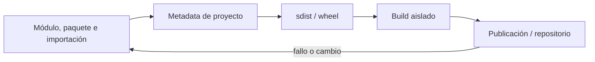
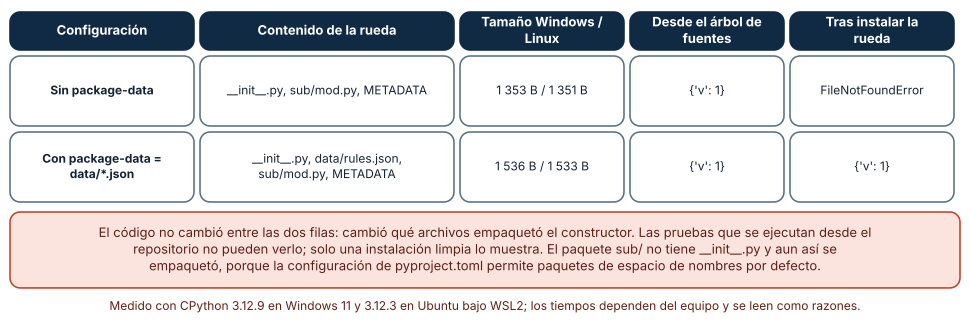
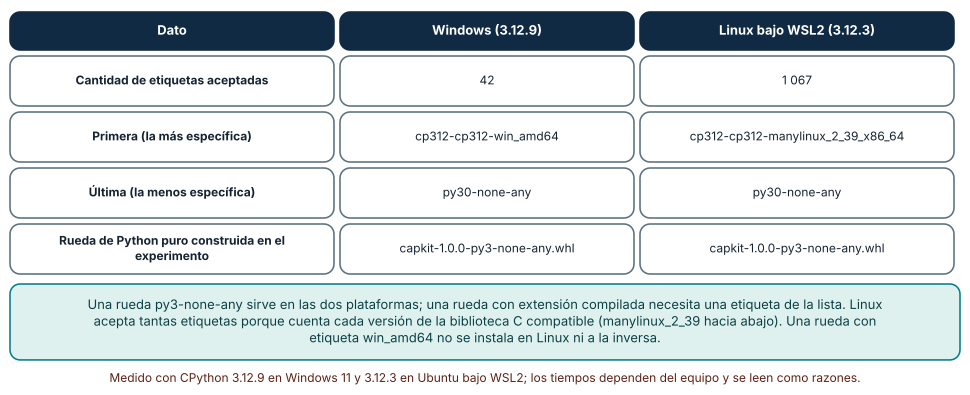

# SE-112 — Paquetes, módulos y publicación

[← SE-111 — Resolución de dependencias y lockfiles](https://github.com/vladimiracunadev-create/modern-software-engineering-program/blob/main/classes/part-09-bibliotecas-paquetes-sdk-y-automatizacion/se-111-resolucion-de-dependencias-y-lockfiles/README.md) · [↑ Parte 09](https://github.com/vladimiracunadev-create/modern-software-engineering-program/blob/main/classes/part-09-bibliotecas-paquetes-sdk-y-automatizacion/README.md) · [📚 Índice completo](https://github.com/vladimiracunadev-create/modern-software-engineering-program/blob/main/classes/README.md) · [🌐 Portal](https://vladimiracunadev-create.github.io/modern-software-engineering-program/classes/SE-112.html) · [SE-113 — CLI, flags, configuración y códigos de salida →](https://github.com/vladimiracunadev-create/modern-software-engineering-program/blob/main/classes/part-09-bibliotecas-paquetes-sdk-y-automatizacion/se-113-cli-flags-configuracion-y-codigos-de-salida/README.md)


## Punto profesional y fundamento pedagógico

**Punto profesional.** La clase existe para separar módulo importable, paquete de distribución, metadata, build y publicación.

**Por qué aparece aquí.** Se sitúa después de **Resolución de dependencias y lockfiles** y antes de **CLI, flags, configuración y códigos de salida**: convierte el conocimiento anterior en una decisión observable que la clase siguiente podrá reutilizar. La continuidad se comprueba en el artefacto, no por compartir vocabulario.

**Error conceptual que debe corregir.** Equiparar carpeta de código con artefacto publicable.

**Secuencia de aprendizaje.** Antes de leer la solución, el estudiante predice el resultado del caso normal y del error conceptual anterior. Luego explica un caso resuelto paso a paso, construye un contraejemplo que cambie la decisión y, sin consultar el texto, reconstruye el mecanismo y lo aplica a una entrada nueva. La secuencia usa predicción, explicación propia, contraste y recuperación. [ICAP](https://icap.education.asu.edu/research) distingue participación de construcción de conocimiento; [How People Learn II](https://nap.nationalacademies.org/catalog/24783/how-people-learn-ii-learners-contexts-and-cultures) exige conectar conocimiento previo, contexto y transferencia; la [práctica de recuperación](https://pubmed.ncbi.nlm.nih.gov/16507066/) respalda producir de nuevo la explicación tras una demora; y [Education for Life and Work](https://nap.nationalacademies.org/resource/13398/dbasse_084153.pdf) exige devolución que explique la causa del error.

**Evidencia de aprendizaje.** Package-lifecycle.md con sdist/wheel, metadata, instalación limpia e importación. Debe contener predicción previa, observación, explicación causal, contraejemplo, criterio de aceptación y una nota de qué dato haría cambiar la conclusión.

**Límite de la conclusión.** Construir un artefacto no demuestra que sea publicable o seguro.

### Trazabilidad fuente → afirmación

| Fuente primaria u oficial | Afirmación que respalda | Lo que no prueba |
|---|---|---|
| [Python Packaging User Guide: Specifications](https://packaging.python.org/en/latest/specifications/) | Metadata, nombres, versiones, dependencias y artefactos de distribución; autoridad: Python Packaging Authority | No demuestra por sí sola que el artefacto del estudiante sea correcto. |
| [pylock.toml Specification](https://packaging.python.org/en/latest/specifications/pylock-toml/) | Lock files para instalaciones reproducibles y selección por entorno; autoridad: Python Packaging Authority | No demuestra por sí sola que el artefacto del estudiante sea correcto. |
| [Python Standard Library](https://docs.python.org/3/library/index.html) | Argparse, importlib.metadata, subprocess y apis de automatización; autoridad: Python Software Foundation | No demuestra por sí sola que el artefacto del estudiante sea correcto. |

## Antes de empezar

Esta clase continúa el **producto reutilizable con SDK y CLI de la Parte 09**. Recupera la evidencia de la clase anterior, añade una decisión propia de **Paquetes, módulos y publicación** y deja un artefacto que la clase siguiente deberá consumir. La pregunta activa es: **¿Qué transforma un árbol fuente en artefactos instalables, inmutables y verificables?**

## Prerrequisitos

- Haber completado la clase anterior o reconstruir su contrato y evidencia.
- Python 3.11 o posterior, terminal, editor y Git; un segundo runtime es opcional y debe declararse.
- Trabajar con fixtures sintéticos: ninguna observación necesita datos de una persona o sistema real.

## Problema auténtico

El producto reutilizable con SDK y CLI funciona desde el checkout, pero la wheel omite fixtures y el sdist incluye secretos de un archivo local. Probar solo `python -m` no cubre la distribución real.

## Objetivos observables

Al terminar podrás explicar los cinco mecanismos de esta clase, predecir su comportamiento antes de ejecutar, construir un caso normal y uno límite, diagnosticar el fallo controlado, comparar una alternativa y entregar evidencia que otra persona pueda reproducir.

## Mapa conceptual



El mapa se lee como una cadena de razonamiento, no como fases obligatorias del runtime. La flecha de retorno indica que un fallo o cambio de requisito obliga a revisar el modelo inicial; no autoriza a parchear solo la última salida.

## Temas y por qué importan

| Tema | Por qué cambia una decisión profesional | Evidencia mínima |
|---|---|---|
| Módulo, paquete e importación | Un módulo es unidad importable; un paquete organiza módulos y namespace. | Predicción, traza causal y contraejemplo de **Módulo, paquete e importación** en `package-lifecycle.md` |
| Metadata de proyecto | Nombre, versión, runtime, dependencias, licencia, autores y entry points permiten construir e instalar. | Predicción, traza causal y contraejemplo de **Metadata de proyecto** en `package-lifecycle.md` |
| sdist y wheel | El sdist contiene fuente necesaria para construir; wheel es distribución construida para tags compatibles. | Predicción, traza causal y contraejemplo de **sdist y wheel** en `package-lifecycle.md` |
| Build aislado | El backend se ejecuta con requisitos de build declarados, evitando depender del entorno del autor. | Predicción, traza causal y contraejemplo de **Build aislado** en `package-lifecycle.md` |
| Publicación y repositorio | Publicar crea un artefacto consumible e idealmente inmutable. | Predicción, traza causal y contraejemplo de **Publicación y repositorio** en `package-lifecycle.md` |
## Conceptos y decisiones

### 1. Módulo, paquete e importación

Un módulo es unidad importable; un paquete organiza módulos y namespace. El layout `src/` reduce import accidental desde checkout. La API pública se exporta deliberadamente; explorar internals por conveniencia crea consumidores frágiles.

### 2. Metadata de proyecto

Nombre, versión, runtime, dependencias, licencia, autores y entry points permiten construir e instalar. Metadata incoherente con código o tag produce releases ambiguos. La versión tiene una fuente canónica y las demás superficies se derivan.

### 3. sdist y wheel

El sdist contiene fuente necesaria para construir; wheel es distribución construida para tags compatibles. Tener ambos no implica mismo contenido. Se inspeccionan archivos y se instala cada artefacto en entorno limpio.

### 4. Build aislado

El backend se ejecuta con requisitos de build declarados, evitando depender del entorno del autor. Builds reproducibles requieren más: timestamps, orden y toolchain pueden variar. Hash igual solo se afirma tras comparar bytes bajo protocolo declarado.

### 5. Publicación y repositorio

Publicar crea un artefacto consumible e idealmente inmutable. Se ensaya en índice de prueba o directorio local, verifica identidad y luego promueve. Credenciales usan mínimo alcance y no aparecen en comandos, logs o configuración versionada.

### Funciona en el repositorio, falla instalado

Se construyeron dos ruedas de un mismo paquete de ejemplo con `pip wheel`: una sin `package-data` y otra con `data/*.json` declarado. La primera contenía `__init__.py`, `sub/mod.py` y los metadatos, pero no el archivo `data/rules.json` (1 353 bytes en Windows y 1 351 en Linux). Ejecutar `load_rules()` desde el árbol de fuentes funcionó (`{'v': 1}`); instalada la rueda en un directorio aparte, lanzó `FileNotFoundError`. La segunda rueda (1 536 y 1 533 bytes) incluyó el archivo y funcionó en ambos lugares.

El código fue el mismo: cambió qué archivos empaquetó el constructor. Las pruebas ejecutadas desde el repositorio no pueden verlo, porque el archivo está allí. Dos defensas: listar el contenido de la rueda (`zipfile.ZipFile(...).namelist()`) y compararlo con una lista esperada, y ejecutar una prueba de humo desde un entorno limpio, fuera del directorio del proyecto. También se observó que `sub/` no tenía `__init__.py` y aun así se empaquetó, porque `[tool.setuptools.packages.find]` en `pyproject.toml` admite paquetes de espacio de nombres por defecto: una configuración implícita que conviene declarar.



**Cómo leer la figura.** Compara las dos filas: lo único que cambió es la configuración de empaquetado. La última columna es la que ve el usuario. **Dónde deja de valer:** se usó setuptools; otros constructores (hatchling, flit) tienen reglas distintas sobre qué incluyen por defecto. El tamaño exacto en bytes depende de la versión del constructor y de la plataforma.

### Quién gana en `sys.path`

Un archivo `json.py` junto al script tapó a la biblioteca estándar: `python main.py` importó el local y `json.dumps({})` devolvió `FAKE`. Con `python -I` (modo aislado, que quita el directorio del script y del usuario de `sys.path`), importó el `__init__.py` de la estándar y devolvió `{}`. Con `python -c "import random"` en un directorio con `random.py`, se ejecutó el local, porque con `-c` el directorio actual va primero. Y `python -m json.tool` falló con «Error while finding module specification» porque el `json.py` local se encontró antes y no es un paquete. Resultados idénticos en Windows y Linux.

Los paquetes de espacio de nombres explican otro comportamiento: `capkit/sub/` sin `__init__.py` se importó sin error, con `__file__` igual a `None` y `__path__` de tipo `_NamespacePath`. Un directorio con ese nombre en otro lugar de `sys.path` se fusionaría con él. Reglas de ingeniería que salen de esto: no nombrar módulos como los de la biblioteca estándar, declarar `__init__.py` en los paquetes que quieres como regulares, y ejecutar las pruebas del paquete instalado (o con `-I`) para no depender del directorio actual.


**Cómo leer la figura.** Cada fila cambia una variable (cómo se invoca Python o qué archivo hay en el directorio). La columna «Causa» enuncia el mecanismo. **Dónde deja de valer:** el orden de `sys.path` depende de cómo se lanza Python (script, `-m`, `-c`, entorno virtual, `PYTHONPATH`); lo medido es el caso de directorio de trabajo con un archivo sombra. Python 3.11+ ofrece `-P` para no anteponer el directorio actual.

### Etiquetas de rueda: quién puede instalar qué

El nombre de una rueda codifica compatibilidad: `capkit-1.0.0-py3-none-any.whl` significa Python 3, sin ABI específica, cualquier plataforma. El intérprete mantiene una lista ordenada de etiquetas que acepta: 42 en Windows (la primera `cp312-cp312-win_amd64`) y 1 067 en Linux (la primera `cp312-cp312-manylinux_2_39_x86_64`); en ambos la última es `py30-none-any`. Linux acepta muchas más porque cuenta cada versión compatible de la biblioteca C, de `manylinux_2_39` hacia abajo, más las variantes heredadas.

La consecuencia de diseño es simple: una rueda pura (`py3-none-any`) sirve en todas partes y es la que se prefiere si no hay extensión compilada. Una rueda con extensión necesita una etiqueta de la lista del intérprete destino, y publicar una sola plataforma deja a las demás compilando desde el código fuente (sdist) o sin soporte. El constructor calcula la etiqueta; el trabajo del autor es saber qué tiene (compilado o no) y comprobar que el nombre de la rueda lo dice.



**Cómo leer la figura.** Compara las dos columnas: la cantidad de etiquetas y cuál es la primera. Esa lista es el orden de preferencia del instalador. **Dónde deja de valer:** la lista depende de la versión de Python, de la biblioteca C del sistema y de `packaging`; en macOS, musl o PyPy es otra. No se construyó una rueda con extensión compilada en este experimento.

## Definiciones de trabajo

- **módulo, paquete e importación:** un módulo es unidad importable; un paquete organiza módulos y namespace.
- **metadata de proyecto:** nombre, versión, runtime, dependencias, licencia, autores y entry points permiten construir e instalar.
- **sdist y wheel:** el sdist contiene fuente necesaria para construir; wheel es distribución construida para tags compatibles.
- **build aislado:** el backend se ejecuta con requisitos de build declarados, evitando depender del entorno del autor.
- **publicación y repositorio:** publicar crea un artefacto consumible e idealmente inmutable.

Las definiciones son operativas para el producto reutilizable con SDK y CLI. No convierten términos con historia más amplia en sinónimos y deben contrastarse con la documentación primaria enlazada al final.

## Ejemplo mínimo

```shell
python -m build
python -m zipfile -l dist/engineering_sdk-*.whl
python -m venv .verify
.verify\Scripts\python -m pip install dist/engineering_sdk-*.whl
.verify\Scripts\python -c "import engineering_sdk; print(engineering_sdk.__version__)"
```

Antes de ejecutar, predice estado, resultado y error. Después registra versión, comando y salida. Si el fragmento es pseudocódigo o pertenece a otro lenguaje, etiquétalo como tal y no afirmes que fue ejecutado.

## Ejemplo profesional

En el producto reutilizable con SDK y CLI, un release contiene contrato público, artefactos inmutables, dependencias, procedencia, ejemplos, errores y ruta de migración. La implementación de esta clase debe conservar ese contrato aunque cambie la forma interna. El caso profesional no pregunta únicamente si produce una salida: pregunta quién puede producirla, qué estado observa, cómo falla y qué rastro permite disputar una decisión incorrecta.

Compara el caso normal con autorización falsa, evidencia incompleta, empate y repetición. Un mecanismo es apropiado cuando esas diferencias quedan visibles y localizadas; es peligroso cuando dependen de orden accidental, estado oculto o una convención que el consumidor no puede conocer.

## Práctica guiada

1. Copia el contrato de entrada y salida antes de escribir implementación.
2. Predice el caso normal y un límite; identifica la invariante que no puede romperse.
3. Implementa la versión mínima sin I/O dentro del núcleo.
4. Ejecuta el caso y conserva comando, versión y salida bajo `evidence/`.
5. Introduce el fallo controlado, reduce la reproducción y formula dos hipótesis rivales.
6. Corrige la causa, añade regresión y ejecuta el conjunto completo.
7. Compara con otro paradigma o lenguaje indicando qué semántica se preserva.

## Ejercicios

1. **Rueda vs repositorio:** construye un paquete con un archivo de datos, instálalo con `--target` en un directorio aparte y ejecuta desde allí; reproduce el `FileNotFoundError`, corrígelo con `package-data` y compara el `namelist` de las dos ruedas.
2. **Sombra en `sys.path`:** crea un `json.py` local, ejecuta con `python script.py`, con `-I` y con `-m json.tool`, y registra qué módulo se importa y cuál es `__file__` en cada caso.
3. **Etiquetas:** imprime con `packaging.tags.sys_tags()` las tres primeras etiquetas de tu intérprete y construye, a mano o con `pip wheel`, una rueda pura; explica por qué su etiqueta no coincide con la primera de la lista.
4. **Lista esperada:** escribe una prueba que abra la rueda con `zipfile` y falle si aparece `tests/` o falta el archivo de datos o `py.typed`.

## Reto verificable

Entrega implementación, fixtures, pruebas y un informe corto. Se aprueba si otra persona ejecuta desde checkout limpio, obtiene los mismos resultados y puede relacionar cada rama o transformación con una regla del dominio. No se aprueba por cantidad de archivos ni por usar la sintaxis característica del paradigma.

## Caso conductor

El producto reutilizable con SDK y CLI empaqueta el motor de la biblioteca de estructuras y algoritmos como `engineering_sdk`, expone `choose_next`, una CLI y un punto de extensión. Ejecuta instalación limpia, entrada válida, configuración ausente, plugin incompatible y actualización entre dos versiones. Cambia después una sola regla o condición y revisa qué archivos, pruebas y trazas debieron modificarse. Esa superficie de cambio alimenta el proyecto final de la parte.

## Preguntas frecuentes

### ¿Por qué las pruebas pasan y el paquete instalado falla?

Porque las pruebas leen el árbol de fuentes, donde el archivo de datos existe, y el usuario recibe solo lo que el constructor empaquetó. En el experimento, `load_rules()` funcionó desde el repositorio y falló con `FileNotFoundError` desde la rueda.

### ¿Debo poner `__init__.py` en todos los directorios?

En los que quieras como paquetes regulares, sí. Sin él, Python los trata como paquetes de espacio de nombres: `__file__` es `None` y pueden fusionarse con otro directorio del mismo nombre. Decídelo a propósito.

### ¿Qué diferencia hay entre una rueda y un sdist?

La rueda es un artefacto ya construido que se instala copiando archivos; el sdist es el código fuente que se construye en la máquina del usuario. Para Python puro conviene publicar ambos y verificar que la rueda contiene lo esperado.

### ¿Puedo nombrar mi módulo `utils.py` o `test.py`?

Puedes, pero un módulo con el nombre de uno de la biblioteca estándar o de otro paquete instalado lo tapa o es tapado según `sys.path`. Un nombre propio del producto (`capkit_utils`) evita la colisión.

## Fallo controlado y diagnóstico

La prueba importa desde raíz del repo aunque la wheel carece de un módulo. Ejecuta verificación fuera del checkout y añade inspección del artefacto.

Registra síntoma, entrada mínima, hipótesis, observación que descarta cada hipótesis, causa, corrección y prueba de regresión. No cambies simultáneamente implementación, fixture y expectativa.

Construye la rueda sin declarar `package-data` y comprueba el paquete solo desde el repositorio. **Síntoma:** las pruebas pasan, la instalación en un directorio limpio lanza `FileNotFoundError` al leer el archivo de datos. **Hipótesis rivales:** (a) la ruta del archivo está mal calculada; (b) el archivo no viajó en la rueda. **Prueba:** `namelist()` de la rueda no contiene `capkit/data/rules.json` (1 353 bytes frente a 1 536 con el archivo); la misma ruta funciona desde el árbol de fuentes. **Conclusión:** la causa es el empaquetado, no la ruta. Corrección: declarar `package-data` y añadir una prueba que lista la rueda y otra de humo desde un directorio ajeno al proyecto. No cambies a la vez el código y la configuración de empaquetado.

## Errores comunes y cómo corregirlos

| Síntoma | Causa probable | Corrección |
|---|---|---|
| `FileNotFoundError` solo tras instalar | El archivo de datos no está en `package-data` | Declararlo y comprobar el contenido de la rueda contra una lista esperada |
| `import json` devuelve un objeto raro en un directorio concreto | Un `json.py` local tapa la biblioteca estándar | Renombrar el archivo y ejecutar con `-I` o `-P` para comprobar |
| Un directorio sin `__init__.py` «funciona» en local y no se empaqueta | Paquete de espacio de nombres y búsqueda de paquetes distinta | Añadir `__init__.py` o declarar `namespaces` de forma explícita |
| `pip` compila desde fuentes en una plataforma que debería tener rueda | No hay rueda con una etiqueta aceptada por ese intérprete | Publicar ruedas por plataforma o una `py3-none-any` si es Python puro |
| La misma configuración produce ruedas distintas en dos máquinas | Versiones distintas del constructor (setuptools) | Fijar `build-system.requires` y registrar la versión usada |

## Entorno y archivos clave

```text
work/SE-112/
├── README.md
├── engineering_sdk/
│   ├── domain.py
│   └── se_112.py
├── fixtures/cases.json
├── tests/test_se_112.py
└── evidence/diagnosis.md
```

El `README` declara plataforma, runtimes, comandos, limpieza y límites. Evita dependencias externas cuando la biblioteca estándar permita observar el mecanismo; si agregas una, fija procedencia y versión.

## Seguridad, ética y accesibilidad

- la autorización forma parte del dominio y no se infiere por ausencia de rechazo;
- no uses `eval`, reglas descargadas ni serialización insegura;
- limita colas, recursión, tamaño de entrada y tiempo de evaluación;
- redacta trazas y conserva una explicación textual además de color o animación;
- una recomendación automatizada debe poder revisarse, impugnarse y corregirse;
- respeta licencias de ejemplos y atribuye adaptaciones.

## Puente hacia el trabajo con agentes

Un agente que corrige «el paquete no encuentra el archivo» suele cambiar la ruta en el código o copiar el archivo en el lugar donde falla, y comprobar solo desde el repositorio. Exige que toda corrección de empaquetado incluya el listado de la rueda antes y después, una instalación en un entorno limpio fuera del árbol y el comando exacto; pídele que justifique cada archivo que entra o sale de la rueda. Si el agente ejecuta pruebas con el directorio del proyecto en `sys.path`, esas pruebas no demuestran nada sobre el artefacto.

## Transferencia

Traslada un fixture al segundo modelo, herramienta, plataforma o lenguaje. Compara representación de ausencia, error, mutabilidad, orden y cancelación. La transferencia está lograda cuando el contrato se conserva y las diferencias están explicadas, no cuando la interfaz se parece.

## Evaluación y evidencia

| Criterio | Evidencia para aprobar |
|---|---|
| comprensión | explicación causal de los cinco mecanismos |
| corrección | normal, límite, inválido y contraejemplo |
| diseño | estado, efectos y contrato localizables |
| diagnóstico | reproducción mínima y regresión |
| transferencia | comparación semántica, no estética |
| reproducibilidad | versiones, comandos, salida y límites |


## Fuentes


- [Semantic Versioning 2.0.0](https://semver.org/spec/v2.0.0.html) — Api pública, versiones, prereleases y compatibilidad declarada; autoridad: Semantic Versioning project.
- [Python Packaging User Guide: Specifications](https://packaging.python.org/en/latest/specifications/) — Metadata, nombres, versiones, dependencias y artefactos de distribución; autoridad: Python Packaging Authority.
- [pylock.toml Specification](https://packaging.python.org/en/latest/specifications/pylock-toml/) — Lock files para instalaciones reproducibles y selección por entorno; autoridad: Python Packaging Authority.
- [Python Standard Library](https://docs.python.org/3/library/index.html) — Argparse, importlib.metadata, subprocess y apis de automatización; autoridad: Python Software Foundation.
- [SPDX Specification 3.0](https://spdx.dev/use/specifications/) — Identificadores, sbom y procedencia legible por máquinas; autoridad: Linux Foundation.
- [REUSE Specification](https://reuse.software/spec-3.3/) — Declaración inequívoca y verificable de copyright y licencias por archivo; autoridad: Free Software Foundation Europe.

Cada fuente respalda el mecanismo indicado; ninguna demuestra que la implementación del producto reutilizable con SDK y CLI sea correcta. Esa afirmación depende de fixtures, pruebas, trazas y revisión reproducible.

- [Python Packaging: Binary distribution format](https://packaging.python.org/en/latest/specifications/binary-distribution-format/) — estructura de una rueda, `RECORD` y nombres de archivo.
- [Python Packaging: Platform compatibility tags](https://packaging.python.org/en/latest/specifications/platform-compatibility-tags/) — significado de las etiquetas de Python, ABI y plataforma.
- [setuptools: Data files support](https://setuptools.pypa.io/en/latest/userguide/datafiles.html) — cómo declarar archivos de datos en el paquete.
- [setuptools: Package discovery](https://setuptools.pypa.io/en/latest/userguide/package_discovery.html) — descubrimiento automático y paquetes de espacio de nombres.
- [Python: The import system](https://docs.python.org/3/reference/import.html) — `sys.path`, paquetes regulares y de espacio de nombres.
- [PEP 427: The Wheel Binary Package Format](https://peps.python.org/pep-0427/) — formato histórico de la rueda, reemplazado por la especificación vigente anterior.
- [Python: opciones de línea de comandos (`-I`, `-P`)](https://docs.python.org/3/using/cmdline.html) — aislamiento de `sys.path` en el arranque.

## Límites y siguiente paso

Un paquete instalado todavía necesita una interfaz operable y estable. La siguiente clase diseña CLI, configuración, streams y códigos de salida como API pública.

## Glosario

- **módulo, paquete e importación:** un módulo es unidad importable; un paquete organiza módulos y namespace.
- **metadata de proyecto:** nombre, versión, runtime, dependencias, licencia, autores y entry points permiten construir e instalar.
- **sdist y wheel:** el sdist contiene fuente necesaria para construir; wheel es distribución construida para tags compatibles.
- **build aislado:** el backend se ejecuta con requisitos de build declarados, evitando depender del entorno del autor.
- **publicación y repositorio:** publicar crea un artefacto consumible e idealmente inmutable.

---

[← SE-111 — Resolución de dependencias y lockfiles](https://github.com/vladimiracunadev-create/modern-software-engineering-program/blob/main/classes/part-09-bibliotecas-paquetes-sdk-y-automatizacion/se-111-resolucion-de-dependencias-y-lockfiles/README.md) · [↑ Parte 09](https://github.com/vladimiracunadev-create/modern-software-engineering-program/blob/main/classes/part-09-bibliotecas-paquetes-sdk-y-automatizacion/README.md) · [📚 Índice completo](https://github.com/vladimiracunadev-create/modern-software-engineering-program/blob/main/classes/README.md) · [🌐 Portal](https://vladimiracunadev-create.github.io/modern-software-engineering-program/classes/SE-112.html) · [SE-113 — CLI, flags, configuración y códigos de salida →](https://github.com/vladimiracunadev-create/modern-software-engineering-program/blob/main/classes/part-09-bibliotecas-paquetes-sdk-y-automatizacion/se-113-cli-flags-configuracion-y-codigos-de-salida/README.md)
