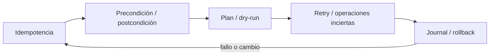
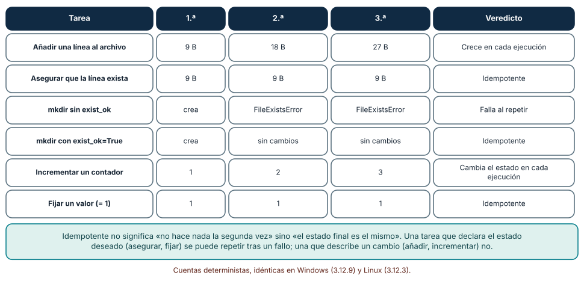
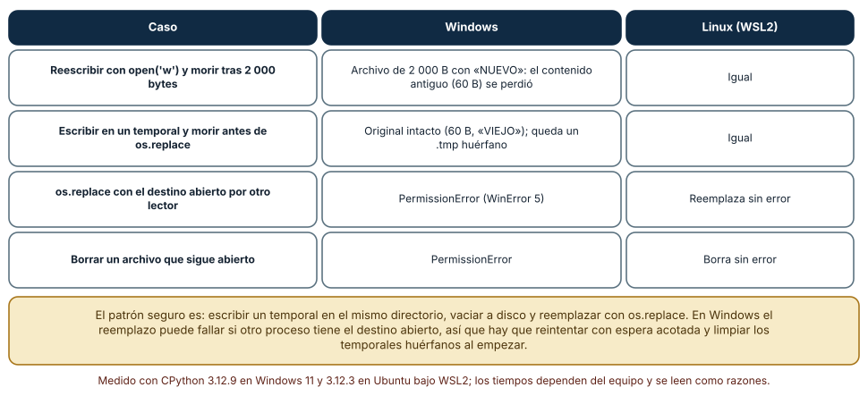
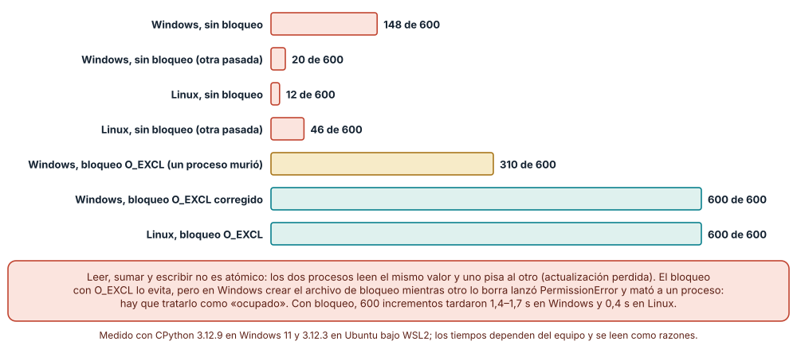

# SE-114 — Scripting repetible y tareas idempotentes

[← SE-113 — CLI, flags, configuración y códigos de salida](https://github.com/vladimiracunadev-create/modern-software-engineering-program/blob/main/classes/part-09-bibliotecas-paquetes-sdk-y-automatizacion/se-113-cli-flags-configuracion-y-codigos-de-salida/README.md) · [↑ Parte 09](https://github.com/vladimiracunadev-create/modern-software-engineering-program/blob/main/classes/part-09-bibliotecas-paquetes-sdk-y-automatizacion/README.md) · [📚 Índice completo](https://github.com/vladimiracunadev-create/modern-software-engineering-program/blob/main/classes/README.md) · [🌐 Portal](https://vladimiracunadev-create.github.io/modern-software-engineering-program/classes/SE-114.html) · [SE-115 — Plugins, extensiones y puntos de integración →](https://github.com/vladimiracunadev-create/modern-software-engineering-program/blob/main/classes/part-09-bibliotecas-paquetes-sdk-y-automatizacion/se-115-plugins-extensiones-y-puntos-de-integracion/README.md)


## Punto profesional y fundamento pedagógico

**Punto profesional.** La clase existe para hacer scripts repetibles mediante precondiciones, detección de estado y efectos idempotentes.

**Por qué aparece aquí.** Se sitúa después de **CLI, flags, configuración y códigos de salida** y antes de **Plugins, extensiones y puntos de integración**: convierte el conocimiento anterior en una decisión observable que la clase siguiente podrá reutilizar. La continuidad se comprueba en el artefacto, no por compartir vocabulario.

**Error conceptual que debe corregir.** Suponer que ejecutar dos veces es seguro porque la primera terminó.

**Secuencia de aprendizaje.** Antes de leer la solución, el estudiante predice el resultado del caso normal y del error conceptual anterior. Luego explica un caso resuelto paso a paso, construye un contraejemplo que cambie la decisión y, sin consultar el texto, reconstruye el mecanismo y lo aplica a una entrada nueva. La secuencia usa predicción, explicación propia, contraste y recuperación. [ICAP](https://icap.education.asu.edu/research) distingue participación de construcción de conocimiento; [How People Learn II](https://nap.nationalacademies.org/catalog/24783/how-people-learn-ii-learners-contexts-and-cultures) exige conectar conocimiento previo, contexto y transferencia; la [práctica de recuperación](https://pubmed.ncbi.nlm.nih.gov/16507066/) respalda producir de nuevo la explicación tras una demora; y [Education for Life and Work](https://nap.nationalacademies.org/resource/13398/dbasse_084153.pdf) exige devolución que explique la causa del error.

**Evidencia de aprendizaje.** Idempotence.md con estado inicial, dos ejecuciones, fallo intermedio y recuperación. Debe contener predicción previa, observación, explicación causal, contraejemplo, criterio de aceptación y una nota de qué dato haría cambiar la conclusión.

**Límite de la conclusión.** Idempotencia local no implica atomicidad ni seguridad concurrente.

### Trazabilidad fuente → afirmación

| Fuente primaria u oficial | Afirmación que respalda | Lo que no prueba |
|---|---|---|
| [Python Standard Library](https://docs.python.org/3/library/index.html) | Argparse, importlib.metadata, subprocess y apis de automatización; autoridad: Python Software Foundation | No demuestra por sí sola que el artefacto del estudiante sea correcto. |
| [pylock.toml Specification](https://packaging.python.org/en/latest/specifications/pylock-toml/) | Lock files para instalaciones reproducibles y selección por entorno; autoridad: Python Packaging Authority | No demuestra por sí sola que el artefacto del estudiante sea correcto. |
| [Python subprocess](https://docs.python.org/3/library/subprocess.html) | define creación, streams y códigos de procesos automatizados | No demuestra por sí sola que el artefacto del estudiante sea correcto. |

## Antes de empezar

Esta clase continúa el **producto reutilizable con SDK y CLI de la Parte 09**. Recupera la evidencia de la clase anterior, añade una decisión propia de **Scripting repetible y tareas idempotentes** y deja un artefacto que la clase siguiente deberá consumir. La pregunta activa es: **¿Qué debe ocurrir al ejecutar una automatización dos veces, interrumpirla o retomarla?**

## Prerrequisitos

- Haber completado la clase anterior o reconstruir su contrato y evidencia.
- Python 3.11 o posterior, terminal, editor y Git; un segundo runtime es opcional y debe declararse.
- Trabajar con fixtures sintéticos: ninguna observación necesita datos de una persona o sistema real.

## Problema auténtico

El script de bootstrap del producto reutilizable con SDK y CLI agrega la misma configuración en cada ejecución y publica de nuevo tras un timeout cuya respuesta se perdió.

## Objetivos observables

Al terminar podrás explicar los cinco mecanismos de esta clase, predecir su comportamiento antes de ejecutar, construir un caso normal y uno límite, diagnosticar el fallo controlado, comparar una alternativa y entregar evidencia que otra persona pueda reproducir.

## Mapa conceptual



El mapa se lee como una cadena de razonamiento, no como fases obligatorias del runtime. La flecha de retorno indica que un fallo o cambio de requisito obliga a revisar el modelo inicial; no autoriza a parchear solo la última salida.

## Temas y por qué importan

| Tema | Por qué cambia una decisión profesional | Evidencia mínima |
|---|---|---|
| Idempotencia | Una operación es idempotente respecto de su efecto observable si repetir con la misma intención no acumula cambios. | Predicción, traza causal y contraejemplo de **Idempotencia** en `idempotence.md` |
| Precondición y postcondición | Antes de mutar se valida estado, identidad y alcance; después se comprueba resultado. | Predicción, traza causal y contraejemplo de **Precondición y postcondición** en `idempotence.md` |
| Plan y dry-run | Mostrar cambios antes de aplicarlos mejora revisión, siempre que use la misma lógica de decisión. | Predicción, traza causal y contraejemplo de **Plan y dry-run** en `idempotence.md` |
| Retry y operaciones inciertas | Reintentar requiere clasificar error y conocer si el primer intento pudo surtir efecto. | Predicción, traza causal y contraejemplo de **Retry y operaciones inciertas** en `idempotence.md` |
| Journal y rollback | Registrar pasos completados permite reanudar o compensar. | Predicción, traza causal y contraejemplo de **Journal y rollback** en `idempotence.md` |
## Conceptos y decisiones

### 1. Idempotencia

Una operación es idempotente respecto de su efecto observable si repetir con la misma intención no acumula cambios. No significa que no trabaje ni que devuelva exactamente la misma latencia. Crear-si-falta y reemplazar contenido canónico son patrones diferentes.

### 2. Precondición y postcondición

Antes de mutar se valida estado, identidad y alcance; después se comprueba resultado. Un script que solo confía en exit code de subcomando puede dejar estado parcial. Checks deben distinguir ya correcto de fallo.

### 3. Plan y dry-run

Mostrar cambios antes de aplicarlos mejora revisión, siempre que use la misma lógica de decisión. Un dry-run que omite permisos o resolución externa no garantiza éxito. Se etiqueta qué no puede simular.

### 4. Retry y operaciones inciertas

Reintentar requiere clasificar error y conocer si el primer intento pudo surtir efecto. Claves de idempotencia o consulta posterior resuelven resultados inciertos. Backoff con jitter y límite evita amplificar una caída.

### 5. Journal y rollback

Registrar pasos completados permite reanudar o compensar. Rollback no siempre restaura efectos externos; por eso se prefieren cambios atómicos y reversibles. La guía declara punto de no retorno y recuperación manual.

### Idempotencia: repetir sin cambiar el resultado

Se ejecutaron seis tareas tres veces seguidas. Añadir una línea a un archivo lo dejó en 9, 18 y 27 bytes; asegurar que la línea exista lo dejó en 9 bytes cada vez. `mkdir` sin `exist_ok` falló con `FileExistsError` desde la segunda ejecución; con `exist_ok=True` quedó igual. Incrementar un contador dio 1, 2, 3 y fijar un valor (`= 1`) dio 1, 1, 1.

La regla que se extrae no es «no hacer nada la segunda vez» sino «el estado final es el mismo». Las tareas que declaran el estado deseado («asegurar», «fijar», «crear si falta») se pueden repetir tras un fallo parcial; las que describen un cambio («añadir», «incrementar», «enviar») no, a menos que lleven una identidad (un identificador de operación) que permita saber si ya se aplicaron. Un script de automatización se diseña pensando en la ejecución interrumpida y repetida, no solo en la ejecución limpia.



**Cómo leer la figura.** Mira cada fila en horizontal: si las tres columnas son iguales, la tarea es idempotente; si crecen o fallan, no. **Dónde deja de valer:** se midió estado de archivos locales; una tarea sobre un servicio remoto (crear un recurso, enviar un mensaje) necesita además identidad de operación, y su idempotencia depende del servicio.

### Escritura atómica: nunca dejar un archivo a medias

Se simuló un proceso que muere (`os._exit`) tras escribir 2 000 bytes. Con la reescritura directa (`open(p, 'w')`), el archivo quedó con 2 000 bytes del contenido nuevo y perdió el antiguo (60 bytes). Con el patrón «escribir un temporal y reemplazar», el proceso murió antes del reemplazo: el original quedó intacto y solo sobró un `.tmp` huérfano. Es lo mismo en Windows y Linux.

El reemplazo (`os.replace`) tiene diferencias de plataforma importantes. Con el destino abierto por otro lector, Windows lanzó `PermissionError` (WinError 5) y Linux reemplazó sin error; borrar un archivo abierto también falló en Windows y funcionó en Linux. La receta completa: escribir el temporal en el mismo directorio, vaciar el búfer, reemplazar y, en Windows, reintentar con una espera acotada ante `PermissionError`; al arrancar, limpiar temporales huérfanos conocidos. La atomicidad ante un corte de energía requiere además `fsync`, que no se midió aquí.



**Cómo leer la figura.** Compara las dos primeras filas: el mismo fallo, dos destinos distintos para el archivo. Las dos últimas son diferencias de plataforma. **Dónde deja de valer:** el corte fue una terminación abrupta del proceso, no un apagón; sin `fsync` el contenido puede perderse aunque `os.replace` haya sido atómico. En sistemas de archivos de red las garantías cambian.

### Actualización perdida: dos procesos, un contador

Dos procesos sumaron 300 veces cada uno a un contador de archivo (esperado: 600). Sin bloqueo, el valor final fue 148 y 20 en dos pasadas en Windows y 12 y 46 en Linux: cada proceso leía, sumaba y escribía, y el otro pisaba lo escrito (actualización perdida). Con un archivo de bloqueo creado con `os.open(..., O_CREAT | O_EXCL)`, el resultado fue 600 en Linux. En Windows el primer intento dio 310: un proceso murió con `PermissionError` al intentar crear el bloqueo justo cuando el otro lo borraba. Tratando `PermissionError` como «ocupado» el resultado fue 600, en 1,4–1,7 s frente a 0,4 s en Linux.

Dos enseñanzas: el fallo sin bloqueo no es raro ni raro de ver (en doce pasadas en Windows y cuatro en Linux se perdió entre 47 % y 98 % de los incrementos), y un bloqueo mal manejado en una plataforma puede crear un fallo nuevo. Un script que puede ejecutarse dos veces a la vez (cron, CI, dos terminales) necesita exclusión mutua, o escribir en lugares distintos, o una operación atómica del lado del servicio. Y todo bloqueo necesita una política para el bloqueo huérfano: un proceso que muere con el archivo de bloqueo creado deja a los demás esperando.



**Cómo leer la figura.** Compara el largo de las barras con el esperado (600). Las barras de oro y teal son la historia del bloqueo en Windows. **Dónde deja de valer:** el contador se leyó y escribió con `open` normal; no se midió `fcntl.flock` ni `msvcrt.locking`, que son bloqueos del sistema operativo y no dejan archivos huérfanos. Los valores sin bloqueo cambian en cada pasada: se informa el rango, no una cifra.

## Definiciones de trabajo

- **idempotencia:** una operación es idempotente respecto de su efecto observable si repetir con la misma intención no acumula cambios.
- **precondición y postcondición:** antes de mutar se valida estado, identidad y alcance; después se comprueba resultado.
- **plan y dry-run:** mostrar cambios antes de aplicarlos mejora revisión, siempre que use la misma lógica de decisión.
- **retry y operaciones inciertas:** reintentar requiere clasificar error y conocer si el primer intento pudo surtir efecto.
- **journal y rollback:** registrar pasos completados permite reanudar o compensar.

Las definiciones son operativas para el producto reutilizable con SDK y CLI. No convierten términos con historia más amplia en sinónimos y deben contrastarse con la documentación primaria enlazada al final.

## Ejemplo mínimo

```python
desired = render_config(input)
current = path.read_text() if path.exists() else None
if current != desired:
    atomic_write(path, desired)
assert path.read_text() == desired
```

Antes de ejecutar, predice estado, resultado y error. Después registra versión, comando y salida. Si el fragmento es pseudocódigo o pertenece a otro lenguaje, etiquétalo como tal y no afirmes que fue ejecutado.

## Ejemplo profesional

En el producto reutilizable con SDK y CLI, un release contiene contrato público, artefactos inmutables, dependencias, procedencia, ejemplos, errores y ruta de migración. La implementación de esta clase debe conservar ese contrato aunque cambie la forma interna. El caso profesional no pregunta únicamente si produce una salida: pregunta quién puede producirla, qué estado observa, cómo falla y qué rastro permite disputar una decisión incorrecta.

Compara el caso normal con autorización falsa, evidencia incompleta, empate y repetición. Un mecanismo es apropiado cuando esas diferencias quedan visibles y localizadas; es peligroso cuando dependen de orden accidental, estado oculto o una convención que el consumidor no puede conocer.

## Práctica guiada

1. Copia el contrato de entrada y salida antes de escribir implementación.
2. Predice el caso normal y un límite; identifica la invariante que no puede romperse.
3. Implementa la versión mínima sin I/O dentro del núcleo.
4. Ejecuta el caso y conserva comando, versión y salida bajo `evidence/`.
5. Introduce el fallo controlado, reduce la reproducción y formula dos hipótesis rivales.
6. Corrige la causa, añade regresión y ejecuta el conjunto completo.
7. Compara con otro paradigma o lenguaje indicando qué semántica se preserva.

## Ejercicios

1. **Seis tareas:** implementa «añadir», «asegurar», `mkdir` con y sin `exist_ok`, «incrementar» y «fijar»; ejecútalas tres veces y construye la tabla de estados; marca las idempotentes.
2. **Corte controlado:** escribe un script que muere con `os._exit` tras escribir parte del contenido; compáralo con la versión de temporal y `os.replace`, y registra qué contenido queda en cada caso.
3. **Plataformas:** abre un archivo en un proceso y prueba `os.replace` y `unlink` sobre él desde otro; registra el resultado en tu sistema operativo y escribe la política de reintentos que adoptarías.
4. **Actualización perdida:** lanza dos procesos que incrementen un contador 300 veces; repite tres pasadas sin bloqueo, luego con `O_EXCL`, y registra valor final y tiempo; añade el tratamiento de `PermissionError` y de un bloqueo huérfano.

## Reto verificable

Entrega implementación, fixtures, pruebas y un informe corto. Se aprueba si otra persona ejecuta desde checkout limpio, obtiene los mismos resultados y puede relacionar cada rama o transformación con una regla del dominio. No se aprueba por cantidad de archivos ni por usar la sintaxis característica del paradigma.

## Caso conductor

El producto reutilizable con SDK y CLI empaqueta el motor de la biblioteca de estructuras y algoritmos como `engineering_sdk`, expone `choose_next`, una CLI y un punto de extensión. Ejecuta instalación limpia, entrada válida, configuración ausente, plugin incompatible y actualización entre dos versiones. Cambia después una sola regla o condición y revisa qué archivos, pruebas y trazas debieron modificarse. Esa superficie de cambio alimenta el proyecto final de la parte.

## Preguntas frecuentes

### ¿Idempotente es lo mismo que «seguro de repetir»?

Casi, pero no siempre. Idempotente significa que el estado final es el mismo; una tarea puede ser idempotente y seguir emitiendo efectos (enviar un aviso cada vez). Define qué efectos son aceptables al repetir.

### ¿Por qué no basta con `open(p, 'w')`?

Porque trunca el archivo antes de escribir: si el proceso muere a mitad, el contenido antiguo ya se perdió. En el experimento quedaron 2 000 bytes del contenido nuevo y los 60 del antiguo desaparecieron.

### ¿`os.replace` es atómico en Windows?

Es una sola operación del sistema, pero puede fallar con `PermissionError` si otro proceso tiene el destino abierto. Hay que reintentar con espera acotada y registrar el fallo; en Linux el mismo caso funcionó.

### ¿Necesito un bloqueo si mi script se ejecuta una vez al día?

Si puede solaparse con otra ejecución (reintento, dos máquinas, ejecución manual), sí. Sin bloqueo se perdió hasta 98 % de los incrementos. Si no puede solaparse, declara esa suposición y detéctala.

## Fallo controlado y diagnóstico

Simula timeout después de publicar pero antes de recibir respuesta. Reintentar crea duplicado. Añade idempotency key o consulta por versión/hashes antes de repetir.

Registra síntoma, entrada mínima, hipótesis, observación que descarta cada hipótesis, causa, corrección y prueba de regresión. No cambies simultáneamente implementación, fixture y expectativa.

Ejecuta dos copias del script que incrementa un contador de archivo al mismo tiempo. **Síntoma:** el valor final es mucho menor que el esperado y cambia en cada pasada (148, 20, 16 y 86 de 600 en cuatro pasadas en Windows). **Hipótesis rivales:** (a) el disco pierde escrituras; (b) los procesos se pisan al leer-modificar-escribir. **Prueba:** añade un bloqueo `O_EXCL` y repite: el resultado es 600; sin tratar `PermissionError` en Windows, un proceso murió y el total fue 310, lo que confirma que el bloqueo mismo necesita cuidado. **Conclusión:** la causa es la actualización no atómica; corrección: exclusión mutua con manejo de «ocupado» y política de bloqueo huérfano; regresión: una prueba que lanza dos procesos y exige 600. No cambies a la vez el algoritmo del bloqueo y el número de incrementos.

## Errores comunes y cómo corregirlos

| Síntoma | Causa probable | Corrección |
|---|---|---|
| Al repetir el script el archivo de configuración crece | Se añade en vez de asegurar | Leer el estado, comparar y escribir solo si difiere |
| `FileExistsError` al reintentar tras un fallo | `mkdir` o creación sin tolerar existencia | `exist_ok=True` y una comprobación del estado deseado |
| Un archivo de configuración queda truncado tras un corte | Escritura directa sin temporal | Temporal en el mismo directorio y `os.replace`; limpiar huérfanos al arrancar |
| El script falla solo en Windows con `PermissionError` al reemplazar | El destino está abierto por otro proceso | Reintentos acotados, cierre explícito de archivos y mensaje claro |
| El resultado final cambia entre ejecuciones concurrentes | Leer-modificar-escribir sin exclusión | Bloqueo con `O_EXCL` (tratando `PermissionError` como ocupado) o bloqueo del sistema |

## Entorno y archivos clave

```text
work/SE-114/
├── README.md
├── engineering_sdk/
│   ├── domain.py
│   └── se_114.py
├── fixtures/cases.json
├── tests/test_se_114.py
└── evidence/diagnosis.md
```

El `README` declara plataforma, runtimes, comandos, limpieza y límites. Evita dependencias externas cuando la biblioteca estándar permita observar el mecanismo; si agregas una, fija procedencia y versión.

## Seguridad, ética y accesibilidad

- la autorización forma parte del dominio y no se infiere por ausencia de rechazo;
- no uses `eval`, reglas descargadas ni serialización insegura;
- limita colas, recursión, tamaño de entrada y tiempo de evaluación;
- redacta trazas y conserva una explicación textual además de color o animación;
- una recomendación automatizada debe poder revisarse, impugnarse y corregirse;
- respeta licencias de ejemplos y atribuye adaptaciones.

## Puente hacia el trabajo con agentes

Un agente que automatiza una tarea escribe la ruta feliz y la prueba una vez en un directorio vacío. Pídele cuatro cosas ejecutables: que la tarea se ejecute tres veces y deje el mismo estado, que la escritura sea por temporal y reemplazo, que exista un modo `--dry-run` que muestre el cambio sin aplicarlo, y que haya una prueba con dos procesos concurrentes. Revisa especialmente el borrado y el reemplazo en Windows y que el agente no «resuelva» un `PermissionError` con `sleep` fijo sin límite ni registro.

## Transferencia

Traslada un fixture al segundo modelo, herramienta, plataforma o lenguaje. Compara representación de ausencia, error, mutabilidad, orden y cancelación. La transferencia está lograda cuando el contrato se conserva y las diferencias están explicadas, no cuando la interfaz se parece.

## Evaluación y evidencia

| Criterio | Evidencia para aprobar |
|---|---|
| comprensión | explicación causal de los cinco mecanismos |
| corrección | normal, límite, inválido y contraejemplo |
| diseño | estado, efectos y contrato localizables |
| diagnóstico | reproducción mínima y regresión |
| transferencia | comparación semántica, no estética |
| reproducibilidad | versiones, comandos, salida y límites |


## Fuentes


- [Semantic Versioning 2.0.0](https://semver.org/spec/v2.0.0.html) — Api pública, versiones, prereleases y compatibilidad declarada; autoridad: Semantic Versioning project.
- [Python Packaging User Guide: Specifications](https://packaging.python.org/en/latest/specifications/) — Metadata, nombres, versiones, dependencias y artefactos de distribución; autoridad: Python Packaging Authority.
- [pylock.toml Specification](https://packaging.python.org/en/latest/specifications/pylock-toml/) — Lock files para instalaciones reproducibles y selección por entorno; autoridad: Python Packaging Authority.
- [Python Standard Library](https://docs.python.org/3/library/index.html) — Argparse, importlib.metadata, subprocess y apis de automatización; autoridad: Python Software Foundation.
- [SPDX Specification 3.0](https://spdx.dev/use/specifications/) — Identificadores, sbom y procedencia legible por máquinas; autoridad: Linux Foundation.
- [REUSE Specification](https://reuse.software/spec-3.3/) — Declaración inequívoca y verificable de copyright y licencias por archivo; autoridad: Free Software Foundation Europe.

Cada fuente respalda el mecanismo indicado; ninguna demuestra que la implementación del producto reutilizable con SDK y CLI sea correcta. Esa afirmación depende de fixtures, pruebas, trazas y revisión reproducible.

- [Python: `os.replace`](https://docs.python.org/3/library/os.html) — contrato de reemplazo atómico y sus salvedades por plataforma.
- [Python: `tempfile`](https://docs.python.org/3/library/tempfile.html) — creación segura de archivos temporales.
- [rename(2), manual de Linux](https://man7.org/linux/man-pages/man2/rename.2.html) — atomicidad de `rename` en el mismo sistema de archivos.
- [flock(2), manual de Linux](https://man7.org/linux/man-pages/man2/flock.2.html) — bloqueos consultivos del sistema operativo, alternativa al archivo de bloqueo.
- [Microsoft: MoveFileExW](https://learn.microsoft.com/en-us/windows/win32/api/winbase/nf-winbase-movefileexw) — semántica de mover y reemplazar en Windows, base de `os.replace`.
- [Python: `pathlib`](https://docs.python.org/3/library/pathlib.html) — `mkdir(exist_ok=True)` y operaciones sobre rutas.

## Límites y siguiente paso

La automatización administra capacidades conocidas. La siguiente clase permite extensiones de terceros sin entregarles accidentalmente toda la autoridad del proceso.

## Glosario

- **idempotencia:** una operación es idempotente respecto de su efecto observable si repetir con la misma intención no acumula cambios.
- **precondición y postcondición:** antes de mutar se valida estado, identidad y alcance; después se comprueba resultado.
- **plan y dry-run:** mostrar cambios antes de aplicarlos mejora revisión, siempre que use la misma lógica de decisión.
- **retry y operaciones inciertas:** reintentar requiere clasificar error y conocer si el primer intento pudo surtir efecto.
- **journal y rollback:** registrar pasos completados permite reanudar o compensar.

---

[← SE-113 — CLI, flags, configuración y códigos de salida](https://github.com/vladimiracunadev-create/modern-software-engineering-program/blob/main/classes/part-09-bibliotecas-paquetes-sdk-y-automatizacion/se-113-cli-flags-configuracion-y-codigos-de-salida/README.md) · [↑ Parte 09](https://github.com/vladimiracunadev-create/modern-software-engineering-program/blob/main/classes/part-09-bibliotecas-paquetes-sdk-y-automatizacion/README.md) · [📚 Índice completo](https://github.com/vladimiracunadev-create/modern-software-engineering-program/blob/main/classes/README.md) · [🌐 Portal](https://vladimiracunadev-create.github.io/modern-software-engineering-program/classes/SE-114.html) · [SE-115 — Plugins, extensiones y puntos de integración →](https://github.com/vladimiracunadev-create/modern-software-engineering-program/blob/main/classes/part-09-bibliotecas-paquetes-sdk-y-automatizacion/se-115-plugins-extensiones-y-puntos-de-integracion/README.md)
