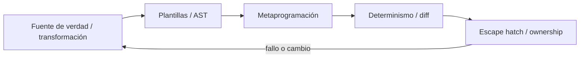
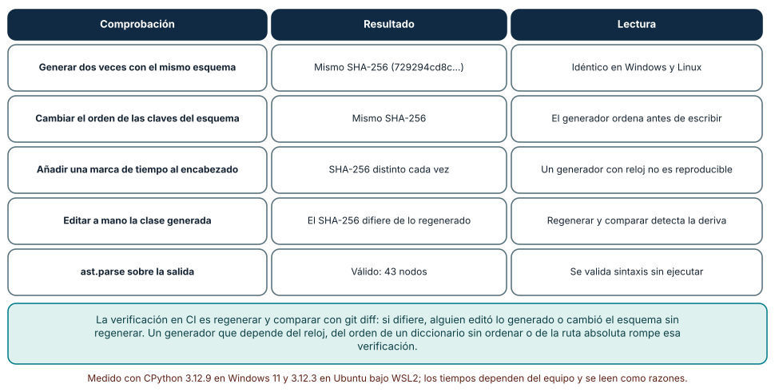
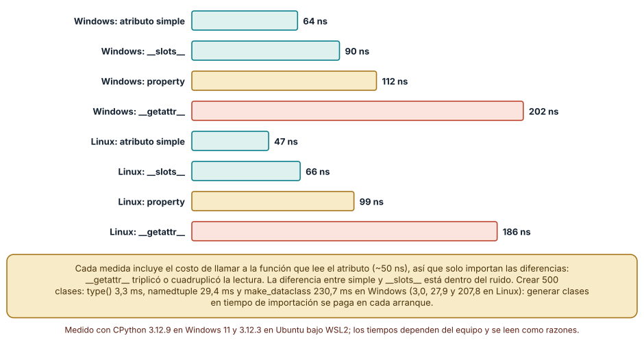
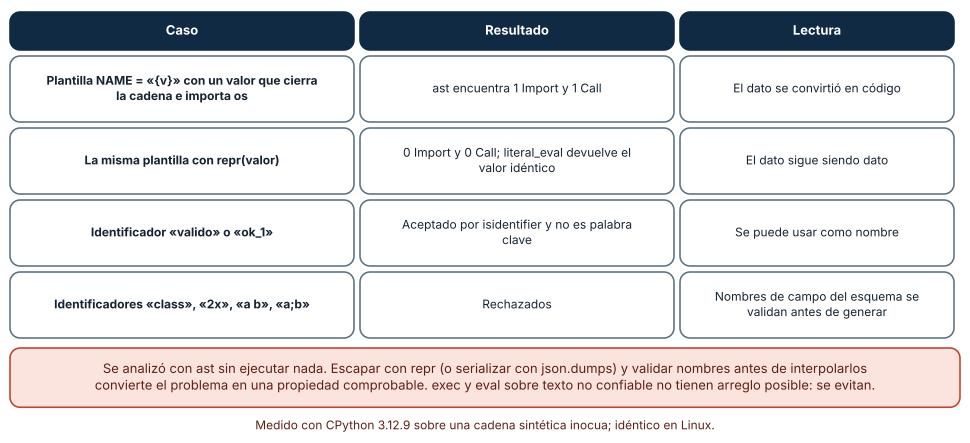

# SE-116 — Generación de código y metaprogramación

[← SE-115 — Plugins, extensiones y puntos de integración](https://github.com/vladimiracunadev-create/modern-software-engineering-program/blob/main/classes/part-09-bibliotecas-paquetes-sdk-y-automatizacion/se-115-plugins-extensiones-y-puntos-de-integracion/README.md) · [↑ Parte 09](https://github.com/vladimiracunadev-create/modern-software-engineering-program/blob/main/classes/part-09-bibliotecas-paquetes-sdk-y-automatizacion/README.md) · [📚 Índice completo](https://github.com/vladimiracunadev-create/modern-software-engineering-program/blob/main/classes/README.md) · [🌐 Portal](https://vladimiracunadev-create.github.io/modern-software-engineering-program/classes/SE-116.html) · [SE-117 — Licencias, procedencia y reutilización →](https://github.com/vladimiracunadev-create/modern-software-engineering-program/blob/main/classes/part-09-bibliotecas-paquetes-sdk-y-automatizacion/se-117-licencias-procedencia-y-reutilizacion/README.md)


## Punto profesional y fundamento pedagógico

**Punto profesional.** La clase existe para tratar generación de código y metaprogramación como transformación con fuente de verdad y salida revisable.

**Por qué aparece aquí.** Se sitúa después de **Plugins, extensiones y puntos de integración** y antes de **Licencias, procedencia y reutilización**: convierte el conocimiento anterior en una decisión observable que la clase siguiente podrá reutilizar. La continuidad se comprueba en el artefacto, no por compartir vocabulario.

**Error conceptual que debe corregir.** Editar generado a mano o esconder cambios semánticos en plantillas.

**Secuencia de aprendizaje.** Antes de leer la solución, el estudiante predice el resultado del caso normal y del error conceptual anterior. Luego explica un caso resuelto paso a paso, construye un contraejemplo que cambie la decisión y, sin consultar el texto, reconstruye el mecanismo y lo aplica a una entrada nueva. La secuencia usa predicción, explicación propia, contraste y recuperación. [ICAP](https://icap.education.asu.edu/research) distingue participación de construcción de conocimiento; [How People Learn II](https://nap.nationalacademies.org/catalog/24783/how-people-learn-ii-learners-contexts-and-cultures) exige conectar conocimiento previo, contexto y transferencia; la [práctica de recuperación](https://pubmed.ncbi.nlm.nih.gov/16507066/) respalda producir de nuevo la explicación tras una demora; y [Education for Life and Work](https://nap.nationalacademies.org/resource/13398/dbasse_084153.pdf) exige devolución que explique la causa del error.

**Evidencia de aprendizaje.** Generation-report.md con entrada, generador, diff determinista y regeneración limpia. Debe contener predicción previa, observación, explicación causal, contraejemplo, criterio de aceptación y una nota de qué dato haría cambiar la conclusión.

**Límite de la conclusión.** Determinismo de salida no demuestra corrección del generador.

### Trazabilidad fuente → afirmación

| Fuente primaria u oficial | Afirmación que respalda | Lo que no prueba |
|---|---|---|
| [Python Standard Library](https://docs.python.org/3/library/index.html) | Argparse, importlib.metadata, subprocess y apis de automatización; autoridad: Python Software Foundation | No demuestra por sí sola que el artefacto del estudiante sea correcto. |
| [Python Packaging User Guide: Specifications](https://packaging.python.org/en/latest/specifications/) | Metadata, nombres, versiones, dependencias y artefactos de distribución; autoridad: Python Packaging Authority | No demuestra por sí sola que el artefacto del estudiante sea correcto. |
| [Python ast](https://docs.python.org/3/library/ast.html) | define transformaciones estructuradas de código Python | No demuestra por sí sola que el artefacto del estudiante sea correcto. |

## Antes de empezar

Esta clase continúa el **producto reutilizable con SDK y CLI de la Parte 09**. Recupera la evidencia de la clase anterior, añade una decisión propia de **Generación de código y metaprogramación** y deja un artefacto que la clase siguiente deberá consumir. La pregunta activa es: **¿Cuándo generar código reduce duplicación y cuándo crea una segunda fuente imposible de reconciliar?**

## Prerrequisitos

- Haber completado la clase anterior o reconstruir su contrato y evidencia.
- Python 3.11 o posterior, terminal, editor y Git; un segundo runtime es opcional y debe declararse.
- Trabajar con fixtures sintéticos: ninguna observación necesita datos de una persona o sistema real.

## Problema auténtico

El producto reutilizable con SDK y CLI genera modelos de SDK desde un esquema, pero desarrolladores editan archivos generados. La siguiente ejecución borra arreglos y el runtime diverge del contrato.

## Objetivos observables

Al terminar podrás explicar los cinco mecanismos de esta clase, predecir su comportamiento antes de ejecutar, construir un caso normal y uno límite, diagnosticar el fallo controlado, comparar una alternativa y entregar evidencia que otra persona pueda reproducir.

## Mapa conceptual



El mapa se lee como una cadena de razonamiento, no como fases obligatorias del runtime. La flecha de retorno indica que un fallo o cambio de requisito obliga a revisar el modelo inicial; no autoriza a parchear solo la última salida.

## Temas y por qué importan

| Tema | Por qué cambia una decisión profesional | Evidencia mínima |
|---|---|---|
| Fuente de verdad y transformación | Generar es aplicar una transformación determinista a esquema, plantilla y versión. | Predicción, traza causal y contraejemplo de **Fuente de verdad y transformación** en `generation-report.md` |
| Plantillas y AST | Plantillas concatenan texto y son simples pero frágiles ante escaping o sintaxis; transformar AST preserva estructura con mayor complejidad. | Predicción, traza causal y contraejemplo de **Plantillas y AST** en `generation-report.md` |
| Metaprogramación | Decoradores, macros, reflexión o generación en build modifican comportamiento desde código sobre código. | Predicción, traza causal y contraejemplo de **Metaprogramación** en `generation-report.md` |
| Determinismo y diff | Misma entrada, versión y entorno deben producir salida equivalente. | Predicción, traza causal y contraejemplo de **Determinismo y diff** en `generation-report.md` |
| Escape hatch y ownership | No toda excepción cabe en generador. | Predicción, traza causal y contraejemplo de **Escape hatch y ownership** en `generation-report.md` |
## Conceptos y decisiones

### 1. Fuente de verdad y transformación

Generar es aplicar una transformación determinista a esquema, plantilla y versión. Se declara cuál entrada es canónica y los outputs llevan aviso. Editar el derivado sin cambiar fuente produce drift inevitable.

### 2. Plantillas y AST

Plantillas concatenan texto y son simples pero frágiles ante escaping o sintaxis; transformar AST preserva estructura con mayor complejidad. La técnica depende del cambio. Generar strings desde datos no confiables exige escaping contextual.

### 3. Metaprogramación

Decoradores, macros, reflexión o generación en build modifican comportamiento desde código sobre código. Reducen repetición sistemática, pero desplazan errores y herramientas. La expansión o resultado debe poder inspeccionarse.

### 4. Determinismo y diff

Misma entrada, versión y entorno deben producir salida equivalente. Orden estable, timestamps controlados y formatter fijado reducen ruido. CI regenera y falla si hay diff, revelando fuentes o derivados desactualizados.

### 5. Escape hatch y ownership

No toda excepción cabe en generador. Extensiones parciales, composición o archivos separados permiten código manual sin ser sobrescrito. Un parche postgeneración opaco vuelve el pipeline una secuencia frágil.

### Generación determinista y detección de deriva

Se escribió un generador de clases a partir de un esquema y se comprobaron sus propiedades. Generar dos veces con el mismo esquema produjo el mismo SHA-256 (`729294cd8c…`), y el mismo en Windows y en Linux. Cambiar el orden de las claves del esquema no cambió el resultado, porque el generador ordena antes de escribir. Añadir una marca de tiempo al encabezado hizo que cada generación fuera distinta. Editar a mano la clase generada produjo un hash distinto del regenerado, de modo que «regenerar y comparar» detecta la deriva. `ast.parse` validó la sintaxis de la salida (43 nodos) sin ejecutarla.

La verificación operativa es simple: en CI se regenera y se ejecuta `git diff --exit-code`; si hay diferencia, alguien editó lo generado o cambió el esquema sin regenerar. Para que eso funcione, el generador no puede depender del reloj, del orden de un diccionario sin ordenar, de rutas absolutas ni del nombre de la máquina. Y lo generado debe llevar un encabezado que diga que no se edite y de qué esquema proviene.



**Cómo leer la figura.** Cada fila es una propiedad que el generador debe cumplir y que se puede probar sin ejecutar lo generado. **Dónde deja de valer:** el generador es de cincuenta líneas y escribe una sola forma de clase; uno real también formatea, importa tipos y maneja versiones del esquema. Un formateador que cambie de versión (black, ruff) puede alterar el hash aunque el generador no cambie.

### El costo del dinamismo: leer un atributo y crear clases

Se midió leer un atributo de cuatro formas, incluyendo el costo de llamar a la función que lo lee (unos 50 ns, que no se resta): atributo simple 64 ns, `__slots__` 90 ns, `property` 112 ns y `__getattr__` dinámico 202 ns en Windows; 47, 66, 99 y 186 ns en Linux. El orden estable es que `__getattr__` triplica o cuadruplica el costo de la lectura; la diferencia entre simple y `__slots__` quedó dentro del ruido de la medición.

Crear clases dinámicamente cuesta más: 500 clases con `type()` tardaron 3,3 ms, con `collections.namedtuple` 29,4 ms y con `dataclasses.make_dataclass` 230,7 ms en Windows (3,0, 27,9 y 207,8 ms en Linux). `namedtuple` y `make_dataclass` generan código fuente y lo compilan con `exec`, de ahí el costo. Generar clases en tiempo de importación se paga en cada arranque; generarlas en un paso de construcción y guardar el código resultante mueve el costo al desarrollador y deja algo que se puede leer, revisar y depurar.



**Cómo leer la figura.** Compara las barras de un mismo sistema operativo; las absolutas no son comparables entre sistemas. **Dónde deja de valer:** la medición incluye la llamada de una función, de modo que las razones están comprimidas; una lectura en un bucle interno de CPython real tendría diferencias relativas mayores. No se midió PyPy ni el efecto del caché de atributos de versiones recientes.

### Generar código desde datos: cuando el dato se convierte en código

Una plantilla que inserta un valor entre comillas (`NAME = "{v}"`) con un valor hostil que cierra la cadena y añade `import os` y una llamada produjo, al analizarla con `ast` (sin ejecutar nada), un nodo `Import` y un nodo `Call`: el dato se convirtió en código. Con `repr(valor)` el árbol no tuvo ninguno de los dos y `ast.literal_eval` devolvió exactamente el valor original. Es la forma general de la inyección: mezclar datos y estructura sin escapar.

Los nombres necesitan su propia defensa. `str.isidentifier()` y la lista de `keyword` aceptaron `valido` y `ok_1` y rechazaron `class`, `2x`, `a b` y `a;b`. La política es validar los nombres que vienen del esquema antes de interpolar, escapar los valores con `repr` o serializarlos con `json.dumps`, analizar la salida con `ast` antes de escribirla, y no usar `exec` o `eval` sobre texto de origen no confiable: no hay arreglo posible. La metaprogramación es una herramienta con superficie de ataque; el generador se revisa como código de producción.



**Cómo leer la figura.** Las dos primeras filas son el mismo dato con y sin escape; las dos últimas muestran la validación de nombres. **Dónde deja de valer:** se analizó una cadena sintética inocua y no se ejecutó nada; una inyección real puede explotar contextos distintos (comentarios, f-strings, SQL, HTML) que cada uno exige su propio escape.

## Definiciones de trabajo

- **fuente de verdad y transformación:** generar es aplicar una transformación determinista a esquema, plantilla y versión.
- **plantillas y ast:** plantillas concatenan texto y son simples pero frágiles ante escaping o sintaxis; transformar ast preserva estructura con mayor complejidad.
- **metaprogramación:** decoradores, macros, reflexión o generación en build modifican comportamiento desde código sobre código.
- **determinismo y diff:** misma entrada, versión y entorno deben producir salida equivalente.
- **escape hatch y ownership:** no toda excepción cabe en generador.

Las definiciones son operativas para el producto reutilizable con SDK y CLI. No convierten términos con historia más amplia en sinónimos y deben contrastarse con la documentación primaria enlazada al final.

## Ejemplo mínimo

```shell
python tools/generate.py --schema contract.json --output src/engineering_sdk/models.py
python -m compileall -q src
git diff --exit-code -- src/engineering_sdk/models.py
```

Antes de ejecutar, predice estado, resultado y error. Después registra versión, comando y salida. Si el fragmento es pseudocódigo o pertenece a otro lenguaje, etiquétalo como tal y no afirmes que fue ejecutado.

## Ejemplo profesional

En el producto reutilizable con SDK y CLI, un release contiene contrato público, artefactos inmutables, dependencias, procedencia, ejemplos, errores y ruta de migración. La implementación de esta clase debe conservar ese contrato aunque cambie la forma interna. El caso profesional no pregunta únicamente si produce una salida: pregunta quién puede producirla, qué estado observa, cómo falla y qué rastro permite disputar una decisión incorrecta.

Compara el caso normal con autorización falsa, evidencia incompleta, empate y repetición. Un mecanismo es apropiado cuando esas diferencias quedan visibles y localizadas; es peligroso cuando dependen de orden accidental, estado oculto o una convención que el consumidor no puede conocer.

## Práctica guiada

1. Copia el contrato de entrada y salida antes de escribir implementación.
2. Predice el caso normal y un límite; identifica la invariante que no puede romperse.
3. Implementa la versión mínima sin I/O dentro del núcleo.
4. Ejecuta el caso y conserva comando, versión y salida bajo `evidence/`.
5. Introduce el fallo controlado, reduce la reproducción y formula dos hipótesis rivales.
6. Corrige la causa, añade regresión y ejecuta el conjunto completo.
7. Compara con otro paradigma o lenguaje indicando qué semántica se preserva.

## Ejercicios

1. **Determinismo:** escribe un generador de clases desde un esquema; genera dos veces, calcula el hash y comprueba que sea igual; añade una marca de tiempo y observa el cambio; propón la verificación en CI.
2. **Costo de lectura:** mide una lectura de atributo simple, con `__slots__`, `property` y `__getattr__` con `timeit`; calcula razones respecto del simple y decide cuál usarías para un campo conocido.
3. **Crear clases:** mide 500 creaciones con `type`, `namedtuple` y `make_dataclass`; explica la diferencia con lo que hace cada uno y decide si generarías en importación o en construcción.
4. **Inyección en un generador:** escribe una plantilla ingenua, pásale un valor hostil, analiza el resultado con `ast` y cuenta nodos `Import` y `Call`; corrígela con `repr` y añade la validación de nombres.

## Reto verificable

Entrega implementación, fixtures, pruebas y un informe corto. Se aprueba si otra persona ejecuta desde checkout limpio, obtiene los mismos resultados y puede relacionar cada rama o transformación con una regla del dominio. No se aprueba por cantidad de archivos ni por usar la sintaxis característica del paradigma.

## Caso conductor

El producto reutilizable con SDK y CLI empaqueta el motor de la biblioteca de estructuras y algoritmos como `engineering_sdk`, expone `choose_next`, una CLI y un punto de extensión. Ejecuta instalación limpia, entrada válida, configuración ausente, plugin incompatible y actualización entre dos versiones. Cambia después una sola regla o condición y revisa qué archivos, pruebas y trazas debieron modificarse. Esa superficie de cambio alimenta el proyecto final de la parte.

## Preguntas frecuentes

### ¿Debo comitear el código generado?

Depende del consumidor. Si otros lo usan sin tener el generador, sí, con encabezado «generado» y verificación en CI de que está al día. Si se genera en la construcción, no. Lo importante es que haya una sola fuente de verdad y una comprobación.

### ¿Por qué mi generador produce archivos distintos cada vez?

Porque depende de algo que cambia: el reloj, el orden de un diccionario o conjunto sin ordenar, rutas absolutas o variables de entorno. Se midió: con marca de tiempo, el hash cambió en cada ejecución.

### ¿`__getattr__` es siempre mala idea?

No, pero es más lenta y opaca: en el experimento triplicó o cuadruplicó el costo de la lectura y los analizadores estáticos no saben qué atributos existen. Úsala para delegación o compatibilidad, no para esconder campos conocidos.

### ¿Puedo usar `exec` para generar clases a partir de una configuración?

Con configuración que controlas y valida, es técnicamente posible (así lo hace `namedtuple`), pero se pierde la revisión del código resultante. Con datos no confiables no hay forma segura de hacerlo: se evita.

## Fallo controlado y diagnóstico

Incluye fecha actual en cada archivo y CI siempre difiere. Elimina nondeterminismo o colócalo en metadata externa; prueba dos generaciones consecutivas.

Registra síntoma, entrada mínima, hipótesis, observación que descarta cada hipótesis, causa, corrección y prueba de regresión. No cambies simultáneamente implementación, fixture y expectativa.

Edita a mano el archivo generado y vuelve a ejecutar el generador en CI con una comprobación de diferencias. **Síntoma:** el CI marca diferencias, o la edición desaparece al regenerar. **Hipótesis rivales:** (a) el generador no es determinista; (b) el archivo generado fue editado. **Prueba:** genera dos veces sin editar y compara hashes (iguales, `729294cd8c…`); luego edita una línea y compara con la regeneración (distinto). **Conclusión:** el generador es determinista y la causa fue la edición manual; corrección: mover el cambio al esquema o a la plantilla y regenerar; regresión: la comprobación de CI. Si el hash cambiara entre dos generaciones sin edición, la causa sería el reloj o un orden no fijado. No cambies a la vez esquema y plantilla.

## Errores comunes y cómo corregirlos

| Síntoma | Causa probable | Corrección |
|---|---|---|
| El CI marca diferencias en archivos generados que nadie tocó | El generador depende de reloj, orden o ruta | Ordenar entradas, quitar marcas de tiempo y usar rutas relativas |
| Alguien editó el archivo generado y se perdió al regenerar | No hay encabezado ni verificación | Encabezado «no editar», regeneración en CI y `git diff --exit-code` |
| Una cadena del esquema rompe el archivo generado | Se interpoló sin escapar | `repr` o `json.dumps` y análisis con `ast` antes de escribir |
| El arranque es lento y el perfil muestra `exec` | Se generan clases al importar | Generar en la construcción y guardar el resultado |
| Un campo del esquema produce un error de sintaxis | El nombre es palabra clave o no es identificador | Validar con `isidentifier()` y `keyword` y rechazar con un mensaje claro |

## Entorno y archivos clave

```text
work/SE-116/
├── README.md
├── engineering_sdk/
│   ├── domain.py
│   └── se_116.py
├── fixtures/cases.json
├── tests/test_se_116.py
└── evidence/diagnosis.md
```

El `README` declara plataforma, runtimes, comandos, limpieza y límites. Evita dependencias externas cuando la biblioteca estándar permita observar el mecanismo; si agregas una, fija procedencia y versión.

## Seguridad, ética y accesibilidad

- la autorización forma parte del dominio y no se infiere por ausencia de rechazo;
- no uses `eval`, reglas descargadas ni serialización insegura;
- limita colas, recursión, tamaño de entrada y tiempo de evaluación;
- redacta trazas y conserva una explicación textual además de color o animación;
- una recomendación automatizada debe poder revisarse, impugnarse y corregirse;
- respeta licencias de ejemplos y atribuye adaptaciones.

## Puente hacia el trabajo con agentes

Un agente que quiere «reducir repetición» escribe un decorador, una metaclase o un `exec` que genera clases, y lo valida con un ejemplo. Exige que lo generado sea legible y esté bajo control de versiones o que se produzca en un paso de construcción, que haya una comprobación de determinismo (regenerar y comparar) y que los valores y nombres que entran a la plantilla se escapen y validen con una prueba hostil. Pídele que mida el costo de arranque antes y después, porque la metaprogramación suele mover el costo a un lugar donde nadie lo mira.

## Transferencia

Traslada un fixture al segundo modelo, herramienta, plataforma o lenguaje. Compara representación de ausencia, error, mutabilidad, orden y cancelación. La transferencia está lograda cuando el contrato se conserva y las diferencias están explicadas, no cuando la interfaz se parece.

## Evaluación y evidencia

| Criterio | Evidencia para aprobar |
|---|---|
| comprensión | explicación causal de los cinco mecanismos |
| corrección | normal, límite, inválido y contraejemplo |
| diseño | estado, efectos y contrato localizables |
| diagnóstico | reproducción mínima y regresión |
| transferencia | comparación semántica, no estética |
| reproducibilidad | versiones, comandos, salida y límites |


## Fuentes


- [Semantic Versioning 2.0.0](https://semver.org/spec/v2.0.0.html) — Api pública, versiones, prereleases y compatibilidad declarada; autoridad: Semantic Versioning project.
- [Python Packaging User Guide: Specifications](https://packaging.python.org/en/latest/specifications/) — Metadata, nombres, versiones, dependencias y artefactos de distribución; autoridad: Python Packaging Authority.
- [pylock.toml Specification](https://packaging.python.org/en/latest/specifications/pylock-toml/) — Lock files para instalaciones reproducibles y selección por entorno; autoridad: Python Packaging Authority.
- [Python Standard Library](https://docs.python.org/3/library/index.html) — Argparse, importlib.metadata, subprocess y apis de automatización; autoridad: Python Software Foundation.
- [SPDX Specification 3.0](https://spdx.dev/use/specifications/) — Identificadores, sbom y procedencia legible por máquinas; autoridad: Linux Foundation.
- [REUSE Specification](https://reuse.software/spec-3.3/) — Declaración inequívoca y verificable de copyright y licencias por archivo; autoridad: Free Software Foundation Europe.

Cada fuente respalda el mecanismo indicado; ninguna demuestra que la implementación del producto reutilizable con SDK y CLI sea correcta. Esa afirmación depende de fixtures, pruebas, trazas y revisión reproducible.

- [Python: `ast`](https://docs.python.org/3/library/ast.html) — análisis sintáctico sin ejecución, `literal_eval` y recorrido de nodos.
- [Python: `dataclasses`](https://docs.python.org/3/library/dataclasses.html) — `make_dataclass` y las clases de datos generadas.
- [Python: `timeit`](https://docs.python.org/3/library/timeit.html) — medición de fragmentos pequeños y sus límites.
- [OWASP: Injection Flaws](https://owasp.org/www-community/Injection_Flaws) — descripción de la inyección cuando datos no confiables se mezclan con estructura.
- [CWE-94: Improper Control of Generation of Code](https://cwe.mitre.org/data/definitions/94.html) — categoría de debilidad para la generación de código sin control.
- [Python: `hashlib`](https://docs.python.org/3/library/hashlib.html) — funciones de hash usadas para comprobar determinismo.

## Límites y siguiente paso

La generación legalmente reutilizable depende de licencias y procedencia de entradas y plantillas. La siguiente clase hace esas obligaciones visibles y verificables.

## Glosario

- **fuente de verdad y transformación:** generar es aplicar una transformación determinista a esquema, plantilla y versión.
- **plantillas y ast:** plantillas concatenan texto y son simples pero frágiles ante escaping o sintaxis; transformar ast preserva estructura con mayor complejidad.
- **metaprogramación:** decoradores, macros, reflexión o generación en build modifican comportamiento desde código sobre código.
- **determinismo y diff:** misma entrada, versión y entorno deben producir salida equivalente.
- **escape hatch y ownership:** no toda excepción cabe en generador.

---

[← SE-115 — Plugins, extensiones y puntos de integración](https://github.com/vladimiracunadev-create/modern-software-engineering-program/blob/main/classes/part-09-bibliotecas-paquetes-sdk-y-automatizacion/se-115-plugins-extensiones-y-puntos-de-integracion/README.md) · [↑ Parte 09](https://github.com/vladimiracunadev-create/modern-software-engineering-program/blob/main/classes/part-09-bibliotecas-paquetes-sdk-y-automatizacion/README.md) · [📚 Índice completo](https://github.com/vladimiracunadev-create/modern-software-engineering-program/blob/main/classes/README.md) · [🌐 Portal](https://vladimiracunadev-create.github.io/modern-software-engineering-program/classes/SE-116.html) · [SE-117 — Licencias, procedencia y reutilización →](https://github.com/vladimiracunadev-create/modern-software-engineering-program/blob/main/classes/part-09-bibliotecas-paquetes-sdk-y-automatizacion/se-117-licencias-procedencia-y-reutilizacion/README.md)
